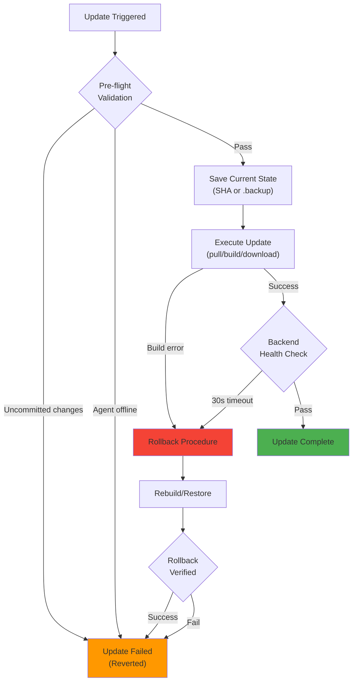
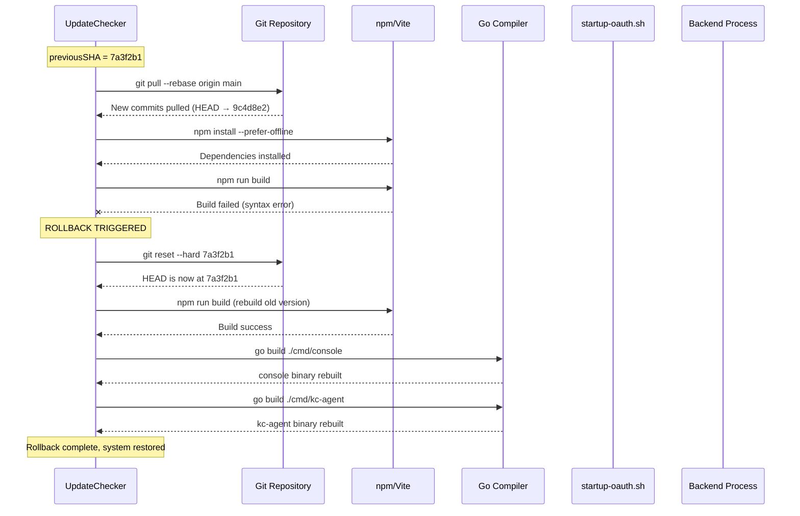
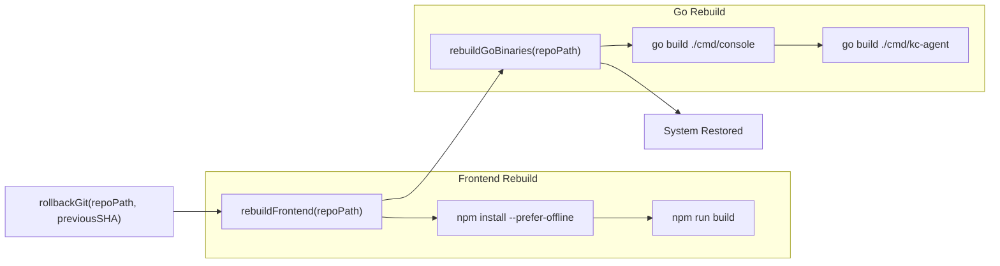
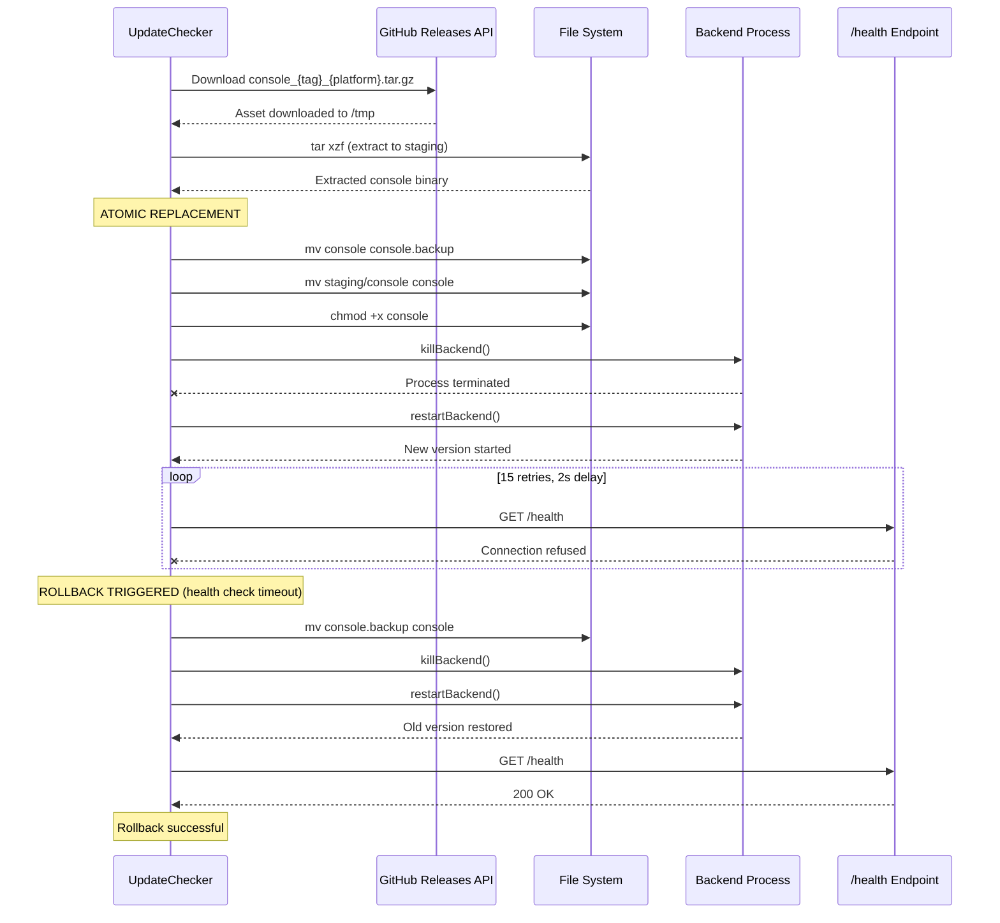
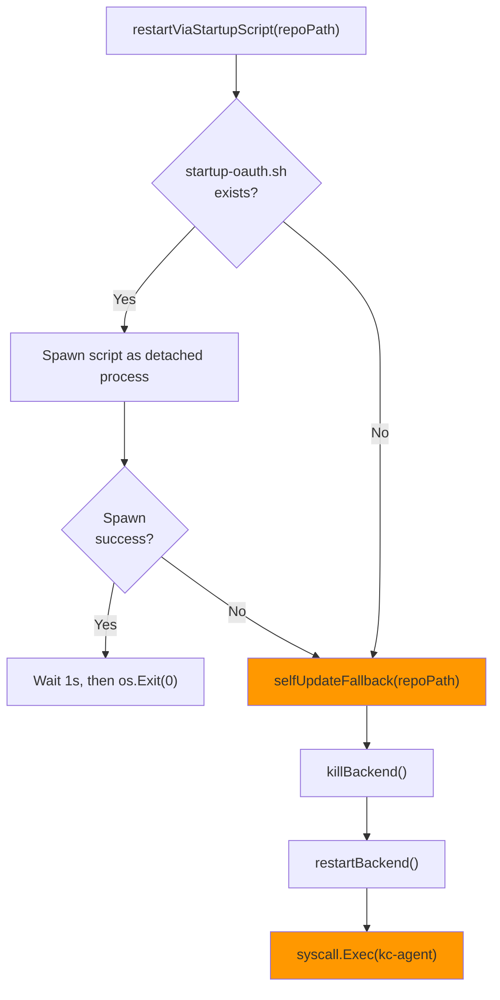
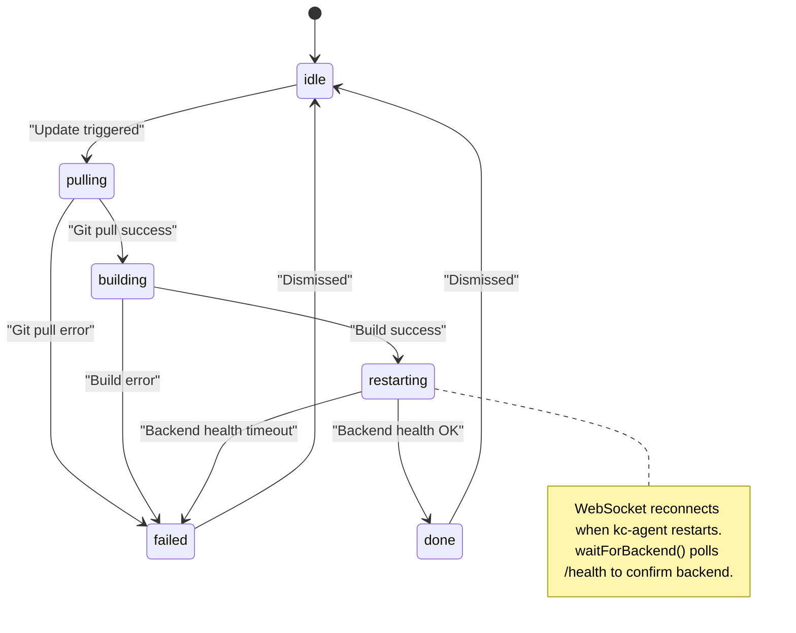
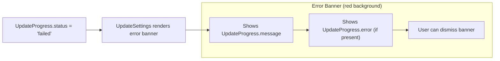
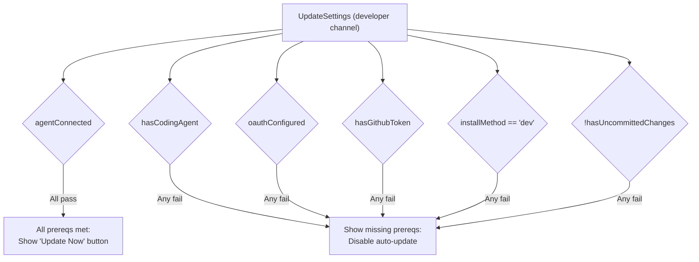

<!-- source: DeepWiki mcp.deepwiki.com · repo kubestellar/console · page 8.4 Rollback & Recovery · fetched 2026-10-27 -->

# Rollback & Recovery

<details>
<summary>Relevant source files</summary>

The following files were used as context for generating this wiki page:

- [pkg/agent/update_checker.go](pkg/agent/update_checker.go)
- [pkg/settings/types.go](pkg/settings/types.go)
- [web/src/components/layout/navbar/UpdateIndicator.tsx](web/src/components/layout/navbar/UpdateIndicator.tsx)
- [web/src/components/settings/Settings.tsx](web/src/components/settings/Settings.tsx)
- [web/src/components/settings/UpdateSettings.tsx](web/src/components/settings/UpdateSettings.tsx)
- [web/src/components/settings/sections/AnalyticsSection.tsx](web/src/components/settings/sections/AnalyticsSection.tsx)
- [web/src/components/settings/sections/index.ts](web/src/components/settings/sections/index.ts)
- [web/src/components/updates/UpdateProgressBanner.tsx](web/src/components/updates/UpdateProgressBanner.tsx)
- [web/src/hooks/useUpdateProgress.ts](web/src/hooks/useUpdateProgress.ts)
- [web/src/hooks/useVersionCheck.tsx](web/src/hooks/useVersionCheck.tsx)
- [web/src/types/updates.ts](web/src/types/updates.ts)

</details>


## Purpose

This document describes the rollback and recovery mechanisms that protect the KubeStellar Console from failed updates. When an auto-update fails during any stage (git pull, npm build, go build, or backend restart), the system automatically reverts to the last known working version to maintain availability.

For information about the update execution flow before rollback scenarios, see [Auto-Update Execution](#8.2). For health check validation that complements these recovery mechanisms, see the health check sections below.

---

## Rollback Architecture Overview

The update system implements **different rollback strategies based on install method**, with pre-flight validation, atomic replacement, and post-update health verification forming a defense-in-depth approach.



**Sources:** [pkg/agent/update_checker.go:274-352](), [pkg/agent/update_checker.go:470-594]()

---

## Developer Channel Rollback (Git-Based)

The **developer channel** updates by pulling from the `main` branch. Rollback is achieved via `git reset --hard` to the previous commit SHA, followed by rebuilding the frontend and Go binaries.

### Rollback Trigger Points

| **Stage** | **Failure Condition** | **Rollback Action** |
|-----------|----------------------|---------------------|
| Git Pull | `git pull --rebase` exits non-zero | N/A (no state changed) |
| Frontend Build | `npm install` or `npm run build` fails | `git reset --hard {previousSHA}` → rebuild |
| Go Build | `go build` for console/kc-agent fails | `git reset --hard {previousSHA}` → rebuild both |
| Backend Restart | `startup-oauth.sh` spawn fails | Fallback to `exec` into old binary |

**Sources:** [pkg/agent/update_checker.go:274-352]()

### Developer Update Flow with Rollback



**Sources:** [pkg/agent/update_checker.go:274-352](), [pkg/agent/update_checker.go:771-831](), [pkg/agent/update_checker.go:833-842]()

### `rollbackGit` Implementation

The `rollbackGit` function performs a hard reset to the specified commit SHA:

```go
func rollbackGit(repoPath, sha string) {
	if sha == "" {
		return
	}
	cmd := exec.Command("git", "reset", "--hard", sha)
	cmd.Dir = repoPath
	if err := cmd.Run(); err != nil {
		log.Printf("[AutoUpdate] Rollback to %s failed: %v", short(sha), err)
	}
}
```

**Key characteristics:**
- Uses `git reset --hard` to discard all working tree changes
- Only called when `previousSHA` is non-empty (saved before update begins)
- Errors are logged but don't prevent subsequent rebuild attempts

**Sources:** [pkg/agent/update_checker.go:833-842]()

### Rebuild After Rollback

After `rollbackGit`, the system rebuilds both frontend and Go binaries to ensure consistency:



**Sources:** [pkg/agent/update_checker.go:309-312](), [pkg/agent/update_checker.go:328-330](), [pkg/agent/update_checker.go:779-831]()

---

## Binary Channel Rollback (Backup-Restore)

The **binary channel** updates by downloading pre-compiled releases. Rollback is achieved by renaming the current binary to `.backup` before replacement, then restoring from backup if the new version fails health checks.

### Binary Update Flow with Health Check Rollback



**Sources:** [pkg/agent/update_checker.go:470-594](), [pkg/agent/update_checker.go:844-858]()

### Backup File Strategy

The binary rollback mechanism uses a `.backup` suffix on the executable:

| **Operation** | **File State** |
|---------------|----------------|
| Before update | `console` (current version) |
| During backup | `console` (current) + `console.backup` (copy) |
| After replacement | `console` (new version) + `console.backup` (old) |
| After health check pass | `console` (new version), `.backup` deleted |
| After rollback | `console` (restored from `.backup`) |

**Sources:** [pkg/agent/update_checker.go:539-544](), [pkg/agent/update_checker.go:554-563](), [pkg/agent/update_checker.go:565-575]()

### Health Check Loop

The `waitForBackendHealth` function polls the backend `/health` endpoint after restart to verify the new version is operational:

```go
func waitForBackendHealth() bool {
	client := &http.Client{Timeout: healthCheckTimeout}
	for i := 0; i < healthCheckRetries; i++ {
		resp, err := client.Get(defaultHealthCheckURL)
		if err == nil && resp.StatusCode == http.StatusOK {
			resp.Body.Close()
			return true
		}
		if resp != nil {
			resp.Body.Close()
		}
		time.Sleep(healthCheckDelay)
	}
	return false
}
```

**Constants:**
- `healthCheckRetries = 15` (max attempts)
- `healthCheckDelay = 2 * time.Second` (between attempts)
- Total timeout: **30 seconds**

**Sources:** [pkg/agent/update_checker.go:22-23](), [pkg/agent/update_checker.go:844-858]()

---

## Restart Mechanism Fallback

When `startup-oauth.sh` is not available or fails to spawn, the system falls back to `selfUpdateFallback`, which uses `syscall.Exec` to replace the kc-agent process atomically.



**Sources:** [pkg/agent/update_checker.go:354-429]()

### `selfUpdateFallback` Implementation

This fallback mechanism restarts the backend and replaces the kc-agent process:

1. **Kill and restart backend** using the rebuilt `console` binary
2. **Replace kc-agent process** via `syscall.Exec` with the same arguments

```go
func (uc *UpdateChecker) selfUpdateFallback(repoPath string) {
	currentBinary, err := os.Executable()
	if err != nil {
		log.Printf("[AutoUpdate] Cannot determine kc-agent binary path: %v", err)
		return
	}

	log.Printf("[AutoUpdate] Falling back to self-update via exec...")

	// Kill and restart backend using the pre-built binary
	uc.killBackend()
	if err := uc.restartBackend(); err != nil {
		log.Printf("[AutoUpdate] Backend restart failed: %v", err)
	}

	// Re-exec with the same args — replaces this process atomically
	if err := syscall.Exec(currentBinary, os.Args, os.Environ()); err != nil {
		log.Printf("[AutoUpdate] exec into new kc-agent failed: %v", err)
	}
	// If exec succeeds, this line is never reached
}
```

**Key points:**
- `syscall.Exec` replaces the current process image atomically (no fork)
- If exec fails, the old kc-agent continues running (graceful degradation)
- Backend is restarted first to ensure it's using the new `console` binary

**Sources:** [pkg/agent/update_checker.go:409-429]()

---

## Frontend Progress Tracking & Error Reporting

The frontend tracks update progress via WebSocket broadcasts from kc-agent, with special handling for the **restart phase** to distinguish between intentional restarts and failures.

### Update Progress State Machine



**Sources:** [web/src/types/updates.ts:74-79](), [web/src/hooks/useUpdateProgress.ts:1-99]()

### WebSocket Reconnection After Restart

When kc-agent restarts, the WebSocket connection is lost. The `useUpdateProgress` hook automatically reconnects and transitions from `restarting` to `done` only after confirming backend health:

```typescript
// After kc-agent reconnects during a restart, the Go backend may still
// be building/starting. Poll /health before showing "done" so the
// "Refresh" link only appears when the backend is actually ready.
async function waitForBackend() {
  setProgress({ status: 'restarting', message: 'Waiting for backend to come up...', progress: 90 })
  for (let i = 0; i < BACKEND_POLL_MAX; i++) {
    try {
      const resp = await fetch('/health', { cache: 'no-store' })
      if (resp.ok) {
        setProgress({ status: 'done', message: 'Update complete — restart successful', progress: 100 })
        return
      }
    } catch {
      // Backend not ready yet
    }
    await new Promise(r => setTimeout(r, BACKEND_POLL_MS))
  }
  // Timed out — show done anyway (backend might be on a different port)
  setProgress({ status: 'done', message: 'Update complete — restart successful', progress: 100 })
}
```

**Polling parameters:**
- `BACKEND_POLL_MAX = 30` (max attempts)
- `BACKEND_POLL_MS = 2000` (2 seconds between attempts)
- Total timeout: **60 seconds**

**Sources:** [web/src/hooks/useUpdateProgress.ts:7-43]()

### Error Display in UI

Failed updates display detailed error messages in the `UpdateSettings` component:



**Example error messages:**
- `"git pull failed: exit status 1"`
- `"Frontend build failed, rolling back..."`
- `"New version unhealthy, rolled back"`
- `"Restart failed, rolled back"`

**Sources:** [web/src/components/settings/UpdateSettings.tsx:505-522]()

### WebSocket Message Format

The kc-agent broadcasts `update_progress` messages via WebSocket:

```json
{
  "type": "update_progress",
  "payload": {
    "status": "failed",
    "message": "Frontend build failed, rolling back...",
    "progress": 30,
    "error": "npm ERR! Exit status 1"
  }
}
```

**Sources:** [pkg/agent/update_checker.go:52-58](), [web/src/hooks/useUpdateProgress.ts:59-67]()

---

## Pre-flight Validation

Before executing any update, the system performs **pre-flight checks** to prevent updates in unsafe conditions:

### Developer Channel Pre-flight Checks

| **Check** | **Condition** | **Action** |
|-----------|--------------|------------|
| Repo path exists | `repoPath != ""` | Fail if empty (not a git repo) |
| Git working tree clean | `git status --porcelain -uno` output empty | Fail if uncommitted changes |
| Main SHA available | GitHub API returns `object.sha` | Fail if API unreachable |

**Sources:** [pkg/agent/update_checker.go:240-258](), [pkg/agent/update_checker.go:758-769]()

### Uncommitted Changes Detection

The `hasUncommittedChanges` function uses `git status --porcelain` to detect modified/staged files:

```go
func hasUncommittedChanges(repoPath string) bool {
	if repoPath == "" {
		return false
	}
	cmd := exec.Command("git", "status", "--porcelain", "-uno")
	cmd.Dir = repoPath
	out, err := cmd.Output()
	if err != nil {
		return true // assume dirty on error
	}
	return len(strings.TrimSpace(string(out))) > 0
}
```

**Why this matters:**
- Prevents `git pull --rebase` from failing due to conflicts
- Ensures `git reset --hard` rollback won't lose user modifications
- UI displays warning in Prerequisites section when detected

**Sources:** [pkg/agent/update_checker.go:758-769](), [web/src/components/settings/UpdateSettings.tsx:357-365]()

### Environment Prerequisites UI

The `UpdateSettings` component displays a checklist of requirements before allowing updates:



**Sources:** [web/src/components/settings/UpdateSettings.tsx:309-389]()

---

## Rollback Success Verification

After a rollback completes, the system verifies the old version is operational before considering the rollback successful.

### Verification Steps

1. **Git reset completes** without error
2. **Frontend rebuild succeeds** (npm install + build)
3. **Go binaries rebuild** successfully
4. **Backend restarts** (optional: via `startup-oauth.sh` or `restartBackend()`)

If any verification step fails, the rollback itself is considered failed, but the system remains in a consistent state (old version restored, even if not fully rebuilt).

### State Tracking

The `UpdateChecker` maintains rollback state via internal fields:

```go
type UpdateChecker struct {
	mu              sync.Mutex
	// ...
	lastUpdateTime  time.Time
	lastUpdateError string
}

func (uc *UpdateChecker) recordError(msg string) {
	uc.mu.Lock()
	uc.lastUpdateError = msg
	uc.lastUpdateTime = time.Now()
	uc.mu.Unlock()
	log.Printf("[AutoUpdate] Error: %s", msg)
}
```

**Rollback error messages:**
- `"git pull failed: {error}"` (no rollback needed)
- `"build failed: {error}"` (rollback triggered)
- `"go build failed: {error}"` (rollback triggered)
- `"restart failed: {error}"` (rollback triggered)
- `"new version failed health check"` (rollback triggered)

**Sources:** [pkg/agent/update_checker.go:40-42](), [pkg/agent/update_checker.go:664-670]()

---

## Summary

The KubeStellar Console update system provides comprehensive rollback protection through:

- **Git-based rollback** for developer installs (commit SHA restoration + rebuild)
- **Binary backup** for release installs (`.backup` file + health check)
- **Health verification** after every update (30s timeout with 15 retries)
- **Pre-flight validation** to prevent updates in unsafe conditions
- **Automatic rebuild** after rollback to ensure consistency
- **Real-time progress tracking** via WebSocket with backend health polling

All rollback operations are **logged** for debugging and **broadcast** to the frontend for user visibility, ensuring the system remains transparent and recoverable even in failure scenarios.

---

