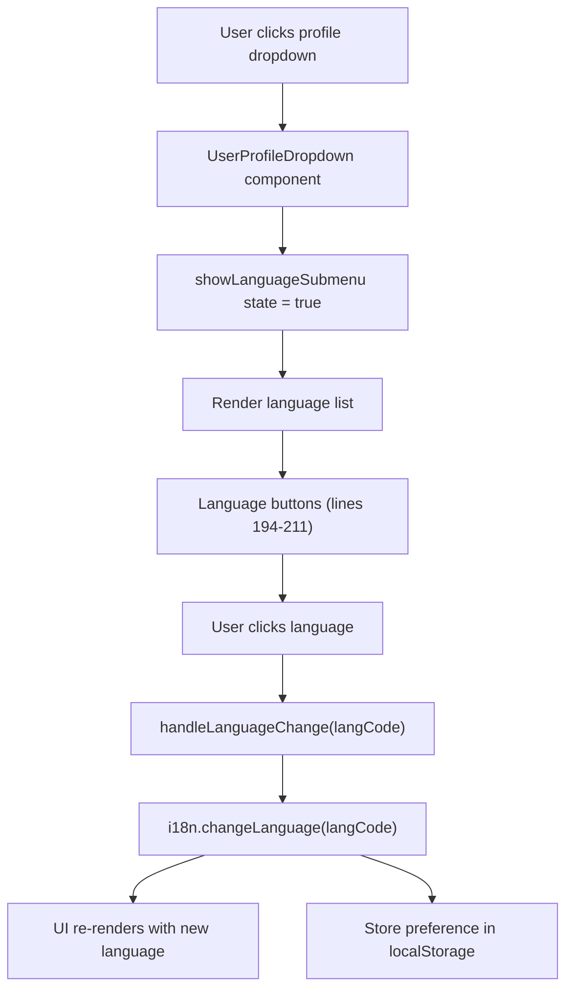
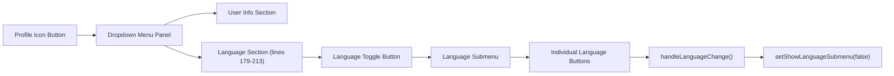
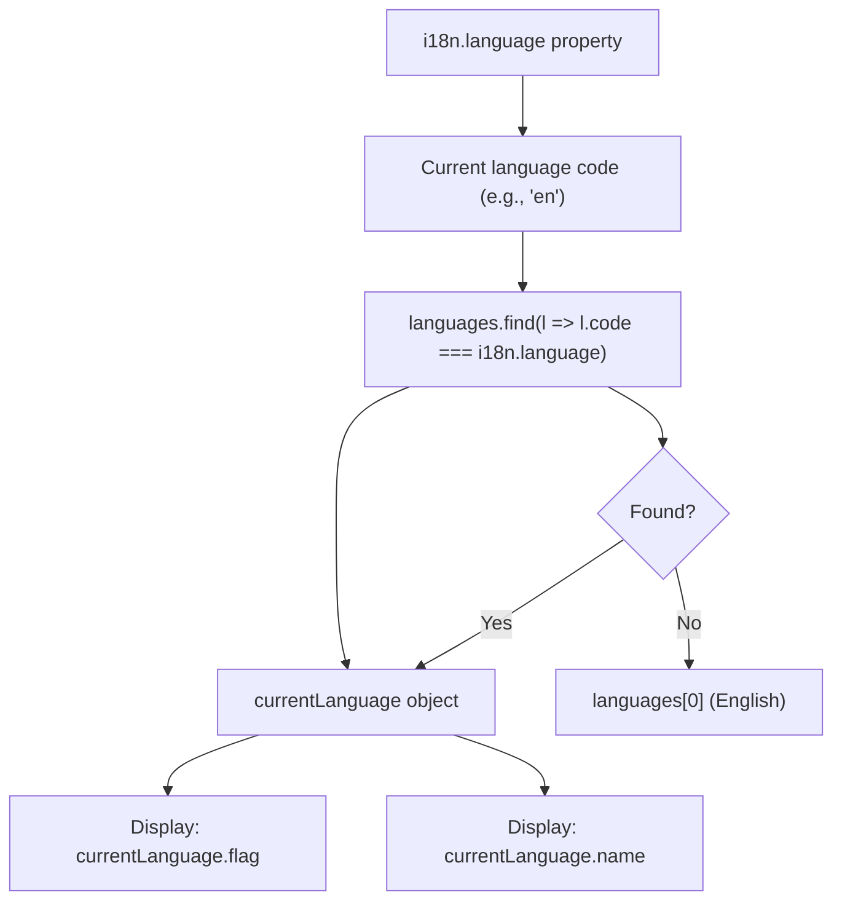
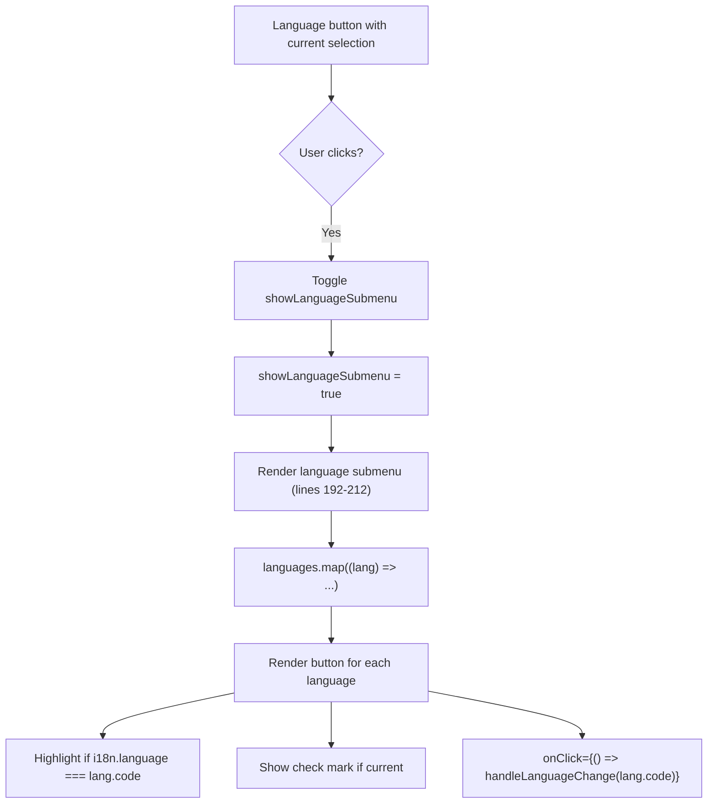
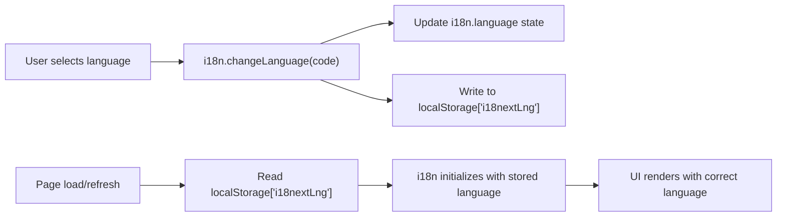

<!-- source: DeepWiki mcp.deepwiki.com · repo kubestellar/console · page 9.2 Supported Languages · fetched 2026-10-27 -->

# Supported Languages

<details>
<summary>Relevant source files</summary>

The following files were used as context for generating this wiki page:

- [web/src/components/layout/UserProfileDropdown.tsx](web/src/components/layout/UserProfileDropdown.tsx)
- [web/src/locales/de/common.json](web/src/locales/de/common.json)
- [web/src/locales/en/common.json](web/src/locales/en/common.json)
- [web/src/locales/es/common.json](web/src/locales/es/common.json)
- [web/src/locales/fr/common.json](web/src/locales/fr/common.json)
- [web/src/locales/hi/common.json](web/src/locales/hi/common.json)
- [web/src/locales/it/common.json](web/src/locales/it/common.json)
- [web/src/locales/ja/common.json](web/src/locales/ja/common.json)
- [web/src/locales/pt/common.json](web/src/locales/pt/common.json)
- [web/src/locales/zh/common.json](web/src/locales/zh/common.json)

</details>


This document describes the multi-language support system in KubeStellar Console. The console supports 9 languages with a comprehensive translation system that covers all UI elements, from navigation labels to error messages.

For information about adding new translation keys or languages, see [Adding New Translations](#9.3). For details about the overall translation structure and key organization, see [Translation Structure](#9.1).

---

## Overview

The console implements internationalization (i18n) using the `react-i18next` library. All user-facing text is externalized into JSON translation files, allowing the UI to be displayed in multiple languages without code changes. Users can switch languages dynamically through the profile dropdown menu, and their preference is persisted in browser storage.

**Sources:** [web/src/locales/en/common.json:1-1000](), [web/src/components/layout/UserProfileDropdown.tsx:1-416]()

---

## Supported Language List

The console currently supports **9 languages**:

| Language | Code | Flag | Translation File |
|----------|------|------|-----------------|
| English | `en` | 🇺🇸 | `web/src/locales/en/common.json` |
| Spanish | `es` | 🇪🇸 | `web/src/locales/es/common.json` |
| French | `fr` | 🇫🇷 | `web/src/locales/fr/common.json` |
| German | `de` | 🇩🇪 | `web/src/locales/de/common.json` |
| Italian | `it` | 🇮🇹 | `web/src/locales/it/common.json` |
| Portuguese | `pt` | 🇧🇷 | `web/src/locales/pt/common.json` |
| Japanese | `ja` | 🇯🇵 | `web/src/locales/ja/common.json` |
| Chinese | `zh` | 🇨🇳 | `web/src/locales/zh/common.json` |
| Hindi | `hi` | 🇮🇳 | `web/src/locales/hi/common.json` |

All translation files follow an identical JSON structure with the same keys, ensuring consistency across languages. English serves as the reference language with complete translations for all UI elements.

**Sources:** [web/src/locales/en/common.json:1-100](), [web/src/locales/es/common.json:1-100](), [web/src/locales/fr/common.json:1-100](), [web/src/locales/de/common.json:1-100](), [web/src/locales/it/common.json:1-100](), [web/src/locales/ja/common.json:1-100](), [web/src/locales/pt/common.json:1-100](), [web/src/locales/zh/common.json:1-100](), [web/src/locales/hi/common.json:1-100]()

---

## Language Selection Mechanism

### User Interface

Users can change the language through the profile dropdown menu in the top-right corner of the console. The language selector displays:
- Current language flag emoji
- Current language name
- Dropdown list of all available languages
- Check mark next to the currently selected language



**Diagram: Language Selection Flow**

**Sources:** [web/src/components/layout/UserProfileDropdown.tsx:179-213]()

### Language Data Structure

The `languages` array in [web/src/lib/i18n]() defines the available languages:

```typescript
interface Language {
  code: string;      // ISO 639-1 language code
  name: string;      // Display name
  flag: string;      // Unicode flag emoji
}
```

The current language is detected by matching `i18n.language` against the `languages` array, with English as the fallback:

```typescript
const currentLanguage = languages.find(l => l.code === i18n.language) || languages[0]
```

**Sources:** [web/src/components/layout/UserProfileDropdown.tsx:43]()

---

## Language Switching Implementation

### Component Integration

The `UserProfileDropdown` component implements the language selector UI:



**Diagram: Language Selector Component Hierarchy**

**Sources:** [web/src/components/layout/UserProfileDropdown.tsx:179-213]()

### Change Handler

The `handleLanguageChange` function implements language switching:

```typescript
const handleLanguageChange = (langCode: string) => {
  i18n.changeLanguage(langCode)        // Update i18next instance
  setShowLanguageSubmenu(false)        // Close submenu
}
```

This triggers:
1. **Immediate UI update**: All components using `useTranslation()` re-render with new translations
2. **Persistence**: `react-i18next` automatically stores the preference in `localStorage`
3. **Subsequent loads**: The language preference is restored on next page load

**Sources:** [web/src/components/layout/UserProfileDropdown.tsx:45-48]()

---

## File Structure and Organization

### Directory Layout

```
web/src/locales/
├── en/
│   └── common.json    (46.65 importance - reference language)
├── es/
│   └── common.json    (10.97 importance)
├── fr/
│   └── common.json    (9.76 importance)
├── de/
│   └── common.json    (10.97 importance)
├── it/
│   └── common.json    (10.97 importance)
├── ja/
│   └── common.json    (10.97 importance)
├── pt/
│   └── common.json    (10.97 importance)
├── zh/
│   └── common.json    (10.97 importance)
└── hi/
    └── common.json    (10.97 importance)
```

Each `common.json` file contains approximately 1,500-2,000 translation keys organized into 15+ top-level domains.

**Sources:** [web/src/locales/en/common.json:1-1000](), [web/src/locales/es/common.json:1-100]()

---

## Translation Key Access Patterns

### Usage in Components

Components access translations using the `useTranslation()` hook:

```typescript
import { useTranslation } from 'react-i18next';

const { t, i18n } = useTranslation();

// Access translations
<span>{t('profile.language')}</span>                    // "Language:"
<span>{t('language.select')}</span>                     // "Select Language"
<button>{t('actions.save')}</button>                    // "Save"
```

### Translation Variables

Many translation strings support variable interpolation:

```typescript
t('profile.language') + ' ' + currentLanguage.name      // "Language: English"
t('settings.agent.agentVersion', { version: '1.2.3' }) // "Agent v1.2.3"
t('time.minutesAgo', { count: 5 })                      // "5m ago"
```

Pluralization is handled automatically based on the `count` parameter:

```typescript
t('settings.agent.clustersCount', { count: 1 })  // "1 cluster"
t('settings.agent.clustersCount', { count: 5 })  // "5 clusters"
```

**Sources:** [web/src/components/layout/UserProfileDropdown.tsx:136-152](), [web/src/locales/en/common.json:231-233]()

---

## Current Language Detection

The console provides multiple ways to detect and display the current language:



**Diagram: Language Detection Logic**

The profile dropdown displays the current language:

```typescript
<span className="text-foreground flex items-center gap-1.5">
  <span>{currentLanguage.flag}</span>    // 🇺🇸
  <span>{currentLanguage.name}</span>    // English
</span>
```

**Sources:** [web/src/components/layout/UserProfileDropdown.tsx:43](), [web/src/components/layout/UserProfileDropdown.tsx:186-189]()

---

## Language Submenu Rendering

The language selector renders a nested menu with the following structure:



**Diagram: Language Submenu Rendering Flow**

Each language button displays:
- Flag emoji (e.g., 🇺🇸)
- Language name (e.g., "English")
- Check mark icon if currently selected
- Purple highlight for current language
- Hover effect for non-current languages

**Sources:** [web/src/components/layout/UserProfileDropdown.tsx:192-212]()

---

## Persistence and State Management

### Storage Mechanism

Language preference is automatically persisted by `react-i18next` to `localStorage` under the key `i18nextLng`. The value is the ISO language code (e.g., `"en"`, `"es"`, `"fr"`).



**Diagram: Language Persistence Flow**

### State Management

The language selection UI maintains its own local state:

- `showLanguageSubmenu`: Controls visibility of the language list dropdown
- `currentLanguage`: Derived from `i18n.language` and the `languages` array
- No Redux or global state required

**Sources:** [web/src/components/layout/UserProfileDropdown.tsx:27](), [web/src/components/layout/UserProfileDropdown.tsx:43]()

---

## Integration with Profile Dropdown

The language selector is integrated into the user profile dropdown as part of the "User details section":

```typescript
// Location in dropdown: Lines 179-213
<div className="relative">
  <button onClick={() => setShowLanguageSubmenu(!showLanguageSubmenu)}>
    {/* Language display with flag and name */}
  </button>
  {showLanguageSubmenu && (
    <div className="mt-1 ml-6 space-y-0.5 border-l-2 border-border pl-3">
      {languages.map((lang) => (
        <button onClick={() => handleLanguageChange(lang.code)}>
          {/* Individual language option */}
        </button>
      ))}
    </div>
  )}
</div>
```

The dropdown appears in the header layout alongside other profile information:
- Email address
- Slack ID
- User role
- Contribution coins
- **Language selector** ← Located here
- Developer panel (on non-demo deployments)

**Sources:** [web/src/components/layout/UserProfileDropdown.tsx:143-214]()

---

## Browser Default Language Detection

On first load (when no language preference is stored), the console respects the browser's default language settings. The `react-i18next` library automatically:

1. Checks `localStorage['i18nextLng']` for stored preference
2. Falls back to `navigator.language` or `navigator.languages[0]`
3. Matches against available languages (en, es, fr, de, it, ja, pt, zh, hi)
4. Falls back to English if no match found

Users can override this automatic detection at any time by selecting a language from the profile dropdown.

**Sources:** [web/src/components/layout/UserProfileDropdown.tsx:45-48]()

---

## Summary Table

| Aspect | Implementation |
|--------|----------------|
| **Total Languages** | 9 (en, es, fr, de, it, ja, pt, zh, hi) |
| **UI Location** | Profile dropdown → Language selector button |
| **State Hook** | `useState<boolean>` for submenu visibility |
| **Translation Hook** | `useTranslation()` from `react-i18next` |
| **Change Function** | `i18n.changeLanguage(langCode)` |
| **Persistence** | `localStorage['i18nextLng']` (automatic) |
| **Fallback Language** | English (`en`) |
| **Translation Files** | `web/src/locales/{code}/common.json` |
| **Key Structure** | Nested JSON with 15+ top-level domains |
| **Display Format** | Flag emoji + language name |

**Sources:** [web/src/components/layout/UserProfileDropdown.tsx:1-416](), [web/src/locales/en/common.json:1-1000]()

---

