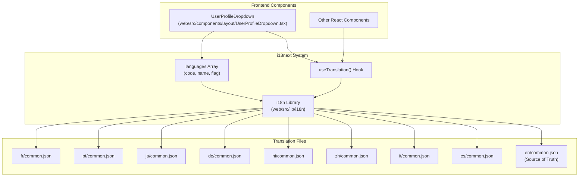
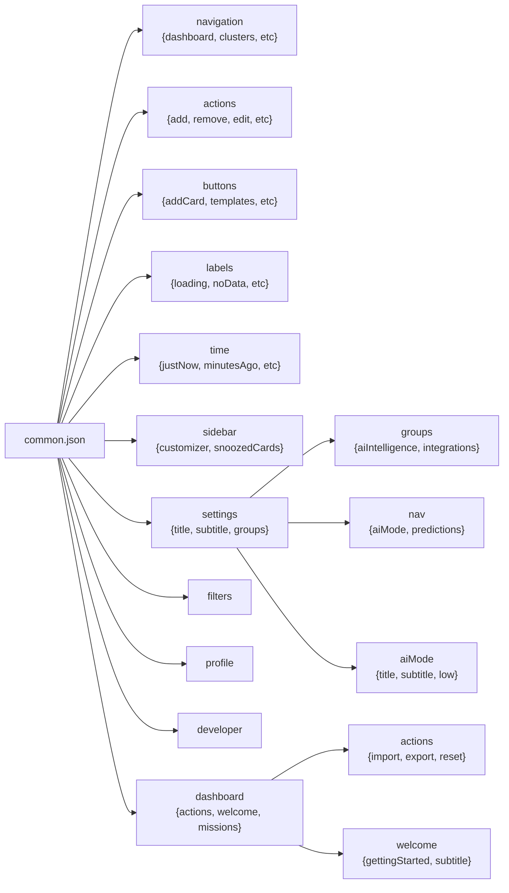
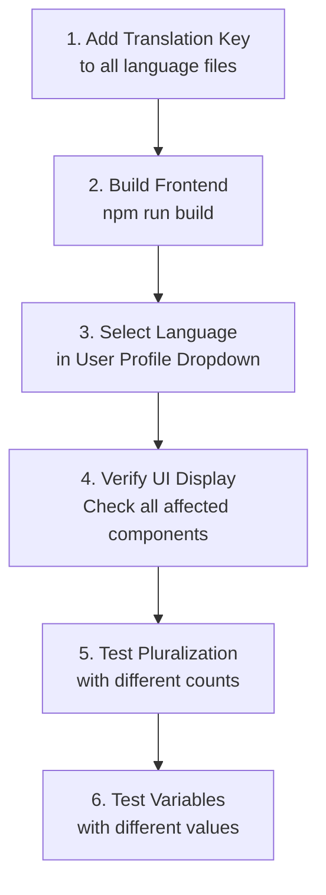

<!-- source: DeepWiki mcp.deepwiki.com · repo kubestellar/console · page 9.3 Adding New Translations · fetched 2026-10-27 -->

# Adding New Translations

<details>
<summary>Relevant source files</summary>

The following files were used as context for generating this wiki page:

- [web/src/components/layout/UserProfileDropdown.tsx](web/src/components/layout/UserProfileDropdown.tsx)
- [web/src/locales/de/common.json](web/src/locales/de/common.json)
- [web/src/locales/en/common.json](web/src/locales/en/common.json)
- [web/src/locales/es/common.json](web/src/locales/es/common.json)
- [web/src/locales/fr/common.json](web/src/locales/fr/common.json)
- [web/src/locales/hi/common.json](web/src/locales/hi/common.json)
- [web/src/locales/it/common.json](web/src/locales/it/common.json)
- [web/src/locales/ja/common.json](web/src/locales/ja/common.json)
- [web/src/locales/pt/common.json](web/src/locales/pt/common.json)
- [web/src/locales/zh/common.json](web/src/locales/zh/common.json)

</details>


## Purpose and Scope

This document provides technical guidance for adding new languages and translation keys to the KubeStellar Console localization system. The console uses i18next for internationalization and currently supports 9 languages with translations organized in domain-specific namespaces.

For information about the overall localization system architecture, see [Translation Structure](#9.1). For the list of currently supported languages, see [Supported Languages](#9.2).

---

## Translation System Architecture

The console's localization system is built on i18next and uses JSON files to store translations for each supported language. The system integrates with React components through the `useTranslation` hook.



**Sources:** [web/src/components/layout/UserProfileDropdown.tsx:1-416](), [web/src/locales/en/common.json:1-2300]()

---

## Translation File Structure

Translation keys are organized hierarchically by functional domain. The English file serves as the source of truth and all other languages must maintain the same key structure.



**Key Organization Principles:**

| Domain | Purpose | Example Keys |
|--------|---------|--------------|
| `navigation` | Main menu items | `dashboard`, `clusters`, `applications` |
| `actions` | Generic action verbs | `add`, `remove`, `edit`, `save`, `cancel` |
| `buttons` | Button-specific labels | `addCard`, `templates`, `customize` |
| `labels` | Status and UI labels | `loading`, `healthy`, `offline` |
| `time` | Relative time strings | `justNow`, `minutesAgo`, `hoursAgo` |
| `settings` | Settings panel content | Nested by settings category |
| `dashboard` | Dashboard-specific UI | Nested by dashboard feature |

**Sources:** [web/src/locales/en/common.json:1-2300]()

---

## Adding a New Language

Follow these steps to add support for a new language to the console:

### Step 1: Create Translation File

Create a new directory and JSON file under `web/src/locales/`:

```
web/src/locales/
├── en/
│   └── common.json  (source of truth)
├── {new-lang}/
│   └── common.json  (your new file)
```

The language code should follow ISO 639-1 standard (e.g., `ko` for Korean, `ru` for Russian).

### Step 2: Copy English Template

Copy the entire contents of [web/src/locales/en/common.json:1-2300]() to your new file. This ensures all keys are present.

### Step 3: Translate Content

Translate the values (not the keys) for each entry:

```json
{
  "navigation": {
    "dashboard": "Dashboard",  // Translate this value
    "clusters": "My Clusters"  // Keep the key, translate the value
  }
}
```

**Important:** Do not modify:
- Key names (e.g., `navigation`, `dashboard`)
- Interpolation variables (e.g., `{{count}}`, `{{cardName}}`)
- Pluralization suffixes (e.g., `_one`, `_other`)

### Step 4: Register Language

Update `web/src/lib/i18n` to register the new language in the `languages` array:

```typescript
export const languages = [
  { code: 'en', name: 'English', flag: '🇺🇸' },
  { code: 'es', name: 'Español', flag: '🇪🇸' },
  // ... other languages
  { code: 'ko', name: '한국어', flag: '🇰🇷' }  // Add your language
]
```

### Step 5: Configure i18next

Ensure the new language is loaded in the i18next configuration:

```typescript
import koCommon from '../locales/ko/common.json'

i18n.use(initReactI18next).init({
  resources: {
    en: { common: enCommon },
    // ... other languages
    ko: { common: koCommon }  // Add import and resource
  }
})
```

**Sources:** [web/src/components/layout/UserProfileDropdown.tsx:42-48](), [web/src/locales/en/common.json:1-2300]()

---

## Adding New Translation Keys

When adding new UI elements that require text, follow this process:

### Step 1: Choose Appropriate Domain

Determine which top-level domain the new key belongs to:

```json
{
  "actions": {},      // For generic verbs
  "buttons": {},      // For button-specific labels
  "settings": {},     // For settings panel
  "dashboard": {},    // For dashboard features
  "cards": {}         // For card-specific content
}
```

### Step 2: Add Key to English File

Add the new key in [web/src/locales/en/common.json]() first:

```json
{
  "dashboard": {
    "missions": {
      "actions": "Actions:",
      "repair": "Repair",
      "newAction": "Your New Action"  // New key
    }
  }
}
```

### Step 3: Propagate to All Languages

Add the same key structure to all language files with appropriate translations:

- [web/src/locales/es/common.json]()
- [web/src/locales/it/common.json]()
- [web/src/locales/zh/common.json]()
- [web/src/locales/hi/common.json]()
- [web/src/locales/de/common.json]()
- [web/src/locales/ja/common.json]()
- [web/src/locales/pt/common.json]()
- [web/src/locales/fr/common.json]()

### Step 4: Use in Components

Reference the new key in your React component:

```typescript
import { useTranslation } from 'react-i18next'

function MyComponent() {
  const { t } = useTranslation()
  
  return (
    <button>
      {t('dashboard.missions.newAction')}
    </button>
  )
}
```

**Sources:** [web/src/components/layout/UserProfileDropdown.tsx:3](), [web/src/locales/en/common.json:670-715]()

---

## Translation Key Naming Conventions

Follow these conventions when creating new translation keys:

### Hierarchical Structure

Use dot notation to organize related keys:

```json
{
  "settings": {
    "agent": {
      "title": "Local Agent",
      "subtitle": "Connect to your local kubeconfig",
      "connected": "Connected",
      "notConnected": "Not Connected"
    }
  }
}
```

### Naming Patterns

| Pattern | Usage | Example |
|---------|-------|---------|
| `{noun}` | Single entities | `dashboard`, `cluster`, `application` |
| `{noun}Title` | Section headers | `gettingStarted`, `aiMode` |
| `{noun}Desc` | Descriptions | `stableDesc`, `enableDesc` |
| `{noun}Hint` | Helper text | `channelHint`, `namespaceHint` |
| `{verb}ing` | Action in progress | `loading`, `saving`, `syncing` |
| `{verb}ed` | Past tense state | `saved`, `synced`, `downloaded` |

### Common Suffixes

```json
{
  "settings": {
    "updates": {
      "title": "System Updates",           // Main heading
      "subtitle": "Check for updates",     // Sub-heading
      "checkNow": "Check Now",            // Action button
      "checking": "Checking...",          // Progress state
      "upToDate": "Up to date",           // Result state
      "updateAvailable": "Update available" // Alternate result
    }
  }
}
```

**Sources:** [web/src/locales/en/common.json:144-554]()

---

## Pluralization

The system supports pluralization through i18next's plural suffixes:

### Basic Pluralization

Define both singular and plural forms:

```json
{
  "sidebar": {
    "activeViewers_one": "{{count}} active viewer",
    "activeViewers_other": "{{count}} active viewers"
  }
}
```

Usage in code:

```typescript
t('sidebar.activeViewers', { count: 1 })   // "1 active viewer"
t('sidebar.activeViewers', { count: 5 })   // "5 active viewers"
```

### Complex Pluralization

Some languages require additional plural forms. The `_one` and `_other` pattern handles most cases:

```json
{
  "time": {
    "minutesAgo": "{{count}}m ago",
    "minutesAgo_one": "{{count}}m ago",
    "minutesAgo_other": "{{count}}m ago",
    "hoursAgo": "{{count}}h ago",
    "hoursAgo_one": "{{count}}h ago",
    "hoursAgo_other": "{{count}}h ago"
  }
}
```

### Pluralization Examples

| Key | Count | Result |
|-----|-------|--------|
| `clustersCount` | 1 | "1 cluster" |
| `clustersCount` | 5 | "5 clusters" |
| `cardsAvailable` | 1 | "1 card available" |
| `cardsAvailable` | 10 | "10 cards available" |

**Sources:** [web/src/locales/en/common.json:63-77](), [web/src/locales/en/common.json:93-94](), [web/src/locales/en/common.json:231-233]()

---

## Variable Interpolation

Translation strings can contain dynamic variables that are replaced at runtime:

### Simple Interpolation

Define variables with double curly braces:

```json
{
  "labels": {
    "swappingTo": "Swapping to \"{{cardName}}\" in 30s"
  },
  "settings": {
    "agent": {
      "agentVersion": "Agent v{{version}}"
    }
  }
}
```

Usage:

```typescript
t('labels.swappingTo', { cardName: 'GPU Status' })
// Result: "Swapping to "GPU Status" in 30s"

t('settings.agent.agentVersion', { version: '1.2.3' })
// Result: "Agent v1.2.3"
```

### Multiple Variables

```json
{
  "dashboard": {
    "templates": {
      "willAddCards": "\"{{name}}\" will add {{count}} cards to your dashboard",
      "willAddCards_one": "\"{{name}}\" will add {{count}} card to your dashboard",
      "willAddCards_other": "\"{{name}}\" will add {{count}} cards to your dashboard"
    }
  }
}
```

Usage:

```typescript
t('dashboard.templates.willAddCards', { 
  name: 'GPU Dashboard', 
  count: 5 
})
// Result: ""GPU Dashboard" will add 5 cards to your dashboard"
```

### Conditional Variables

```json
{
  "sidebar": {
    "customizer": {
      "dashboardsSelected": "{{count}} dashboard{{plural}} selected",
      "dashboardsSelected_one": "{{count}} dashboard{{plural}} selected",
      "dashboardsSelected_other": "{{count}} dashboard{{plural}} selected"
    }
  }
}
```

**Note:** The `{{plural}}` variable is manually managed in the code to add "s" when needed.

**Sources:** [web/src/locales/en/common.json:61](), [web/src/locales/en/common.json:229](), [web/src/locales/en/common.json:762-764]()

---

## Testing Translations

### Manual Testing Workflow



### Testing Checklist

| Test Case | How to Test | Expected Result |
|-----------|-------------|-----------------|
| Key exists in all languages | Build frontend and check console for errors | No missing key warnings |
| Plural forms work | Test with count=1 and count>1 | Correct singular/plural form |
| Variables interpolate | Use with different variable values | Variables replaced correctly |
| Long strings | Test with longest translation | No text overflow or truncation |
| Special characters | Include quotes, apostrophes, etc. | Characters display correctly |

### Language Selection Testing

The language selector is located in the user profile dropdown at [web/src/components/layout/UserProfileDropdown.tsx:179-213]():

1. Click user avatar in top-right corner
2. Click on current language (shows flag + name)
3. Select different language from dropdown
4. Verify page content updates immediately

### Verification Points

Check these UI areas after changing languages:

- **Navigation menu**: [web/src/locales/en/common.json:2-11]()
- **Action buttons**: [web/src/locales/en/common.json:12-37]()
- **Settings panel**: [web/src/locales/en/common.json:144-562]()
- **Dashboard content**: [web/src/locales/en/common.json:636-1048]()
- **Error messages**: Check console for any missing keys
- **Time formats**: [web/src/locales/en/common.json:63-78]()

**Sources:** [web/src/components/layout/UserProfileDropdown.tsx:179-213](), [web/src/locales/en/common.json:1-2300]()

---

## Common Issues and Solutions

### Issue: Missing Translation Key

**Symptom:** UI displays the key path instead of translated text (e.g., "settings.agent.title")

**Solution:** Add the missing key to all language files with the same hierarchical structure.

### Issue: Pluralization Not Working

**Symptom:** Always shows plural form regardless of count

**Solution:** Ensure both `_one` and `_other` variants exist:

```json
{
  "key": "{{count}} items",
  "key_one": "{{count}} item",
  "key_other": "{{count}} items"
}
```

### Issue: Variable Not Interpolating

**Symptom:** UI shows literal `{{variable}}` instead of value

**Solution:** Verify the variable is passed in the `t()` function call:

```typescript
// Wrong
t('key.with.variable')

// Correct
t('key.with.variable', { variable: 'value' })
```

### Issue: Special Characters Breaking JSON

**Symptom:** Build fails or keys not loading

**Solution:** Escape special characters in JSON strings:

```json
{
  "message": "Use \"quotes\" and avoid breaking syntax"
}
```

**Sources:** [web/src/locales/en/common.json:1-2300]()

---

