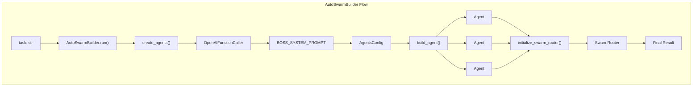
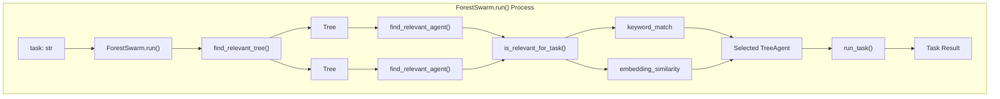
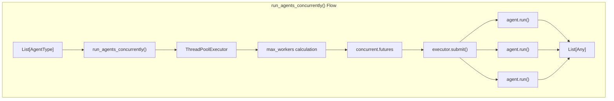
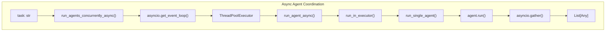
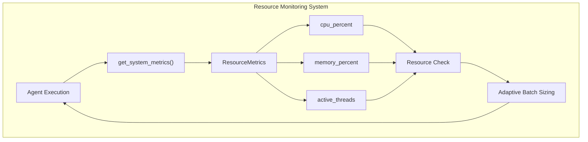
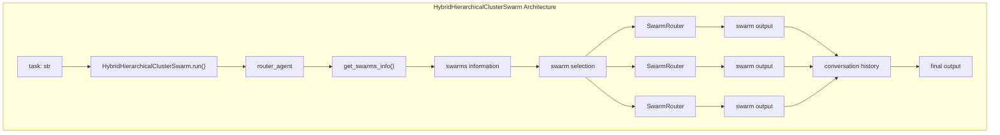
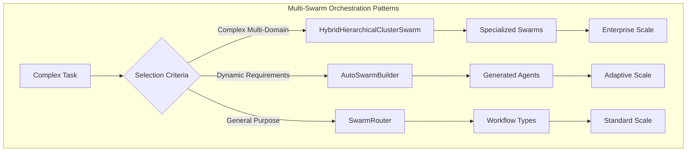
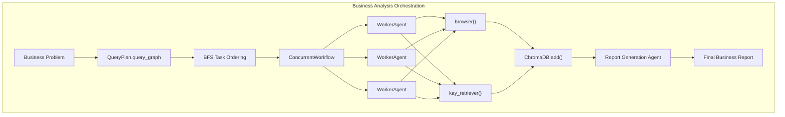
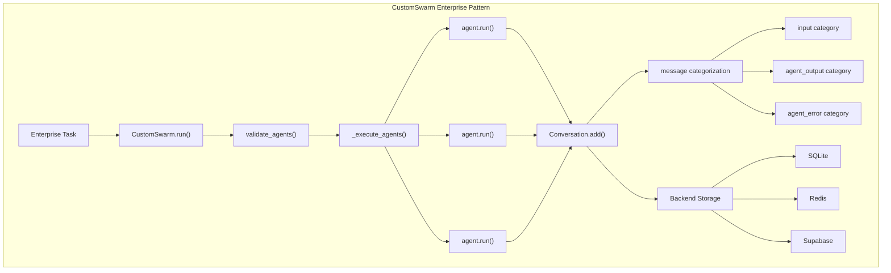

<!-- source: DeepWiki mcp.deepwiki.com · repo kyegomez/swarms · page 10 Advanced Patterns · fetched 2026-10-27 -->

# Advanced Patterns

Relevant source files

The following files were used as context for generating this wiki page:

- [docs/applications/business-analyst-agent.md](docs/applications/business-analyst-agent.md)
- [docs/assets/img/docs/query-plan-mini.png](docs/assets/img/docs/query-plan-mini.png)
- [docs/assets/img/docs/query-plan.png](docs/assets/img/docs/query-plan.png)
- [docs/corporate/bounty_program.md](docs/corporate/bounty_program.md)
- [docs/corporate/data_room.md](docs/corporate/data_room.md)
- [docs/swarms/structs/custom_swarm.md](docs/swarms/structs/custom_swarm.md)
- [docs/swarms/structs/hhcs.md](docs/swarms/structs/hhcs.md)
- [docs/swarms/structs/multi_swarm_orchestration.md](docs/swarms/structs/multi_swarm_orchestration.md)
- [examples/multi_agent/enhanced_collaboration_example.py](examples/multi_agent/enhanced_collaboration_example.py)
- [swarms/structs/auto_swarm_builder.py](swarms/structs/auto_swarm_builder.py)
- [swarms/structs/multi_agent_exec.py](swarms/structs/multi_agent_exec.py)
- [swarms/structs/tree_swarm.py](swarms/structs/tree_swarm.py)

## Purpose and Scope

This page explores advanced orchestration patterns and specialized use cases in the Swarms framework. It covers sophisticated multi-agent coordination strategies, dynamic agent creation, concurrent execution patterns, and enterprise-grade architectures for complex real-world applications.

The advanced patterns documented here serve as foundation knowledge for three specialized areas:
- [Auto Swarm Builder](#10.1) - Dynamic agent creation and swarm construction
- [Multi-Agent Execution](#10.2) - Concurrent and asynchronous execution patterns  
- [Enterprise Applications](#10.3) - Real-world enterprise use cases and integration patterns

## Dynamic Agent Creation Patterns

### AutoSwarmBuilder Architecture

The `AutoSwarmBuilder` class implements a sophisticated pattern for automatically creating and orchestrating specialized agents based on task requirements. This pattern uses a boss agent to analyze tasks and generate appropriate agent configurations.

**AutoSwarmBuilder System Architecture**

The `AutoSwarmBuilder.run()` method [swarms/structs/auto_swarm_builder.py:171-201]() orchestrates the entire process:

1. **Task Analysis**: Uses `OpenAIFunctionCaller` with `BOSS_SYSTEM_PROMPT` to analyze task requirements
2. **Agent Creation**: Generates `AgentConfig` objects based on task analysis
3. **Agent Construction**: Builds individual `Agent` instances using `build_agent()` method
4. **Swarm Assembly**: Creates a `SwarmRouter` to coordinate the generated agents
5. **Execution**: Runs the task through the assembled swarm

Sources: [swarms/structs/auto_swarm_builder.py:129-366]()

### Boss Agent System Prompt Engineering

The `BOSS_SYSTEM_PROMPT` [swarms/structs/auto_swarm_builder.py:15-97]() defines sophisticated agent creation principles:

| Principle | Implementation |
|-----------|----------------|
| Deep Task Understanding | Analyzes task requirements and breaks them into components |
| Agent Design Philosophy | Creates agents with distinct personalities and capabilities |
| System Prompt Design | Generates comprehensive prompts for specialized agents |
| Swarm Coordination | Establishes communication channels and protocols |
| Quality Assurance | Implements verification and improvement mechanisms |

The boss agent creates `AgentConfig` objects containing agent name, description, and system prompt, which are then used to instantiate actual `Agent` objects through the `build_agent()` method.

Sources: [swarms/structs/auto_swarm_builder.py:15-97](), [swarms/structs/auto_swarm_builder.py:100-127]()

### Tree-based Semantic Routing

The `ForestSwarm` implements hierarchical agent organization using semantic similarity for intelligent task routing.

**ForestSwarm Semantic Routing Architecture**

The `TreeAgent.is_relevant_for_task()` method [swarms/structs/tree_swarm.py:153-187]() uses dual matching:
- **Keyword Matching**: Extracted keywords from system prompts
- **Semantic Similarity**: Cosine similarity between task and agent embeddings
- **Distance Calculation**: Dynamic similarity scoring using `sentence_transformers`

Sources: [swarms/structs/tree_swarm.py:191-344](), [swarms/structs/tree_swarm.py:262-344]()

## Concurrent and Asynchronous Execution Patterns

### Multi-Agent Concurrent Execution

The `multi_agent_exec` module provides sophisticated patterns for concurrent agent coordination. These functions enable parallel processing, resource monitoring, and timeout management.

**Concurrent Agent Execution Architecture**

Key concurrent execution functions include:

| Function | Purpose | Key Features |
|----------|---------|--------------|
| `run_agents_concurrently()` | Basic parallel execution | ThreadPoolExecutor, automatic worker sizing |
| `run_agents_with_timeout()` | Execution with time limits | Async timeout handling, partial results |
| `run_agents_with_different_tasks()` | Different tasks per agent | Task-agent pairing, batch processing |
| `run_agents_with_resource_monitoring()` | Resource-aware execution | CPU/memory monitoring, adaptive batch sizing |

Sources: [swarms/structs/multi_agent_exec.py:69-109](), [swarms/structs/multi_agent_exec.py:233-279]()

### Asynchronous Agent Coordination

The framework provides async patterns for sophisticated agent coordination using `asyncio` and `ThreadPoolExecutor`.

**Async Agent Execution Pattern**

The async execution pattern [swarms/structs/multi_agent_exec.py:29-66]() enables:
- **Non-blocking Execution**: Agents run without blocking each other
- **Resource Optimization**: Efficient CPU and I/O utilization  
- **Batch Processing**: Process agents in configurable batch sizes
- **Error Isolation**: Individual agent failures don't affect others

Sources: [swarms/structs/multi_agent_exec.py:29-66](), [swarms/structs/multi_agent_exec.py:49-66]()

### Resource-Aware Execution

The `ResourceMetrics` class and monitoring functions provide resource-aware agent execution.

The `ResourceMetrics` dataclass [swarms/structs/multi_agent_exec.py:17-22]() tracks:
- CPU utilization percentage
- Memory usage percentage  
- Active thread count

This enables adaptive execution that scales based on available system resources.

Sources: [swarms/structs/multi_agent_exec.py:17-22](), [swarms/structs/multi_agent_exec.py:282-324]()

## Hierarchical Orchestration Architectures

### Hybrid Hierarchical-Cluster Swarm (HHCS)

The `HybridHierarchicalClusterSwarm` implements sophisticated multi-level orchestration using a router agent to distribute tasks across specialized swarms.

**HHCS Router-Based Task Distribution**

Key HHCS capabilities include:

| Method | Purpose | Parameters |
|--------|---------|------------|
| `run()` | Process single task | `task: str` |
| `batched_run()` | Process multiple tasks | `tasks: List[str]` |
| `find_swarm_by_name()` | Locate specific swarm | `swarm_name: str` |
| `route_task()` | Direct task to swarm | `swarm_name: str`, `task_description: str` |
| `get_swarms_info()` | List available swarms | None |

The router agent analyzes tasks and selects appropriate specialized swarms for processing, enabling parallel multi-domain task execution.

Sources: [docs/swarms/structs/hhcs.md:77-97]()

### Multi-Swarm Orchestration Patterns

The framework supports multiple hierarchical orchestration patterns, each optimized for different use cases:

| Architecture | Strengths | Use Cases |
|--------------|-----------|-----------|
| HHCS | Clear task routing, specialized handling | Complex multi-domain tasks |
| Auto Agent Builder | Dynamic creation, flexible scaling | Evolving requirements |
| SwarmRouter | Multiple workflow types, simple config | General-purpose tasks |

**Orchestration Architecture Comparison**

Sources: [docs/swarms/structs/multi_swarm_orchestration.md:7-11]()

## Enterprise Integration Patterns

### Business Analysis Orchestration

Enterprise business analysis requires sophisticated multi-agent coordination patterns combining task decomposition, parallel research, and comprehensive reporting.

**Enterprise Business Analysis Pattern**

This pattern demonstrates enterprise-grade capabilities:

- **Task Decomposition**: Using `QueryPlan` with dependency graphs
- **Parallel Research**: Multiple `WorkerAgent` instances with specialized tools
- **Shared Knowledge**: `ChromaDB` for persistent information storage
- **Report Generation**: Synthesis of research into comprehensive reports

The pattern uses `Query` and `QueryPlan` models for structured task breakdown, enabling systematic analysis of complex business problems.

Sources: [docs/applications/business-analyst-agent.md:42-76](), [docs/applications/business-analyst-agent.md:361-546]()

### Custom Swarm Architecture Patterns

Enterprise applications require custom swarm architectures with sophisticated conversation management and error handling.

**Custom Enterprise Swarm Pattern**

The `CustomSwarm` pattern provides enterprise features:

- **Agent Validation**: Ensures all agents have required methods and attributes
- **Conversation Tracking**: Complete audit trail of agent interactions
- **Error Categorization**: Structured error handling and reporting
- **Multiple Storage Backends**: Flexible persistence options for different environments
- **Concurrent Execution**: Optional parallel processing with `run_concurrent()`

Key methods include `validate_agents()`, `_execute_agents()`, and `run_concurrent()` for sophisticated agent coordination.

Sources: [docs/swarms/structs/custom_swarm.md:102-278](), [docs/swarms/structs/custom_swarm.md:283-366]()

## Best Practices for Advanced Implementations

When implementing advanced Swarms concepts, consider these best practices:

1. **Workflow Selection**: Choose appropriate workflow types based on task dependencies and parallelization opportunities
2. **Memory Management**: Configure appropriate memory systems based on knowledge persistence requirements
3. **Error Handling**: Implement robust error handling and recovery mechanisms for production systems
4. **Observability**: Use logging and telemetry to monitor system performance and diagnose issues
5. **Security**: Follow security best practices, especially for handling credentials and sensitive data
6. **Scalability**: Design agent systems with scalability in mind, using concurrent workflows where appropriate
7. **Testing**: Thoroughly test complex agent interactions before production deployment

For specific implementation patterns and enterprise deployment guidelines, see [Enterprise Use Cases](#10.2).

## Summary

Advanced concepts in the Swarms framework enable sophisticated agent architectures, complex workflows, and enterprise-grade implementations. By leveraging tree-based agent structures, advanced workflow patterns, comprehensive observability, and robust security features, developers can build powerful multi-agent systems for complex real-world applications.

For detailed information on implementing specific advanced workflows, see [Agent Workflows](#10.1). For enterprise deployment patterns and case studies, see [Enterprise Use Cases](#10.2).

---

