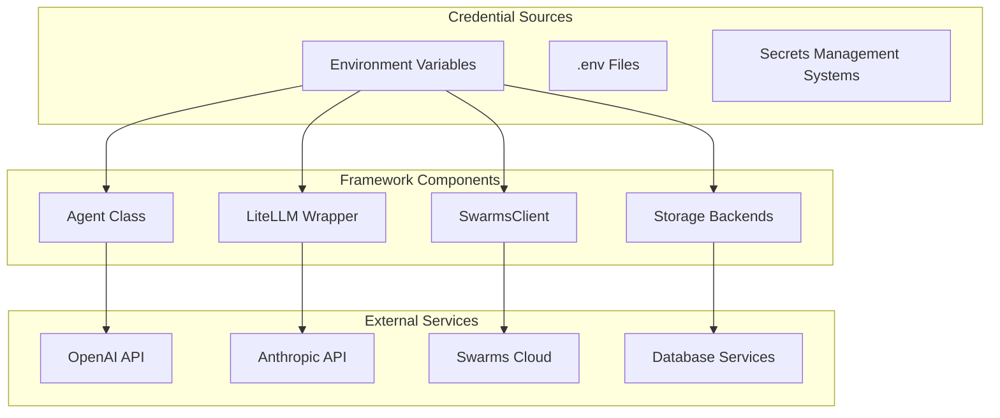
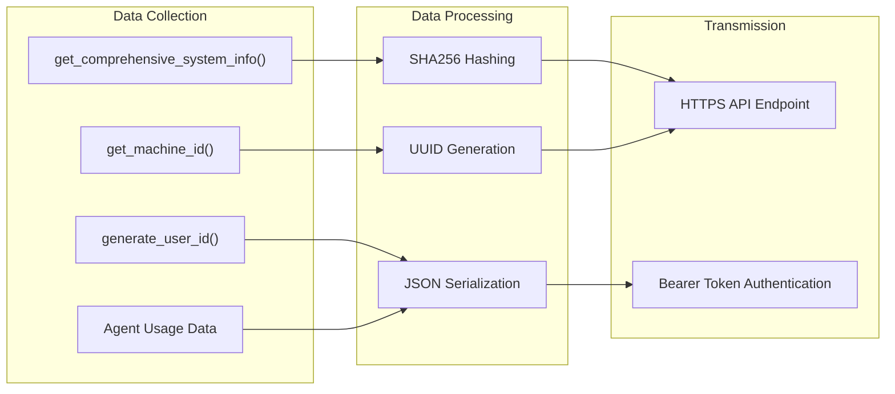
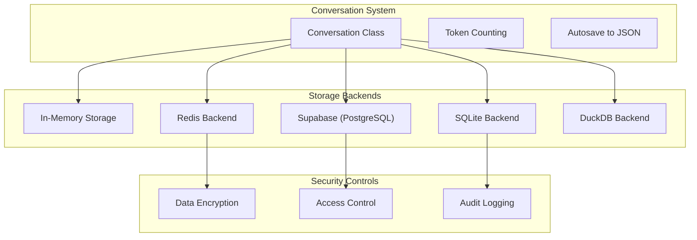
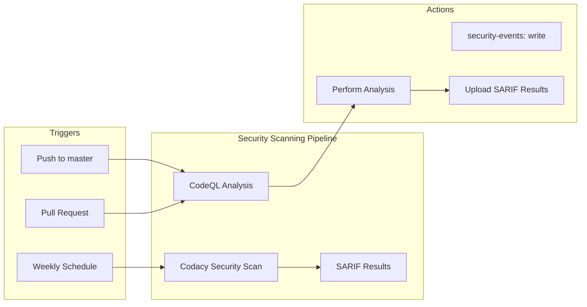
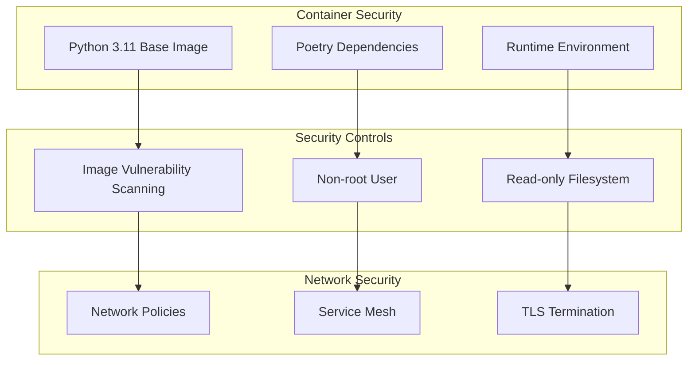
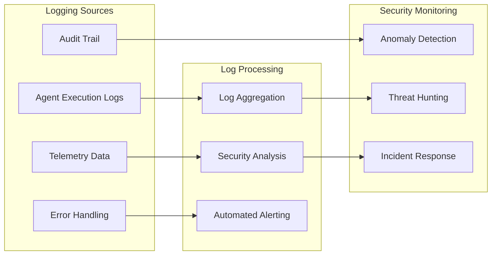

<!-- source: DeepWiki mcp.deepwiki.com · repo kyegomez/swarms · page 11.3 Security Considerations · fetched 2026-10-27 -->

# Security Considerations

Relevant source files

The following files were used as context for generating this wiki page:

- [.github/action.yml](.github/action.yml)
- [.github/labeler.yml](.github/labeler.yml)
- [.github/workflows/codacy.yml](.github/workflows/codacy.yml)
- [.github/workflows/codeql.yml](.github/workflows/codeql.yml)
- [.github/workflows/label.yml](.github/workflows/label.yml)
- [.github/workflows/stale.yml](.github/workflows/stale.yml)
- [.github/workflows/welcome.yml](.github/workflows/welcome.yml)
- [SECURITY.md](SECURITY.md)
- [docs/swarms/models/gemini.md](docs/swarms/models/gemini.md)
- [docs/swarms_platform/monetize.md](docs/swarms_platform/monetize.md)
- [swarms/telemetry/__init__.py](swarms/telemetry/__init__.py)
- [swarms/telemetry/main.py](swarms/telemetry/main.py)

## Purpose and Scope

This document covers security considerations for production deployments of the Swarms framework, including authentication mechanisms, data protection strategies, API security, vulnerability management, and infrastructure hardening. This focuses on securing the multi-agent orchestration system and its integrations with external services and storage backends.

For development environment setup and CI/CD security, see [Development Infrastructure](#8). For cloud deployment security specifics, see [Cloud Services & APIs](#9).

## Authentication and API Key Management

The Swarms framework relies heavily on API key-based authentication for external service integrations. Proper credential management is critical for production security.

### Environment Variable Security

The framework uses environment variables for sensitive configuration management across multiple components:

- **Model API Keys**: OpenAI, Anthropic, Groq, and other LLM provider credentials
- **Storage Backend Credentials**: Database connection strings for Supabase, Redis, etc.
- **Swarms Cloud API Keys**: For cloud service integration

**Sources: [SECURITY.md:7](), [swarms/telemetry/main.py:112-117]()**

### API Key Best Practices

| Security Control | Implementation | Risk Mitigation |
|------------------|----------------|-----------------|
| Environment Variables | Secure configuration management | Prevents hardcoded credentials |
| Key Rotation | Regular credential updates | Limits exposure window |
| Least Privilege | Service-specific permissions | Reduces blast radius |
| Encrypted Storage | At-rest encryption for keys | Protects stored credentials |

**Sources: [SECURITY.md:7-13]()**

## Data Protection and Privacy

### Telemetry and Data Collection

The framework includes a telemetry system that collects system information and usage data. Understanding what data is collected and how it's transmitted is crucial for privacy compliance.

**Sources: [swarms/telemetry/main.py:23-31](), [swarms/telemetry/main.py:95-128]()**

The telemetry system collects:
- **System Hardware Info**: CPU, memory, platform details
- **Machine Identification**: Hashed hostname using SHA256
- **Network Information**: MAC address (anonymized)
- **Agent Usage Patterns**: Runtime data and performance metrics

### Data Transmission Security

All telemetry data is transmitted via HTTPS to `https://swarms.world/api/get-agents/log-agents` with Bearer token authentication. The system includes timeout controls and error handling to prevent data leakage.

**Sources: [swarms/telemetry/main.py:98-121]()**

### Conversation Data Protection

The conversation management system handles potentially sensitive user interactions across multiple storage backends:

**Sources: [SECURITY.md:17](), [SECURITY.md:10](), [SECURITY.md:18]()**

## Code Security and Vulnerability Management

### Automated Security Scanning

The framework implements comprehensive automated security scanning through CI/CD pipelines:

#### CodeQL Analysis

The CodeQL workflow performs static analysis security testing on every push and pull request to the master branch.

**Sources: [.github/workflows/codeql.yml:1-42](), [.github/workflows/codacy.yml:1-46]()**

#### Codacy Security Analysis

Codacy scanning runs on a daily schedule and uploads SARIF results for security event tracking. The configuration allows up to 2,147,483,647 issues to ensure SARIF file generation doesn't fail.

**Sources: [.github/workflows/codacy.yml:25-40]()**

### Dependency Security

The framework uses Poetry for dependency management, which includes security features for tracking and updating vulnerable packages.

**Sources: [.github/action.yml:14-18]()**

## Infrastructure Security

### Container Security

The framework supports Docker containerization for secure deployment isolation:

**Sources: [SECURITY.md:13](), [.github/action.yml:6-34]()**

### Access Control Mechanisms

The security policy outlines comprehensive access control implementations:

| Control Type | Implementation | Coverage |
|--------------|----------------|----------|
| Authentication | Multi-factor verification | User access |
| Authorization | Role-based permissions | Feature access |
| Network Access | IP allowlisting, VPN | Infrastructure |
| Data Access | Encryption, key management | Storage layers |

**Sources: [SECURITY.md:10-20]()**

## Deployment Security

### Environment Separation

Production deployments should maintain strict environment separation with dedicated credentials and configurations for each environment tier.

### Monitoring and Logging

The framework includes comprehensive logging and monitoring capabilities for security oversight:

**Sources: [SECURITY.md:15](), [swarms/telemetry/main.py:130-135]()**

## Vulnerability Reporting and Response

### Security Incident Reporting

The framework maintains a formal security policy for vulnerability disclosure:

- **Contact**: Security vulnerabilities should be reported to `kye@apac.ai`
- **Response Time**: 24-hour acknowledgment commitment
- **Resolution Process**: Regular updates throughout investigation
- **Disclosure**: Coordinated responsible disclosure process

**Sources: [SECURITY.md:25-39]()**

### Supported Versions

The security policy covers vulnerability management across supported framework versions with timely security patches and advisories.

**Sources: [SECURITY.md:30-36]()**

## Compliance and Regulatory Considerations

### Data Protection Regulations

The framework's data handling capabilities must comply with relevant regulations:

- **GDPR**: European data protection requirements
- **CCPA**: California consumer privacy act
- **HIPAA**: Healthcare information protection (if applicable)
- **SOX**: Financial data controls (if applicable)

**Sources: [SECURITY.md:21]()**

### Security Auditing

Regular security audits ensure ongoing compliance and security posture maintenance. The framework supports comprehensive audit logging for compliance reporting.

**Sources: [SECURITY.md:22]()**

---

