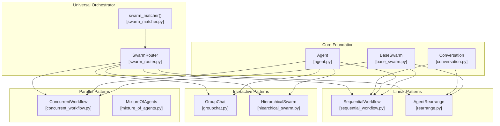
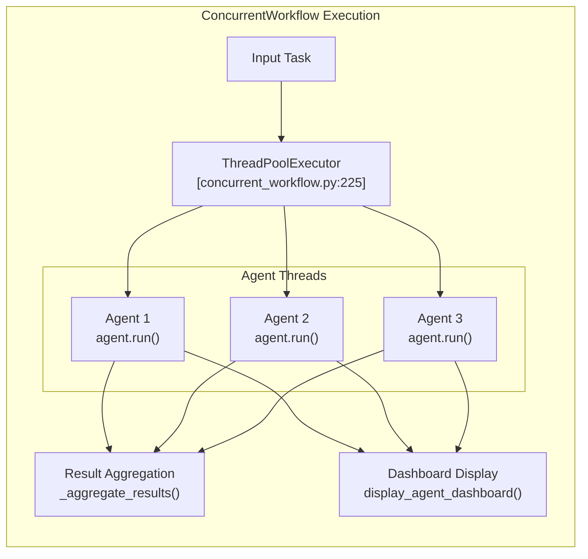
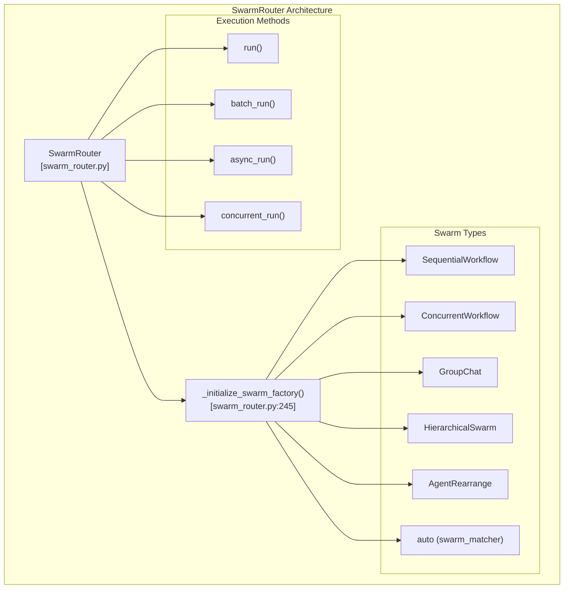

<!-- source: DeepWiki mcp.deepwiki.com · repo kyegomez/swarms · page 3 Multi-Agent Orchestration · fetched 2026-10-27 -->

# Multi-Agent Orchestration

<details>
<summary>Relevant source files</summary>

The following files were used as context for generating this wiki page:

- [.gitignore](.gitignore)
- [README.md](README.md)
- [docs/mkdocs.yml](docs/mkdocs.yml)
- [docs/swarms/concept/swarm_architectures.md](docs/swarms/concept/swarm_architectures.md)
- [docs/swarms/examples/multi_agent_router_minimal.md](docs/swarms/examples/multi_agent_router_minimal.md)
- [docs/swarms/prompts/main.md](docs/swarms/prompts/main.md)
- [docs/swarms/structs/swarm_router.md](docs/swarms/structs/swarm_router.md)
- [example.py](example.py)
- [examples/multi_agent/mar/multi_agent_router_minimal.py](examples/multi_agent/mar/multi_agent_router_minimal.py)
- [pyproject.toml](pyproject.toml)
- [requirements.txt](requirements.txt)
- [swarms/__init__.py](swarms/__init__.py)
- [swarms/agents/__init__.py](swarms/agents/__init__.py)
- [swarms/prompts/logistics.py](swarms/prompts/logistics.py)
- [swarms/prompts/sop_generator_agent_prompt.py](swarms/prompts/sop_generator_agent_prompt.py)
- [swarms/structs/__init__.py](swarms/structs/__init__.py)
- [swarms/structs/agent.py](swarms/structs/agent.py)
- [swarms/structs/concurrent_workflow.py](swarms/structs/concurrent_workflow.py)
- [swarms/structs/rearrange.py](swarms/structs/rearrange.py)
- [swarms/structs/sequential_workflow.py](swarms/structs/sequential_workflow.py)
- [swarms/structs/swarm_router.py](swarms/structs/swarm_router.py)
- [swarms/structs/swarming_architectures.py](swarms/structs/swarming_architectures.py)
- [swarms/utils/__init__.py](swarms/utils/__init__.py)
- [tests/prompts/test_prompt.py](tests/prompts/test_prompt.py)

</details>


Multi-agent orchestration in the Swarms framework provides systematic coordination and execution patterns for multiple autonomous agents working together to achieve complex goals. This document covers the architectural patterns, implementation details, and coordination mechanisms that enable sophisticated multi-agent collaboration.

For information about individual agent configuration and capabilities, see [Agent Class](#2.1). For details about the universal routing system, see [SwarmRouter](#2.2). For specific workflow implementations, see [Sequential Workflow](#3.1), [Concurrent Workflow](#3.2), [Hierarchical Swarm](#3.3), and [GroupChat](#3.4).

## Core Orchestration Architecture

The Swarms framework implements multiple orchestration patterns through a unified architecture built around the `BaseSwarm` class and specialized workflow implementations. Each pattern serves different coordination needs, from simple linear processing to complex hierarchical collaboration.



Sources: [swarms/structs/base_swarm.py](), [swarms/structs/agent.py](), [swarms/structs/sequential_workflow.py](), [swarms/structs/concurrent_workflow.py](), [swarms/structs/swarm_router.py]()

## Sequential and Linear Patterns

Sequential orchestration processes tasks through agents in a predefined order, where each agent's output becomes the input for the next agent in the chain.

### SequentialWorkflow

The `SequentialWorkflow` class implements linear agent processing through the `AgentRearrange` pattern with automatic flow generation.

| Method | Purpose | File Location |
|--------|---------|---------------|
| `sequential_flow()` | Generates agent flow string | [swarms/structs/sequential_workflow.py:62-92]() |
| `run()` | Executes sequential processing | [swarms/structs/sequential_workflow.py:103-144]() |
| `run_batched()` | Batch processing support | [seque

sequential_workflow.py:149-176]() |

The implementation creates a flow pattern by joining agent names with arrows (`agent1 -> agent2 -> agent3`) and delegates execution to `AgentRearrange`.

### AgentRearrange

`AgentRearrange` provides flexible flow-based orchestration supporting both sequential and parallel execution patterns through flow string parsing.

| Component | Description | Implementation |
|-----------|-------------|----------------|
| Flow Validation | Parses and validates flow strings | [swarms/structs/rearrange.py:174-216]() |
| Task Distribution | Routes tasks based on flow pattern | [swarms/structs/rearrange.py:248-346]() |
| History Tracking | Maintains conversation history | [swarms/structs/rearrange.py:122-133]() |

Sources: [swarms/structs/sequential_workflow.py](), [swarms/structs/rearrange.py]()

## Parallel and Concurrent Patterns

Parallel orchestration enables simultaneous agent execution for tasks that can be processed independently, maximizing throughput and resource utilization.

### ConcurrentWorkflow

The `ConcurrentWorkflow` class implements high-performance parallel agent execution using `ThreadPoolExecutor` with comprehensive monitoring and error handling.



Key features include:

- **Thread Management**: Uses 95% of available CPU cores via `ThreadPoolExecutor`
- **Real-time Monitoring**: Dashboard shows agent status during execution
- **Error Handling**: Continues execution even if some agents fail
- **Output Formatting**: Multiple output types including dict, string, and list formats

Sources: [swarms/structs/concurrent_workflow.py]()

### MixtureOfAgents

The `MixtureOfAgents` pattern processes tasks through multiple expert agents in parallel, then synthesizes results through an aggregator agent.

| Phase | Description | Implementation |
|-------|-------------|----------------|
| Parallel Execution | Run expert agents simultaneously | Expert agent `run()` methods |
| Result Collection | Gather all expert outputs | Result aggregation logic |
| Synthesis | Aggregator processes all outputs | Aggregator agent `run()` |

Sources: [swarms/structs/mixture_of_agents.py](), [README.md:430-458]()

## Interactive and Collaborative Patterns

Interactive patterns enable dynamic communication and decision-making between agents through conversation-based coordination.

### GroupChat

`GroupChat` facilitates multi-agent conversations with configurable speaker selection and dynamic interaction patterns.

| Component | Function | Location |
|-----------|----------|----------|
| Speaker Selection | Determines next agent to speak | `speaker_fn` parameter |
| Conversation Management | Tracks dialogue history | `Conversation` class integration |
| Loop Control | Manages conversation rounds | `max_loops` parameter |

### HierarchicalSwarm

`HierarchicalSwarm` implements a director-worker pattern where a central director coordinates specialized worker agents through task decomposition and result synthesis.

The pattern includes:
- **Director Agent**: Creates plans and distributes tasks
- **Worker Agents**: Execute specialized subtasks  
- **Feedback Loops**: Director evaluates and refines results
- **Task Coordination**: Manages dependencies between workers

Sources: [swarms/structs/groupchat.py](), [swarms/structs/hiearchical_swarm.py](), [README.md:491-548]()

## Specialized Orchestration Patterns

The framework includes several specialized patterns for specific use cases requiring advanced coordination strategies.

| Pattern | Purpose | Key Features |
|---------|---------|--------------|
| `HeavySwarm` | Intensive computational workflows | 5-phase analysis with specialized agents |
| `DeepResearchSwarm` | Comprehensive research tasks | Multi-domain investigation coordination |
| `CouncilAsAJudge` | Consensus-based evaluation | Multiple agents as council members |
| `MALT` | Complex language processing | Multi-agent language task coordination |

These patterns extend the base orchestration model with domain-specific coordination logic and specialized agent roles.

Sources: [swarms/structs/heavy_swarm.py](), [swarms/structs/deep_research_swarm.py](), [swarms/structs/council_judge.py](), [swarms/structs/malt.py]()

## SwarmRouter - Universal Orchestrator

The `SwarmRouter` class provides a unified interface for dynamically selecting and executing different orchestration patterns based on task requirements or explicit configuration.



### Key Capabilities

| Feature | Implementation | Purpose |
|---------|----------------|---------|
| Dynamic Selection | `swarm_type` parameter or "auto" mode | Choose optimal pattern for task |
| Factory Pattern | `_swarm_factory` O(1) lookup | Efficient swarm instantiation |
| Caching | `_swarm_cache` dictionary | Reuse created swarm instances |
| Auto-matching | `swarm_matcher()` function | Embedding-based pattern selection |

### SwarmType Enumeration

The `SwarmType` literal defines supported orchestration patterns:

```python
SwarmType = Literal[
    "AgentRearrange",
    "MixtureOfAgents", 
    "SequentialWorkflow",
    "ConcurrentWorkflow",
    "GroupChat",
    "HiearchicalSwarm",
    "auto",
    # ... additional types
]
```

Sources: [swarms/structs/swarm_router.py:37-54](), [swarms/structs/swarm_router.py:106-173]()

## Implementation Patterns

### Common Base Classes

Most orchestration patterns inherit from `BaseSwarm` which provides:

- Agent management and validation
- Common initialization patterns  
- Shared utility methods
- Consistent interface contracts

### Conversation Integration

All patterns integrate with the `Conversation` class for:

- Message history tracking
- Context management across agents
- Token counting and limits
- Serialization and persistence

### Error Handling and Reliability

Orchestration patterns implement comprehensive error handling:

- **Validation**: Pre-execution configuration checks
- **Graceful Degradation**: Continue execution when individual agents fail  
- **Logging**: Detailed execution tracking via `loguru`
- **State Management**: Autosave and recovery capabilities

Sources: [swarms/structs/base_swarm.py](), [swarms/structs/conversation.py](), [swarms/structs/agent.py:622-624]()

The multi-agent orchestration system provides a flexible, robust foundation for coordinating autonomous agents across diverse use cases, from simple sequential processing to complex hierarchical collaboration patterns.

---

