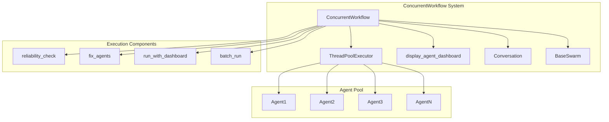
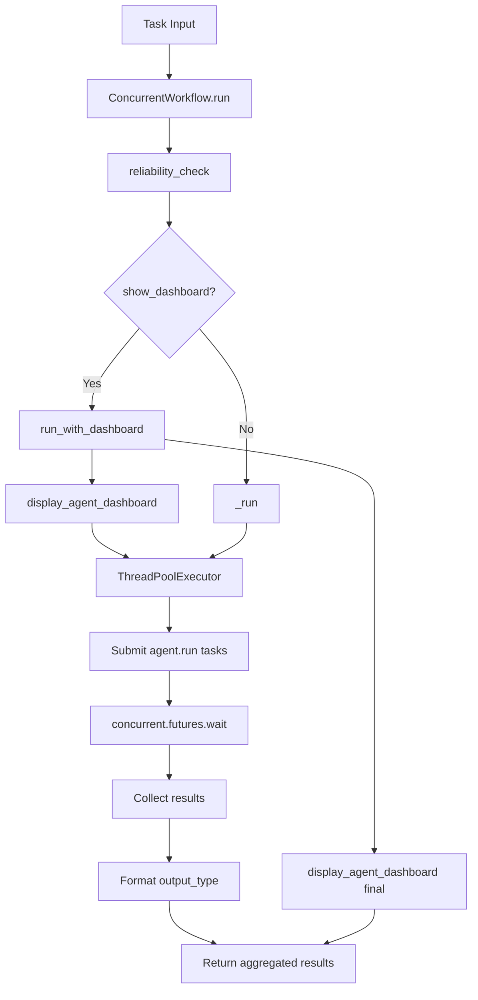
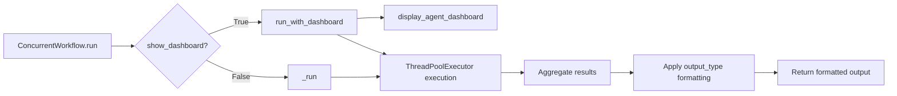
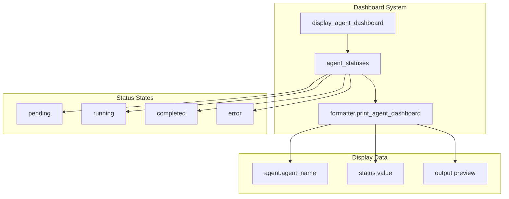

<!-- source: DeepWiki mcp.deepwiki.com · repo kyegomez/swarms · page 3.2 Concurrent Workflow · fetched 2026-10-27 -->

# Concurrent Workflow

<details>
<summary>Relevant source files</summary>

The following files were used as context for generating this wiki page:

- [.dockerignore](.dockerignore)
- [.gitignore](.gitignore)
- [Dockerfile](Dockerfile)
- [README.md](README.md)
- [docs/corporate/swarms_bounty_system.md](docs/corporate/swarms_bounty_system.md)
- [docs/mkdocs.yml](docs/mkdocs.yml)
- [docs/swarms/structs/multi_threaded_workflow.md](docs/swarms/structs/multi_threaded_workflow.md)
- [example.py](example.py)
- [pyproject.toml](pyproject.toml)
- [requirements.txt](requirements.txt)
- [swarms/__init__.py](swarms/__init__.py)
- [swarms/agents/__init__.py](swarms/agents/__init__.py)
- [swarms/prompts/logistics.py](swarms/prompts/logistics.py)
- [swarms/prompts/sop_generator_agent_prompt.py](swarms/prompts/sop_generator_agent_prompt.py)
- [swarms/structs/__init__.py](swarms/structs/__init__.py)
- [swarms/structs/agent.py](swarms/structs/agent.py)
- [swarms/structs/concurrent_workflow.py](swarms/structs/concurrent_workflow.py)
- [swarms/structs/rearrange.py](swarms/structs/rearrange.py)
- [swarms/structs/sequential_workflow.py](swarms/structs/sequential_workflow.py)
- [swarms/structs/swarm_router.py](swarms/structs/swarm_router.py)
- [swarms/utils/__init__.py](swarms/utils/__init__.py)

</details>


This document covers the `ConcurrentWorkflow` system in the Swarms framework, which provides production-grade parallel execution of multiple agents on the same task. The system is designed for high-throughput scenarios where multiple agents need to process identical tasks independently and their results require aggregation.

For sequential agent processing where outputs chain together, see [Sequential Workflow](#3.1). For complex multi-agent coordination with feedback loops, see [Hierarchical Swarm](#3.3).

## System Overview

The `ConcurrentWorkflow` class orchestrates simultaneous execution of multiple agents using Python's `ThreadPoolExecutor`. Unlike sequential workflows where agents process tasks in order, concurrent workflows distribute the same task to all agents simultaneously, collecting and aggregating their independent responses.



Sources: [swarms/structs/concurrent_workflow.py:1-150](), [swarms/structs/base_swarm.py](), [swarms/structs/agent.py]()

## Core Architecture Components

The `ConcurrentWorkflow` extends `BaseSwarm` and integrates several key components for parallel agent execution:

### Primary Classes and Dependencies

| Component | Type | Purpose |
|-----------|------|---------|
| `ConcurrentWorkflow` | Main Class | Orchestrates concurrent agent execution |
| `ThreadPoolExecutor` | Execution Engine | Manages parallel thread execution |
| `Agent` | Worker Units | Individual processing agents |
| `Conversation` | History Manager | Tracks execution history and context |
| `BaseSwarm` | Parent Class | Provides foundational swarm functionality |

### Execution Flow Architecture



Sources: [swarms/structs/concurrent_workflow.py:355-450](), [swarms/structs/concurrent_workflow.py:580-680]()

## Configuration and Initialization

The `ConcurrentWorkflow` constructor accepts multiple configuration parameters that control execution behavior:

### Core Parameters

| Parameter | Type | Default | Description |
|-----------|------|---------|-------------|
| `name` | `str` | `"ConcurrentWorkflow"` | Workflow identifier |
| `agents` | `List[Union[Agent, Callable]]` | `[]` | Agents to execute concurrently |
| `max_loops` | `int` | `1` | Maximum execution loops per agent |
| `output_type` | `str` | `"dict-all-except-first"` | Result aggregation format |
| `show_dashboard` | `bool` | `False` | Enable real-time monitoring display |
| `auto_save` | `bool` | `True` | Automatic metadata persistence |

### Initialization Process

The constructor performs several setup operations:

1. **Agent Status Tracking**: Creates `agent_statuses` dictionary mapping agent names to status objects
2. **Reliability Validation**: Calls `reliability_check()` to validate configuration
3. **Conversation Setup**: Initializes `Conversation` object for history management
4. **Dashboard Configuration**: Calls `fix_agents()` when dashboard mode is enabled

```python
# Constructor signature from swarms/structs/concurrent_workflow.py:137-150
def __init__(
    self,
    name: str = "ConcurrentWorkflow",
    description: str = "Execution of multiple agents concurrently",
    agents: List[Union[Agent, Callable]] = [],
    # ... additional parameters
)
```

Sources: [swarms/structs/concurrent_workflow.py:137-188]()

## Execution Patterns

### Primary Execution Method

The `run()` method serves as the main entry point for task execution. It branches between dashboard and non-dashboard execution paths:



### Concurrent Execution Implementation

The core execution logic uses `concurrent.futures.ThreadPoolExecutor` with optimized worker count:

```python
# Thread pool sizing from swarms/structs/concurrent_workflow.py:620-625
max_workers = min(len(self.agents), os.cpu_count() * 95 // 100)
with concurrent.futures.ThreadPoolExecutor(max_workers=max_workers) as executor:
    # Submit all agent tasks simultaneously
    future_to_agent = {
        executor.submit(self._execute_agent, agent, task, img, imgs): agent
        for agent in self.agents
    }
```

### Batch Processing Support

The `batch_run()` method processes multiple tasks sequentially, with each task executed concurrently across all agents:

| Method | Purpose | Execution Pattern |
|--------|---------|-------------------|
| `run()` | Single task execution | All agents process one task concurrently |
| `batch_run()` | Multiple task execution | Sequential task processing, concurrent agent execution per task |
| `run_async()` | Asynchronous execution | Non-blocking concurrent execution |
| `run_concurrent()` | High-throughput mode | Optimized for maximum parallel processing |

Sources: [swarms/structs/concurrent_workflow.py:580-680](), [swarms/structs/concurrent_workflow.py:710-780]()

## Dashboard and Monitoring System

### Real-Time Status Tracking

The dashboard system provides live monitoring of agent execution status through the `agent_statuses` dictionary:

```python
# Status tracking structure from swarms/structs/concurrent_workflow.py:178-182
self.agent_statuses = {
    agent.agent_name: {"status": "pending", "output": ""}
    for agent in agents
}
```

### Dashboard Display Components



### Agent Configuration for Dashboard Mode

The `fix_agents()` method modifies agent print behavior when dashboard mode is enabled:

```python
# Dashboard agent configuration from swarms/structs/concurrent_workflow.py:189-213
def fix_agents(self):
    if self.show_dashboard is True:
        for agent in self.agents:
            agent.print_on = False
    return self.agents
```

Sources: [swarms/structs/concurrent_workflow.py:295-354](), [swarms/structs/concurrent_workflow.py:189-213]()

## Error Handling and Reliability

### Configuration Validation

The `reliability_check()` method validates essential configuration parameters before execution:

```python
# Reliability validation from swarms/structs/concurrent_workflow.py:215-261
def reliability_check(self):
    if self.agents is None:
        raise ValueError("ConcurrentWorkflow: No agents provided")
    
    if len(self.agents) == 0:
        raise ValueError("ConcurrentWorkflow: No agents provided")
    
    if len(self.agents) == 1:
        logger.warning("ConcurrentWorkflow: Only one agent provided...")
```

### Exception Handling Pattern

The execution methods implement comprehensive error handling to ensure partial results are available even when some agents fail:

| Error Scenario | Handling Strategy |
|----------------|-------------------|
| Agent execution failure | Individual agent errors logged, other agents continue |
| Configuration errors | Validation during initialization with descriptive messages |
| Resource exhaustion | ThreadPoolExecutor manages thread lifecycle automatically |
| Timeout conditions | Future objects allow timeout specification and handling |

Sources: [swarms/structs/concurrent_workflow.py:215-261]()

## Integration with Swarm Ecosystem

### SwarmRouter Integration

The `ConcurrentWorkflow` integrates with the broader Swarms ecosystem through `SwarmRouter`:

```python
# SwarmRouter integration from swarms/structs/swarm_router.py:42
SwarmType = Literal[
    "ConcurrentWorkflow",  # Available as swarm type
    # ... other swarm types
]
```

### Output Type Compatibility

The `output_type` parameter supports multiple aggregation formats for integration with different downstream systems:

| Output Type | Format | Use Case |
|-------------|--------|----------|
| `"dict-all-except-first"` | Dictionary excluding first result | Standard aggregation |
| `"dict"` | Full dictionary of all results | Complete result set |
| `"str"` | Concatenated string | Text processing pipelines |
| `"list"` | List of individual outputs | Sequential processing |

### BaseSwarm Heritage

As a subclass of `BaseSwarm`, `ConcurrentWorkflow` inherits foundational swarm capabilities and maintains consistency with other swarm implementations in the framework.

Sources: [swarms/structs/swarm_router.py:37-54](), [swarms/structs/base_swarm.py](), [swarms/structs/__init__.py:7]()

## Usage Examples and Patterns

### Multi-Perspective Analysis Pattern

The most common usage pattern involves creating specialized agents for different analytical perspectives:

```python
# Example from README.md:270-307
from swarms import Agent, ConcurrentWorkflow

# Create specialized analysis agents
market_analyst = Agent(
    agent_name="Market-Analyst",
    system_prompt="Analyze market trends and provide insights...",
    model_name="gpt-4o-mini",
)

financial_analyst = Agent(
    agent_name="Financial-Analyst", 
    system_prompt="Provide financial analysis and recommendations...",
    model_name="gpt-4o-mini",
)

# Create concurrent workflow
concurrent_workflow = ConcurrentWorkflow(
    agents=[market_analyst, financial_analyst, risk_analyst],
    max_loops=1,
)

# Execute analysis across all agents simultaneously
results = concurrent_workflow.run(
    "Analyze the potential impact of AI technology on the healthcare industry"
)
```

### Dashboard Monitoring Pattern

For production deployments requiring real-time monitoring:

```python
# Dashboard-enabled execution pattern
workflow = ConcurrentWorkflow(
    name="Production-Analysis-Workflow",
    agents=[agent1, agent2, agent3],
    show_dashboard=True,
    auto_save=True,
    output_type="dict"
)

# Real-time monitoring during execution
results = workflow.run("Complex analysis task")
```

Sources: [README.md:266-307](), [swarms/structs/concurrent_workflow.py:90-135]()

---

