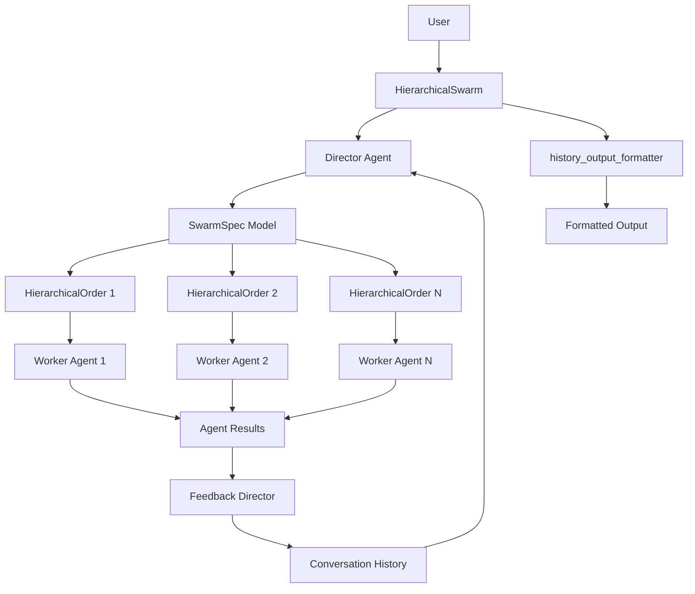
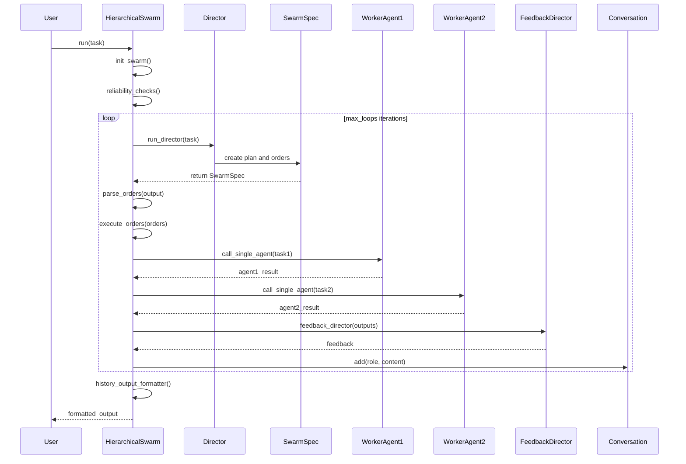

<!-- source: DeepWiki mcp.deepwiki.com · repo kyegomez/swarms · page 3.3 Hierarchical Swarm · fetched 2026-10-27 -->

# Hierarchical Swarm

<details>
<summary>Relevant source files</summary>

The following files were used as context for generating this wiki page:

- [docs/examples/paper_implementations.md](docs/examples/paper_implementations.md)
- [scripts/examples.py](scripts/examples.py)
- [swarms/structs/hiearchical_swarm.py](swarms/structs/hiearchical_swarm.py)
- [tests/test_data/image1.jpg](tests/test_data/image1.jpg)
- [tests/test_data/image2.png](tests/test_data/image2.png)

</details>


The Hierarchical Swarm implements a director-worker orchestration pattern where a central director agent coordinates multiple worker agents through structured planning and task distribution. This system enables complex multi-agent coordination with feedback loops and conversation history preservation throughout the execution process.

For sequential agent processing where output flows linearly from one agent to the next, see [Sequential Workflow](#3.1). For parallel agent execution without hierarchical coordination, see [Concurrent Workflow](#3.2). For dynamic conversation management between agents, see [GroupChat](#3.4).

## Architecture Overview

The Hierarchical Swarm follows a centralized coordination model where the director agent acts as the orchestrator for all worker agents. The system maintains conversation history and supports iterative refinement through feedback loops.

### Hierarchical Coordination Architecture



**Sources:** [swarms/structs/hiearchical_swarm.py:1-738]()

## Core Components

The Hierarchical Swarm system consists of several key classes and data structures that manage the coordination workflow.

### Component Relationships

```mermaid
graph TB
    subgraph "Core Classes"
        HierarchicalSwarm["HierarchicalSwarm"]
        BaseSwarm["BaseSwarm"]
        Agent["Agent"]
        Conversation["Conversation"]
    end
    
    subgraph "Data Models"
        SwarmSpec["SwarmSpec"]
        HierarchicalOrder["HierarchicalOrder"]
        SwarmRouterCall["SwarmRouterCall"]
    end
    
    subgraph "Key Methods"
        run["run()"]
        step["step()"]
        run_director["run_director()"]
        parse_orders["parse_orders()"]
        execute_orders["execute_orders()"]
        feedback_director["feedback_director()"]
    end
    
    HierarchicalSwarm --|"inherits from"| BaseSwarm
    HierarchicalSwarm --|"contains"| Agent
    HierarchicalSwarm --|"uses"| Conversation
    HierarchicalSwarm --|"processes"| SwarmSpec
    SwarmSpec --|"contains"| HierarchicalOrder
    
    HierarchicalSwarm --> run
    HierarchicalSwarm --> step
    HierarchicalSwarm --> run_director
    HierarchicalSwarm --> parse_orders
    HierarchicalSwarm --> execute_orders
    HierarchicalSwarm --> feedback_director
```

**Sources:** [swarms/structs/hiearchical_swarm.py:35-91](), [swarms/structs/hiearchical_swarm.py:92-155]()

### Data Models

| Class | Purpose | Key Fields |
|-------|---------|------------|
| `HierarchicalOrder` | Represents individual task assignments | `agent_name`, `task` |
| `SwarmSpec` | Contains director's plan and orders | `plan`, `orders` |
| `SwarmRouterCall` | Router call specification | `goal`, `swarm_type`, `task` |

The `HierarchicalOrder` model specifies task assignments:

```python
class HierarchicalOrder(BaseModel):
    agent_name: str = Field(...)  # Agent to execute the task
    task: str = Field(...)        # Specific task description
```

**Sources:** [swarms/structs/hiearchical_swarm.py:35-44](), [swarms/structs/hiearchical_swarm.py:46-55]()

## Execution Workflow

The Hierarchical Swarm follows a structured execution pattern with multiple phases and feedback loops.

### Execution Flow Process



**Sources:** [swarms/structs/hiearchical_swarm.py:371-449](), [swarms/structs/hiearchical_swarm.py:331-370]()

## Configuration and Setup

The `HierarchicalSwarm` class provides extensive configuration options for customizing behavior and performance.

### Initialization Parameters

| Parameter | Type | Default | Description |
|-----------|------|---------|-------------|
| `name` | `str` | `"HierarchicalAgentSwarm"` | Swarm identifier |
| `description` | `str` | `"Distributed task swarm"` | Swarm description |
| `director` | `Agent` | `None` | Director agent instance |
| `agents` | `List[Agent]` | `None` | Worker agents list |
| `max_loops` | `int` | `1` | Maximum feedback iterations |
| `output_type` | `OutputType` | `"dict-all-except-first"` | Output format specification |
| `verbose` | `bool` | `False` | Enable detailed logging |
| `director_feedback_on` | `bool` | `True` | Enable director feedback |

The initialization process includes several validation and setup steps:

```python
def __init__(self, ...):
    super().__init__(name=name, description=description, agents=agents)
    # Configuration assignment
    self.init_swarm()  # Triggers setup process
```

**Sources:** [swarms/structs/hiearchical_swarm.py:103-155]()

### Director Setup Process

The director agent is configured with structured output capabilities:

```python
def setup_director(self):
    schema = BaseTool().base_model_to_dict(SwarmSpec)
    return Agent(
        agent_name=self.director_name,
        agent_description="A director agent that can create a plan and distribute orders to agents",
        model_name=self.director_model_name,
        max_loops=1,
        base_model=SwarmSpec,
        tools_list_dictionary=[schema],
        output_type="dict-all-except-first",
    )
```

**Sources:** [swarms/structs/hiearchical_swarm.py:209-243]()

## Core Operations

### Task Execution Methods

The system provides multiple execution patterns for different use cases:

| Method | Purpose | Return Type |
|--------|---------|-------------|
| `run()` | Full hierarchical execution with feedback loops | Formatted conversation history |
| `step()` | Single iteration execution | Agent outputs or feedback |
| `batched_run()` | Multiple task processing | List of results |

### Order Processing Pipeline

The order processing follows a structured pipeline:

1. **Director Planning**: The `run_director()` method processes the task through the director agent
2. **Order Parsing**: The `parse_orders()` method extracts structured orders from director output
3. **Task Execution**: The `execute_orders()` method dispatches tasks to appropriate agents
4. **Feedback Generation**: The `feedback_director()` method provides evaluation and guidance

```python
def step(self, task: str, img: str = None, *args, **kwargs):
    output = self.run_director(task=task, img=img)
    plan, orders = self.parse_orders(output)
    outputs = self.execute_orders(orders)
    
    if self.director_feedback_on:
        feedback = self.feedback_director(outputs)
    else:
        feedback = outputs
    
    return feedback
```

**Sources:** [swarms/structs/hiearchical_swarm.py:331-370]()

### Agent Communication

Individual agent execution maintains conversation context:

```python
def call_single_agent(self, agent_name: str, task: str, *args, **kwargs):
    # Find agent by name
    agent = None
    for a in self.agents:
        if hasattr(a, "agent_name") and a.agent_name == agent_name:
            agent = a
            break
    
    output = agent.run(
        task=f"History: {self.conversation.get_str()} \n\n Task: {task}",
        *args, **kwargs,
    )
    self.conversation.add(role=agent_name, content=output)
    return output
```

**Sources:** [swarms/structs/hiearchical_swarm.py:490-537]()

## Advanced Features

### Feedback Loop System

The hierarchical swarm supports iterative refinement through director feedback:

```python
def feedback_director(self, outputs: list):
    feedback_director = Agent(
        agent_name="Director",
        agent_description="Director module that provides feedback to the worker agents",
        model_name=self.director_model_name,
        max_loops=1,
        system_prompt=HIEARCHICAL_SWARM_SYSTEM_PROMPT,
    )
    
    output = feedback_director.run(
        task=("You are the Director. Carefully review the outputs generated by all the worker agents... "
              f"Worker Agent Responses: {task}")
    )
    return output
```

**Sources:** [swarms/structs/hiearchical_swarm.py:450-489]()

### Context Management

The system maintains comprehensive conversation history throughout execution:

- All agent interactions are stored in the `Conversation` object
- Historical context is provided to agents for continuity
- Loop completion markers track execution progress

### Error Handling and Reliability

The system includes robust error handling and validation:

```python
def reliability_checks(self):
    if not self.agents or len(self.agents) == 0:
        raise ValueError("No agents found in the swarm...")
    
    if self.max_loops <= 0:
        raise ValueError("Max loops must be greater than 0...")
    
    if not self.director:
        raise ValueError("Director not set for the swarm...")
```

**Sources:** [swarms/structs/hiearchical_swarm.py:245-282]()

---

