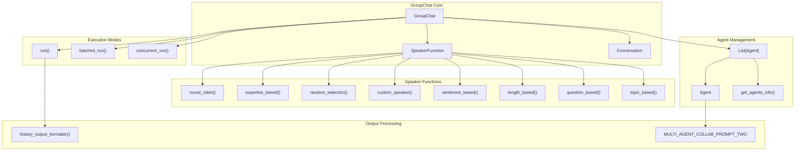
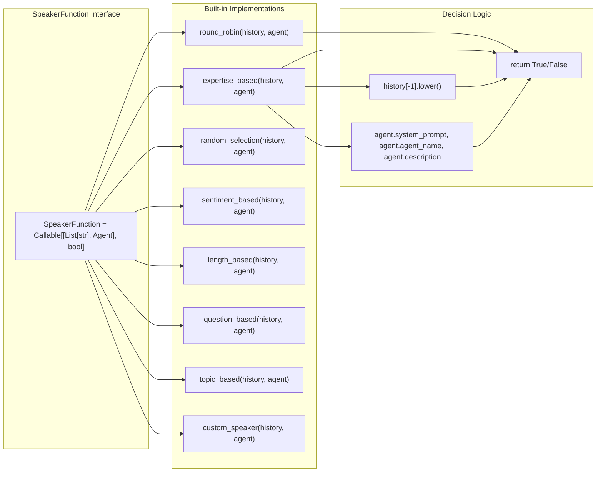
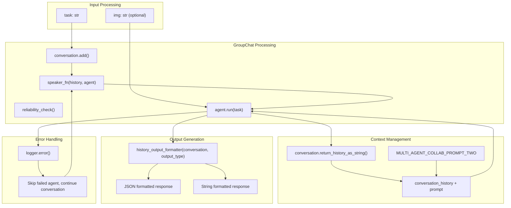

<!-- source: DeepWiki mcp.deepwiki.com · repo kyegomez/swarms · page 3.4 GroupChat · fetched 2026-10-27 -->

# GroupChat

<details>
<summary>Relevant source files</summary>

The following files were used as context for generating this wiki page:

- [docs/swarms/structs/group_chat.md](docs/swarms/structs/group_chat.md)
- [docs/swarms_cloud/mcs_api.md](docs/swarms_cloud/mcs_api.md)
- [swarms/structs/groupchat.py](swarms/structs/groupchat.py)
- [swarms/structs/spreadsheet_swarm.py](swarms/structs/spreadsheet_swarm.py)
- [tests/structs/test_groupchat.py](tests/structs/test_groupchat.py)

</details>


This document covers the GroupChat system, a dynamic conversation management framework that orchestrates multi-agent discussions with customizable speaker selection logic and parallel processing capabilities. GroupChat enables multiple AI agents to engage in structured conversations where the flow and participation are controlled through programmable speaker functions.

For information about sequential multi-agent workflows, see [Sequential Workflow](#3.1). For hierarchical agent coordination with director-worker patterns, see [Hierarchical Swarm](#3.3).

## System Architecture

The GroupChat system orchestrates dynamic conversations between multiple agents through a speaker function mechanism that determines conversation flow and participant selection.



Sources: [swarms/structs/groupchat.py:1-491](), [swarms/structs/multi_agent_exec.py:9](), [swarms/prompts/multi_agent_collab_prompt.py:13-15]()

## Speaker Function System

The speaker function architecture provides the core conversation control mechanism, where each function implements the `SpeakerFunction` type signature to determine agent participation.



Sources: [swarms/structs/groupchat.py:17](), [swarms/structs/groupchat.py:20-192]()

## Core GroupChat Class

The `GroupChat` class manages multi-agent conversations through speaker function delegation and conversation state tracking.

| Attribute | Type | Description |
|-----------|------|-------------|
| `name` | `str` | Group chat identifier |
| `description` | `str` | Purpose description of the chat |
| `agents` | `List[Agent]` | Participating agent instances |
| `speaker_fn` | `SpeakerFunction` | Function controlling agent speaking order |
| `max_loops` | `int` | Maximum conversation turns |
| `conversation` | `Conversation` | History and context management |
| `rules` | `str` | Conversation guidelines |
| `output_type` | `str` | Response format specification |

The constructor initializes the conversation system and applies collaboration prompts to all participating agents:

```python
def __init__(
    self,
    name: str = "GroupChat",
    description: str = "A group chat for multiple agents",
    agents: List[Agent] = [],
    speaker_fn: SpeakerFunction = round_robin,
    max_loops: int = 1,
    rules: str = "",
    output_type: str = "string",
):
```

Sources: [swarms/structs/groupchat.py:194-246]()

## Built-in Speaker Functions

The framework provides eight built-in speaker functions implementing different conversation flow strategies:

### Basic Flow Control

- **`round_robin(history, agent)`**: Always returns `True`, enabling sequential agent participation [swarms/structs/groupchat.py:20-25]()
- **`random_selection(history, agent)`**: Returns random boolean value for unpredictable conversation flow [swarms/structs/groupchat.py:40-47]()

### Content-Based Selection

- **`expertise_based(history, agent)`**: Activates agents when their `system_prompt` content appears in the last message [swarms/structs/groupchat.py:28-37]()
- **`topic_based(history, agent)`**: Matches agent expertise keywords from `description` against recent conversation content [swarms/structs/groupchat.py:172-191]()

### Context-Aware Selection

- **`sentiment_based(history, agent)`**: Analyzes message sentiment and matches to agent personality traits [swarms/structs/groupchat.py:96-126]()
- **`length_based(history, agent)`**: Triggers agents based on message length preferences defined in agent descriptions [swarms/structs/groupchat.py:129-144]()
- **`question_based(history, agent)`**: Activates agents when questions are detected in conversation [swarms/structs/groupchat.py:147-169]()

### Advanced Logic

- **`custom_speaker(history, agent)`**: Implements complex multi-criteria selection based on expertise relevance, direct mentions, and recent participation history [swarms/structs/groupchat.py:50-81]()

Sources: [swarms/structs/groupchat.py:20-192]()

## Execution Modes

GroupChat provides three execution patterns for different use cases:

### Single Task Execution

The `run(task, img=None)` method executes a single conversation with dynamic turn management:

- Randomly determines conversation length (1-4 turns)
- Prevents consecutive speaking by the same agent
- Builds contextual prompts referencing previous speakers
- Handles agent failures gracefully with error logging

Sources: [swarms/structs/groupchat.py:267-369]()

### Sequential Batch Processing

The `batched_run(tasks)` method processes multiple tasks sequentially:

```python
def batched_run(self, tasks: List[str], *args, **kwargs) -> List[str]:
    return [self.run(task, *args, **kwargs) for task in tasks]
```

Sources: [swarms/structs/groupchat.py:371-392]()

### Concurrent Processing

The `concurrent_run(tasks)` method leverages `concurrent.futures.ThreadPoolExecutor` for parallel task execution:

```python
def concurrent_run(self, tasks: List[str], *args, **kwargs) -> List[str]:
    with concurrent.futures.ThreadPoolExecutor() as executor:
        return list(executor.map(lambda task: self.run(task, *args, **kwargs), tasks))
```

Sources: [swarms/structs/groupchat.py:394-429]()

## Integration Architecture

GroupChat integrates with multiple framework components to provide comprehensive conversation management:



Sources: [swarms/structs/groupchat.py:267-369](), [swarms/utils/history_output_formatter.py:10-12](), [swarms/prompts/multi_agent_collab_prompt.py:13-15]()

## Configuration and Validation

The GroupChat system implements comprehensive validation through the `reliability_check()` method:

- Enforces minimum of 2 agents for meaningful conversations
- Validates `max_loops > 0` constraint  
- Automatically appends `MULTI_AGENT_COLLAB_PROMPT_TWO` to each agent's system prompt
- Initializes conversation context with group metadata

The conversation initialization includes agent context formatting:

```python
agent_context = f"\n Group Chat Name: {self.name}\nGroup Chat Description: {self.description}\n Agents in your Group Chat: {get_agents_info(self.agents)}"
self.conversation.add(role="System", content=agent_context)
```

Sources: [swarms/structs/groupchat.py:248-266](), [swarms/structs/multi_agent_exec.py:9]()

## Error Handling and Reliability

GroupChat implements robust error handling throughout the conversation flow:

- **Agent Failure Recovery**: Failed agent responses are logged and conversation continues with remaining agents
- **Input Validation**: Task inputs are validated for non-empty strings before processing
- **Concurrent Execution Safety**: ThreadPoolExecutor failures are caught and re-raised as `RuntimeError` with detailed context
- **Conversation State Protection**: Conversation state is preserved even when individual agents fail

The error handling preserves conversation continuity while providing detailed logging for debugging:

```python
try:
    message = current_speaker.run(task=f"{conversation_history} {prompt}")
    # Process successful response
except Exception as e:
    logger.error(f"Error from {current_speaker.agent_name}: {e}")
    continue  # Skip failed agent, maintain conversation flow
```

Sources: [swarms/structs/groupchat.py:356-361](), [swarms/structs/groupchat.py:417-429]()

---

