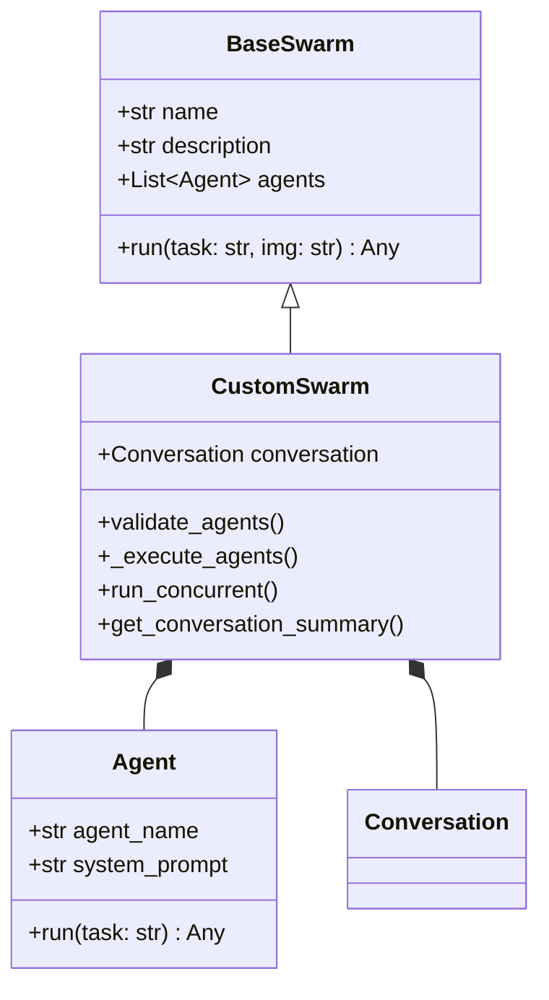
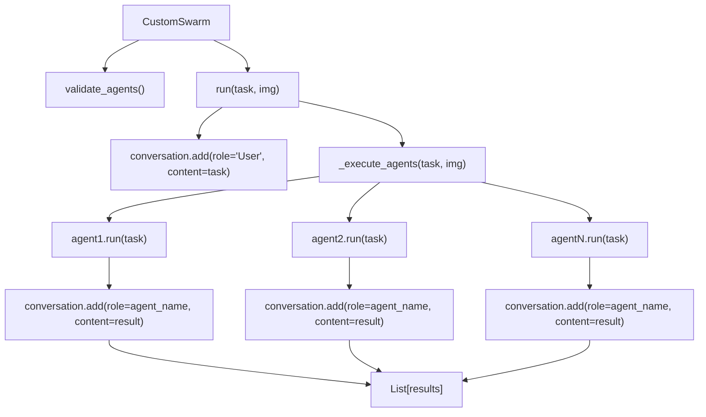
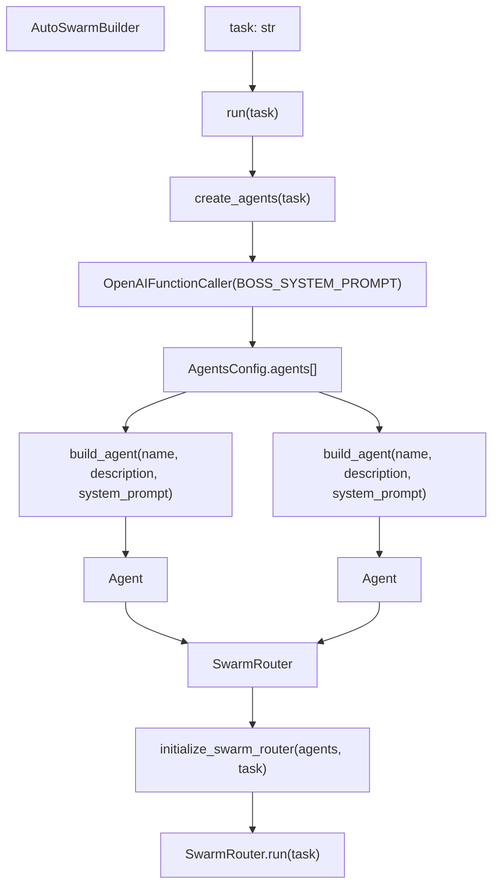
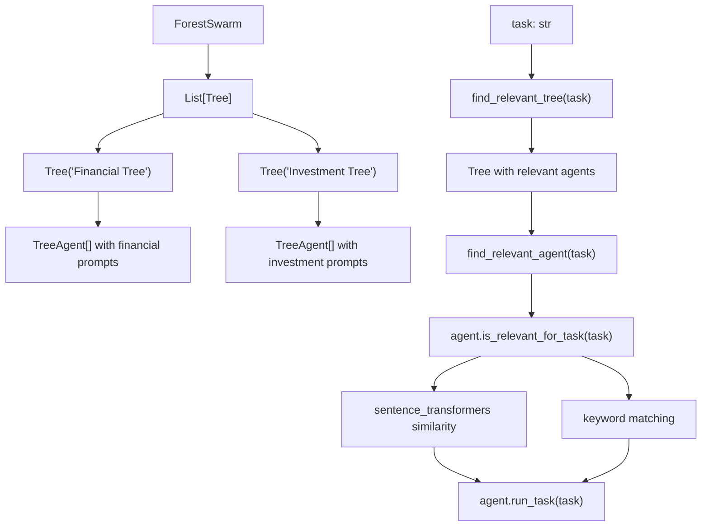
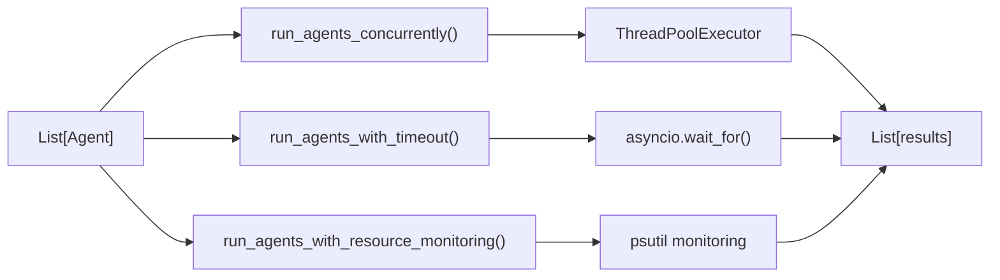
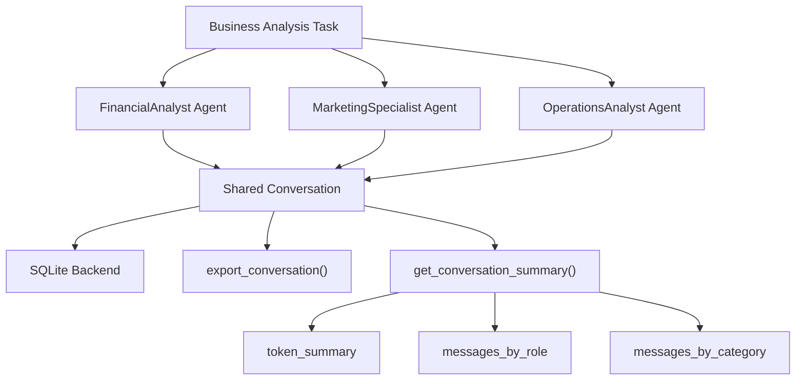
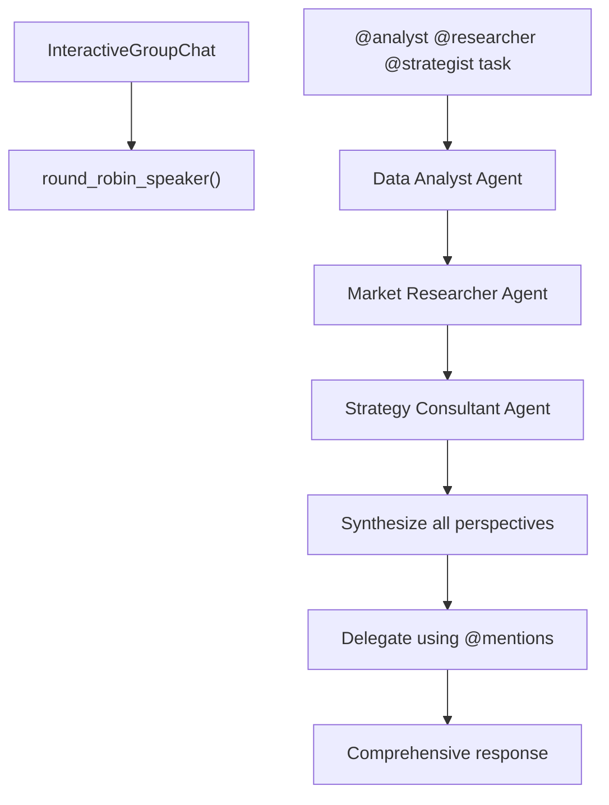
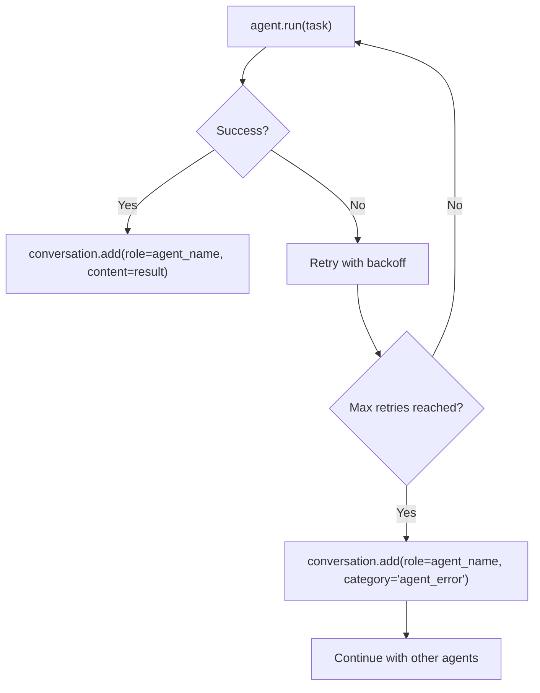

<!-- source: DeepWiki mcp.deepwiki.com · repo kyegomez/swarms · page 3.5 Custom Swarms · fetched 2026-10-27 -->

# Custom Swarms

Relevant source files

The following files were used as context for generating this wiki page:

- [docs/applications/business-analyst-agent.md](docs/applications/business-analyst-agent.md)
- [docs/assets/img/docs/query-plan-mini.png](docs/assets/img/docs/query-plan-mini.png)
- [docs/assets/img/docs/query-plan.png](docs/assets/img/docs/query-plan.png)
- [docs/corporate/bounty_program.md](docs/corporate/bounty_program.md)
- [docs/corporate/data_room.md](docs/corporate/data_room.md)
- [docs/swarms/structs/custom_swarm.md](docs/swarms/structs/custom_swarm.md)
- [docs/swarms/structs/hhcs.md](docs/swarms/structs/hhcs.md)
- [docs/swarms/structs/multi_swarm_orchestration.md](docs/swarms/structs/multi_swarm_orchestration.md)
- [examples/multi_agent/enhanced_collaboration_example.py](examples/multi_agent/enhanced_collaboration_example.py)
- [swarms/structs/auto_swarm_builder.py](swarms/structs/auto_swarm_builder.py)
- [swarms/structs/multi_agent_exec.py](swarms/structs/multi_agent_exec.py)
- [swarms/structs/tree_swarm.py](swarms/structs/tree_swarm.py)

This document covers building custom multi-agent architectures and specialized swarm patterns beyond the standard orchestration types. For information about pre-built orchestration patterns like Sequential and Concurrent workflows, see [Multi-Agent Orchestration](#3). For details on agent routing and factory patterns, see [SwarmRouter](#2.2).

## Purpose and Scope

Custom swarms enable developers to create specialized multi-agent collaboration patterns tailored to specific use cases. This includes building swarms with custom execution logic, conversation management, error handling, and agent selection mechanisms that extend beyond the framework's built-in orchestration types.

## Core Architecture Requirements

Every custom swarm implementation must adhere to fundamental interface requirements to maintain compatibility with the framework ecosystem.

### Required Interface

**Sources:** [docs/swarms/structs/custom_swarm.md:42-66](), [swarms/structs/base_swarm.py]()

All custom swarms must implement the `run(task: str, img: str, *args, **kwargs)` method and maintain the core attributes: `name`, `description`, `agents`, and `conversation` for proper integration with the framework's tooling and monitoring systems.

## Implementation Patterns

### Manual Construction Pattern

The most direct approach involves explicitly defining swarm behavior and agent coordination logic.

**Sources:** [docs/swarms/structs/custom_swarm.md:186-277]()

### Automated Construction Pattern

The `AutoSwarmBuilder` pattern uses AI to dynamically generate specialized agents based on task requirements.

**Sources:** [swarms/structs/auto_swarm_builder.py:171-202](), [swarms/structs/auto_swarm_builder.py:203-258]()

### Tree-Based Pattern

The `ForestSwarm` pattern organizes agents hierarchically with semantic similarity matching for task routing.

**Sources:** [swarms/structs/tree_swarm.py:190-344](), [swarms/structs/tree_swarm.py:153-187]()

## Key Components and Classes

### AutoSwarmBuilder

The `AutoSwarmBuilder` class provides intelligent agent creation and orchestration setup.

| Method | Parameters | Purpose |
|--------|------------|---------|
| `create_agents()` | `task: str` | Generates `AgentConfig` objects using LLM analysis |
| `build_agent()` | `agent_name, agent_description, agent_system_prompt` | Constructs `Agent` instances |
| `initialize_swarm_router()` | `agents: List[Agent], task: str` | Creates `SwarmRouter` with appropriate configuration |

**Sources:** [swarms/structs/auto_swarm_builder.py:129-151](), [swarms/structs/auto_swarm_builder.py:203-258]()

### TreeAgent and ForestSwarm  

Tree-based swarms use semantic embedding similarity for intelligent agent selection.

| Class | Key Methods | Purpose |
|-------|-------------|---------|
| `TreeAgent` | `calculate_distance()`, `is_relevant_for_task()` | Agent with embedding-based relevance scoring |
| `Tree` | `find_relevant_agent()`, `calculate_agent_distances()` | Container for related agents |
| `ForestSwarm` | `find_relevant_tree()`, `run()` | Multi-tree orchestration system |

**Sources:** [swarms/structs/tree_swarm.py:58-188](), [swarms/structs/tree_swarm.py:190-261](), [swarms/structs/tree_swarm.py:262-344]()

### Concurrent Execution Utilities

The `multi_agent_exec` module provides various execution patterns for custom swarms.

**Sources:** [swarms/structs/multi_agent_exec.py:69-109](), [swarms/structs/multi_agent_exec.py:233-279](), [swarms/structs/multi_agent_exec.py:291-324]()

## Advanced Patterns

### Business Analysis Swarm

Multi-domain analysis swarms combine specialized agents with shared conversation context.

**Sources:** [docs/applications/business-analyst-agent.md:588-672](), [docs/swarms/structs/custom_swarm.md:440-466]()

### Enhanced Collaborative GroupChat

Custom swarms can implement sophisticated collaboration patterns with delegation and synthesis.

**Sources:** [examples/multi_agent/enhanced_collaboration_example.py:66-106](), [examples/multi_agent/enhanced_collaboration_example.py:185-224]()

## Best Practices

### Conversation Management Integration

All custom swarms should integrate with the framework's `Conversation` system for tracking and auditing.

| Configuration | Backend Options | Use Case |
|---------------|-----------------|----------|
| `backend` | `"sqlite"`, `"redis"`, `"supabase"` | Persistent storage |
| `time_enabled` | `True` | Timestamp tracking |
| `token_count` | `True` | Usage monitoring |
| `autosave` | `True` | Automatic persistence |

**Sources:** [docs/swarms/structs/custom_swarm.md:612-627](), [docs/swarms/structs/custom_swarm.md:719-737]()

### Error Handling and Resilience

Implement retry logic and graceful degradation for production deployments.

**Sources:** [docs/swarms/structs/custom_swarm.md:371-438](), [docs/swarms/structs/custom_swarm.md:263-276]()

### Resource Optimization

Use concurrent execution patterns and resource monitoring for scalable deployments.

| Function | Parameters | Optimization |
|----------|------------|--------------|
| `run_agents_concurrently()` | `max_workers=None` | CPU-based worker scaling |
| `run_agents_with_timeout()` | `timeout: float` | Prevent hanging agents |
| `get_system_metrics()` | None | CPU/memory monitoring |

**Sources:** [swarms/structs/multi_agent_exec.py:69-109](), [swarms/structs/multi_agent_exec.py:233-279](), [swarms/structs/multi_agent_exec.py:282-288]()

---

