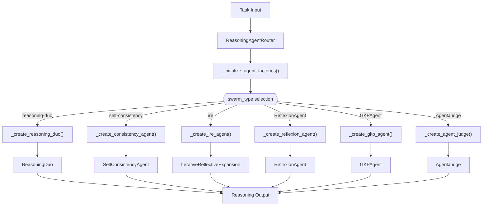

<!-- source: DeepWiki mcp.deepwiki.com · repo kyegomez/swarms · page 3.6 Reasoning Agents · fetched 2026-10-27 -->

# Reasoning Agents

<details>
<summary>Relevant source files</summary>

The following files were used as context for generating this wiki page:

- [docs/swarms/agents/consistency_agent.md](docs/swarms/agents/consistency_agent.md)
- [docs/swarms/agents/reasoning_agent_router.md](docs/swarms/agents/reasoning_agent_router.md)
- [examples/multi_agent/caching_examples/example_multi_agent_caching.py](examples/multi_agent/caching_examples/example_multi_agent_caching.py)
- [examples/multi_agent/caching_examples/quick_start_agent_caching.py](examples/multi_agent/caching_examples/quick_start_agent_caching.py)
- [examples/multi_agent/caching_examples/test_simple_agent_caching.py](examples/multi_agent/caching_examples/test_simple_agent_caching.py)
- [examples/multi_agent/election_swarm_examples/apple_board_election_example.py](examples/multi_agent/election_swarm_examples/apple_board_election_example.py)
- [examples/multi_agent/election_swarm_examples/election_example.py](examples/multi_agent/election_swarm_examples/election_example.py)
- [examples/multi_agent/heavy_swarm_examples/heavy_swarm_no_dashboard.py](examples/multi_agent/heavy_swarm_examples/heavy_swarm_no_dashboard.py)
- [examples/multi_agent/sequential_workflow/sequential_wofkflow.py](examples/multi_agent/sequential_workflow/sequential_wofkflow.py)
- [examples/single_agent/reasoning_agent_examples/reasoning_agent_router.py](examples/single_agent/reasoning_agent_examples/reasoning_agent_router.py)
- [examples/single_agent/reasoning_agent_examples/reasoning_agent_router_now.py](examples/single_agent/reasoning_agent_examples/reasoning_agent_router_now.py)
- [examples/single_agent/reasoning_agent_examples/reasoning_duo_test.py](examples/single_agent/reasoning_agent_examples/reasoning_duo_test.py)
- [swarms/agents/consistency_agent.py](swarms/agents/consistency_agent.py)
- [swarms/agents/reasoning_agents.py](swarms/agents/reasoning_agents.py)
- [swarms/agents/reasoning_duo.py](swarms/agents/reasoning_duo.py)

</details>


## Purpose and Scope

This document covers the advanced reasoning agent patterns available in the Swarms framework. Reasoning agents implement sophisticated cognitive strategies that go beyond simple single-pass processing, including self-consistency validation, collaborative reasoning, iterative refinement, and reflective thinking patterns.

For basic multi-agent orchestration patterns like sequential and concurrent workflows, see [Sequential Workflow](#3.1) and [Concurrent Workflow](#3.2). For tool integration with reasoning agents, see [Tool System](#4).

## Overview

The Swarms framework provides specialized reasoning agents that implement advanced cognitive strategies to improve output quality, reliability, and reasoning depth. These agents use techniques like generating multiple independent solutions, collaborative dual-agent reasoning, iterative refinement, and self-reflection to tackle complex problems that require sophisticated reasoning approaches.

The system is built around the `ReasoningAgentRouter` factory pattern, which provides a unified interface for selecting and configuring different reasoning strategies based on task requirements.

## Architecture

### ReasoningAgentRouter Factory System



Sources: [swarms/agents/reasoning_agents.py:82-345]()

### Core Reasoning Agent Types

```mermaid
graph TB
    subgraph "Collaborative Reasoning"
        ReasoningDuo["ReasoningDuo<br/>dual-agent collaboration"]
        ReasoningAgent["reasoning_agent<br/>REASONING_PROMPT"]
        MainAgent["main_agent<br/>system_prompt"]
        
        ReasoningDuo --> ReasoningAgent
        ReasoningDuo --> MainAgent
        ReasoningAgent --> Conversation["Conversation<br/>conversation history"]
        MainAgent --> Conversation
    end
    
    subgraph "Consensus-Based Reasoning"
        SelfConsistency["SelfConsistencyAgent<br/>multiple independent responses"]
        ThreadPool["ThreadPoolExecutor<br/>concurrent execution"]
        AggregationAgent["aggregation_agent<br/>majority voting"]
        
        SelfConsistency --> ThreadPool
        ThreadPool --> AggregationAgent
        AggregationAgent --> FinalAnswer["final consensus answer"]
    end
    
    subgraph "Iterative Reasoning"
        IREAgent["IterativeReflectiveExpansion<br/>iterative refinement"]
        ReflexionAgent["ReflexionAgent<br/>self-reflection with memory"]
        
        IREAgent --> Iterations["max_iterations loops"]
        ReflexionAgent --> Memory["memory_capacity"]
    end
    
    subgraph "Specialized Reasoning"
        GKPAgent["GKPAgent<br/>knowledge generation"]
        AgentJudge["AgentJudge<br/>evaluation and critique"]
        
        GKPAgent --> Knowledge["num_knowledge_items"]
        AgentJudge --> Evaluation["quality assessment"]
    end
```



Sources: [swarms/agents/reasoning_agents.py:52-63](), [swarms/agents/reasoning_duo.py:15-163](), [swarms/agents/consistency_agent.py:113-390]()

## Reasoning Agent Types

### ReasoningDuo

The `ReasoningDuo` implements a collaborative dual-agent system where a reasoning agent analyzes the problem and a main agent executes the solution. This pattern separates analytical thinking from execution.

| Parameter | Type | Default | Description |
|-----------|------|---------|-------------|
| `reasoning_model_name` | `Optional[str]` | `"claude-3-5-sonnet-20240620"` | Model for reasoning agent |
| `model_name` | `str` | `"gpt-4o-mini"` | Model for main agent |
| `max_loops` | `int` | `1` | Number of reasoning iterations |
| `output_type` | `OutputType` | `"dict-all-except-first"` | Output format |

The reasoning agent uses the `REASONING_PROMPT` system prompt, while the main agent uses the user-specified `system_prompt`. The conversation history is maintained across both agents using the `Conversation` class.

**Usage Pattern:**
```python
# ReasoningDuo with specialized models
router = ReasoningAgentRouter(
    swarm_type="reasoning-duo",
    reasoning_model_name="claude-3-5-sonnet-20240620",
    model_name="gpt-4o-mini"
)
```

Sources: [swarms/agents/reasoning_duo.py:15-163](), [swarms/agents/reasoning_agents.py:191-206]()

### SelfConsistencyAgent

The `SelfConsistencyAgent` generates multiple independent responses concurrently and uses majority voting to aggregate them into a final answer. This approach improves reliability by reducing random errors and biases.

| Parameter | Type | Default | Description |
|-----------|------|---------|-------------|
| `num_samples` | `int` | `5` | Number of independent responses |
| `eval` | `bool` | `False` | Enable answer validation |
| `random_models_on` | `bool` | `False` | Use random models for diversity |
| `majority_voting_prompt` | `Optional[str]` | `majority_voting_prompt` | Custom aggregation prompt |

The agent uses `ThreadPoolExecutor` for concurrent response generation and an `aggregation_agent` function that implements sophisticated majority voting analysis.

**Core Workflow:**
1. Generate `num_samples` independent responses using `ThreadPoolExecutor`
2. Optional validation against known answer if `eval=True`
3. Aggregate responses using AI-powered `aggregation_agent`
4. Return final consensus answer

Sources: [swarms/agents/consistency_agent.py:113-390](), [swarms/agents/reasoning_agents.py:208-226]()

### IterativeReflectiveExpansion (IRE)

The IRE agent implements iterative refinement where each iteration builds upon previous reasoning to progressively improve the solution quality.

| Parameter | Type | Default | Description |
|-----------|------|---------|-------------|
| `max_iterations` | `int` | `num_samples` | Maximum refinement iterations |
| `max_loops` | `int` | `1` | Loops per iteration |

Sources: [swarms/agents/reasoning_agents.py:228-243]()

### ReflexionAgent

The `ReflexionAgent` implements self-reflection capabilities with memory management, allowing the agent to learn from previous experiences and adapt its reasoning approach.

| Parameter | Type | Default | Description |
|-----------|------|---------|-------------|
| `memory_capacity` | `int` | `6` | Maximum memory items |
| `max_loops` | `int` | `1` | Reasoning loops |

Sources: [swarms/agents/reasoning_agents.py:259-272]()

### GKPAgent (Generated Knowledge Prompting)

The `GKPAgent` specializes in knowledge generation and synthesis, creating relevant background knowledge before answering questions.

| Parameter | Type | Default | Description |
|-----------|------|---------|-------------|
| `num_knowledge_items` | `int` | `6` | Number of knowledge items to generate |

Sources: [swarms/agents/reasoning_agents.py:274-285]()

### AgentJudge

The `AgentJudge` provides evaluation and critique capabilities, useful for quality assessment and solution validation.

| Parameter | Type | Default | Description |
|-----------|------|---------|-------------|
| `max_loops` | `int` | `1` | Evaluation loops |

Sources: [swarms/agents/reasoning_agents.py:245-257]()

## Configuration and Usage

### ReasoningAgentRouter Configuration

The `ReasoningAgentRouter` provides a unified interface for all reasoning agent types with shared configuration parameters:

| Parameter | Type | Default | Description |
|-----------|------|---------|-------------|
| `agent_name` | `str` | `"reasoning_agent"` | Agent identifier |
| `swarm_type` | `agent_types` | `"reasoning-duo"` | Reasoning strategy |
| `model_name` | `str` | `"gpt-4o-mini"` | Base model |
| `system_prompt` | `str` | Default assistant prompt | Agent instructions |
| `max_loops` | `int` | `1` | Reasoning iterations |
| `num_samples` | `int` | `1` | Samples for consistency agents |
| `output_type` | `OutputType` | `"dict-all-except-first"` | Output format |

### Supported Agent Types

The router supports these `swarm_type` values through the `agent_types` literal:

```python
agent_types = Literal[
    "reasoning-duo",
    "self-consistency", 
    "ire",
    "reasoning-agent",    # alias for reasoning-duo
    "consistency-agent",  # alias for self-consistency
    "ire-agent",         # alias for ire
    "ReflexionAgent",
    "GKPAgent", 
    "AgentJudge",
]
```

### Basic Usage Examples

**Self-Consistency for Reliable Answers:**
```python
router = ReasoningAgentRouter(
    swarm_type="self-consistency",
    num_samples=5,
    model_name="gpt-4o-mini"
)
result = router.run("What is the 40th prime number?")
```

**Reasoning Duo for Complex Analysis:**
```python
router = ReasoningAgentRouter(
    swarm_type="reasoning-duo",
    reasoning_model_name="claude-3-5-sonnet-20240620",
    model_name="gpt-4o-mini"
)
result = router.run("Analyze the quantum mechanics implications...")
```

**Batch Processing:**
```python
tasks = ["Task 1", "Task 2", "Task 3"]
results = router.batched_run(tasks)
```

Sources: [swarms/agents/reasoning_agents.py:82-345](), [examples/single_agent/reasoning_agent_examples/reasoning_agent_router.py:1-24]()

### Error Handling

The router implements comprehensive error handling through custom exception classes:

- `ReasoningAgentInitializationError`: Raised during agent setup failures
- `ReasoningAgentExecutorError`: Raised during execution failures

The `reliability_check()` method validates configuration parameters before agent creation.

Sources: [swarms/agents/reasoning_agents.py:66-79](), [swarms/agents/reasoning_agents.py:151-169]()

## Advanced Features

### Multimodal Support

Reasoning agents support image inputs through the `img` parameter:

```python
result = router.run(
    task="Analyze this chart",
    img="path/to/chart.png"
)

# Batch processing with images
results = router.batched_run(
    tasks=["Analyze chart", "Describe photo"],
    imgs=["chart.png", "photo.jpg"] 
)
```

### Concurrent Execution in SelfConsistencyAgent

The `SelfConsistencyAgent` uses `ThreadPoolExecutor` for parallel response generation:

```python
with ThreadPoolExecutor() as executor:
    futures = {
        executor.submit(reasoning_agent.run, task=task, img=img): i
        for i in range(self.num_samples)
    }
    for future in as_completed(futures):
        response = future.result()
        responses.append(response)
```

Sources: [swarms/agents/consistency_agent.py:263-276]()

### Sophisticated Aggregation

The `aggregation_agent` function implements detailed majority voting analysis with comprehensive examination of:
- Dominant responses and consensus patterns
- Disparities and contrasting viewpoints  
- Minority insights and alternative perspectives
- Mathematical validity and logical reasoning
- Final synthesized recommendations

Sources: [swarms/agents/consistency_agent.py:70-110](), [swarms/agents/consistency_agent.py:43-67]()

## Best Practices

### Agent Type Selection

| Use Case | Recommended Agent | Rationale |
|----------|------------------|-----------|
| High reliability required | `self-consistency` | Multiple independent solutions with consensus |
| Complex analysis + action | `reasoning-duo` | Separates analytical thinking from execution |
| Iterative refinement needed | `ire` | Progressive improvement through iterations |
| Quality assessment | `AgentJudge` | Specialized evaluation capabilities |
| Knowledge-intensive tasks | `GKPAgent` | Generates relevant background knowledge |

### Performance Optimization

- **Sample Size**: Use 3-5 samples for `self-consistency`, increase for critical decisions
- **Model Selection**: Choose stronger models for reasoning-heavy tasks
- **Concurrent Execution**: Leverage `ThreadPoolExecutor` in consistency agents
- **Memory Management**: Configure appropriate `memory_capacity` for reflexion agents

### Configuration Guidelines

- Enable `eval=True` for tasks with known correct answers
- Use `random_models_on=True` for diverse reasoning perspectives in consistency agents
- Customize `majority_voting_prompt` for domain-specific aggregation logic
- Adjust `max_loops` based on task complexity requirements

Sources: [docs/swarms/agents/reasoning_agent_router.md:358-403]()

---

