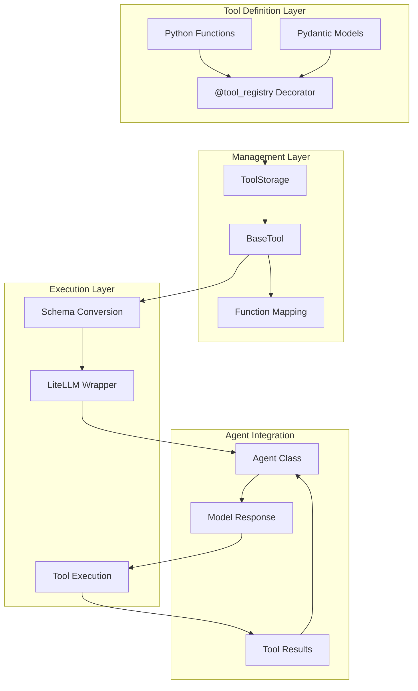
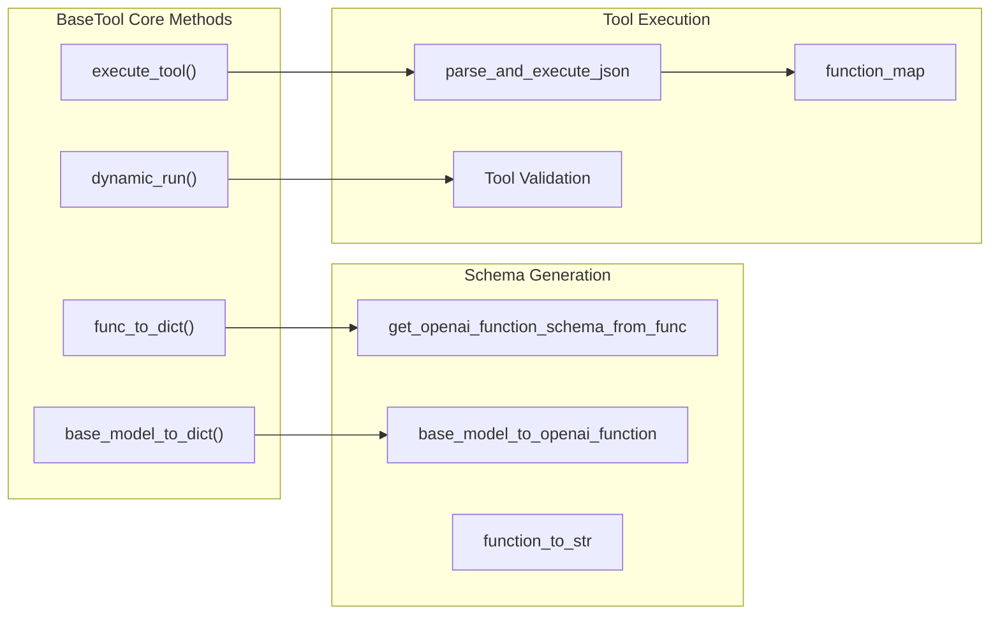
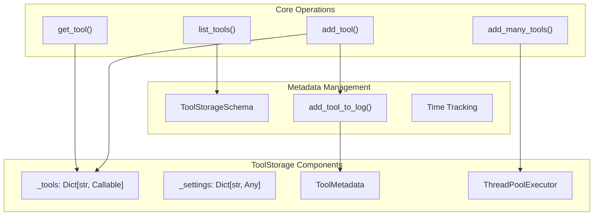
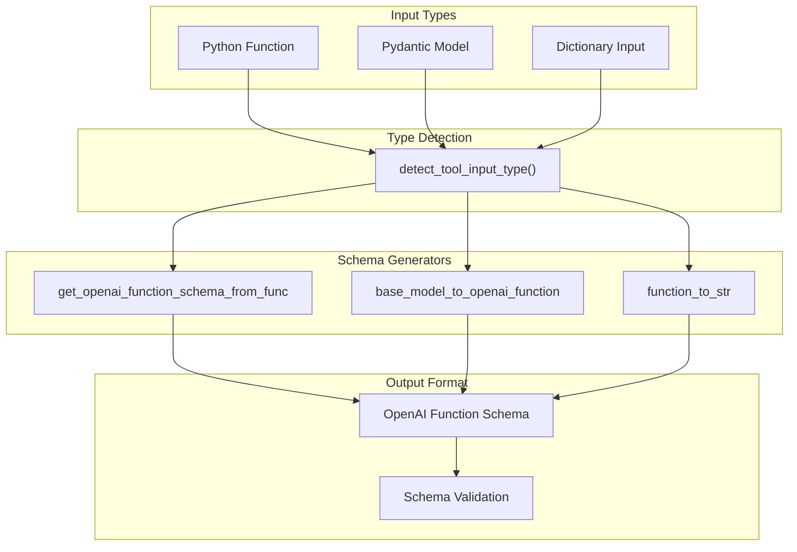
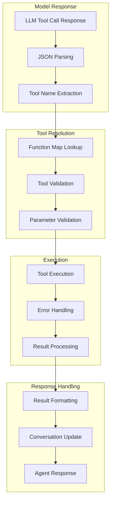
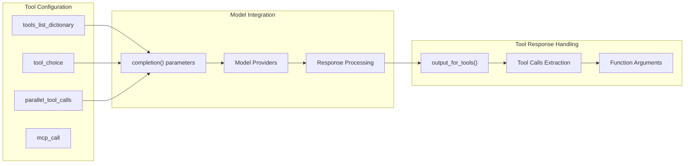
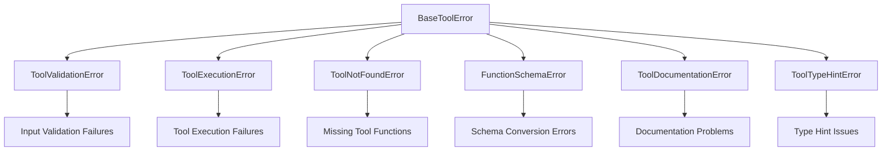
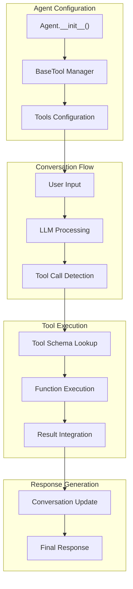

<!-- source: DeepWiki mcp.deepwiki.com · repo kyegomez/swarms · page 4 Tool System · fetched 2026-10-27 -->

# Tool System

<details>
<summary>Relevant source files</summary>

The following files were used as context for generating this wiki page:

- [docs/examples/agent_stream.md](docs/examples/agent_stream.md)
- [docs/swarms/examples/model_providers.md](docs/swarms/examples/model_providers.md)
- [examples/multi_agent/groupchat/quantum_physics_swarm.py](examples/multi_agent/groupchat/quantum_physics_swarm.py)
- [examples/multi_agent/mixture_of_agents_example.py](examples/multi_agent/mixture_of_agents_example.py)
- [examples/ui/chat.py](examples/ui/chat.py)
- [swarms/prompts/multi_modal_visual_prompts.py](swarms/prompts/multi_modal_visual_prompts.py)
- [swarms/tools/base_tool.py](swarms/tools/base_tool.py)
- [swarms/tools/tool_registry.py](swarms/tools/tool_registry.py)
- [swarms/utils/formatter.py](swarms/utils/formatter.py)
- [swarms/utils/litellm_wrapper.py](swarms/utils/litellm_wrapper.py)

</details>


The Tool System provides a comprehensive framework for extending agent capabilities through function calling and tool integration. It enables agents to execute Python functions, access external APIs, and interact with various services through a unified interface that converts functions to OpenAI-compatible schemas and manages their execution.

For information about integrating tools with specific models, see [Model Integration](#5). For details on agent-tool interaction patterns, see [Core Agent System](#2).

## Architecture Overview

The Tool System consists of three primary layers that work together to provide seamless function calling capabilities:

### Tool System Architecture



Sources: [swarms/tools/base_tool.py:69-106](), [swarms/tools/tool_registry.py:30-64](), [swarms/utils/litellm_wrapper.py:83-155]()

## Core Components

### BaseTool Management System

The `BaseTool` class serves as the central orchestrator for tool operations, providing schema conversion, validation, and execution capabilities.



Sources: [swarms/tools/base_tool.py:142-173](), [swarms/tools/base_tool.py:231-315](), [swarms/tools/base_tool.py:527-592]()

| Method | Purpose | Input Type | Output Type |
|--------|---------|------------|-------------|
| `func_to_dict` | Convert function to OpenAI schema | `Callable` | `Dict[str, Any]` |
| `base_model_to_dict` | Convert Pydantic model to schema | `type[BaseModel]` | `Dict[str, Any]` |
| `execute_tool` | Execute tool from JSON response | `str` | `Callable` |
| `dynamic_run` | Auto-detect and process input | `Any` | `str` |

### ToolStorage Registry

The `ToolStorage` class provides a centralized registry for managing tool functions with metadata tracking and concurrent operations.



Sources: [swarms/tools/tool_registry.py:66-92](), [swarms/tools/tool_registry.py:113-134](), [swarms/tools/tool_registry.py:175-192]()

### Tool Registration Decorator

The `@tool_registry` decorator provides a convenient way to register functions as tools automatically:

```python
@tool_registry(storage)
def example_tool(a: int, b: int) -> int:
    """An example tool that adds two numbers."""
    return a + b
```

Sources: [swarms/tools/tool_registry.py:194-225]()

## Schema Conversion Process

The Tool System converts Python functions and Pydantic models into OpenAI-compatible function calling schemas through a standardized process:

### Function to Schema Conversion Flow



Sources: [swarms/tools/base_tool.py:593-619](), [swarms/tools/base_tool.py:620-715]()

The schema conversion process ensures that all tools are represented in a consistent format that LLM providers can understand and execute.

## Tool Execution Pipeline

When an agent receives a tool call from the model, the execution pipeline processes the request through several validation and execution stages:

### Tool Execution Flow



Sources: [swarms/tools/base_tool.py:527-592](), [swarms/tools/base_tool.py:716-797](), [swarms/tools/base_tool.py:798-882]()

## LiteLLM Tool Integration

The `LiteLLM` wrapper class provides the bridge between the Tool System and various language model providers, handling tool schema transmission and response processing:

### LiteLLM Tool Configuration



Sources: [swarms/utils/litellm_wrapper.py:98-155](), [swarms/utils/litellm_wrapper.py:156-172](), [swarms/utils/litellm_wrapper.py:502-515]()

| Configuration Parameter | Purpose | Default Value |
|------------------------|---------|---------------|
| `tools_list_dictionary` | List of tool schemas | `None` |
| `tool_choice` | Tool selection strategy | `"auto"` |
| `parallel_tool_calls` | Enable concurrent tool execution | `False` |
| `mcp_call` | Model Control Protocol mode | `False` |

## Error Handling and Validation

The Tool System includes comprehensive error handling through custom exception classes that provide detailed error information:

### Exception Hierarchy



Sources: [swarms/tools/base_tool.py:23-64]()

## Integration with Agent System

The Tool System integrates seamlessly with the Agent class through the `BaseTool` manager, enabling agents to execute functions as part of their conversation flow:

### Agent-Tool Integration



Sources: [swarms/utils/litellm_wrapper.py:455-552](), [swarms/tools/base_tool.py:527-592]()

The Tool System provides a robust, scalable foundation for extending agent capabilities through function calling, with comprehensive error handling, validation, and integration across multiple model providers.

---

