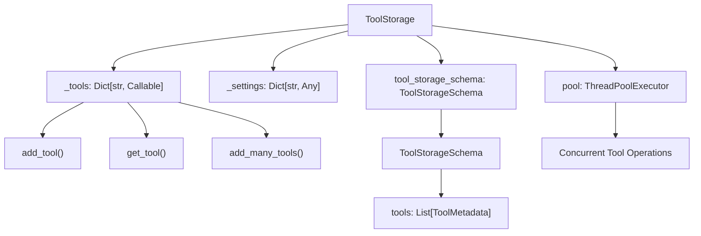
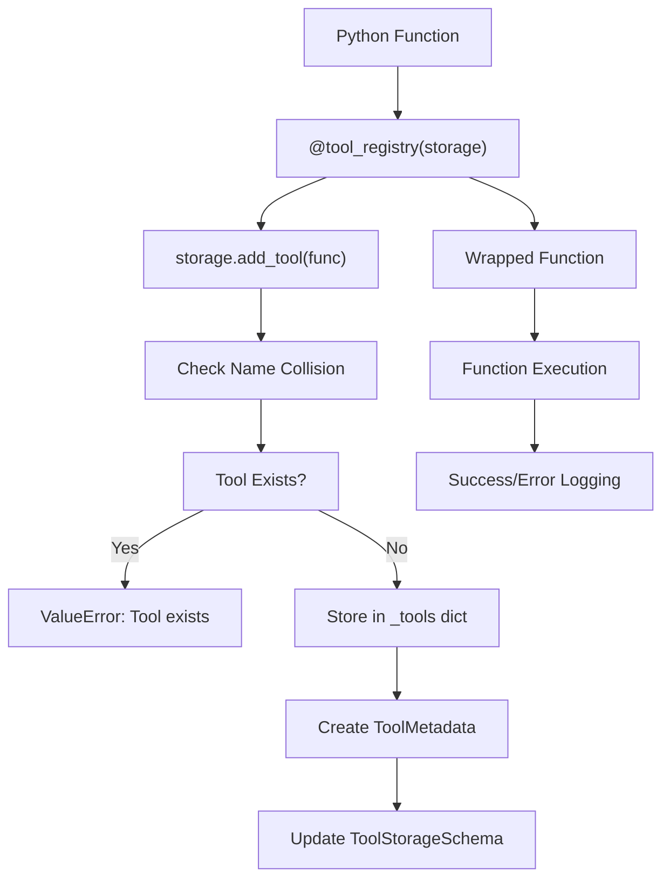
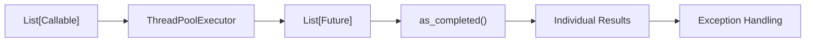
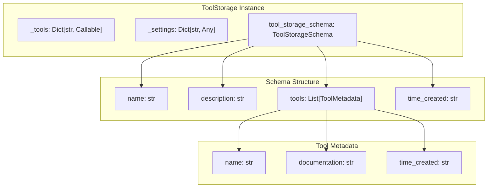
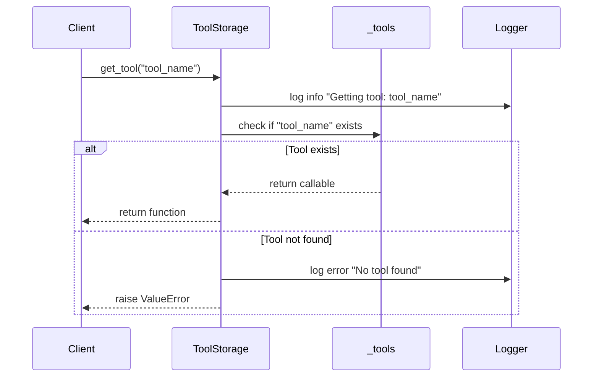
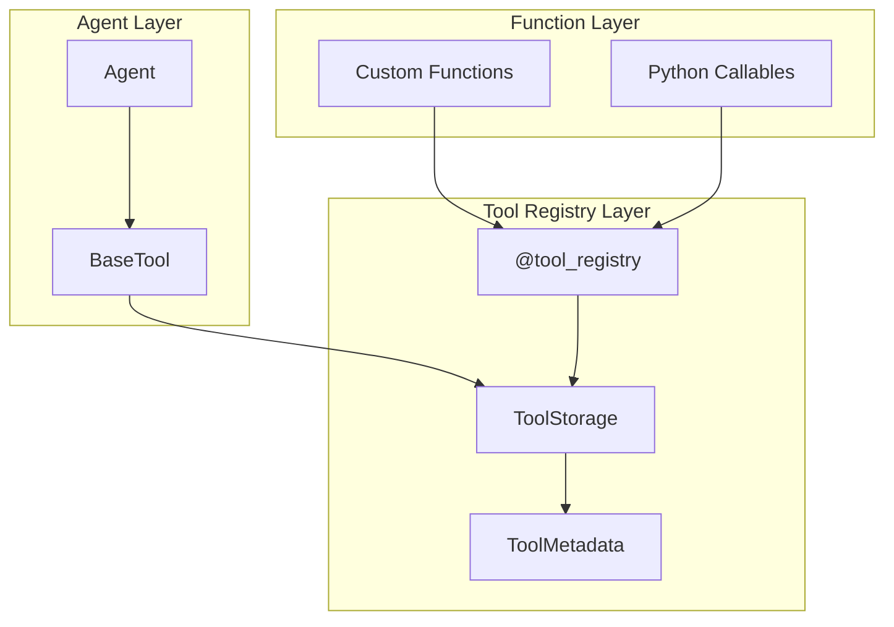

<!-- source: DeepWiki mcp.deepwiki.com · repo kyegomez/swarms · page 4.1 Tool Registry · fetched 2026-10-27 -->

# Tool Registry

<details>
<summary>Relevant source files</summary>

The following files were used as context for generating this wiki page:

- [swarms/prompts/multi_modal_visual_prompts.py](swarms/prompts/multi_modal_visual_prompts.py)
- [swarms/tools/tool_registry.py](swarms/tools/tool_registry.py)

</details>


The Tool Registry is the centralized system for registering, storing, and retrieving tools within the Swarms framework. It provides a decorator-based registration pattern and thread-safe storage mechanism that enables agents to dynamically discover and execute tools during runtime.

For information about tool execution and schema generation, see [BaseTool Management](#4.2). For guidance on developing custom tools, see [Creating Custom Tools](#4.3).

## Core Components

The Tool Registry system consists of three primary components that work together to manage tool lifecycle and metadata.

### ToolStorage Class

The `ToolStorage` class serves as the central repository for all registered tools. It maintains an internal dictionary of callable functions indexed by name and provides thread-safe operations for tool management.



The storage system includes several key attributes:
- `_tools`: Internal dictionary mapping tool names to callable functions
- `_settings`: Configuration storage for registry-wide settings  
- `tool_storage_schema`: Structured metadata about the registry and its tools
- `pool`: Thread pool executor for concurrent operations

*Sources: [swarms/tools/tool_registry.py:30-65]()*

### Data Models

The system uses Pydantic models to enforce structured metadata and ensure data consistency across tool operations.

| Model | Purpose | Key Fields |
|-------|---------|------------|
| `ToolMetadata` | Individual tool metadata | `name`, `documentation`, `time_created` |
| `ToolStorageSchema` | Registry-level schema | `name`, `description`, `tools`, `time_created` |

The `ToolMetadata` model captures essential information about each registered tool, including automatic timestamp generation for tracking when tools are added to the registry.

*Sources: [swarms/tools/tool_registry.py:11-28]()*

## Tool Registration Process

The registration process supports both individual tool registration and bulk operations through decorator patterns and direct method calls.

### Decorator Registration

The `tool_registry` decorator provides the primary registration mechanism, automatically adding functions to a specified storage instance while preserving their original functionality.



The decorator performs several operations:
1. Extracts function name and documentation
2. Validates name uniqueness within the registry
3. Stores the function in the internal dictionary
4. Creates metadata records
5. Wraps the function with logging capabilities

*Sources: [swarms/tools/tool_registry.py:195-224]()*

### Bulk Registration

For scenarios requiring multiple tool registration, the system provides `add_many_tools()` which uses concurrent execution to process multiple functions simultaneously.



The bulk registration process leverages Python's `concurrent.futures` module to parallelize tool addition operations, improving performance when registering large numbers of tools.

*Sources: [swarms/tools/tool_registry.py:93-112]()*

## Storage Architecture

The storage architecture provides thread-safe operations and structured metadata management through a combination of dictionaries and schema validation.

### Internal Storage Structure



The storage maintains dual representations of tool data:
- Runtime dictionary for fast callable lookup
- Structured schema for metadata queries and serialization

*Sources: [swarms/tools/tool_registry.py:55-61]()*

### Tool Retrieval Operations

Tool retrieval follows a simple dictionary lookup pattern with comprehensive error handling and logging.



The retrieval mechanism includes built-in validation to ensure requested tools exist before returning callable references.

*Sources: [swarms/tools/tool_registry.py:113-134]()*

## Concurrency and Performance

The Tool Registry implements several performance optimizations to handle concurrent operations efficiently.

### Thread Pool Execution

Each `ToolStorage` instance maintains a dedicated thread pool for concurrent operations, automatically sized based on available CPU cores.

```python
# Thread pool initialization
self.pool = ThreadPoolExecutor(max_workers=os.cpu_count())
```

This architecture enables:
- Parallel tool registration during bulk operations
- Non-blocking tool addition workflows
- Efficient resource utilization across CPU cores

*Sources: [swarms/tools/tool_registry.py:64]()*

### Logging and Monitoring

The system integrates comprehensive logging through the Swarms logging infrastructure, providing visibility into tool operations and error conditions.

| Operation | Log Level | Information Captured |
|-----------|-----------|---------------------|
| Tool Addition | INFO | Tool name, success/failure status |
| Tool Retrieval | INFO | Requested tool name |
| Registration | INFO | Decorator registration events |
| Errors | ERROR | Exception details, tool names |

*Sources: [swarms/tools/tool_registry.py:6-8]()*

## Integration with Agent System

The Tool Registry integrates with the broader Swarms ecosystem through standardized interfaces that enable dynamic tool discovery and execution.



The registry serves as the bridge between raw Python functions and the agent execution environment, providing the necessary metadata and callable references for dynamic tool invocation.

*Sources: [swarms/tools/tool_registry.py:30-224]()*

---

