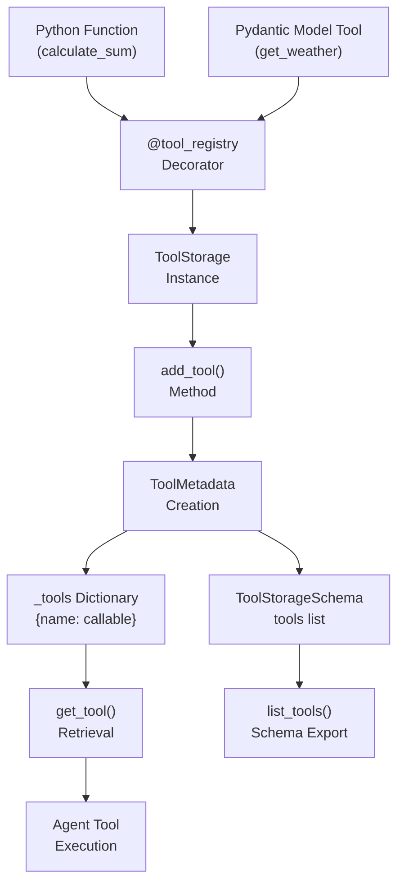
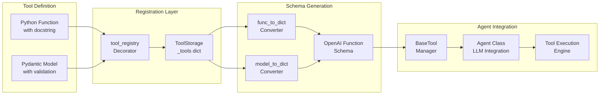

<!-- source: DeepWiki mcp.deepwiki.com · repo kyegomez/swarms · page 4.3 Creating Custom Tools · fetched 2026-10-27 -->

# Creating Custom Tools

<details>
<summary>Relevant source files</summary>

The following files were used as context for generating this wiki page:

- [swarms/prompts/meta_system_prompt.py](swarms/prompts/meta_system_prompt.py)
- [swarms/prompts/multi_modal_visual_prompts.py](swarms/prompts/multi_modal_visual_prompts.py)
- [swarms/tools/tool_registry.py](swarms/tools/tool_registry.py)

</details>


This document provides a comprehensive guide for developing and integrating custom tools with agents in the Swarms framework. Custom tools extend agent capabilities by allowing them to execute specific functions, call external APIs, or perform complex operations beyond basic text generation.

For information about tool storage and registry management, see [Tool Registry](#4.1). For details about tool execution and schema management, see [BaseTool Management](#4.2).

## Tool Creation Methods

The Swarms framework supports multiple approaches for creating custom tools, each designed for different use cases and complexity levels.

### Python Function Tools

The simplest method for creating tools is defining Python functions with proper type hints and documentation. The framework automatically converts these functions into tool schemas that agents can understand and execute.

```python
def calculate_sum(a: int, b: int) -> int:
    """
    Calculates the sum of two integers.
    
    Args:
        a (int): The first number
        b (int): The second number
    
    Returns:
        int: The sum of a and b
    """
    return a + b
```

Function-based tools must include:
- Type hints for all parameters and return values
- Comprehensive docstrings describing the function's purpose
- Clear parameter descriptions in the docstring
- Return value documentation

### Pydantic Model Tools

For more complex tools requiring structured input validation, Pydantic models provide advanced type checking and data validation capabilities.

```python
from pydantic import BaseModel, Field

class WeatherQuery(BaseModel):
    location: str = Field(description="City name or coordinates")
    units: str = Field(default="celsius", description="Temperature units")
    
def get_weather(query: WeatherQuery) -> dict:
    """
    Retrieves weather information for a specified location.
    
    Args:
        query (WeatherQuery): Weather query parameters
        
    Returns:
        dict: Weather data including temperature and conditions
    """
    # Implementation here
    pass
```

Pydantic-based tools offer:
- Advanced input validation
- Default value handling
- Nested data structure support
- Automatic error handling for invalid inputs

Sources: [swarms/tools/tool_registry.py:1-291]()

## Tool Registration Architecture

The tool registration system manages tool lifecycle from creation to agent integration through a centralized storage and decorator pattern.

### Tool Registration Flow



Sources: [swarms/tools/tool_registry.py:30-62](), [swarms/tools/tool_registry.py:66-92](), [swarms/tools/tool_registry.py:195-224]()

### Registration Process Components

The `ToolStorage` class manages tool registration through several key components:

| Component | Purpose | Key Methods |
|-----------|---------|-------------|
| `ToolStorage` | Central registry for all tools | `add_tool()`, `get_tool()`, `list_tools()` |
| `ToolMetadata` | Metadata tracking for each tool | `name`, `documentation`, `time_created` |
| `ToolStorageSchema` | Schema representation of registry | `tools`, `name`, `description` |
| `tool_registry` | Decorator for automatic registration | Wraps functions with registration logic |

The registration process creates a `ToolMetadata` instance for each tool, capturing essential information including the tool name, documentation, and creation timestamp.

Sources: [swarms/tools/tool_registry.py:11-28](), [swarms/tools/tool_registry.py:30-65]()

## Schema Generation and Agent Integration

Custom tools undergo automatic schema conversion to enable agent understanding and execution. This process transforms Python functions and Pydantic models into standardized formats compatible with language model function calling.

### Tool-to-Schema Conversion Pipeline



Sources: [swarms/tools/tool_registry.py:66-92](), [swarms/tools/tool_registry.py:195-224]()

### Integration with Agent Workflows

Tools integrate with agents through the `BaseTool` management system, which handles schema conversion, execution orchestration, and result processing. The agent receives tool schemas in OpenAI function calling format, enabling natural language tool selection and parameter extraction.

The integration process involves:
1. **Schema Registration**: Tools register with `ToolStorage` instances
2. **Schema Conversion**: Functions convert to JSON schemas with parameter descriptions
3. **Agent Binding**: Agents receive tool schemas for LLM function calling
4. **Execution Handling**: `BaseTool` manages tool invocation and result processing
5. **Response Integration**: Tool results integrate into agent conversation flows

Sources: [swarms/tools/tool_registry.py:165-174](), [swarms/tools/tool_registry.py:113-134]()

## Multi-Modal Tool Integration

The framework supports multi-modal tools that process images, audio, and other media types alongside text inputs. Multi-modal tools follow specialized prompt patterns that ensure proper file handling and media processing.

### Visual Tool Integration Pattern

Multi-modal agents use structured thought processes for tool selection and execution, as demonstrated in the visual agent prompt system:

```
Thought: Do I need to use a tool? Yes
Action: the action to take, should be one of [tool_names]  
Action Input: the input to the action
Observation: the result of the action
```

Visual tools must handle file references correctly and maintain strict filename accuracy throughout the execution process. The framework enforces filename correctness to prevent agents from fabricating nonexistent files.

Sources: [swarms/prompts/multi_modal_visual_prompts.py:19-34](), [swarms/prompts/multi_modal_visual_prompts.py:36-48]()

## Tool Storage and Retrieval

### Concurrent Tool Management

The `ToolStorage` class supports concurrent tool operations through `ThreadPoolExecutor` integration, enabling efficient batch tool registration and parallel tool execution.

```python
# Batch tool registration example
def add_many_tools(self, funcs: List[Callable]) -> None:
    with ThreadPoolExecutor(max_workers=os.cpu_count()) as executor:
        futures = [executor.submit(self.add_tool, func) for func in funcs]
        for future in as_completed(futures):
            try:
                future.result()
            except Exception as e:
                logger.error(f"Error adding tool: {e}")
```

### Storage Configuration and Settings

Tool storage instances support configuration management through key-value settings, enabling runtime customization of tool behavior and storage parameters.

| Method | Purpose | Usage |
|--------|---------|-------|
| `set_setting(key, value)` | Configure storage parameters | Runtime configuration |
| `get_setting(key)` | Retrieve configuration values | Parameter access |
| `list_tools()` | Export tool registry schema | Schema introspection |

Sources: [swarms/tools/tool_registry.py:63-65](), [swarms/tools/tool_registry.py:93-112](), [swarms/tools/tool_registry.py:135-163]()

## Best Practices for Custom Tool Development

### Documentation Standards

- **Comprehensive Docstrings**: Include detailed descriptions of tool purpose, parameters, and return values
- **Type Annotations**: Use precise type hints for all function parameters and return types  
- **Parameter Descriptions**: Document each parameter's purpose and expected format in docstrings
- **Return Value Documentation**: Clearly specify what the tool returns and in what format

### Error Handling and Validation

- **Input Validation**: Use Pydantic models for complex input validation requirements
- **Exception Handling**: Implement proper error handling with informative error messages
- **Logging Integration**: Leverage the framework's logging system for debugging and monitoring
- **Graceful Failures**: Design tools to fail gracefully with meaningful error responses

### Performance Considerations

- **Concurrent Execution**: Design tools to work efficiently in concurrent execution environments
- **Resource Management**: Consider memory and computational requirements for tool operations
- **Timeout Handling**: Implement appropriate timeouts for external API calls or long-running operations
- **Caching Strategies**: Cache expensive computations or external API responses when appropriate

### Integration Guidelines

- **Schema Compatibility**: Ensure tool schemas are compatible with OpenAI function calling standards
- **Agent Context**: Design tools that work effectively within agent conversation contexts
- **Multi-Modal Support**: Consider file handling requirements for visual or audio processing tools
- **State Management**: Handle stateful operations appropriately within agent workflows

Sources: [swarms/tools/tool_registry.py:76-92](), [swarms/tools/tool_registry.py:206-224](), [swarms/prompts/multi_modal_visual_prompts.py:36-48]()

---

