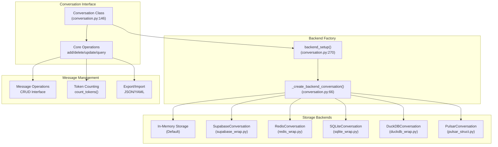
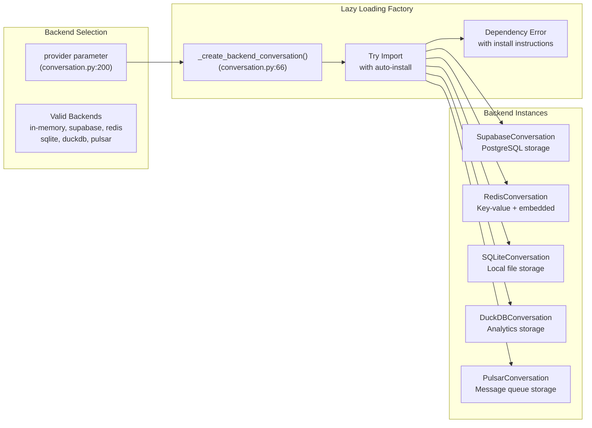
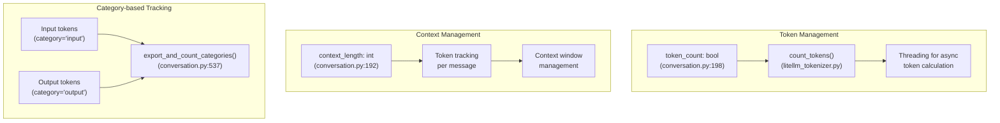

<!-- source: DeepWiki mcp.deepwiki.com · repo kyegomez/swarms · page 6.1 Conversation Management · fetched 2026-10-27 -->

# Conversation Management

<details>
<summary>Relevant source files</summary>

The following files were used as context for generating this wiki page:

- [swarms/communication/__init__.py](swarms/communication/__init__.py)
- [swarms/communication/duckdb_wrap.py](swarms/communication/duckdb_wrap.py)
- [swarms/communication/pulsar_struct.py](swarms/communication/pulsar_struct.py)
- [swarms/communication/redis_wrap.py](swarms/communication/redis_wrap.py)
- [swarms/communication/sqlite_wrap.py](swarms/communication/sqlite_wrap.py)
- [swarms/communication/supabase_wrap.py](swarms/communication/supabase_wrap.py)
- [swarms/structs/conversation.py](swarms/structs/conversation.py)
- [tests/communication/__init__.py](tests/communication/__init__.py)
- [tests/communication/test_duckdb_conversation.py](tests/communication/test_duckdb_conversation.py)
- [tests/communication/test_redis.py](tests/communication/test_redis.py)
- [tests/communication/test_sqlite_wrapper.py](tests/communication/test_sqlite_wrapper.py)
- [tests/communication/test_supabase_conversation.py](tests/communication/test_supabase_conversation.py)

</details>


This document covers the core conversation management system in Swarms, which provides persistent history tracking, context management, and multi-backend storage for agent conversations. The system is designed to handle conversation state across different agent interactions while supporting various storage backends and export formats.

For information about specific storage backend implementations, see [Storage Backends](#6.2). For general agent prompting and system message configuration, see [System Prompts](#7.1).

## Core Architecture

The conversation management system is built around the `Conversation` class in [swarms/structs/conversation.py:146-1271](), which provides a unified interface for managing conversation history regardless of the underlying storage backend.



The `Conversation` class acts as a facade that abstracts the underlying storage implementation, allowing users to switch between different backends without changing their code.

**Sources:** [swarms/structs/conversation.py:146-268](), [swarms/structs/conversation.py:66-144]()

## Backend Storage System

The conversation system uses a pluggable backend architecture that supports multiple storage providers through lazy loading and automatic dependency management.



Each backend is loaded on-demand with automatic dependency installation. The factory method [_create_backend_conversation():66-144]() handles import errors gracefully and provides clear installation instructions.

| Backend | Storage Type | Dependencies | Use Case |
|---------|--------------|--------------|----------|
| `in-memory` | Memory | None | Development, testing |
| `supabase` | PostgreSQL | `pip install supabase` | Production, multi-user |
| `redis` | Key-value | `pip install redis` | High-performance caching |
| `sqlite` | Local file | Built-in | Single-user applications |
| `duckdb` | Analytics | `pip install duckdb` | Analytics, reporting |
| `pulsar` | Message queue | `pip install pulsar-client` | Event-driven systems |

**Sources:** [swarms/structs/conversation.py:54-63](), [swarms/structs/conversation.py:66-144](), [swarms/structs/conversation.py:270-325]()

## Message Management Operations

The conversation system provides comprehensive CRUD operations for managing individual messages and conversation history.

### Core Message Operations

The primary interface for message management includes:

- `add(role, content, category=None)` - Add messages to conversation history [swarms/structs/conversation.py:633-662]()
- `delete(index)` - Remove messages by index [swarms/structs/conversation.py:714-722]()
- `update(index, role, content)` - Modify existing messages [swarms/structs/conversation.py:724-744]()  
- `query(index)` - Retrieve specific messages [swarms/structs/conversation.py:746-763]()
- `search(keyword)` - Find messages containing keywords [swarms/structs/conversation.py:765-786]()

### Message Structure

Messages are stored with the following structure:

```python
{
    "role": "user|assistant|system|function",
    "content": "message content or structured data",
    "timestamp": "ISO timestamp (if time_enabled)",
    "message_id": "UUID (if message_id_on)", 
    "category": "input|output (optional)",
    "token_count": "calculated tokens (if token_count enabled)"
}
```

### Batch Operations

The system supports efficient batch operations through `add_multiple()` [swarms/structs/conversation.py:691-712](), which uses thread pooling for concurrent message processing with 25% of available CPU cores.

**Sources:** [swarms/structs/conversation.py:633-662](), [swarms/structs/conversation.py:691-712](), [swarms/structs/conversation.py:495-536]()

## Context and Token Management

The conversation system includes sophisticated context management and token counting capabilities to handle LLM context windows and cost tracking.

### Token Counting

Token counting is handled through the `count_tokens()` utility [swarms/utils/litellm_tokenizer.py]() and can be enabled via the `token_count` parameter [swarms/structs/conversation.py:198]().



The `export_and_count_categories()` method [swarms/structs/conversation.py:537-608]() provides detailed token analytics, separating input and output tokens for cost analysis.

### Context Window Management

The system tracks context length [swarms/structs/conversation.py:192]() and provides mechanisms for managing conversation history within LLM context limits.

**Sources:** [swarms/structs/conversation.py:537-608](), [swarms/structs/conversation.py:668-690](), [swarms/utils/litellm_tokenizer.py]()

## Export and Import Capabilities

The conversation system provides comprehensive export and import functionality supporting multiple formats and use cases.

### Export Formats

- **JSON Export**: `save_as_json()` with metadata preservation [swarms/structs/conversation.py:949-1003]()
- **YAML Export**: Available through `save_as_yaml` flag [swarms/structs/conversation.py:234]()
- **String Export**: `return_history_as_string()` for readable format [swarms/structs/conversation.py:908-932]()

### Metadata Preservation

Exported conversations include comprehensive metadata:

```python
{
    "metadata": {
        "id": "conversation_id",
        "name": "conversation_name", 
        "created_at": "ISO_timestamp",
        "system_prompt": "system_prompt_text",
        "rules": "conversation_rules",
        "custom_rules_prompt": "custom_rules"
    },
    "history": [/* message objects */]
}
```

### Import and Restoration

The `load_from_json()` method [swarms/structs/conversation.py:1005-1036]() restores both conversation metadata and message history, maintaining conversation state across sessions.

**Sources:** [swarms/structs/conversation.py:949-1003](), [swarms/structs/conversation.py:1005-1036](), [swarms/structs/conversation.py:827-855]()

## Configuration and Setup

The `Conversation` class provides extensive configuration options for customizing behavior, storage, and functionality.

### Core Configuration Parameters

| Parameter | Type | Default | Purpose |
|-----------|------|---------|---------|
| `system_prompt` | `Optional[str]` | `None` | Initial system message |
| `time_enabled` | `bool` | `False` | Timestamp tracking |
| `autosave` | `bool` | `False` | Automatic persistence |
| `save_enabled` | `bool` | `False` | Enable save functionality |
| `context_length` | `int` | `8192` | Token context limit |
| `token_count` | `bool` | `False` | Enable token counting |
| `message_id_on` | `bool` | `False` | Generate message UUIDs |
| `provider` | `providers` | `"in-memory"` | Storage backend |

### Backend-Specific Configuration

Each backend accepts specific configuration parameters:

- **Supabase**: `supabase_url`, `supabase_key`, `table_name`
- **Redis**: `redis_host`, `redis_port`, `redis_db`, `use_embedded_redis`, `persist_redis`
- **SQLite/DuckDB**: `db_path`, `table_name`  
- **Pulsar**: `pulsar_url`, `topic`

### Initialization and Setup

The `setup()` method [swarms/structs/conversation.py:424-451]() handles conversation directory creation and existing conversation loading, while `_initialize_new_conversation()` [swarms/structs/conversation.py:453-466]() sets up initial prompts and rules.

**Sources:** [swarms/structs/conversation.py:182-268](), [swarms/structs/conversation.py:327-422](), [swarms/structs/conversation.py:424-466]()

---

