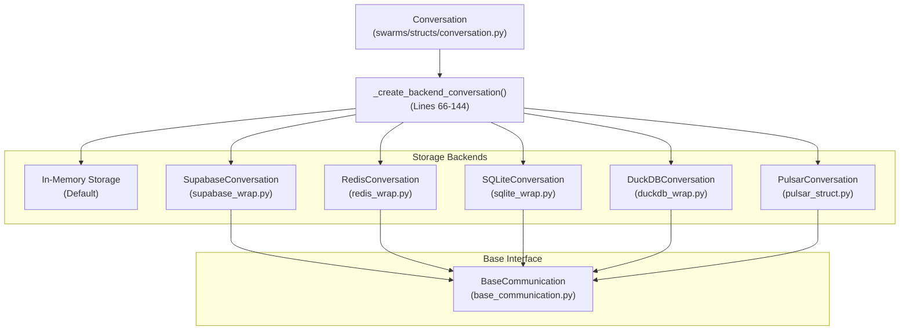
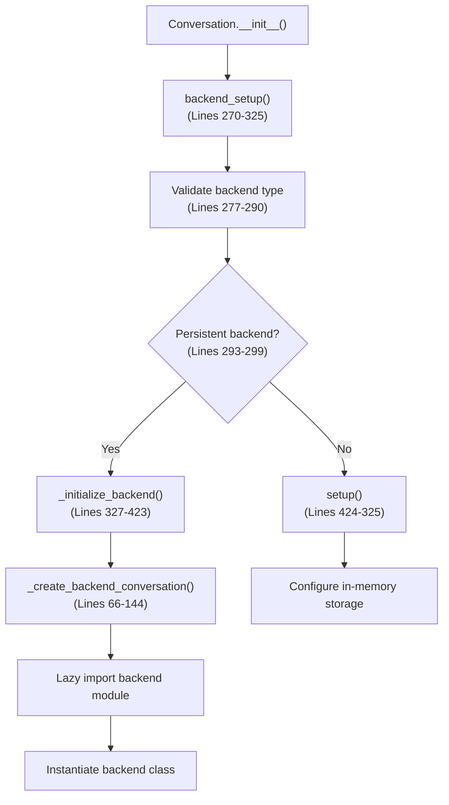

<!-- source: DeepWiki mcp.deepwiki.com · repo kyegomez/swarms · page 6.2 Storage Backends · fetched 2026-10-27 -->

# Storage Backends

<details>
<summary>Relevant source files</summary>

The following files were used as context for generating this wiki page:

- [swarms/communication/__init__.py](swarms/communication/__init__.py)
- [swarms/communication/duckdb_wrap.py](swarms/communication/duckdb_wrap.py)
- [swarms/communication/pulsar_struct.py](swarms/communication/pulsar_struct.py)
- [swarms/communication/redis_wrap.py](swarms/communication/redis_wrap.py)
- [swarms/communication/sqlite_wrap.py](swarms/communication/sqlite_wrap.py)
- [swarms/communication/supabase_wrap.py](swarms/communication/supabase_wrap.py)
- [swarms/structs/conversation.py](swarms/structs/conversation.py)
- [tests/communication/__init__.py](tests/communication/__init__.py)
- [tests/communication/test_duckdb_conversation.py](tests/communication/test_duckdb_conversation.py)
- [tests/communication/test_redis.py](tests/communication/test_redis.py)
- [tests/communication/test_sqlite_wrapper.py](tests/communication/test_sqlite_wrapper.py)
- [tests/communication/test_supabase_conversation.py](tests/communication/test_supabase_conversation.py)

</details>


This document covers the pluggable storage backends system for conversation management in the Swarms framework. The storage backends provide persistent storage options for conversation history, allowing agents to maintain context across sessions and scale to different deployment scenarios.

For information about the core conversation management interface, see [Conversation Management](#6.1). For details about agent prompting and system messages, see [System Prompts](#7.1).

## Overview

The Swarms framework provides a unified conversation storage system that supports multiple persistent backends through a pluggable architecture. The `Conversation` class serves as the primary interface while delegating storage operations to specialized backend implementations. This design allows applications to choose the most appropriate storage solution based on their requirements for persistence, scalability, and deployment environment.

The system supports both ephemeral in-memory storage and persistent storage backends including PostgreSQL (via Supabase), Redis, SQLite, DuckDB, and Apache Pulsar. Each backend implements a common interface while providing backend-specific optimizations and features.

## Backend Architecture

The storage backend system uses a factory pattern with lazy loading to minimize dependencies and startup time. The `Conversation` class acts as a facade that automatically selects and initializes the appropriate backend based on configuration.



Sources: [swarms/structs/conversation.py:55-325](), [swarms/communication/base_communication.py]()

## Available Backends

The framework supports the following storage backends, each with distinct characteristics and use cases:

| Backend | Type | Persistence | Scalability | Use Case |
|---------|------|-------------|-------------|----------|
| `in-memory` | Memory | None | Single instance | Development, testing |
| `supabase` | PostgreSQL | Full | High | Production, multi-user |
| `redis` | Key-value | Configurable | High | High-performance, caching |
| `sqlite` | File-based SQL | Full | Single node | Local applications |
| `duckdb` | Analytical SQL | Full | Single node | Analytics, data processing |
| `pulsar` | Message queue | Full | Very high | Event streaming, microservices |

### Backend Selection

Backend selection occurs during `Conversation` initialization through the `provider` or `backend` parameter:



Sources: [swarms/structs/conversation.py:270-325](), [swarms/structs/conversation.py:66-144]()

## Backend Implementations

### Supabase Backend

The `SupabaseConversation` provides PostgreSQL-based storage through Supabase's managed database service. It offers full SQL capabilities, real-time subscriptions, and built-in authentication.

**Key Features:**
- Automatic table creation with proper indexing
- JSON/JSONB support for complex message content
- Row-level security policies
- Connection pooling and retry logic

**Configuration:**
```python
conversation = Conversation(
    backend="supabase",
    supabase_url="https://your-project.supabase.co",
    supabase_key="your-anon-key",
    table_name="conversations"
)
```

The implementation handles database initialization through `_init_db()` method which creates the required table schema if it doesn't exist.

Sources: [swarms/communication/supabase_wrap.py:48-231](), [swarms/communication/supabase_wrap.py:232-320]()

### Redis Backend

The `RedisConversation` supports both external Redis servers and embedded Redis instances for development. It provides high-performance key-value storage with optional persistence.

**Key Features:**
- Embedded Redis server for development (`EmbeddedRedisServer`)
- Automatic persistence configuration
- Connection retry logic with exponential backoff
- Cache statistics and performance monitoring

**Configuration:**
```python
conversation = Conversation(
    backend="redis",
    redis_host="localhost",
    redis_port=6379,
    use_embedded_redis=True,
    persist_redis=True
)
```

The embedded server is managed by the `EmbeddedRedisServer` class which handles Redis configuration, startup, and cleanup.

Sources: [swarms/communication/redis_wrap.py:81-234](), [swarms/communication/redis_wrap.py:236-453]()

### SQLite Backend

The `SQLiteConversation` provides file-based SQL storage suitable for single-node deployments and local applications.

**Key Features:**
- Automatic database schema creation
- Transaction support with connection pooling
- Full-text search capabilities
- Thread-safe operations with connection management

**Configuration:**
```python
conversation = Conversation(
    backend="sqlite",
    db_path="./conversations.sqlite",
    table_name="conversations"
)
```

The implementation uses context managers for connection handling and includes retry logic for database operations.

Sources: [swarms/communication/sqlite_wrap.py:26-181](), [swarms/communication/sqlite_wrap.py:182-284]()

### DuckDB Backend

The `DuckDBConversation` provides analytical database capabilities optimized for OLAP workloads and data processing.

**Key Features:**
- Columnar storage for analytical queries
- Advanced SQL analytics functions  
- Efficient JSON handling
- Connection pooling with retry logic

**Configuration:**
```python
conversation = Conversation(
    backend="duckdb",
    db_path="./conversations.duckdb",
    table_name="conversations"
)
```

DuckDB excels at analytical queries over conversation data and supports complex aggregations efficiently.

Sources: [swarms/communication/duckdb_wrap.py:35-179](), [swarms/communication/duckdb_wrap.py:218-330]()

### Pulsar Backend

The `PulsarConversation` uses Apache Pulsar for message-based conversation storage, suitable for event streaming and microservices architectures.

**Key Features:**
- Message durability and ordering guarantees
- Topic-based conversation isolation
- Consumer groups for scalable processing
- Automatic message serialization

**Configuration:**
```python
conversation = Conversation(
    backend="pulsar",
    pulsar_host="pulsar://localhost:6650",
    topic="conversation-topic"
)
```

Each conversation creates its own topic and subscription for message isolation.

Sources: [swarms/communication/pulsar_struct.py:27-187](), [swarms/communication/pulsar_struct.py:188-284]()

## Error Handling and Dependency Management

The backend system implements robust error handling with automatic fallbacks and lazy dependency loading:

### Lazy Loading Pattern

Each backend uses lazy importing to avoid requiring all dependencies at startup:

```python
def _create_backend_conversation(backend: str, **kwargs):
    try:
        if backend == "supabase":
            from swarms.communication.supabase_wrap import SupabaseConversation
            return SupabaseConversation(**kwargs)
        # ... other backends
    except ImportError as e:
        # Provide helpful installation instructions
        backend_deps = {
            "supabase": "pip install supabase",
            "redis": "pip install redis",
            # ...
        }
        raise ImportError(f"Backend '{backend}' dependencies not available...")
```

### Fallback Mechanisms

The `Conversation` class includes fallback logic for backend initialization failures:

- Backend initialization errors fall back to in-memory storage with warnings
- Database connection failures trigger retry logic with exponential backoff
- Missing dependencies provide clear installation instructions

Sources: [swarms/structs/conversation.py:66-144](), [swarms/structs/conversation.py:315-322]()

## Testing and Validation

Each backend includes comprehensive test suites that validate:

- Basic CRUD operations (add, get, update, delete)
- Complex message types (JSON, lists, nested objects)
- Pagination and search functionality
- Error handling and edge cases
- Performance characteristics

The test files demonstrate proper usage patterns and serve as integration examples for each backend.

Sources: [tests/communication/test_redis.py](), [tests/communication/test_sqlite_wrapper.py](), [tests/communication/test_duckdb_conversation.py](), [tests/communication/test_supabase_conversation.py]()

---

