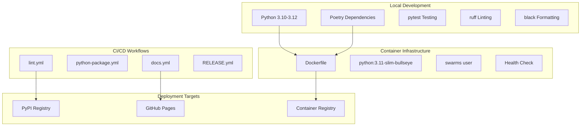
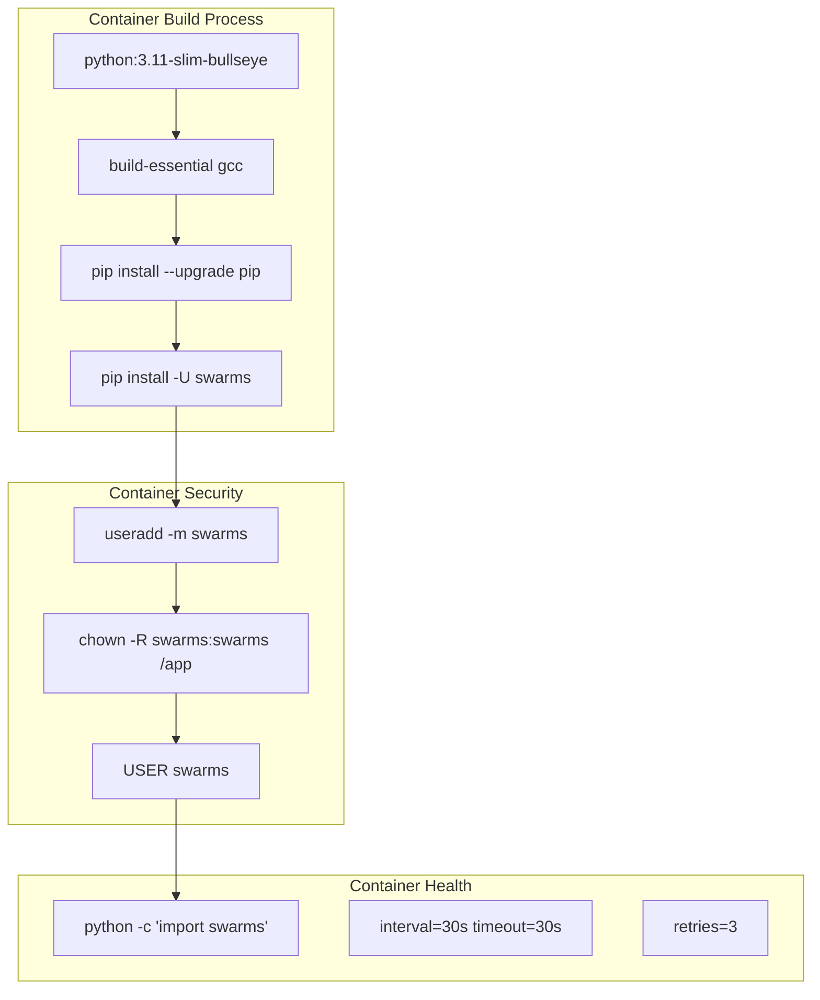
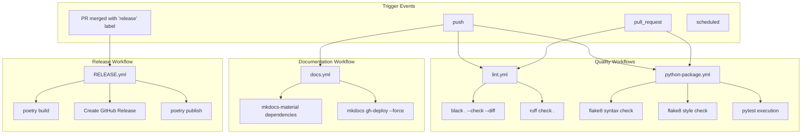
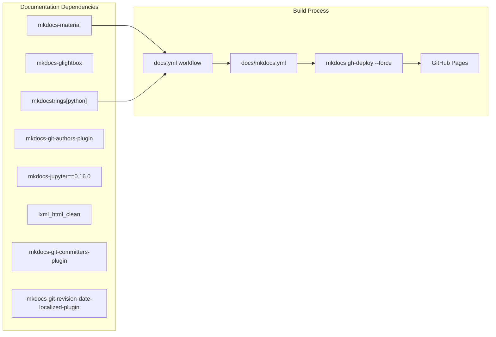
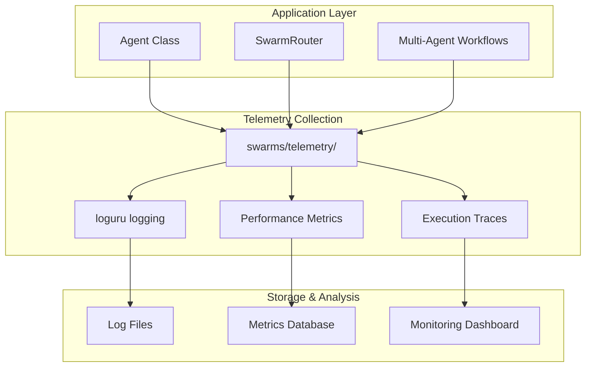

<!-- source: DeepWiki mcp.deepwiki.com · repo kyegomez/swarms · page 8 Development Infrastructure · fetched 2026-10-27 -->

# Development Infrastructure

<details>
<summary>Relevant source files</summary>

The following files were used as context for generating this wiki page:

- [.dockerignore](.dockerignore)
- [.github/workflows/RELEASE.yml](.github/workflows/RELEASE.yml)
- [.github/workflows/docs.yml](.github/workflows/docs.yml)
- [.github/workflows/lint.yml](.github/workflows/lint.yml)
- [.github/workflows/python-package.yml](.github/workflows/python-package.yml)
- [Dockerfile](Dockerfile)
- [docs/corporate/swarms_bounty_system.md](docs/corporate/swarms_bounty_system.md)
- [docs/swarms/structs/multi_threaded_workflow.md](docs/swarms/structs/multi_threaded_workflow.md)

</details>


This page documents the development infrastructure for the Swarms framework, including environment setup, containerization, and the CI/CD pipeline. The infrastructure is designed to support production-grade multi-agent AI orchestration development with automated testing, code quality enforcement, and deployment processes.

## Infrastructure Overview

The Swarms development infrastructure consists of three main components: local development environment, containerized deployment, and automated CI/CD pipeline.

### Development Infrastructure Architecture



Sources: [Dockerfile:1-37](), [.github/workflows/lint.yml:1-34](), [.github/workflows/python-package.yml:1-43](), [.github/workflows/docs.yml:1-25](), [.github/workflows/RELEASE.yml:1-48]()

## Environment Setup

### Python Environment Requirements

The Swarms framework supports Python versions 3.10, 3.11, and 3.12. The CI pipeline tests against all supported versions to ensure compatibility.

| Component | Version/Tool | Purpose |
|-----------|-------------|---------|
| Python | 3.10, 3.11, 3.12 | Runtime environment |
| Poetry | Latest | Dependency management |
| pip | Latest | Package installation |
| pytest | Latest | Test framework |
| ruff | 0.2.1 | Linting and formatting |
| black | 24.2.0 | Code formatting |
| flake8 | Latest | Code quality checks |

### Local Development Setup

1. **Clone and Install Dependencies**:
   ```bash
   git clone https://github.com/kyegomez/swarms.git
   cd swarms
   python -m pip install --upgrade pip
   ```

2. **Install Testing Dependencies**:
   ```bash
   pip install black==24.2.0 ruff==0.2.1 flake8 pytest
   ```

3. **Install Requirements** (if available):
   ```bash
   if [ -f requirements.txt ]; then pip install -r requirements.txt; fi
   ```

Sources: [.github/workflows/lint.yml:24-28](), [.github/workflows/python-package.yml:29-33]()

## Docker Containerization

The Swarms framework provides containerized deployment through a lightweight Docker setup using `python:3.11-slim-bullseye` base image.

### Docker Infrastructure



### Dockerfile Configuration

The container setup follows security best practices:

| Configuration | Value | Purpose |
|---------------|-------|---------|
| Base Image | `python:3.11-slim-bullseye` | Lightweight Python runtime |
| Working Directory | `/app` | Application root |
| User | `swarms` (non-root) | Security isolation |
| Environment Variables | `PYTHONDONTWRITEBYTECODE=1`, `PYTHONUNBUFFERED=1` | Performance optimization |
| Health Check | Import test every 30s | Container health monitoring |

### Docker Build Process

1. **System Dependencies**: Installs minimal build tools (`build-essential`, `gcc`)
2. **Python Package**: Installs latest swarms package via pip
3. **User Creation**: Creates non-root `swarms` user for security
4. **Application Copy**: Copies source code with proper ownership
5. **Health Monitoring**: Configures health check via Python import test

Sources: [Dockerfile:1-37](), [.dockerignore:1-298]()

## CI/CD Pipeline

The Swarms framework uses GitHub Actions for automated testing, code quality enforcement, and deployment. The pipeline consists of multiple workflows that run on different triggers.

### CI/CD Workflow Architecture



### Workflow Details

#### Lint Workflow (`lint.yml`)
- **Triggers**: Push and pull request events
- **Python Version**: 3.10
- **Tools**: `black==24.2.0`, `ruff==0.2.1`
- **Cache**: pip dependencies cached by `pyproject.toml` hash
- **Checks**: 
  - Black formatting verification with `--check --diff`
  - Ruff linting with `ruff check .`

#### Python Package Workflow (`python-package.yml`)
- **Triggers**: Push to master, pull requests to master
- **Python Versions**: 3.10, 3.11, 3.12 (matrix build)
- **Fail Fast**: Disabled to test all versions
- **Tools**: `flake8`, `pytest`
- **Checks**:
  - Syntax errors: `flake8 . --count --select=E9,F63,F7,F82`
  - Style warnings: `flake8 . --count --exit-zero --max-complexity=10 --max-line-length=127`
  - Test execution: `pytest`

#### Documentation Workflow (`docs.yml`)
- **Triggers**: Push to master, main, or develop branches
- **Python Version**: 3.11
- **Dependencies**: `mkdocs-material`, `mkdocs-glightbox`, `mkdocstrings[python]`, `mkdocs-git-authors-plugin`, `mkdocs-jupyter==0.16.0`, `mkdocs-git-committers-plugin`, `mkdocs-git-revision-date-localized-plugin`
- **Deployment**: `mkdocs gh-deploy --force -f docs/mkdocs.yml`

#### Release Workflow (`RELEASE.yml`)
- **Triggers**: PR merged to master with 'release' label and `pyproject.toml` changes
- **Poetry Version**: 1.4.2
- **Python Version**: 3.9
- **Process**:
  1. Build with `poetry build`
  2. Extract version with `poetry version --short`
  3. Create GitHub release with artifacts from `dist/*`
  4. Publish to PyPI with `poetry publish`

Sources: [.github/workflows/lint.yml:1-34](), [.github/workflows/python-package.yml:1-43](), [.github/workflows/docs.yml:1-25](), [.github/workflows/RELEASE.yml:1-48]()

### Code Quality Standards

| Tool | Configuration | Purpose |
|------|--------------|---------|
| `black` | Version 24.2.0, `--check --diff` | Code formatting enforcement |
| `ruff` | Version 0.2.1, `check .` | Fast linting and import sorting |
| `flake8` | Syntax: `E9,F63,F7,F82`, Style: `max-complexity=10 max-line-length=127` | PEP 8 compliance and complexity checks |
| `pytest` | Default configuration | Unit test execution |

Sources: [.github/workflows/lint.yml:27-33](), [.github/workflows/python-package.yml:34-42]()

## Documentation System

The Swarms framework uses MkDocs with Material theme for documentation generation and GitHub Pages for hosting.

### Documentation Infrastructure



### Documentation Workflow
- **Trigger**: Push to `master`, `main`, or `develop` branches
- **Python Version**: 3.11
- **Build Command**: `mkdocs gh-deploy --force -f docs/mkdocs.yml`
- **Deployment Target**: GitHub Pages

Sources: [.github/workflows/docs.yml:16-24]()

## Logging & Telemetry

The Swarms framework includes telemetry and logging infrastructure for monitoring agent performance and system behavior in production environments.

### Telemetry Architecture



### Container Health Monitoring

The Docker container includes a health check mechanism that verifies the Swarms package can be imported successfully:

```bash
# Health check configuration in Dockerfile
HEALTHCHECK --interval=30s --timeout=30s --start-period=5s --retries=3 \
    CMD python -c "import swarms; print('Health check passed')" || exit 1
```

This health check runs every 30 seconds and fails the container if the import fails after 3 retries.

Sources: [Dockerfile:35-36]()

## Continuous Integration

The Swarms project uses GitHub Actions for continuous integration. Several workflows are in place to ensure code quality:

### CI/CD Workflows

| Workflow | Purpose | Trigger |
|----------|---------|---------|
| Lint | Runs linting tools | On push and pull request |
| Tests | Runs tests with pytest | On push and scheduled daily |
| Run Examples | Runs example scripts | On push and scheduled daily |
| Documentation | Builds and deploys documentation | On push to master/main/develop |
| CodeQL Analysis | Security vulnerability scanning | On push, pull request, weekly |
| Release | Creates release and publishes to PyPI | When PR with "release" label is merged to master |

Sources: [.github/workflows/lint.yml:1-33](), [.github/workflows/test.yml:1-60](), [.github/workflows/docs.yml:1-24](), [.github/workflows/codeql.yml:1-41](), [.github/workflows/RELEASE.yml:1-47]()

### Release Process

Releases are created automatically when a pull request with the "release" label that modifies `pyproject.toml` is merged into the master branch. The release workflow:

1. Builds the project with Poetry
2. Extracts the version from `pyproject.toml`
3. Creates a GitHub release with the tag `v{version}`
4. Generates release notes automatically
5. Publishes the package to PyPI

Sources: [.github/workflows/RELEASE.yml:14-47]()

## Security Scanning

The Swarms project uses multiple security scanning tools to identify vulnerabilities:

1. **CodeQL Analysis**: Analyzes Python code for security vulnerabilities
2. **Codacy Security Scan**: Performs additional security analysis

These scans run automatically on pull requests and on a scheduled basis.

Sources: [.github/workflows/codeql.yml:1-41](), [.github/workflows/codacy.yml:1-45]()

## Development Best Practices

1. **Follow PEP 8**: Adhere to Python style guidelines
2. **Write Tests**: Add tests for new features and bug fixes
3. **Document Code**: Add docstrings and update documentation
4. **Small PRs**: Keep pull requests focused on a single feature or fix
5. **Meaningful Commits**: Write clear commit messages
6. **Check CI Results**: Ensure all CI checks pass before requesting review

These practices help maintain code quality and make the review process smoother.

---

