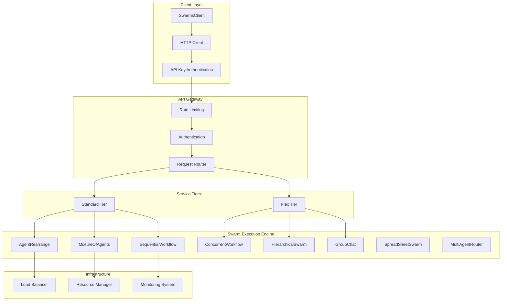
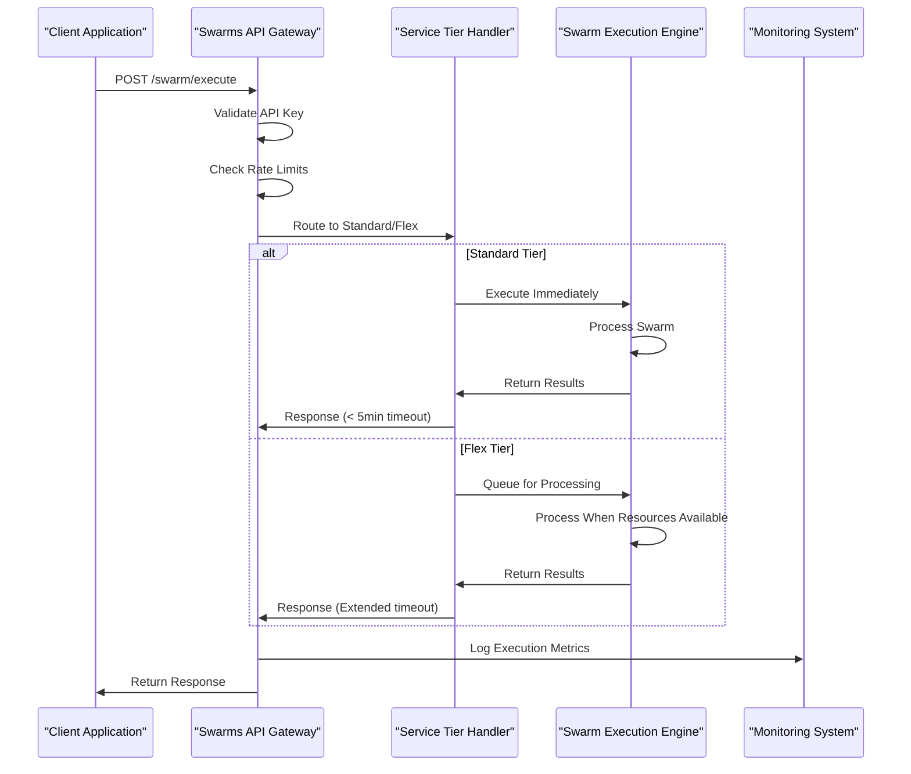
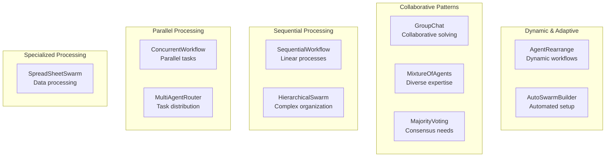
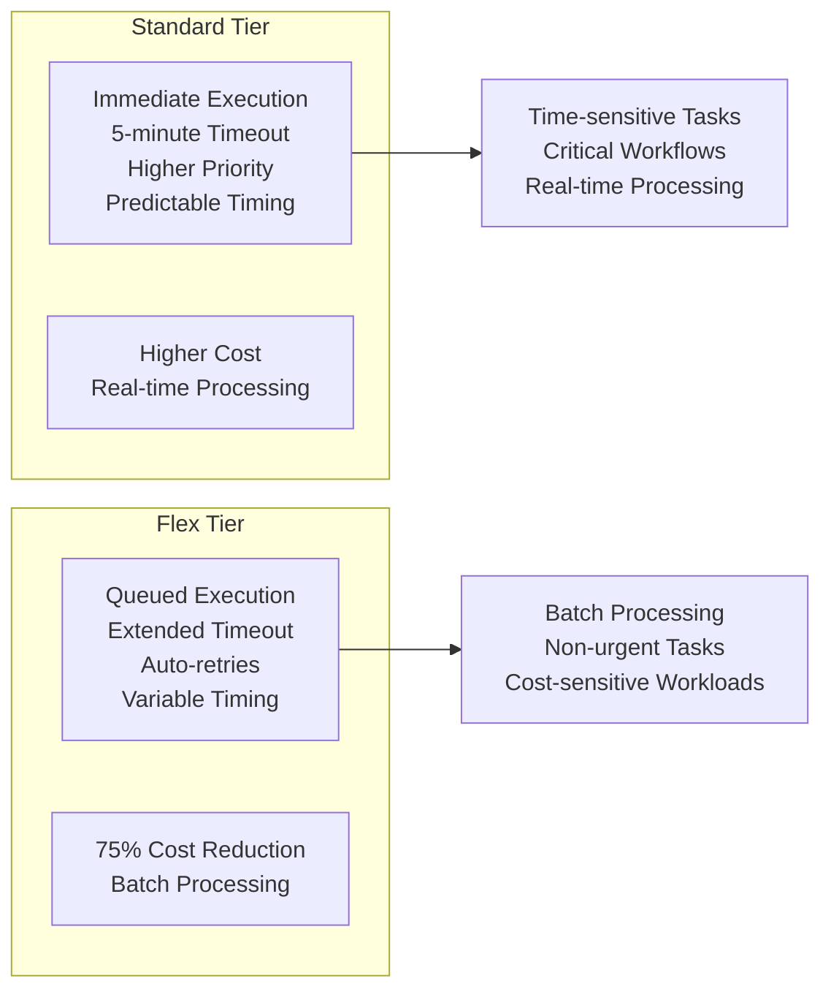
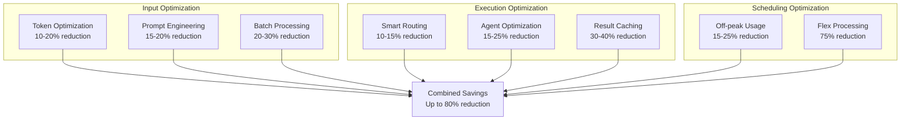
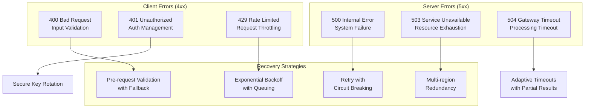
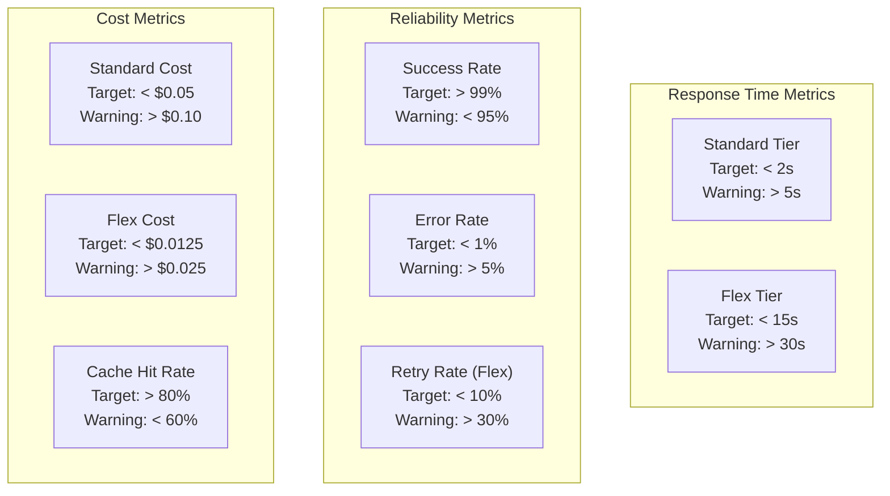

<!-- source: DeepWiki mcp.deepwiki.com · repo kyegomez/swarms · page 9.1 Swarms Cloud API · fetched 2026-10-27 -->

# Swarms Cloud API

Relevant source files

The following files were used as context for generating this wiki page:

- [docs/concepts/limitations.md](docs/concepts/limitations.md)
- [docs/index.md](docs/index.md)
- [docs/swarms_cloud/best_practices.md](docs/swarms_cloud/best_practices.md)

## Purpose and Scope

The Swarms Cloud API provides a production-grade, cloud-hosted service for executing multi-agent AI workflows at scale. This system enables developers to leverage sophisticated multi-agent orchestration patterns without managing the underlying infrastructure. The API offers tiered service levels, cost optimization features, and enterprise-grade reliability for deploying agent swarms in production environments.

For information about local framework usage, see [Core Agent System](#2). For API integration patterns, see [Client Integration](#9.3). For usage tracking and cost management, see [Rate Limits & Usage](#9.2).

## Service Architecture Overview

The Swarms Cloud API operates as a managed service that abstracts the complexity of multi-agent orchestration while providing flexible deployment options through different service tiers and swarm architectures.

### Cloud Service Architecture

Sources: [docs/swarms_cloud/best_practices.md:50-82](), [docs/index.md:67-68]()

### Request Processing Flow

Sources: [docs/swarms_cloud/best_practices.md:54-57]()

## Available Swarm Architectures

The Swarms Cloud API supports multiple swarm architectures, each optimized for specific use cases and workflow patterns.

### Swarm Type Classification

Sources: [docs/swarms_cloud/best_practices.md:9-22]()

### Swarm Selection Matrix

| Swarm Architecture | Primary Use Case | Processing Pattern | Ideal For |
|-------------------|------------------|-------------------|-----------|
| `AgentRearrange` | Dynamic workflows | Adaptive task decomposition | Complex analysis, resource allocation |
| `MixtureOfAgents` | Cross-domain expertise | Parallel specialist processing | Research synthesis, comprehensive analysis |
| `SequentialWorkflow` | Linear processes | Step-by-step execution | Document processing, quality control |
| `ConcurrentWorkflow` | Parallel operations | Independent task execution | Batch processing, multi-market analysis |
| `HierarchicalSwarm` | Complex organization | Director-worker coordination | Project management, enterprise workflows |
| `GroupChat` | Collaborative problem-solving | Interactive agent communication | Brainstorming, decision making |
| `SpreadSheetSwarm` | Data processing | Structured data operations | Financial analysis, report generation |
| `MultiAgentRouter` | Task distribution | Intelligent routing | Load balancing, specialized processing |

Sources: [docs/swarms_cloud/best_practices.md:12-22]()

## Service Tiers

The Swarms Cloud API provides two distinct service tiers to balance performance requirements with cost considerations.

### Service Tier Comparison

Sources: [docs/swarms_cloud/best_practices.md:54-57]()

### Tier Selection Guidelines

| Criteria | Standard Tier | Flex Tier |
|----------|--------------|-----------|
| **Response Time** | < 2 seconds | < 15 seconds |
| **Timeout Limit** | 5 minutes | Extended (30+ minutes) |
| **Cost** | Full price | 75% reduction |
| **Priority** | High | Variable |
| **Retry Logic** | Manual | Automatic |
| **Best For** | Real-time, critical workflows | Batch, cost-sensitive tasks |

Sources: [docs/swarms_cloud/best_practices.md:154-163]()

## Cost Optimization Strategies

The Swarms Cloud API implements multiple cost optimization mechanisms to enable efficient resource utilization across different usage patterns.

### Cost Optimization Framework

Sources: [docs/swarms_cloud/best_practices.md:37-48]()

### Implementation Strategies

| Strategy | Implementation Method | Expected Savings | Best Practices |
|----------|----------------------|------------------|----------------|
| Batch Processing | Group related tasks into single API calls | 20-30% | Combine similar operations, process during off-peak |
| Off-peak Scheduling | Execute between 8 PM - 6 AM PT | 15-25% | Schedule non-urgent tasks for overnight processing |
| Token Optimization | Precise prompts and focused task definitions | 10-20% | Remove redundant information, use concise language |
| Result Caching | Store and reuse frequently accessed results | 30-40% | Implement TTL-based caching, cache expensive operations |
| Agent Count Optimization | Use minimum required agents per task | 15-25% | Profile task complexity, avoid over-provisioning |
| Flex Tier Usage | Route non-urgent tasks to flex processing | 75% | Identify time-flexible workloads |

Sources: [docs/swarms_cloud/best_practices.md:37-48]()

## Error Handling and Resilience

The Swarms Cloud API implements comprehensive error handling patterns to ensure reliable operation across different failure modes.

### Error Response Architecture

Sources: [docs/swarms_cloud/best_practices.md:72-81]()

### Error Handling Best Practices

| Error Code | Root Cause | Recovery Pattern | Implementation |
|------------|------------|------------------|----------------|
| 400 | Invalid request format, missing parameters | Input validation with fallback | Pre-validate requests, provide default values |
| 401 | Invalid or expired API key | Secure key rotation and storage | Implement key refresh logic, secure storage |
| 429 | Rate limit exceeded | Exponential backoff with queuing | Implement retry with increasing delays |
| 500 | Internal service error | Retry with circuit breaking | Limited retries with fallback to alternative service |
| 503 | Service temporarily unavailable | Multi-region redundancy | Route to alternative regions or queue for later |
| 504 | Request timeout | Adaptive timeouts with partial results | Adjust timeout based on task complexity |

Sources: [docs/swarms_cloud/best_practices.md:74-81]()

## Performance Monitoring and Metrics

The Swarms Cloud API provides comprehensive monitoring capabilities to track system performance, usage patterns, and cost optimization opportunities.

### Performance Metrics Dashboard

Sources: [docs/swarms_cloud/best_practices.md:154-163]()

### Performance Benchmarks

| Metric Category | Target Range | Warning Threshold | Critical Threshold |
|-----------------|--------------|-------------------|-------------------|
| **Response Time** | Standard: < 2s, Flex: < 15s | Standard: > 5s, Flex: > 30s | Standard: > 10s, Flex: > 60s |
| **Success Rate** | > 99% | < 95% | < 90% |
| **Cost Efficiency** | Standard: < $0.05, Flex: < $0.0125 | Standard: > $0.10, Flex: > $0.025 | Standard: > $0.20, Flex: > $0.05 |
| **Cache Performance** | > 80% hit rate | < 60% hit rate | < 40% hit rate |
| **Error Rate** | < 1% | > 5% | > 10% |

Sources: [docs/swarms_cloud/best_practices.md:156-163]()

## Industry-Specific Applications

The Swarms Cloud API supports specialized configurations optimized for different industry verticals and use cases.

### Industry Application Matrix

| Industry | Primary Use Case | Recommended Swarm | Key Benefits |
|----------|------------------|-------------------|--------------|
| **Finance** | Automated trading desk, risk analysis | `HierarchicalSwarm`, `ConcurrentWorkflow` | Portfolio management, real-time analysis, risk assessment |
| **Healthcare** | Clinical workflow automation | `SequentialWorkflow`, `MajorityVoting` | Patient analysis, diagnostic support, treatment planning |
| **Legal** | Document processing, compliance | `SequentialWorkflow`, `MixtureOfAgents` | Document review, case analysis, compliance checking |
| **E-commerce** | Operations automation | `MultiAgentRouter`, `SpreadSheetSwarm` | Product management, pricing optimization, inventory management |

Sources: [docs/swarms_cloud/best_practices.md:59-68]()

## Production Deployment Considerations

### Best Practices Summary

**Recommended Patterns:**
- Select appropriate swarm architectures based on task complexity and requirements
- Implement comprehensive error handling with exponential backoff and circuit breaking
- Use caching strategies to reduce redundant processing and costs
- Implement secure API key rotation and storage practices
- Choose service tiers based on task urgency and cost sensitivity
- Monitor performance metrics and optimize based on usage patterns

**Anti-patterns to Avoid:**
- Hardcoding API keys in application code
- Ignoring rate limits and not implementing proper backoff mechanisms
- Missing error handling for transient failures
- Over-provisioning agents for simple tasks
- Using standard tier for non-urgent, cost-sensitive workloads
- Inadequate monitoring and alerting for production systems

Sources: [docs/swarms_cloud/best_practices.md:134-150]()

---

