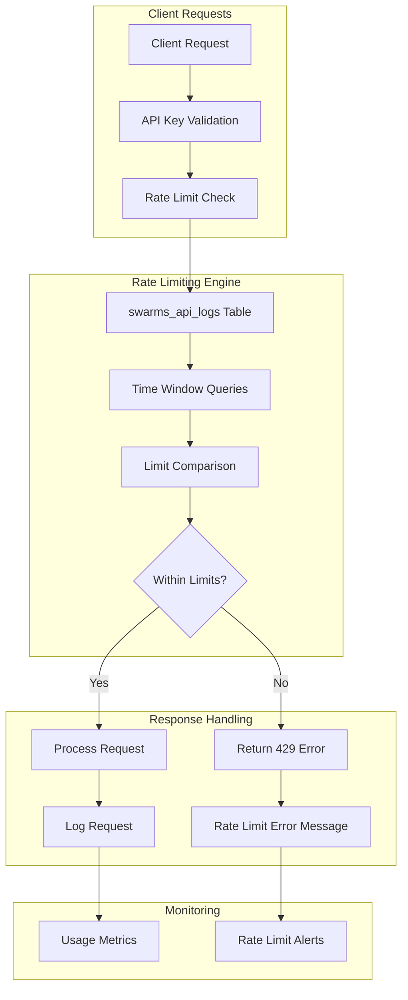
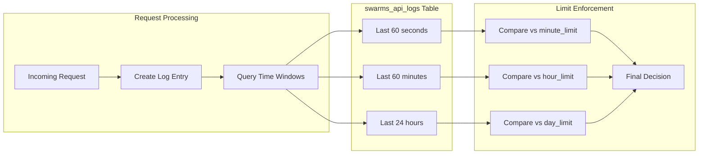
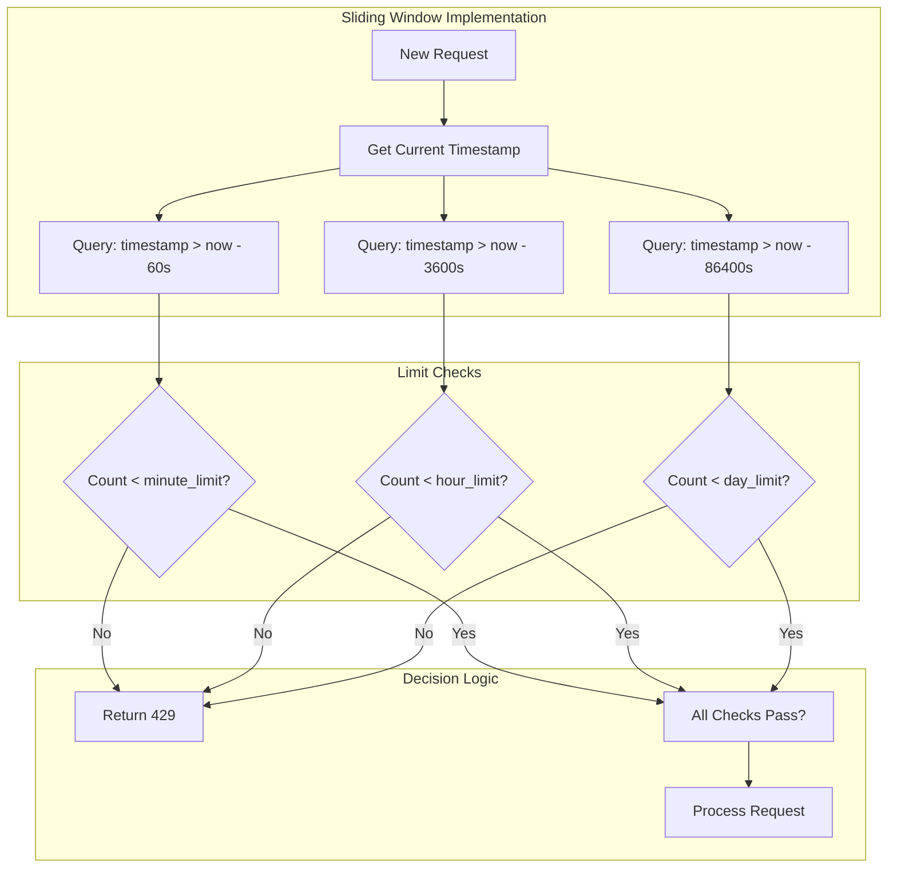
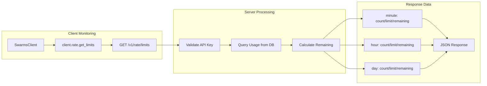
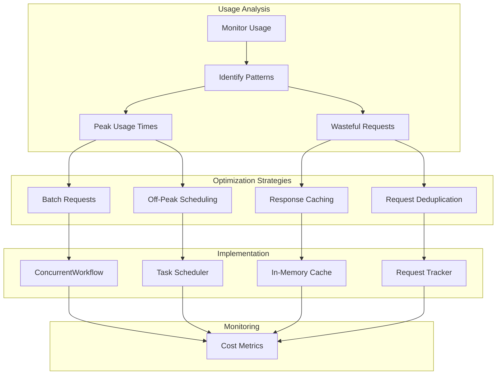
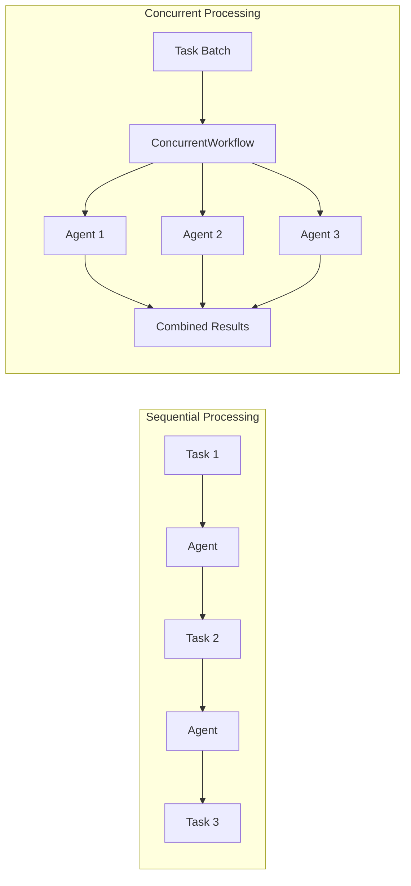
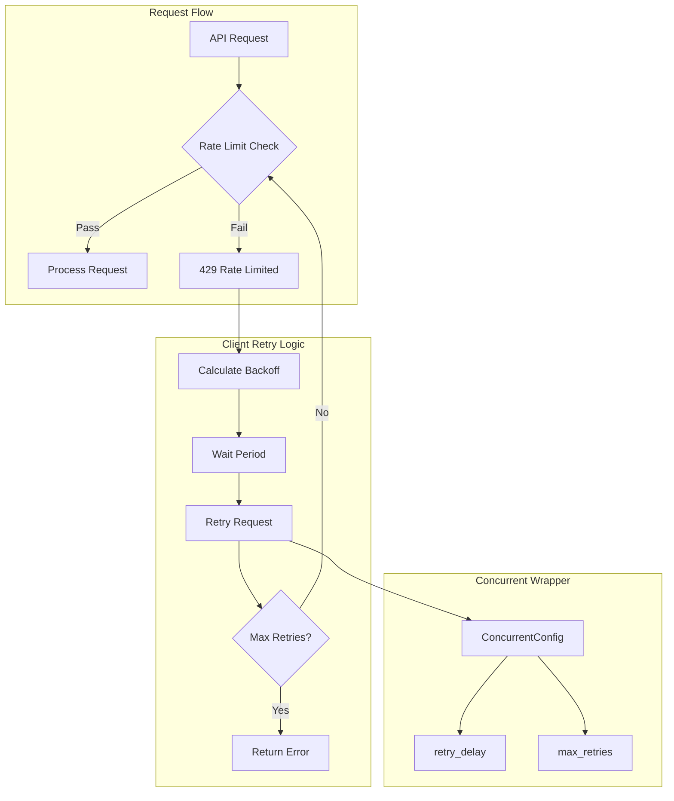
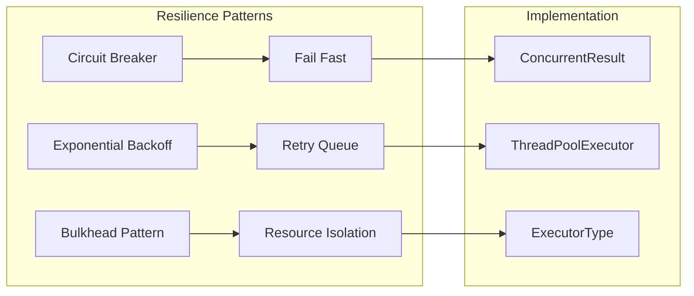

<!-- source: DeepWiki mcp.deepwiki.com · repo kyegomez/swarms · page 9.2 Rate Limits & Usage · fetched 2026-10-27 -->

# Rate Limits & Usage

<details>
<summary>Relevant source files</summary>

The following files were used as context for generating this wiki page:

- [docs/concepts/limitations.md](docs/concepts/limitations.md)
- [docs/index.md](docs/index.md)
- [docs/swarms/structs/agent_multi_agent_communication.md](docs/swarms/structs/agent_multi_agent_communication.md)
- [docs/swarms_cloud/best_practices.md](docs/swarms_cloud/best_practices.md)
- [docs/swarms_cloud/rate_limits.md](docs/swarms_cloud/rate_limits.md)
- [examples/api/client_example.py](examples/api/client_example.py)
- [examples/api/rate_limits.py](examples/api/rate_limits.py)
- [examples/multi_agent/agent_communication_examples.py](examples/multi_agent/agent_communication_examples.py)
- [examples/multi_agent/concurrent_examples/concurrent_example_dashboard.py](examples/multi_agent/concurrent_examples/concurrent_example_dashboard.py)
- [examples/multi_agent/heavy_swarm_examples/heavy_swarm_example.py](examples/multi_agent/heavy_swarm_examples/heavy_swarm_example.py)
- [examples/single_agent/reasoning_agent_examples/agent_judge_evaluation_criteria_example.py](examples/single_agent/reasoning_agent_examples/agent_judge_evaluation_criteria_example.py)
- [examples/utils/concurrent_wrapper_examples.py](examples/utils/concurrent_wrapper_examples.py)
- [simple_agent.py](simple_agent.py)
- [swarms/agents/agent_judge.py](swarms/agents/agent_judge.py)
- [swarms/prompts/prompt_generator_optimizer.py](swarms/prompts/prompt_generator_optimizer.py)
- [swarms/tools/__init__.py](swarms/tools/__init__.py)
- [swarms/tools/py_func_to_openai_func_str.py](swarms/tools/py_func_to_openai_func_str.py)
- [swarms/utils/concurrent_wrapper.py](swarms/utils/concurrent_wrapper.py)

</details>


This document covers the API rate limiting system, usage tracking mechanisms, and cost management strategies for the Swarms Cloud platform. It explains how rate limits are implemented, monitored, and optimized to ensure fair usage and system stability.

For information about the broader Swarms Cloud API functionality, see [Swarms Cloud API](#9.1). For details on programmatic client integration, see [Client Integration](#9.3).

## Rate Limiting Architecture

The Swarms API implements a comprehensive multi-tier rate limiting system that tracks usage across multiple time windows and enforces various limits based on subscription tiers.

### Rate Limiting System Overview



Sources: [docs/swarms_cloud/rate_limits.md:86-106]()

### Database-Based Tracking Implementation



Sources: [docs/swarms_cloud/rate_limits.md:89-94]()

## Rate Limit Types and Tiers

The system enforces multiple types of limits across different subscription tiers to ensure fair usage and prevent abuse.

### Service Tier Comparison

| Rate Limit Type | Free Tier | Premium Tier | Time Window | Implementation |
|-----------------|-----------|--------------|-------------|----------------|
| **Requests per Minute** | 100 | 2,000 | Sliding 60s | Database query count |
| **Requests per Hour** | 50 | 10,000 | Sliding 60m | Database query count |
| **Requests per Day** | 1,200 | 100,000 | Sliding 24h | Database query count |
| **Tokens per Agent** | 200,000 | 2,000,000 | Per request | Token counting validation |
| **Prompt Length** | 200,000 | 200,000 | Per request | Input validation |
| **Batch Size** | 10 | 10 | Per request | Array length check |

Sources: [docs/swarms_cloud/rate_limits.md:6-16]()

### Request Rate Limits

The API enforces sliding window rate limits for different time periods:



Sources: [docs/swarms_cloud/rate_limits.md:97-106]()

### Token and Content Limits

Beyond request frequency, the system enforces content-based limits:

| Limit Type | Validation Point | Error Response | Implementation |
|------------|------------------|----------------|----------------|
| **Tokens per Agent** | Agent configuration | 400 error | Token counting in agent spec |
| **Prompt Length** | Request processing | 400 error | Combined input text length |
| **Batch Size** | Batch endpoint | 400 error | Array length validation |

Sources: [docs/swarms_cloud/rate_limits.md:47-84]()

## Usage Tracking and Monitoring

The system provides comprehensive usage tracking through dedicated endpoints and client methods.

### Rate Limit Monitoring Endpoint

The `/v1/rate/limits` endpoint provides real-time usage information:



Sources: [docs/swarms_cloud/rate_limits.md:110-117](), [examples/api/client_example.py:39]()

### Usage Tracking Implementation

```python
# Example from client code
from swarms_client import SwarmsClient

client = SwarmsClient(api_key=os.getenv("SWARMS_API_KEY"))
response = client.client.rate.get_limits()
```

Sources: [examples/api/rate_limits.py:7-10]()

The response includes detailed usage metrics:

```json
{
  "success": true,
  "rate_limits": {
    "minute": {
      "count": 5,
      "limit": 100, 
      "exceeded": false,
      "remaining": 95,
      "reset_time": "2024-01-15T10:30:00Z"
    }
  }
}
```

Sources: [docs/swarms_cloud/rate_limits.md:121-155]()

## Cost Management Strategies

Effective cost management involves understanding usage patterns and implementing optimization techniques.

### Cost Optimization Framework



Sources: [docs/swarms_cloud/best_practices.md:35-48]()

### Concurrent Execution for Cost Efficiency

The framework provides concurrent execution capabilities to optimize API usage:



Sources: [examples/multi_agent/concurrent_examples/concurrent_example_dashboard.py:52-59]()

### Concurrent Wrapper Implementation

The `concurrent` decorator enables efficient resource utilization:

```python
@concurrent(
    max_workers=4,
    timeout=30,
    retry_on_failure=True,
    max_retries=2
)
def process_data(data: str) -> str:
    return f"processed_{data}"
```

Sources: [swarms/utils/concurrent_wrapper.py:127-139](), [examples/utils/concurrent_wrapper_examples.py:24-36]()

## Error Handling and Resilience

Proper error handling ensures graceful degradation when rate limits are exceeded.

### Rate Limit Error Response

When limits are exceeded, the API returns a structured error response:

```json
{
  "detail": "Rate limit exceeded for minute window(s). Upgrade to Premium for increased limits (2,000/min, 10,000/hour, 100,000/day) at https://swarms.world/platform/account for just $99/month."
}
```

Sources: [docs/swarms_cloud/rate_limits.md:161-167]()

### Retry Logic Implementation



Sources: [swarms/utils/concurrent_wrapper.py:98-102](), [docs/swarms_cloud/rate_limits.md:169-175]()

## Best Practices

### Monitoring and Alerting

1. **Regular Usage Monitoring**
   - Check `/v1/rate/limits` endpoint regularly
   - Monitor usage trends and patterns
   - Set up alerts for approaching limits

2. **Proactive Limit Management**
   - Track usage across all time windows
   - Plan for peak usage periods
   - Consider Premium tier for high-volume applications

Sources: [docs/swarms_cloud/rate_limits.md:169-175]()

### Optimization Techniques

1. **Request Batching**
   - Group related operations
   - Use `ConcurrentWorkflow` for parallel processing
   - Implement request deduplication

2. **Caching Strategies**
   - Cache frequently accessed results
   - Implement response memoization
   - Use persistent storage for long-term caching

Sources: [docs/swarms_cloud/best_practices.md:35-48]()

### Error Recovery Patterns



Sources: [swarms/utils/concurrent_wrapper.py:79-85](), [swarms/utils/concurrent_wrapper.py:104-125]()

---

