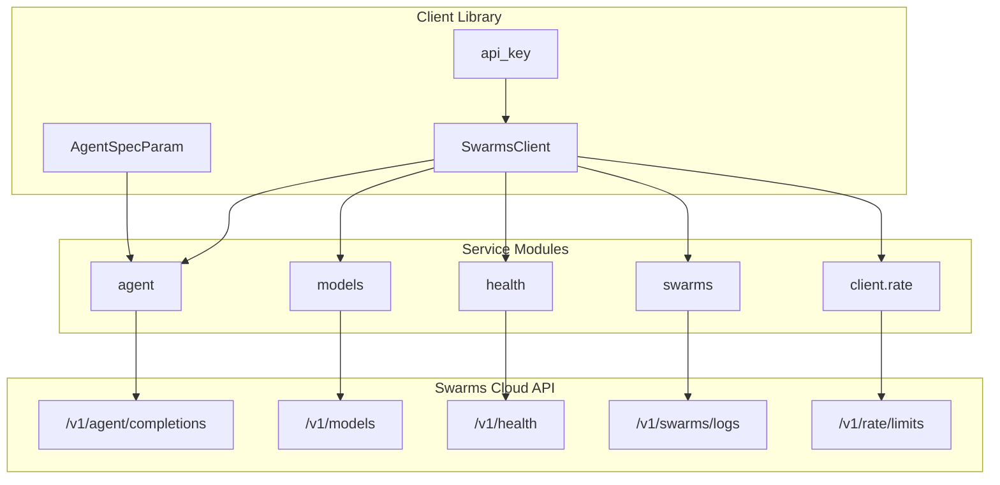
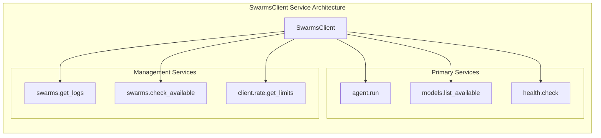
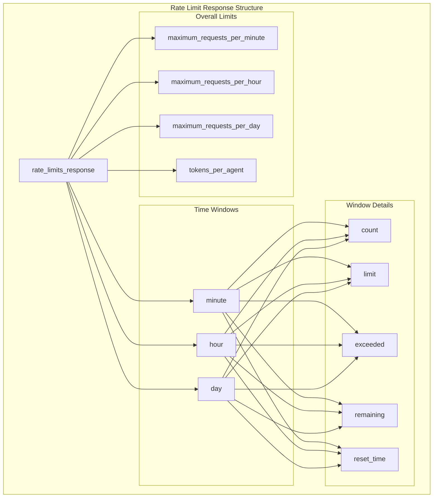

<!-- source: DeepWiki mcp.deepwiki.com · repo kyegomez/swarms · page 9.3 Client Integration · fetched 2026-10-27 -->

# Client Integration

<details>
<summary>Relevant source files</summary>

The following files were used as context for generating this wiki page:

- [docs/swarms/structs/agent_multi_agent_communication.md](docs/swarms/structs/agent_multi_agent_communication.md)
- [docs/swarms_cloud/rate_limits.md](docs/swarms_cloud/rate_limits.md)
- [examples/api/client_example.py](examples/api/client_example.py)
- [examples/api/rate_limits.py](examples/api/rate_limits.py)
- [examples/multi_agent/agent_communication_examples.py](examples/multi_agent/agent_communication_examples.py)
- [examples/multi_agent/concurrent_examples/concurrent_example_dashboard.py](examples/multi_agent/concurrent_examples/concurrent_example_dashboard.py)
- [examples/multi_agent/heavy_swarm_examples/heavy_swarm_example.py](examples/multi_agent/heavy_swarm_examples/heavy_swarm_example.py)
- [examples/single_agent/reasoning_agent_examples/agent_judge_evaluation_criteria_example.py](examples/single_agent/reasoning_agent_examples/agent_judge_evaluation_criteria_example.py)
- [examples/utils/concurrent_wrapper_examples.py](examples/utils/concurrent_wrapper_examples.py)
- [simple_agent.py](simple_agent.py)
- [swarms/agents/agent_judge.py](swarms/agents/agent_judge.py)
- [swarms/prompts/prompt_generator_optimizer.py](swarms/prompts/prompt_generator_optimizer.py)
- [swarms/tools/__init__.py](swarms/tools/__init__.py)
- [swarms/tools/py_func_to_openai_func_str.py](swarms/tools/py_func_to_openai_func_str.py)
- [swarms/utils/concurrent_wrapper.py](swarms/utils/concurrent_wrapper.py)

</details>


This document covers the SwarmsClient Python library for programmatic access to the Swarms Cloud API platform. The SwarmsClient provides a unified interface for executing agents, managing models, monitoring usage, and handling rate limits in cloud-based deployments.

For information about the underlying Swarms Cloud API endpoints and service architecture, see [Swarms Cloud API](#9.1). For details about API rate limiting and usage tracking, see [Rate Limits & Usage](#9.2).

## SwarmsClient Architecture

The SwarmsClient serves as the primary interface for interacting with the Swarms Cloud platform, providing both synchronous and asynchronous operations across multiple service domains.



**Sources:** [examples/api/client_example.py:1-41](), [examples/api/rate_limits.py:1-13]()

## Client Initialization

The SwarmsClient requires an API key for authentication and provides access to multiple service endpoints through a structured interface.

### Basic Setup

```python
from swarms_client import SwarmsClient
from swarms_client.types import AgentSpecParam
import os

# Initialize client with API key
client = SwarmsClient(api_key=os.getenv("SWARMS_API_KEY"))
```

### Environment Configuration

The client typically loads API credentials from environment variables:

| Variable | Purpose | Example |
|----------|---------|---------|
| `SWARMS_API_KEY` | Authentication token for Swarms Cloud API | `sk-xxx...` |

**Sources:** [examples/api/client_example.py:9](), [examples/api/rate_limits.py:7]()

## Core Service Operations

The SwarmsClient exposes multiple service modules, each providing specific functionality for different aspects of the Swarms platform.



**Sources:** [examples/api/client_example.py:36-40]()

### Agent Execution Service

The `agent` service provides methods for executing AI agents with specified configurations and tasks.

#### Agent Configuration

The `AgentSpecParam` type defines the configuration structure for agent execution:

| Parameter | Type | Description |
|-----------|------|-------------|
| `agent_name` | `str` | Unique identifier for the agent |
| `description` | `str` | Description of agent purpose and capabilities |
| `task` | `str` | The specific task for the agent to execute |
| `model_name` | `str` | AI model to use (e.g., "claude-3-5-sonnet-20241022") |
| `system_prompt` | `str` | System-level instructions defining agent behavior |
| `max_loops` | `int` | Maximum number of execution loops |
| `temperature` | `float` | Model temperature for response generation |
| `role` | `str` | Agent role identifier |

#### Agent Execution Example

```python
agent_spec = AgentSpecParam(
    agent_name="doctor_agent",
    description="A virtual doctor agent that provides evidence-based medical advice",
    task="What is the best medicine for a cold?",
    model_name="claude-3-5-sonnet-20241022",
    system_prompt="You are a highly knowledgeable, ethical, and empathetic virtual doctor.",
    max_loops=1,
    temperature=0.4,
    role="doctor",
)

response = client.agent.run(
    agent_config=agent_spec,
    task="What is the best medicine for a cold?",
)
```

**Sources:** [examples/api/client_example.py:11-32]()

### Models Service

The `models` service provides access to available AI models and their capabilities.

```python
# List all available models
models = client.models.list_available()
print(json.dumps(models, indent=4))
```

**Sources:** [examples/api/client_example.py:36]()

### Health Service

The `health` service provides system status and availability checks.

```python
# Check system health
health_status = client.health.check()
print(json.dumps(health_status, indent=4))
```

**Sources:** [examples/api/client_example.py:37](), [examples/api/rate_limits.py:12]()

### Swarms Management Service

The `swarms` service provides logging and system availability operations.

```python
# Get execution logs
logs = client.swarms.get_logs()
print(json.dumps(logs, indent=4))

# Check swarms availability
availability = client.swarms.check_available()
print(json.dumps(availability, indent=4))
```

**Sources:** [examples/api/client_example.py:38-40]()

## Rate Limit Management

The client provides comprehensive rate limit monitoring and management through the `client.rate` service.

### Rate Limit Checking

```python
# Get current rate limit status
rate_limits = client.client.rate.get_limits()
print(rate_limits)
```

### Rate Limit Response Structure

The rate limits endpoint returns detailed information about current usage across multiple time windows:



**Sources:** [examples/api/rate_limits.py:9-10](), [docs/swarms_cloud/rate_limits.md:121-155]()

### Rate Limit Tiers

The Swarms API implements different rate limit tiers with varying capacities:

| Tier | Requests/Min | Requests/Hour | Requests/Day | Tokens/Agent |
|------|-------------|---------------|--------------|--------------|
| Free | 100 | 50 | 1,200 | 200,000 |
| Premium | 2,000 | 10,000 | 100,000 | 2,000,000 |

**Sources:** [docs/swarms_cloud/rate_limits.md:7-16]()

## Error Handling

The client implements comprehensive error handling for various failure scenarios including rate limits, authentication errors, and service unavailability.

### Rate Limit Errors

When rate limits are exceeded, the API returns HTTP 429 status codes with detailed error messages:

```python
# Example error response structure
{
  "detail": "Rate limit exceeded for minute window(s). Upgrade to Premium for increased limits (2,000/min, 10,000/hour, 100,000/day) at https://swarms.world/platform/account for just $99/month."
}
```

### Best Practices for Error Handling

1. **Monitor Usage**: Regularly check rate limits using `client.client.rate.get_limits()`
2. **Implement Retry Logic**: Use exponential backoff when hitting rate limits
3. **Handle Exceptions**: Wrap client calls in try-catch blocks
4. **Graceful Degradation**: Provide fallback responses when services are unavailable

**Sources:** [docs/swarms_cloud/rate_limits.md:159-175]()

## Complete Usage Example

The following example demonstrates a comprehensive client integration pattern:

```python
import json
import os
from swarms_client import SwarmsClient
from swarms_client.types import AgentSpecParam
from dotenv import load_dotenv

# Load environment configuration
load_dotenv()

# Initialize client
client = SwarmsClient(api_key=os.getenv("SWARMS_API_KEY"))

# Define agent configuration
agent_spec = AgentSpecParam(
    agent_name="doctor_agent",
    description="A virtual doctor agent that provides evidence-based, safe, and empathetic medical advice for common health questions.",
    task="What is the best medicine for a cold?",
    model_name="claude-3-5-sonnet-20241022",
    system_prompt=(
        "You are a highly knowledgeable, ethical, and empathetic virtual doctor. "
        "Always provide evidence-based, safe, and practical medical advice. "
        "If a question requires a diagnosis, prescription, or urgent care, remind the user to consult a licensed healthcare professional."
    ),
    max_loops=1,
    temperature=0.4,
    role="doctor",
)

# Execute agent and handle response
try:
    response = client.agent.run(
        agent_config=agent_spec,
        task="What is the best medicine for a cold?",
    )
    print("Agent Response:", response)
    
    # Check system status
    print("Available Models:", json.dumps(client.models.list_available(), indent=4))
    print("Health Status:", json.dumps(client.health.check(), indent=4))
    print("Execution Logs:", json.dumps(client.swarms.get_logs(), indent=4))
    print("Rate Limits:", json.dumps(client.client.rate.get_limits(), indent=4))
    print("System Availability:", json.dumps(client.swarms.check_available(), indent=4))
    
except Exception as e:
    print(f"Error: {e}")
    # Implement fallback logic
```

**Sources:** [examples/api/client_example.py:1-41]()

---

