# Page: Overview

# Overview

<details>
<summary>Relevant source files</summary>

The following files were used as context for generating this wiki page:

- [.gitignore](.gitignore)
- [README.md](README.md)
- [docs/concepts/limitations.md](docs/concepts/limitations.md)
- [docs/index.md](docs/index.md)
- [docs/mkdocs.yml](docs/mkdocs.yml)
- [docs/swarms_cloud/best_practices.md](docs/swarms_cloud/best_practices.md)
- [example.py](example.py)
- [pyproject.toml](pyproject.toml)
- [requirements.txt](requirements.txt)
- [swarms/__init__.py](swarms/__init__.py)
- [swarms/agents/__init__.py](swarms/agents/__init__.py)
- [swarms/prompts/logistics.py](swarms/prompts/logistics.py)
- [swarms/prompts/sop_generator_agent_prompt.py](swarms/prompts/sop_generator_agent_prompt.py)
- [swarms/structs/__init__.py](swarms/structs/__init__.py)
- [swarms/structs/agent.py](swarms/structs/agent.py)
- [swarms/structs/concurrent_workflow.py](swarms/structs/concurrent_workflow.py)
- [swarms/structs/rearrange.py](swarms/structs/rearrange.py)
- [swarms/structs/sequential_workflow.py](swarms/structs/sequential_workflow.py)
- [swarms/structs/swarm_router.py](swarms/structs/swarm_router.py)
- [swarms/utils/__init__.py](swarms/utils/__init__.py)

</details>


## Purpose and Scope

Swarms is an enterprise-grade, production-ready multi-agent AI orchestration framework designed for building sophisticated autonomous agent systems at scale. This framework provides the infrastructure, tools, and patterns needed to create complex multi-agent applications that can handle real-world enterprise workloads through collaborative intelligence, parallel processing, and intelligent task distribution.

This document provides a comprehensive overview of the Swarms framework architecture, core components, and system design. For specific implementation details about individual agents, see [Agent Class](#2.1). For multi-agent coordination patterns, see [Multi-Agent Orchestration](#3). For tool integration capabilities, see [Tool System](#4).

## System Architecture Overview

The Swarms framework is built around a modular architecture with four primary layers: the Core Agent System, Multi-Agent Orchestration, Infrastructure Services, and Integration Layer.

### Primary System Architecture

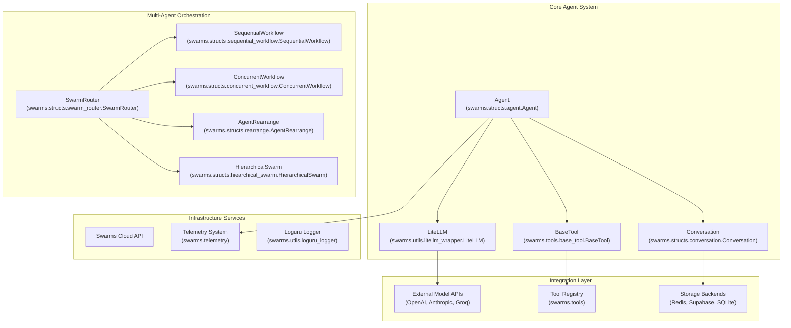

Sources: [swarms/structs/agent.py:163-302](), [swarms/structs/swarm_router.py:106-173](), [swarms/structs/__init__.py:1-172](), [swarms/__init__.py:1-18]()

### Core Component Relationships

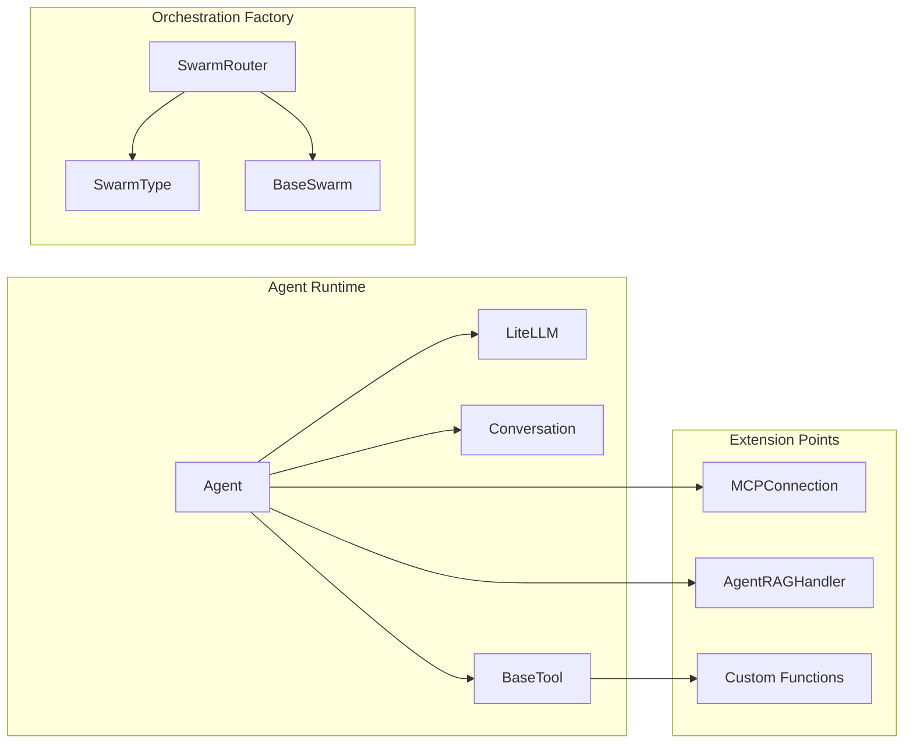

Sources: [swarms/structs/agent.py:303-438](), [swarms/structs/swarm_router.py:37-54](), [swarms/structs/base_swarm.py]()

## Core Agent System

The foundation of Swarms is the `Agent` class, which serves as the primary building block for all autonomous operations. Each agent is an independent entity that combines large language models with tools, memory, and conversation management.

### Agent Architecture Components

| Component | Class | Purpose | Configuration |
|-----------|-------|---------|---------------|
| **Language Model** | `LiteLLM` | Universal LLM interface supporting 100+ providers | `model_name`, `llm_base_url`, `llm_api_key` |
| **Conversation Memory** | `Conversation` | History management and context preservation | `conversation_schema`, `context_length` |
| **Tool Integration** | `BaseTool` | Function calling and external system integration | `tools`, `tool_choice`, `execute_tool` |
| **Agent Configuration** | `Agent.__init__()` | Agent behavior, prompts, and operational parameters | `system_prompt`, `max_loops`, `temperature` |

The `Agent` class supports extensive configuration through over 100 initialization parameters, enabling fine-tuned control over behavior, performance, and integration capabilities.

Sources: [swarms/structs/agent.py:163-302](), [swarms/utils/litellm_wrapper.py](), [swarms/structs/conversation.py](), [swarms/tools/base_tool.py]()

## Multi-Agent Orchestration System

Swarms provides multiple orchestration patterns for coordinating agents in complex workflows. The `SwarmRouter` serves as the central factory for dynamically selecting and instantiating different swarm architectures.

### Available Swarm Architectures

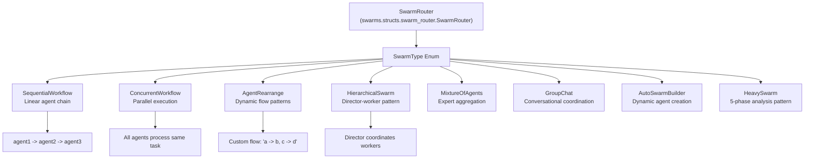

### Swarm Type Selection Matrix

| Swarm Type | Use Case | Pattern | Key Classes |
|------------|----------|---------|-------------|
| `SequentialWorkflow` | Linear processing pipelines | `A → B → C` | `SequentialWorkflow`, `AgentRearrange` |
| `ConcurrentWorkflow` | Parallel task execution | `A ∥ B ∥ C` | `ConcurrentWorkflow`, `ThreadPoolExecutor` |
| `AgentRearrange` | Dynamic workflow patterns | `A → B,C → D` | `AgentRearrange`, custom flow strings |
| `HierarchicalSwarm` | Director-worker coordination | Director → Workers | `HierarchicalSwarm`, feedback loops |
| `MixtureOfAgents` | Expert consensus building | Experts → Aggregator | `MixtureOfAgents`, expert specialization |
| `GroupChat` | Collaborative problem solving | Interactive conversation | `GroupChat`, speaker selection |

Sources: [swarms/structs/swarm_router.py:37-54](), [swarms/structs/sequential_workflow.py:12-28](), [swarms/structs/concurrent_workflow.py:17-135](), [swarms/structs/rearrange.py:27-63]()

## Key Framework Capabilities

### Production-Grade Infrastructure

Swarms is designed for enterprise deployment with comprehensive infrastructure support:

- **Error Handling**: Structured exception hierarchy with `AgentError`, `AgentInitializationError`, `AgentRunError` classes
- **Logging & Telemetry**: Integration with `loguru` for structured logging and built-in telemetry collection
- **State Management**: Automatic state persistence and recovery with `SafeStateManager` and `SafeLoaderUtils`
- **Performance Monitoring**: Built-in metrics collection and dashboard capabilities

### Extensibility and Integration

The framework provides multiple extension points for customization:

- **Model Provider Integration**: Universal LLM support through `LiteLLM` wrapper supporting OpenAI, Anthropic, Groq, and 100+ other providers
- **Tool System**: Flexible tool integration supporting Python functions, Pydantic models, and MCP (Model Context Protocol) servers
- **Memory Systems**: Pluggable storage backends including Redis, Supabase, SQLite, and DuckDB
- **Custom Agents**: Support for integrating external agents from LangChain, AutoGen, and other frameworks

### Deployment and Scaling

| Deployment Option | Implementation | Use Case |
|------------------|---------------|----------|
| **Local Development** | Direct Python imports | Development, testing, small-scale applications |
| **Container Deployment** | Docker with Poetry dependencies | Scalable local deployment |
| **Cloud Services** | Swarms Cloud API | Production scaling, managed infrastructure |
| **Enterprise Integration** | Custom API endpoints | Enterprise systems integration |

Sources: [pyproject.toml:58-82](), [README.md:112-148](), [swarms/structs/agent.py:115-161](), [docs/mkdocs.yml:431-456]()

## Integration Architecture

### Tool and Model Integration Flow

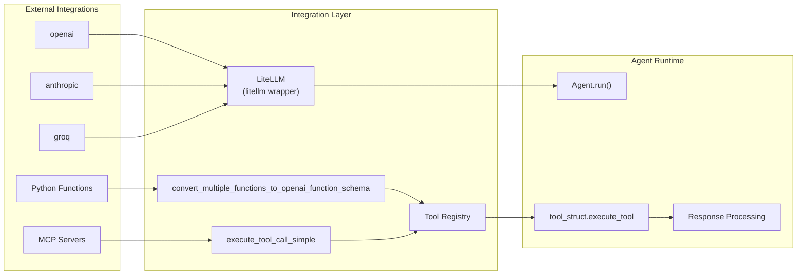

The integration architecture enables seamless connection between agents and external systems through standardized interfaces and conversion layers.

Sources: [swarms/structs/agent.py:633-651](), [swarms/tools/py_func_to_openai_func_str.py](), [swarms/tools/mcp_client_call.py:74-83](), [swarms/utils/litellm_wrapper.py]()

## Framework Entry Points

### Primary Import Structure

The framework provides a clean import hierarchy designed for ease of use:

```python
from swarms import Agent                    # Core agent class
from swarms import SequentialWorkflow       # Linear workflows  
from swarms import ConcurrentWorkflow       # Parallel workflows
from swarms import SwarmRouter             # Dynamic swarm selection
from swarms import BaseTool                # Tool integration
```

### Configuration and Initialization

Key configuration entry points include:

- **Environment Setup**: API keys, workspace directories, and provider configuration via `.env` files
- **Agent Configuration**: System prompts, model selection, tool integration, and behavior parameters  
- **Swarm Architecture**: Workflow patterns, agent coordination, and execution strategies
- **Production Settings**: Logging, telemetry, error handling, and performance monitoring

Sources: [swarms/__init__.py:1-18](), [swarms/structs/__init__.py:1-172](), [README.md:151-161](), [example.py:1-48]()

The Swarms framework provides a comprehensive foundation for building production-grade multi-agent AI systems, with robust infrastructure, flexible architecture patterns, and extensive integration capabilities. The modular design enables developers to start with simple agent configurations and scale to complex multi-agent orchestrations as requirements evolve.

---

# Page: Core Agent System

# Core Agent System

<details>
<summary>Relevant source files</summary>

The following files were used as context for generating this wiki page:

- [.gitignore](.gitignore)
- [README.md](README.md)
- [docs/mkdocs.yml](docs/mkdocs.yml)
- [example.py](example.py)
- [pyproject.toml](pyproject.toml)
- [requirements.txt](requirements.txt)
- [swarms/__init__.py](swarms/__init__.py)
- [swarms/agents/__init__.py](swarms/agents/__init__.py)
- [swarms/prompts/logistics.py](swarms/prompts/logistics.py)
- [swarms/prompts/sop_generator_agent_prompt.py](swarms/prompts/sop_generator_agent_prompt.py)
- [swarms/structs/__init__.py](swarms/structs/__init__.py)
- [swarms/structs/agent.py](swarms/structs/agent.py)
- [swarms/structs/concurrent_workflow.py](swarms/structs/concurrent_workflow.py)
- [swarms/structs/rearrange.py](swarms/structs/rearrange.py)
- [swarms/structs/sequential_workflow.py](swarms/structs/sequential_workflow.py)
- [swarms/structs/swarm_router.py](swarms/structs/swarm_router.py)
- [swarms/utils/__init__.py](swarms/utils/__init__.py)

</details>


## Purpose and Scope

The Core Agent System provides the foundational infrastructure for creating, configuring, and orchestrating intelligent agents within the Swarms framework. This system encompasses the primary `Agent` class, the `SwarmRouter` factory pattern, and core orchestration mechanisms that enable both single-agent and multi-agent workflows.

This document covers the architectural overview and integration patterns of the core system. For detailed implementation specifics of individual agents, see [Agent Class](#2.1). For comprehensive SwarmRouter configuration and usage, see [SwarmRouter](#2.2). For multi-agent collaboration patterns, see [Multi-Agent Orchestration](#3).

## System Architecture Overview

The Core Agent System operates as a layered architecture where individual agents serve as the fundamental building blocks, orchestrated through various workflow patterns via the SwarmRouter factory system.

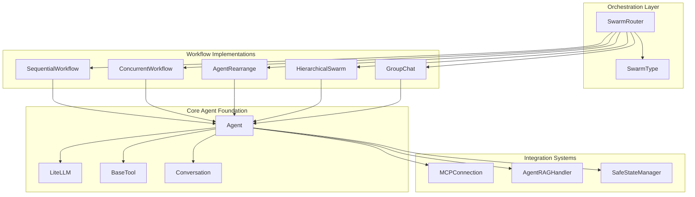

**Sources:** [swarms/structs/agent.py:163-301](), [swarms/structs/swarm_router.py:106-173](), [swarms/structs/__init__.py:1-172]()

## Agent Class Foundation

The `Agent` class serves as the core building block, integrating language models, tools, memory systems, and conversation management into a unified interface. The class provides extensive configuration options for production deployments.

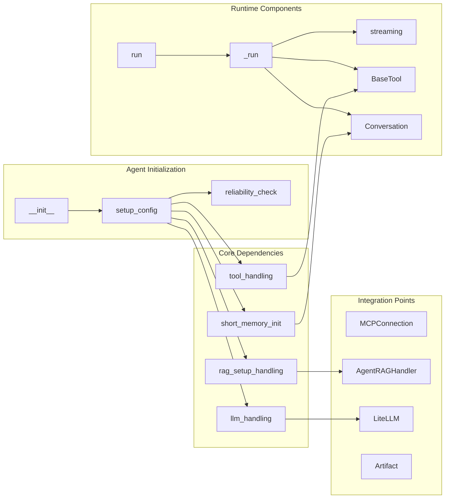

**Sources:** [swarms/structs/agent.py:303-624](), [swarms/structs/agent.py:625-690](), [swarms/structs/conversation.py]()

## SwarmRouter Factory System

The `SwarmRouter` implements a factory pattern that provides dynamic selection and instantiation of different swarm types based on task requirements or explicit configuration. This system enables seamless switching between orchestration strategies.

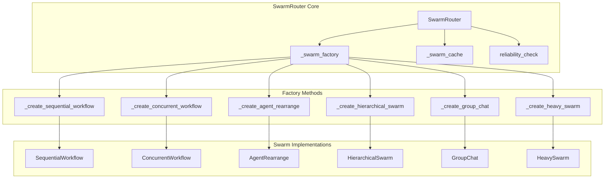

**Sources:** [swarms/structs/swarm_router.py:175-249](), [swarms/structs/swarm_router.py:380-450](), [swarms/structs/swarm_router.py:37-54]()

## Core Integration Patterns

### Agent Configuration System

The Agent class utilizes several key integration patterns for production readiness:

| Integration Point | Implementation | Purpose |
|------------------|----------------|---------|
| `llm_handling()` | [swarms/structs/agent.py:2640-2672]() | LLM provider abstraction via LiteLLM |
| `tool_handling()` | [swarms/structs/agent.py:633-651]() | Function calling and tool integration |
| `short_memory_init()` | [swarms/structs/agent.py:652-693]() | Conversation history management |
| `rag_setup_handling()` | [swarms/structs/agent.py:625-631]() | Long-term memory and RAG integration |

### Orchestration Factory Pattern

The SwarmRouter employs a factory pattern with O(1) lookup performance for swarm type selection:

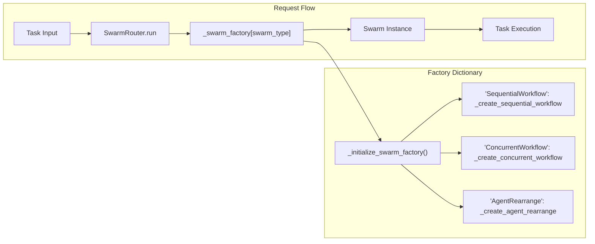

**Sources:** [swarms/structs/swarm_router.py:380-402](), [swarms/structs/swarm_router.py:658-715]()

### Memory and State Management

The core system provides multiple layers of memory and state persistence:

- **Short-term Memory**: `Conversation` class manages interaction history
- **Long-term Memory**: `AgentRAGHandler` integrates vector databases
- **State Persistence**: `SafeStateManager` handles agent state serialization
- **Distributed Memory**: Shared memory systems across agent swarms

**Sources:** [swarms/structs/conversation.py](), [swarms/structs/agent_rag_handler.py](), [swarms/structs/safe_loading.py]()

## Execution Models

The Core Agent System supports multiple execution paradigms:

### Single Agent Execution
Direct agent instantiation and task execution via `Agent.run()` method with support for:
- Synchronous and asynchronous execution
- Streaming output generation
- Tool integration and function calling
- Memory persistence and state management

### Multi-Agent Orchestration
Factory-based swarm creation through `SwarmRouter` supporting:
- Sequential task processing via `SequentialWorkflow`
- Parallel execution via `ConcurrentWorkflow`
- Dynamic agent arrangement via `AgentRearrange`
- Hierarchical coordination via `HierarchicalSwarm`
- Conversational coordination via `GroupChat`

**Sources:** [swarms/structs/agent.py:1549-1900](), [swarms/structs/swarm_router.py:658-800]()

## Configuration and Initialization

The system provides comprehensive configuration management through:

- **Environment Variables**: API keys and workspace configuration
- **YAML/JSON Configuration**: Agent and swarm parameter specification
- **Dynamic Configuration**: Runtime parameter adjustment
- **Validation Systems**: Configuration reliability checks and error handling

Key configuration classes include `SwarmRouterConfig`, `ConversationSchema`, and `RAGConfig` for structured parameter management.

**Sources:** [swarms/structs/swarm_router.py:62-92](), [swarms/schemas/conversation_schema.py](), [swarms/structs/agent_rag_handler.py]()

---

# Page: Agent Class

# Agent Class

<details>
<summary>Relevant source files</summary>

The following files were used as context for generating this wiki page:

- [.env.example](.env.example)
- [.gitignore](.gitignore)
- [README.md](README.md)
- [docs/mkdocs.yml](docs/mkdocs.yml)
- [example.py](example.py)
- [pyproject.toml](pyproject.toml)
- [requirements.txt](requirements.txt)
- [swarms/__init__.py](swarms/__init__.py)
- [swarms/agents/__init__.py](swarms/agents/__init__.py)
- [swarms/prompts/logistics.py](swarms/prompts/logistics.py)
- [swarms/prompts/sop_generator_agent_prompt.py](swarms/prompts/sop_generator_agent_prompt.py)
- [swarms/schemas/__init__.py](swarms/schemas/__init__.py)
- [swarms/structs/__init__.py](swarms/structs/__init__.py)
- [swarms/structs/agent.py](swarms/structs/agent.py)
- [swarms/structs/concurrent_workflow.py](swarms/structs/concurrent_workflow.py)
- [swarms/structs/rearrange.py](swarms/structs/rearrange.py)
- [swarms/structs/sequential_workflow.py](swarms/structs/sequential_workflow.py)
- [swarms/structs/swarm_router.py](swarms/structs/swarm_router.py)
- [swarms/utils/__init__.py](swarms/utils/__init__.py)

</details>


This document covers the `Agent` class, which serves as the foundational building block of the Swarms framework. The Agent class provides a comprehensive interface for creating autonomous AI agents with LLM integration, tool usage, memory systems, and conversation management capabilities.

For information about multi-agent orchestration patterns that use Agent instances, see [Multi-Agent Orchestration](#3). For details about tool integration, see [Tool System](#4).

## Overview

The `Agent` class is the core component that enables autonomous AI behavior within the Swarms ecosystem. It acts as a wrapper and orchestrator that combines language models, tools, memory systems, and conversation management into a unified interface for task execution.

**Key Capabilities:**
- Language model integration through `LiteLLM` wrapper
- Function calling and tool execution via `BaseTool`
- Conversation history management with `Conversation` class
- Long-term memory integration with various backend storage systems
- Streaming output and real-time interaction support
- State persistence and recovery mechanisms
- Multi-modal input processing (text, images)

Sources: [swarms/structs/agent.py:163-301](), [README.md:164-180]()

## Agent Architecture

The following diagram illustrates the core architecture of the Agent class and its primary dependencies:

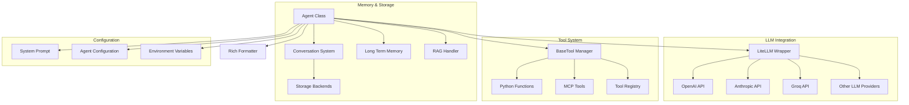

The Agent class orchestrates these components to provide a unified interface for autonomous task execution. Each component handles a specific aspect of agent functionality while maintaining loose coupling for flexibility and extensibility.

Sources: [swarms/structs/agent.py:1-89](), [swarms/structs/agent.py:438-624]()

## Core Components Integration

The following diagram shows how the Agent class integrates its core components during initialization and runtime:

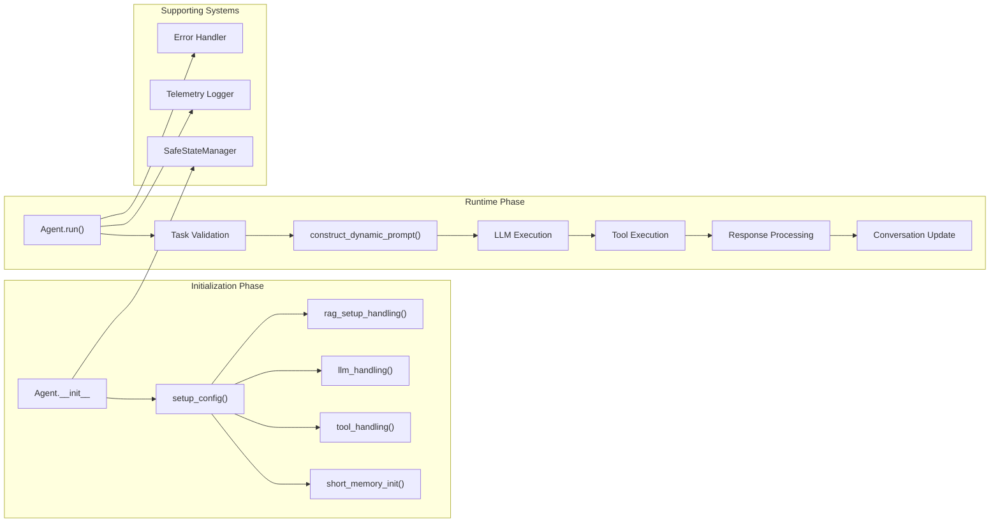

This architecture ensures that agents are properly initialized with all necessary components and can execute tasks through a well-defined pipeline that handles validation, execution, and state management.

Sources: [swarms/structs/agent.py:438-624](), [swarms/structs/agent.py:3278-3400]()

## Agent Configuration

The Agent class supports extensive configuration through its constructor parameters. The following table outlines the key configuration categories:

| Category | Key Parameters | Purpose |
|----------|----------------|---------|
| **Core Identity** | `agent_name`, `agent_description`, `system_prompt` | Define agent identity and behavior |
| **LLM Configuration** | `model_name`, `max_tokens`, `temperature`, `llm_args` | Control language model behavior |
| **Execution Control** | `max_loops`, `interactive`, `streaming_on` | Manage execution flow and output |
| **Tool Integration** | `tools`, `function_calling_type`, `tool_choice` | Configure function calling capabilities |
| **Memory Systems** | `long_term_memory`, `rag_config`, `conversation_schema` | Set up memory and retrieval systems |
| **Output Control** | `output_type`, `return_history`, `verbose` | Control response formatting and logging |

### Initialization Process

The Agent initialization follows a specific sequence to ensure all components are properly configured:

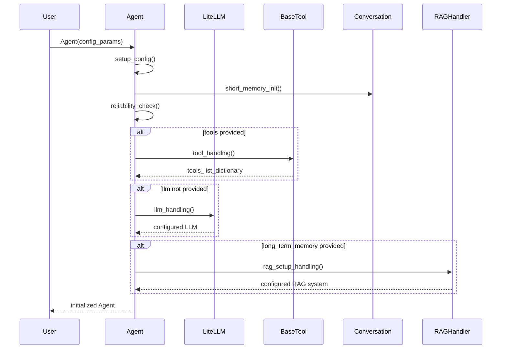

Sources: [swarms/structs/agent.py:303-624](), [swarms/structs/agent.py:625-651](), [swarms/structs/agent.py:652-686]()

## Task Execution Pipeline

The `run` method implements the core task execution pipeline. The following diagram illustrates the execution flow:

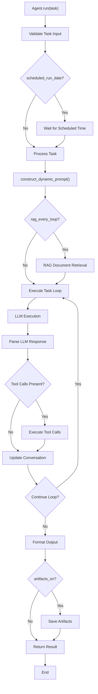

The execution pipeline handles various execution modes, tool integration, and output formatting while maintaining conversation state throughout the process.

Sources: [swarms/structs/agent.py:3278-3400](), [swarms/structs/agent.py:3401-3500]()

## Tool Integration Architecture

The Agent class integrates with the tool system through the `BaseTool` manager and supports multiple tool execution patterns:

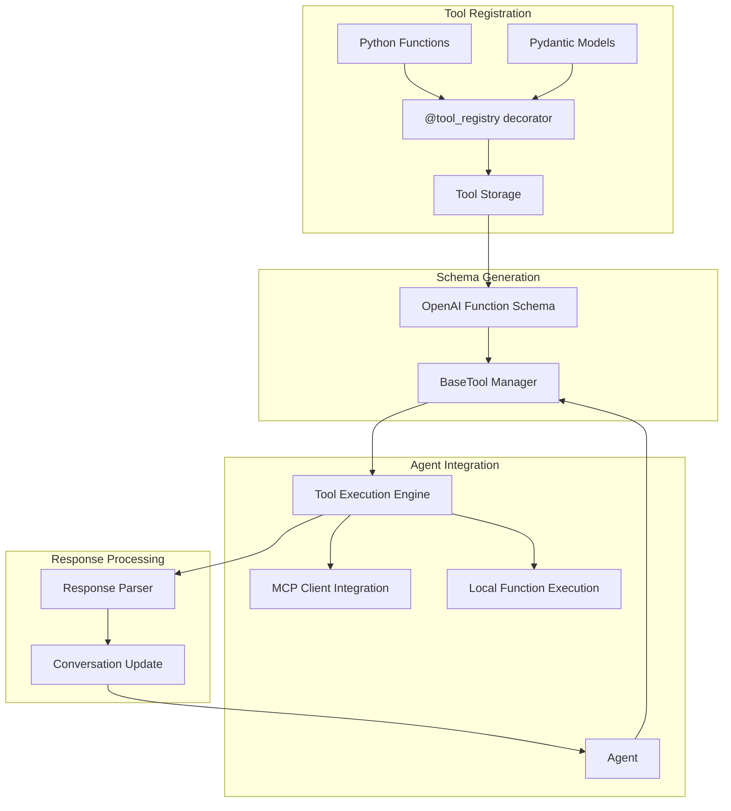

The tool system supports both local Python function execution and MCP (Model Context Protocol) client integration for distributed tool services.

Sources: [swarms/structs/agent.py:633-651](), [swarms/tools/base_tool.py](), [swarms/tools/mcp_client_call.py:74-83]()

## Memory and Conversation Management

The Agent class manages conversation history and long-term memory through integrated systems:

| Component | Purpose | Implementation |
|-----------|---------|----------------|
| **Conversation** | Short-term conversation history | [swarms/structs/conversation.py]() |
| **Long Term Memory** | Persistent knowledge storage | Pluggable vector database backends |
| **RAG Handler** | Document retrieval and integration | [swarms/structs/agent_rag_handler.py]() |
| **State Persistence** | Agent state saving/loading | JSON-based state management |

### Conversation Flow

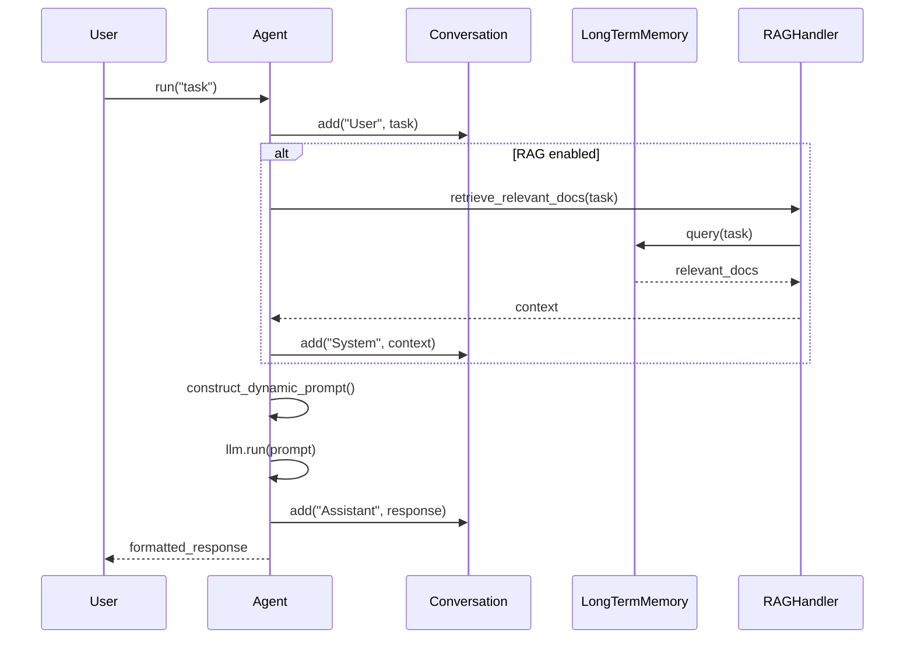

Sources: [swarms/structs/agent.py:669-705](), [swarms/structs/agent.py:625-632]()

## Common Usage Patterns

### Basic Agent Creation

The simplest agent setup requires minimal configuration:

```python
from swarms import Agent

agent = Agent(
    model_name="gpt-4o-mini",
    max_loops=1,
    interactive=True,
)

result = agent.run("What are the benefits of autonomous agents?")
```

### Advanced Configuration

Production agents typically require more comprehensive configuration:

```python
agent = Agent(
    agent_name="Financial-Analyst",
    agent_description="Expert financial analysis agent",
    system_prompt="You are a financial expert...",
    model_name="claude-3-sonnet-20240229",
    max_loops=3,
    tools=[calculate_ratios, fetch_market_data],
    streaming_on=True,
    verbose=True,
    artifacts_on=True,
    long_term_memory=vector_db_instance
)
```

### Multi-Modal Processing

Agents support image and document processing:

```python
agent = Agent(
    model_name="gpt-4-vision-preview",
    multi_modal=True
)

result = agent.run(
    task="Analyze this financial chart",
    img="path/to/chart.png"
)
```

Sources: [README.md:168-180](), [example.py:1-48](), [swarms/structs/agent.py:164-222]()

## State Management and Persistence

The Agent class provides comprehensive state management capabilities through the `SafeStateManager` and built-in serialization methods:

| Method | Purpose | Usage |
|--------|---------|-------|
| `save_state()` | Save current agent state | Automatic or manual state persistence |
| `load()` | Load saved agent state | Restore agent from previous session |
| `to_dict()` | Serialize agent configuration | Export for telemetry or debugging |
| `autosave` | Automatic state saving | Configurable background state persistence |

The state management system ensures agent continuity across sessions and provides recovery mechanisms for production deployments.

Sources: [swarms/structs/agent.py:4600-4700](), [swarms/structs/safe_loading.py]()

---

# Page: SwarmRouter

# SwarmRouter

<details>
<summary>Relevant source files</summary>

The following files were used as context for generating this wiki page:

- [.gitignore](.gitignore)
- [README.md](README.md)
- [docs/mkdocs.yml](docs/mkdocs.yml)
- [docs/swarms/concept/swarm_architectures.md](docs/swarms/concept/swarm_architectures.md)
- [docs/swarms/examples/multi_agent_router_minimal.md](docs/swarms/examples/multi_agent_router_minimal.md)
- [docs/swarms/prompts/main.md](docs/swarms/prompts/main.md)
- [docs/swarms/structs/swarm_router.md](docs/swarms/structs/swarm_router.md)
- [example.py](example.py)
- [examples/multi_agent/mar/multi_agent_router_minimal.py](examples/multi_agent/mar/multi_agent_router_minimal.py)
- [pyproject.toml](pyproject.toml)
- [requirements.txt](requirements.txt)
- [swarms/__init__.py](swarms/__init__.py)
- [swarms/agents/__init__.py](swarms/agents/__init__.py)
- [swarms/prompts/logistics.py](swarms/prompts/logistics.py)
- [swarms/prompts/sop_generator_agent_prompt.py](swarms/prompts/sop_generator_agent_prompt.py)
- [swarms/structs/__init__.py](swarms/structs/__init__.py)
- [swarms/structs/agent.py](swarms/structs/agent.py)
- [swarms/structs/concurrent_workflow.py](swarms/structs/concurrent_workflow.py)
- [swarms/structs/rearrange.py](swarms/structs/rearrange.py)
- [swarms/structs/sequential_workflow.py](swarms/structs/sequential_workflow.py)
- [swarms/structs/swarm_router.py](swarms/structs/swarm_router.py)
- [swarms/structs/swarming_architectures.py](swarms/structs/swarming_architectures.py)
- [swarms/utils/__init__.py](swarms/utils/__init__.py)
- [tests/prompts/test_prompt.py](tests/prompts/test_prompt.py)

</details>


SwarmRouter is a factory class that provides a unified interface for dynamically selecting and instantiating different multi-agent orchestration patterns within the Swarms framework. It serves as the central routing mechanism that allows users to execute tasks using various swarm architectures through a single, consistent API.

This document covers the SwarmRouter's architecture, supported swarm types, configuration options, and execution patterns. For information about individual swarm architectures, see [Multi-Agent Orchestration](#3). For basic agent configuration, see [Agent Class](#2.1).

## Architecture Overview

SwarmRouter implements a factory pattern that abstracts the complexity of different multi-agent architectures behind a unified interface. The router can either use a specified swarm type or automatically determine the most suitable architecture for a given task.

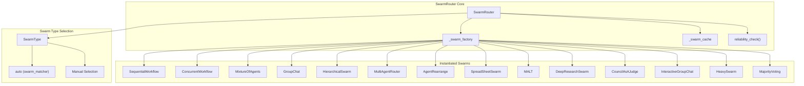

Sources: [swarms/structs/swarm_router.py:106-1173](), [swarms/structs/swarm_router.py:37-54](), [swarms/structs/swarm_router.py:449-527]()

## Swarm Factory Pattern

The SwarmRouter uses a factory pattern with O(1) lookup performance through the `_swarm_factory` dictionary. Each swarm type is mapped to its corresponding instantiation logic.

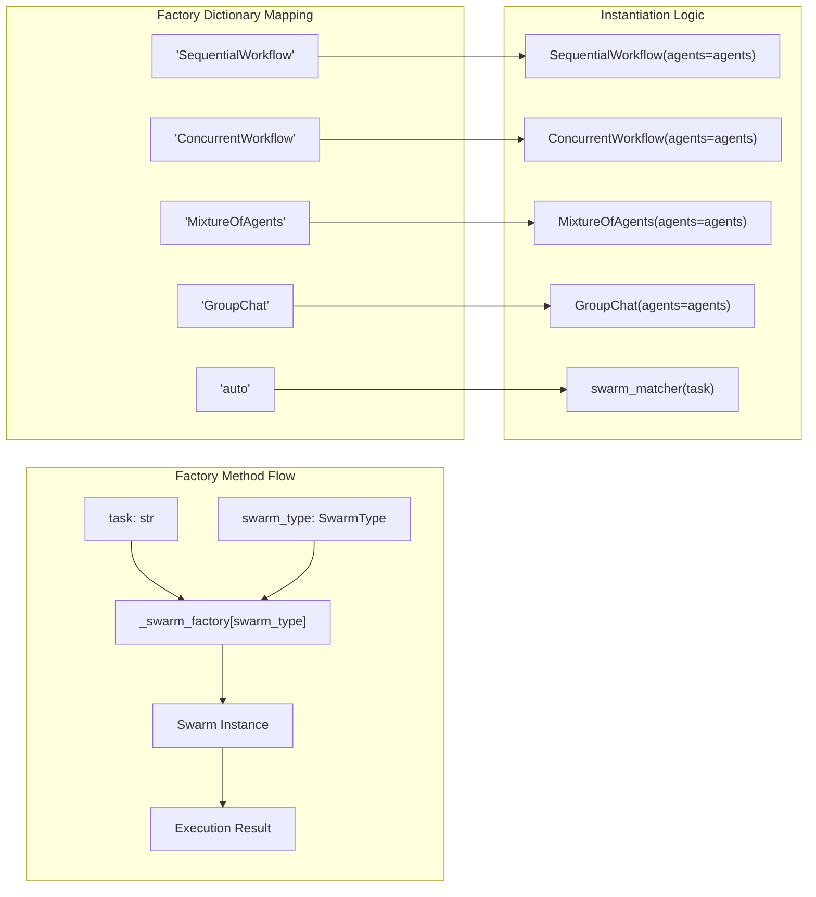

Sources: [swarms/structs/swarm_router.py:244-247](), [swarms/structs/swarm_router.py:449-527](), [swarms/structs/swarm_router.py:575-695]()

## Supported Swarm Types

SwarmRouter supports 14 different swarm architectures, each optimized for specific use cases:

| SwarmType | Class | Primary Use Case |
|-----------|-------|------------------|
| `SequentialWorkflow` | `SequentialWorkflow` | Linear task processing |
| `ConcurrentWorkflow` | `ConcurrentWorkflow` | Parallel task execution |
| `MixtureOfAgents` | `MixtureOfAgents` | Expert agent aggregation |
| `GroupChat` | `GroupChat` | Conversational collaboration |
| `HierarchicalSwarm` | `HierarchicalSwarm` | Director-worker patterns |
| `MultiAgentRouter` | `MultiAgentRouter` | Task-based agent selection |
| `AgentRearrange` | `AgentRearrange` | Custom flow orchestration |
| `SpreadSheetSwarm` | `SpreadSheetSwarm` | Structured data processing |
| `MajorityVoting` | `MajorityVoting` | Consensus-based decisions |
| `MALT` | `MALT` | Multi-agent language tasks |
| `DeepResearchSwarm` | `DeepResearchSwarm` | Research-oriented workflows |
| `CouncilAsAJudge` | `CouncilAsAJudge` | Evaluation and judgment |
| `InteractiveGroupChat` | `InteractiveGroupChat` | Dynamic speaker selection |
| `HeavySwarm` | `HeavySwarm` | Intensive computational tasks |
| `auto` | `swarm_matcher` | Automatic architecture selection |

Sources: [swarms/structs/swarm_router.py:37-54](), [swarms/structs/swarm_router.py:449-527]()

## Configuration and Initialization

SwarmRouter accepts extensive configuration options to customize behavior across different swarm types:

```mermaid
graph TD
    subgraph "Core Configuration"
        ID["id: str"]
        Name["name: str"]
        Desc["description: str"]
        Agents["agents: List[Agent]"]
        SwarmType["swarm_type: SwarmType"]
    end
    
    subgraph "Execution Options"
        MaxLoops["max_loops: int"]
        AutoSave["autosave: bool"]
        OutputType["output_type: OutputType"]
        ReturnJSON["return_json: bool"]
    end
    
    subgraph "Agent Enhancement"
        AutoPrompts["auto_generate_prompts: bool"]
        Rules["rules: str"]
        SharedMemory["shared_memory_system: Any"]
        MultiAgentCollab["multi_agent_collab_prompt: bool"]
    end
    
    subgraph "Specialized Options"
        RearrangeFlow["rearrange_flow: str"]
        SpeakerFn["speaker_fn: callable"]
        LoadCSV["load_agents_from_csv: bool"]
        CSVPath["csv_file_path: str"]
    end
    
    ID --> SwarmRouter
    Name --> SwarmRouter
    Desc --> SwarmRouter
    Agents --> SwarmRouter
    SwarmType --> SwarmRouter
    
    MaxLoops --> SwarmRouter
    AutoSave --> SwarmRouter
    OutputType --> SwarmRouter
    ReturnJSON --> SwarmRouter
    
    AutoPrompts --> SwarmRouter
    Rules --> SwarmRouter
    SharedMemory --> SwarmRouter
    MultiAgentCollab --> SwarmRouter
    
    RearrangeFlow --> SwarmRouter
    SpeakerFn --> SwarmRouter
    LoadCSV --> SwarmRouter
    CSVPath --> SwarmRouter
```

Sources: [swarms/structs/swarm_router.py:175-208](), [swarms/structs/swarm_router.py:309-393]()

## Execution Modes

SwarmRouter provides multiple execution patterns to handle different performance and concurrency requirements:

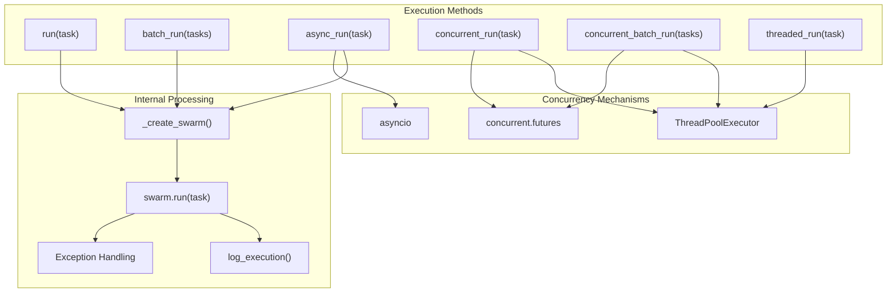

Sources: [swarms/structs/swarm_router.py:891-949](), [swarms/structs/swarm_router.py:951-977](), [swarms/structs/swarm_router.py:1008-1051](), [swarms/structs/swarm_router.py:1053-1094]()

## Reliability and Error Handling

The SwarmRouter implements comprehensive validation through the `reliability_check()` method, ensuring proper configuration before execution:

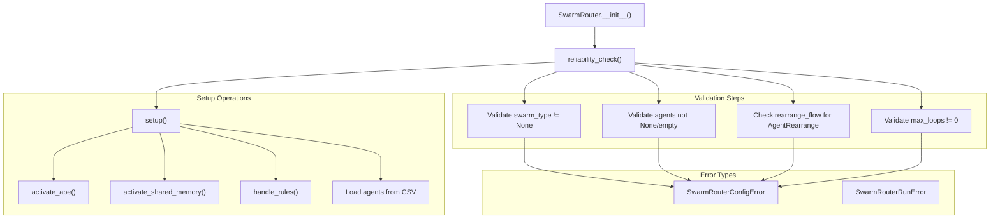

Sources: [swarms/structs/swarm_router.py:251-307](), [swarms/structs/swarm_router.py:309-393](), [swarms/structs/swarm_router.py:94-104]()

## Automatic Swarm Selection

When `swarm_type="auto"` is specified, SwarmRouter uses the `swarm_matcher` function to automatically select the most appropriate swarm architecture based on task characteristics:

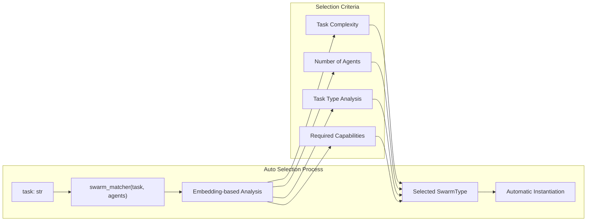

Sources: [swarms/structs/swarm_router.py:23](), [swarms/structs/swarm_router.py:521-527]()

## Usage Patterns

SwarmRouter supports several common usage patterns for different scenarios:

### Basic Task Execution
```python
from swarms import Agent, SwarmRouter

router = SwarmRouter(
    agents=[agent1, agent2],
    swarm_type="SequentialWorkflow"
)
result = router.run("Analyze market trends")
```

### Automatic Architecture Selection
```python
router = SwarmRouter(
    agents=[agent1, agent2, agent3],
    swarm_type="auto"  # Automatically selects best architecture
)
result = router.run("Complex research task")
```

### Batch Processing
```python
tasks = ["Task 1", "Task 2", "Task 3"]
results = router.batch_run(tasks)
```

### Concurrent Execution
```python
result = router.concurrent_run("Parallel processing task")
```

Sources: [docs/swarms/structs/swarm_router.md:122-211](), [examples/multi_agent/mar/multi_agent_router_minimal.py:1-26]()

## Integration with Agent System

SwarmRouter seamlessly integrates with the core Agent system, providing enhanced capabilities through shared memory, rule injection, and collaborative prompting:

```mermaid
graph TB
    subgraph "Agent Enhancement Features"
        APE["Automatic Prompt Engineering"]
        SharedMem["Shared Memory System"]
        RuleInjection["Rule Injection"]
        CollabPrompts["Multi-Agent Collaboration Prompts"]
    end
    
    subgraph "Agent Configuration"
        AgentList["agents: List[Agent]"]
        AgentCSV["CSV Agent Loading"]
        AgentConfig["agents_config: Dict"]
    end
    
    subgraph "SwarmRouter Processing"
        Setup["setup()"]
        CreateSwarm["_create_swarm()"]
        Execute["Execute Task"]
    end
    
    AgentList --> Setup
    AgentCSV --> Setup
    AgentConfig --> Setup
    
    Setup --> APE
    Setup --> SharedMem
    Setup --> RuleInjection
    Setup --> CollabPrompts
    
    APE --> CreateSwarm
    SharedMem --> CreateSwarm
    RuleInjection --> CreateSwarm
    CollabPrompts --> CreateSwarm
    
    CreateSwarm --> Execute
```

Sources: [swarms/structs/swarm_router.py:309-393](), [swarms/structs/swarm_router.py:395-447](), [swarms/structs/swarm_router.py:709-782]()

---

# Page: Multi-Agent Orchestration

# Multi-Agent Orchestration

<details>
<summary>Relevant source files</summary>

The following files were used as context for generating this wiki page:

- [.gitignore](.gitignore)
- [README.md](README.md)
- [docs/mkdocs.yml](docs/mkdocs.yml)
- [docs/swarms/concept/swarm_architectures.md](docs/swarms/concept/swarm_architectures.md)
- [docs/swarms/examples/multi_agent_router_minimal.md](docs/swarms/examples/multi_agent_router_minimal.md)
- [docs/swarms/prompts/main.md](docs/swarms/prompts/main.md)
- [docs/swarms/structs/swarm_router.md](docs/swarms/structs/swarm_router.md)
- [example.py](example.py)
- [examples/multi_agent/mar/multi_agent_router_minimal.py](examples/multi_agent/mar/multi_agent_router_minimal.py)
- [pyproject.toml](pyproject.toml)
- [requirements.txt](requirements.txt)
- [swarms/__init__.py](swarms/__init__.py)
- [swarms/agents/__init__.py](swarms/agents/__init__.py)
- [swarms/prompts/logistics.py](swarms/prompts/logistics.py)
- [swarms/prompts/sop_generator_agent_prompt.py](swarms/prompts/sop_generator_agent_prompt.py)
- [swarms/structs/__init__.py](swarms/structs/__init__.py)
- [swarms/structs/agent.py](swarms/structs/agent.py)
- [swarms/structs/concurrent_workflow.py](swarms/structs/concurrent_workflow.py)
- [swarms/structs/rearrange.py](swarms/structs/rearrange.py)
- [swarms/structs/sequential_workflow.py](swarms/structs/sequential_workflow.py)
- [swarms/structs/swarm_router.py](swarms/structs/swarm_router.py)
- [swarms/structs/swarming_architectures.py](swarms/structs/swarming_architectures.py)
- [swarms/utils/__init__.py](swarms/utils/__init__.py)
- [tests/prompts/test_prompt.py](tests/prompts/test_prompt.py)

</details>


Multi-agent orchestration in the Swarms framework provides systematic coordination and execution patterns for multiple autonomous agents working together to achieve complex goals. This document covers the architectural patterns, implementation details, and coordination mechanisms that enable sophisticated multi-agent collaboration.

For information about individual agent configuration and capabilities, see [Agent Class](#2.1). For details about the universal routing system, see [SwarmRouter](#2.2). For specific workflow implementations, see [Sequential Workflow](#3.1), [Concurrent Workflow](#3.2), [Hierarchical Swarm](#3.3), and [GroupChat](#3.4).

## Core Orchestration Architecture

The Swarms framework implements multiple orchestration patterns through a unified architecture built around the `BaseSwarm` class and specialized workflow implementations. Each pattern serves different coordination needs, from simple linear processing to complex hierarchical collaboration.

```mermaid
graph TB
    subgraph "Core Foundation"
        BaseSwarm["BaseSwarm<br/>[base_swarm.py]"]
        Agent["Agent<br/>[agent.py]"]
        Conversation["Conversation<br/>[conversation.py]"]
    end
    
    subgraph "Linear Patterns"
        Sequential["SequentialWorkflow<br/>[sequential_workflow.py]"]
        AgentRearrange["AgentRearrange<br/>[rearrange.py]"]
    end
    
    subgraph "Parallel Patterns"
        Concurrent["ConcurrentWorkflow<br/>[concurrent_workflow.py]"]
        MixtureOfAgents["MixtureOfAgents<br/>[mixture_of_agents.py]"]
    end
    
    subgraph "Interactive Patterns"
        GroupChat["GroupChat<br/>[groupchat.py]"]
        HierarchicalSwarm["HierarchicalSwarm<br/>[hiearchical_swarm.py]"]
    end
    
    subgraph "Universal Orchestrator"
        SwarmRouter["SwarmRouter<br/>[swarm_router.py]"]
        SwarmMatcher["swarm_matcher()<br/>[swarm_matcher.py]"]
    end
    
    BaseSwarm --> Sequential
    BaseSwarm --> Concurrent
    BaseSwarm --> AgentRearrange
    Agent --> Sequential
    Agent --> Concurrent
    Agent --> GroupChat
    Agent --> HierarchicalSwarm
    Conversation --> Sequential
    Conversation --> AgentRearrange
    
    SwarmRouter --> Sequential
    SwarmRouter --> Concurrent
    SwarmRouter --> GroupChat
    SwarmRouter --> HierarchicalSwarm
    SwarmRouter --> AgentRearrange
    SwarmMatcher --> SwarmRouter
```

Sources: [swarms/structs/base_swarm.py](), [swarms/structs/agent.py](), [swarms/structs/sequential_workflow.py](), [swarms/structs/concurrent_workflow.py](), [swarms/structs/swarm_router.py]()

## Sequential and Linear Patterns

Sequential orchestration processes tasks through agents in a predefined order, where each agent's output becomes the input for the next agent in the chain.

### SequentialWorkflow

The `SequentialWorkflow` class implements linear agent processing through the `AgentRearrange` pattern with automatic flow generation.

| Method | Purpose | File Location |
|--------|---------|---------------|
| `sequential_flow()` | Generates agent flow string | [swarms/structs/sequential_workflow.py:62-92]() |
| `run()` | Executes sequential processing | [swarms/structs/sequential_workflow.py:103-144]() |
| `run_batched()` | Batch processing support | [seque

sequential_workflow.py:149-176]() |

The implementation creates a flow pattern by joining agent names with arrows (`agent1 -> agent2 -> agent3`) and delegates execution to `AgentRearrange`.

### AgentRearrange

`AgentRearrange` provides flexible flow-based orchestration supporting both sequential and parallel execution patterns through flow string parsing.

| Component | Description | Implementation |
|-----------|-------------|----------------|
| Flow Validation | Parses and validates flow strings | [swarms/structs/rearrange.py:174-216]() |
| Task Distribution | Routes tasks based on flow pattern | [swarms/structs/rearrange.py:248-346]() |
| History Tracking | Maintains conversation history | [swarms/structs/rearrange.py:122-133]() |

Sources: [swarms/structs/sequential_workflow.py](), [swarms/structs/rearrange.py]()

## Parallel and Concurrent Patterns

Parallel orchestration enables simultaneous agent execution for tasks that can be processed independently, maximizing throughput and resource utilization.

### ConcurrentWorkflow

The `ConcurrentWorkflow` class implements high-performance parallel agent execution using `ThreadPoolExecutor` with comprehensive monitoring and error handling.

```mermaid
graph LR
    subgraph "ConcurrentWorkflow Execution"
        Task["Input Task"]
        ThreadPool["ThreadPoolExecutor<br/>[concurrent_workflow.py:225]"]
        
        subgraph "Agent Threads"
            Agent1["Agent 1<br/>agent.run()"]
            Agent2["Agent 2<br/>agent.run()"]
            Agent3["Agent 3<br/>agent.run()"]
        end
        
        Aggregator["Result Aggregation<br/>_aggregate_results()"]
        Dashboard["Dashboard Display<br/>display_agent_dashboard()"]
    end
    
    Task --> ThreadPool
    ThreadPool --> Agent1
    ThreadPool --> Agent2
    ThreadPool --> Agent3
    Agent1 --> Aggregator
    Agent2 --> Aggregator
    Agent3 --> Aggregator
    
    Agent1 --> Dashboard
    Agent2 --> Dashboard
    Agent3 --> Dashboard
```

Key features include:

- **Thread Management**: Uses 95% of available CPU cores via `ThreadPoolExecutor`
- **Real-time Monitoring**: Dashboard shows agent status during execution
- **Error Handling**: Continues execution even if some agents fail
- **Output Formatting**: Multiple output types including dict, string, and list formats

Sources: [swarms/structs/concurrent_workflow.py]()

### MixtureOfAgents

The `MixtureOfAgents` pattern processes tasks through multiple expert agents in parallel, then synthesizes results through an aggregator agent.

| Phase | Description | Implementation |
|-------|-------------|----------------|
| Parallel Execution | Run expert agents simultaneously | Expert agent `run()` methods |
| Result Collection | Gather all expert outputs | Result aggregation logic |
| Synthesis | Aggregator processes all outputs | Aggregator agent `run()` |

Sources: [swarms/structs/mixture_of_agents.py](), [README.md:430-458]()

## Interactive and Collaborative Patterns

Interactive patterns enable dynamic communication and decision-making between agents through conversation-based coordination.

### GroupChat

`GroupChat` facilitates multi-agent conversations with configurable speaker selection and dynamic interaction patterns.

| Component | Function | Location |
|-----------|----------|----------|
| Speaker Selection | Determines next agent to speak | `speaker_fn` parameter |
| Conversation Management | Tracks dialogue history | `Conversation` class integration |
| Loop Control | Manages conversation rounds | `max_loops` parameter |

### HierarchicalSwarm

`HierarchicalSwarm` implements a director-worker pattern where a central director coordinates specialized worker agents through task decomposition and result synthesis.

The pattern includes:
- **Director Agent**: Creates plans and distributes tasks
- **Worker Agents**: Execute specialized subtasks  
- **Feedback Loops**: Director evaluates and refines results
- **Task Coordination**: Manages dependencies between workers

Sources: [swarms/structs/groupchat.py](), [swarms/structs/hiearchical_swarm.py](), [README.md:491-548]()

## Specialized Orchestration Patterns

The framework includes several specialized patterns for specific use cases requiring advanced coordination strategies.

| Pattern | Purpose | Key Features |
|---------|---------|--------------|
| `HeavySwarm` | Intensive computational workflows | 5-phase analysis with specialized agents |
| `DeepResearchSwarm` | Comprehensive research tasks | Multi-domain investigation coordination |
| `CouncilAsAJudge` | Consensus-based evaluation | Multiple agents as council members |
| `MALT` | Complex language processing | Multi-agent language task coordination |

These patterns extend the base orchestration model with domain-specific coordination logic and specialized agent roles.

Sources: [swarms/structs/heavy_swarm.py](), [swarms/structs/deep_research_swarm.py](), [swarms/structs/council_judge.py](), [swarms/structs/malt.py]()

## SwarmRouter - Universal Orchestrator

The `SwarmRouter` class provides a unified interface for dynamically selecting and executing different orchestration patterns based on task requirements or explicit configuration.

```mermaid
graph TB
    subgraph "SwarmRouter Architecture"
        SwarmRouter["SwarmRouter<br/>[swarm_router.py]"]
        SwarmFactory["_initialize_swarm_factory()<br/>[swarm_router.py:245]"]
        
        subgraph "Swarm Types"
            ST_Sequential["SequentialWorkflow"]
            ST_Concurrent["ConcurrentWorkflow"] 
            ST_GroupChat["GroupChat"]
            ST_Hierarchical["HierarchicalSwarm"]
            ST_Rearrange["AgentRearrange"]
            ST_Auto["auto (swarm_matcher)"]
        end
        
        subgraph "Execution Methods"
            Run["run()"]
            BatchRun["batch_run()"]
            AsyncRun["async_run()"]
            ConcurrentRun["concurrent_run()"]
        end
    end
    
    SwarmRouter --> SwarmFactory
    SwarmFactory --> ST_Sequential
    SwarmFactory --> ST_Concurrent
    SwarmFactory --> ST_GroupChat
    SwarmFactory --> ST_Hierarchical
    SwarmFactory --> ST_Rearrange
    SwarmFactory --> ST_Auto
    
    SwarmRouter --> Run
    SwarmRouter --> BatchRun
    SwarmRouter --> AsyncRun
    SwarmRouter --> ConcurrentRun
```

### Key Capabilities

| Feature | Implementation | Purpose |
|---------|----------------|---------|
| Dynamic Selection | `swarm_type` parameter or "auto" mode | Choose optimal pattern for task |
| Factory Pattern | `_swarm_factory` O(1) lookup | Efficient swarm instantiation |
| Caching | `_swarm_cache` dictionary | Reuse created swarm instances |
| Auto-matching | `swarm_matcher()` function | Embedding-based pattern selection |

### SwarmType Enumeration

The `SwarmType` literal defines supported orchestration patterns:

```python
SwarmType = Literal[
    "AgentRearrange",
    "MixtureOfAgents", 
    "SequentialWorkflow",
    "ConcurrentWorkflow",
    "GroupChat",
    "HiearchicalSwarm",
    "auto",
    # ... additional types
]
```

Sources: [swarms/structs/swarm_router.py:37-54](), [swarms/structs/swarm_router.py:106-173]()

## Implementation Patterns

### Common Base Classes

Most orchestration patterns inherit from `BaseSwarm` which provides:

- Agent management and validation
- Common initialization patterns  
- Shared utility methods
- Consistent interface contracts

### Conversation Integration

All patterns integrate with the `Conversation` class for:

- Message history tracking
- Context management across agents
- Token counting and limits
- Serialization and persistence

### Error Handling and Reliability

Orchestration patterns implement comprehensive error handling:

- **Validation**: Pre-execution configuration checks
- **Graceful Degradation**: Continue execution when individual agents fail  
- **Logging**: Detailed execution tracking via `loguru`
- **State Management**: Autosave and recovery capabilities

Sources: [swarms/structs/base_swarm.py](), [swarms/structs/conversation.py](), [swarms/structs/agent.py:622-624]()

The multi-agent orchestration system provides a flexible, robust foundation for coordinating autonomous agents across diverse use cases, from simple sequential processing to complex hierarchical collaboration patterns.

---

# Page: Sequential Workflow

# Sequential Workflow

<details>
<summary>Relevant source files</summary>

The following files were used as context for generating this wiki page:

- [.gitignore](.gitignore)
- [README.md](README.md)
- [docs/mkdocs.yml](docs/mkdocs.yml)
- [example.py](example.py)
- [pyproject.toml](pyproject.toml)
- [requirements.txt](requirements.txt)
- [swarms/__init__.py](swarms/__init__.py)
- [swarms/agents/__init__.py](swarms/agents/__init__.py)
- [swarms/prompts/logistics.py](swarms/prompts/logistics.py)
- [swarms/prompts/sop_generator_agent_prompt.py](swarms/prompts/sop_generator_agent_prompt.py)
- [swarms/structs/__init__.py](swarms/structs/__init__.py)
- [swarms/structs/agent.py](swarms/structs/agent.py)
- [swarms/structs/concurrent_workflow.py](swarms/structs/concurrent_workflow.py)
- [swarms/structs/rearrange.py](swarms/structs/rearrange.py)
- [swarms/structs/sequential_workflow.py](swarms/structs/sequential_workflow.py)
- [swarms/structs/swarm_router.py](swarms/structs/swarm_router.py)
- [swarms/utils/__init__.py](swarms/utils/__init__.py)

</details>


## Overview

`SequentialWorkflow` is a production-grade workflow orchestrator that executes agents in a linear chain where each agent processes the output from the previous agent. This workflow pattern is ideal for multi-step processes requiring ordered execution such as research → analysis → writing → editing pipelines.

The `SequentialWorkflow` class serves as a high-level wrapper around the `AgentRearrange` system, automatically generating arrow-based flow patterns and providing multiple execution modes including synchronous, asynchronous, batched, and concurrent processing.

**Sequential Workflow Data Flow**
```mermaid
graph LR
    task["task: str"] --> SequentialWorkflow
    SequentialWorkflow --> AgentRearrange
    AgentRearrange --> Agent1["agents[0].run()"]
    Agent1 --> Agent2["agents[1].run()"]
    Agent2 --> Agent3["agents[2].run()"]
    Agent3 --> result["formatted_output"]
```

Sources: [swarms/structs/sequential_workflow.py:12-29](), [swarms/structs/sequential_workflow.py:53-61]()

## Architecture and Class Structure

The `SequentialWorkflow` architecture follows a wrapper pattern around `AgentRearrange`, providing a simplified interface for linear agent execution while leveraging the full power of the underlying rearrangement system.

**SequentialWorkflow Class Architecture**
```mermaid
classDiagram
    class SequentialWorkflow {
        +id: str
        +name: str
        +description: str
        +agents: List[Union[Agent, Callable]]
        +max_loops: int
        +output_type: OutputType
        +shared_memory_system: callable
        +flow: str
        +agent_rearrange: AgentRearrange
        +sequential_flow() str
        +reliability_check() void
        +run(task, img, imgs) Any
        +run_batched(tasks) List[str]
        +run_async(task) str
        +run_concurrent(tasks) List[str]
        +__call__(task) Any
    }
    
    class AgentRearrange {
        +name: str
        +description: str
        +agents: Dict[str, Agent]
        +flow: str
        +max_loops: int
        +output_type: OutputType
        +conversation: Conversation
        +_run(task, img, custom_tasks) Any
        +run(task, img) Any
        +validate_flow() bool
    }
    
    class Agent {
        +agent_name: str
        +system_prompt: str
        +llm: Any
        +run(task) str
        +short_memory: Conversation
    }
    
    SequentialWorkflow --> AgentRearrange : "delegates execution to"
    AgentRearrange --> Agent : "orchestrates via agent_name dict"
    SequentialWorkflow --> Agent : "receives list, converts to dict"
```

Sources: [swarms/structs/sequential_workflow.py:30-61](), [swarms/structs/rearrange.py:95-133]()

## Core Components

### SequentialWorkflow Class

The main orchestrator class that provides a simplified interface for sequential agent execution.

| Attribute | Type | Description |
|-----------|------|-------------|
| `id` | str | Unique identifier, defaults to "sequential_workflow" |
| `name` | str | Human-readable workflow name |
| `description` | str | Workflow purpose description |
| `agents` | List[Union[Agent, Callable]] | Ordered list of agents to execute |
| `max_loops` | int | Number of complete workflow iterations |
| `output_type` | OutputType | Result formatting: "dict", "str", "list" |
| `shared_memory_system` | callable | Optional shared memory between agents |
| `flow` | str | Generated arrow notation: "Agent1 -> Agent2 -> Agent3" |
| `agent_rearrange` | AgentRearrange | Internal execution engine |

Sources: [swarms/structs/sequential_workflow.py:30-50]()

### AgentRearrange Integration

`SequentialWorkflow` automatically configures an `AgentRearrange` instance with the generated flow pattern, converting the simple agent list into the dictionary format required by the rearrangement system.

Sources: [swarms/structs/sequential_workflow.py:53-61]()

## Initialization and Configuration

The `SequentialWorkflow` constructor performs initialization in a specific sequence to ensure proper workflow configuration.

**Initialization Flow**
```mermaid
graph TD
    init["SequentialWorkflow.__init__()"] --> assign["Assign constructor parameters"]
    assign --> reliability["reliability_check()"]
    reliability --> flow_gen["sequential_flow()"]
    flow_gen --> agent_rearrange["Create AgentRearrange instance"]
    
    reliability --> validate_agents["Validate agents list not empty"]
    reliability --> validate_loops["Validate max_loops != 0"]
    
    flow_gen --> extract_names["Extract agent.agent_name or agent.name"]
    extract_names --> join_arrows["Join with ' -> ' separator"]
    
    agent_rearrange --> configure["Configure with name, description, agents, flow, max_loops, output_type"]
```

Sources: [swarms/structs/sequential_workflow.py:30-61](), [swarms/structs/sequential_workflow.py:94-102]()

### Constructor Parameters

| Parameter | Type | Default | Description |
|-----------|------|---------|-------------|
| `id` | str | "sequential_workflow" | Unique workflow identifier |
| `name` | str | "SequentialWorkflow" | Workflow display name |
| `description` | str | "Sequential Workflow, where agents are executed in a sequence." | Workflow purpose description |
| `agents` | List[Union[Agent, Callable]] | [] | Ordered list of agents for execution |
| `max_loops` | int | 1 | Number of complete workflow iterations |
| `output_type` | OutputType | "dict" | Output format ("dict", "str", "list") |
| `shared_memory_system` | callable | None | Optional shared memory system |

Sources: [swarms/structs/sequential_workflow.py:30-41]()

### Validation Rules

The `reliability_check()` method enforces these constraints:

- **Non-empty agents**: `agents` list cannot be `None` or empty
- **Valid max_loops**: `max_loops` cannot be 0
- **Agent naming**: Each agent must have `agent_name` or `name` attribute

Sources: [swarms/structs/sequential_workflow.py:94-102]()

## Flow Generation and Agent Name Resolution

The `sequential_flow()` method generates the arrow-based flow notation that `AgentRearrange` uses for execution orchestration. This method handles the complexity of extracting agent names from different agent implementations.

**Flow Generation Process**
```mermaid
graph TD
    sequential_flow["sequential_flow()"] --> check_agents{"self.agents exists?"}
    check_agents -->|"Yes"| iterate["Iterate through agents"]
    check_agents -->|"No"| empty_return["Return empty string"]
    
    iterate --> extract_name["Try getattr(agent, 'agent_name', None)"]
    extract_name --> fallback["Fallback to agent.name"]
    fallback --> success_check{"Name extracted?"}
    
    success_check -->|"Yes"| add_to_list["Add to agent_names list"]
    success_check -->|"No"| log_warning["logger.warning() and continue"]
    
    add_to_list --> more_agents{"More agents?"}
    more_agents -->|"Yes"| iterate
    more_agents -->|"No"| join_names["' -> '.join(agent_names)"]
    
    log_warning --> more_agents
    join_names --> return_flow["Return flow string"]
```

Sources: [swarms/structs/sequential_workflow.py:62-92]()

### Agent Name Resolution Logic

The flow generation handles different agent naming conventions:

1. **Primary**: `agent.agent_name` (standard Swarms Agent attribute)
2. **Fallback**: `agent.name` (alternative naming)
3. **Error handling**: Logs warning and skips agents without valid names

**Example Flow Outputs:**
- Input: `[researcher_agent, writer_agent, editor_agent]`
- Output: `"Researcher -> Writer -> Editor"`

Sources: [swarms/structs/sequential_workflow.py:68-78]()

## Execution Methods

`SequentialWorkflow` provides multiple execution patterns to handle different use cases, from single-task processing to high-throughput batch operations.

### Standard Execution: `run()`

The primary execution method that processes a single task through the agent sequence.

**Sequential Execution Flow**
```mermaid
sequenceDiagram
    participant Client
    participant SequentialWorkflow
    participant AgentRearrange
    participant Conversation
    participant Agent1
    participant Agent2
    
    Client->>SequentialWorkflow: run(task, img, imgs)
    SequentialWorkflow->>AgentRearrange: run(task, img)
    AgentRearrange->>Conversation: add("User", task)
    AgentRearrange->>Agent1: run(conversation.get_str())
    Agent1-->>AgentRearrange: result1
    AgentRearrange->>Conversation: add(agent1.agent_name, result1)
    AgentRearrange->>Agent2: run(conversation.get_str())
    Agent2-->>AgentRearrange: result2
    AgentRearrange->>Conversation: add(agent2.agent_name, result2)
    AgentRearrange-->>SequentialWorkflow: history_output_formatter()
    SequentialWorkflow-->>Client: formatted_result
```

**Method Signature:**
```python
def run(self, task: str, img: Optional[str] = None, imgs: Optional[List[str]] = None) -> Any
```

Sources: [swarms/structs/sequential_workflow.py:103-145](), [swarms/structs/rearrange.py:218-346]()

### Batch Processing: `run_batched()`

Executes multiple tasks sequentially through the same agent workflow. Each task goes through the complete agent sequence before the next task begins.

**Method Signature:**
```python
def run_batched(self, tasks: List[str]) -> List[str]
```

**Execution Pattern:**
- Task 1: Agent1 → Agent2 → Agent3 → Result1
- Task 2: Agent1 → Agent2 → Agent3 → Result2
- Task 3: Agent1 → Agent2 → Agent3 → Result3

Sources: [swarms/structs/sequential_workflow.py:149-177]()

### Asynchronous Execution: `run_async()`

Provides asynchronous task execution for integration with async/await workflows.

**Method Signature:**
```python
async def run_async(self, task: str) -> str
```

**Usage Pattern:**
```python
import asyncio

workflow = SequentialWorkflow(agents=[researcher, writer])
result = await workflow.run_async("Research quantum computing trends")
```

Sources: [swarms/structs/sequential_workflow.py:178-202]()

### Concurrent Task Processing: `run_concurrent()`

Executes multiple tasks concurrently using `ThreadPoolExecutor`. Each task runs through the complete agent sequence in parallel with other tasks.

**Concurrent Execution Architecture**
```mermaid
graph TD
    tasks["List[str] tasks"] --> ThreadPoolExecutor
    ThreadPoolExecutor --> task1["Task 1: Agent1→Agent2→Agent3"]
    ThreadPoolExecutor --> task2["Task 2: Agent1→Agent2→Agent3"] 
    ThreadPoolExecutor --> task3["Task 3: Agent1→Agent2→Agent3"]
    
    task1 --> result1["Result 1"]
    task2 --> result2["Result 2"] 
    task3 --> result3["Result 3"]
    
    result1 --> results["List[str] results"]
    result2 --> results
    result3 --> results
```

**Method Signature:**
```python
async def run_concurrent(self, tasks: List[str]) -> List[str]
```

Sources: [swarms/structs/sequential_workflow.py:203-239]()

### Callable Interface: `__call__()`

Enables direct invocation of the workflow instance as a callable function.

```python
workflow = SequentialWorkflow(agents=[agent1, agent2])
result = workflow("Process this data")  # Equivalent to workflow.run("Process this data")
```

Sources: [swarms/structs/sequential_workflow.py:146-148]()

## Error Handling and Validation

`SequentialWorkflow` implements comprehensive error handling at multiple levels to ensure robust operation in production environments.

### Initialization Validation

The `reliability_check()` method performs startup validation:

**Validation Rules:**
- **Agent List Validation**: `ValueError` if `agents` is `None` or empty
- **Loop Count Validation**: `ValueError` if `max_loops` is 0
- **Success Logging**: Confirms successful validation with logger.info()

```python
def reliability_check(self):
    if self.agents is None or len(self.agents) == 0:
        raise ValueError("Agents list cannot be None or empty")
    if self.max_loops == 0:
        raise ValueError("max_loops cannot be 0")
    logger.info("Checks completed; your swarm is ready.")
```

Sources: [swarms/structs/sequential_workflow.py:94-102]()

### Runtime Error Handling

Each execution method includes specific error handling:

**`run()` Method Error Handling:**
- Catches all exceptions during `agent_rearrange.run()`
- Logs detailed error information with `logger.error()`
- Re-raises exception for upstream handling

**`run_batched()` Method Validation:**
- Validates `tasks` is non-empty list
- Validates all tasks are strings
- Provides specific error messages for different failure modes

**`run_async()` Method Validation:**
- Validates task is non-empty string
- Handles async execution errors with detailed logging

**`run_concurrent()` Method Validation:**
- Validates tasks list format
- Handles `ThreadPoolExecutor` exceptions
- Manages concurrent execution failures

Sources: [swarms/structs/sequential_workflow.py:131-144](), [swarms/structs/sequential_workflow.py:163-168](), [swarms/structs/sequential_workflow.py:192-194](), [swarms/structs/sequential_workflow.py:217-220]()

### AgentRearrange Error Propagation

The underlying `AgentRearrange` system provides additional error handling through the `_catch_error()` method, which handles autosaving and detailed error logging.

Sources: [swarms/structs/rearrange.py:350-358]()

## Usage Examples

### Basic Sequential Processing

```python
from swarms import Agent, SequentialWorkflow

# Create specialized agents with specific roles
researcher = Agent(
    agent_name="Researcher",
    system_prompt="Research the given topic and provide detailed information.",
    model_name="gpt-4o-mini"
)

writer = Agent(
    agent_name="Writer", 
    system_prompt="Transform research into engaging content.",
    model_name="gpt-4o-mini"
)

editor = Agent(
    agent_name="Editor",
    system_prompt="Review and refine the content for clarity and accuracy.",
    model_name="gpt-4o-mini"
)

# Create workflow with automatic flow generation
workflow = SequentialWorkflow(
    name="Content-Creation-Pipeline",
    description="Research, write, and edit content in sequence",
    agents=[researcher, writer, editor],
    max_loops=1,
    output_type="dict"
)

# Execute single task
result = workflow.run("Analyze the impact of AI on healthcare")
print(f"Generated flow: {workflow.flow}")  # "Researcher -> Writer -> Editor"
```

### Batch Processing Example

```python
# Process multiple related tasks
tasks = [
    "Analyze AI trends in healthcare",
    "Analyze AI trends in finance", 
    "Analyze AI trends in education"
]

batch_results = workflow.run_batched(tasks)
for i, result in enumerate(batch_results):
    print(f"Task {i+1} result: {result}")
```

### Asynchronous Execution

```python
import asyncio

async def process_async_tasks():
    # Single async task
    result = await workflow.run_async("Research blockchain applications")
    
    # Concurrent processing of multiple tasks
    concurrent_tasks = [
        "Research quantum computing",
        "Research edge computing", 
        "Research neuromorphic computing"
    ]
    concurrent_results = await workflow.run_concurrent(concurrent_tasks)
    
    return result, concurrent_results

# Run async workflow
result, concurrent_results = asyncio.run(process_async_tasks())
```

### Integration with SwarmRouter

```python  
from swarms import SwarmRouter, SwarmType

# Use SequentialWorkflow through SwarmRouter
router = SwarmRouter(
    name="Research-Pipeline-Router",
    agents=[researcher, writer, editor],
    swarm_type=SwarmType.SequentialWorkflow,
    max_loops=1
)

result = router.run("Analyze renewable energy technologies")
```

Sources: [README.md:186-210](), [swarms/structs/sequential_workflow.py:103-148](), [swarms/structs/swarm_router.py:525-537]()

## Integration with Swarms Architecture

`SequentialWorkflow` integrates with the broader Swarms ecosystem through multiple touchpoints and standardized interfaces.

**Swarms Ecosystem Integration**
```mermaid
graph TB
    subgraph "Swarms Framework Core"
        SwarmRouter --> SequentialWorkflow
        SwarmRouter --> ConcurrentWorkflow
        SwarmRouter --> HierarchicalSwarm
        SwarmRouter --> MixtureOfAgents
    end
    
    subgraph "SequentialWorkflow Implementation"
        SequentialWorkflow --> AgentRearrange
        AgentRearrange --> Conversation
        AgentRearrange --> Agent
    end
    
    subgraph "Agent Capabilities"
        Agent --> LiteLLM
        Agent --> BaseTool
        Agent --> BaseVectorDatabase
        Agent --> Conversation
    end
    
    subgraph "Output Processing"
        AgentRearrange --> history_output_formatter
        history_output_formatter --> OutputType
    end
```

Sources: [swarms/structs/swarm_router.py:525-537](), [swarms/structs/sequential_workflow.py:4-7](), [swarms/structs/rearrange.py:1-19]()

### SwarmRouter Integration

`SequentialWorkflow` is available as `SwarmType.SequentialWorkflow` in the `SwarmRouter` factory system:

```python
# SwarmRouter factory method for SequentialWorkflow
def _create_sequential_workflow(self, *args, **kwargs):
    return SequentialWorkflow(
        name=self.name,
        description=self.description, 
        agents=self.agents,
        max_loops=self.max_loops,
        output_type=self.output_type,
        *args,
        **kwargs,
    )
```

Sources: [swarms/structs/swarm_router.py:525-537]()

### Multi-Agent Communication

Through the `AgentRearrange` system, `SequentialWorkflow` maintains conversation history using the `Conversation` class, enabling agents to access the full context of previous agent outputs.

**Conversation Flow Pattern:**
1. Initial task added as "User" role
2. Each agent output added with `agent.agent_name` as role
3. Subsequent agents receive full conversation context via `conversation.get_str()`

Sources: [swarms/structs/rearrange.py:122-133](), [swarms/structs/rearrange.py:250-255]()

### Output Type Compatibility

`SequentialWorkflow` supports all standard Swarms output types through the `history_output_formatter` system:

| Output Type | Description | Use Case |
|-------------|-------------|----------|
| `"dict"` | Agent name → output mapping | Structured access to individual results |
| `"str"` | Concatenated string output | Simple text processing |
| `"list"` | List of agent outputs | Ordered result processing |
| `"all"` | Complete conversation history | Full traceability |

Sources: [swarms/structs/sequential_workflow.py:37](), [swarms/utils/history_output_formatter.py:21-24]()

## Best Practices

1. **Order Matters**: Arrange agents in a logical processing sequence where each agent's capabilities build upon the previous agent's output.

2. **Specialized Agents**: Design each agent with a specific, focused role in the pipeline.

3. **Error Handling**: Implement error handling at both the workflow level and within individual agents.

4. **Monitoring**: Use the generated flow string to visualize and monitor the execution path.

5. **Memory Management**: Consider using a shared memory system when agents need to access information produced in earlier stages.

## When to Use Sequential Workflow

Sequential Workflow is ideal for:

- Tasks that naturally decompose into sequential steps
- Processes where the output of one step is the input to the next
- Cases where strict ordering of operations is required
- Scenarios where you need clear traceability of how information flows through the system

For tasks requiring parallel processing, consider the [Concurrent Workflow](#3.2) instead.

---

# Page: Concurrent Workflow

# Concurrent Workflow

<details>
<summary>Relevant source files</summary>

The following files were used as context for generating this wiki page:

- [.dockerignore](.dockerignore)
- [.gitignore](.gitignore)
- [Dockerfile](Dockerfile)
- [README.md](README.md)
- [docs/corporate/swarms_bounty_system.md](docs/corporate/swarms_bounty_system.md)
- [docs/mkdocs.yml](docs/mkdocs.yml)
- [docs/swarms/structs/multi_threaded_workflow.md](docs/swarms/structs/multi_threaded_workflow.md)
- [example.py](example.py)
- [pyproject.toml](pyproject.toml)
- [requirements.txt](requirements.txt)
- [swarms/__init__.py](swarms/__init__.py)
- [swarms/agents/__init__.py](swarms/agents/__init__.py)
- [swarms/prompts/logistics.py](swarms/prompts/logistics.py)
- [swarms/prompts/sop_generator_agent_prompt.py](swarms/prompts/sop_generator_agent_prompt.py)
- [swarms/structs/__init__.py](swarms/structs/__init__.py)
- [swarms/structs/agent.py](swarms/structs/agent.py)
- [swarms/structs/concurrent_workflow.py](swarms/structs/concurrent_workflow.py)
- [swarms/structs/rearrange.py](swarms/structs/rearrange.py)
- [swarms/structs/sequential_workflow.py](swarms/structs/sequential_workflow.py)
- [swarms/structs/swarm_router.py](swarms/structs/swarm_router.py)
- [swarms/utils/__init__.py](swarms/utils/__init__.py)

</details>


This document covers the `ConcurrentWorkflow` system in the Swarms framework, which provides production-grade parallel execution of multiple agents on the same task. The system is designed for high-throughput scenarios where multiple agents need to process identical tasks independently and their results require aggregation.

For sequential agent processing where outputs chain together, see [Sequential Workflow](#3.1). For complex multi-agent coordination with feedback loops, see [Hierarchical Swarm](#3.3).

## System Overview

The `ConcurrentWorkflow` class orchestrates simultaneous execution of multiple agents using Python's `ThreadPoolExecutor`. Unlike sequential workflows where agents process tasks in order, concurrent workflows distribute the same task to all agents simultaneously, collecting and aggregating their independent responses.

```mermaid
graph TB
    subgraph "ConcurrentWorkflow System"
        CW[ConcurrentWorkflow]
        TPE[ThreadPoolExecutor]
        Dashboard[display_agent_dashboard]
        Conversation[Conversation]
        BaseSwarm[BaseSwarm]
    end
    
    subgraph "Agent Pool"
        A1[Agent1]
        A2[Agent2]
        A3[Agent3]
        AN[AgentN]
    end
    
    subgraph "Execution Components"
        reliability_check[reliability_check]
        fix_agents[fix_agents]
        run_with_dashboard[run_with_dashboard]
        batch_run[batch_run]
    end
    
    CW --> BaseSwarm
    CW --> TPE
    CW --> Dashboard
    CW --> Conversation
    CW --> reliability_check
    CW --> fix_agents
    
    TPE --> A1
    TPE --> A2
    TPE --> A3
    TPE --> AN
    
    CW --> run_with_dashboard
    CW --> batch_run
```

Sources: [swarms/structs/concurrent_workflow.py:1-150](), [swarms/structs/base_swarm.py](), [swarms/structs/agent.py]()

## Core Architecture Components

The `ConcurrentWorkflow` extends `BaseSwarm` and integrates several key components for parallel agent execution:

### Primary Classes and Dependencies

| Component | Type | Purpose |
|-----------|------|---------|
| `ConcurrentWorkflow` | Main Class | Orchestrates concurrent agent execution |
| `ThreadPoolExecutor` | Execution Engine | Manages parallel thread execution |
| `Agent` | Worker Units | Individual processing agents |
| `Conversation` | History Manager | Tracks execution history and context |
| `BaseSwarm` | Parent Class | Provides foundational swarm functionality |

### Execution Flow Architecture

```mermaid
flowchart TD
    Task[Task Input] --> CW[ConcurrentWorkflow.run]
    CW --> RC[reliability_check]
    RC --> Dashboard{show_dashboard?}
    Dashboard -->|Yes| RWD[run_with_dashboard]
    Dashboard -->|No| DirectRun[_run]
    
    RWD --> DisplayInit[display_agent_dashboard]
    DisplayInit --> TPE[ThreadPoolExecutor]
    DirectRun --> TPE
    
    TPE --> Submit[Submit agent.run tasks]
    Submit --> Wait[concurrent.futures.wait]
    Wait --> Collect[Collect results]
    Collect --> Format[Format output_type]
    Format --> Return[Return aggregated results]
    
    RWD --> DisplayFinal[display_agent_dashboard final]
    DisplayFinal --> Return
```

Sources: [swarms/structs/concurrent_workflow.py:355-450](), [swarms/structs/concurrent_workflow.py:580-680]()

## Configuration and Initialization

The `ConcurrentWorkflow` constructor accepts multiple configuration parameters that control execution behavior:

### Core Parameters

| Parameter | Type | Default | Description |
|-----------|------|---------|-------------|
| `name` | `str` | `"ConcurrentWorkflow"` | Workflow identifier |
| `agents` | `List[Union[Agent, Callable]]` | `[]` | Agents to execute concurrently |
| `max_loops` | `int` | `1` | Maximum execution loops per agent |
| `output_type` | `str` | `"dict-all-except-first"` | Result aggregation format |
| `show_dashboard` | `bool` | `False` | Enable real-time monitoring display |
| `auto_save` | `bool` | `True` | Automatic metadata persistence |

### Initialization Process

The constructor performs several setup operations:

1. **Agent Status Tracking**: Creates `agent_statuses` dictionary mapping agent names to status objects
2. **Reliability Validation**: Calls `reliability_check()` to validate configuration
3. **Conversation Setup**: Initializes `Conversation` object for history management
4. **Dashboard Configuration**: Calls `fix_agents()` when dashboard mode is enabled

```python
# Constructor signature from swarms/structs/concurrent_workflow.py:137-150
def __init__(
    self,
    name: str = "ConcurrentWorkflow",
    description: str = "Execution of multiple agents concurrently",
    agents: List[Union[Agent, Callable]] = [],
    # ... additional parameters
)
```

Sources: [swarms/structs/concurrent_workflow.py:137-188]()

## Execution Patterns

### Primary Execution Method

The `run()` method serves as the main entry point for task execution. It branches between dashboard and non-dashboard execution paths:

```mermaid
graph LR
    run[ConcurrentWorkflow.run] --> Check{show_dashboard?}
    Check -->|True| RWD[run_with_dashboard]
    Check -->|False| _run[_run]
    
    RWD --> Dashboard[display_agent_dashboard]
    RWD --> Execute[ThreadPoolExecutor execution]
    _run --> Execute
    
    Execute --> Results[Aggregate results]
    Results --> Format[Apply output_type formatting]
    Format --> Return[Return formatted output]
```

### Concurrent Execution Implementation

The core execution logic uses `concurrent.futures.ThreadPoolExecutor` with optimized worker count:

```python
# Thread pool sizing from swarms/structs/concurrent_workflow.py:620-625
max_workers = min(len(self.agents), os.cpu_count() * 95 // 100)
with concurrent.futures.ThreadPoolExecutor(max_workers=max_workers) as executor:
    # Submit all agent tasks simultaneously
    future_to_agent = {
        executor.submit(self._execute_agent, agent, task, img, imgs): agent
        for agent in self.agents
    }
```

### Batch Processing Support

The `batch_run()` method processes multiple tasks sequentially, with each task executed concurrently across all agents:

| Method | Purpose | Execution Pattern |
|--------|---------|-------------------|
| `run()` | Single task execution | All agents process one task concurrently |
| `batch_run()` | Multiple task execution | Sequential task processing, concurrent agent execution per task |
| `run_async()` | Asynchronous execution | Non-blocking concurrent execution |
| `run_concurrent()` | High-throughput mode | Optimized for maximum parallel processing |

Sources: [swarms/structs/concurrent_workflow.py:580-680](), [swarms/structs/concurrent_workflow.py:710-780]()

## Dashboard and Monitoring System

### Real-Time Status Tracking

The dashboard system provides live monitoring of agent execution status through the `agent_statuses` dictionary:

```python
# Status tracking structure from swarms/structs/concurrent_workflow.py:178-182
self.agent_statuses = {
    agent.agent_name: {"status": "pending", "output": ""}
    for agent in agents
}
```

### Dashboard Display Components

```mermaid
graph TB
    subgraph "Dashboard System"
        Display[display_agent_dashboard]
        Status[agent_statuses]
        Formatter[formatter.print_agent_dashboard]
    end
    
    subgraph "Status States"
        Pending["pending"]
        Running["running"] 
        Completed["completed"]
        Error["error"]
    end
    
    subgraph "Display Data"
        AgentName[agent.agent_name]
        StatusValue[status value]
        OutputPreview[output preview]
    end
    
    Display --> Status
    Status --> Formatter
    Status --> Pending
    Status --> Running
    Status --> Completed
    Status --> Error
    
    Formatter --> AgentName
    Formatter --> StatusValue
    Formatter --> OutputPreview
```

### Agent Configuration for Dashboard Mode

The `fix_agents()` method modifies agent print behavior when dashboard mode is enabled:

```python
# Dashboard agent configuration from swarms/structs/concurrent_workflow.py:189-213
def fix_agents(self):
    if self.show_dashboard is True:
        for agent in self.agents:
            agent.print_on = False
    return self.agents
```

Sources: [swarms/structs/concurrent_workflow.py:295-354](), [swarms/structs/concurrent_workflow.py:189-213]()

## Error Handling and Reliability

### Configuration Validation

The `reliability_check()` method validates essential configuration parameters before execution:

```python
# Reliability validation from swarms/structs/concurrent_workflow.py:215-261
def reliability_check(self):
    if self.agents is None:
        raise ValueError("ConcurrentWorkflow: No agents provided")
    
    if len(self.agents) == 0:
        raise ValueError("ConcurrentWorkflow: No agents provided")
    
    if len(self.agents) == 1:
        logger.warning("ConcurrentWorkflow: Only one agent provided...")
```

### Exception Handling Pattern

The execution methods implement comprehensive error handling to ensure partial results are available even when some agents fail:

| Error Scenario | Handling Strategy |
|----------------|-------------------|
| Agent execution failure | Individual agent errors logged, other agents continue |
| Configuration errors | Validation during initialization with descriptive messages |
| Resource exhaustion | ThreadPoolExecutor manages thread lifecycle automatically |
| Timeout conditions | Future objects allow timeout specification and handling |

Sources: [swarms/structs/concurrent_workflow.py:215-261]()

## Integration with Swarm Ecosystem

### SwarmRouter Integration

The `ConcurrentWorkflow` integrates with the broader Swarms ecosystem through `SwarmRouter`:

```python
# SwarmRouter integration from swarms/structs/swarm_router.py:42
SwarmType = Literal[
    "ConcurrentWorkflow",  # Available as swarm type
    # ... other swarm types
]
```

### Output Type Compatibility

The `output_type` parameter supports multiple aggregation formats for integration with different downstream systems:

| Output Type | Format | Use Case |
|-------------|--------|----------|
| `"dict-all-except-first"` | Dictionary excluding first result | Standard aggregation |
| `"dict"` | Full dictionary of all results | Complete result set |
| `"str"` | Concatenated string | Text processing pipelines |
| `"list"` | List of individual outputs | Sequential processing |

### BaseSwarm Heritage

As a subclass of `BaseSwarm`, `ConcurrentWorkflow` inherits foundational swarm capabilities and maintains consistency with other swarm implementations in the framework.

Sources: [swarms/structs/swarm_router.py:37-54](), [swarms/structs/base_swarm.py](), [swarms/structs/__init__.py:7]()

## Usage Examples and Patterns

### Multi-Perspective Analysis Pattern

The most common usage pattern involves creating specialized agents for different analytical perspectives:

```python
# Example from README.md:270-307
from swarms import Agent, ConcurrentWorkflow

# Create specialized analysis agents
market_analyst = Agent(
    agent_name="Market-Analyst",
    system_prompt="Analyze market trends and provide insights...",
    model_name="gpt-4o-mini",
)

financial_analyst = Agent(
    agent_name="Financial-Analyst", 
    system_prompt="Provide financial analysis and recommendations...",
    model_name="gpt-4o-mini",
)

# Create concurrent workflow
concurrent_workflow = ConcurrentWorkflow(
    agents=[market_analyst, financial_analyst, risk_analyst],
    max_loops=1,
)

# Execute analysis across all agents simultaneously
results = concurrent_workflow.run(
    "Analyze the potential impact of AI technology on the healthcare industry"
)
```

### Dashboard Monitoring Pattern

For production deployments requiring real-time monitoring:

```python
# Dashboard-enabled execution pattern
workflow = ConcurrentWorkflow(
    name="Production-Analysis-Workflow",
    agents=[agent1, agent2, agent3],
    show_dashboard=True,
    auto_save=True,
    output_type="dict"
)

# Real-time monitoring during execution
results = workflow.run("Complex analysis task")
```

Sources: [README.md:266-307](), [swarms/structs/concurrent_workflow.py:90-135]()

---

# Page: Hierarchical Swarm

# Hierarchical Swarm

<details>
<summary>Relevant source files</summary>

The following files were used as context for generating this wiki page:

- [docs/examples/paper_implementations.md](docs/examples/paper_implementations.md)
- [scripts/examples.py](scripts/examples.py)
- [swarms/structs/hiearchical_swarm.py](swarms/structs/hiearchical_swarm.py)
- [tests/test_data/image1.jpg](tests/test_data/image1.jpg)
- [tests/test_data/image2.png](tests/test_data/image2.png)

</details>


The Hierarchical Swarm implements a director-worker orchestration pattern where a central director agent coordinates multiple worker agents through structured planning and task distribution. This system enables complex multi-agent coordination with feedback loops and conversation history preservation throughout the execution process.

For sequential agent processing where output flows linearly from one agent to the next, see [Sequential Workflow](#3.1). For parallel agent execution without hierarchical coordination, see [Concurrent Workflow](#3.2). For dynamic conversation management between agents, see [GroupChat](#3.4).

## Architecture Overview

The Hierarchical Swarm follows a centralized coordination model where the director agent acts as the orchestrator for all worker agents. The system maintains conversation history and supports iterative refinement through feedback loops.

### Hierarchical Coordination Architecture

```mermaid
graph TD
    User[User] --> HierarchicalSwarm["HierarchicalSwarm"]
    HierarchicalSwarm --> Director["Director Agent"]
    Director --> SwarmSpec["SwarmSpec Model"]
    SwarmSpec --> HierarchicalOrder1["HierarchicalOrder 1"]
    SwarmSpec --> HierarchicalOrder2["HierarchicalOrder 2"]
    SwarmSpec --> HierarchicalOrderN["HierarchicalOrder N"]
    
    HierarchicalOrder1 --> Agent1["Worker Agent 1"]
    HierarchicalOrder2 --> Agent2["Worker Agent 2"]
    HierarchicalOrderN --> AgentN["Worker Agent N"]
    
    Agent1 --> Results["Agent Results"]
    Agent2 --> Results
    AgentN --> Results
    
    Results --> FeedbackDirector["Feedback Director"]
    FeedbackDirector --> Conversation["Conversation History"]
    Conversation --> Director
    
    HierarchicalSwarm --> OutputFormatter["history_output_formatter"]
    OutputFormatter --> FinalOutput["Formatted Output"]
```

**Sources:** [swarms/structs/hiearchical_swarm.py:1-738]()

## Core Components

The Hierarchical Swarm system consists of several key classes and data structures that manage the coordination workflow.

### Component Relationships

```mermaid
graph TB
    subgraph "Core Classes"
        HierarchicalSwarm["HierarchicalSwarm"]
        BaseSwarm["BaseSwarm"]
        Agent["Agent"]
        Conversation["Conversation"]
    end
    
    subgraph "Data Models"
        SwarmSpec["SwarmSpec"]
        HierarchicalOrder["HierarchicalOrder"]
        SwarmRouterCall["SwarmRouterCall"]
    end
    
    subgraph "Key Methods"
        run["run()"]
        step["step()"]
        run_director["run_director()"]
        parse_orders["parse_orders()"]
        execute_orders["execute_orders()"]
        feedback_director["feedback_director()"]
    end
    
    HierarchicalSwarm --|"inherits from"| BaseSwarm
    HierarchicalSwarm --|"contains"| Agent
    HierarchicalSwarm --|"uses"| Conversation
    HierarchicalSwarm --|"processes"| SwarmSpec
    SwarmSpec --|"contains"| HierarchicalOrder
    
    HierarchicalSwarm --> run
    HierarchicalSwarm --> step
    HierarchicalSwarm --> run_director
    HierarchicalSwarm --> parse_orders
    HierarchicalSwarm --> execute_orders
    HierarchicalSwarm --> feedback_director
```

**Sources:** [swarms/structs/hiearchical_swarm.py:35-91](), [swarms/structs/hiearchical_swarm.py:92-155]()

### Data Models

| Class | Purpose | Key Fields |
|-------|---------|------------|
| `HierarchicalOrder` | Represents individual task assignments | `agent_name`, `task` |
| `SwarmSpec` | Contains director's plan and orders | `plan`, `orders` |
| `SwarmRouterCall` | Router call specification | `goal`, `swarm_type`, `task` |

The `HierarchicalOrder` model specifies task assignments:

```python
class HierarchicalOrder(BaseModel):
    agent_name: str = Field(...)  # Agent to execute the task
    task: str = Field(...)        # Specific task description
```

**Sources:** [swarms/structs/hiearchical_swarm.py:35-44](), [swarms/structs/hiearchical_swarm.py:46-55]()

## Execution Workflow

The Hierarchical Swarm follows a structured execution pattern with multiple phases and feedback loops.

### Execution Flow Process

```mermaid
sequenceDiagram
    participant User
    participant HierarchicalSwarm
    participant Director
    participant SwarmSpec
    participant WorkerAgent1
    participant WorkerAgent2
    participant FeedbackDirector
    participant Conversation
    
    User->>HierarchicalSwarm: run(task)
    HierarchicalSwarm->>HierarchicalSwarm: init_swarm()
    HierarchicalSwarm->>HierarchicalSwarm: reliability_checks()
    
    loop max_loops iterations
        HierarchicalSwarm->>Director: run_director(task)
        Director->>SwarmSpec: create plan and orders
        SwarmSpec-->>HierarchicalSwarm: return SwarmSpec
        
        HierarchicalSwarm->>HierarchicalSwarm: parse_orders(output)
        HierarchicalSwarm->>HierarchicalSwarm: execute_orders(orders)
        
        HierarchicalSwarm->>WorkerAgent1: call_single_agent(task1)
        WorkerAgent1-->>HierarchicalSwarm: agent1_result
        
        HierarchicalSwarm->>WorkerAgent2: call_single_agent(task2)
        WorkerAgent2-->>HierarchicalSwarm: agent2_result
        
        HierarchicalSwarm->>FeedbackDirector: feedback_director(outputs)
        FeedbackDirector-->>HierarchicalSwarm: feedback
        
        HierarchicalSwarm->>Conversation: add(role, content)
    end
    
    HierarchicalSwarm->>HierarchicalSwarm: history_output_formatter()
    HierarchicalSwarm-->>User: formatted_output
```

**Sources:** [swarms/structs/hiearchical_swarm.py:371-449](), [swarms/structs/hiearchical_swarm.py:331-370]()

## Configuration and Setup

The `HierarchicalSwarm` class provides extensive configuration options for customizing behavior and performance.

### Initialization Parameters

| Parameter | Type | Default | Description |
|-----------|------|---------|-------------|
| `name` | `str` | `"HierarchicalAgentSwarm"` | Swarm identifier |
| `description` | `str` | `"Distributed task swarm"` | Swarm description |
| `director` | `Agent` | `None` | Director agent instance |
| `agents` | `List[Agent]` | `None` | Worker agents list |
| `max_loops` | `int` | `1` | Maximum feedback iterations |
| `output_type` | `OutputType` | `"dict-all-except-first"` | Output format specification |
| `verbose` | `bool` | `False` | Enable detailed logging |
| `director_feedback_on` | `bool` | `True` | Enable director feedback |

The initialization process includes several validation and setup steps:

```python
def __init__(self, ...):
    super().__init__(name=name, description=description, agents=agents)
    # Configuration assignment
    self.init_swarm()  # Triggers setup process
```

**Sources:** [swarms/structs/hiearchical_swarm.py:103-155]()

### Director Setup Process

The director agent is configured with structured output capabilities:

```python
def setup_director(self):
    schema = BaseTool().base_model_to_dict(SwarmSpec)
    return Agent(
        agent_name=self.director_name,
        agent_description="A director agent that can create a plan and distribute orders to agents",
        model_name=self.director_model_name,
        max_loops=1,
        base_model=SwarmSpec,
        tools_list_dictionary=[schema],
        output_type="dict-all-except-first",
    )
```

**Sources:** [swarms/structs/hiearchical_swarm.py:209-243]()

## Core Operations

### Task Execution Methods

The system provides multiple execution patterns for different use cases:

| Method | Purpose | Return Type |
|--------|---------|-------------|
| `run()` | Full hierarchical execution with feedback loops | Formatted conversation history |
| `step()` | Single iteration execution | Agent outputs or feedback |
| `batched_run()` | Multiple task processing | List of results |

### Order Processing Pipeline

The order processing follows a structured pipeline:

1. **Director Planning**: The `run_director()` method processes the task through the director agent
2. **Order Parsing**: The `parse_orders()` method extracts structured orders from director output
3. **Task Execution**: The `execute_orders()` method dispatches tasks to appropriate agents
4. **Feedback Generation**: The `feedback_director()` method provides evaluation and guidance

```python
def step(self, task: str, img: str = None, *args, **kwargs):
    output = self.run_director(task=task, img=img)
    plan, orders = self.parse_orders(output)
    outputs = self.execute_orders(orders)
    
    if self.director_feedback_on:
        feedback = self.feedback_director(outputs)
    else:
        feedback = outputs
    
    return feedback
```

**Sources:** [swarms/structs/hiearchical_swarm.py:331-370]()

### Agent Communication

Individual agent execution maintains conversation context:

```python
def call_single_agent(self, agent_name: str, task: str, *args, **kwargs):
    # Find agent by name
    agent = None
    for a in self.agents:
        if hasattr(a, "agent_name") and a.agent_name == agent_name:
            agent = a
            break
    
    output = agent.run(
        task=f"History: {self.conversation.get_str()} \n\n Task: {task}",
        *args, **kwargs,
    )
    self.conversation.add(role=agent_name, content=output)
    return output
```

**Sources:** [swarms/structs/hiearchical_swarm.py:490-537]()

## Advanced Features

### Feedback Loop System

The hierarchical swarm supports iterative refinement through director feedback:

```python
def feedback_director(self, outputs: list):
    feedback_director = Agent(
        agent_name="Director",
        agent_description="Director module that provides feedback to the worker agents",
        model_name=self.director_model_name,
        max_loops=1,
        system_prompt=HIEARCHICAL_SWARM_SYSTEM_PROMPT,
    )
    
    output = feedback_director.run(
        task=("You are the Director. Carefully review the outputs generated by all the worker agents... "
              f"Worker Agent Responses: {task}")
    )
    return output
```

**Sources:** [swarms/structs/hiearchical_swarm.py:450-489]()

### Context Management

The system maintains comprehensive conversation history throughout execution:

- All agent interactions are stored in the `Conversation` object
- Historical context is provided to agents for continuity
- Loop completion markers track execution progress

### Error Handling and Reliability

The system includes robust error handling and validation:

```python
def reliability_checks(self):
    if not self.agents or len(self.agents) == 0:
        raise ValueError("No agents found in the swarm...")
    
    if self.max_loops <= 0:
        raise ValueError("Max loops must be greater than 0...")
    
    if not self.director:
        raise ValueError("Director not set for the swarm...")
```

**Sources:** [swarms/structs/hiearchical_swarm.py:245-282]()

---

# Page: GroupChat

# GroupChat

<details>
<summary>Relevant source files</summary>

The following files were used as context for generating this wiki page:

- [docs/swarms/structs/group_chat.md](docs/swarms/structs/group_chat.md)
- [docs/swarms_cloud/mcs_api.md](docs/swarms_cloud/mcs_api.md)
- [swarms/structs/groupchat.py](swarms/structs/groupchat.py)
- [swarms/structs/spreadsheet_swarm.py](swarms/structs/spreadsheet_swarm.py)
- [tests/structs/test_groupchat.py](tests/structs/test_groupchat.py)

</details>


This document covers the GroupChat system, a dynamic conversation management framework that orchestrates multi-agent discussions with customizable speaker selection logic and parallel processing capabilities. GroupChat enables multiple AI agents to engage in structured conversations where the flow and participation are controlled through programmable speaker functions.

For information about sequential multi-agent workflows, see [Sequential Workflow](#3.1). For hierarchical agent coordination with director-worker patterns, see [Hierarchical Swarm](#3.3).

## System Architecture

The GroupChat system orchestrates dynamic conversations between multiple agents through a speaker function mechanism that determines conversation flow and participant selection.

```mermaid
graph TB
    subgraph "GroupChat Core"
        GroupChat["GroupChat"]
        SpeakerFunction["SpeakerFunction"]
        Conversation["Conversation"]
    end
    
    subgraph "Speaker Functions"
        round_robin["round_robin()"]
        expertise_based["expertise_based()"]
        random_selection["random_selection()"]
        custom_speaker["custom_speaker()"]
        sentiment_based["sentiment_based()"]
        length_based["length_based()"]
        question_based["question_based()"]
        topic_based["topic_based()"]
    end
    
    subgraph "Agent Management"
        Agent["Agent"]
        AgentList["List[Agent]"]
        get_agents_info["get_agents_info()"]
    end
    
    subgraph "Execution Modes"
        run["run()"]
        batched_run["batched_run()"]
        concurrent_run["concurrent_run()"]
    end
    
    subgraph "Output Processing"
        history_output_formatter["history_output_formatter()"]
        MULTI_AGENT_COLLAB_PROMPT_TWO["MULTI_AGENT_COLLAB_PROMPT_TWO"]
    end
    
    GroupChat --> SpeakerFunction
    GroupChat --> Conversation
    GroupChat --> AgentList
    
    SpeakerFunction --> round_robin
    SpeakerFunction --> expertise_based
    SpeakerFunction --> random_selection
    SpeakerFunction --> custom_speaker
    SpeakerFunction --> sentiment_based
    SpeakerFunction --> length_based
    SpeakerFunction --> question_based
    SpeakerFunction --> topic_based
    
    AgentList --> Agent
    AgentList --> get_agents_info
    
    GroupChat --> run
    GroupChat --> batched_run
    GroupChat --> concurrent_run
    
    run --> history_output_formatter
    Agent --> MULTI_AGENT_COLLAB_PROMPT_TWO
```

Sources: [swarms/structs/groupchat.py:1-491](), [swarms/structs/multi_agent_exec.py:9](), [swarms/prompts/multi_agent_collab_prompt.py:13-15]()

## Speaker Function System

The speaker function architecture provides the core conversation control mechanism, where each function implements the `SpeakerFunction` type signature to determine agent participation.

```mermaid
graph LR
    subgraph "SpeakerFunction Interface"
        SpeakerFunction["SpeakerFunction = Callable[[List[str], Agent], bool]"]
    end
    
    subgraph "Built-in Implementations"
        round_robin_impl["round_robin(history, agent)"]
        expertise_based_impl["expertise_based(history, agent)"]
        random_selection_impl["random_selection(history, agent)"]
        sentiment_based_impl["sentiment_based(history, agent)"]
        length_based_impl["length_based(history, agent)"]
        question_based_impl["question_based(history, agent)"]
        topic_based_impl["topic_based(history, agent)"]
        custom_speaker_impl["custom_speaker(history, agent)"]
    end
    
    subgraph "Decision Logic"
        history_analysis["history[-1].lower()"]
        agent_properties["agent.system_prompt, agent.agent_name, agent.description"]
        boolean_return["return True/False"]
    end
    
    SpeakerFunction --> round_robin_impl
    SpeakerFunction --> expertise_based_impl
    SpeakerFunction --> random_selection_impl
    SpeakerFunction --> sentiment_based_impl
    SpeakerFunction --> length_based_impl
    SpeakerFunction --> question_based_impl
    SpeakerFunction --> topic_based_impl
    SpeakerFunction --> custom_speaker_impl
    
    round_robin_impl --> boolean_return
    expertise_based_impl --> history_analysis
    expertise_based_impl --> agent_properties
    expertise_based_impl --> boolean_return
    
    history_analysis --> boolean_return
    agent_properties --> boolean_return
```

Sources: [swarms/structs/groupchat.py:17](), [swarms/structs/groupchat.py:20-192]()

## Core GroupChat Class

The `GroupChat` class manages multi-agent conversations through speaker function delegation and conversation state tracking.

| Attribute | Type | Description |
|-----------|------|-------------|
| `name` | `str` | Group chat identifier |
| `description` | `str` | Purpose description of the chat |
| `agents` | `List[Agent]` | Participating agent instances |
| `speaker_fn` | `SpeakerFunction` | Function controlling agent speaking order |
| `max_loops` | `int` | Maximum conversation turns |
| `conversation` | `Conversation` | History and context management |
| `rules` | `str` | Conversation guidelines |
| `output_type` | `str` | Response format specification |

The constructor initializes the conversation system and applies collaboration prompts to all participating agents:

```python
def __init__(
    self,
    name: str = "GroupChat",
    description: str = "A group chat for multiple agents",
    agents: List[Agent] = [],
    speaker_fn: SpeakerFunction = round_robin,
    max_loops: int = 1,
    rules: str = "",
    output_type: str = "string",
):
```

Sources: [swarms/structs/groupchat.py:194-246]()

## Built-in Speaker Functions

The framework provides eight built-in speaker functions implementing different conversation flow strategies:

### Basic Flow Control

- **`round_robin(history, agent)`**: Always returns `True`, enabling sequential agent participation [swarms/structs/groupchat.py:20-25]()
- **`random_selection(history, agent)`**: Returns random boolean value for unpredictable conversation flow [swarms/structs/groupchat.py:40-47]()

### Content-Based Selection

- **`expertise_based(history, agent)`**: Activates agents when their `system_prompt` content appears in the last message [swarms/structs/groupchat.py:28-37]()
- **`topic_based(history, agent)`**: Matches agent expertise keywords from `description` against recent conversation content [swarms/structs/groupchat.py:172-191]()

### Context-Aware Selection

- **`sentiment_based(history, agent)`**: Analyzes message sentiment and matches to agent personality traits [swarms/structs/groupchat.py:96-126]()
- **`length_based(history, agent)`**: Triggers agents based on message length preferences defined in agent descriptions [swarms/structs/groupchat.py:129-144]()
- **`question_based(history, agent)`**: Activates agents when questions are detected in conversation [swarms/structs/groupchat.py:147-169]()

### Advanced Logic

- **`custom_speaker(history, agent)`**: Implements complex multi-criteria selection based on expertise relevance, direct mentions, and recent participation history [swarms/structs/groupchat.py:50-81]()

Sources: [swarms/structs/groupchat.py:20-192]()

## Execution Modes

GroupChat provides three execution patterns for different use cases:

### Single Task Execution

The `run(task, img=None)` method executes a single conversation with dynamic turn management:

- Randomly determines conversation length (1-4 turns)
- Prevents consecutive speaking by the same agent
- Builds contextual prompts referencing previous speakers
- Handles agent failures gracefully with error logging

Sources: [swarms/structs/groupchat.py:267-369]()

### Sequential Batch Processing

The `batched_run(tasks)` method processes multiple tasks sequentially:

```python
def batched_run(self, tasks: List[str], *args, **kwargs) -> List[str]:
    return [self.run(task, *args, **kwargs) for task in tasks]
```

Sources: [swarms/structs/groupchat.py:371-392]()

### Concurrent Processing

The `concurrent_run(tasks)` method leverages `concurrent.futures.ThreadPoolExecutor` for parallel task execution:

```python
def concurrent_run(self, tasks: List[str], *args, **kwargs) -> List[str]:
    with concurrent.futures.ThreadPoolExecutor() as executor:
        return list(executor.map(lambda task: self.run(task, *args, **kwargs), tasks))
```

Sources: [swarms/structs/groupchat.py:394-429]()

## Integration Architecture

GroupChat integrates with multiple framework components to provide comprehensive conversation management:

```mermaid
graph TB
    subgraph "Input Processing"
        task["task: str"]
        img["img: str (optional)"]
    end
    
    subgraph "GroupChat Processing"
        reliability_check["reliability_check()"]
        conversation_add["conversation.add()"]
        speaker_selection["speaker_fn(history, agent)"]
        agent_run["agent.run(task)"]
    end
    
    subgraph "Context Management"
        conversation_history["conversation.return_history_as_string()"]
        prompt_building["conversation_history + prompt"]
        multi_agent_prompt["MULTI_AGENT_COLLAB_PROMPT_TWO"]
    end
    
    subgraph "Output Generation"
        history_output_formatter_call["history_output_formatter(conversation, output_type)"]
        json_output["JSON formatted response"]
        string_output["String formatted response"]
    end
    
    subgraph "Error Handling"
        logger_error["logger.error()"]
        agent_failure_recovery["Skip failed agent, continue conversation"]
    end
    
    task --> conversation_add
    img --> agent_run
    
    conversation_add --> speaker_selection
    speaker_selection --> agent_run
    agent_run --> conversation_history
    
    conversation_history --> prompt_building
    multi_agent_prompt --> prompt_building
    prompt_building --> agent_run
    
    agent_run --> history_output_formatter_call
    history_output_formatter_call --> json_output
    history_output_formatter_call --> string_output
    
    agent_run --> logger_error
    logger_error --> agent_failure_recovery
    agent_failure_recovery --> speaker_selection
```

Sources: [swarms/structs/groupchat.py:267-369](), [swarms/utils/history_output_formatter.py:10-12](), [swarms/prompts/multi_agent_collab_prompt.py:13-15]()

## Configuration and Validation

The GroupChat system implements comprehensive validation through the `reliability_check()` method:

- Enforces minimum of 2 agents for meaningful conversations
- Validates `max_loops > 0` constraint  
- Automatically appends `MULTI_AGENT_COLLAB_PROMPT_TWO` to each agent's system prompt
- Initializes conversation context with group metadata

The conversation initialization includes agent context formatting:

```python
agent_context = f"\n Group Chat Name: {self.name}\nGroup Chat Description: {self.description}\n Agents in your Group Chat: {get_agents_info(self.agents)}"
self.conversation.add(role="System", content=agent_context)
```

Sources: [swarms/structs/groupchat.py:248-266](), [swarms/structs/multi_agent_exec.py:9]()

## Error Handling and Reliability

GroupChat implements robust error handling throughout the conversation flow:

- **Agent Failure Recovery**: Failed agent responses are logged and conversation continues with remaining agents
- **Input Validation**: Task inputs are validated for non-empty strings before processing
- **Concurrent Execution Safety**: ThreadPoolExecutor failures are caught and re-raised as `RuntimeError` with detailed context
- **Conversation State Protection**: Conversation state is preserved even when individual agents fail

The error handling preserves conversation continuity while providing detailed logging for debugging:

```python
try:
    message = current_speaker.run(task=f"{conversation_history} {prompt}")
    # Process successful response
except Exception as e:
    logger.error(f"Error from {current_speaker.agent_name}: {e}")
    continue  # Skip failed agent, maintain conversation flow
```

Sources: [swarms/structs/groupchat.py:356-361](), [swarms/structs/groupchat.py:417-429]()

---

# Page: Custom Swarms

# Custom Swarms

<details>
<summary>Relevant source files</summary>

The following files were used as context for generating this wiki page:

- [docs/applications/business-analyst-agent.md](docs/applications/business-analyst-agent.md)
- [docs/assets/img/docs/query-plan-mini.png](docs/assets/img/docs/query-plan-mini.png)
- [docs/assets/img/docs/query-plan.png](docs/assets/img/docs/query-plan.png)
- [docs/corporate/bounty_program.md](docs/corporate/bounty_program.md)
- [docs/corporate/data_room.md](docs/corporate/data_room.md)
- [docs/swarms/structs/custom_swarm.md](docs/swarms/structs/custom_swarm.md)
- [docs/swarms/structs/hhcs.md](docs/swarms/structs/hhcs.md)
- [docs/swarms/structs/multi_swarm_orchestration.md](docs/swarms/structs/multi_swarm_orchestration.md)
- [examples/multi_agent/enhanced_collaboration_example.py](examples/multi_agent/enhanced_collaboration_example.py)
- [swarms/structs/auto_swarm_builder.py](swarms/structs/auto_swarm_builder.py)
- [swarms/structs/multi_agent_exec.py](swarms/structs/multi_agent_exec.py)
- [swarms/structs/tree_swarm.py](swarms/structs/tree_swarm.py)

</details>


This document covers building custom multi-agent architectures and specialized swarm patterns beyond the standard orchestration types. For information about pre-built orchestration patterns like Sequential and Concurrent workflows, see [Multi-Agent Orchestration](#3). For details on agent routing and factory patterns, see [SwarmRouter](#2.2).

## Purpose and Scope

Custom swarms enable developers to create specialized multi-agent collaboration patterns tailored to specific use cases. This includes building swarms with custom execution logic, conversation management, error handling, and agent selection mechanisms that extend beyond the framework's built-in orchestration types.

## Core Architecture Requirements

Every custom swarm implementation must adhere to fundamental interface requirements to maintain compatibility with the framework ecosystem.

### Required Interface

```mermaid
classDiagram
    class BaseSwarm {
        +str name
        +str description  
        +List~Agent~ agents
        +run(task: str, img: str) Any
    }
    
    class CustomSwarm {
        +Conversation conversation
        +validate_agents()
        +_execute_agents()
        +run_concurrent()
        +get_conversation_summary()
    }
    
    class Agent {
        +str agent_name
        +str system_prompt
        +run(task: str) Any
    }
    
    BaseSwarm <|-- CustomSwarm
    CustomSwarm *-- Agent
    CustomSwarm *-- Conversation
```

**Sources:** [docs/swarms/structs/custom_swarm.md:42-66](), [swarms/structs/base_swarm.py]()

All custom swarms must implement the `run(task: str, img: str, *args, **kwargs)` method and maintain the core attributes: `name`, `description`, `agents`, and `conversation` for proper integration with the framework's tooling and monitoring systems.

## Implementation Patterns

### Manual Construction Pattern

The most direct approach involves explicitly defining swarm behavior and agent coordination logic.

```mermaid
flowchart TD
    CustomSwarm["CustomSwarm"]
    CustomSwarm --> validate_agents["validate_agents()"]
    CustomSwarm --> run["run(task, img)"]
    
    run --> conversation_add["conversation.add(role='User', content=task)"]
    run --> execute_agents["_execute_agents(task, img)"]
    
    execute_agents --> agent1_run["agent1.run(task)"]
    execute_agents --> agent2_run["agent2.run(task)"]
    execute_agents --> agentN_run["agentN.run(task)"]
    
    agent1_run --> conversation_log1["conversation.add(role=agent_name, content=result)"]
    agent2_run --> conversation_log2["conversation.add(role=agent_name, content=result)"]
    agentN_run --> conversation_logN["conversation.add(role=agent_name, content=result)"]
    
    conversation_log1 --> results["List[results]"]
    conversation_log2 --> results
    conversation_logN --> results
```

**Sources:** [docs/swarms/structs/custom_swarm.md:186-277]()

### Automated Construction Pattern

The `AutoSwarmBuilder` pattern uses AI to dynamically generate specialized agents based on task requirements.

```mermaid
flowchart TD
    AutoSwarmBuilder["AutoSwarmBuilder"]
    task["task: str"] --> run["run(task)"]
    
    run --> create_agents["create_agents(task)"]
    create_agents --> model["OpenAIFunctionCaller(BOSS_SYSTEM_PROMPT)"]
    model --> agent_configs["AgentsConfig.agents[]"]
    
    agent_configs --> build_agent1["build_agent(name, description, system_prompt)"]
    agent_configs --> build_agent2["build_agent(name, description, system_prompt)"]
    
    build_agent1 --> agent1["Agent"]
    build_agent2 --> agent2["Agent"]
    
    agent1 --> swarm_router["SwarmRouter"]
    agent2 --> swarm_router
    
    swarm_router --> initialize_swarm_router["initialize_swarm_router(agents, task)"]
    initialize_swarm_router --> result["SwarmRouter.run(task)"]
```

**Sources:** [swarms/structs/auto_swarm_builder.py:171-202](), [swarms/structs/auto_swarm_builder.py:203-258]()

### Tree-Based Pattern

The `ForestSwarm` pattern organizes agents hierarchically with semantic similarity matching for task routing.

```mermaid
flowchart TD
    ForestSwarm["ForestSwarm"] --> trees["List[Tree]"]
    
    trees --> tree1["Tree('Financial Tree')"]
    trees --> tree2["Tree('Investment Tree')"]
    
    tree1 --> agents1["TreeAgent[] with financial prompts"]
    tree2 --> agents2["TreeAgent[] with investment prompts"]
    
    task["task: str"] --> find_relevant_tree["find_relevant_tree(task)"]
    find_relevant_tree --> tree_selection["Tree with relevant agents"]
    
    tree_selection --> find_relevant_agent["find_relevant_agent(task)"]
    find_relevant_agent --> is_relevant_for_task["agent.is_relevant_for_task(task)"]
    
    is_relevant_for_task --> embedding_similarity["sentence_transformers similarity"]
    is_relevant_for_task --> keyword_match["keyword matching"]
    
    embedding_similarity --> agent_run["agent.run_task(task)"]
    keyword_match --> agent_run
```

**Sources:** [swarms/structs/tree_swarm.py:190-344](), [swarms/structs/tree_swarm.py:153-187]()

## Key Components and Classes

### AutoSwarmBuilder

The `AutoSwarmBuilder` class provides intelligent agent creation and orchestration setup.

| Method | Parameters | Purpose |
|--------|------------|---------|
| `create_agents()` | `task: str` | Generates `AgentConfig` objects using LLM analysis |
| `build_agent()` | `agent_name, agent_description, agent_system_prompt` | Constructs `Agent` instances |
| `initialize_swarm_router()` | `agents: List[Agent], task: str` | Creates `SwarmRouter` with appropriate configuration |

**Sources:** [swarms/structs/auto_swarm_builder.py:129-151](), [swarms/structs/auto_swarm_builder.py:203-258]()

### TreeAgent and ForestSwarm  

Tree-based swarms use semantic embedding similarity for intelligent agent selection.

| Class | Key Methods | Purpose |
|-------|-------------|---------|
| `TreeAgent` | `calculate_distance()`, `is_relevant_for_task()` | Agent with embedding-based relevance scoring |
| `Tree` | `find_relevant_agent()`, `calculate_agent_distances()` | Container for related agents |
| `ForestSwarm` | `find_relevant_tree()`, `run()` | Multi-tree orchestration system |

**Sources:** [swarms/structs/tree_swarm.py:58-188](), [swarms/structs/tree_swarm.py:190-261](), [swarms/structs/tree_swarm.py:262-344]()

### Concurrent Execution Utilities

The `multi_agent_exec` module provides various execution patterns for custom swarms.

```mermaid
graph LR
    agents["List[Agent]"] --> run_agents_concurrently["run_agents_concurrently()"]
    agents --> run_agents_with_timeout["run_agents_with_timeout()"]
    agents --> run_agents_with_resource_monitoring["run_agents_with_resource_monitoring()"]
    
    run_agents_concurrently --> ThreadPoolExecutor["ThreadPoolExecutor"]
    run_agents_with_timeout --> asyncio_wait_for["asyncio.wait_for()"]
    run_agents_with_resource_monitoring --> psutil["psutil monitoring"]
    
    ThreadPoolExecutor --> results["List[results]"]
    asyncio_wait_for --> results
    psutil --> results
```

**Sources:** [swarms/structs/multi_agent_exec.py:69-109](), [swarms/structs/multi_agent_exec.py:233-279](), [swarms/structs/multi_agent_exec.py:291-324]()

## Advanced Patterns

### Business Analysis Swarm

Multi-domain analysis swarms combine specialized agents with shared conversation context.

```mermaid
flowchart TD
    task["Business Analysis Task"] --> analyst["FinancialAnalyst Agent"]
    task --> marketer["MarketingSpecialist Agent"] 
    task --> operations["OperationsAnalyst Agent"]
    
    analyst --> conversation["Shared Conversation"]
    marketer --> conversation
    operations --> conversation
    
    conversation --> sqlite["SQLite Backend"]
    conversation --> export["export_conversation()"]
    conversation --> summary["get_conversation_summary()"]
    
    summary --> token_counts["token_summary"]
    summary --> message_counts["messages_by_role"]
    summary --> category_counts["messages_by_category"]
```

**Sources:** [docs/applications/business-analyst-agent.md:588-672](), [docs/swarms/structs/custom_swarm.md:440-466]()

### Enhanced Collaborative GroupChat

Custom swarms can implement sophisticated collaboration patterns with delegation and synthesis.

```mermaid
flowchart TD
    InteractiveGroupChat["InteractiveGroupChat"] --> round_robin_speaker["round_robin_speaker()"]
    
    task["@analyst @researcher @strategist task"] --> analyst["Data Analyst Agent"]
    analyst --> researcher["Market Researcher Agent"]
    researcher --> strategist["Strategy Consultant Agent"]
    
    strategist --> synthesis["Synthesize all perspectives"]
    synthesis --> delegation["Delegate using @mentions"]
    delegation --> collaborative_response["Comprehensive response"]
```

**Sources:** [examples/multi_agent/enhanced_collaboration_example.py:66-106](), [examples/multi_agent/enhanced_collaboration_example.py:185-224]()

## Best Practices

### Conversation Management Integration

All custom swarms should integrate with the framework's `Conversation` system for tracking and auditing.

| Configuration | Backend Options | Use Case |
|---------------|-----------------|----------|
| `backend` | `"sqlite"`, `"redis"`, `"supabase"` | Persistent storage |
| `time_enabled` | `True` | Timestamp tracking |
| `token_count` | `True` | Usage monitoring |
| `autosave` | `True` | Automatic persistence |

**Sources:** [docs/swarms/structs/custom_swarm.md:612-627](), [docs/swarms/structs/custom_swarm.md:719-737]()

### Error Handling and Resilience

Implement retry logic and graceful degradation for production deployments.

```mermaid
flowchart TD
    agent_run["agent.run(task)"] --> success{"Success?"}
    success -->|Yes| log_success["conversation.add(role=agent_name, content=result)"]
    success -->|No| retry_logic["Retry with backoff"]
    
    retry_logic --> max_retries{"Max retries reached?"}
    max_retries -->|No| agent_run
    max_retries -->|Yes| log_failure["conversation.add(role=agent_name, category='agent_error')"]
    
    log_failure --> continue_others["Continue with other agents"]
```

**Sources:** [docs/swarms/structs/custom_swarm.md:371-438](), [docs/swarms/structs/custom_swarm.md:263-276]()

### Resource Optimization

Use concurrent execution patterns and resource monitoring for scalable deployments.

| Function | Parameters | Optimization |
|----------|------------|--------------|
| `run_agents_concurrently()` | `max_workers=None` | CPU-based worker scaling |
| `run_agents_with_timeout()` | `timeout: float` | Prevent hanging agents |
| `get_system_metrics()` | None | CPU/memory monitoring |

**Sources:** [swarms/structs/multi_agent_exec.py:69-109](), [swarms/structs/multi_agent_exec.py:233-279](), [swarms/structs/multi_agent_exec.py:282-288]()

---

# Page: Reasoning Agents

# Reasoning Agents

<details>
<summary>Relevant source files</summary>

The following files were used as context for generating this wiki page:

- [docs/swarms/agents/consistency_agent.md](docs/swarms/agents/consistency_agent.md)
- [docs/swarms/agents/reasoning_agent_router.md](docs/swarms/agents/reasoning_agent_router.md)
- [examples/multi_agent/caching_examples/example_multi_agent_caching.py](examples/multi_agent/caching_examples/example_multi_agent_caching.py)
- [examples/multi_agent/caching_examples/quick_start_agent_caching.py](examples/multi_agent/caching_examples/quick_start_agent_caching.py)
- [examples/multi_agent/caching_examples/test_simple_agent_caching.py](examples/multi_agent/caching_examples/test_simple_agent_caching.py)
- [examples/multi_agent/election_swarm_examples/apple_board_election_example.py](examples/multi_agent/election_swarm_examples/apple_board_election_example.py)
- [examples/multi_agent/election_swarm_examples/election_example.py](examples/multi_agent/election_swarm_examples/election_example.py)
- [examples/multi_agent/heavy_swarm_examples/heavy_swarm_no_dashboard.py](examples/multi_agent/heavy_swarm_examples/heavy_swarm_no_dashboard.py)
- [examples/multi_agent/sequential_workflow/sequential_wofkflow.py](examples/multi_agent/sequential_workflow/sequential_wofkflow.py)
- [examples/single_agent/reasoning_agent_examples/reasoning_agent_router.py](examples/single_agent/reasoning_agent_examples/reasoning_agent_router.py)
- [examples/single_agent/reasoning_agent_examples/reasoning_agent_router_now.py](examples/single_agent/reasoning_agent_examples/reasoning_agent_router_now.py)
- [examples/single_agent/reasoning_agent_examples/reasoning_duo_test.py](examples/single_agent/reasoning_agent_examples/reasoning_duo_test.py)
- [swarms/agents/consistency_agent.py](swarms/agents/consistency_agent.py)
- [swarms/agents/reasoning_agents.py](swarms/agents/reasoning_agents.py)
- [swarms/agents/reasoning_duo.py](swarms/agents/reasoning_duo.py)

</details>


## Purpose and Scope

This document covers the advanced reasoning agent patterns available in the Swarms framework. Reasoning agents implement sophisticated cognitive strategies that go beyond simple single-pass processing, including self-consistency validation, collaborative reasoning, iterative refinement, and reflective thinking patterns.

For basic multi-agent orchestration patterns like sequential and concurrent workflows, see [Sequential Workflow](#3.1) and [Concurrent Workflow](#3.2). For tool integration with reasoning agents, see [Tool System](#4).

## Overview

The Swarms framework provides specialized reasoning agents that implement advanced cognitive strategies to improve output quality, reliability, and reasoning depth. These agents use techniques like generating multiple independent solutions, collaborative dual-agent reasoning, iterative refinement, and self-reflection to tackle complex problems that require sophisticated reasoning approaches.

The system is built around the `ReasoningAgentRouter` factory pattern, which provides a unified interface for selecting and configuring different reasoning strategies based on task requirements.

## Architecture

### ReasoningAgentRouter Factory System

```mermaid
graph TD
    Task["Task Input"] --> Router["ReasoningAgentRouter"]
    Router --> Factory["_initialize_agent_factories()"]
    Factory --> AgentTypes{{"swarm_type selection"}}
    
    AgentTypes -->|"reasoning-duo"| CreateDuo["_create_reasoning_duo()"]
    AgentTypes -->|"self-consistency"| CreateSelf["_create_consistency_agent()"]  
    AgentTypes -->|"ire"| CreateIRE["_create_ire_agent()"]
    AgentTypes -->|"ReflexionAgent"| CreateReflexion["_create_reflexion_agent()"]
    AgentTypes -->|"GKPAgent"| CreateGKP["_create_gkp_agent()"]
    AgentTypes -->|"AgentJudge"| CreateJudge["_create_agent_judge()"]
    
    CreateDuo --> ReasoningDuo["ReasoningDuo"]
    CreateSelf --> SelfConsistency["SelfConsistencyAgent"]
    CreateIRE --> IREAgent["IterativeReflectiveExpansion"]
    CreateReflexion --> ReflexionAgent["ReflexionAgent"]
    CreateGKP --> GKPAgent["GKPAgent"] 
    CreateJudge --> AgentJudge["AgentJudge"]
    
    ReasoningDuo --> Output["Reasoning Output"]
    SelfConsistency --> Output
    IREAgent --> Output
    ReflexionAgent --> Output
    GKPAgent --> Output
    AgentJudge --> Output
```

Sources: [swarms/agents/reasoning_agents.py:82-345]()

### Core Reasoning Agent Types

```mermaid
graph TB
    subgraph "Collaborative Reasoning"
        ReasoningDuo["ReasoningDuo<br/>dual-agent collaboration"]
        ReasoningAgent["reasoning_agent<br/>REASONING_PROMPT"]
        MainAgent["main_agent<br/>system_prompt"]
        
        ReasoningDuo --> ReasoningAgent
        ReasoningDuo --> MainAgent
        ReasoningAgent --> Conversation["Conversation<br/>conversation history"]
        MainAgent --> Conversation
    end
    
    subgraph "Consensus-Based Reasoning"
        SelfConsistency["SelfConsistencyAgent<br/>multiple independent responses"]
        ThreadPool["ThreadPoolExecutor<br/>concurrent execution"]
        AggregationAgent["aggregation_agent<br/>majority voting"]
        
        SelfConsistency --> ThreadPool
        ThreadPool --> AggregationAgent
        AggregationAgent --> FinalAnswer["final consensus answer"]
    end
    
    subgraph "Iterative Reasoning"
        IREAgent["IterativeReflectiveExpansion<br/>iterative refinement"]
        ReflexionAgent["ReflexionAgent<br/>self-reflection with memory"]
        
        IREAgent --> Iterations["max_iterations loops"]
        ReflexionAgent --> Memory["memory_capacity"]
    end
    
    subgraph "Specialized Reasoning"
        GKPAgent["GKPAgent<br/>knowledge generation"]
        AgentJudge["AgentJudge<br/>evaluation and critique"]
        
        GKPAgent --> Knowledge["num_knowledge_items"]
        AgentJudge --> Evaluation["quality assessment"]
    end
```

Sources: [swarms/agents/reasoning_agents.py:52-63](), [swarms/agents/reasoning_duo.py:15-163](), [swarms/agents/consistency_agent.py:113-390]()

## Reasoning Agent Types

### ReasoningDuo

The `ReasoningDuo` implements a collaborative dual-agent system where a reasoning agent analyzes the problem and a main agent executes the solution. This pattern separates analytical thinking from execution.

| Parameter | Type | Default | Description |
|-----------|------|---------|-------------|
| `reasoning_model_name` | `Optional[str]` | `"claude-3-5-sonnet-20240620"` | Model for reasoning agent |
| `model_name` | `str` | `"gpt-4o-mini"` | Model for main agent |
| `max_loops` | `int` | `1` | Number of reasoning iterations |
| `output_type` | `OutputType` | `"dict-all-except-first"` | Output format |

The reasoning agent uses the `REASONING_PROMPT` system prompt, while the main agent uses the user-specified `system_prompt`. The conversation history is maintained across both agents using the `Conversation` class.

**Usage Pattern:**
```python
# ReasoningDuo with specialized models
router = ReasoningAgentRouter(
    swarm_type="reasoning-duo",
    reasoning_model_name="claude-3-5-sonnet-20240620",
    model_name="gpt-4o-mini"
)
```

Sources: [swarms/agents/reasoning_duo.py:15-163](), [swarms/agents/reasoning_agents.py:191-206]()

### SelfConsistencyAgent

The `SelfConsistencyAgent` generates multiple independent responses concurrently and uses majority voting to aggregate them into a final answer. This approach improves reliability by reducing random errors and biases.

| Parameter | Type | Default | Description |
|-----------|------|---------|-------------|
| `num_samples` | `int` | `5` | Number of independent responses |
| `eval` | `bool` | `False` | Enable answer validation |
| `random_models_on` | `bool` | `False` | Use random models for diversity |
| `majority_voting_prompt` | `Optional[str]` | `majority_voting_prompt` | Custom aggregation prompt |

The agent uses `ThreadPoolExecutor` for concurrent response generation and an `aggregation_agent` function that implements sophisticated majority voting analysis.

**Core Workflow:**
1. Generate `num_samples` independent responses using `ThreadPoolExecutor`
2. Optional validation against known answer if `eval=True`
3. Aggregate responses using AI-powered `aggregation_agent`
4. Return final consensus answer

Sources: [swarms/agents/consistency_agent.py:113-390](), [swarms/agents/reasoning_agents.py:208-226]()

### IterativeReflectiveExpansion (IRE)

The IRE agent implements iterative refinement where each iteration builds upon previous reasoning to progressively improve the solution quality.

| Parameter | Type | Default | Description |
|-----------|------|---------|-------------|
| `max_iterations` | `int` | `num_samples` | Maximum refinement iterations |
| `max_loops` | `int` | `1` | Loops per iteration |

Sources: [swarms/agents/reasoning_agents.py:228-243]()

### ReflexionAgent

The `ReflexionAgent` implements self-reflection capabilities with memory management, allowing the agent to learn from previous experiences and adapt its reasoning approach.

| Parameter | Type | Default | Description |
|-----------|------|---------|-------------|
| `memory_capacity` | `int` | `6` | Maximum memory items |
| `max_loops` | `int` | `1` | Reasoning loops |

Sources: [swarms/agents/reasoning_agents.py:259-272]()

### GKPAgent (Generated Knowledge Prompting)

The `GKPAgent` specializes in knowledge generation and synthesis, creating relevant background knowledge before answering questions.

| Parameter | Type | Default | Description |
|-----------|------|---------|-------------|
| `num_knowledge_items` | `int` | `6` | Number of knowledge items to generate |

Sources: [swarms/agents/reasoning_agents.py:274-285]()

### AgentJudge

The `AgentJudge` provides evaluation and critique capabilities, useful for quality assessment and solution validation.

| Parameter | Type | Default | Description |
|-----------|------|---------|-------------|
| `max_loops` | `int` | `1` | Evaluation loops |

Sources: [swarms/agents/reasoning_agents.py:245-257]()

## Configuration and Usage

### ReasoningAgentRouter Configuration

The `ReasoningAgentRouter` provides a unified interface for all reasoning agent types with shared configuration parameters:

| Parameter | Type | Default | Description |
|-----------|------|---------|-------------|
| `agent_name` | `str` | `"reasoning_agent"` | Agent identifier |
| `swarm_type` | `agent_types` | `"reasoning-duo"` | Reasoning strategy |
| `model_name` | `str` | `"gpt-4o-mini"` | Base model |
| `system_prompt` | `str` | Default assistant prompt | Agent instructions |
| `max_loops` | `int` | `1` | Reasoning iterations |
| `num_samples` | `int` | `1` | Samples for consistency agents |
| `output_type` | `OutputType` | `"dict-all-except-first"` | Output format |

### Supported Agent Types

The router supports these `swarm_type` values through the `agent_types` literal:

```python
agent_types = Literal[
    "reasoning-duo",
    "self-consistency", 
    "ire",
    "reasoning-agent",    # alias for reasoning-duo
    "consistency-agent",  # alias for self-consistency
    "ire-agent",         # alias for ire
    "ReflexionAgent",
    "GKPAgent", 
    "AgentJudge",
]
```

### Basic Usage Examples

**Self-Consistency for Reliable Answers:**
```python
router = ReasoningAgentRouter(
    swarm_type="self-consistency",
    num_samples=5,
    model_name="gpt-4o-mini"
)
result = router.run("What is the 40th prime number?")
```

**Reasoning Duo for Complex Analysis:**
```python
router = ReasoningAgentRouter(
    swarm_type="reasoning-duo",
    reasoning_model_name="claude-3-5-sonnet-20240620",
    model_name="gpt-4o-mini"
)
result = router.run("Analyze the quantum mechanics implications...")
```

**Batch Processing:**
```python
tasks = ["Task 1", "Task 2", "Task 3"]
results = router.batched_run(tasks)
```

Sources: [swarms/agents/reasoning_agents.py:82-345](), [examples/single_agent/reasoning_agent_examples/reasoning_agent_router.py:1-24]()

### Error Handling

The router implements comprehensive error handling through custom exception classes:

- `ReasoningAgentInitializationError`: Raised during agent setup failures
- `ReasoningAgentExecutorError`: Raised during execution failures

The `reliability_check()` method validates configuration parameters before agent creation.

Sources: [swarms/agents/reasoning_agents.py:66-79](), [swarms/agents/reasoning_agents.py:151-169]()

## Advanced Features

### Multimodal Support

Reasoning agents support image inputs through the `img` parameter:

```python
result = router.run(
    task="Analyze this chart",
    img="path/to/chart.png"
)

# Batch processing with images
results = router.batched_run(
    tasks=["Analyze chart", "Describe photo"],
    imgs=["chart.png", "photo.jpg"] 
)
```

### Concurrent Execution in SelfConsistencyAgent

The `SelfConsistencyAgent` uses `ThreadPoolExecutor` for parallel response generation:

```python
with ThreadPoolExecutor() as executor:
    futures = {
        executor.submit(reasoning_agent.run, task=task, img=img): i
        for i in range(self.num_samples)
    }
    for future in as_completed(futures):
        response = future.result()
        responses.append(response)
```

Sources: [swarms/agents/consistency_agent.py:263-276]()

### Sophisticated Aggregation

The `aggregation_agent` function implements detailed majority voting analysis with comprehensive examination of:
- Dominant responses and consensus patterns
- Disparities and contrasting viewpoints  
- Minority insights and alternative perspectives
- Mathematical validity and logical reasoning
- Final synthesized recommendations

Sources: [swarms/agents/consistency_agent.py:70-110](), [swarms/agents/consistency_agent.py:43-67]()

## Best Practices

### Agent Type Selection

| Use Case | Recommended Agent | Rationale |
|----------|------------------|-----------|
| High reliability required | `self-consistency` | Multiple independent solutions with consensus |
| Complex analysis + action | `reasoning-duo` | Separates analytical thinking from execution |
| Iterative refinement needed | `ire` | Progressive improvement through iterations |
| Quality assessment | `AgentJudge` | Specialized evaluation capabilities |
| Knowledge-intensive tasks | `GKPAgent` | Generates relevant background knowledge |

### Performance Optimization

- **Sample Size**: Use 3-5 samples for `self-consistency`, increase for critical decisions
- **Model Selection**: Choose stronger models for reasoning-heavy tasks
- **Concurrent Execution**: Leverage `ThreadPoolExecutor` in consistency agents
- **Memory Management**: Configure appropriate `memory_capacity` for reflexion agents

### Configuration Guidelines

- Enable `eval=True` for tasks with known correct answers
- Use `random_models_on=True` for diverse reasoning perspectives in consistency agents
- Customize `majority_voting_prompt` for domain-specific aggregation logic
- Adjust `max_loops` based on task complexity requirements

Sources: [docs/swarms/agents/reasoning_agent_router.md:358-403]()

---

# Page: Tool System

# Tool System

<details>
<summary>Relevant source files</summary>

The following files were used as context for generating this wiki page:

- [docs/examples/agent_stream.md](docs/examples/agent_stream.md)
- [docs/swarms/examples/model_providers.md](docs/swarms/examples/model_providers.md)
- [examples/multi_agent/groupchat/quantum_physics_swarm.py](examples/multi_agent/groupchat/quantum_physics_swarm.py)
- [examples/multi_agent/mixture_of_agents_example.py](examples/multi_agent/mixture_of_agents_example.py)
- [examples/ui/chat.py](examples/ui/chat.py)
- [swarms/prompts/multi_modal_visual_prompts.py](swarms/prompts/multi_modal_visual_prompts.py)
- [swarms/tools/base_tool.py](swarms/tools/base_tool.py)
- [swarms/tools/tool_registry.py](swarms/tools/tool_registry.py)
- [swarms/utils/formatter.py](swarms/utils/formatter.py)
- [swarms/utils/litellm_wrapper.py](swarms/utils/litellm_wrapper.py)

</details>


The Tool System provides a comprehensive framework for extending agent capabilities through function calling and tool integration. It enables agents to execute Python functions, access external APIs, and interact with various services through a unified interface that converts functions to OpenAI-compatible schemas and manages their execution.

For information about integrating tools with specific models, see [Model Integration](#5). For details on agent-tool interaction patterns, see [Core Agent System](#2).

## Architecture Overview

The Tool System consists of three primary layers that work together to provide seamless function calling capabilities:

### Tool System Architecture

```mermaid
graph TB
    subgraph "Tool Definition Layer"
        PythonFunctions["Python Functions"]
        PydanticModels["Pydantic Models"]
        Decorators["@tool_registry Decorator"]
    end
    
    subgraph "Management Layer"
        ToolStorage["ToolStorage"]
        BaseTool["BaseTool"]
        FunctionMap["Function Mapping"]
    end
    
    subgraph "Execution Layer"
        LiteLLM["LiteLLM Wrapper"]
        SchemaConversion["Schema Conversion"]
        ToolExecution["Tool Execution"]
    end
    
    subgraph "Agent Integration"
        Agent["Agent Class"]
        ModelResponse["Model Response"]
        ToolResults["Tool Results"]
    end
    
    PythonFunctions --> Decorators
    PydanticModels --> Decorators
    Decorators --> ToolStorage
    
    ToolStorage --> BaseTool
    BaseTool --> FunctionMap
    
    BaseTool --> SchemaConversion
    SchemaConversion --> LiteLLM
    LiteLLM --> Agent
    
    Agent --> ModelResponse
    ModelResponse --> ToolExecution
    ToolExecution --> ToolResults
    ToolResults --> Agent
```

Sources: [swarms/tools/base_tool.py:69-106](), [swarms/tools/tool_registry.py:30-64](), [swarms/utils/litellm_wrapper.py:83-155]()

## Core Components

### BaseTool Management System

The `BaseTool` class serves as the central orchestrator for tool operations, providing schema conversion, validation, and execution capabilities.

```mermaid
graph LR
    subgraph "BaseTool Core Methods"
        func_to_dict["func_to_dict()"]
        base_model_to_dict["base_model_to_dict()"]
        execute_tool["execute_tool()"]
        dynamic_run["dynamic_run()"]
    end
    
    subgraph "Schema Generation"
        get_openai_function_schema_from_func["get_openai_function_schema_from_func"]
        base_model_to_openai_function["base_model_to_openai_function"]
        function_to_str["function_to_str"]
    end
    
    subgraph "Tool Execution"
        parse_and_execute_json["parse_and_execute_json"]
        function_map["function_map"]
        tool_validation["Tool Validation"]
    end
    
    func_to_dict --> get_openai_function_schema_from_func
    base_model_to_dict --> base_model_to_openai_function
    execute_tool --> parse_and_execute_json
    parse_and_execute_json --> function_map
    dynamic_run --> tool_validation
```

Sources: [swarms/tools/base_tool.py:142-173](), [swarms/tools/base_tool.py:231-315](), [swarms/tools/base_tool.py:527-592]()

| Method | Purpose | Input Type | Output Type |
|--------|---------|------------|-------------|
| `func_to_dict` | Convert function to OpenAI schema | `Callable` | `Dict[str, Any]` |
| `base_model_to_dict` | Convert Pydantic model to schema | `type[BaseModel]` | `Dict[str, Any]` |
| `execute_tool` | Execute tool from JSON response | `str` | `Callable` |
| `dynamic_run` | Auto-detect and process input | `Any` | `str` |

### ToolStorage Registry

The `ToolStorage` class provides a centralized registry for managing tool functions with metadata tracking and concurrent operations.

```mermaid
graph TB
    subgraph "ToolStorage Components"
        tools_dict["_tools: Dict[str, Callable]"]
        settings_dict["_settings: Dict[str, Any]"]
        tool_metadata["ToolMetadata"]
        thread_pool["ThreadPoolExecutor"]
    end
    
    subgraph "Core Operations"
        add_tool["add_tool()"]
        get_tool["get_tool()"]
        add_many_tools["add_many_tools()"]
        list_tools["list_tools()"]
    end
    
    subgraph "Metadata Management"
        ToolStorageSchema["ToolStorageSchema"]
        add_tool_to_log["add_tool_to_log()"]
        time_tracking["Time Tracking"]
    end
    
    add_tool --> tools_dict
    add_tool --> add_tool_to_log
    add_many_tools --> thread_pool
    get_tool --> tools_dict
    list_tools --> ToolStorageSchema
    add_tool_to_log --> tool_metadata
```

Sources: [swarms/tools/tool_registry.py:66-92](), [swarms/tools/tool_registry.py:113-134](), [swarms/tools/tool_registry.py:175-192]()

### Tool Registration Decorator

The `@tool_registry` decorator provides a convenient way to register functions as tools automatically:

```python
@tool_registry(storage)
def example_tool(a: int, b: int) -> int:
    """An example tool that adds two numbers."""
    return a + b
```

Sources: [swarms/tools/tool_registry.py:194-225]()

## Schema Conversion Process

The Tool System converts Python functions and Pydantic models into OpenAI-compatible function calling schemas through a standardized process:

### Function to Schema Conversion Flow

```mermaid
graph TD
    subgraph "Input Types"
        python_func["Python Function"]
        pydantic_model["Pydantic Model"]
        dict_input["Dictionary Input"]
    end
    
    subgraph "Type Detection"
        detect_tool_input_type["detect_tool_input_type()"]
    end
    
    subgraph "Schema Generators"
        get_openai_function_schema_from_func["get_openai_function_schema_from_func"]
        base_model_to_openai_function["base_model_to_openai_function"]
        function_to_str["function_to_str"]
    end
    
    subgraph "Output Format"
        openai_schema["OpenAI Function Schema"]
        schema_validation["Schema Validation"]
    end
    
    python_func --> detect_tool_input_type
    pydantic_model --> detect_tool_input_type
    dict_input --> detect_tool_input_type
    
    detect_tool_input_type --> get_openai_function_schema_from_func
    detect_tool_input_type --> base_model_to_openai_function
    detect_tool_input_type --> function_to_str
    
    get_openai_function_schema_from_func --> openai_schema
    base_model_to_openai_function --> openai_schema
    function_to_str --> openai_schema
    
    openai_schema --> schema_validation
```

Sources: [swarms/tools/base_tool.py:593-619](), [swarms/tools/base_tool.py:620-715]()

The schema conversion process ensures that all tools are represented in a consistent format that LLM providers can understand and execute.

## Tool Execution Pipeline

When an agent receives a tool call from the model, the execution pipeline processes the request through several validation and execution stages:

### Tool Execution Flow

```mermaid
graph TB
    subgraph "Model Response"
        llm_response["LLM Tool Call Response"]
        json_parsing["JSON Parsing"]
        tool_name_extraction["Tool Name Extraction"]
    end
    
    subgraph "Tool Resolution"
        function_map_lookup["Function Map Lookup"]
        tool_validation["Tool Validation"]
        parameter_validation["Parameter Validation"]
    end
    
    subgraph "Execution"
        tool_execution["Tool Execution"]
        error_handling["Error Handling"]
        result_processing["Result Processing"]
    end
    
    subgraph "Response Handling"
        result_formatting["Result Formatting"]
        conversation_update["Conversation Update"]
        agent_response["Agent Response"]
    end
    
    llm_response --> json_parsing
    json_parsing --> tool_name_extraction
    tool_name_extraction --> function_map_lookup
    function_map_lookup --> tool_validation
    tool_validation --> parameter_validation
    parameter_validation --> tool_execution
    tool_execution --> error_handling
    error_handling --> result_processing
    result_processing --> result_formatting
    result_formatting --> conversation_update
    conversation_update --> agent_response
```

Sources: [swarms/tools/base_tool.py:527-592](), [swarms/tools/base_tool.py:716-797](), [swarms/tools/base_tool.py:798-882]()

## LiteLLM Tool Integration

The `LiteLLM` wrapper class provides the bridge between the Tool System and various language model providers, handling tool schema transmission and response processing:

### LiteLLM Tool Configuration

```mermaid
graph LR
    subgraph "Tool Configuration"
        tools_list_dictionary["tools_list_dictionary"]
        tool_choice["tool_choice"]
        parallel_tool_calls["parallel_tool_calls"]
        mcp_call["mcp_call"]
    end
    
    subgraph "Model Integration"
        completion_params["completion() parameters"]
        model_providers["Model Providers"]
        response_processing["Response Processing"]
    end
    
    subgraph "Tool Response Handling"
        output_for_tools["output_for_tools()"]
        tool_calls_extraction["Tool Calls Extraction"]
        function_arguments["Function Arguments"]
    end
    
    tools_list_dictionary --> completion_params
    tool_choice --> completion_params
    parallel_tool_calls --> completion_params
    completion_params --> model_providers
    model_providers --> response_processing
    response_processing --> output_for_tools
    output_for_tools --> tool_calls_extraction
    tool_calls_extraction --> function_arguments
```

Sources: [swarms/utils/litellm_wrapper.py:98-155](), [swarms/utils/litellm_wrapper.py:156-172](), [swarms/utils/litellm_wrapper.py:502-515]()

| Configuration Parameter | Purpose | Default Value |
|------------------------|---------|---------------|
| `tools_list_dictionary` | List of tool schemas | `None` |
| `tool_choice` | Tool selection strategy | `"auto"` |
| `parallel_tool_calls` | Enable concurrent tool execution | `False` |
| `mcp_call` | Model Control Protocol mode | `False` |

## Error Handling and Validation

The Tool System includes comprehensive error handling through custom exception classes that provide detailed error information:

### Exception Hierarchy

```mermaid
graph TB
    BaseToolError["BaseToolError"]
    
    BaseToolError --> ToolValidationError["ToolValidationError"]
    BaseToolError --> ToolExecutionError["ToolExecutionError"]
    BaseToolError --> ToolNotFoundError["ToolNotFoundError"]
    BaseToolError --> FunctionSchemaError["FunctionSchemaError"]
    BaseToolError --> ToolDocumentationError["ToolDocumentationError"]
    BaseToolError --> ToolTypeHintError["ToolTypeHintError"]
    
    ToolValidationError --> input_validation["Input Validation Failures"]
    ToolExecutionError --> execution_failures["Tool Execution Failures"]
    ToolNotFoundError --> missing_tools["Missing Tool Functions"]
    FunctionSchemaError --> schema_conversion_errors["Schema Conversion Errors"]
    ToolDocumentationError --> documentation_issues["Documentation Problems"]
    ToolTypeHintError --> type_hint_problems["Type Hint Issues"]
```

Sources: [swarms/tools/base_tool.py:23-64]()

## Integration with Agent System

The Tool System integrates seamlessly with the Agent class through the `BaseTool` manager, enabling agents to execute functions as part of their conversation flow:

### Agent-Tool Integration

```mermaid
graph TB
    subgraph "Agent Configuration"
        agent_init["Agent.__init__()"]
        base_tool_manager["BaseTool Manager"]
        tools_configuration["Tools Configuration"]
    end
    
    subgraph "Conversation Flow"
        user_input["User Input"]
        llm_processing["LLM Processing"]
        tool_call_detection["Tool Call Detection"]
    end
    
    subgraph "Tool Execution"
        tool_schema_lookup["Tool Schema Lookup"]
        function_execution["Function Execution"]
        result_integration["Result Integration"]
    end
    
    subgraph "Response Generation"
        conversation_update["Conversation Update"]
        final_response["Final Response"]
    end
    
    agent_init --> base_tool_manager
    base_tool_manager --> tools_configuration
    tools_configuration --> user_input
    user_input --> llm_processing
    llm_processing --> tool_call_detection
    tool_call_detection --> tool_schema_lookup
    tool_schema_lookup --> function_execution
    function_execution --> result_integration
    result_integration --> conversation_update
    conversation_update --> final_response
```

Sources: [swarms/utils/litellm_wrapper.py:455-552](), [swarms/tools/base_tool.py:527-592]()

The Tool System provides a robust, scalable foundation for extending agent capabilities through function calling, with comprehensive error handling, validation, and integration across multiple model providers.

---

# Page: Tool Registry

# Tool Registry

<details>
<summary>Relevant source files</summary>

The following files were used as context for generating this wiki page:

- [swarms/prompts/multi_modal_visual_prompts.py](swarms/prompts/multi_modal_visual_prompts.py)
- [swarms/tools/tool_registry.py](swarms/tools/tool_registry.py)

</details>


The Tool Registry is the centralized system for registering, storing, and retrieving tools within the Swarms framework. It provides a decorator-based registration pattern and thread-safe storage mechanism that enables agents to dynamically discover and execute tools during runtime.

For information about tool execution and schema generation, see [BaseTool Management](#4.2). For guidance on developing custom tools, see [Creating Custom Tools](#4.3).

## Core Components

The Tool Registry system consists of three primary components that work together to manage tool lifecycle and metadata.

### ToolStorage Class

The `ToolStorage` class serves as the central repository for all registered tools. It maintains an internal dictionary of callable functions indexed by name and provides thread-safe operations for tool management.

```mermaid
graph TD
    ToolStorage["ToolStorage"] --> _tools["_tools: Dict[str, Callable]"]
    ToolStorage --> _settings["_settings: Dict[str, Any]"]
    ToolStorage --> tool_storage_schema["tool_storage_schema: ToolStorageSchema"]
    ToolStorage --> pool["pool: ThreadPoolExecutor"]
    
    _tools --> add_tool["add_tool()"]
    _tools --> get_tool["get_tool()"]
    _tools --> add_many_tools["add_many_tools()"]
    
    tool_storage_schema --> ToolStorageSchema["ToolStorageSchema"]
    ToolStorageSchema --> tools_list["tools: List[ToolMetadata]"]
    
    pool --> concurrent_ops["Concurrent Tool Operations"]
```

The storage system includes several key attributes:
- `_tools`: Internal dictionary mapping tool names to callable functions
- `_settings`: Configuration storage for registry-wide settings  
- `tool_storage_schema`: Structured metadata about the registry and its tools
- `pool`: Thread pool executor for concurrent operations

*Sources: [swarms/tools/tool_registry.py:30-65]()*

### Data Models

The system uses Pydantic models to enforce structured metadata and ensure data consistency across tool operations.

| Model | Purpose | Key Fields |
|-------|---------|------------|
| `ToolMetadata` | Individual tool metadata | `name`, `documentation`, `time_created` |
| `ToolStorageSchema` | Registry-level schema | `name`, `description`, `tools`, `time_created` |

The `ToolMetadata` model captures essential information about each registered tool, including automatic timestamp generation for tracking when tools are added to the registry.

*Sources: [swarms/tools/tool_registry.py:11-28]()*

## Tool Registration Process

The registration process supports both individual tool registration and bulk operations through decorator patterns and direct method calls.

### Decorator Registration

The `tool_registry` decorator provides the primary registration mechanism, automatically adding functions to a specified storage instance while preserving their original functionality.

```mermaid
flowchart TD
    function["Python Function"] --> decorator["@tool_registry(storage)"]
    decorator --> wrapper["Wrapped Function"]
    decorator --> registration["storage.add_tool(func)"]
    
    registration --> name_check["Check Name Collision"]
    name_check --> exists["Tool Exists?"]
    exists -->|Yes| error["ValueError: Tool exists"]
    exists -->|No| store_tool["Store in _tools dict"]
    
    store_tool --> metadata["Create ToolMetadata"]
    metadata --> schema_update["Update ToolStorageSchema"]
    
    wrapper --> execution["Function Execution"]
    execution --> logging["Success/Error Logging"]
```

The decorator performs several operations:
1. Extracts function name and documentation
2. Validates name uniqueness within the registry
3. Stores the function in the internal dictionary
4. Creates metadata records
5. Wraps the function with logging capabilities

*Sources: [swarms/tools/tool_registry.py:195-224]()*

### Bulk Registration

For scenarios requiring multiple tool registration, the system provides `add_many_tools()` which uses concurrent execution to process multiple functions simultaneously.

```mermaid
graph LR
    funcs["List[Callable]"] --> executor["ThreadPoolExecutor"]
    executor --> futures["List[Future]"]
    futures --> completion["as_completed()"]
    completion --> results["Individual Results"]
    results --> error_handling["Exception Handling"]
```

The bulk registration process leverages Python's `concurrent.futures` module to parallelize tool addition operations, improving performance when registering large numbers of tools.

*Sources: [swarms/tools/tool_registry.py:93-112]()*

## Storage Architecture

The storage architecture provides thread-safe operations and structured metadata management through a combination of dictionaries and schema validation.

### Internal Storage Structure

```mermaid
graph TB
    subgraph "ToolStorage Instance"
        internal_dict["_tools: Dict[str, Callable]"]
        settings_dict["_settings: Dict[str, Any]"]
        schema["tool_storage_schema: ToolStorageSchema"]
    end
    
    subgraph "Schema Structure"
        schema_name["name: str"]
        schema_desc["description: str"]
        tools_list["tools: List[ToolMetadata]"]
        schema_time["time_created: str"]
    end
    
    subgraph "Tool Metadata"
        meta_name["name: str"]
        meta_docs["documentation: str"]
        meta_time["time_created: str"]
    end
    
    schema --> schema_name
    schema --> schema_desc
    schema --> tools_list
    schema --> schema_time
    
    tools_list --> meta_name
    tools_list --> meta_docs
    tools_list --> meta_time
```

The storage maintains dual representations of tool data:
- Runtime dictionary for fast callable lookup
- Structured schema for metadata queries and serialization

*Sources: [swarms/tools/tool_registry.py:55-61]()*

### Tool Retrieval Operations

Tool retrieval follows a simple dictionary lookup pattern with comprehensive error handling and logging.

```mermaid
sequenceDiagram
    participant Client
    participant ToolStorage
    participant _tools
    participant Logger
    
    Client->>ToolStorage: get_tool("tool_name")
    ToolStorage->>Logger: log info "Getting tool: tool_name"
    ToolStorage->>_tools: check if "tool_name" exists
    
    alt Tool exists
        _tools-->>ToolStorage: return callable
        ToolStorage-->>Client: return function
    else Tool not found
        ToolStorage->>Logger: log error "No tool found"
        ToolStorage-->>Client: raise ValueError
    end
```

The retrieval mechanism includes built-in validation to ensure requested tools exist before returning callable references.

*Sources: [swarms/tools/tool_registry.py:113-134]()*

## Concurrency and Performance

The Tool Registry implements several performance optimizations to handle concurrent operations efficiently.

### Thread Pool Execution

Each `ToolStorage` instance maintains a dedicated thread pool for concurrent operations, automatically sized based on available CPU cores.

```python
# Thread pool initialization
self.pool = ThreadPoolExecutor(max_workers=os.cpu_count())
```

This architecture enables:
- Parallel tool registration during bulk operations
- Non-blocking tool addition workflows
- Efficient resource utilization across CPU cores

*Sources: [swarms/tools/tool_registry.py:64]()*

### Logging and Monitoring

The system integrates comprehensive logging through the Swarms logging infrastructure, providing visibility into tool operations and error conditions.

| Operation | Log Level | Information Captured |
|-----------|-----------|---------------------|
| Tool Addition | INFO | Tool name, success/failure status |
| Tool Retrieval | INFO | Requested tool name |
| Registration | INFO | Decorator registration events |
| Errors | ERROR | Exception details, tool names |

*Sources: [swarms/tools/tool_registry.py:6-8]()*

## Integration with Agent System

The Tool Registry integrates with the broader Swarms ecosystem through standardized interfaces that enable dynamic tool discovery and execution.

```mermaid
graph TD
    subgraph "Agent Layer"
        Agent["Agent"]
        BaseTool["BaseTool"]
    end
    
    subgraph "Tool Registry Layer"
        ToolStorage["ToolStorage"]
        tool_registry_decorator["@tool_registry"]
        ToolMetadata["ToolMetadata"]
    end
    
    subgraph "Function Layer"
        custom_functions["Custom Functions"]
        python_callables["Python Callables"]
    end
    
    Agent --> BaseTool
    BaseTool --> ToolStorage
    
    custom_functions --> tool_registry_decorator
    python_callables --> tool_registry_decorator
    tool_registry_decorator --> ToolStorage
    
    ToolStorage --> ToolMetadata
```

The registry serves as the bridge between raw Python functions and the agent execution environment, providing the necessary metadata and callable references for dynamic tool invocation.

*Sources: [swarms/tools/tool_registry.py:30-224]()*

---

# Page: BaseTool Management

# BaseTool Management

<details>
<summary>Relevant source files</summary>

The following files were used as context for generating this wiki page:

- [docs/examples/agent_stream.md](docs/examples/agent_stream.md)
- [docs/swarms/examples/model_providers.md](docs/swarms/examples/model_providers.md)
- [docs/swarms/structs/agent_multi_agent_communication.md](docs/swarms/structs/agent_multi_agent_communication.md)
- [docs/swarms_cloud/rate_limits.md](docs/swarms_cloud/rate_limits.md)
- [examples/api/client_example.py](examples/api/client_example.py)
- [examples/api/rate_limits.py](examples/api/rate_limits.py)
- [examples/multi_agent/agent_communication_examples.py](examples/multi_agent/agent_communication_examples.py)
- [examples/multi_agent/concurrent_examples/concurrent_example_dashboard.py](examples/multi_agent/concurrent_examples/concurrent_example_dashboard.py)
- [examples/multi_agent/groupchat/quantum_physics_swarm.py](examples/multi_agent/groupchat/quantum_physics_swarm.py)
- [examples/multi_agent/heavy_swarm_examples/heavy_swarm_example.py](examples/multi_agent/heavy_swarm_examples/heavy_swarm_example.py)
- [examples/multi_agent/mixture_of_agents_example.py](examples/multi_agent/mixture_of_agents_example.py)
- [examples/single_agent/reasoning_agent_examples/agent_judge_evaluation_criteria_example.py](examples/single_agent/reasoning_agent_examples/agent_judge_evaluation_criteria_example.py)
- [examples/ui/chat.py](examples/ui/chat.py)
- [examples/utils/concurrent_wrapper_examples.py](examples/utils/concurrent_wrapper_examples.py)
- [simple_agent.py](simple_agent.py)
- [swarms/agents/agent_judge.py](swarms/agents/agent_judge.py)
- [swarms/prompts/prompt_generator_optimizer.py](swarms/prompts/prompt_generator_optimizer.py)
- [swarms/tools/__init__.py](swarms/tools/__init__.py)
- [swarms/tools/base_tool.py](swarms/tools/base_tool.py)
- [swarms/tools/py_func_to_openai_func_str.py](swarms/tools/py_func_to_openai_func_str.py)
- [swarms/utils/concurrent_wrapper.py](swarms/utils/concurrent_wrapper.py)
- [swarms/utils/formatter.py](swarms/utils/formatter.py)
- [swarms/utils/litellm_wrapper.py](swarms/utils/litellm_wrapper.py)

</details>


BaseTool Management is the core tool integration system within Swarms that handles function calling schema generation, tool execution, and management of Python functions and Pydantic models for AI agent interactions. This system bridges Python code with OpenAI's function calling API format, enabling agents to execute tools dynamically based on LLM responses.

For information about tool registration and storage, see [Tool Registry](#4.1). For guidance on creating custom tools, see [Creating Custom Tools](#4.3).

## Architecture Overview

The BaseTool management system operates as a comprehensive tool orchestration layer that converts Python functions and Pydantic models into OpenAI-compatible function calling schemas, manages tool execution, and provides error handling and validation.

### BaseTool System Architecture

```mermaid
graph TB
    subgraph "Input Sources"
        PythonFunc["Python Functions"]
        PydanticModels["Pydantic BaseModels"] 
        DictSchemas["Dictionary Schemas"]
    end
    
    subgraph "BaseTool Core"
        BaseTool["BaseTool"]
        FunctionMap["function_map"]
        ToolsList["tools"]
        ListOfDicts["list_of_dicts"]
    end
    
    subgraph "Schema Conversion"
        FuncToDict["func_to_dict()"]
        BaseModelToDict["base_model_to_dict()"]
        MultiBaseModels["multi_base_models_to_dict()"]
        DictToSchema["dict_to_openai_schema_str()"]
    end
    
    subgraph "Tool Execution"
        ExecuteTool["execute_tool()"]
        ExecuteByName["execute_tool_by_name()"]
        ExecuteFromText["execute_tool_from_text()"]
        DynamicRun["dynamic_run()"]
    end
    
    subgraph "Output"
        OpenAISchema["OpenAI Function Schema"]
        ExecutionResult["Tool Execution Result"]
    end
    
    PythonFunc --> BaseTool
    PydanticModels --> BaseTool
    DictSchemas --> BaseTool
    
    BaseTool --> FuncToDict
    BaseTool --> BaseModelToDict
    BaseTool --> MultiBaseModels
    BaseTool --> DictToSchema
    
    FuncToDict --> OpenAISchema
    BaseModelToDict --> OpenAISchema
    MultiBaseModels --> OpenAISchema
    DictToSchema --> OpenAISchema
    
    BaseTool --> ExecuteTool
    BaseTool --> ExecuteByName
    BaseTool --> ExecuteFromText
    BaseTool --> DynamicRun
    
    ExecuteTool --> ExecutionResult
    ExecuteByName --> ExecutionResult
    ExecuteFromText --> ExecutionResult
    DynamicRun --> ExecutionResult
```

Sources: [swarms/tools/base_tool.py:69-106](), [swarms/tools/base_tool.py:142-484]()

### Function to Schema Conversion Flow

```mermaid
graph LR
    subgraph "Function Analysis"
        Function["Python Function"]
        GetTypedSignature["get_typed_signature()"]
        GetParamAnnotations["get_param_annotations()"]
        GetRequiredParams["get_required_params()"]
        GetDefaultValues["get_default_values()"]
    end
    
    subgraph "Schema Generation"
        Parameters["Parameters"]
        FunctionSchema["Function"]
        ToolFunction["ToolFunction"]
        OpenAISchema["OpenAI Schema Dict"]
    end
    
    subgraph "Validation"
        MissingAnnotations["get_missing_annotations()"]
        TypeErrors["TypeError"]
        ValidationErrors["ToolValidationError"]
    end
    
    Function --> GetTypedSignature
    GetTypedSignature --> GetParamAnnotations
    GetTypedSignature --> GetRequiredParams
    GetTypedSignature --> GetDefaultValues
    GetTypedSignature --> MissingAnnotations
    
    GetParamAnnotations --> Parameters
    GetRequiredParams --> Parameters
    GetDefaultValues --> Parameters
    
    Parameters --> FunctionSchema
    FunctionSchema --> ToolFunction
    ToolFunction --> OpenAISchema
    
    MissingAnnotations --> TypeErrors
    TypeErrors --> ValidationErrors
```

Sources: [swarms/tools/py_func_to_openai_func_str.py:387-484](), [swarms/tools/base_tool.py:142-173]()

## Core Components

### BaseTool Class

The `BaseTool` class serves as the central management system for tool operations, providing a unified interface for schema conversion and tool execution.

| Attribute | Type | Description |
|-----------|------|-------------|
| `verbose` | `Optional[bool]` | Enable detailed logging output |
| `base_models` | `Optional[List[type[BaseModel]]]` | List of Pydantic models to manage |
| `tools` | `Optional[List[Callable]]` | List of callable functions to manage |
| `function_map` | `Optional[Dict[str, Callable]]` | Mapping of function names to callables |
| `auto_execute_tool` | `Optional[bool]` | Enable automatic tool execution |
| `tool_system_prompt` | `Optional[str]` | System prompt for tool operations |

Sources: [swarms/tools/base_tool.py:69-106]()

### Tool Type Support

BaseTool supports three primary input types for tool management:

```mermaid
graph TD
    ToolType["ToolType Union"]
    
    subgraph "Supported Types"
        BaseModel["BaseModel"]
        DictType["Dict[str, Any]"]
        CallableType["Callable[..., Any]"]
    end
    
    subgraph "Detection Methods"
        DetectToolInputType["detect_tool_input_type()"]
        PydanticDetection["isinstance(input, BaseModel)"]
        DictDetection["isinstance(input, dict)"]
        CallableDetection["callable(input)"]
    end
    
    ToolType --> BaseModel
    ToolType --> DictType
    ToolType --> CallableType
    
    DetectToolInputType --> PydanticDetection
    DetectToolInputType --> DictDetection
    DetectToolInputType --> CallableDetection
```

Sources: [swarms/tools/base_tool.py:593-618](), [swarms/tools/base_tool.py:66]()

## Schema Generation and Conversion

### Function Schema Conversion

The `func_to_dict()` method converts Python functions to OpenAI function calling schema format through the underlying `get_openai_function_schema_from_func()` function.

**Key Requirements:**
- Function parameters must have type annotations
- Function must have a docstring or explicit description
- Required parameters cannot be missing annotations

```python
# Example function schema conversion process
def example_conversion():
    # Input: Python function with annotations
    # Output: OpenAI compatible schema dictionary
    pass
```

Sources: [swarms/tools/base_tool.py:142-173](), [swarms/tools/py_func_to_openai_func_str.py:387-484]()

### Pydantic Model Conversion

The `base_model_to_dict()` method handles Pydantic model conversion using the `base_model_to_openai_function()` utility:

**Conversion Process:**
1. Validate input is BaseModel subclass
2. Generate base function schema
3. Extract function definition from results
4. Format as OpenAI function calling schema

Sources: [swarms/tools/base_tool.py:231-315](), [swarms/tools/pydantic_to_json.py:33-49]()

### Multiple Model Support

The `multi_base_models_to_dict()` method processes multiple Pydantic models concurrently:

| Method | Input | Output | Use Case |
|--------|-------|---------|----------|
| `base_model_to_dict()` | Single BaseModel | Single schema dict | Individual model conversion |
| `multi_base_models_to_dict()` | List[BaseModel] | List[schema dict] | Batch model processing |
| `multi_dict_to_openai_schema_str()` | List[dict] | Combined schema string | Multiple dictionary schemas |

Sources: [swarms/tools/base_tool.py:316-358](), [swarms/tools/base_tool.py:416-478]()

## Tool Execution Management

### Tool Execution Flow

```mermaid
graph TD
    subgraph "Execution Entry Points"
        ExecuteTool["execute_tool(response)"]
        ExecuteByName["execute_tool_by_name(name, response)"]
        ExecuteFromText["execute_tool_from_text(text)"]
    end
    
    subgraph "Processing"
        JSONParse["JSON Parsing"]
        FunctionLookup["Function Lookup"]
        ParameterExtraction["Parameter Extraction"]
        Validation["Input Validation"]
    end
    
    subgraph "Execution Engine"
        ParseAndExecuteJSON["parse_and_execute_json()"]
        DirectExecution["func(**params)"]
        ErrorHandling["Exception Handling"]
    end
    
    subgraph "Results"
        SuccessResult["Execution Result"]
        ToolExecutionError["ToolExecutionError"]
        ToolNotFoundError["ToolNotFoundError"]
    end
    
    ExecuteTool --> JSONParse
    ExecuteByName --> FunctionLookup
    ExecuteFromText --> JSONParse
    
    JSONParse --> ParameterExtraction
    FunctionLookup --> ParameterExtraction
    ParameterExtraction --> Validation
    
    Validation --> ParseAndExecuteJSON
    Validation --> DirectExecution
    ParseAndExecuteJSON --> ErrorHandling
    DirectExecution --> ErrorHandling
    
    ErrorHandling --> SuccessResult
    ErrorHandling --> ToolExecutionError
    ErrorHandling --> ToolNotFoundError
```

Sources: [swarms/tools/base_tool.py:527-592](), [swarms/tools/base_tool.py:716-796](), [swarms/tools/base_tool.py:798-881]()

### Dynamic Tool Processing

The `dynamic_run()` method provides automatic type detection and processing:

**Processing Logic:**
1. Detect input type (Pydantic, Dictionary, Function, Unknown)
2. Convert to appropriate schema format
3. Optionally execute tool if `auto_execute_tool` is enabled
4. Return schema string or execution result

Sources: [swarms/tools/base_tool.py:620-714]()

## Integration with Agent System

### LiteLLM Integration

BaseTool integrates with the `LiteLLM` wrapper through the `tools_list_dictionary` parameter:

| LiteLLM Parameter | Purpose | BaseTool Method |
|-------------------|---------|-----------------|
| `tools_list_dictionary` | List of tool schemas | `func_to_dict()`, `base_model_to_dict()` |
| `tool_choice` | Tool selection strategy | Used by agent execution logic |
| `parallel_tool_calls` | Enable parallel execution | Affects tool execution behavior |

Sources: [swarms/utils/litellm_wrapper.py:98-100](), [swarms/utils/litellm_wrapper.py:502-509]()

### Agent Tool Workflow

```mermaid
graph LR
    subgraph "Agent Setup"
        AgentInit["Agent Initialization"]
        ToolsParam["tools parameter"]
        BaseTool["BaseTool instance"]
    end
    
    subgraph "Schema Generation"
        ConvertTools["Convert tools to schemas"]
        ToolsListDict["tools_list_dictionary"]
        LiteLLMConfig["LiteLLM configuration"]
    end
    
    subgraph "Model Interaction"
        LLMCall["LLM API Call"]
        ToolCallResponse["Tool call response"]
        ToolExecution["Tool execution"]
    end
    
    subgraph "Response Processing"
        ParseResponse["Parse tool call JSON"]
        ExecuteFunction["Execute function"]
        ReturnResult["Return result to agent"]
    end
    
    AgentInit --> ToolsParam
    ToolsParam --> BaseTool
    BaseTool --> ConvertTools
    ConvertTools --> ToolsListDict
    ToolsListDict --> LiteLLMConfig
    
    LiteLLMConfig --> LLMCall
    LLMCall --> ToolCallResponse
    ToolCallResponse --> ToolExecution
    
    ToolExecution --> ParseResponse
    ParseResponse --> ExecuteFunction
    ExecuteFunction --> ReturnResult
```

Sources: [swarms/structs/agent.py:150-200](), [swarms/utils/litellm_wrapper.py:156-172]()

## Error Handling and Validation

### Exception Hierarchy

BaseTool implements a comprehensive exception system for robust error handling:

| Exception | Purpose | Raised By |
|-----------|---------|-----------|
| `BaseToolError` | Base exception for all BaseTool errors | All BaseTool operations |
| `ToolValidationError` | Input validation failures | Parameter validation methods |
| `ToolExecutionError` | Tool execution failures | Execution methods |
| `ToolNotFoundError` | Tool lookup failures | `execute_tool_by_name()` |
| `FunctionSchemaError` | Schema conversion failures | Schema generation methods |
| `ToolDocumentationError` | Missing/invalid documentation | Documentation extraction |
| `ToolTypeHintError` | Missing/invalid type hints | Type annotation validation |

Sources: [swarms/tools/base_tool.py:23-63]()

### Validation Methods

BaseTool provides comprehensive validation throughout the tool management lifecycle:

**Input Validation:**
- Function parameter type annotations
- Pydantic model inheritance validation
- JSON format validation
- Function map existence checks

**Execution Validation:**
- Tool existence verification
- Parameter completeness checks
- JSON schema validation
- Function signature matching

Sources: [swarms/tools/base_tool.py:204-230](), [swarms/tools/base_tool.py:883-944]()

---

# Page: Creating Custom Tools

# Creating Custom Tools

<details>
<summary>Relevant source files</summary>

The following files were used as context for generating this wiki page:

- [swarms/prompts/meta_system_prompt.py](swarms/prompts/meta_system_prompt.py)
- [swarms/prompts/multi_modal_visual_prompts.py](swarms/prompts/multi_modal_visual_prompts.py)
- [swarms/tools/tool_registry.py](swarms/tools/tool_registry.py)

</details>


This document provides a comprehensive guide for developing and integrating custom tools with agents in the Swarms framework. Custom tools extend agent capabilities by allowing them to execute specific functions, call external APIs, or perform complex operations beyond basic text generation.

For information about tool storage and registry management, see [Tool Registry](#4.1). For details about tool execution and schema management, see [BaseTool Management](#4.2).

## Tool Creation Methods

The Swarms framework supports multiple approaches for creating custom tools, each designed for different use cases and complexity levels.

### Python Function Tools

The simplest method for creating tools is defining Python functions with proper type hints and documentation. The framework automatically converts these functions into tool schemas that agents can understand and execute.

```python
def calculate_sum(a: int, b: int) -> int:
    """
    Calculates the sum of two integers.
    
    Args:
        a (int): The first number
        b (int): The second number
    
    Returns:
        int: The sum of a and b
    """
    return a + b
```

Function-based tools must include:
- Type hints for all parameters and return values
- Comprehensive docstrings describing the function's purpose
- Clear parameter descriptions in the docstring
- Return value documentation

### Pydantic Model Tools

For more complex tools requiring structured input validation, Pydantic models provide advanced type checking and data validation capabilities.

```python
from pydantic import BaseModel, Field

class WeatherQuery(BaseModel):
    location: str = Field(description="City name or coordinates")
    units: str = Field(default="celsius", description="Temperature units")
    
def get_weather(query: WeatherQuery) -> dict:
    """
    Retrieves weather information for a specified location.
    
    Args:
        query (WeatherQuery): Weather query parameters
        
    Returns:
        dict: Weather data including temperature and conditions
    """
    # Implementation here
    pass
```

Pydantic-based tools offer:
- Advanced input validation
- Default value handling
- Nested data structure support
- Automatic error handling for invalid inputs

Sources: [swarms/tools/tool_registry.py:1-291]()

## Tool Registration Architecture

The tool registration system manages tool lifecycle from creation to agent integration through a centralized storage and decorator pattern.

### Tool Registration Flow

```mermaid
graph TD
    PythonFunc["Python Function\n(calculate_sum)"] --> Decorator["@tool_registry\nDecorator"]
    PydanticModel["Pydantic Model Tool\n(get_weather)"] --> Decorator
    
    Decorator --> ToolStorage["ToolStorage\nInstance"]
    ToolStorage --> AddTool["add_tool()\nMethod"]
    AddTool --> ToolMetadata["ToolMetadata\nCreation"]
    
    ToolMetadata --> StorageDict["_tools Dictionary\n{name: callable}"]
    ToolMetadata --> SchemaLog["ToolStorageSchema\ntools list"]
    
    StorageDict --> GetTool["get_tool()\nRetrieval"]
    GetTool --> AgentExecution["Agent Tool\nExecution"]
    
    SchemaLog --> ListTools["list_tools()\nSchema Export"]
```

Sources: [swarms/tools/tool_registry.py:30-62](), [swarms/tools/tool_registry.py:66-92](), [swarms/tools/tool_registry.py:195-224]()

### Registration Process Components

The `ToolStorage` class manages tool registration through several key components:

| Component | Purpose | Key Methods |
|-----------|---------|-------------|
| `ToolStorage` | Central registry for all tools | `add_tool()`, `get_tool()`, `list_tools()` |
| `ToolMetadata` | Metadata tracking for each tool | `name`, `documentation`, `time_created` |
| `ToolStorageSchema` | Schema representation of registry | `tools`, `name`, `description` |
| `tool_registry` | Decorator for automatic registration | Wraps functions with registration logic |

The registration process creates a `ToolMetadata` instance for each tool, capturing essential information including the tool name, documentation, and creation timestamp.

Sources: [swarms/tools/tool_registry.py:11-28](), [swarms/tools/tool_registry.py:30-65]()

## Schema Generation and Agent Integration

Custom tools undergo automatic schema conversion to enable agent understanding and execution. This process transforms Python functions and Pydantic models into standardized formats compatible with language model function calling.

### Tool-to-Schema Conversion Pipeline

```mermaid
graph LR
    subgraph "Tool Definition"
        Function["Python Function\nwith docstring"]
        Pydantic["Pydantic Model\nwith validation"]
    end
    
    subgraph "Registration Layer"
        Registry["tool_registry\nDecorator"]
        Storage["ToolStorage\n_tools dict"]
    end
    
    subgraph "Schema Generation"
        FuncToDict["func_to_dict\nConverter"]
        ModelToDict["model_to_dict\nConverter"]
        OpenAISchema["OpenAI Function\nSchema"]
    end
    
    subgraph "Agent Integration"
        BaseTool["BaseTool\nManager"]
        Agent["Agent Class\nLLM Integration"]
        Execution["Tool Execution\nEngine"]
    end
    
    Function --> Registry
    Pydantic --> Registry
    Registry --> Storage
    
    Storage --> FuncToDict
    Storage --> ModelToDict
    FuncToDict --> OpenAISchema
    ModelToDict --> OpenAISchema
    
    OpenAISchema --> BaseTool
    BaseTool --> Agent
    Agent --> Execution
```

Sources: [swarms/tools/tool_registry.py:66-92](), [swarms/tools/tool_registry.py:195-224]()

### Integration with Agent Workflows

Tools integrate with agents through the `BaseTool` management system, which handles schema conversion, execution orchestration, and result processing. The agent receives tool schemas in OpenAI function calling format, enabling natural language tool selection and parameter extraction.

The integration process involves:
1. **Schema Registration**: Tools register with `ToolStorage` instances
2. **Schema Conversion**: Functions convert to JSON schemas with parameter descriptions
3. **Agent Binding**: Agents receive tool schemas for LLM function calling
4. **Execution Handling**: `BaseTool` manages tool invocation and result processing
5. **Response Integration**: Tool results integrate into agent conversation flows

Sources: [swarms/tools/tool_registry.py:165-174](), [swarms/tools/tool_registry.py:113-134]()

## Multi-Modal Tool Integration

The framework supports multi-modal tools that process images, audio, and other media types alongside text inputs. Multi-modal tools follow specialized prompt patterns that ensure proper file handling and media processing.

### Visual Tool Integration Pattern

Multi-modal agents use structured thought processes for tool selection and execution, as demonstrated in the visual agent prompt system:

```
Thought: Do I need to use a tool? Yes
Action: the action to take, should be one of [tool_names]  
Action Input: the input to the action
Observation: the result of the action
```

Visual tools must handle file references correctly and maintain strict filename accuracy throughout the execution process. The framework enforces filename correctness to prevent agents from fabricating nonexistent files.

Sources: [swarms/prompts/multi_modal_visual_prompts.py:19-34](), [swarms/prompts/multi_modal_visual_prompts.py:36-48]()

## Tool Storage and Retrieval

### Concurrent Tool Management

The `ToolStorage` class supports concurrent tool operations through `ThreadPoolExecutor` integration, enabling efficient batch tool registration and parallel tool execution.

```python
# Batch tool registration example
def add_many_tools(self, funcs: List[Callable]) -> None:
    with ThreadPoolExecutor(max_workers=os.cpu_count()) as executor:
        futures = [executor.submit(self.add_tool, func) for func in funcs]
        for future in as_completed(futures):
            try:
                future.result()
            except Exception as e:
                logger.error(f"Error adding tool: {e}")
```

### Storage Configuration and Settings

Tool storage instances support configuration management through key-value settings, enabling runtime customization of tool behavior and storage parameters.

| Method | Purpose | Usage |
|--------|---------|-------|
| `set_setting(key, value)` | Configure storage parameters | Runtime configuration |
| `get_setting(key)` | Retrieve configuration values | Parameter access |
| `list_tools()` | Export tool registry schema | Schema introspection |

Sources: [swarms/tools/tool_registry.py:63-65](), [swarms/tools/tool_registry.py:93-112](), [swarms/tools/tool_registry.py:135-163]()

## Best Practices for Custom Tool Development

### Documentation Standards

- **Comprehensive Docstrings**: Include detailed descriptions of tool purpose, parameters, and return values
- **Type Annotations**: Use precise type hints for all function parameters and return types  
- **Parameter Descriptions**: Document each parameter's purpose and expected format in docstrings
- **Return Value Documentation**: Clearly specify what the tool returns and in what format

### Error Handling and Validation

- **Input Validation**: Use Pydantic models for complex input validation requirements
- **Exception Handling**: Implement proper error handling with informative error messages
- **Logging Integration**: Leverage the framework's logging system for debugging and monitoring
- **Graceful Failures**: Design tools to fail gracefully with meaningful error responses

### Performance Considerations

- **Concurrent Execution**: Design tools to work efficiently in concurrent execution environments
- **Resource Management**: Consider memory and computational requirements for tool operations
- **Timeout Handling**: Implement appropriate timeouts for external API calls or long-running operations
- **Caching Strategies**: Cache expensive computations or external API responses when appropriate

### Integration Guidelines

- **Schema Compatibility**: Ensure tool schemas are compatible with OpenAI function calling standards
- **Agent Context**: Design tools that work effectively within agent conversation contexts
- **Multi-Modal Support**: Consider file handling requirements for visual or audio processing tools
- **State Management**: Handle stateful operations appropriately within agent workflows

Sources: [swarms/tools/tool_registry.py:76-92](), [swarms/tools/tool_registry.py:206-224](), [swarms/prompts/multi_modal_visual_prompts.py:36-48]()

---

# Page: Model Integration

# Model Integration

<details>
<summary>Relevant source files</summary>

The following files were used as context for generating this wiki page:

- [SECURITY.md](SECURITY.md)
- [docs/examples/agent_stream.md](docs/examples/agent_stream.md)
- [docs/swarms/examples/model_providers.md](docs/swarms/examples/model_providers.md)
- [docs/swarms/models/gemini.md](docs/swarms/models/gemini.md)
- [docs/swarms_platform/monetize.md](docs/swarms_platform/monetize.md)
- [examples/multi_agent/groupchat/quantum_physics_swarm.py](examples/multi_agent/groupchat/quantum_physics_swarm.py)
- [examples/multi_agent/mixture_of_agents_example.py](examples/multi_agent/mixture_of_agents_example.py)
- [examples/ui/chat.py](examples/ui/chat.py)
- [swarms/telemetry/__init__.py](swarms/telemetry/__init__.py)
- [swarms/telemetry/main.py](swarms/telemetry/main.py)
- [swarms/tools/base_tool.py](swarms/tools/base_tool.py)
- [swarms/utils/formatter.py](swarms/utils/formatter.py)
- [swarms/utils/litellm_wrapper.py](swarms/utils/litellm_wrapper.py)

</details>


## Purpose and Scope

Model Integration in Swarms provides a unified interface for connecting with various AI model providers through standardized APIs. This system enables agents to seamlessly work with different language models, multimodal models, and specialized AI services while maintaining consistent behavior and configuration patterns. The integration layer abstracts provider-specific implementations and handles capabilities like streaming, tool calling, vision processing, and audio input across different model backends.

For information about tool system integration with models, see [Tool System](#4). For agent-level model configuration, see [Agent Class](#2.1).

## Architecture Overview

The model integration system in Swarms is built around a layered architecture that provides abstraction between agents and AI model providers:

```mermaid
graph TB
    subgraph "Agent Layer"
        Agent["Agent Class"]
        Conversation["Conversation Manager"]
    end
    
    subgraph "Integration Layer" 
        LiteLLM["LiteLLM Wrapper"]
        Formatter["Rich Formatter"]
        BaseTool["BaseTool Manager"]
    end
    
    subgraph "Provider APIs"
        OpenAI["OpenAI API"]
        Anthropic["Anthropic API"] 
        Groq["Groq API"]
        Ollama["Ollama Local"]
        Others["Other Providers"]
    end
    
    subgraph "Capabilities"
        Streaming["Stream Processing"]
        Vision["Vision Processing"]
        Audio["Audio Processing"]
        Tools["Function Calling"]
    end
    
    Agent --> LiteLLM
    Agent --> Formatter
    Agent --> BaseTool
    Conversation --> Agent
    
    LiteLLM --> OpenAI
    LiteLLM --> Anthropic
    LiteLLM --> Groq
    LiteLLM --> Ollama
    LiteLLM --> Others
    
    LiteLLM --> Streaming
    LiteLLM --> Vision
    LiteLLM --> Audio
    BaseTool --> Tools
    
    Formatter --> Streaming
```

**Sources:** [swarms/utils/litellm_wrapper.py:83-154](), [swarms/utils/formatter.py:48-72](), [swarms/tools/base_tool.py:69-106]()

## LiteLLM Wrapper

The `LiteLLM` class serves as the primary abstraction layer for model integration, providing a unified interface across different AI providers. It handles model initialization, request formatting, response processing, and capability detection.

### Core Components

The LiteLLM wrapper manages several key responsibilities:

```mermaid
graph LR
    subgraph "LiteLLM Core"
        init["__init__"]
        run["run()"]
        arun["arun()"]
        prepare["_prepare_messages()"]
    end
    
    subgraph "Processing Methods"
        vision["vision_processing()"]
        audio["audio_processing()"]
        tools["output_for_tools()"]
        batch["batched_run()"]
    end
    
    subgraph "Provider Specific"
        openai_vision["openai_vision_processing()"]
        anthropic_vision["anthropic_vision_processing()"]
        supports["check_if_model_supports_vision()"]
    end
    
    init --> run
    run --> prepare
    prepare --> vision
    prepare --> audio
    run --> tools
    
    vision --> openai_vision
    vision --> anthropic_vision
    vision --> supports
```

**Sources:** [swarms/utils/litellm_wrapper.py:83-154](), [swarms/utils/litellm_wrapper.py:455-537]()

### Configuration Parameters

| Parameter | Type | Default | Description |
|-----------|------|---------|-------------|
| `model_name` | str | "gpt-4o" | Model identifier for the provider |
| `system_prompt` | str | None | System-level instructions |
| `stream` | bool | False | Enable streaming responses |
| `temperature` | float | 0.5 | Response randomness control |
| `max_tokens` | int | 4000 | Maximum response length |
| `tools_list_dictionary` | List[dict] | None | Function calling tools |
| `base_url` | str | None | Custom API endpoint |
| `api_key` | str | None | Provider authentication key |

**Sources:** [swarms/utils/litellm_wrapper.py:89-112]()

## Multimodal Integration

Swarms supports multimodal AI capabilities through specialized processing methods that handle vision and audio inputs alongside text. The system automatically detects model capabilities and formats inputs appropriately for different providers.

### Vision Processing

The vision processing system handles image inputs through provider-specific formatting:

```mermaid
graph TD
    ImageInput["Image Input"]
    VisionCheck["check_if_model_supports_vision()"]
    ProcessingRouter["vision_processing()"]
    
    subgraph "Provider Handlers"
        OpenAIVision["openai_vision_processing()"]
        AnthropicVision["anthropic_vision_processing()"]
    end
    
    subgraph "Format Utilities"
        Base64["get_image_base64()"]
        DirectURL["_should_use_direct_url()"]
    end
    
    ImageInput --> VisionCheck
    VisionCheck --> ProcessingRouter
    ProcessingRouter --> OpenAIVision
    ProcessingRouter --> AnthropicVision
    
    OpenAIVision --> Base64
    OpenAIVision --> DirectURL
    AnthropicVision --> Base64
    AnthropicVision --> DirectURL
```

The system supports multiple image formats and automatically converts between local files, URLs, and base64 encoding based on model requirements and performance optimization.

**Sources:** [swarms/utils/litellm_wrapper.py:364-405](), [swarms/utils/litellm_wrapper.py:274-318](), [swarms/utils/litellm_wrapper.py:208-272]()

### Audio Processing

Audio input processing converts audio files to base64 format for model consumption:

```python
# Audio processing implementation
def audio_processing(self, task: str, audio: str):
    encoded_string = get_audio_base64(audio)
    self.messages.append({
        "role": "user",
        "content": [
            {"type": "text", "text": task},
            {
                "type": "input_audio",
                "input_audio": {
                    "data": encoded_string,
                    "format": "wav",
                },
            },
        ],
    })
```

**Sources:** [swarms/utils/litellm_wrapper.py:407-432](), [swarms/utils/litellm_wrapper.py:23-51]()

## Streaming and Real-time Response

The streaming system provides real-time token-by-token response generation with rich formatting and display capabilities. The integration uses thread-safe rendering to prevent conflicts during concurrent operations.

### Stream Processing Architecture

```mermaid
graph TB
    StreamRequest["Streaming Request"]
    LiteLLMStream["LiteLLM Stream Response"]
    
    subgraph "Display System"
        LiveRenderLock["live_render_lock"]
        RichLive["Rich Live Display"]
        StreamingPanel["print_streaming_panel()"]
    end
    
    subgraph "Response Processing"
        ChunkCollection["Chunk Collection"]
        CallbackSystem["on_chunk_callback()"]
        TextAssembly["Text Assembly"]
    end
    
    StreamRequest --> LiteLLMStream
    LiteLLMStream --> LiveRenderLock
    LiveRenderLock --> RichLive
    RichLive --> StreamingPanel
    
    StreamingPanel --> ChunkCollection
    StreamingPanel --> CallbackSystem
    StreamingPanel --> TextAssembly
```

The streaming system includes thread-safe rendering using a global lock to prevent Rich Live context conflicts when multiple agents stream simultaneously.

**Sources:** [swarms/utils/formatter.py:22-28](), [swarms/utils/formatter.py:235-349](), [swarms/utils/litellm_wrapper.py:526-528]()

## Tool Integration with Models

Model integration supports function calling through the BaseTool system, which converts Python functions and Pydantic models into OpenAI-compatible function schemas.

### Function Calling Flow

```mermaid
graph LR
    subgraph "Tool Definition"
        PythonFunc["Python Functions"]
        PydanticModel["Pydantic Models"]
    end
    
    subgraph "Schema Generation"
        FuncToDict["func_to_dict()"]
        BaseModelToDict["base_model_to_dict()"]
        OpenAISchema["OpenAI Function Schema"]
    end
    
    subgraph "Model Integration"
        LiteLLMTools["tools_list_dictionary"]
        ToolChoice["tool_choice"]
        ParallelCalls["parallel_tool_calls"]
    end
    
    subgraph "Execution"
        OutputParser["output_for_tools()"]
        ToolExecution["execute_tool()"]
    end
    
    PythonFunc --> FuncToDict
    PydanticModel --> BaseModelToDict
    FuncToDict --> OpenAISchema
    BaseModelToDict --> OpenAISchema
    
    OpenAISchema --> LiteLLMTools
    LiteLLMTools --> ToolChoice
    LiteLLMTools --> ParallelCalls
    
    ToolChoice --> OutputParser
    OutputParser --> ToolExecution
```

**Sources:** [swarms/tools/base_tool.py:142-173](), [swarms/tools/base_tool.py:231-314](), [swarms/utils/litellm_wrapper.py:156-171](), [swarms/utils/litellm_wrapper.py:502-509]()

## Supported Model Providers

Swarms integrates with numerous AI model providers through the LiteLLM abstraction layer:

| Provider | Models | Capabilities | Configuration |
|----------|---------|--------------|---------------|
| **OpenAI** | GPT-4o, GPT-4o-mini, GPT-4 | Text, Vision, Tools, Streaming | `OPENAI_API_KEY` |
| **Anthropic** | Claude-3.5-Sonnet, Claude-3-Haiku | Text, Vision, Tools, Streaming | `ANTHROPIC_API_KEY` |
| **Groq** | Llama, Mixtral, Gemma | Ultra-fast inference | `GROQ_API_KEY` |
| **DeepSeek** | DeepSeek-R1, DeepSeek-Chat | Advanced reasoning | `DEEPSEEK_API_KEY` |
| **Ollama** | Local models | Privacy, no API key | Local installation |
| **OpenRouter** | 100+ models | Unified access | `OPENROUTER_API_KEY` |
| **Cohere** | Command, Embed | Enterprise features | `COHERE_API_KEY` |
| **XAI** | Grok models | Research capabilities | `XAI_API_KEY` |

**Sources:** [docs/swarms/examples/model_providers.md:6-18](), [swarms/utils/litellm_wrapper.py:124]()

## Configuration and Environment Setup

Model integration requires proper environment configuration and API key management. The system supports multiple configuration methods:

### Environment Variables

```bash
# Core providers
OPENAI_API_KEY=your_openai_key
ANTHROPIC_API_KEY=your_anthropic_key
GROQ_API_KEY=your_groq_key

# Specialized providers  
DEEPSEEK_API_KEY=your_deepseek_key
OPENROUTER_API_KEY=your_openrouter_key
XAI_API_KEY=your_xai_key
```

### Model Selection Patterns

```python
# Direct model specification
agent = Agent(
    model_name="gpt-4o-mini",
    temperature=0.7,
    max_tokens=2000
)

# Custom endpoint configuration
agent = Agent(
    model_name="custom-model",
    base_url="https://custom-endpoint.com/v1",
    api_key="custom-key"
)
```

**Sources:** [docs/swarms/examples/model_providers.md:77-100](), [swarms/utils/litellm_wrapper.py:516-517]()

The integration system automatically handles provider-specific authentication, request formatting, and response parsing, allowing agents to work seamlessly across different model backends while maintaining consistent behavior and capabilities.

**Sources:** [swarms/utils/litellm_wrapper.py:83-154](), [docs/swarms/examples/model_providers.md:22-41]()

---

# Page: LiteLLM Wrapper

# Language Models

<details>
<summary>Relevant source files</summary>

The following files were used as context for generating this wiki page:

- [docs/examples/agent_stream.md](docs/examples/agent_stream.md)
- [docs/swarms/examples/model_providers.md](docs/swarms/examples/model_providers.md)
- [examples/multi_agent/groupchat/quantum_physics_swarm.py](examples/multi_agent/groupchat/quantum_physics_swarm.py)
- [examples/multi_agent/mixture_of_agents_example.py](examples/multi_agent/mixture_of_agents_example.py)
- [examples/ui/chat.py](examples/ui/chat.py)
- [swarms/tools/base_tool.py](swarms/tools/base_tool.py)
- [swarms/utils/formatter.py](swarms/utils/formatter.py)
- [swarms/utils/litellm_wrapper.py](swarms/utils/litellm_wrapper.py)

</details>


## Purpose and Scope

This document provides a technical overview of language model integrations in the Swarms framework. It covers how language models are integrated, configured, and utilized by agents within the system. For information about multimodal models that handle both text and images, see [Multimodal Models](#7.2).

## Overview of Language Models in Swarms

In the Swarms framework, language models (LLMs) serve as the cognitive engines that power autonomous agents. They enable agents to understand natural language instructions, generate responses, make decisions, and invoke tools based on context and goals. Language models operate as external services that agents communicate with through standardized interfaces.

### Language Model Integration Architecture

```mermaid
graph TD
    subgraph "Swarms Framework"
        Agent["Agent"] -->|"sends prompts"| LLMInterface["LLM Interface"]
        LLMInterface -->|"returns responses"| Agent
        
        Agent -->|"parses tool calls with"| ToolParser["parse_and_execute_json"]
        Agent -->|"uses"| ToolRegistry["Tool Registry"]
        Agent -->|"stores in"| Memory["Memory Systems"]
        
        WorkflowSystems["Workflow Systems"] -->|"orchestrates"| Agent
    end
    
    subgraph "External LLM Services"
        LLMInterface -->|"API calls"| LLMProviders["LLM Providers"]
        LLMProviders -->|"text generation"| LLMInterface
        
        LLMProviders -->|"includes"| OpenAI["OpenAI Models"]
        LLMProviders -->|"includes"| Anthropic["Anthropic Models"]
        LLMProviders -->|"includes"| OtherProviders["Other Providers"]
    end
    
    subgraph "Prompt Systems"
        Agent -->|"configured with"| SystemPrompt["System Prompts"]
        WorkerPrompt["Worker Prompts"] -.->|"specialized type"| SystemPrompt
        SOPPrompt["SOP Generator Prompts"] -.->|"specialized type"| SystemPrompt
    end
```

Sources: [swarms/prompts/worker_prompt.py:115-211]()

## Agent-LLM Interaction Flow

The diagram below illustrates how agents interact with language models in the Swarms framework:

```mermaid
sequenceDiagram
    participant User
    participant Agent
    participant LLM as "Language Model"
    participant Tools as "Tool Registry"
    participant Memory
    
    User->>Agent: Submit task
    Agent->>Agent: Prepare prompt with system message and context
    Agent->>LLM: Send prompt to language model
    LLM-->>Agent: Generate text response
    
    opt Tool Execution
        Agent->>Agent: Parse tool calls from response
        Agent->>Tools: Look up tool in registry
        Tools-->>Agent: Return tool function
        Agent->>Agent: Execute tool function
        Agent->>Memory: Store tool execution results
    end
    
    Agent->>Memory: Update conversation history
    Agent->>User: Return final response
```

Sources: [swarms/prompts/worker_prompt.py:31-114]()

## Supported Language Model Providers

The Swarms framework supports integration with various language model providers:

| Provider | Models | Key Features |
|----------|--------|--------------|
| OpenAI | GPT-3.5, GPT-4, etc. | Function calling, high reasoning capabilities |
| Anthropic | Claude models | Long context windows, detailed reasoning |
| Local Models | Various open-source models | Self-hosted deployment, privacy |
| Custom Providers | User-implemented | Extension through provider interfaces |

## Prompt Engineering in Swarms

Prompt engineering is crucial for effective agent-LLM interaction. The Swarms framework includes several prompt types and utilities:

### Prompt Structure

```mermaid
graph TD
    subgraph "Prompt Components"
        SystemPrompt["System Prompt"] -->|"defines"| AgentRole["Agent Role/Capabilities"]
        UserInput["User Input"] -->|"specifies"| TaskDescription["Task Description"]
        ConversationHistory["Conversation History"] -->|"provides"| Context["Context"]
        ToolDefinitions["Tool Definitions"] -->|"enables"| ToolCalling["Tool Calling"]
    end
    
    subgraph "Complete Prompt"
        SystemPrompt -->|"combined into"| FinalPrompt["Final Prompt"]
        UserInput -->|"combined into"| FinalPrompt
        ConversationHistory -->|"combined into"| FinalPrompt
        ToolDefinitions -->|"combined into"| FinalPrompt
    end
    
    FinalPrompt -->|"sent to"| LLM["Language Model"]
    LLM -->|"generates"| Response["Response"]
```

Sources: [swarms/prompts/worker_prompt.py:130-194](), [swarms/prompts/sop_generator_agent_prompt.py:1-88](), [swarms/prompts/logistics.py:1-52]()

### Worker Prompts

Worker prompts are specialized system prompts designed for task execution agents. They include:

1. **Task context and constraints**
2. **Tool usage instructions**
3. **Performance evaluation criteria**
4. **Response format specifications**

The Swarms framework provides a `tool_usage_worker_prompt` function that generates comprehensive worker prompts with tool documentation:

```python
def tool_usage_worker_prompt(current_time=time, tools: List[callable] = []):
    tool_docs = BaseTool(verbose=True, functions=tools)
    
    prompt = f"""
    **Date and Time**: {current_time}
    
    You have been assigned a task that requires the use of various tools to gather information and execute commands.
    Follow the instructions provided to complete the task effectively.
    ...
    """
    return prompt
```

Sources: [swarms/prompts/worker_prompt.py:124-211]()

### SOP Generator Prompts

Standard Operating Procedure (SOP) generator prompts help create structured documentation:

```python
def sop_generator_agent_prompt(task_name: str) -> str:
    SOP_GENERATOR_SOP = f"""
    Your are an autonomous agent that generates Standard Operating Procedures for autonomous
    worker agents, your goal is to generate a SOP for the following task: {task_name}
    ...
    """
    return SOP_GENERATOR_SOP
```

Sources: [swarms/prompts/sop_generator_agent_prompt.py:1-88]()

### Logistics Prompts

Specialized role-based prompts for different domains:

```python
Health_Security_Agent_Prompt = """Conduct a thorough analysis of the factory's working conditions focusing on health and safety standards...
"""

Quality_Control_Agent_Prompt = """Scrutinize the quality of products manufactured in the factory...
"""
```

Sources: [swarms/prompts/logistics.py:1-52]()

## Response Format and Tool Execution

Swarms uses structured response formats to enable agents to parse and execute tools from language model responses:

```python
class Thoughts(BaseModel):
    text: str = Field(..., title="Thoughts")
    reasoning: str = Field(..., title="Reasoning")
    plan: str = Field(..., title="Plan")

class Command(BaseModel):
    name: str = Field(..., title="Command Name")
    parameters: dict = Field({}, title="Command Arguments")

class ResponseFormat(BaseModel):
    thoughts: Thoughts = Field(..., title="Thoughts")
    command: Command = Field(..., title="Command")
```

Source: [swarms/prompts/worker_prompt.py:12-26]()

The response format encourages language models to structure their responses in a way that facilitates tool execution:

```json
{
  "thoughts": {
    "text": "I need to find the current weather in Miami",
    "reasoning": "Weather information is needed to answer the user's question",
    "plan": "I will use the browser tool to search for Miami weather"
  },
  "command": {
    "name": "browser",
    "parameters": {
      "query": "Miami weather"
    }
  }
}
```

## Tool Parsing and Execution

When language models generate responses with tool calls, the `parse_and_execute_json` function extracts and executes these tool invocations:

```mermaid
flowchart TD
    A["LLM Response"] -->|"contains tool calls"| B["parse_and_execute_json"]
    B -->|"extracts tool name"| C["Tool Lookup"]
    C -->|"finds matching tool"| D["Tool Registry"]
    D -->|"returns tool function"| E["Function Execution"]
    E -->|"with extracted parameters"| F["Tool Result"]
    F -->|"incorporated into"| G["Conversation History"]
    G -->|"used in next"| H["LLM Prompt"]
```

Sources: [swarms/prompts/worker_prompt.py:31-79]()

## Configuring Language Models in Agents

When creating an agent, you can configure various language model parameters:

```python
agent = Agent(
    system_prompt="You are a helpful assistant",
    model="gpt-4",
    temperature=0.7,
    max_tokens=1000,
    tools=[search_tool, calculator_tool],
    memory=memory_system
)
```

Key configuration parameters include:

| Parameter | Description | Typical Values |
|-----------|-------------|----------------|
| `model` | LLM to use | "gpt-4", "claude-2", etc. |
| `temperature` | Randomness (higher = more creative) | 0.0-1.0 (0.7 default) |
| `max_tokens` | Maximum response length | 256-4096 |
| `top_p` | Nucleus sampling parameter | 0.0-1.0 (1.0 default) |
| `frequency_penalty` | Repetition reduction | -2.0-2.0 (0.0 default) |
| `presence_penalty` | Topic repetition reduction | -2.0-2.0 (0.0 default) |

## Best Practices

When working with language models in the Swarms framework:

1. **Clear System Prompts**: Define agent roles and constraints clearly
2. **Tool Documentation**: Provide detailed descriptions of tool functionalities
3. **Chain of Thought**: Encourage structured reasoning with the Thoughts format
4. **Error Handling**: Implement retry mechanisms for API failures
5. **Context Management**: Be mindful of token limits in conversation history
6. **Cost Optimization**: Balance model capabilities with usage costs

## Conclusion

Language models are the core cognitive component in the Swarms framework, enabling agents to understand, reason, and act on complex tasks. Through structured prompts, response formats, and tool integration, Swarms leverages the capabilities of language models to create powerful autonomous agent systems.

---

# Page: Multimodal Models

# Multimodal Models

<details>
<summary>Relevant source files</summary>

The following files were used as context for generating this wiki page:

- [docs/examples/agent_stream.md](docs/examples/agent_stream.md)
- [docs/swarms/examples/model_providers.md](docs/swarms/examples/model_providers.md)
- [examples/multi_agent/groupchat/quantum_physics_swarm.py](examples/multi_agent/groupchat/quantum_physics_swarm.py)
- [examples/multi_agent/mixture_of_agents_example.py](examples/multi_agent/mixture_of_agents_example.py)
- [examples/ui/chat.py](examples/ui/chat.py)
- [swarms/prompts/multi_modal_visual_prompts.py](swarms/prompts/multi_modal_visual_prompts.py)
- [swarms/tools/base_tool.py](swarms/tools/base_tool.py)
- [swarms/tools/tool_registry.py](swarms/tools/tool_registry.py)
- [swarms/utils/formatter.py](swarms/utils/formatter.py)
- [swarms/utils/litellm_wrapper.py](swarms/utils/litellm_wrapper.py)

</details>


This document covers the multimodal model integration capabilities within the Swarms framework, focusing on vision and audio processing through the LiteLLM wrapper system. For information about the core LiteLLM wrapper architecture and basic model integration, see [LiteLLM Wrapper](#5.1).

## Purpose and Scope

The multimodal models system enables Swarms agents to process and understand multiple types of input beyond text, including images and audio. This system provides unified interfaces for vision and audio processing across different model providers, automatic format conversion, and seamless integration with the core agent architecture.

## Architecture Overview

The multimodal system is built around the `LiteLLM` class which serves as the central orchestrator for multimodal processing, with specialized methods for different input types and model providers.

### Multimodal Processing Pipeline

```mermaid
graph TB
    subgraph "Input Processing"
        TextInput["text: str"]
        ImageInput["img: str"]
        AudioInput["audio: str"]
    end
    
    subgraph "LiteLLM Core"
        LiteLLM["LiteLLM"]
        PrepareMessages["_prepare_messages()"]
        VisionCheck["check_if_model_supports_vision()"]
    end
    
    subgraph "Modality Handlers"
        VisionProcessor["vision_processing()"]
        AudioProcessor["audio_processing()"]
        ImageEncoder["get_image_base64()"]
        AudioEncoder["get_audio_base64()"]
    end
    
    subgraph "Provider-Specific Processing"
        OpenAIVision["openai_vision_processing()"]
        AnthropicVision["anthropic_vision_processing()"]
        DirectURL["_should_use_direct_url()"]
    end
    
    subgraph "Output Generation"
        Completion["completion()"]
        StreamingResponse["Streaming Response"]
        FinalResponse["Final Response"]
    end
    
    TextInput --> PrepareMessages
    ImageInput --> VisionCheck
    AudioInput --> PrepareMessages
    
    PrepareMessages --> VisionProcessor
    PrepareMessages --> AudioProcessor
    
    VisionProcessor --> OpenAIVision
    VisionProcessor --> AnthropicVision
    VisionProcessor --> DirectURL
    
    AudioProcessor --> AudioEncoder
    VisionProcessor --> ImageEncoder
    
    OpenAIVision --> Completion
    AnthropicVision --> Completion
    AudioProcessor --> Completion
    
    Completion --> StreamingResponse
    Completion --> FinalResponse
```

Sources: [swarms/utils/litellm_wrapper.py:173-206](), [swarms/utils/litellm_wrapper.py:364-406](), [swarms/utils/litellm_wrapper.py:407-433]()

### Model Provider Integration

```mermaid
graph LR
    subgraph "Model Providers"
        OpenAI["OpenAI GPT-4V"]
        Anthropic["Claude Vision"]
        Custom["Custom Models"]
    end
    
    subgraph "Processing Methods"
        OpenAIMethod["openai_vision_processing()"]
        AnthropicMethod["anthropic_vision_processing()"] 
        GenericMethod["vision_processing()"]
    end
    
    subgraph "Format Handlers"
        Base64Handler["Base64 Conversion"]
        DirectURLHandler["Direct URL Passing"]
        LocalFileHandler["Local File Processing"]
    end
    
    subgraph "Capability Detection"
        SupportsVision["supports_vision()"]
        ShouldUseDirectURL["_should_use_direct_url()"]
    end
    
    OpenAI --> OpenAIMethod
    Anthropic --> AnthropicMethod
    Custom --> GenericMethod
    
    OpenAIMethod --> Base64Handler
    OpenAIMethod --> DirectURLHandler
    AnthropicMethod --> Base64Handler
    AnthropicMethod --> DirectURLHandler
    
    Base64Handler --> LocalFileHandler
    DirectURLHandler --> SupportsVision
    DirectURLHandler --> ShouldUseDirectURL
```

Sources: [swarms/utils/litellm_wrapper.py:274-318](), [swarms/utils/litellm_wrapper.py:208-272](), [swarms/utils/litellm_wrapper.py:320-363]()

## Vision Processing

The vision processing system handles image inputs through multiple pathways depending on the model provider and input format.

### Image Input Formats

| Format | Handler | Description |
|--------|---------|-------------|
| **HTTP/HTTPS URLs** | `DirectURLHandler` or `Base64Handler` | Remote images, processed based on model capabilities |
| **Local File Paths** | `Base64Handler` | Local images converted to base64 data URIs |
| **Data URIs** | `PassthroughHandler` | Pre-encoded images passed directly |

### Vision Processing Methods

The `vision_processing()` method in `LiteLLM` automatically routes to provider-specific implementations:

**OpenAI Vision Processing** (`openai_vision_processing()`):
- Supports direct URL passing for HTTP/HTTPS images when model supports it
- Falls back to base64 conversion for local files or unsupported models
- Formats images according to OpenAI's vision API specification
- Handles MIME type detection and format specification

**Anthropic Vision Processing** (`anthropic_vision_processing()`):
- Similar URL/base64 handling logic as OpenAI
- Uses Anthropic-specific message formatting
- Supports specific image formats: JPEG, PNG, GIF, WebP
- Includes format validation and fallback mechanisms

Sources: [swarms/utils/litellm_wrapper.py:274-318](), [swarms/utils/litellm_wrapper.py:208-272](), [swarms/utils/litellm_wrapper.py:364-406]()

### Image Encoding Utilities

The `get_image_base64()` function handles conversion of various image sources to base64 data URIs:

```python
# Function signature from litellm_wrapper.py
def get_image_base64(image_source: str) -> str
```

Key features:
- Handles URLs, local files, and existing data URIs
- Automatic MIME type detection from file extensions
- Returns properly formatted data URI with base64 encoding
- Error handling for network requests and file access

Sources: [swarms/utils/litellm_wrapper.py:54-81]()

## Audio Processing

Audio processing enables agents to work with audio inputs through the `audio_processing()` method and `get_audio_base64()` utility.

### Audio Processing Pipeline

```mermaid
graph TD
    subgraph "Audio Input"
        AudioURL["Audio URL"]
        AudioFile["Local Audio File"]
    end
    
    subgraph "Audio Processing"
        AudioProcessor["audio_processing()"]
        AudioEncoder["get_audio_base64()"]
    end
    
    subgraph "Message Formation"
        AudioMessage["Audio Message Structure"]
        InputAudio["input_audio object"]
    end
    
    subgraph "Model Integration"
        MessagesArray["self.messages[]"]
        ModelCompletion["Model Processing"]
    end
    
    AudioURL --> AudioEncoder
    AudioFile --> AudioEncoder
    
    AudioEncoder --> AudioProcessor
    AudioProcessor --> AudioMessage
    AudioMessage --> InputAudio
    InputAudio --> MessagesArray
    MessagesArray --> ModelCompletion
```

Sources: [swarms/utils/litellm_wrapper.py:407-433](), [swarms/utils/litellm_wrapper.py:23-52]()

### Audio Message Format

The system creates structured audio messages for model consumption:

- `type`: "input_audio"
- `input_audio.data`: Base64-encoded audio data
- `input_audio.format`: Audio format specification (default: "wav")

Sources: [swarms/utils/litellm_wrapper.py:418-432]()

## Model Capability Detection

The system includes intelligent capability detection to optimize processing and prevent errors.

### Vision Support Detection

The `check_if_model_supports_vision()` method validates model capabilities before processing:

```python
# Validates vision support using LiteLLM's built-in function
def check_if_model_supports_vision(self, img: str = None):
    if img is not None:
        out = supports_vision(model=self.model_name)
        if out is False:
            raise ValueError(f"Model {self.model_name} does not support vision")
```

### Direct URL vs Base64 Decision Logic

The `_should_use_direct_url()` method determines the optimal processing approach:

**Direct URL Criteria**:
- Input must be HTTP/HTTPS URL
- Model must not be local/custom (excludes localhost, ollama, llama-cpp)
- Model must support vision capabilities via LiteLLM

**Base64 Conversion Used For**:
- Local file paths
- Local/custom model deployments
- Models without direct URL support

Sources: [swarms/utils/litellm_wrapper.py:434-454](), [swarms/utils/litellm_wrapper.py:320-363]()

## Agent Integration

Multimodal capabilities integrate seamlessly with the core `Agent` class through the LiteLLM wrapper system.

### Configuration Parameters

Key LiteLLM initialization parameters for multimodal support:

| Parameter | Type | Purpose |
|-----------|------|---------|
| `audio` | `str` | Audio input path/URL |
| `modalities` | `List[str]` | Supported modality types |
| `model_name` | `str` | Model identifier for capability detection |

### Usage Patterns

**Vision Processing in Agents**:
```python
# Called through Agent.run() with img parameter
response = agent.run(
    task="Describe this image",
    img="/path/to/image.jpg"  # or URL
)
```

**Audio Processing in Agents**:
```python  
# Audio processing through LiteLLM audio parameter
response = litellm_instance.run(
    task="Transcribe this audio",
    audio="/path/to/audio.wav"  # or URL
)
```

Sources: [swarms/utils/litellm_wrapper.py:455-552]()

## Visual Agent Prompting

The framework includes specialized prompts for multimodal visual agents through the `multi_modal_visual_prompts.py` module.

### Visual Agent Components

| Component | Purpose |
|-----------|---------|
| `VISUAL_AGENT_PREFIX` | System prompt defining visual agent capabilities |
| `VISUAL_AGENT_FORMAT_INSTRUCTIONS` | Tool usage format for visual tasks |
| `VISUAL_AGENT_SUFFIX` | Conversation context and guidelines |

### Key Visual Agent Behaviors

- **File Name Accuracy**: Strict adherence to actual image file names
- **Tool-Based Processing**: Uses tools rather than imagination for image analysis  
- **Sequential Tool Usage**: Can chain multiple visual tools together
- **Observation Loyalty**: Relies on tool outputs rather than assumptions

Sources: [swarms/prompts/multi_modal_visual_prompts.py:1-49]()

## Rich Formatting for Multimodal Content

The `Formatter` class provides enhanced display capabilities for multimodal interactions through Rich console formatting.

### Streaming Panel Display

The `print_streaming_panel()` method enables real-time display of multimodal responses with visual enhancements:

- Automatic text wrapping for multimodal content
- Blinking cursor during streaming
- Completion indicators
- Thread-safe rendering with `live_render_lock`

Sources: [swarms/utils/formatter.py:235-349]()

## Error Handling and Validation

The multimodal system includes comprehensive error handling:

### Vision Processing Errors
- Model capability validation before processing
- File access and network request error handling
- MIME type validation and fallback mechanisms
- Provider-specific error handling

### Audio Processing Errors  
- File format validation
- Network request error handling for URLs
- Base64 encoding error management

### General Multimodal Errors
- `LiteLLMException` for model-specific errors
- Rate limiting with automatic retry logic
- Graceful degradation for unsupported formats

Sources: [swarms/utils/litellm_wrapper.py:539-552](), [swarms/utils/litellm_wrapper.py:17-21]()

---

# Page: Conversation & Memory

# Conversation & Memory

<details>
<summary>Relevant source files</summary>

The following files were used as context for generating this wiki page:

- [swarms/communication/__init__.py](swarms/communication/__init__.py)
- [swarms/communication/duckdb_wrap.py](swarms/communication/duckdb_wrap.py)
- [swarms/communication/pulsar_struct.py](swarms/communication/pulsar_struct.py)
- [swarms/communication/redis_wrap.py](swarms/communication/redis_wrap.py)
- [swarms/communication/sqlite_wrap.py](swarms/communication/sqlite_wrap.py)
- [swarms/communication/supabase_wrap.py](swarms/communication/supabase_wrap.py)
- [swarms/structs/conversation.py](swarms/structs/conversation.py)
- [tests/communication/__init__.py](tests/communication/__init__.py)
- [tests/communication/test_duckdb_conversation.py](tests/communication/test_duckdb_conversation.py)
- [tests/communication/test_redis.py](tests/communication/test_redis.py)
- [tests/communication/test_sqlite_wrapper.py](tests/communication/test_sqlite_wrapper.py)
- [tests/communication/test_supabase_conversation.py](tests/communication/test_supabase_conversation.py)

</details>


This document covers the conversation history management and persistent memory systems within the Swarms framework. The conversation system provides a unified interface for storing, retrieving, and managing agent conversations across multiple storage backends, enabling both ephemeral and persistent memory capabilities for multi-agent systems.

For information about agent-to-agent communication patterns, see [GroupChat](#3.4). For tool integration and function calling, see [Tool System](#4).

## System Architecture

The conversation and memory system is built around a pluggable backend architecture that allows agents to persist conversation history across different storage systems while maintaining a consistent API.

```mermaid
graph TB
    subgraph "Agent Integration"
        Agent["Agent"]
        AgentRun["agent.run()"]
        AgentMemory["agent.memory"]
    end
    
    subgraph "Core Interface"
        Conversation["Conversation"]
        ConversationAPI["add()/update()/delete()/query()/search()"]
        BackendSelector["_create_backend_conversation()"]
    end
    
    subgraph "Storage Backends"
        InMemory["In-Memory"]
        Supabase["SupabaseConversation"]
        Redis["RedisConversation"] 
        SQLite["SQLiteConversation"]
        DuckDB["DuckDBConversation"]
        Pulsar["PulsarConversation"]
    end
    
    subgraph "Data Operations"
        MessageOps["Message CRUD"]
        Export["export_conversation()"]
        Import["import_conversation()"]
        Search["search()"]
        TokenCount["count_tokens()"]
    end
    
    Agent --> Conversation
    AgentRun --> AgentMemory
    AgentMemory --> Conversation
    Conversation --> ConversationAPI
    ConversationAPI --> BackendSelector
    BackendSelector --> InMemory
    BackendSelector --> Supabase
    BackendSelector --> Redis
    BackendSelector --> SQLite
    BackendSelector --> DuckDB
    BackendSelector --> Pulsar
    ConversationAPI --> MessageOps
    ConversationAPI --> Export
    ConversationAPI --> Import
    ConversationAPI --> Search
    ConversationAPI --> TokenCount
```

Sources: [swarms/structs/conversation.py:146-326](), [swarms/communication/base_communication.py]()

## Core Conversation Class

The `Conversation` class serves as the primary interface for conversation management, implementing a factory pattern for backend selection and providing a unified API regardless of the underlying storage mechanism.

### Backend Selection and Initialization

The conversation system supports multiple providers through the `providers` literal type and dynamic backend instantiation:

```mermaid
graph LR
    ConversationInit["Conversation.__init__()"] --> BackendSetup["backend_setup()"]
    BackendSetup --> ValidateBackend["validate backend type"]
    ValidateBackend --> InitBackend["_initialize_backend()"]
    InitBackend --> CreateBackend["_create_backend_conversation()"]
    CreateBackend --> LazyImport["lazy import backend module"]
    LazyImport --> InstantiateBackend["instantiate backend class"]
    
    subgraph "Supported Backends"
        InMemoryProvider["in-memory"]
        Mem0Provider["mem0"]  
        SupabaseProvider["supabase"]
        RedisProvider["redis"]
        SQLiteProvider["sqlite"]
        DuckDBProvider["duckdb"]
        PulsarProvider["pulsar"]
    end
    
    CreateBackend --> InMemoryProvider
    CreateBackend --> Mem0Provider
    CreateBackend --> SupabaseProvider
    CreateBackend --> RedisProvider
    CreateBackend --> SQLiteProvider
    CreateBackend --> DuckDBProvider
    CreateBackend --> PulsarProvider
```

The backend selection logic uses lazy loading to import dependencies only when needed:

| Backend | Module Import | Dependencies | Auto-Install |
|---------|---------------|--------------|--------------|
| `supabase` | `swarms.communication.supabase_wrap.SupabaseConversation` | `supabase` | Yes |
| `redis` | `swarms.communication.redis_wrap.RedisConversation` | `redis` | Yes |
| `sqlite` | `swarms.communication.sqlite_wrap.SQLiteConversation` | Built-in | N/A |
| `duckdb` | `swarms.communication.duckdb_wrap.DuckDBConversation` | `duckdb` | Yes |
| `pulsar` | `swarms.communication.pulsar_struct.PulsarConversation` | `pulsar-client` | Yes |

Sources: [swarms/structs/conversation.py:54-63](), [swarms/structs/conversation.py:66-144](), [swarms/structs/conversation.py:270-326]()

### Message Operations Interface

The `Conversation` class provides consistent message operations that delegate to the appropriate backend:

- `add(role, content, metadata, category)` - Add messages with automatic backend routing
- `delete(index)` - Remove messages by index
- `update(index, role, content)` - Modify existing messages  
- `query(index)` - Retrieve specific messages
- `search(keyword)` - Search message content
- `export_conversation(filename)` - Export to files
- `import_conversation(filename)` - Import from files

Sources: [swarms/structs/conversation.py:633-661](), [swarms/structs/conversation.py:714-786]()

## Storage Backend Implementations

### Supabase Backend (PostgreSQL)

The `SupabaseConversation` class provides PostgreSQL-based persistence through Supabase with comprehensive error handling and auto-installation capabilities.

#### Database Schema and Operations

```mermaid
erDiagram
    conversations {
        bigint id PK
        text conversation_id
        text role
        text content
        timestamptz timestamp
        text message_type
        jsonb metadata
        integer token_count
        timestamptz created_at
    }
    
    conversations ||--o{ message_operations : operates_on
    
    message_operations {
        string operation_type
        string add
        string batch_add
        string get_messages
        string update_message
        string delete_message
        string search_messages
    }
```

Key methods and their SQL operations:

- `add()` - Inserts with JSON serialization and timestamp handling
- `batch_add()` - Bulk inserts with transaction management
- `get_messages()` - Paginated queries with conversation filtering
- `search()` - Content-based search with SQL LIKE operations

Sources: [swarms/communication/supabase_wrap.py:48-231](), [swarms/communication/supabase_wrap.py:510-589](), [swarms/communication/supabase_wrap.py:591-674]()

### Redis Backend with Embedded Server

The `RedisConversation` implementation includes an embedded Redis server capability for development and testing scenarios.

#### Redis Architecture and Key Structure

```mermaid
graph TB
    subgraph "Redis Client Layer"
        RedisConversation["RedisConversation"]
        RedisClient["redis_client"]
        ConversationID["conversation_id"]
    end
    
    subgraph "Redis Server Options"
        EmbeddedServer["EmbeddedRedisServer"]
        ExternalRedis["External Redis"]
        ServerConfig["redis.conf"]
    end
    
    subgraph "Data Structure"
        ConversationKey["conversation:{id}"]
        MessageKeys["message:{id}"]
        MetadataKeys["metadata:{id}"]
        CacheStats["cache_stats"]
    end
    
    subgraph "Persistence Options"
        RDBPersistence["RDB snapshots"]
        AOFPersistence["AOF logging"]
        DataDir["redis_data_dir"]
    end
    
    RedisConversation --> RedisClient
    RedisClient --> EmbeddedServer
    RedisClient --> ExternalRedis
    EmbeddedServer --> ServerConfig
    RedisClient --> ConversationKey
    ConversationKey --> MessageKeys
    ConversationKey --> MetadataKeys
    ConversationKey --> CacheStats
    EmbeddedServer --> RDBPersistence
    EmbeddedServer --> AOFPersistence
    RDBPersistence --> DataDir
    AOFPersistence --> DataDir
```

The Redis backend supports both embedded and external Redis instances with configurable persistence:

- Embedded server with automatic configuration
- RDB and AOF persistence options
- Connection retry logic with exponential backoff
- Cache statistics tracking

Sources: [swarms/communication/redis_wrap.py:81-234](), [swarms/communication/redis_wrap.py:236-453](), [swarms/communication/redis_wrap.py:454-600]()

### SQLite and DuckDB Backends

Both SQLite and DuckDB implementations provide local file-based persistence with similar schemas and APIs.

#### Local Database Schema

```mermaid
erDiagram
    conversations {
        integer id PK
        text role
        text content
        text timestamp
        text message_type
        text metadata
        integer token_count
        text conversation_id
        text created_at
    }
```

Key differences between SQLite and DuckDB implementations:

| Feature | SQLite | DuckDB |
|---------|--------|---------|
| File Extension | `.sqlite` | `.duckdb` |
| Connection Method | `sqlite3.connect()` | `duckdb.connect()` |
| Schema Type | `INTEGER PRIMARY KEY AUTOINCREMENT` | `BIGINT PRIMARY KEY` |
| Analytics Support | Basic | Advanced analytics functions |
| Thread Safety | Row-level locking | Better concurrent access |

Sources: [swarms/communication/sqlite_wrap.py:26-118](), [swarms/communication/duckdb_wrap.py:35-160]()

### Apache Pulsar Backend

The `PulsarConversation` implementation uses Apache Pulsar for message-based conversation storage, suitable for distributed and streaming scenarios.

#### Pulsar Message Flow

```mermaid
sequenceDiagram
    participant Agent
    participant PulsarConversation
    participant Producer
    participant Topic
    participant Consumer
    
    Agent->>PulsarConversation: add("user", "hello")
    PulsarConversation->>Producer: send(message_json)
    Producer->>Topic: publish to conversation-{id}
    Topic-->>Consumer: message available
    
    Agent->>PulsarConversation: get_messages()
    PulsarConversation->>Consumer: receive(timeout=1000)
    Consumer->>Topic: pull messages
    Topic-->>Consumer: message batch
    Consumer-->>PulsarConversation: parsed messages
    PulsarConversation-->>Agent: List[Dict]
```

Pulsar-specific features:
- Topic-based message organization per conversation
- Subscription management for message consumption
- Message immutability (updates create new messages)
- Distributed message handling capabilities

Sources: [swarms/communication/pulsar_struct.py:27-187](), [swarms/communication/pulsar_struct.py:188-283]()

## Message Management Operations

### Core Message CRUD Operations

All backends implement a consistent set of message operations through the base interface:

```mermaid
graph TB
    subgraph "Message Operations"
        AddMessage["add(role, content, metadata)"]
        BatchAdd["batch_add(messages)"]
        UpdateMessage["update(index, role, content)"]
        DeleteMessage["delete(index)"]
        QueryMessage["query(index)"]
        SearchMessages["search(keyword)"]
    end
    
    subgraph "Data Processing"
        ContentSerialization["_serialize_content()"]
        MetadataSerialization["_serialize_metadata()"]
        TokenCounting["count_tokens()"]
        TimestampGeneration["datetime.now().isoformat()"]
    end
    
    subgraph "Backend Routing"
        BackendInstance["backend_instance"]
        FallbackMemory["fallback to in-memory"]
        ErrorHandling["try/catch with logging"]
    end
    
    AddMessage --> ContentSerialization
    AddMessage --> MetadataSerialization
    AddMessage --> TokenCounting
    AddMessage --> TimestampGeneration
    AddMessage --> BackendInstance
    BackendInstance --> FallbackMemory
    BackendInstance --> ErrorHandling
    
    BatchAdd --> AddMessage
    UpdateMessage --> BackendInstance
    DeleteMessage --> BackendInstance
    QueryMessage --> BackendInstance
    SearchMessages --> BackendInstance
```

### Content Serialization and Type Handling

The system handles various content types with automatic serialization:

- **String content**: Stored directly
- **Dict/List content**: JSON serialized with `DateTimeEncoder`
- **Complex objects**: Converted to string representation
- **Metadata**: Always JSON serialized with error handling

Sources: [swarms/structs/conversation.py:495-536](), [swarms/communication/supabase_wrap.py:438-490]()

### Token Counting and Context Management

Token counting is implemented with threading to avoid blocking message operations:

```python
def _count_tokens(self, content: str, message: dict):
    if self.token_count is True:
        def count_tokens_thread():
            tokens = count_tokens(any_to_str(content))
            message["token_count"] = int(tokens)
            if self.autosave:
                self.save_as_json(self.save_filepath)
        
        token_thread = threading.Thread(target=count_tokens_thread)
        token_thread.daemon = True
        token_thread.start()
```

Sources: [swarms/structs/conversation.py:668-690]()

## Data Export and Import

### File Format Support

The conversation system supports multiple export formats with consistent APIs across backends:

| Format | Export Method | Import Method | Use Case |
|--------|---------------|---------------|----------|
| JSON | `export_conversation(filename.json)` | `import_conversation(filename.json)` | Structured data exchange |
| YAML | `save_as_yaml()` | `load_from_yaml()` | Human-readable configuration |
| Text | `export_conversation(filename.txt)` | Not supported | Simple text export |

### Export Data Structure

JSON exports follow a standardized structure:

```json
{
  "metadata": {
    "id": "conversation_id",
    "name": "conversation_name", 
    "created_at": "2024-01-01T00:00:00",
    "system_prompt": "...",
    "rules": "..."
  },
  "history": [
    {
      "role": "user",
      "content": "message content",
      "timestamp": "2024-01-01T00:00:01",
      "message_type": "user",
      "metadata": {},
      "token_count": 10
    }
  ]
}
```

Sources: [swarms/structs/conversation.py:827-855](), [swarms/structs/conversation.py:949-1004]()

## Integration with Agent System

### Agent-Conversation Integration

Agents integrate with the conversation system through the `memory` attribute and automatic message logging:

```mermaid
graph LR
    subgraph "Agent Lifecycle"
        AgentInit["Agent.__init__()"]
        AgentRun["Agent.run()"]
        AgentResponse["response generation"]
    end
    
    subgraph "Conversation Integration"
        ConversationInit["Conversation(backend=...)"]
        AddUserMessage["memory.add('user', query)"]
        AddAgentMessage["memory.add('assistant', response)"]
        CategoryTracking["category='input'/'output'"]
    end
    
    subgraph "Token Management"
        InputTokens["input_tokens count"]
        OutputTokens["output_tokens count"] 
        TotalTokens["total_tokens tracking"]
        ExportCounts["export_and_count_categories()"]
    end
    
    AgentInit --> ConversationInit
    AgentRun --> AddUserMessage
    AgentResponse --> AddAgentMessage
    AddUserMessage --> CategoryTracking
    AddAgentMessage --> CategoryTracking
    CategoryTracking --> InputTokens
    CategoryTracking --> OutputTokens
    InputTokens --> TotalTokens
    OutputTokens --> TotalTokens
    TotalTokens --> ExportCounts
```

### Category-Based Token Tracking

The system provides specialized token counting for input/output categorization:

```python
def export_and_count_categories(
    self, tokenizer_model_name: Optional[str] = "gpt-4.1-mini"
) -> Dict[str, int]:
    input_messages = []
    output_messages = []
    
    for message in self.conversation_history:
        category = message.get("category", "")
        if category == "input":
            input_messages.append(content)
        elif category == "output":
            output_messages.append(content)
    
    return {
        "input_tokens": count_tokens(all_input_text, tokenizer_model_name),
        "output_tokens": count_tokens(all_output_text, tokenizer_model_name), 
        "total_tokens": input_tokens + output_tokens,
    }
```

Sources: [swarms/structs/conversation.py:537-608]()

## Configuration and Setup

### Backend-Specific Configuration

Each backend requires specific configuration parameters:

#### Supabase Configuration
```python
conversation = Conversation(
    backend="supabase",
    supabase_url="https://project.supabase.co",
    supabase_key="anon_key", 
    table_name="conversations"
)
```

#### Redis Configuration  
```python
conversation = Conversation(
    backend="redis",
    redis_host="localhost",
    redis_port=6379,
    use_embedded_redis=True,
    persist_redis=True,
    redis_data_dir="~/.swarms/redis"
)
```

#### Local Database Configuration
```python
conversation = Conversation(
    backend="sqlite",  # or "duckdb"
    db_path="./conversations.db"
)
```

### Environment Variable Support

The system supports environment-based configuration for sensitive parameters:

- `SUPABASE_URL` and `SUPABASE_ANON_KEY` for Supabase backend
- Redis connection parameters via standard Redis environment variables
- Custom database paths via application-specific environment variables

Sources: [swarms/structs/conversation.py:182-268](), [swarms/communication/supabase_wrap.py:350-371](), [swarms/communication/redis_wrap.py:263-453]()

---

# Page: Conversation Management

# Conversation Management

<details>
<summary>Relevant source files</summary>

The following files were used as context for generating this wiki page:

- [swarms/communication/__init__.py](swarms/communication/__init__.py)
- [swarms/communication/duckdb_wrap.py](swarms/communication/duckdb_wrap.py)
- [swarms/communication/pulsar_struct.py](swarms/communication/pulsar_struct.py)
- [swarms/communication/redis_wrap.py](swarms/communication/redis_wrap.py)
- [swarms/communication/sqlite_wrap.py](swarms/communication/sqlite_wrap.py)
- [swarms/communication/supabase_wrap.py](swarms/communication/supabase_wrap.py)
- [swarms/structs/conversation.py](swarms/structs/conversation.py)
- [tests/communication/__init__.py](tests/communication/__init__.py)
- [tests/communication/test_duckdb_conversation.py](tests/communication/test_duckdb_conversation.py)
- [tests/communication/test_redis.py](tests/communication/test_redis.py)
- [tests/communication/test_sqlite_wrapper.py](tests/communication/test_sqlite_wrapper.py)
- [tests/communication/test_supabase_conversation.py](tests/communication/test_supabase_conversation.py)

</details>


This document covers the core conversation management system in Swarms, which provides persistent history tracking, context management, and multi-backend storage for agent conversations. The system is designed to handle conversation state across different agent interactions while supporting various storage backends and export formats.

For information about specific storage backend implementations, see [Storage Backends](#6.2). For general agent prompting and system message configuration, see [System Prompts](#7.1).

## Core Architecture

The conversation management system is built around the `Conversation` class in [swarms/structs/conversation.py:146-1271](), which provides a unified interface for managing conversation history regardless of the underlying storage backend.

```mermaid
graph TB
    subgraph "Conversation Interface"
        Conversation["Conversation Class<br/>(conversation.py:146)"]
        ConversationOps["Core Operations<br/>add/delete/update/query"]
    end
    
    subgraph "Backend Factory"
        BackendSetup["backend_setup()<br/>(conversation.py:270)"]
        CreateBackend["_create_backend_conversation()<br/>(conversation.py:66)"]
    end
    
    subgraph "Storage Backends"
        InMemory["In-Memory Storage<br/>(Default)"]
        Supabase["SupabaseConversation<br/>(supabase_wrap.py)"]
        Redis["RedisConversation<br/>(redis_wrap.py)"]
        SQLite["SQLiteConversation<br/>(sqlite_wrap.py)"]
        DuckDB["DuckDBConversation<br/>(duckdb_wrap.py)"]
        Pulsar["PulsarConversation<br/>(pulsar_struct.py)"]
    end
    
    subgraph "Message Management"
        MessageOps["Message Operations<br/>CRUD Interface"]
        TokenCount["Token Counting<br/>count_tokens()"]
        Export["Export/Import<br/>JSON/YAML"]
    end
    
    Conversation --> BackendSetup
    BackendSetup --> CreateBackend
    CreateBackend --> InMemory
    CreateBackend --> Supabase
    CreateBackend --> Redis
    CreateBackend --> SQLite
    CreateBackend --> DuckDB
    CreateBackend --> Pulsar
    
    Conversation --> ConversationOps
    ConversationOps --> MessageOps
    ConversationOps --> TokenCount
    ConversationOps --> Export
```

The `Conversation` class acts as a facade that abstracts the underlying storage implementation, allowing users to switch between different backends without changing their code.

**Sources:** [swarms/structs/conversation.py:146-268](), [swarms/structs/conversation.py:66-144]()

## Backend Storage System

The conversation system uses a pluggable backend architecture that supports multiple storage providers through lazy loading and automatic dependency management.

```mermaid
graph LR
    subgraph "Backend Selection"
        Provider["provider parameter<br/>(conversation.py:200)"]
        ValidBackends["Valid Backends<br/>in-memory, supabase, redis<br/>sqlite, duckdb, pulsar"]
    end
    
    subgraph "Lazy Loading Factory"
        CreateBackend["_create_backend_conversation()<br/>(conversation.py:66)"]
        ImportCheck["Try Import<br/>with auto-install"]
        ErrorHandling["Dependency Error<br/>with install instructions"]
    end
    
    subgraph "Backend Instances"
        SupabaseInstance["SupabaseConversation<br/>PostgreSQL storage"]
        RedisInstance["RedisConversation<br/>Key-value + embedded"]
        SQLiteInstance["SQLiteConversation<br/>Local file storage"]
        DuckDBInstance["DuckDBConversation<br/>Analytics storage"]
        PulsarInstance["PulsarConversation<br/>Message queue storage"]
    end
    
    Provider --> CreateBackend
    CreateBackend --> ImportCheck
    ImportCheck --> SupabaseInstance
    ImportCheck --> RedisInstance
    ImportCheck --> SQLiteInstance
    ImportCheck --> DuckDBInstance
    ImportCheck --> PulsarInstance
    ImportCheck --> ErrorHandling
```

Each backend is loaded on-demand with automatic dependency installation. The factory method [_create_backend_conversation():66-144]() handles import errors gracefully and provides clear installation instructions.

| Backend | Storage Type | Dependencies | Use Case |
|---------|--------------|--------------|----------|
| `in-memory` | Memory | None | Development, testing |
| `supabase` | PostgreSQL | `pip install supabase` | Production, multi-user |
| `redis` | Key-value | `pip install redis` | High-performance caching |
| `sqlite` | Local file | Built-in | Single-user applications |
| `duckdb` | Analytics | `pip install duckdb` | Analytics, reporting |
| `pulsar` | Message queue | `pip install pulsar-client` | Event-driven systems |

**Sources:** [swarms/structs/conversation.py:54-63](), [swarms/structs/conversation.py:66-144](), [swarms/structs/conversation.py:270-325]()

## Message Management Operations

The conversation system provides comprehensive CRUD operations for managing individual messages and conversation history.

### Core Message Operations

The primary interface for message management includes:

- `add(role, content, category=None)` - Add messages to conversation history [swarms/structs/conversation.py:633-662]()
- `delete(index)` - Remove messages by index [swarms/structs/conversation.py:714-722]()
- `update(index, role, content)` - Modify existing messages [swarms/structs/conversation.py:724-744]()  
- `query(index)` - Retrieve specific messages [swarms/structs/conversation.py:746-763]()
- `search(keyword)` - Find messages containing keywords [swarms/structs/conversation.py:765-786]()

### Message Structure

Messages are stored with the following structure:

```python
{
    "role": "user|assistant|system|function",
    "content": "message content or structured data",
    "timestamp": "ISO timestamp (if time_enabled)",
    "message_id": "UUID (if message_id_on)", 
    "category": "input|output (optional)",
    "token_count": "calculated tokens (if token_count enabled)"
}
```

### Batch Operations

The system supports efficient batch operations through `add_multiple()` [swarms/structs/conversation.py:691-712](), which uses thread pooling for concurrent message processing with 25% of available CPU cores.

**Sources:** [swarms/structs/conversation.py:633-662](), [swarms/structs/conversation.py:691-712](), [swarms/structs/conversation.py:495-536]()

## Context and Token Management

The conversation system includes sophisticated context management and token counting capabilities to handle LLM context windows and cost tracking.

### Token Counting

Token counting is handled through the `count_tokens()` utility [swarms/utils/litellm_tokenizer.py]() and can be enabled via the `token_count` parameter [swarms/structs/conversation.py:198]().

```mermaid
graph TB
    subgraph "Token Management"
        TokenCountFlag["token_count: bool<br/>(conversation.py:198)"]
        CountTokens["count_tokens()<br/>(litellm_tokenizer.py)"]
        ThreadedCount["Threading for async<br/>token calculation"]
    end
    
    subgraph "Context Management"
        ContextLength["context_length: int<br/>(conversation.py:192)"]
        TokenTracking["Token tracking<br/>per message"]
        ContextWindow["Context window<br/>management"]
    end
    
    subgraph "Category-based Tracking"
        InputTokens["Input tokens<br/>(category='input')"]
        OutputTokens["Output tokens<br/>(category='output')"]
        ExportCount["export_and_count_categories()<br/>(conversation.py:537)"]
    end
    
    TokenCountFlag --> CountTokens
    CountTokens --> ThreadedCount
    ContextLength --> TokenTracking
    TokenTracking --> ContextWindow
    
    InputTokens --> ExportCount
    OutputTokens --> ExportCount
```

The `export_and_count_categories()` method [swarms/structs/conversation.py:537-608]() provides detailed token analytics, separating input and output tokens for cost analysis.

### Context Window Management

The system tracks context length [swarms/structs/conversation.py:192]() and provides mechanisms for managing conversation history within LLM context limits.

**Sources:** [swarms/structs/conversation.py:537-608](), [swarms/structs/conversation.py:668-690](), [swarms/utils/litellm_tokenizer.py]()

## Export and Import Capabilities

The conversation system provides comprehensive export and import functionality supporting multiple formats and use cases.

### Export Formats

- **JSON Export**: `save_as_json()` with metadata preservation [swarms/structs/conversation.py:949-1003]()
- **YAML Export**: Available through `save_as_yaml` flag [swarms/structs/conversation.py:234]()
- **String Export**: `return_history_as_string()` for readable format [swarms/structs/conversation.py:908-932]()

### Metadata Preservation

Exported conversations include comprehensive metadata:

```python
{
    "metadata": {
        "id": "conversation_id",
        "name": "conversation_name", 
        "created_at": "ISO_timestamp",
        "system_prompt": "system_prompt_text",
        "rules": "conversation_rules",
        "custom_rules_prompt": "custom_rules"
    },
    "history": [/* message objects */]
}
```

### Import and Restoration

The `load_from_json()` method [swarms/structs/conversation.py:1005-1036]() restores both conversation metadata and message history, maintaining conversation state across sessions.

**Sources:** [swarms/structs/conversation.py:949-1003](), [swarms/structs/conversation.py:1005-1036](), [swarms/structs/conversation.py:827-855]()

## Configuration and Setup

The `Conversation` class provides extensive configuration options for customizing behavior, storage, and functionality.

### Core Configuration Parameters

| Parameter | Type | Default | Purpose |
|-----------|------|---------|---------|
| `system_prompt` | `Optional[str]` | `None` | Initial system message |
| `time_enabled` | `bool` | `False` | Timestamp tracking |
| `autosave` | `bool` | `False` | Automatic persistence |
| `save_enabled` | `bool` | `False` | Enable save functionality |
| `context_length` | `int` | `8192` | Token context limit |
| `token_count` | `bool` | `False` | Enable token counting |
| `message_id_on` | `bool` | `False` | Generate message UUIDs |
| `provider` | `providers` | `"in-memory"` | Storage backend |

### Backend-Specific Configuration

Each backend accepts specific configuration parameters:

- **Supabase**: `supabase_url`, `supabase_key`, `table_name`
- **Redis**: `redis_host`, `redis_port`, `redis_db`, `use_embedded_redis`, `persist_redis`
- **SQLite/DuckDB**: `db_path`, `table_name`  
- **Pulsar**: `pulsar_url`, `topic`

### Initialization and Setup

The `setup()` method [swarms/structs/conversation.py:424-451]() handles conversation directory creation and existing conversation loading, while `_initialize_new_conversation()` [swarms/structs/conversation.py:453-466]() sets up initial prompts and rules.

**Sources:** [swarms/structs/conversation.py:182-268](), [swarms/structs/conversation.py:327-422](), [swarms/structs/conversation.py:424-466]()

---

# Page: Storage Backends

# Storage Backends

<details>
<summary>Relevant source files</summary>

The following files were used as context for generating this wiki page:

- [swarms/communication/__init__.py](swarms/communication/__init__.py)
- [swarms/communication/duckdb_wrap.py](swarms/communication/duckdb_wrap.py)
- [swarms/communication/pulsar_struct.py](swarms/communication/pulsar_struct.py)
- [swarms/communication/redis_wrap.py](swarms/communication/redis_wrap.py)
- [swarms/communication/sqlite_wrap.py](swarms/communication/sqlite_wrap.py)
- [swarms/communication/supabase_wrap.py](swarms/communication/supabase_wrap.py)
- [swarms/structs/conversation.py](swarms/structs/conversation.py)
- [tests/communication/__init__.py](tests/communication/__init__.py)
- [tests/communication/test_duckdb_conversation.py](tests/communication/test_duckdb_conversation.py)
- [tests/communication/test_redis.py](tests/communication/test_redis.py)
- [tests/communication/test_sqlite_wrapper.py](tests/communication/test_sqlite_wrapper.py)
- [tests/communication/test_supabase_conversation.py](tests/communication/test_supabase_conversation.py)

</details>


This document covers the pluggable storage backends system for conversation management in the Swarms framework. The storage backends provide persistent storage options for conversation history, allowing agents to maintain context across sessions and scale to different deployment scenarios.

For information about the core conversation management interface, see [Conversation Management](#6.1). For details about agent prompting and system messages, see [System Prompts](#7.1).

## Overview

The Swarms framework provides a unified conversation storage system that supports multiple persistent backends through a pluggable architecture. The `Conversation` class serves as the primary interface while delegating storage operations to specialized backend implementations. This design allows applications to choose the most appropriate storage solution based on their requirements for persistence, scalability, and deployment environment.

The system supports both ephemeral in-memory storage and persistent storage backends including PostgreSQL (via Supabase), Redis, SQLite, DuckDB, and Apache Pulsar. Each backend implements a common interface while providing backend-specific optimizations and features.

## Backend Architecture

The storage backend system uses a factory pattern with lazy loading to minimize dependencies and startup time. The `Conversation` class acts as a facade that automatically selects and initializes the appropriate backend based on configuration.

```mermaid
graph TB
    Conversation["Conversation<br/>(swarms/structs/conversation.py)"]
    BackendFactory["_create_backend_conversation()<br/>(Lines 66-144)"]
    
    subgraph "Storage Backends"
        InMemory["In-Memory Storage<br/>(Default)"]
        Supabase["SupabaseConversation<br/>(supabase_wrap.py)"]
        Redis["RedisConversation<br/>(redis_wrap.py)"]
        SQLite["SQLiteConversation<br/>(sqlite_wrap.py)"]
        DuckDB["DuckDBConversation<br/>(duckdb_wrap.py)"]
        Pulsar["PulsarConversation<br/>(pulsar_struct.py)"]
    end
    
    subgraph "Base Interface"
        BaseCommunication["BaseCommunication<br/>(base_communication.py)"]
    end
    
    Conversation --> BackendFactory
    BackendFactory --> InMemory
    BackendFactory --> Supabase
    BackendFactory --> Redis
    BackendFactory --> SQLite
    BackendFactory --> DuckDB
    BackendFactory --> Pulsar
    
    Supabase --> BaseCommunication
    Redis --> BaseCommunication
    SQLite --> BaseCommunication
    DuckDB --> BaseCommunication
    Pulsar --> BaseCommunication
```

Sources: [swarms/structs/conversation.py:55-325](), [swarms/communication/base_communication.py]()

## Available Backends

The framework supports the following storage backends, each with distinct characteristics and use cases:

| Backend | Type | Persistence | Scalability | Use Case |
|---------|------|-------------|-------------|----------|
| `in-memory` | Memory | None | Single instance | Development, testing |
| `supabase` | PostgreSQL | Full | High | Production, multi-user |
| `redis` | Key-value | Configurable | High | High-performance, caching |
| `sqlite` | File-based SQL | Full | Single node | Local applications |
| `duckdb` | Analytical SQL | Full | Single node | Analytics, data processing |
| `pulsar` | Message queue | Full | Very high | Event streaming, microservices |

### Backend Selection

Backend selection occurs during `Conversation` initialization through the `provider` or `backend` parameter:

```mermaid
graph TD
    Init["Conversation.__init__()"] --> BackendSetup["backend_setup()<br/>(Lines 270-325)"]
    BackendSetup --> Validate["Validate backend type<br/>(Lines 277-290)"]
    Validate --> CheckPersistent{"Persistent backend?<br/>(Lines 293-299)"}
    
    CheckPersistent -->|Yes| InitBackend["_initialize_backend()<br/>(Lines 327-423)"]
    CheckPersistent -->|No| Setup["setup()<br/>(Lines 424-325)"]
    
    InitBackend --> CreateInstance["_create_backend_conversation()<br/>(Lines 66-144)"]
    CreateInstance --> LazyImport["Lazy import backend module"]
    LazyImport --> InstantiateBackend["Instantiate backend class"]
    
    Setup --> InMemorySetup["Configure in-memory storage"]
```

Sources: [swarms/structs/conversation.py:270-325](), [swarms/structs/conversation.py:66-144]()

## Backend Implementations

### Supabase Backend

The `SupabaseConversation` provides PostgreSQL-based storage through Supabase's managed database service. It offers full SQL capabilities, real-time subscriptions, and built-in authentication.

**Key Features:**
- Automatic table creation with proper indexing
- JSON/JSONB support for complex message content
- Row-level security policies
- Connection pooling and retry logic

**Configuration:**
```python
conversation = Conversation(
    backend="supabase",
    supabase_url="https://your-project.supabase.co",
    supabase_key="your-anon-key",
    table_name="conversations"
)
```

The implementation handles database initialization through `_init_db()` method which creates the required table schema if it doesn't exist.

Sources: [swarms/communication/supabase_wrap.py:48-231](), [swarms/communication/supabase_wrap.py:232-320]()

### Redis Backend

The `RedisConversation` supports both external Redis servers and embedded Redis instances for development. It provides high-performance key-value storage with optional persistence.

**Key Features:**
- Embedded Redis server for development (`EmbeddedRedisServer`)
- Automatic persistence configuration
- Connection retry logic with exponential backoff
- Cache statistics and performance monitoring

**Configuration:**
```python
conversation = Conversation(
    backend="redis",
    redis_host="localhost",
    redis_port=6379,
    use_embedded_redis=True,
    persist_redis=True
)
```

The embedded server is managed by the `EmbeddedRedisServer` class which handles Redis configuration, startup, and cleanup.

Sources: [swarms/communication/redis_wrap.py:81-234](), [swarms/communication/redis_wrap.py:236-453]()

### SQLite Backend

The `SQLiteConversation` provides file-based SQL storage suitable for single-node deployments and local applications.

**Key Features:**
- Automatic database schema creation
- Transaction support with connection pooling
- Full-text search capabilities
- Thread-safe operations with connection management

**Configuration:**
```python
conversation = Conversation(
    backend="sqlite",
    db_path="./conversations.sqlite",
    table_name="conversations"
)
```

The implementation uses context managers for connection handling and includes retry logic for database operations.

Sources: [swarms/communication/sqlite_wrap.py:26-181](), [swarms/communication/sqlite_wrap.py:182-284]()

### DuckDB Backend

The `DuckDBConversation` provides analytical database capabilities optimized for OLAP workloads and data processing.

**Key Features:**
- Columnar storage for analytical queries
- Advanced SQL analytics functions  
- Efficient JSON handling
- Connection pooling with retry logic

**Configuration:**
```python
conversation = Conversation(
    backend="duckdb",
    db_path="./conversations.duckdb",
    table_name="conversations"
)
```

DuckDB excels at analytical queries over conversation data and supports complex aggregations efficiently.

Sources: [swarms/communication/duckdb_wrap.py:35-179](), [swarms/communication/duckdb_wrap.py:218-330]()

### Pulsar Backend

The `PulsarConversation` uses Apache Pulsar for message-based conversation storage, suitable for event streaming and microservices architectures.

**Key Features:**
- Message durability and ordering guarantees
- Topic-based conversation isolation
- Consumer groups for scalable processing
- Automatic message serialization

**Configuration:**
```python
conversation = Conversation(
    backend="pulsar",
    pulsar_host="pulsar://localhost:6650",
    topic="conversation-topic"
)
```

Each conversation creates its own topic and subscription for message isolation.

Sources: [swarms/communication/pulsar_struct.py:27-187](), [swarms/communication/pulsar_struct.py:188-284]()

## Error Handling and Dependency Management

The backend system implements robust error handling with automatic fallbacks and lazy dependency loading:

### Lazy Loading Pattern

Each backend uses lazy importing to avoid requiring all dependencies at startup:

```python
def _create_backend_conversation(backend: str, **kwargs):
    try:
        if backend == "supabase":
            from swarms.communication.supabase_wrap import SupabaseConversation
            return SupabaseConversation(**kwargs)
        # ... other backends
    except ImportError as e:
        # Provide helpful installation instructions
        backend_deps = {
            "supabase": "pip install supabase",
            "redis": "pip install redis",
            # ...
        }
        raise ImportError(f"Backend '{backend}' dependencies not available...")
```

### Fallback Mechanisms

The `Conversation` class includes fallback logic for backend initialization failures:

- Backend initialization errors fall back to in-memory storage with warnings
- Database connection failures trigger retry logic with exponential backoff
- Missing dependencies provide clear installation instructions

Sources: [swarms/structs/conversation.py:66-144](), [swarms/structs/conversation.py:315-322]()

## Testing and Validation

Each backend includes comprehensive test suites that validate:

- Basic CRUD operations (add, get, update, delete)
- Complex message types (JSON, lists, nested objects)
- Pagination and search functionality
- Error handling and edge cases
- Performance characteristics

The test files demonstrate proper usage patterns and serve as integration examples for each backend.

Sources: [tests/communication/test_redis.py](), [tests/communication/test_sqlite_wrapper.py](), [tests/communication/test_duckdb_conversation.py](), [tests/communication/test_supabase_conversation.py]()

---

# Page: Agent Prompting

# Agent Prompting

<details>
<summary>Relevant source files</summary>

The following files were used as context for generating this wiki page:

- [docs/assets/img/agent_def.png](docs/assets/img/agent_def.png)
- [docs/requirements.txt](docs/requirements.txt)
- [docs/swarms/agents/tool_agent.md](docs/swarms/agents/tool_agent.md)
- [docs/swarms/framework/index.md](docs/swarms/framework/index.md)
- [swarms/prompts/meta_system_prompt.py](swarms/prompts/meta_system_prompt.py)

</details>


## Purpose and Scope

This document covers the agent prompting system within the Swarms framework. Agent prompting refers to the structured instructions provided to language models to guide their behavior when operating as autonomous agents. A well-crafted prompt is essential for defining agent behavior, capabilities, interaction protocols, and task execution patterns.

For information about specific system prompts used in different agent roles, see [System Prompts](#7.1).
For techniques to generate prompts with other prompts, see [Meta-Prompting](#7.2).

## Prompt Architecture

The Swarms framework implements a modular approach to agent prompting, where different components combine to create customized agent behaviors.

```mermaid
graph TD
    subgraph "Agent Prompting Architecture"
        BasePrompt["System Prompt"] --> AgentRole["Role Definition"]
        BasePrompt --> Capabilities["Capability Specification"]
        BasePrompt --> Rules["Behavioral Rules"]
        
        ToolPrompt["Tool Usage Prompt"] --> ToolInvocation["Tool Invocation Format"]
        ToolPrompt --> ToolExamples["Example Tool Calls"]
        
        CompletionPrompt["Task Completion Prompt"] --> CompletionSignal["Completion Token"]
        CompletionPrompt --> ExitConditions["Exit Conditions"]
        
        AgentRole --> FinalPrompt["Complete Agent Prompt"]
        Capabilities --> FinalPrompt
        Rules --> FinalPrompt
        ToolInvocation --> FinalPrompt
        ToolExamples --> FinalPrompt
        CompletionSignal --> FinalPrompt
        ExitConditions --> FinalPrompt
    end
    
    FinalPrompt --> Agent["Agent Instance"]
    Agent --> LLM["Language Model"]
    Agent --> TaskExecution["Task Execution"]
```

Sources: 
- [swarms/prompts/agent_system_prompts.py:7-43]()
- [swarms/prompts/tools.py:2-34]()

## Core Prompt Components

### System Prompts

System prompts define the agent's role, capabilities, and behavioral guidelines. The framework includes multiple versions with progressive improvements:

1. **AGENT_SYSTEM_PROMPT_V1** - Basic autonomous agent definition
2. **AGENT_SYSTEM_PROMPT_V2** - Enhanced prompt with explicit rules and quality standards

Example from AGENT_SYSTEM_PROMPT_V2:
```
You are an elite autonomous agent operating within an autonomous loop structure.
Your primary function is to reliably complete user's tasks.
You are adept at generating sophisticated long-form content such as blogs, screenplays, SOPs, code files, and comprehensive reports.
```

Sources:
- [swarms/prompts/agent_system_prompts.py:7-21]() - AGENT_SYSTEM_PROMPT_V2
- [swarms/prompts/agent_system_prompts.py:69-76]() - AGENT_SYSTEM_PROMPT_V1

### Tool Usage Prompts

Tool usage prompts instruct agents on how to invoke tools using specified JSON formats. The primary tool prompt is `DYNAMICAL_TOOL_USAGE`:

```
DYNAMICAL_TOOL_USAGE = """
You have access to the following tools:
Output a JSON object with the following structure to use the tools

commands: {
    "tools": {
        tool1: "search_api",
        "params": {
            "query": "What is the weather in New York?",
            "description": "Get the weather in New York"
        }
        ...
    }
}
"""
```

Sources:
- [swarms/prompts/tools.py:12-34]() - DYNAMICAL_TOOL_USAGE

### Task Completion Prompts

Task completion prompts define how agents signal task completion. The main completion prompt is `DYNAMIC_STOP_PROMPT`:

```
DYNAMIC_STOP_PROMPT = """
When you have finished the task from the Human, output a special token: <DONE>
This will enable you to leave the autonomous loop.
"""
```

Sources:
- [swarms/prompts/tools.py:2-8]() - DYNAMIC_STOP_PROMPT

## Dynamic Prompt Generation

The framework provides functions to generate dynamic agent prompts customized for specific tasks:

1. **autonomous_agent_prompt_v2** - Creates prompts for autonomous agents with customizable components
2. **agent_system_prompt_2_v2** - Generates prompts with specific agent names and task completion tokens

Example:

```python
def autonomous_agent_prompt_v2(
    tools_prompt: str = DYNAMICAL_TOOL_USAGE,
    dynamic_stop_prompt: str = DYNAMIC_STOP_PROMPT,
    agent_name: str = None,
):
    return f"""
    You are {agent_name}, an elite autonomous agent operating within a sophisticated autonomous loop structure.
    Your mission is to exceed user expectations in all tasks...
    """
```

Sources:
- [swarms/prompts/agent_system_prompts.py:24-43]() - autonomous_agent_prompt_v2
- [swarms/prompts/agent_system_prompts.py:46-65]() - agent_system_prompt_2_v2

## Prompt Flow in the Agent System

This diagram shows how prompts flow through the agent execution cycle:

```mermaid
sequenceDiagram
    participant User as "User"
    participant Agent as "Agent Instance"
    participant LLM as "Language Model"
    participant Tools as "Tools"
    
    User->>Agent: Submit task
    Agent->>Agent: Construct prompt
    Note over Agent: Combine system prompt,<br>tool usage prompt,<br>and task completion prompt
    
    Agent->>LLM: Send constructed prompt
    LLM->>Agent: Generate response
    
    alt Tool Usage Required
        Agent->>Tools: Parse and execute tool call
        Tools->>Agent: Return tool result
        Agent->>LLM: Send updated prompt with tool result
        LLM->>Agent: Generate new response
    end
    
    alt Task Completed
        Agent->>User: Return result with completion token
    else Task Not Completed
        Agent->>LLM: Continue interaction
    end
```

Sources:
- [swarms/prompts/agent_system_prompts.py:7-43]()
- [swarms/prompts/tools.py:2-34]()
- [swarms/tools/tool_utils.py:9-90]()

## From Natural Language to Code Execution

This diagram illustrates how user inputs are transformed through the prompting system into agent actions:

```mermaid
graph TD
    subgraph "Natural Language Space"
        UserInput["User Task Description"]
        UserFeedback["User Feedback"]
    end
    
    subgraph "Agent Prompting System"
        autonomous_agent_prompt_v2["autonomous_agent_prompt_v2()"]
        AGENT_SYSTEM_PROMPT_V2["AGENT_SYSTEM_PROMPT_V2"]
        DYNAMICAL_TOOL_USAGE["DYNAMICAL_TOOL_USAGE"]
        DYNAMIC_STOP_PROMPT["DYNAMIC_STOP_PROMPT"]
        
        UserInput --> autonomous_agent_prompt_v2
        AGENT_SYSTEM_PROMPT_V2 --> autonomous_agent_prompt_v2
        DYNAMICAL_TOOL_USAGE --> autonomous_agent_prompt_v2
        DYNAMIC_STOP_PROMPT --> autonomous_agent_prompt_v2
    end
    
    subgraph "Code Entity Space"
        AgentRun["Agent.run()"]
        ToolStorage["ToolStorage.get_tools()"]
        LiteLLMGenerate["litellm.completion()"]
        parse_and_execute_json["parse_and_execute_json()"]
        
        autonomous_agent_prompt_v2 --> AgentRun
        AgentRun --> LiteLLMGenerate
        LiteLLMGenerate --> parse_and_execute_json
        parse_and_execute_json --> ToolStorage
        ToolStorage --> AgentRun
    end
    
    AgentRun --> UserFeedback
```

## Meta-Prompting Template System

The Swarms framework includes a sophisticated meta-prompting system for generating agent prompts. The `meta_system_prompt_generator` provides a structured template for creating effective agent prompts:

```mermaid
graph TD
    subgraph "Meta-Prompt Generation Process"
        TaskObjective["1. Clarify Task Objective"]
        KeyRequirements["2. Establish Key Requirements"]
        EssentialContext["3. Provide Essential Context"]
        InteractionStyle["4. Determine Interaction Style"]
        FeedbackProcesses["5. Outline Feedback Processes"]
        IncorporateExamples["6. Incorporate Examples"]
        IterativeRefinement["7. Iterative Refinement"]
        
        TaskObjective --> KeyRequirements
        KeyRequirements --> EssentialContext
        EssentialContext --> InteractionStyle
        InteractionStyle --> FeedbackProcesses
        FeedbackProcesses --> IncorporateExamples
        IncorporateExamples --> IterativeRefinement
    end
    
    subgraph "Code Implementation"
        meta_system_prompt_generator["meta_system_prompt_generator"]
        GeneratedPrompt["Generated Agent Prompt"]
        AgentInstance["Agent Instance"]
        
        IterativeRefinement --> meta_system_prompt_generator
        meta_system_prompt_generator --> GeneratedPrompt
        GeneratedPrompt --> AgentInstance
    end
```

### Meta-Prompt Template Structure

The `meta_system_prompt_generator` follows a systematic approach:

| Step | Component | Purpose |
|------|-----------|---------|
| 1 | Task Objective | Clearly articulate the primary goal or specific outcome expected |
| 2 | Key Requirements | Enumerate crucial requirements, limitations, response format |
| 3 | Essential Context | Provide relevant background and contextual information |
| 4 | Interaction Style | Define desired tone and style (professional, casual, instructional) |
| 5 | Feedback Processes | Describe evaluation methods and feedback mechanisms |
| 6 | Examples | Provide positive and negative response examples |
| 7 | Iterative Refinement | Review and test the prompt for improvements |

The template emphasizes: *"Only Return the prompt for the agent you're instructing. Nothing else"*

Sources:
- [swarms/prompts/agent_system_prompts.py:7-43]()
- [swarms/prompts/tools.py:2-34]()
- [swarms/prompts/meta_system_prompt.py:1-53]()
- [swarms/tools/tool_utils.py:50-90]()

## Best Practices for Agent Prompting

### Role Definition

Clearly define the agent's role, capabilities, and purpose in the prompt:

```
You are an elite autonomous agent operating within an autonomous loop structure.
Your primary function is to reliably complete user's tasks.
You are adept at generating sophisticated long-form content...
```

### Explicit Rules

Include specific rules that guide the agent's behavior:

```
You are programmed to follow these rules:
1. Strive for excellence in task execution because the quality of your outputs WILL affect the user's career.
2. Think step-by-step through every task before answering.
3. Always give full files when providing code so the user can copy paste easily to VScode...
```

### Tool Usage Instructions

Provide clear instructions for tool invocation with proper formatting requirements:

```
You have access to the following tools:
Output a JSON object with the following structure to use the tools

commands: {
    "tools": {
        tool1: "tool_name",
        "params": {
            "parameter1": "value1",
            "parameter2": "value2"
        }
    }
}
```

### Task Completion Signals

Include clear instructions for signaling task completion:

```
When you have finished the task from the Human, output a special token: <DONE>
This will enable you to leave the autonomous loop.
```

## Prompt Evolution in the Swarms Framework

The table below summarizes the evolution of prompting in the Swarms framework:

| Version | Key Features | Improvements |
|---------|-------------|--------------|
| v1 Basic | Simple role definition, basic capabilities | Established foundation for autonomous agents |
| v1 Autonomous | Added tool usage, completion signals | Enhanced agent capabilities with tools |
| v2 Basic | Explicit rules, quality standards | Improved output quality and task execution |
| v2 Autonomous | Sophisticated autonomy, dynamic customization | Enhanced adaptability to different tasks |

Sources:
- [swarms/prompts/agent_system_prompts.py:7-21]() - AGENT_SYSTEM_PROMPT_V2
- [swarms/prompts/agent_system_prompts.py:69-76]() - AGENT_SYSTEM_PROMPT_V1
- [swarms/prompts/agent_system_prompts.py:24-43]() - autonomous_agent_prompt_v2

## Domain-Specific Prompting

Swarms includes domain-specific prompts for specialized tasks. For example, urban planning agents use tailored prompts:

```
ARCHITECTURE_ANALYSIS_PROMPT = """
Analyze the architectural styles, building designs, and construction materials visible in the urban area image provided...
"""
```

Sources:
- [swarms/prompts/urban_planning.py:4-6]() - ARCHITECTURE_ANALYSIS_PROMPT

## Conclusion

Effective agent prompting is critical for creating agents that understand their roles, follow behavioral guidelines, use tools appropriately, and complete tasks successfully. The Swarms framework provides a flexible, modular approach to prompt construction that can be adapted to various agent types and tasks.

By following the best practices outlined in this document and leveraging the prompt components provided by the framework, developers can create powerful agents capable of accomplishing a wide range of tasks autonomously.

For more detailed information about specific prompt types and advanced prompting techniques, refer to [System Prompts](#6.1) and [Meta-Prompting](#6.2).

---

# Page: System Prompts

# System Prompts

<details>
<summary>Relevant source files</summary>

The following files were used as context for generating this wiki page:

- [swarms/prompts/meta_system_prompt.py](swarms/prompts/meta_system_prompt.py)

</details>


System prompts are specialized instructions that define the behavior, capabilities, and operational guidelines for AI agents within the Swarms framework. They serve as the foundation for agent personality, capabilities, and interaction patterns. This page details how system prompts are structured, created, and customized in Swarms.

For information about meta-prompting techniques used to generate prompts with other prompts, see [7.2](7.2).

## Purpose and Role of System Prompts

System prompts in Swarms act as the core instruction set that guides agent behavior. They:

- Define the agent's role and capabilities
- Establish operational boundaries and rules
- Set the tone and style of agent responses
- Integrate with tools and memory systems
- Configure task completion conditions

## System Prompt Architecture in Agent Class

```mermaid
graph TD
    subgraph "Agent Configuration"
        system_prompt["system_prompt parameter"] -->|defines| agent_name["agent_name"]
        system_prompt -->|establishes| max_loops["max_loops boundaries"]
        system_prompt -->|sets| output_type["output_type format"]
        system_prompt -->|configures| tools["tools integration"]
        system_prompt -->|defines| stopping_condition["stopping_condition"]
    end
    
    subgraph "Agent Execution Flow"
        system_prompt -->|guides| run["Agent.run()"]
        system_prompt -->|controls| tool_selection["BaseTool.run()"]
        system_prompt -->|influences| llm_response["litellm.completion()"]
        system_prompt -->|determines| conversation_flow["Conversation.add()"]
    end
```

Sources: [swarms/prompts/meta_system_prompt.py:1-52]()

## System Prompt Anatomy

System prompts in the Swarms framework follow a structured format with several key components:

### Core Components

## Meta-Prompt Generator for System Prompt Creation

The Swarms framework includes a meta-prompt generator that provides a structured template for creating effective system prompts. The `meta_system_prompt_generator` follows a systematic approach to prompt engineering.

### Meta-Prompt Generator Structure

```mermaid
graph TD
    subgraph "meta_system_prompt_generator Template"
        clarify_objective["1. Clarify the Task Objective"]
        establish_requirements["2. Establish Key Requirements"]
        provide_context["3. Provide Essential Context"]
        determine_style["4. Determine the Interaction Style"]
        outline_feedback["5. Outline Feedback and Iteration Processes"]
        incorporate_examples["6. Incorporate Examples"]
        iterative_refinement["7. Iterative Refinement"]
    end
    
    clarify_objective --> establish_requirements
    establish_requirements --> provide_context
    provide_context --> determine_style
    determine_style --> outline_feedback
    outline_feedback --> incorporate_examples
    incorporate_examples --> iterative_refinement
    
    subgraph "Generated System Prompt Components"
        iterative_refinement --> agent_identity["Agent Identity"]
        iterative_refinement --> task_guidelines["Task Guidelines"]
        iterative_refinement --> output_format["Output Format"]
        iterative_refinement --> completion_criteria["Completion Criteria"]
    end
```

Sources: [swarms/prompts/meta_system_prompt.py:1-52]()

### System Prompt Anatomy Using Meta-Prompt Framework

```mermaid
graph TD
    subgraph "System Prompt Structure"
        direction TB
        task_objective["Task Objective Definition"] --> key_requirements["Key Requirements"]
        key_requirements --> essential_context["Essential Context"]
        essential_context --> interaction_style["Interaction Style"]
        interaction_style --> examples_section["Examples Section"]
    end
    
    task_objective -->|"Generate innovative community project ideas..."| objective_example["Objective Example"]
    key_requirements -->|"Ideas must be actionable with local resources..."| requirements_example["Requirements Example"]  
    essential_context -->|"Assume community has access to public garden..."| context_example["Context Example"]
    interaction_style -->|"Use uplifting and motivational tone..."| style_example["Style Example"]
    examples_section -->|"Organize a 'green market'..."| positive_example["Positive Example"]
```

Sources: [swarms/prompts/meta_system_prompt.py:39-46]()

### Key Elements for Effective System Prompts

Based on the `meta_system_prompt_generator` template, effective system prompts should include:

1. **Task Objective Clarity**: Clearly articulate the primary goal or specific outcome expected
2. **Key Requirements**: Enumerate crucial requirements including response length, format, and information constraints
3. **Essential Context**: Provide relevant background information and necessary assumptions
4. **Interaction Style**: Define desired tone (professional, casual, instructional) and communication approach
5. **Feedback and Iteration**: Describe evaluation methods and refinement mechanisms  
6. **Examples**: Include both positive examples (what to aim for) and negative examples (what to avoid)
7. **Iterative Refinement**: Test and improve the prompt based on outcomes

Sources: [swarms/prompts/meta_system_prompt.py:9-35]()

## Creating System Prompts with Meta-Prompt Generator

The `meta_system_prompt_generator` provides a systematic approach to creating effective system prompts. This template guides prompt creators through essential considerations for agent behavior definition.

### Meta-Prompt Generator Workflow

```mermaid
flowchart TD
    input_task["Input: Task Description"] --> meta_generator["meta_system_prompt_generator"]
    meta_generator --> analyze_objective["Analyze Task Objective"]
    analyze_objective --> define_requirements["Define Key Requirements"]
    define_requirements --> set_context["Set Essential Context"]
    set_context --> choose_style["Choose Interaction Style"]
    choose_style --> create_examples["Create Examples"]
    create_examples --> generate_prompt["Generated System Prompt"]
    
    subgraph "Meta-Prompt Components"
        meta_generator --> template_structure["Template Structure (7 steps)"]
        template_structure --> example_creation["Example Meta-Prompt Creation"]
        example_creation --> sustainability_example["Community Sustainability Project Example"]
    end
    
    generate_prompt --> agent_implementation["Agent Implementation"]
```

Sources: [swarms/prompts/meta_system_prompt.py:1-52]()

### Example Meta-Prompt Application

The meta-prompt generator includes a practical example for creating community sustainability project prompts:

| Component | Example Content |
|-----------|----------------|
| **Objective** | Generate innovative community project ideas that promote sustainability |
| **Key Requirements** | Actionable with local resources, community participation, 6-month timeframe |
| **Context** | Community has public garden space and modest environmental project fund |
| **Interaction Style** | Uplifting and motivational tone to inspire community involvement |
| **Positive Example** | "Organize a 'green market' where local vendors sell sustainably produced goods" |
| **Negative Example** | "Launch a large-scale solar farm" (exceeds community scope and resources) |

Sources: [swarms/prompts/meta_system_prompt.py:39-46]()

## Evolution of System Prompts

The Swarms codebase shows an evolution of system prompting techniques:

```mermaid
flowchart LR
    V1["AGENT_SYSTEM_PROMPT_V1"] -->|"Added tool integration"| A1["autonomous_agent_prompt"]
    A1 -->|"Enhanced rules & task completion"| V2["AGENT_SYSTEM_PROMPT_V2"]
    V2 -->|"Added dynamic agent naming"| A2["autonomous_agent_prompt_v2"]
    A2 -->|"Added special tokens & code formatting"| V2_2["agent_system_prompt_2_v2"]
```

Sources: [swarms/prompts/agent_system_prompts.py:7-21](), [swarms/prompts/agent_system_prompts.py:69-76](), [swarms/prompts/agent_system_prompts.py:79-110](), [swarms/prompts/agent_system_prompts.py:24-43](), [swarms/prompts/agent_system_prompts.py:46-65]()

## System Prompts and Tools Integration

System prompts include specific sections for tool integration, defining how agents should use available tools:

## System Prompt Integration with Agent Architecture

```mermaid
graph TD
    subgraph "Agent Initialization"
        agent_constructor["Agent(__init__)"] --> system_prompt_param["system_prompt parameter"]
        system_prompt_param --> sop_attribute["self.sop attribute"]
    end
    
    subgraph "Prompt Application"
        sop_attribute --> conversation_init["Conversation initialization"]
        conversation_init --> system_message["System message creation"]
        system_message --> llm_context["LLM context preparation"]
    end
    
    subgraph "Runtime Integration"
        llm_context --> agent_run["Agent.run(task)"]
        agent_run --> litellm_completion["litellm.completion()"]
        litellm_completion --> response_generation["Response generation"]
        response_generation --> tool_execution["Tool execution (if applicable)"]
    end
    
    subgraph "Meta-Prompt Generation"
        meta_system_prompt_generator --> custom_prompt["Custom System Prompt"]
        custom_prompt --> agent_constructor
    end
```

Sources: [swarms/prompts/meta_system_prompt.py:1-52]()

## Using System Prompts in Agents

System prompts are applied to agents during initialization:

## Using Meta-Prompt Generator for Agent Creation

```mermaid
sequenceDiagram
    participant Developer
    participant meta_system_prompt_generator
    participant Agent
    participant LLM
    
    Developer->>meta_system_prompt_generator: Input task requirements
    meta_system_prompt_generator->>meta_system_prompt_generator: Apply 7-step template
    meta_system_prompt_generator->>Developer: Generated system prompt
    Developer->>Agent: Create Agent(system_prompt=generated_prompt)
    Agent->>Agent: Store in self.sop
    Developer->>Agent: agent.run(task)
    Agent->>LLM: Send system_prompt + task
    LLM->>Agent: Generate response
    Agent->>Developer: Return response
```

Sources: [swarms/prompts/meta_system_prompt.py:1-52]()

## Customizing System Prompts

The framework provides several ways to customize system prompts:

### Creating Custom System Prompts with Meta-Prompt Generator

The `meta_system_prompt_generator` provides a structured template for creating effective system prompts. This approach ensures comprehensive prompt design following established best practices.

#### Using the Meta-Prompt Generator Template

```python
# Example using meta_system_prompt_generator approach
from swarms.prompts.meta_system_prompt import meta_system_prompt_generator

# The meta_system_prompt_generator provides the template structure
# Follow the 7-step process:
# 1. Clarify the Task Objective
# 2. Establish Key Requirements  
# 3. Provide Essential Context
# 4. Determine the Interaction Style
# 5. Outline Feedback and Iteration Processes
# 6. Incorporate Examples
# 7. Iterative Refinement
```

#### Meta-Prompt Generator Framework Components

| Component | Purpose | Implementation |
|-----------|---------|---------------|
| Task Objective Clarification | Define the primary goal and core problem | Lines 9-11 in template |
| Key Requirements Establishment | Enumerate response constraints and depth | Lines 13-15 in template |
| Essential Context Provision | Provide background and assumptions | Lines 17-19 in template |
| Interaction Style Determination | Define tone and communication approach | Lines 21-23 in template |
| Feedback Process Outline | Describe evaluation and refinement methods | Lines 25-27 in template |
| Example Incorporation | Include positive and negative examples | Lines 29-31 in template |
| Iterative Refinement | Test and improve prompt effectiveness | Lines 33-35 in template |

Sources: [swarms/prompts/meta_system_prompt.py:9-35]()

## Best Practices for Creating Effective System Prompts

Based on the `meta_system_prompt_generator` framework and established prompt engineering principles:

### Core Design Principles

1. **Task Objective Clarity**: Clearly articulate the primary goal or specific outcome expected from the agent
2. **Comprehensive Requirements**: Enumerate crucial requirements including response length, format, and information constraints
3. **Essential Context**: Provide relevant background information and necessary assumptions for accurate responses
4. **Interaction Style Definition**: Define desired tone (professional, casual, instructional) and communication approach
5. **Example-Driven Learning**: Include both positive examples (what to aim for) and negative examples (what to avoid)
6. **Iterative Testing**: Review and refine prompts based on actual agent performance and outcomes
7. **Feedback Integration**: Establish clear evaluation methods and refinement mechanisms

### Meta-Prompt Generator Implementation

The `meta_system_prompt_generator` enforces these principles through its structured 7-step template, ensuring comprehensive prompt design that addresses all critical aspects of agent behavior definition.

Sources: [swarms/prompts/meta_system_prompt.py:9-35]()

## System Prompt Integration with the Swarms Framework

This diagram shows how system prompts integrate with the broader Swarms framework:

## System Prompt Creation Ecosystem

```mermaid
graph TD
    subgraph "Meta-Prompt Generator System"
        meta_system_prompt_generator["meta_system_prompt_generator"] -->|generates| custom_system_prompt["Custom System Prompt"]
        template_steps["7-Step Template Process"] -->|structures| meta_system_prompt_generator
        example_creation["Example Meta-Prompt Creation"] -->|demonstrates| meta_system_prompt_generator
    end
    
    subgraph "Agent Integration"
        custom_system_prompt -->|applied to| Agent_init["Agent.__init__(system_prompt)"]
        Agent_init -->|stores in| sop_attribute["self.sop"]
        sop_attribute -->|used by| agent_run["Agent.run()"]
    end
    
    subgraph "Prompt Components from Meta-Generator"
        task_objective["Task Objective"] -->|included in| custom_system_prompt
        key_requirements["Key Requirements"] -->|included in| custom_system_prompt
        essential_context["Essential Context"] -->|included in| custom_system_prompt
        interaction_style["Interaction Style"] -->|included in| custom_system_prompt
        examples_section["Examples Section"] -->|included in| custom_system_prompt
    end
    
    subgraph "Runtime Execution"
        agent_run -->|sends| llm_interaction["LiteLLM Interaction"]
        llm_interaction -->|guided by| custom_system_prompt
    end
```

Sources: [swarms/prompts/meta_system_prompt.py:1-52]()

## Meta-Prompt Generator Implementation Details

The `meta_system_prompt_generator` provides a comprehensive template for systematic prompt creation. Understanding its implementation helps create better system prompts.

### Template Structure Analysis

```mermaid
graph TD
    subgraph "meta_system_prompt_generator Template Flow"
        objective_section["1. Clarify the Task Objective"] --> requirements_section["2. Establish Key Requirements"]
        requirements_section --> context_section["3. Provide Essential Context"] 
        context_section --> style_section["4. Determine the Interaction Style"]
        style_section --> feedback_section["5. Outline Feedback and Iteration Processes"]
        feedback_section --> examples_section["6. Incorporate Examples"]
        examples_section --> refinement_section["7. Iterative Refinement"]
    end
    
    subgraph "Implementation Constraints"
        output_constraint["Only Return the prompt for the agent you're instructing. Nothing else"]
        template_end_marker["####### Meta-Prompter Template Ends Here #######"]
        final_reminder["Remember to only return the prompt for the agent you're instructing"]
    end
    
    refinement_section --> output_constraint
    template_end_marker --> final_reminder
```

### Key Implementation Features

| Feature | Implementation | Line Reference |
|---------|---------------|----------------|
| Template Introduction | Meta-Prompter Template for Agent-Based Task Prompt Generation | [swarms/prompts/meta_system_prompt.py:4-6]() |
| Objective Definition | Clearly articulate the primary goal or specific outcome expected | [swarms/prompts/meta_system_prompt.py:9-11]() |
| Requirements Framework | Enumerate crucial requirements or limitations for agent response | [swarms/prompts/meta_system_prompt.py:13-15]() |
| Context Provision | Offer relevant background or contextual information | [swarms/prompts/meta_system_prompt.py:17-19]() |
| Style Specification | Define desired tone and style for agent responses | [swarms/prompts/meta_system_prompt.py:21-23]() |
| Feedback Integration | Describe evaluation methods and refinement mechanisms | [swarms/prompts/meta_system_prompt.py:25-27]() |
| Example Integration | Provide positive and negative examples | [swarms/prompts/meta_system_prompt.py:29-31]() |
| Output Constraints | Enforce prompt-only output with specific formatting | [swarms/prompts/meta_system_prompt.py:50-52]() |

Sources: [swarms/prompts/meta_system_prompt.py:1-52]()

## Conclusion

System prompts form the foundation of agent behavior in the Swarms framework, defining how agents interpret tasks, interact with tools, and generate outputs. By carefully crafting system prompts, developers can create specialized agents for various tasks while maintaining consistent behavior patterns.

---

# Page: Meta-Prompting

# Meta-Prompting

<details>
<summary>Relevant source files</summary>

The following files were used as context for generating this wiki page:

- [swarms/prompts/meta_system_prompt.py](swarms/prompts/meta_system_prompt.py)

</details>


This document covers the meta-prompting system in Swarms, which provides structured templates and methodologies for generating effective system prompts for AI agents. Meta-prompting is the practice of using prompts to create other prompts, enabling systematic and optimized prompt engineering at scale.

For basic system prompt creation and agent behavior definition, see [System Prompts](#7.1). For broader agent configuration and setup, see [Agent Class](#2.1).

## Overview

Meta-prompting in Swarms enables developers to systematically generate high-quality system prompts for agents through structured templates and guided prompt engineering processes. The system provides a framework for creating prompts that are comprehensive, contextually appropriate, and aligned with specific task objectives.

The meta-prompting system addresses the challenge of creating effective agent instructions by providing a structured approach that ensures all critical elements are considered during prompt creation.

Sources: [swarms/prompts/meta_system_prompt.py:1-53]()

## Meta-Prompt Generator System

The core of Swarms' meta-prompting capability is implemented through the `meta_system_prompt_generator` template, which serves as a comprehensive guide for creating agent system prompts.

```mermaid
flowchart TD
    UserRequest["User Task Request"] --> MetaPromptGenerator["meta_system_prompt_generator"]
    MetaPromptGenerator --> TemplateStructure["7-Step Template Structure"]
    TemplateStructure --> GeneratedPrompt["Generated System Prompt"]
    GeneratedPrompt --> AgentClass["Agent Class Configuration"]
    AgentClass --> AgentExecution["Agent Task Execution"]
    
    TemplateStructure --> TaskObjective["1. Task Objective Clarification"]
    TemplateStructure --> KeyRequirements["2. Key Requirements Definition"]
    TemplateStructure --> EssentialContext["3. Essential Context Provision"]
    TemplateStructure --> InteractionStyle["4. Interaction Style Determination"]
    TemplateStructure --> FeedbackProcess["5. Feedback & Iteration Process"]
    TemplateStructure --> ExampleInclusion["6. Example Incorporation"]
    TemplateStructure --> IterativeRefinement["7. Iterative Refinement"]
```

**Meta-Prompt Generation Flow**

Sources: [swarms/prompts/meta_system_prompt.py:1-53]()

## Template Structure Components

The meta-prompt generator follows a systematic 7-step approach for creating comprehensive agent system prompts:

| Component | Purpose | Implementation |
|-----------|---------|----------------|
| **Task Objective** | Define primary goal and expected outcome | Clear articulation of core problem or question |
| **Key Requirements** | Establish constraints and specifications | Response format, length, depth requirements |
| **Essential Context** | Provide background information | Relevant assumptions and preset conditions |
| **Interaction Style** | Define tone and communication approach | Professional, casual, instructional styles |
| **Feedback Process** | Establish evaluation mechanisms | Response assessment and iteration methods |
| **Example Integration** | Provide concrete illustrations | Positive and negative response examples |
| **Iterative Refinement** | Enable continuous improvement | Testing and optimization processes |

Sources: [swarms/prompts/meta_system_prompt.py:9-36]()

## Meta-Prompt Template Structure

The `meta_system_prompt_generator` provides a structured framework that guides users through systematic prompt creation:

```mermaid
graph TB
    subgraph "Meta-Prompt Template Components"
        Objective["Task Objective Clarification<br/>Lines 9-11"]
        Requirements["Key Requirements Establishment<br/>Lines 13-15"]
        Context["Essential Context Provision<br/>Lines 17-19"]
        Style["Interaction Style Determination<br/>Lines 21-23"]
        Feedback["Feedback and Iteration Processes<br/>Lines 25-27"]
        Examples["Example Incorporation<br/>Lines 29-31"]
        Refinement["Iterative Refinement<br/>Lines 33-35"]
    end
    
    subgraph "Example Implementation"
        ExampleObjective["Community Sustainability Projects"]
        ExampleRequirements["Actionable, Local Resources, 6-month Timeline"]
        ExampleContext["Public Garden Space, Modest Fund"]
        ExampleStyle["Uplifting, Motivational Tone"]
    end
    
    Objective --> ExampleObjective
    Requirements --> ExampleRequirements
    Context --> ExampleContext
    Style --> ExampleStyle
```

**Meta-Prompt Template Architecture**

Sources: [swarms/prompts/meta_system_prompt.py:37-47]()

## Integration with Agent System

Meta-prompting integrates with the broader Swarms agent system to enable dynamic and optimized prompt generation for various agent configurations:

```mermaid
flowchart LR
    subgraph "Meta-Prompting System"
        MetaPromptGen[meta_system_prompt_generator]
        PromptTemplate["Structured Template"]
        GeneratedPrompt["Generated System Prompt"]
    end
    
    subgraph "Agent Configuration"
        AgentClass["Agent Class"]
        SystemPrompt["system_prompt Parameter"]
        AgentBehavior["Agent Behavior Definition"]
    end
    
    subgraph "Execution Context"
        TaskExecution["Task Execution"]
        ConversationManager["Conversation Management"]
        ResponseGeneration["Response Generation"]
    end
    
    MetaPromptGen --> PromptTemplate
    PromptTemplate --> GeneratedPrompt
    GeneratedPrompt --> SystemPrompt
    SystemPrompt --> AgentClass
    AgentClass --> AgentBehavior
    AgentBehavior --> TaskExecution
    TaskExecution --> ConversationManager
    ConversationManager --> ResponseGeneration
```

**Meta-Prompting Integration Architecture**

Sources: [swarms/prompts/meta_system_prompt.py:1-53]()

## Usage Patterns

### Basic Meta-Prompt Application

The meta-prompt generator is designed to be used as a template for creating specific agent system prompts. The template guides users through a systematic process:

1. **Objective Definition**: Clearly state the agent's primary task
2. **Requirement Specification**: Define constraints and expected outputs
3. **Context Establishment**: Provide necessary background information
4. **Style Configuration**: Set appropriate communication tone
5. **Feedback Integration**: Establish evaluation and improvement processes
6. **Example Provision**: Include illustrative cases
7. **Refinement Process**: Enable iterative optimization

Sources: [swarms/prompts/meta_system_prompt.py:9-36]()

### Example Meta-Prompt Implementation

The template includes a comprehensive example for creating sustainability-focused community project prompts:

| Element | Specification |
|---------|---------------|
| **Objective** | Generate innovative community sustainability project ideas |
| **Requirements** | Actionable with local resources, community participation, 6-month timeline |
| **Context** | Public garden space available, modest environmental project fund |
| **Style** | Uplifting and motivational tone to inspire community involvement |
| **Assessment** | Creativity, community impact, and sustainability metrics |

**Positive Example**: "Organize a 'green market' where local vendors and farmers can sell sustainably produced goods"

**Negative Example**: "Launch a large-scale solar farm initiative" (exceeds community scope and resources)

Sources: [swarms/prompts/meta_system_prompt.py:39-47]()

## Best Practices

### Template Application Guidelines

1. **Comprehensive Coverage**: Address all seven template components systematically
2. **Context Specificity**: Tailor context and requirements to specific use cases
3. **Example Quality**: Provide clear positive and negative examples
4. **Iterative Testing**: Test generated prompts in controlled environments
5. **Feedback Integration**: Establish clear evaluation and refinement processes

### Integration Considerations

- Use meta-generated prompts as `system_prompt` parameter in Agent class initialization
- Combine with conversation management for multi-turn interactions
- Integrate with tool systems for enhanced agent capabilities
- Consider prompt length and token limits for model compatibility

Sources: [swarms/prompts/meta_system_prompt.py:33-53]()

## Output Constraints

The meta-prompt generator includes specific output constraints to ensure focused and actionable prompt generation:

- **Single Output Focus**: "Only Return the prompt for the agent you're instructing. Nothing else"
- **Direct Implementation**: Generated prompts should be immediately usable with Agent class
- **Clear Boundaries**: Eliminate extraneous content that doesn't contribute to agent instruction

These constraints ensure that meta-generated prompts integrate seamlessly with the Swarms agent system while maintaining clarity and effectiveness.

Sources: [swarms/prompts/meta_system_prompt.py:6, 50]()

---

# Page: Development Infrastructure

# Development Infrastructure

<details>
<summary>Relevant source files</summary>

The following files were used as context for generating this wiki page:

- [.dockerignore](.dockerignore)
- [.github/workflows/RELEASE.yml](.github/workflows/RELEASE.yml)
- [.github/workflows/docs.yml](.github/workflows/docs.yml)
- [.github/workflows/lint.yml](.github/workflows/lint.yml)
- [.github/workflows/python-package.yml](.github/workflows/python-package.yml)
- [Dockerfile](Dockerfile)
- [docs/corporate/swarms_bounty_system.md](docs/corporate/swarms_bounty_system.md)
- [docs/swarms/structs/multi_threaded_workflow.md](docs/swarms/structs/multi_threaded_workflow.md)

</details>


This page documents the development infrastructure for the Swarms framework, including environment setup, containerization, and the CI/CD pipeline. The infrastructure is designed to support production-grade multi-agent AI orchestration development with automated testing, code quality enforcement, and deployment processes.

## Infrastructure Overview

The Swarms development infrastructure consists of three main components: local development environment, containerized deployment, and automated CI/CD pipeline.

### Development Infrastructure Architecture

```mermaid
graph TB
    subgraph "Local Development"
        python["Python 3.10-3.12"]
        poetry["Poetry Dependencies"]
        pytest["pytest Testing"]
        ruff["ruff Linting"]
        black["black Formatting"]
    end
    
    subgraph "Container Infrastructure"
        dockerfile["Dockerfile"]
        python311["python:3.11-slim-bullseye"]
        swarms_user["swarms user"]
        healthcheck["Health Check"]
    end
    
    subgraph "CI/CD Workflows"
        lint_yml["lint.yml"]
        python_package_yml["python-package.yml"] 
        docs_yml["docs.yml"]
        release_yml["RELEASE.yml"]
    end
    
    subgraph "Deployment Targets"
        pypi["PyPI Registry"]
        gh_pages["GitHub Pages"]
        docker_registry["Container Registry"]
    end
    
    python --> dockerfile
    poetry --> dockerfile
    lint_yml --> pypi
    docs_yml --> gh_pages
    dockerfile --> docker_registry
```

Sources: [Dockerfile:1-37](), [.github/workflows/lint.yml:1-34](), [.github/workflows/python-package.yml:1-43](), [.github/workflows/docs.yml:1-25](), [.github/workflows/RELEASE.yml:1-48]()

## Environment Setup

### Python Environment Requirements

The Swarms framework supports Python versions 3.10, 3.11, and 3.12. The CI pipeline tests against all supported versions to ensure compatibility.

| Component | Version/Tool | Purpose |
|-----------|-------------|---------|
| Python | 3.10, 3.11, 3.12 | Runtime environment |
| Poetry | Latest | Dependency management |
| pip | Latest | Package installation |
| pytest | Latest | Test framework |
| ruff | 0.2.1 | Linting and formatting |
| black | 24.2.0 | Code formatting |
| flake8 | Latest | Code quality checks |

### Local Development Setup

1. **Clone and Install Dependencies**:
   ```bash
   git clone https://github.com/kyegomez/swarms.git
   cd swarms
   python -m pip install --upgrade pip
   ```

2. **Install Testing Dependencies**:
   ```bash
   pip install black==24.2.0 ruff==0.2.1 flake8 pytest
   ```

3. **Install Requirements** (if available):
   ```bash
   if [ -f requirements.txt ]; then pip install -r requirements.txt; fi
   ```

Sources: [.github/workflows/lint.yml:24-28](), [.github/workflows/python-package.yml:29-33]()

## Docker Containerization

The Swarms framework provides containerized deployment through a lightweight Docker setup using `python:3.11-slim-bullseye` base image.

### Docker Infrastructure

```mermaid
graph TD
    subgraph "Container Build Process"
        base_image["python:3.11-slim-bullseye"]
        build_deps["build-essential gcc"]
        pip_upgrade["pip install --upgrade pip"]
        swarms_install["pip install -U swarms"]
    end
    
    subgraph "Container Security"
        swarms_user["useradd -m swarms"]
        chown_app["chown -R swarms:swarms /app"]
        user_switch["USER swarms"]
    end
    
    subgraph "Container Health"
        healthcheck["python -c 'import swarms'"]
        health_interval["interval=30s timeout=30s"]
        health_retries["retries=3"]
    end
    
    base_image --> build_deps
    build_deps --> pip_upgrade
    pip_upgrade --> swarms_install
    swarms_install --> swarms_user
    swarms_user --> chown_app
    chown_app --> user_switch
    user_switch --> healthcheck
```

### Dockerfile Configuration

The container setup follows security best practices:

| Configuration | Value | Purpose |
|---------------|-------|---------|
| Base Image | `python:3.11-slim-bullseye` | Lightweight Python runtime |
| Working Directory | `/app` | Application root |
| User | `swarms` (non-root) | Security isolation |
| Environment Variables | `PYTHONDONTWRITEBYTECODE=1`, `PYTHONUNBUFFERED=1` | Performance optimization |
| Health Check | Import test every 30s | Container health monitoring |

### Docker Build Process

1. **System Dependencies**: Installs minimal build tools (`build-essential`, `gcc`)
2. **Python Package**: Installs latest swarms package via pip
3. **User Creation**: Creates non-root `swarms` user for security
4. **Application Copy**: Copies source code with proper ownership
5. **Health Monitoring**: Configures health check via Python import test

Sources: [Dockerfile:1-37](), [.dockerignore:1-298]()

## CI/CD Pipeline

The Swarms framework uses GitHub Actions for automated testing, code quality enforcement, and deployment. The pipeline consists of multiple workflows that run on different triggers.

### CI/CD Workflow Architecture

```mermaid
graph TB
    subgraph "Trigger Events"
        push_event["push"]
        pr_event["pull_request"]
        release_event["PR merged with 'release' label"]
        schedule_event["scheduled"]
    end
    
    subgraph "Quality Workflows"
        lint_workflow["lint.yml"]
        python_package_workflow["python-package.yml"]
        
        lint_workflow --> black_check["black . --check --diff"]
        lint_workflow --> ruff_check["ruff check ."]
        
        python_package_workflow --> flake8_syntax["flake8 syntax check"]
        python_package_workflow --> flake8_style["flake8 style check"]
        python_package_workflow --> pytest_run["pytest execution"]
    end
    
    subgraph "Documentation Workflow"
        docs_workflow["docs.yml"]
        docs_workflow --> mkdocs_deps["mkdocs-material dependencies"]
        docs_workflow --> mkdocs_deploy["mkdocs gh-deploy --force"]
    end
    
    subgraph "Release Workflow"
        release_workflow["RELEASE.yml"]
        release_workflow --> poetry_build["poetry build"]
        release_workflow --> github_release["Create GitHub Release"]
        release_workflow --> pypi_publish["poetry publish"]
    end
    
    push_event --> lint_workflow
    pr_event --> lint_workflow
    push_event --> python_package_workflow
    pr_event --> python_package_workflow
    push_event --> docs_workflow
    release_event --> release_workflow
```

### Workflow Details

#### Lint Workflow (`lint.yml`)
- **Triggers**: Push and pull request events
- **Python Version**: 3.10
- **Tools**: `black==24.2.0`, `ruff==0.2.1`
- **Cache**: pip dependencies cached by `pyproject.toml` hash
- **Checks**: 
  - Black formatting verification with `--check --diff`
  - Ruff linting with `ruff check .`

#### Python Package Workflow (`python-package.yml`)
- **Triggers**: Push to master, pull requests to master
- **Python Versions**: 3.10, 3.11, 3.12 (matrix build)
- **Fail Fast**: Disabled to test all versions
- **Tools**: `flake8`, `pytest`
- **Checks**:
  - Syntax errors: `flake8 . --count --select=E9,F63,F7,F82`
  - Style warnings: `flake8 . --count --exit-zero --max-complexity=10 --max-line-length=127`
  - Test execution: `pytest`

#### Documentation Workflow (`docs.yml`)
- **Triggers**: Push to master, main, or develop branches
- **Python Version**: 3.11
- **Dependencies**: `mkdocs-material`, `mkdocs-glightbox`, `mkdocstrings[python]`, `mkdocs-git-authors-plugin`, `mkdocs-jupyter==0.16.0`, `mkdocs-git-committers-plugin`, `mkdocs-git-revision-date-localized-plugin`
- **Deployment**: `mkdocs gh-deploy --force -f docs/mkdocs.yml`

#### Release Workflow (`RELEASE.yml`)
- **Triggers**: PR merged to master with 'release' label and `pyproject.toml` changes
- **Poetry Version**: 1.4.2
- **Python Version**: 3.9
- **Process**:
  1. Build with `poetry build`
  2. Extract version with `poetry version --short`
  3. Create GitHub release with artifacts from `dist/*`
  4. Publish to PyPI with `poetry publish`

Sources: [.github/workflows/lint.yml:1-34](), [.github/workflows/python-package.yml:1-43](), [.github/workflows/docs.yml:1-25](), [.github/workflows/RELEASE.yml:1-48]()

### Code Quality Standards

| Tool | Configuration | Purpose |
|------|--------------|---------|
| `black` | Version 24.2.0, `--check --diff` | Code formatting enforcement |
| `ruff` | Version 0.2.1, `check .` | Fast linting and import sorting |
| `flake8` | Syntax: `E9,F63,F7,F82`, Style: `max-complexity=10 max-line-length=127` | PEP 8 compliance and complexity checks |
| `pytest` | Default configuration | Unit test execution |

Sources: [.github/workflows/lint.yml:27-33](), [.github/workflows/python-package.yml:34-42]()

## Documentation System

The Swarms framework uses MkDocs with Material theme for documentation generation and GitHub Pages for hosting.

### Documentation Infrastructure

```mermaid
graph LR
    subgraph "Documentation Dependencies"
        mkdocs_material["mkdocs-material"]
        mkdocs_glightbox["mkdocs-glightbox"]
        mkdocstrings["mkdocstrings[python]"]
        git_authors["mkdocs-git-authors-plugin"]
        mkdocs_jupyter["mkdocs-jupyter==0.16.0"]
        lxml_clean["lxml_html_clean"]
        git_committers["mkdocs-git-committers-plugin"]
        git_revision["mkdocs-git-revision-date-localized-plugin"]
    end
    
    subgraph "Build Process"
        docs_yml["docs.yml workflow"]
        mkdocs_config["docs/mkdocs.yml"]
        gh_deploy["mkdocs gh-deploy --force"]
        github_pages["GitHub Pages"]
    end
    
    mkdocs_material --> docs_yml
    mkdocstrings --> docs_yml
    docs_yml --> mkdocs_config
    mkdocs_config --> gh_deploy
    gh_deploy --> github_pages
```

### Documentation Workflow
- **Trigger**: Push to `master`, `main`, or `develop` branches
- **Python Version**: 3.11
- **Build Command**: `mkdocs gh-deploy --force -f docs/mkdocs.yml`
- **Deployment Target**: GitHub Pages

Sources: [.github/workflows/docs.yml:16-24]()

## Logging & Telemetry

The Swarms framework includes telemetry and logging infrastructure for monitoring agent performance and system behavior in production environments.

### Telemetry Architecture

```mermaid
graph TB
    subgraph "Application Layer"
        agent["Agent Class"]
        swarm_router["SwarmRouter"]
        workflows["Multi-Agent Workflows"]
    end
    
    subgraph "Telemetry Collection"
        telemetry_module["swarms/telemetry/"]
        loguru["loguru logging"]
        metrics["Performance Metrics"]
        traces["Execution Traces"]
    end
    
    subgraph "Storage & Analysis"
        log_files["Log Files"]
        metrics_db["Metrics Database"]
        monitoring["Monitoring Dashboard"]
    end
    
    agent --> telemetry_module
    swarm_router --> telemetry_module
    workflows --> telemetry_module
    telemetry_module --> loguru
    telemetry_module --> metrics
    telemetry_module --> traces
    loguru --> log_files
    metrics --> metrics_db
    traces --> monitoring
```

### Container Health Monitoring

The Docker container includes a health check mechanism that verifies the Swarms package can be imported successfully:

```bash
# Health check configuration in Dockerfile
HEALTHCHECK --interval=30s --timeout=30s --start-period=5s --retries=3 \
    CMD python -c "import swarms; print('Health check passed')" || exit 1
```

This health check runs every 30 seconds and fails the container if the import fails after 3 retries.

Sources: [Dockerfile:35-36]()

## Continuous Integration

The Swarms project uses GitHub Actions for continuous integration. Several workflows are in place to ensure code quality:

### CI/CD Workflows

| Workflow | Purpose | Trigger |
|----------|---------|---------|
| Lint | Runs linting tools | On push and pull request |
| Tests | Runs tests with pytest | On push and scheduled daily |
| Run Examples | Runs example scripts | On push and scheduled daily |
| Documentation | Builds and deploys documentation | On push to master/main/develop |
| CodeQL Analysis | Security vulnerability scanning | On push, pull request, weekly |
| Release | Creates release and publishes to PyPI | When PR with "release" label is merged to master |

Sources: [.github/workflows/lint.yml:1-33](), [.github/workflows/test.yml:1-60](), [.github/workflows/docs.yml:1-24](), [.github/workflows/codeql.yml:1-41](), [.github/workflows/RELEASE.yml:1-47]()

### Release Process

Releases are created automatically when a pull request with the "release" label that modifies `pyproject.toml` is merged into the master branch. The release workflow:

1. Builds the project with Poetry
2. Extracts the version from `pyproject.toml`
3. Creates a GitHub release with the tag `v{version}`
4. Generates release notes automatically
5. Publishes the package to PyPI

Sources: [.github/workflows/RELEASE.yml:14-47]()

## Security Scanning

The Swarms project uses multiple security scanning tools to identify vulnerabilities:

1. **CodeQL Analysis**: Analyzes Python code for security vulnerabilities
2. **Codacy Security Scan**: Performs additional security analysis

These scans run automatically on pull requests and on a scheduled basis.

Sources: [.github/workflows/codeql.yml:1-41](), [.github/workflows/codacy.yml:1-45]()

## Development Best Practices

1. **Follow PEP 8**: Adhere to Python style guidelines
2. **Write Tests**: Add tests for new features and bug fixes
3. **Document Code**: Add docstrings and update documentation
4. **Small PRs**: Keep pull requests focused on a single feature or fix
5. **Meaningful Commits**: Write clear commit messages
6. **Check CI Results**: Ensure all CI checks pass before requesting review

These practices help maintain code quality and make the review process smoother.

---

# Page: Environment Setup

# Setting Up Development Environment

<details>
<summary>Relevant source files</summary>

The following files were used as context for generating this wiki page:

- [.env.example](.env.example)
- [.github/action.yml](.github/action.yml)
- [.github/labeler.yml](.github/labeler.yml)
- [.github/workflows/codacy.yml](.github/workflows/codacy.yml)
- [.github/workflows/codeql.yml](.github/workflows/codeql.yml)
- [.github/workflows/label.yml](.github/workflows/label.yml)
- [.github/workflows/stale.yml](.github/workflows/stale.yml)
- [.github/workflows/welcome.yml](.github/workflows/welcome.yml)
- [swarms/schemas/__init__.py](swarms/schemas/__init__.py)

</details>


This document provides a comprehensive guide for setting up your local development environment to work with the Swarms framework. It covers all essential steps from initial system requirements through to running and testing your setup. For guidelines on contributing to the project, see [Contributing](#9.2).

## Prerequisites

Before setting up the Swarms development environment, ensure you have the following prerequisites installed:

| Requirement | Version | Notes |
|-------------|---------|-------|
| Python      | 3.10-3.12 | Swarms supports Python 3.10, 3.11, and 3.12 |
| Git         | Latest | For version control and cloning the repository |
| Poetry      | 1.4.2+ | Dependency management and packaging |
| OpenCV      | Latest | Required for certain visual tools |

Sources: [.github/workflows/python-package.yml:21-22](), [.github/workflows/RELEASE.yml:12](), [.github/workflows/test.yml:28]()

## Development Environment Setup Workflow

```mermaid
flowchart TD
    A["Clone Repository"] --> B["Install Poetry"]
    B --> C["Install Dependencies"]
    C --> D["Configure Environment Variables"]
    D --> E["Run Linters"]
    E --> F["Run Tests"]
    F --> G["Local Development Ready"]

    subgraph "Optional Steps"
        H["Setup Documentation"]
        I["Run Example Scripts"]
    end
    
    G --> H
    G --> I
```

Sources: [.github/workflows/test.yml](), [.github/workflows/lint.yml]()

## Cloning the Repository

```bash
git clone https://github.com/kyegomez/swarms.git
cd swarms
```

## Setting Up Poetry Environment

Poetry is used for dependency management in the Swarms project. Follow these steps to set up your Poetry environment:

```mermaid
flowchart LR
    A["Install Poetry"] --> B["Configure Poetry"]
    B --> C["Install Dependencies"]
    
    subgraph "Installation Commands"
        A1["pip install poetry==1.4.2"]
        B1["poetry config virtualenvs.create true --local"]
        B2["poetry config virtualenvs.in-project true --local"]
        C1["poetry install"]
    end
    
    A --> A1
    B --> B1
    B --> B2
    C --> C1
```

```bash
# Install Poetry (if not already installed)
pip install poetry

# Configure Poetry to create virtual environments in the project directory
poetry config virtualenvs.create true --local
poetry config virtualenvs.in-project true --local

# Install project dependencies
poetry install
```

For certain features, you may need to install additional system packages:

```bash
# For OpenCV dependencies (on Ubuntu/Debian)
sudo apt-get install python3-opencv
```

Sources: [.github/workflows/test.yml:14-27](), [.github/workflows/RELEASE.yml:12-27]()

## Environment Configuration

The Swarms framework relies on various environment variables for configuration, especially API keys for different models and tools. Copy the example environment file and update it with your own keys:

```bash
cp .env.example .env
# Edit the .env file with your API keys and configuration
```

### Framework Configuration Variables

| Category | Variable | Purpose |
|----------|----------|---------|
| **Framework Core** | `WORKSPACE_DIR` | Directory for agent workspace files |
| | `SWARMS_VERBOSE_GLOBAL` | Enable/disable verbose logging |
| | `SWARMS_API_KEY` | API key for Swarms Cloud services |

### Model Provider API Keys

| Provider | Variable | Usage |
|----------|----------|-------|
| **OpenAI** | `OPENAI_API_KEY` | GPT models access |
| **Anthropic** | `ANTHROPIC_API_KEY` | Claude models access |
| **Google** | `GEMINI_API_KEY` | Gemini models access |
| **Hugging Face** | `HUGGINGFACE_TOKEN` | HF model hub access |
| **Groq** | `GROQ_API_KEY` | Groq inference API |
| **Perplexity** | `PPLX_API_KEY` | Perplexity AI models |
| **AI21** | `AI21_API_KEY` | AI21 Labs models |

### Tool Provider API Keys

| Category | Variable | Purpose |
|----------|----------|---------|
| **Search Tools** | `BING_BROWSER_API` | Bing search integration |
| | `BRAVESEARCH_API_KEY` | Brave search API |
| | `TAVILY_API_KEY` | Tavily search service |
| | `YOU_API_KEY` | You.com search API |
| | `EXA_API_KEY` | Exa search platform |
| **Browser Tools** | `MULTION_API_KEY` | MultiOn browser automation |
| **Other Tools** | `HCP_APP_ID` | HashiCorp Cloud Platform |

### Azure OpenAI Configuration

| Variable | Purpose |
|----------|---------|
| `AZURE_OPENAI_ENDPOINT` | Azure OpenAI service endpoint |
| `AZURE_OPENAI_DEPLOYMENT` | Deployment name |
| `OPENAI_API_VERSION` | API version specification |
| `AZURE_OPENAI_API_KEY` | Authentication key |
| `AZURE_OPENAI_AD_TOKEN` | Azure AD token |

Sources: [.env.example]()

## Linting and Code Quality

The Swarms project uses several linting tools to maintain code quality. To run these tools:

```mermaid
flowchart TD
    A["Swarms Linting Workflow"] --> B["Code Style Checks"]
    A --> C["Code Quality Checks"]
    
    subgraph "Style Checks"
        B1["ruff format"]
        B2["yamllint"]
    end
    
    subgraph "Quality Checks"
        C1["flake8"]
        C2["ruff check"]
        C3["pylint"]
    end
    
    B --> B1
    B --> B2
    C --> C1
    C --> C2
    C --> C3
```

```bash
# Install linting tools
pip install yamllint flake8 ruff pylint

# Run linters
yamllint .
flake8 .
ruff format .
ruff check --fix .
pylint swarms --recursive=y
```

Sources: [.github/workflows/lint.yml](), [.github/workflows/python-package.yml:34-39]()

## Testing

The Swarms framework uses pytest for testing. Run tests with the following command:

```bash
# Run all tests
poetry run pytest --verbose

# Run a specific test file
poetry run pytest tests/path/to/test_file.py
```

The project also includes a script to run example code:

```bash
chmod +x ./scripts/run_examples.sh
./scripts/run_examples.sh
```

Sources: [.github/workflows/test.yml:31-32](), [.github/workflows/test.yml:57-60]()

## Documentation

To build and preview the documentation locally:

```bash
# Install documentation dependencies
pip install mkdocs-material mkdocs-glightbox "mkdocstrings[python]" mkdocs-git-authors-plugin mkdocs-jupyter==0.16.0 lxml_html_clean mkdocs-git-committers-plugin mkdocs-git-revision-date-localized-plugin

# Build and serve documentation
mkdocs serve -f docs/mkdocs.yml
```

This will start a local server, typically at http://127.0.0.1:8000/, where you can preview the documentation as you make changes.

Sources: [.github/workflows/docs.yml:16-24]()

## Development Environment Structure

```mermaid
graph TD
    subgraph "Development Environment"
        A["Repository Root"]
        A --> B["swarms/"]
        A --> C[".github/workflows/"]
        A --> D["tests/"]
        A --> E["docs/"]
        A --> F["examples/"]
        A --> G["scripts/"]
        
        B --> B1["Core Module Files"]
        C --> C1["CI/CD Configuration"]
        D --> D1["Test Files"]
        E --> E1["Documentation Files"]
        F --> F1["Example Scripts"]
        G --> G1["Utility Scripts"]
    end
    
    subgraph "Key Configuration Files"
        A --> CF1[".env"]
        A --> CF2["pyproject.toml"]
        A --> CF3["poetry.lock"]
    end
```

Sources: File structure derived from repo organization

## Python Version Compatibility

Swarms is tested against multiple Python versions to ensure compatibility. The CI/CD pipeline runs tests on:

| Python Version | Status |
|----------------|--------|
| 3.10           | Supported |
| 3.11           | Supported |
| 3.12           | Supported |

Sources: [.github/workflows/python-package.yml:21]()

## Development Workflow

```mermaid
sequenceDiagram
    participant D as Developer
    participant R as Repository
    participant CI as CI/CD Pipeline
    
    D->>D: Setup local environment
    D->>R: Clone repository
    D->>D: Create feature branch
    D->>D: Make changes
    D->>D: Run linters locally
    D->>D: Run tests locally
    D->>R: Push changes
    R->>CI: Trigger CI/CD pipeline
    CI->>CI: Run linters
    CI->>CI: Run tests
    CI->>CI: Build docs (on merge)
    CI->>D: Report status
    D->>R: Create pull request
```

This diagram outlines the typical development workflow for contributing to Swarms, from setting up your environment to submitting changes.

Sources: [.github/workflows/lint.yml](), [.github/workflows/test.yml](), [.github/workflows/docs.yml]()

## Troubleshooting Common Issues

Here are solutions to some common issues when setting up the development environment:

1. **Poetry installation issues**:
   - Ensure you're using a compatible Python version
   - Try installing Poetry through the official installer script instead of pip

2. **Dependency conflicts**:
   - Run `poetry update` to resolve conflicts
   - Check for compatibility with your Python version

3. **API key configuration**:
   - Double check your `.env` file configuration
   - Ensure API keys are correctly formatted without extra spaces

4. **Linting errors**:
   - Run `ruff check --fix .` to automatically fix many common issues
   - Review the pylint error messages for specific guidance

For more detailed troubleshooting guidance, see [Troubleshooting and Best Practices](#11).

Sources: Common development issues observed in similar projects

This setup guide should provide you with everything you need to start developing with the Swarms framework. Once your environment is configured, refer to [Contributing](#9.2) for guidelines on how to contribute to the project.

---

# Page: Docker Deployment

# Docker Deployment

<details>
<summary>Relevant source files</summary>

The following files were used as context for generating this wiki page:

- [.dockerignore](.dockerignore)
- [.github/PULL_REQUEST_TEMPLATE.md](.github/PULL_REQUEST_TEMPLATE.md)
- [.github/workflows/docker-image.yml](.github/workflows/docker-image.yml)
- [.github/workflows/docker-publish.yml](.github/workflows/docker-publish.yml)
- [.github/workflows/tests.yml](.github/workflows/tests.yml)
- [Dockerfile](Dockerfile)
- [docs/corporate/swarms_bounty_system.md](docs/corporate/swarms_bounty_system.md)
- [docs/overrides/main.html](docs/overrides/main.html)
- [docs/swarms/structs/multi_threaded_workflow.md](docs/swarms/structs/multi_threaded_workflow.md)

</details>


This document covers containerization and Docker deployment strategies for the Swarms framework. It details the Docker configuration, multi-platform build processes, CI/CD integration, and production deployment patterns used in the Swarms ecosystem.

For information about environment setup without Docker, see [Environment Setup](#8.1). For CI/CD pipeline details, see [CI/CD Pipeline](#8.3).

## Docker Configuration Overview

The Swarms framework uses a lightweight, security-focused Docker configuration built on Python 3.11. The containerization strategy emphasizes minimal image size, non-root execution, and comprehensive health monitoring.

## Docker Build Architecture

```mermaid
graph TD
    subgraph "Docker Build Process"
        Dockerfile["Dockerfile<br/>Base Configuration"]
        DockerIgnore[".dockerignore<br/>Build Context Filter"]
        BaseImage["python:3.11-slim-bullseye<br/>Base Image"]
    end
    
    subgraph "Build Environment"
        SystemDeps["build-essential<br/>gcc compiler"]
        PipInstall["pip install swarms<br/>Package Installation"]
        UserSetup["useradd swarms<br/>Non-root User"]
    end
    
    subgraph "Runtime Configuration"
        WorkDir["/app<br/>Working Directory"]
        HealthCheck["python -c 'import swarms'<br/>Health Check Command"]
        EnvVars["PYTHONDONTWRITEBYTECODE=1<br/>PYTHONUNBUFFERED=1"]
    end
    
    Dockerfile --> BaseImage
    DockerIgnore --> Dockerfile
    BaseImage --> SystemDeps
    SystemDeps --> PipInstall
    PipInstall --> UserSetup
    UserSetup --> WorkDir
    WorkDir --> HealthCheck
    Dockerfile --> EnvVars
```

Sources: [Dockerfile:1-37](), [.dockerignore:1-298]()

## Base Image and Environment Configuration

The Docker configuration uses `python:3.11-slim-bullseye` as the base image with optimized Python environment variables for production deployment.

### Environment Variables

| Variable | Value | Purpose |
|----------|--------|---------|
| `PYTHONDONTWRITEBYTECODE` | `1` | Prevents Python from writing bytecode files |
| `PYTHONUNBUFFERED` | `1` | Forces stdout/stderr to be unbuffered |
| `PIP_NO_CACHE_DIR` | `1` | Disables pip cache to reduce image size |
| `PIP_DISABLE_PIP_VERSION_CHECK` | `1` | Disables pip version warnings |
| `PATH` | `/app:${PATH}` | Adds application directory to PATH |
| `PYTHONPATH` | `/app:${PYTHONPATH}` | Adds application directory to Python path |
| `USER` | `swarms` | Defines non-root username |

### System Dependencies

The container installs minimal system dependencies required for Python package compilation:
- `build-essential`: Essential compilation tools
- `gcc`: GNU Compiler Collection

Sources: [Dockerfile:5-11](), [Dockerfile:17-19]()

## Multi-Platform CI/CD Integration

```mermaid
graph LR
    subgraph "GitHub Actions Triggers"
        PushMaster["push: master<br/>Branch Trigger"]
        TagPush["tags: v*.*.*<br/>Semver Tags"]
        PullRequest["pull_request<br/>PR Validation"]
    end
    
    subgraph "Build Infrastructure"
        QEMU["docker/setup-qemu-action@v3<br/>Multi-arch Emulation"]
        BuildX["docker/setup-buildx-action@v3<br/>Extended Build Features"]
        DockerLogin["docker/login-action@v3<br/>Registry Authentication"]
    end
    
    subgraph "Build Process"
        MetadataExtract["docker/metadata-action@v5<br/>Tag/Label Generation"]
        MultiBuild["docker/build-push-action@v6<br/>Multi-platform Build"]
        Platforms["linux/amd64<br/>linux/arm64"]
    end
    
    subgraph "Registry"
        DockerHub["docker.io<br/>kyegomez/swarms"]
    end
    
    PushMaster --> QEMU
    TagPush --> QEMU
    PullRequest --> QEMU
    QEMU --> BuildX
    BuildX --> DockerLogin
    DockerLogin --> MetadataExtract
    MetadataExtract --> MultiBuild
    MultiBuild --> Platforms
    Platforms --> DockerHub
```

Sources: [.github/workflows/docker-publish.yml:1-74](), [.github/workflows/docker-image.yml:1-19]()

## Docker Publishing Workflow

The automated Docker publishing pipeline supports multiple architectures and environments through GitHub Actions integration.

### Build Triggers

The Docker publishing workflow activates on:
- Pushes to `master` branch
- Semantic version tags (`v*.*.*` pattern)
- Pull requests for validation

### Multi-Architecture Support

The build process targets multiple CPU architectures:
- `linux/amd64`: Standard x86_64 architecture
- `linux/arm64`: ARM 64-bit architecture for Apple Silicon and ARM servers

### Registry Configuration

| Component | Value | Description |
|-----------|--------|-------------|
| Registry | `docker.io` | Docker Hub registry |
| Image Name | `${{ github.repository }}` | Dynamically set to repository name |
| Authentication | `DOCKERHUB_USERNAME`, `DOCKERHUB_TOKEN` | GitHub secrets for Docker Hub |

Sources: [.github/workflows/docker-publish.yml:11-16](), [.github/workflows/docker-publish.yml:40-46](), [.github/workflows/docker-publish.yml:71-71]()

## Security and User Management

The Docker configuration implements security best practices through non-root user execution and minimal privilege escalation.

### Non-Root User Setup

```bash
# User creation and permissions
useradd -m -s /bin/bash -U swarms
chown -R swarms:swarms /app
```

The container switches to the non-root `swarms` user before runtime, preventing privilege escalation attacks and following container security guidelines.

### Health Check Implementation

The container includes a comprehensive health check mechanism:

```bash
python -c "import swarms; print('Health check passed')"
```

Health check parameters:
- **Interval**: 30 seconds between checks
- **Timeout**: 30 seconds per check
- **Start Period**: 5 seconds initial delay
- **Retries**: 3 attempts before marking unhealthy

Sources: [Dockerfile:25-32](), [Dockerfile:35-36]()

## Build Context Optimization

The `.dockerignore` file excludes development artifacts and sensitive files from the Docker build context, reducing image size and preventing accidental inclusion of secrets.

### Excluded Categories

| Category | Examples | Purpose |
|----------|----------|---------|
| Version Control | `.git`, `.gitignore` | Excludes Git metadata |
| Python Artifacts | `__pycache__`, `*.pyc`, `.pytest_cache` | Removes compiled Python files |
| Virtual Environments | `venv/`, `.venv/`, `ENV/` | Excludes local development environments |
| Secrets | `.env` | Prevents environment variable leakage |
| Build Artifacts | `build/`, `dist/`, `*.egg-info/` | Excludes packaging outputs |
| Media Files | `image/`, `audio/`, `video/` | Removes large media assets |
| Development Files | `.vscode/`, `.DS_Store`, `Cargo.lock` | Excludes editor and system files |

Sources: [.dockerignore:1-25](), [.dockerignore:78-113](), [.dockerignore:209-217]()

## Local Development with Docker

For local development and testing, developers can build and run the Docker container using standard Docker commands:

```bash
# Build the Docker image
docker build -t swarms:local .

# Run the container
docker run -it swarms:local

# Run with environment variables
docker run -it -e OPENAI_API_KEY=your_key swarms:local
```

The container automatically installs the latest Swarms package from PyPI, ensuring consistency with the published version.

## Production Deployment Strategies

The Docker configuration supports various production deployment patterns:

### Container Orchestration

The lightweight image design makes it suitable for:
- **Kubernetes**: Pod deployment with health checks and resource limits
- **Docker Swarm**: Service deployment with replicas and load balancing
- **Docker Compose**: Multi-container application orchestration

### Cloud Platform Integration

The multi-architecture support enables deployment on:
- **AWS ECS/Fargate**: x86_64 and ARM-based compute
- **Google Cloud Run**: Serverless container deployment
- **Azure Container Instances**: Managed container hosting

Sources: [Dockerfile:2-2](), [.github/workflows/docker-publish.yml:71-71]()

---

# Page: CI/CD Pipeline

# CI/CD Pipeline

<details>
<summary>Relevant source files</summary>

The following files were used as context for generating this wiki page:

- [.github/action.yml](.github/action.yml)
- [.github/labeler.yml](.github/labeler.yml)
- [.github/workflows/RELEASE.yml](.github/workflows/RELEASE.yml)
- [.github/workflows/codacy.yml](.github/workflows/codacy.yml)
- [.github/workflows/codeql.yml](.github/workflows/codeql.yml)
- [.github/workflows/docs.yml](.github/workflows/docs.yml)
- [.github/workflows/label.yml](.github/workflows/label.yml)
- [.github/workflows/lint.yml](.github/workflows/lint.yml)
- [.github/workflows/python-package.yml](.github/workflows/python-package.yml)
- [.github/workflows/stale.yml](.github/workflows/stale.yml)
- [.github/workflows/welcome.yml](.github/workflows/welcome.yml)

</details>


This document covers the automated Continuous Integration and Continuous Deployment (CI/CD) pipeline for the Swarms framework. The pipeline encompasses code quality checks, multi-version testing, security scanning, documentation deployment, and automated releases through GitHub Actions workflows.

For information about the Docker deployment strategies used within this pipeline, see [Docker Deployment](#8.2). For details about development environment setup that integrates with these workflows, see [Environment Setup](#8.1).

## Pipeline Architecture Overview

The Swarms CI/CD pipeline is built on GitHub Actions and consists of multiple specialized workflows that run in parallel and sequential stages based on different triggers.

```mermaid
graph TB
    subgraph "Trigger Events"
        Push["push"]
        PR["pull_request"]
        PRTarget["pull_request_target"]
        Schedule["schedule"]
        Merge["PR merge + release label"]
    end
    
    subgraph "Code Quality Workflows"
        LintWorkflow[".github/workflows/lint.yml"]
        PythonPackage[".github/workflows/python-package.yml"] 
        CodeQL[".github/workflows/codeql.yml"]
        Codacy[".github/workflows/codacy.yml"]
    end
    
    subgraph "Documentation & Release"
        DocsWorkflow[".github/workflows/docs.yml"]
        ReleaseWorkflow[".github/workflows/RELEASE.yml"]
    end
    
    subgraph "Repository Management"
        LabelWorkflow[".github/workflows/label.yml"]
        WelcomeWorkflow[".github/workflows/welcome.yml"]
        StaleWorkflow[".github/workflows/stale.yml"]
    end
    
    Push --> LintWorkflow
    Push --> PythonPackage
    Push --> CodeQL
    Push --> Codacy
    Push --> DocsWorkflow
    
    PR --> LintWorkflow
    PR --> PythonPackage
    PR --> CodeQL
    PR --> Codacy
    
    PRTarget --> LabelWorkflow
    PRTarget --> WelcomeWorkflow
    
    Schedule --> Codacy
    Schedule --> CodeQL
    Schedule --> StaleWorkflow
    
    Merge --> ReleaseWorkflow
```

**Workflow Execution Flow**
The pipeline executes workflows based on specific triggers, with code quality checks running on every push and pull request, while specialized workflows handle documentation, releases, and repository management.

Sources: [.github/workflows/lint.yml:1-34](), [.github/workflows/python-package.yml:1-43](), [.github/workflows/docs.yml:1-25](), [.github/workflows/RELEASE.yml:1-48]()

## Core Testing and Quality Workflows

### Python Package Testing

The `python-package.yml` workflow serves as the primary testing pipeline, executing comprehensive tests across multiple Python versions.

| Component | Configuration | Purpose |
|-----------|---------------|---------|
| **Python Versions** | `["3.10", "3.11", "3.12"]` | Multi-version compatibility testing |
| **OS** | `ubuntu-latest` | Standardized testing environment |
| **Linting** | `flake8` | Syntax and style validation |
| **Testing** | `pytest` | Unit and integration test execution |
| **Dependency Management** | `requirements.txt` | Package installation |

The workflow implements a matrix strategy for parallel execution across Python versions with `fail-fast: false` to ensure all versions are tested even if one fails.

Sources: [.github/workflows/python-package.yml:14-43]()

### Code Quality Enforcement

The `lint.yml` workflow enforces code formatting and style standards using modern Python tooling.

```mermaid
graph LR
    subgraph "Lint Workflow Steps"
        Checkout["actions/checkout@v4"]
        PythonSetup["actions/setup-python@v5<br/>Python 3.10"]
        Cache["actions/cache@v4<br/>pip dependencies"]
        Install["Install black==24.2.0<br/>ruff==0.2.1"]
        Black["black . --check --diff"]
        Ruff["ruff check ."]
    end
    
    Checkout --> PythonSetup
    PythonSetup --> Cache
    Cache --> Install
    Install --> Black
    Install --> Ruff
```

**Code Quality Tools Configuration**
- **Black**: Version `24.2.0` for consistent code formatting
- **Ruff**: Version `0.2.1` for fast Python linting
- **Caching**: Pip dependencies cached using `pyproject.toml` hash

Sources: [.github/workflows/lint.yml:8-34]()

## Security and Code Analysis

### CodeQL Security Analysis

The `codeql.yml` workflow implements GitHub's semantic code analysis for security vulnerability detection.

| Configuration | Value | Purpose |
|---------------|-------|---------|
| **Language Matrix** | `["python"]` | Python-specific analysis |
| **Schedule** | `"33 12 * * 5"` | Weekly Friday execution |
| **Timeout** | `360 minutes` | Extended analysis time |
| **Runner** | `ubuntu-latest` | Standardized environment |

The workflow uses `github/codeql-action` for initialization, autobuild, and analysis with results uploaded to GitHub Security tab.

Sources: [.github/workflows/codeql.yml:9-42]()

### Codacy Security Scanning

The `codacy.yml` workflow integrates third-party security analysis with SARIF result formatting.

```mermaid
graph TB
    subgraph "Codacy Workflow Process"
        CheckoutCode["Checkout code<br/>actions/checkout@v4"]
        CodacyCLI["Run Codacy Analysis CLI<br/>codacy/codacy-analysis-cli-action"]
        SARIFUpload["Upload SARIF results<br/>github/codeql-action/upload-sarif@v3"]
    end
    
    subgraph "Configuration"
        ProjectToken["CODACY_PROJECT_TOKEN<br/>secrets"]
        OutputFormat["results.sarif<br/>SARIF format"]
        MaxIssues["max-allowed-issues: 2147483647<br/>No build failure"]
    end
    
    CheckoutCode --> CodacyCLI
    CodacyCLI --> SARIFUpload
    ProjectToken --> CodacyCLI
    OutputFormat --> CodacyCLI
    MaxIssues --> CodacyCLI
```

**Codacy Integration Features**
- **SARIF Output**: Standardized security findings format
- **GitHub Integration**: Results appear in Security tab
- **Non-blocking**: `max-allowed-issues: 2147483647` prevents build failures
- **Schedule**: Daily execution at midnight UTC

Sources: [.github/workflows/codacy.yml:22-46]()

## Documentation and Release Automation

### Documentation Deployment

The `docs.yml` workflow automatically deploys documentation to GitHub Pages using MkDocs Material theme.

| Package | Version | Purpose |
|---------|---------|---------|
| `mkdocs-material` | Latest | Material Design theme |
| `mkdocs-glightbox` | Latest | Image lightbox functionality |
| `mkdocstrings[python]` | Latest | Python API documentation |
| `mkdocs-git-authors-plugin` | Latest | Author attribution |
| `mkdocs-jupyter` | `0.16.0` | Jupyter notebook integration |
| `mkdocs-git-committers-plugin` | Latest | Contributor tracking |

The deployment uses `mkdocs gh-deploy --force -f docs/mkdocs.yml` to publish to GitHub Pages on pushes to `master`, `main`, or `develop` branches.

Sources: [.github/workflows/docs.yml:8-25]()

### Release Automation

The `RELEASE.yml` workflow automates package building, GitHub release creation, and PyPI publishing.

```mermaid
graph TB
    subgraph "Release Trigger Conditions"
        PRMerged["PR merged to master"]
        ReleaseLabel["Contains 'release' label"]
        PyprojectChanged["pyproject.toml modified"]
    end
    
    subgraph "Release Process"
        PoetryInstall["Install poetry==1.4.2"]
        PythonSetup["Python 3.9 setup"]
        Build["poetry build"]
        VersionCheck["poetry version --short"]
        GitHubRelease["ncipollo/release-action@v1"]
        PyPIPublish["poetry publish"]
    end
    
    PRMerged --> PoetryInstall
    ReleaseLabel --> PoetryInstall
    PyprojectChanged --> PoetryInstall
    
    PoetryInstall --> PythonSetup
    PythonSetup --> Build
    Build --> VersionCheck
    VersionCheck --> GitHubRelease
    GitHubRelease --> PyPIPublish
```

**Release Workflow Features**
- **Conditional Execution**: Only runs when PR is merged with `release` label and `pyproject.toml` changes
- **Poetry Integration**: Uses Poetry `1.4.2` for dependency management and building
- **Artifact Generation**: Creates distribution packages in `dist/*`
- **Dual Publishing**: GitHub Releases and PyPI publication
- **Auto-tagging**: Creates tags with `v{version}` format

Sources: [.github/workflows/RELEASE.yml:13-48]()

## Repository Management Workflows

### Automatic Labeling System

The labeling system uses `labeler.yml` configuration to automatically categorize pull requests based on file changes.

| Label Category | File Patterns | Purpose |
|----------------|---------------|---------|
| `documentation` | `docs/**`, `*.md` | Documentation changes |
| `tests` | `tests/**` | Test suite modifications |
| `agents` | `swarms/agents/**` | Agent system changes |
| `memory` | `swarms/memory/**` | Memory system changes |
| `models` | `swarms/models/**` | Model integration changes |
| `tools` | `swarms/tools/**` | Tool system changes |

The `label.yml` workflow executes on `pull_request_target` events using `actions/labeler@v5` for automatic categorization.

Sources: [.github/labeler.yml:2-35](), [.github/workflows/label.yml:10-21]()

### Issue and PR Management

The `stale.yml` workflow implements automated lifecycle management for inactive issues and pull requests.

**Stale Management Configuration**
- **Issue Lifecycle**: 14 days to stale, 14 additional days to close
- **PR Lifecycle**: 14 days to stale, 14 additional days to close
- **Trigger Labels**: `status:awaiting user response`, `status:more data needed`
- **Exemption**: `override-stale` label prevents automatic closure
- **Schedule**: Daily execution at midnight UTC

Sources: [.github/workflows/stale.yml:19-50]()

## Environment Initialization Action

The repository includes a reusable composite action for environment setup used across workflows.

```mermaid
graph TB
    subgraph "Environment Setup Steps"
        CheckoutActions["actions/checkout@v3"]
        SetupPython["actions/setup-python@v4<br/>Matrix Python version"]
        InstallPoetry["snok/install-poetry@v1<br/>virtualenvs-in-project: true"]
        LoadCache["actions/cache@v3<br/>venv cache by poetry.lock hash"]
        InstallDeps["poetry install<br/>--with test --with dev --all-extras"]
        ActivateVenv["Activate venv<br/>Update PATH environment"]
    end
    
    CheckoutActions --> SetupPython
    SetupPython --> InstallPoetry
    InstallPoetry --> LoadCache
    LoadCache --> InstallDeps
    InstallDeps --> ActivateVenv
```

**Composite Action Features**
- **Poetry Configuration**: Virtual environments created in project directory
- **Caching Strategy**: Venv cached by OS, Python version, and `poetry.lock` hash
- **Dependency Groups**: Installs test, dev, and all optional extras
- **Environment Activation**: Updates `PATH` for subsequent workflow steps

Sources: [.github/action.yml:5-34]()

## Integration with Development Workflow

The CI/CD pipeline integrates with the development workflow through multiple touchpoints that ensure code quality and streamline collaboration.

**Development Integration Points**
- **Pre-merge Validation**: All quality checks must pass before merge
- **Automatic Documentation**: Changes automatically reflected in deployed docs
- **Security Monitoring**: Continuous security analysis with SARIF integration
- **Release Automation**: Version bumps trigger full release pipeline
- **Community Management**: Automated welcome messages and stale issue cleanup

The pipeline supports the Swarms framework's multi-agent architecture by ensuring code quality across the complex agent orchestration system while maintaining security standards for production deployments.

Sources: [.github/workflows/welcome.yml:14-23](), [.github/workflows/python-package.yml:8-12]()

---

# Page: Logging & Telemetry

# Logging & Telemetry

<details>
<summary>Relevant source files</summary>

The following files were used as context for generating this wiki page:

- [SECURITY.md](SECURITY.md)
- [docs/swarms/models/gemini.md](docs/swarms/models/gemini.md)
- [docs/swarms_platform/monetize.md](docs/swarms_platform/monetize.md)
- [swarms/telemetry/__init__.py](swarms/telemetry/__init__.py)
- [swarms/telemetry/main.py](swarms/telemetry/main.py)
- [swarms/utils/loguru_logger.py](swarms/utils/loguru_logger.py)

</details>


This document covers the logging and telemetry infrastructure in the Swarms framework, including system data collection, remote telemetry transmission, and local logging configuration. The telemetry system gathers comprehensive system information and agent usage data for monitoring and analytics purposes, while the logging system provides structured output for debugging and operational visibility.

For information about CI/CD pipeline monitoring, see [CI/CD Pipeline](#8.3). For details about cloud service metrics and monitoring, see [Swarms Cloud API](#9.1).

## Telemetry System Overview

The Swarms framework implements a comprehensive telemetry system that collects system information and agent usage data. The system is designed with privacy considerations and includes functions for generating unique identifiers, collecting system metrics, and transmitting data to remote endpoints.

**Telemetry Data Flow**
```mermaid
graph TD
    AgentExecution["Agent Execution"] --> log_agent_data["log_agent_data()"]
    log_agent_data --> _log_agent_data["_log_agent_data()"]
    _log_agent_data --> get_comprehensive_system_info["get_comprehensive_system_info()"]
    _log_agent_data --> RemoteEndpoint["https://swarms.world/api/get-agents/log-agents"]
    
    get_comprehensive_system_info --> SystemData["System Data Collection"]
    SystemData --> PlatformInfo["Platform Information"]
    SystemData --> CPUInfo["CPU Information"] 
    SystemData --> MemoryInfo["Memory Information"]
    SystemData --> NetworkInfo["Network Information"]
    
    generate_user_id["generate_user_id()"] --> UserID["UUID4 User ID"]
    get_machine_id["get_machine_id()"] --> MachineID["SHA256 Hashed Machine ID"]
    
    UserID --> _log_agent_data
    MachineID --> _log_agent_data
```

Sources: [swarms/telemetry/main.py:95-134](), [swarms/telemetry/main.py:34-92]()

## System Information Collection

The `get_comprehensive_system_info()` function serves as the core data collection mechanism, gathering detailed system metrics using the `psutil` and `platform` libraries. This function is cached using `@lru_cache(maxsize=1)` for performance optimization.

| Data Category | Information Collected | Source |
|---------------|----------------------|---------|
| Platform | System, release, version, architecture | `platform` module |
| Hardware | CPU count (logical/physical), memory stats | `psutil` module |
| Network | MAC address, hostname | `uuid.getnode()`, `socket` |
| Python | Version information | `platform.python_version()` |
| Unique ID | UUID5 generated from system data | `uuid.uuid5()` |

**System Information Collection Architecture**
```mermaid
graph LR
    get_comprehensive_system_info["get_comprehensive_system_info()"] --> platform_system["platform.system()"]
    get_comprehensive_system_info --> platform_processor["platform.processor()"]
    get_comprehensive_system_info --> psutil_cpu_count["psutil.cpu_count()"]
    get_comprehensive_system_info --> psutil_virtual_memory["psutil.virtual_memory()"]
    get_comprehensive_system_info --> socket_gethostname["socket.gethostname()"]
    get_comprehensive_system_info --> uuid_getnode["uuid.getnode()"]
    
    platform_system --> SystemData["system_data dict"]
    platform_processor --> SystemData
    psutil_cpu_count --> SystemData
    psutil_virtual_memory --> SystemData
    socket_gethostname --> SystemData
    uuid_getnode --> SystemData
    
    SystemData --> uuid_uuid5["uuid.uuid5()"]
    uuid_uuid5 --> unique_identifier["unique_identifier"]
```

Sources: [swarms/telemetry/main.py:34-92]()

## Remote Data Transmission

The telemetry system transmits collected data to a remote endpoint using the `requests` library. The `log_agent_data()` function provides a safe wrapper around the transmission logic with exception handling.

**Key Components:**
- **URL**: `https://swarms.world/api/get-agents/log-agents`
- **Authentication**: Bearer token authentication
- **Payload Structure**: JSON containing agent data, system data, and timestamp
- **Error Handling**: Silent failure on exceptions to prevent disruption

```mermaid
graph TD
    log_agent_data["log_agent_data(data_dict)"] --> ExceptionWrapper["Exception Wrapper"]
    ExceptionWrapper --> _log_agent_data["_log_agent_data(data_dict)"]
    
    _log_agent_data --> PayloadConstruction["Payload Construction"]
    PayloadConstruction --> SystemDataCollection["get_comprehensive_system_info()"]
    PayloadConstruction --> TimestampGeneration["datetime.datetime.now()"]
    
    PayloadConstruction --> HTTPRequest["requests.post()"]
    HTTPRequest --> SwarmsWorldAPI["swarms.world API"]
    
    HTTPRequest --> ResponseHandling["Response Status Check"]
    ResponseHandling --> Success["200 OK - Silent Return"]
    ResponseHandling --> Failure["Error - Silent Failure"]
```

Sources: [swarms/telemetry/main.py:95-134](), [swarms/telemetry/main.py:130-134]()

## Logging Infrastructure

The Swarms framework uses `loguru` for structured logging with rich formatting and console output. The logging system is configured through the `initialize_logger()` function in the utilities module.

**Logging Configuration:**
- **Handler**: Combined console and stdout handler
- **Format**: Structured format with timestamp, level, location, and message
- **Features**: Colorized output, backtrace, diagnosis, enqueued processing
- **Level**: INFO level by default

```mermaid
graph LR
    initialize_logger["initialize_logger(log_folder)"] --> logger_remove["logger.remove()"]
    logger_remove --> logger_add["logger.add()"]
    
    logger_add --> sys_stdout["sys.stdout"]
    logger_add --> ColorizedFormat["Colorized Format"]
    logger_add --> LevelINFO["Level: INFO"]
    logger_add --> BacktraceEnabled["backtrace=True"]
    logger_add --> DiagnoseEnabled["diagnose=True"]
    logger_add --> EnqueueEnabled["enqueue=True"]
    
    ColorizedFormat --> FormattedOutput["<green>{time}</green> | <level>{level}</level> | <cyan>{name}:{function}:{line}</cyan> - <level>{message}</level>"]
```

Sources: [swarms/utils/loguru_logger.py:5-21]()

## Privacy and Security Considerations

The telemetry system implements several privacy-focused design decisions:

| Privacy Feature | Implementation | Purpose |
|-----------------|----------------|---------|
| Machine ID Hashing | SHA256 hash of `platform.node()` | Anonymize machine identification |
| Exception Handling | Silent failure on transmission errors | Prevent system disruption |
| Data Minimization | Only essential system metrics collected | Reduce privacy exposure |
| No Personal Data | No user files or personal information | Privacy compliance |

The security documentation indicates "No Telemetry" as a privacy feature, suggesting the telemetry system may be optional or configurable.

Sources: [swarms/telemetry/main.py:23-31](), [SECURITY.md:8]()

## Module Integration

The telemetry functionality is exposed through a clean module interface that exports core functions for use throughout the framework.

**Exported Functions:**
- `generate_user_id()` - UUID4 user identification
- `get_machine_id()` - Hashed machine identification  
- `get_comprehensive_system_info()` - System metrics collection
- `log_agent_data()` - Safe telemetry transmission

**Usage Pattern:**
```python
from swarms.telemetry import log_agent_data, get_comprehensive_system_info

# Collect and log agent usage data
agent_data = {"agent_name": "example", "task_count": 5}
log_agent_data(agent_data)

# Get system information
system_info = get_comprehensive_system_info()
```

Sources: [swarms/telemetry/__init__.py:1-13]()

---

# Page: Cloud Services & APIs

# Cloud Services & APIs

<details>
<summary>Relevant source files</summary>

The following files were used as context for generating this wiki page:

- [docs/concepts/limitations.md](docs/concepts/limitations.md)
- [docs/index.md](docs/index.md)
- [docs/swarms/structs/agent_multi_agent_communication.md](docs/swarms/structs/agent_multi_agent_communication.md)
- [docs/swarms_cloud/best_practices.md](docs/swarms_cloud/best_practices.md)
- [docs/swarms_cloud/rate_limits.md](docs/swarms_cloud/rate_limits.md)
- [examples/api/client_example.py](examples/api/client_example.py)
- [examples/api/rate_limits.py](examples/api/rate_limits.py)
- [examples/multi_agent/agent_communication_examples.py](examples/multi_agent/agent_communication_examples.py)
- [examples/multi_agent/concurrent_examples/concurrent_example_dashboard.py](examples/multi_agent/concurrent_examples/concurrent_example_dashboard.py)
- [examples/multi_agent/heavy_swarm_examples/heavy_swarm_example.py](examples/multi_agent/heavy_swarm_examples/heavy_swarm_example.py)
- [examples/single_agent/reasoning_agent_examples/agent_judge_evaluation_criteria_example.py](examples/single_agent/reasoning_agent_examples/agent_judge_evaluation_criteria_example.py)
- [examples/utils/concurrent_wrapper_examples.py](examples/utils/concurrent_wrapper_examples.py)
- [simple_agent.py](simple_agent.py)
- [swarms/agents/agent_judge.py](swarms/agents/agent_judge.py)
- [swarms/prompts/prompt_generator_optimizer.py](swarms/prompts/prompt_generator_optimizer.py)
- [swarms/tools/__init__.py](swarms/tools/__init__.py)
- [swarms/tools/py_func_to_openai_func_str.py](swarms/tools/py_func_to_openai_func_str.py)
- [swarms/utils/concurrent_wrapper.py](swarms/utils/concurrent_wrapper.py)

</details>


This document provides comprehensive guidance for integrating with the Swarms Cloud platform and API services for scalable multi-agent deployment. The Swarms Cloud platform offers managed infrastructure for running multi-agent workflows without the complexity of managing your own servers.

## Swarms Cloud Platform Overview

The Swarms Cloud platform provides a managed service for deploying and scaling multi-agent systems with built-in cost optimization, rate limiting, and performance monitoring:

```mermaid
flowchart TD
    subgraph "Client Applications"
        WebApp["Web Applications"]
        MobileApp["Mobile Applications"] 
        CLITools["CLI Tools"]
        PythonSDK["Python SDK (SwarmsClient)"]
    end
    
    subgraph "Swarms Cloud Platform"
        APIGateway["API Gateway\n(api.swarms.world)"]
        AuthService["Authentication Service"]
        RateLimiter["Rate Limiting Service"]
        
        subgraph "Service Tiers"
            StandardTier["Standard Tier\n(Real-time processing)"]
            FlexTier["Flex Tier\n(75% cost reduction)"]
        end
        
        subgraph "Agent Execution"
            AgentOrchestrator["Agent Orchestrator"]
            SwarmRouter["SwarmRouter Factory"]
            ModelProviders["LLM Model Providers"]
        end
        
        subgraph "Management Services"
            UsageTracking["Usage Tracking"]
            CostOptimizer["Cost Optimizer"]
            LoggingService["Logging Service"]
        end
    end
    
    WebApp --> APIGateway
    MobileApp --> APIGateway
    CLITools --> APIGateway
    PythonSDK --> APIGateway
    
    APIGateway --> AuthService
    APIGateway --> RateLimiter
    RateLimiter --> StandardTier
    RateLimiter --> FlexTier
    
    StandardTier --> AgentOrchestrator
    FlexTier --> AgentOrchestrator
    AgentOrchestrator --> SwarmRouter
    SwarmRouter --> ModelProviders
    
    AgentOrchestrator --> UsageTracking
    UsageTracking --> CostOptimizer
    AgentOrchestrator --> LoggingService
```

Sources: [docs/swarms_cloud/rate_limits.md](), [docs/swarms_cloud/best_practices.md](), [examples/api/client_example.py]()

## Swarms Cloud API Architecture

The Swarms Cloud API provides a comprehensive managed service for multi-agent orchestration with built-in scalability, cost optimization, and performance monitoring:

Swarms Cloud API System Architecture
```mermaid
flowchart TD
    subgraph "API Layer"
        APIEndpoint["api.swarms.world"]
        AuthMiddleware["x-api-key Authentication"]
        RateLimitMiddleware["Rate Limiting Middleware"]
    end
    
    subgraph "Core Services"
        AgentService["/v1/agent/completions"]
        BatchService["/v1/agent/batch/completions"]
        ModelsService["/v1/models/list"]
        HealthService["/v1/health"]
        RateLimitService["/v1/rate/limits"]
        LogsService["/v1/swarms/logs"]
    end
    
    subgraph "Execution Engine"
        SwarmRouterFactory["SwarmRouter Factory"]
        AgentOrchestrator["Agent Orchestrator"]
        ConcurrentWorkflow["ConcurrentWorkflow"]
        SequentialWorkflow["SequentialWorkflow"]
        HierarchicalSwarm["HierarchicalSwarm"]
    end
    
    subgraph "Model Integration"
        LiteLLMWrapper["LiteLLM Wrapper"]
        OpenAIModels["OpenAI Models"]
        AnthropicModels["Anthropic Models"]
        GroqModels["Groq Models"]
    end
    
    APIEndpoint --> AuthMiddleware
    AuthMiddleware --> RateLimitMiddleware
    RateLimitMiddleware --> AgentService
    RateLimitMiddleware --> BatchService
    RateLimitMiddleware --> ModelsService
    RateLimitMiddleware --> HealthService
    RateLimitMiddleware --> RateLimitService
    RateLimitMiddleware --> LogsService
    
    AgentService --> SwarmRouterFactory
    BatchService --> SwarmRouterFactory
    SwarmRouterFactory --> AgentOrchestrator
    AgentOrchestrator --> ConcurrentWorkflow
    AgentOrchestrator --> SequentialWorkflow
    AgentOrchestrator --> HierarchicalSwarm
    
    AgentOrchestrator --> LiteLLMWrapper
    LiteLLMWrapper --> OpenAIModels
    LiteLLMWrapper --> AnthropicModels
    LiteLLMWrapper --> GroqModels
```

Sources: [docs/swarms_cloud/rate_limits.md](), [examples/api/client_example.py](), [swarms/tools/__init__.py]()

### Service Tiers

The Swarms Cloud platform offers two service tiers optimized for different use cases:

| Tier | Best For | Cost | Processing Time | Timeout |
|------|----------|------|----------------|---------|
| **Standard** | Real-time processing, time-sensitive tasks | Higher cost | Immediate execution | 5 minutes |
| **Flex** | Batch processing, non-urgent tasks | 75% cost reduction | Variable timing | 15 minutes |

### API Authentication

All API requests require authentication using the `x-api-key` header:

```python
import os
from swarms_client import SwarmsClient

# Initialize client with API key
client = SwarmsClient(api_key=os.getenv("SWARMS_API_KEY"))

# Check API health
health_status = client.health.check()
print(health_status)
```

Sources: [examples/api/client_example.py:9](), [examples/api/rate_limits.py:7]()

### Core API Endpoints

API Endpoint Structure
```mermaid
flowchart LR
    subgraph "Agent Execution"
        SingleAgent["/v1/agent/completions"]
        BatchAgent["/v1/agent/batch/completions"]
    end
    
    subgraph "System Management"
        ModelsEndpoint["/v1/models/list"]
        HealthEndpoint["/v1/health"]
        RateLimitEndpoint["/v1/rate/limits"]
        LogsEndpoint["/v1/swarms/logs"]
    end
    
    subgraph "Client Methods"
        AgentRun["client.agent.run()"]
        ModelsList["client.models.list_available()"]
        HealthCheck["client.health.check()"]
        RateCheck["client.client.rate.get_limits()"]
        GetLogs["client.swarms.get_logs()"]
    end
    
    AgentRun --> SingleAgent
    AgentRun --> BatchAgent
    ModelsList --> ModelsEndpoint
    HealthCheck --> HealthEndpoint
    RateCheck --> RateLimitEndpoint
    GetLogs --> LogsEndpoint
```

Sources: [examples/api/client_example.py:36-40]()

## Security Considerations

### API Key Management

- Store API keys securely using environment variables or secret management systems
- Use different API keys for development and production
- Implement key rotation policies

### Container Security

- Run containers with non-root users (implemented in the official Dockerfile)
- Use read-only file systems where possible
- Scan images for vulnerabilities
- Keep base images updated

Sources: [Dockerfile:11-12](), [Dockerfile:24-27]()

## Telemetry and Monitoring

The Swarms framework includes telemetry utilities that can be useful for monitoring deployments:

```mermaid
flowchart TD
    subgraph "Telemetry System"
        TelemetryModule["swarms.telemetry"]
        GenerateUserID["generate_user_id()"]
        GetMachineID["get_machine_id()"]
        GetSystemInfo["get_system_info()"]
        DisableLogging["disable_logging()"]
    end
    
    Application["Swarms Application"] --> TelemetryModule
    TelemetryModule --> GenerateUserID
    TelemetryModule --> GetMachineID
    TelemetryModule --> GetSystemInfo
    TelemetryModule --> DisableLogging
    
    subgraph "Monitoring Infrastructure"
        LogAggregator["Log Aggregator"]
        MetricsSystem["Metrics System"]
        AlertingSystem["Alerting System"]
    end
    
    TelemetryModule --> LogAggregator
    LogAggregator --> MetricsSystem
    MetricsSystem --> AlertingSystem
```

Sources: [tests/telemetry/test_user_utils.py:1-101]()

## Production Best Practices

1. **Resource Allocation**: Ensure containers have appropriate CPU and memory limits based on expected workload
2. **Scaling Strategy**: Implement horizontal scaling for handling variable loads
3. **Persistent Storage**: Use volume mounts for data that needs to persist across container restarts
4. **Backup Strategy**: Implement regular backups of critical data
5. **Logging Configuration**: Configure appropriate logging levels and log aggregation
6. **Monitoring**: Set up monitoring for container health, resource usage, and API performance
7. **CI/CD Pipeline**: Automate deployment through CI/CD pipelines

Sources: [.github/workflows/codacy.yml](), [.github/workflows/codeql.yml](), [.github/workflows/stale.yml]()

## Troubleshooting Common Issues

| Issue | Possible Causes | Solutions |
|-------|----------------|-----------|
| Container fails to start | Missing API keys, insufficient resources | Check environment variables, increase resource limits |
| Health check failures | Network issues, package installation problems | Check network connectivity, verify Swarms installation |
| High memory usage | Large model inputs, memory leaks | Optimize input sizes, update to latest version |
| Slow response times | Insufficient resources, network latency | Scale up resources, optimize network configuration |

Sources: [Dockerfile:35-36]()

For more information on troubleshooting and logging, see [Debugging and Logging](#11.1).

---

# Page: Swarms Cloud API

# Swarms Cloud API

<details>
<summary>Relevant source files</summary>

The following files were used as context for generating this wiki page:

- [docs/concepts/limitations.md](docs/concepts/limitations.md)
- [docs/index.md](docs/index.md)
- [docs/swarms_cloud/best_practices.md](docs/swarms_cloud/best_practices.md)

</details>


## Purpose and Scope

The Swarms Cloud API provides a production-grade, cloud-hosted service for executing multi-agent AI workflows at scale. This system enables developers to leverage sophisticated multi-agent orchestration patterns without managing the underlying infrastructure. The API offers tiered service levels, cost optimization features, and enterprise-grade reliability for deploying agent swarms in production environments.

For information about local framework usage, see [Core Agent System](#2). For API integration patterns, see [Client Integration](#9.3). For usage tracking and cost management, see [Rate Limits & Usage](#9.2).

## Service Architecture Overview

The Swarms Cloud API operates as a managed service that abstracts the complexity of multi-agent orchestration while providing flexible deployment options through different service tiers and swarm architectures.

### Cloud Service Architecture

```mermaid
graph TB
    subgraph "Client Layer"
        SwarmsClient["SwarmsClient"]
        HTTPClient["HTTP Client"]
        APIKey["API Key Authentication"]
    end
    
    subgraph "API Gateway"
        RateLimit["Rate Limiting"]
        Auth["Authentication"]
        Router["Request Router"]
    end
    
    subgraph "Service Tiers"
        StandardTier["Standard Tier"]
        FlexTier["Flex Tier"]
    end
    
    subgraph "Swarm Execution Engine"
        AgentRearrange["AgentRearrange"]
        MixtureOfAgents["MixtureOfAgents"]
        SequentialWorkflow["SequentialWorkflow"]
        ConcurrentWorkflow["ConcurrentWorkflow"]
        HierarchicalSwarm["HierarchicalSwarm"]
        GroupChat["GroupChat"]
        SpreadSheetSwarm["SpreadSheetSwarm"]
        MultiAgentRouter["MultiAgentRouter"]
    end
    
    subgraph "Infrastructure"
        LoadBalancer["Load Balancer"]
        ResourceManager["Resource Manager"]
        MonitoringSystem["Monitoring System"]
    end
    
    SwarmsClient --> HTTPClient
    HTTPClient --> APIKey
    APIKey --> RateLimit
    RateLimit --> Auth
    Auth --> Router
    
    Router --> StandardTier
    Router --> FlexTier
    
    StandardTier --> AgentRearrange
    StandardTier --> MixtureOfAgents
    StandardTier --> SequentialWorkflow
    FlexTier --> ConcurrentWorkflow
    FlexTier --> HierarchicalSwarm
    FlexTier --> GroupChat
    
    AgentRearrange --> LoadBalancer
    MixtureOfAgents --> ResourceManager
    SequentialWorkflow --> MonitoringSystem
```

Sources: [docs/swarms_cloud/best_practices.md:50-82](), [docs/index.md:67-68]()

### Request Processing Flow

```mermaid
sequenceDiagram
    participant Client as "Client Application"
    participant API as "Swarms API Gateway"
    participant Tier as "Service Tier Handler"
    participant Engine as "Swarm Execution Engine"
    participant Monitor as "Monitoring System"
    
    Client->>API: POST /swarm/execute
    API->>API: Validate API Key
    API->>API: Check Rate Limits
    API->>Tier: Route to Standard/Flex
    
    alt Standard Tier
        Tier->>Engine: Execute Immediately
        Engine->>Engine: Process Swarm
        Engine->>Tier: Return Results
        Tier->>API: Response (< 5min timeout)
    else Flex Tier
        Tier->>Engine: Queue for Processing
        Engine->>Engine: Process When Resources Available
        Engine->>Tier: Return Results
        Tier->>API: Response (Extended timeout)
    end
    
    API->>Monitor: Log Execution Metrics
    API->>Client: Return Response
```

Sources: [docs/swarms_cloud/best_practices.md:54-57]()

## Available Swarm Architectures

The Swarms Cloud API supports multiple swarm architectures, each optimized for specific use cases and workflow patterns.

### Swarm Type Classification

```mermaid
graph TD
    subgraph "Dynamic & Adaptive"
        AgentRearrange["AgentRearrange<br/>Dynamic workflows"]
        AutoSwarmBuilder["AutoSwarmBuilder<br/>Automated setup"]
    end
    
    subgraph "Collaborative Patterns"
        GroupChat["GroupChat<br/>Collaborative solving"]
        MixtureOfAgents["MixtureOfAgents<br/>Diverse expertise"]
        MajorityVoting["MajorityVoting<br/>Consensus needs"]
    end
    
    subgraph "Sequential Processing"
        SequentialWorkflow["SequentialWorkflow<br/>Linear processes"]
        HierarchicalSwarm["HierarchicalSwarm<br/>Complex organization"]
    end
    
    subgraph "Parallel Processing"
        ConcurrentWorkflow["ConcurrentWorkflow<br/>Parallel tasks"]
        MultiAgentRouter["MultiAgentRouter<br/>Task distribution"]
    end
    
    subgraph "Specialized Processing"
        SpreadSheetSwarm["SpreadSheetSwarm<br/>Data processing"]
    end
```

Sources: [docs/swarms_cloud/best_practices.md:9-22]()

### Swarm Selection Matrix

| Swarm Architecture | Primary Use Case | Processing Pattern | Ideal For |
|-------------------|------------------|-------------------|-----------|
| `AgentRearrange` | Dynamic workflows | Adaptive task decomposition | Complex analysis, resource allocation |
| `MixtureOfAgents` | Cross-domain expertise | Parallel specialist processing | Research synthesis, comprehensive analysis |
| `SequentialWorkflow` | Linear processes | Step-by-step execution | Document processing, quality control |
| `ConcurrentWorkflow` | Parallel operations | Independent task execution | Batch processing, multi-market analysis |
| `HierarchicalSwarm` | Complex organization | Director-worker coordination | Project management, enterprise workflows |
| `GroupChat` | Collaborative problem-solving | Interactive agent communication | Brainstorming, decision making |
| `SpreadSheetSwarm` | Data processing | Structured data operations | Financial analysis, report generation |
| `MultiAgentRouter` | Task distribution | Intelligent routing | Load balancing, specialized processing |

Sources: [docs/swarms_cloud/best_practices.md:12-22]()

## Service Tiers

The Swarms Cloud API provides two distinct service tiers to balance performance requirements with cost considerations.

### Service Tier Comparison

```mermaid
graph LR
    subgraph "Standard Tier"
        StandardFeatures["Immediate Execution<br/>5-minute Timeout<br/>Higher Priority<br/>Predictable Timing"]
        StandardCost["Higher Cost<br/>Real-time Processing"]
    end
    
    subgraph "Flex Tier"
        FlexFeatures["Queued Execution<br/>Extended Timeout<br/>Auto-retries<br/>Variable Timing"]
        FlexCost["75% Cost Reduction<br/>Batch Processing"]
    end
    
    StandardFeatures --> StandardUseCase["Time-sensitive Tasks<br/>Critical Workflows<br/>Real-time Processing"]
    FlexFeatures --> FlexUseCase["Batch Processing<br/>Non-urgent Tasks<br/>Cost-sensitive Workloads"]
```

Sources: [docs/swarms_cloud/best_practices.md:54-57]()

### Tier Selection Guidelines

| Criteria | Standard Tier | Flex Tier |
|----------|--------------|-----------|
| **Response Time** | < 2 seconds | < 15 seconds |
| **Timeout Limit** | 5 minutes | Extended (30+ minutes) |
| **Cost** | Full price | 75% reduction |
| **Priority** | High | Variable |
| **Retry Logic** | Manual | Automatic |
| **Best For** | Real-time, critical workflows | Batch, cost-sensitive tasks |

Sources: [docs/swarms_cloud/best_practices.md:154-163]()

## Cost Optimization Strategies

The Swarms Cloud API implements multiple cost optimization mechanisms to enable efficient resource utilization across different usage patterns.

### Cost Optimization Framework

```mermaid
graph TD
    subgraph "Input Optimization"
        TokenOpt["Token Optimization<br/>10-20% reduction"]
        PromptEng["Prompt Engineering<br/>15-20% reduction"]
        BatchProc["Batch Processing<br/>20-30% reduction"]
    end
    
    subgraph "Execution Optimization"
        SmartRoute["Smart Routing<br/>10-15% reduction"]
        AgentOpt["Agent Optimization<br/>15-25% reduction"]
        Caching["Result Caching<br/>30-40% reduction"]
    end
    
    subgraph "Scheduling Optimization"
        OffPeak["Off-peak Usage<br/>15-25% reduction"]
        FlexTier["Flex Processing<br/>75% reduction"]
    end
    
    TokenOpt --> TotalSavings["Combined Savings<br/>Up to 80% reduction"]
    PromptEng --> TotalSavings
    BatchProc --> TotalSavings
    SmartRoute --> TotalSavings
    AgentOpt --> TotalSavings
    Caching --> TotalSavings
    OffPeak --> TotalSavings
    FlexTier --> TotalSavings
```

Sources: [docs/swarms_cloud/best_practices.md:37-48]()

### Implementation Strategies

| Strategy | Implementation Method | Expected Savings | Best Practices |
|----------|----------------------|------------------|----------------|
| Batch Processing | Group related tasks into single API calls | 20-30% | Combine similar operations, process during off-peak |
| Off-peak Scheduling | Execute between 8 PM - 6 AM PT | 15-25% | Schedule non-urgent tasks for overnight processing |
| Token Optimization | Precise prompts and focused task definitions | 10-20% | Remove redundant information, use concise language |
| Result Caching | Store and reuse frequently accessed results | 30-40% | Implement TTL-based caching, cache expensive operations |
| Agent Count Optimization | Use minimum required agents per task | 15-25% | Profile task complexity, avoid over-provisioning |
| Flex Tier Usage | Route non-urgent tasks to flex processing | 75% | Identify time-flexible workloads |

Sources: [docs/swarms_cloud/best_practices.md:37-48]()

## Error Handling and Resilience

The Swarms Cloud API implements comprehensive error handling patterns to ensure reliable operation across different failure modes.

### Error Response Architecture

```mermaid
graph TD
    subgraph "Client Errors (4xx)"
        BadRequest["400 Bad Request<br/>Input Validation"]
        Unauthorized["401 Unauthorized<br/>Auth Management"]
        RateLimit["429 Rate Limited<br/>Request Throttling"]
    end
    
    subgraph "Server Errors (5xx)"
        ServerError["500 Internal Error<br/>System Failure"]
        ServiceUnavailable["503 Service Unavailable<br/>Resource Exhaustion"]
        Timeout["504 Gateway Timeout<br/>Processing Timeout"]
    end
    
    subgraph "Recovery Strategies"
        InputValidation["Pre-request Validation<br/>with Fallback"]
        ExponentialBackoff["Exponential Backoff<br/>with Queuing"]
        CircuitBreaker["Retry with<br/>Circuit Breaking"]
        MultiRegion["Multi-region<br/>Redundancy"]
    end
    
    BadRequest --> InputValidation
    Unauthorized --> KeyRotation["Secure Key Rotation"]
    RateLimit --> ExponentialBackoff
    ServerError --> CircuitBreaker
    ServiceUnavailable --> MultiRegion
    Timeout --> AdaptiveTimeout["Adaptive Timeouts<br/>with Partial Results"]
```

Sources: [docs/swarms_cloud/best_practices.md:72-81]()

### Error Handling Best Practices

| Error Code | Root Cause | Recovery Pattern | Implementation |
|------------|------------|------------------|----------------|
| 400 | Invalid request format, missing parameters | Input validation with fallback | Pre-validate requests, provide default values |
| 401 | Invalid or expired API key | Secure key rotation and storage | Implement key refresh logic, secure storage |
| 429 | Rate limit exceeded | Exponential backoff with queuing | Implement retry with increasing delays |
| 500 | Internal service error | Retry with circuit breaking | Limited retries with fallback to alternative service |
| 503 | Service temporarily unavailable | Multi-region redundancy | Route to alternative regions or queue for later |
| 504 | Request timeout | Adaptive timeouts with partial results | Adjust timeout based on task complexity |

Sources: [docs/swarms_cloud/best_practices.md:74-81]()

## Performance Monitoring and Metrics

The Swarms Cloud API provides comprehensive monitoring capabilities to track system performance, usage patterns, and cost optimization opportunities.

### Performance Metrics Dashboard

```mermaid
graph TB
    subgraph "Response Time Metrics"
        StandardResponseTime["Standard Tier<br/>Target: < 2s<br/>Warning: > 5s"]
        FlexResponseTime["Flex Tier<br/>Target: < 15s<br/>Warning: > 30s"]
    end
    
    subgraph "Reliability Metrics"
        SuccessRate["Success Rate<br/>Target: > 99%<br/>Warning: < 95%"]
        ErrorRate["Error Rate<br/>Target: < 1%<br/>Warning: > 5%"]
        RetryRate["Retry Rate (Flex)<br/>Target: < 10%<br/>Warning: > 30%"]
    end
    
    subgraph "Cost Metrics"
        StandardCost["Standard Cost<br/>Target: < $0.05<br/>Warning: > $0.10"]
        FlexCost["Flex Cost<br/>Target: < $0.0125<br/>Warning: > $0.025"]
        CacheHitRate["Cache Hit Rate<br/>Target: > 80%<br/>Warning: < 60%"]
    end
```

Sources: [docs/swarms_cloud/best_practices.md:154-163]()

### Performance Benchmarks

| Metric Category | Target Range | Warning Threshold | Critical Threshold |
|-----------------|--------------|-------------------|-------------------|
| **Response Time** | Standard: < 2s, Flex: < 15s | Standard: > 5s, Flex: > 30s | Standard: > 10s, Flex: > 60s |
| **Success Rate** | > 99% | < 95% | < 90% |
| **Cost Efficiency** | Standard: < $0.05, Flex: < $0.0125 | Standard: > $0.10, Flex: > $0.025 | Standard: > $0.20, Flex: > $0.05 |
| **Cache Performance** | > 80% hit rate | < 60% hit rate | < 40% hit rate |
| **Error Rate** | < 1% | > 5% | > 10% |

Sources: [docs/swarms_cloud/best_practices.md:156-163]()

## Industry-Specific Applications

The Swarms Cloud API supports specialized configurations optimized for different industry verticals and use cases.

### Industry Application Matrix

| Industry | Primary Use Case | Recommended Swarm | Key Benefits |
|----------|------------------|-------------------|--------------|
| **Finance** | Automated trading desk, risk analysis | `HierarchicalSwarm`, `ConcurrentWorkflow` | Portfolio management, real-time analysis, risk assessment |
| **Healthcare** | Clinical workflow automation | `SequentialWorkflow`, `MajorityVoting` | Patient analysis, diagnostic support, treatment planning |
| **Legal** | Document processing, compliance | `SequentialWorkflow`, `MixtureOfAgents` | Document review, case analysis, compliance checking |
| **E-commerce** | Operations automation | `MultiAgentRouter`, `SpreadSheetSwarm` | Product management, pricing optimization, inventory management |

Sources: [docs/swarms_cloud/best_practices.md:59-68]()

## Production Deployment Considerations

### Best Practices Summary

**Recommended Patterns:**
- Select appropriate swarm architectures based on task complexity and requirements
- Implement comprehensive error handling with exponential backoff and circuit breaking
- Use caching strategies to reduce redundant processing and costs
- Implement secure API key rotation and storage practices
- Choose service tiers based on task urgency and cost sensitivity
- Monitor performance metrics and optimize based on usage patterns

**Anti-patterns to Avoid:**
- Hardcoding API keys in application code
- Ignoring rate limits and not implementing proper backoff mechanisms
- Missing error handling for transient failures
- Over-provisioning agents for simple tasks
- Using standard tier for non-urgent, cost-sensitive workloads
- Inadequate monitoring and alerting for production systems

Sources: [docs/swarms_cloud/best_practices.md:134-150]()

---

# Page: Rate Limits & Usage

# Rate Limits & Usage

<details>
<summary>Relevant source files</summary>

The following files were used as context for generating this wiki page:

- [docs/concepts/limitations.md](docs/concepts/limitations.md)
- [docs/index.md](docs/index.md)
- [docs/swarms/structs/agent_multi_agent_communication.md](docs/swarms/structs/agent_multi_agent_communication.md)
- [docs/swarms_cloud/best_practices.md](docs/swarms_cloud/best_practices.md)
- [docs/swarms_cloud/rate_limits.md](docs/swarms_cloud/rate_limits.md)
- [examples/api/client_example.py](examples/api/client_example.py)
- [examples/api/rate_limits.py](examples/api/rate_limits.py)
- [examples/multi_agent/agent_communication_examples.py](examples/multi_agent/agent_communication_examples.py)
- [examples/multi_agent/concurrent_examples/concurrent_example_dashboard.py](examples/multi_agent/concurrent_examples/concurrent_example_dashboard.py)
- [examples/multi_agent/heavy_swarm_examples/heavy_swarm_example.py](examples/multi_agent/heavy_swarm_examples/heavy_swarm_example.py)
- [examples/single_agent/reasoning_agent_examples/agent_judge_evaluation_criteria_example.py](examples/single_agent/reasoning_agent_examples/agent_judge_evaluation_criteria_example.py)
- [examples/utils/concurrent_wrapper_examples.py](examples/utils/concurrent_wrapper_examples.py)
- [simple_agent.py](simple_agent.py)
- [swarms/agents/agent_judge.py](swarms/agents/agent_judge.py)
- [swarms/prompts/prompt_generator_optimizer.py](swarms/prompts/prompt_generator_optimizer.py)
- [swarms/tools/__init__.py](swarms/tools/__init__.py)
- [swarms/tools/py_func_to_openai_func_str.py](swarms/tools/py_func_to_openai_func_str.py)
- [swarms/utils/concurrent_wrapper.py](swarms/utils/concurrent_wrapper.py)

</details>


This document covers the API rate limiting system, usage tracking mechanisms, and cost management strategies for the Swarms Cloud platform. It explains how rate limits are implemented, monitored, and optimized to ensure fair usage and system stability.

For information about the broader Swarms Cloud API functionality, see [Swarms Cloud API](#9.1). For details on programmatic client integration, see [Client Integration](#9.3).

## Rate Limiting Architecture

The Swarms API implements a comprehensive multi-tier rate limiting system that tracks usage across multiple time windows and enforces various limits based on subscription tiers.

### Rate Limiting System Overview

```mermaid
graph TB
    subgraph "Client Requests"
        ClientReq[Client Request] --> APIKey[API Key Validation]
        APIKey --> RateCheck[Rate Limit Check]
    end
    
    subgraph "Rate Limiting Engine"
        RateCheck --> Database[swarms_api_logs Table]
        Database --> TimeWindows[Time Window Queries]
        TimeWindows --> LimitComp[Limit Comparison]
        LimitComp --> Decision{Within Limits?}
    end
    
    subgraph "Response Handling"
        Decision -->|Yes| ProcessReq[Process Request]
        Decision -->|No| Block429[Return 429 Error]
        ProcessReq --> LogReq[Log Request]
        Block429 --> ErrorMsg[Rate Limit Error Message]
    end
    
    subgraph "Monitoring"
        LogReq --> Metrics[Usage Metrics]
        ErrorMsg --> Alerts[Rate Limit Alerts]
    end
```

Sources: [docs/swarms_cloud/rate_limits.md:86-106]()

### Database-Based Tracking Implementation

```mermaid
graph LR
    subgraph "Request Processing"
        IncomingReq[Incoming Request] --> LogEntry[Create Log Entry]
        LogEntry --> QueryCounts[Query Time Windows]
    end
    
    subgraph "swarms_api_logs Table"
        QueryCounts --> MinuteQuery["Last 60 seconds"]
        QueryCounts --> HourQuery["Last 60 minutes"] 
        QueryCounts --> DayQuery["Last 24 hours"]
    end
    
    subgraph "Limit Enforcement"
        MinuteQuery --> CompareMin[Compare vs minute_limit]
        HourQuery --> CompareHour[Compare vs hour_limit]
        DayQuery --> CompareDay[Compare vs day_limit]
        CompareMin --> FinalDecision[Final Decision]
        CompareHour --> FinalDecision
        CompareDay --> FinalDecision
    end
```

Sources: [docs/swarms_cloud/rate_limits.md:89-94]()

## Rate Limit Types and Tiers

The system enforces multiple types of limits across different subscription tiers to ensure fair usage and prevent abuse.

### Service Tier Comparison

| Rate Limit Type | Free Tier | Premium Tier | Time Window | Implementation |
|-----------------|-----------|--------------|-------------|----------------|
| **Requests per Minute** | 100 | 2,000 | Sliding 60s | Database query count |
| **Requests per Hour** | 50 | 10,000 | Sliding 60m | Database query count |
| **Requests per Day** | 1,200 | 100,000 | Sliding 24h | Database query count |
| **Tokens per Agent** | 200,000 | 2,000,000 | Per request | Token counting validation |
| **Prompt Length** | 200,000 | 200,000 | Per request | Input validation |
| **Batch Size** | 10 | 10 | Per request | Array length check |

Sources: [docs/swarms_cloud/rate_limits.md:6-16]()

### Request Rate Limits

The API enforces sliding window rate limits for different time periods:

```mermaid
graph TD
    subgraph "Sliding Window Implementation"
        Request[New Request] --> CurrentTime[Get Current Timestamp]
        CurrentTime --> Window1[Query: timestamp > now - 60s]
        CurrentTime --> Window2[Query: timestamp > now - 3600s] 
        CurrentTime --> Window3[Query: timestamp > now - 86400s]
    end
    
    subgraph "Limit Checks"
        Window1 --> MinCheck{Count < minute_limit?}
        Window2 --> HourCheck{Count < hour_limit?}
        Window3 --> DayCheck{Count < day_limit?}
    end
    
    subgraph "Decision Logic"
        MinCheck -->|No| Block[Return 429]
        HourCheck -->|No| Block
        DayCheck -->|No| Block
        MinCheck -->|Yes| AllowCheck[All Checks Pass?]
        HourCheck -->|Yes| AllowCheck
        DayCheck -->|Yes| AllowCheck
        AllowCheck --> Process[Process Request]
    end
```

Sources: [docs/swarms_cloud/rate_limits.md:97-106]()

### Token and Content Limits

Beyond request frequency, the system enforces content-based limits:

| Limit Type | Validation Point | Error Response | Implementation |
|------------|------------------|----------------|----------------|
| **Tokens per Agent** | Agent configuration | 400 error | Token counting in agent spec |
| **Prompt Length** | Request processing | 400 error | Combined input text length |
| **Batch Size** | Batch endpoint | 400 error | Array length validation |

Sources: [docs/swarms_cloud/rate_limits.md:47-84]()

## Usage Tracking and Monitoring

The system provides comprehensive usage tracking through dedicated endpoints and client methods.

### Rate Limit Monitoring Endpoint

The `/v1/rate/limits` endpoint provides real-time usage information:

```mermaid
graph LR
    subgraph "Client Monitoring"
        SwarmsClient[SwarmsClient] --> RateMethod[client.rate.get_limits]
        RateMethod --> APICall[GET /v1/rate/limits]
    end
    
    subgraph "Server Processing"
        APICall --> APIKeyCheck[Validate API Key]
        APIKeyCheck --> QueryUsage[Query Usage from DB]
        QueryUsage --> CalcRemaining[Calculate Remaining]
    end
    
    subgraph "Response Data"
        CalcRemaining --> MinuteData[minute: count/limit/remaining]
        CalcRemaining --> HourData[hour: count/limit/remaining]  
        CalcRemaining --> DayData[day: count/limit/remaining]
        MinuteData --> JSONResponse[JSON Response]
        HourData --> JSONResponse
        DayData --> JSONResponse
    end
```

Sources: [docs/swarms_cloud/rate_limits.md:110-117](), [examples/api/client_example.py:39]()

### Usage Tracking Implementation

```python
# Example from client code
from swarms_client import SwarmsClient

client = SwarmsClient(api_key=os.getenv("SWARMS_API_KEY"))
response = client.client.rate.get_limits()
```

Sources: [examples/api/rate_limits.py:7-10]()

The response includes detailed usage metrics:

```json
{
  "success": true,
  "rate_limits": {
    "minute": {
      "count": 5,
      "limit": 100, 
      "exceeded": false,
      "remaining": 95,
      "reset_time": "2024-01-15T10:30:00Z"
    }
  }
}
```

Sources: [docs/swarms_cloud/rate_limits.md:121-155]()

## Cost Management Strategies

Effective cost management involves understanding usage patterns and implementing optimization techniques.

### Cost Optimization Framework

```mermaid
graph TB
    subgraph "Usage Analysis"
        Monitor[Monitor Usage] --> Patterns[Identify Patterns]
        Patterns --> Peaks[Peak Usage Times]
        Patterns --> Waste[Wasteful Requests]
    end
    
    subgraph "Optimization Strategies"
        Peaks --> BatchReq[Batch Requests]
        Peaks --> OffPeak[Off-Peak Scheduling]
        Waste --> Caching[Response Caching]
        Waste --> Dedup[Request Deduplication]
    end
    
    subgraph "Implementation"
        BatchReq --> ConcurrentWorkflow[ConcurrentWorkflow]
        OffPeak --> Scheduler[Task Scheduler]
        Caching --> MemoryCache[In-Memory Cache]
        Dedup --> RequestTracker[Request Tracker]
    end
    
    subgraph "Monitoring"
        ConcurrentWorkflow --> CostMetrics[Cost Metrics]
        Scheduler --> CostMetrics
        MemoryCache --> CostMetrics
        RequestTracker --> CostMetrics
    end
```

Sources: [docs/swarms_cloud/best_practices.md:35-48]()

### Concurrent Execution for Cost Efficiency

The framework provides concurrent execution capabilities to optimize API usage:

```mermaid
graph LR
    subgraph "Sequential Processing"
        Task1[Task 1] --> Agent1[Agent]
        Agent1 --> Task2[Task 2]
        Task2 --> Agent2[Agent]
        Agent2 --> Task3[Task 3]
    end
    
    subgraph "Concurrent Processing"
        TaskBatch[Task Batch] --> ConcurrentWorkflow[ConcurrentWorkflow]
        ConcurrentWorkflow --> Agent3[Agent 1]
        ConcurrentWorkflow --> Agent4[Agent 2] 
        ConcurrentWorkflow --> Agent5[Agent 3]
        Agent3 --> Results[Combined Results]
        Agent4 --> Results
        Agent5 --> Results
    end
```

Sources: [examples/multi_agent/concurrent_examples/concurrent_example_dashboard.py:52-59]()

### Concurrent Wrapper Implementation

The `concurrent` decorator enables efficient resource utilization:

```python
@concurrent(
    max_workers=4,
    timeout=30,
    retry_on_failure=True,
    max_retries=2
)
def process_data(data: str) -> str:
    return f"processed_{data}"
```

Sources: [swarms/utils/concurrent_wrapper.py:127-139](), [examples/utils/concurrent_wrapper_examples.py:24-36]()

## Error Handling and Resilience

Proper error handling ensures graceful degradation when rate limits are exceeded.

### Rate Limit Error Response

When limits are exceeded, the API returns a structured error response:

```json
{
  "detail": "Rate limit exceeded for minute window(s). Upgrade to Premium for increased limits (2,000/min, 10,000/hour, 100,000/day) at https://swarms.world/platform/account for just $99/month."
}
```

Sources: [docs/swarms_cloud/rate_limits.md:161-167]()

### Retry Logic Implementation

```mermaid
graph TD
    subgraph "Request Flow"
        Request[API Request] --> RateCheck{Rate Limit Check}
        RateCheck -->|Pass| Process[Process Request]
        RateCheck -->|Fail| Error429[429 Rate Limited]
    end
    
    subgraph "Client Retry Logic"
        Error429 --> BackoffCalc[Calculate Backoff]
        BackoffCalc --> WaitTime[Wait Period]
        WaitTime --> RetryReq[Retry Request]
        RetryReq --> MaxRetries{Max Retries?}
        MaxRetries -->|No| RateCheck
        MaxRetries -->|Yes| FinalError[Return Error]
    end
    
    subgraph "Concurrent Wrapper"
        RetryReq --> ConcurrentConfig[ConcurrentConfig]
        ConcurrentConfig --> RetryDelay[retry_delay]
        ConcurrentConfig --> MaxRetriesConfig[max_retries]
    end
```

Sources: [swarms/utils/concurrent_wrapper.py:98-102](), [docs/swarms_cloud/rate_limits.md:169-175]()

## Best Practices

### Monitoring and Alerting

1. **Regular Usage Monitoring**
   - Check `/v1/rate/limits` endpoint regularly
   - Monitor usage trends and patterns
   - Set up alerts for approaching limits

2. **Proactive Limit Management**
   - Track usage across all time windows
   - Plan for peak usage periods
   - Consider Premium tier for high-volume applications

Sources: [docs/swarms_cloud/rate_limits.md:169-175]()

### Optimization Techniques

1. **Request Batching**
   - Group related operations
   - Use `ConcurrentWorkflow` for parallel processing
   - Implement request deduplication

2. **Caching Strategies**
   - Cache frequently accessed results
   - Implement response memoization
   - Use persistent storage for long-term caching

Sources: [docs/swarms_cloud/best_practices.md:35-48]()

### Error Recovery Patterns

```mermaid
graph LR
    subgraph "Resilience Patterns"
        CircuitBreaker[Circuit Breaker] --> FailFast[Fail Fast]
        ExponentialBackoff[Exponential Backoff] --> RetryQueue[Retry Queue]
        BulkheadPattern[Bulkhead Pattern] --> ResourceIsolation[Resource Isolation]
    end
    
    subgraph "Implementation"
        FailFast --> ConcurrentResult[ConcurrentResult]
        RetryQueue --> ThreadPoolExecutor[ThreadPoolExecutor]
        ResourceIsolation --> ExecutorType[ExecutorType]
    end
```

Sources: [swarms/utils/concurrent_wrapper.py:79-85](), [swarms/utils/concurrent_wrapper.py:104-125]()

---

# Page: Client Integration

# Client Integration

<details>
<summary>Relevant source files</summary>

The following files were used as context for generating this wiki page:

- [docs/swarms/structs/agent_multi_agent_communication.md](docs/swarms/structs/agent_multi_agent_communication.md)
- [docs/swarms_cloud/rate_limits.md](docs/swarms_cloud/rate_limits.md)
- [examples/api/client_example.py](examples/api/client_example.py)
- [examples/api/rate_limits.py](examples/api/rate_limits.py)
- [examples/multi_agent/agent_communication_examples.py](examples/multi_agent/agent_communication_examples.py)
- [examples/multi_agent/concurrent_examples/concurrent_example_dashboard.py](examples/multi_agent/concurrent_examples/concurrent_example_dashboard.py)
- [examples/multi_agent/heavy_swarm_examples/heavy_swarm_example.py](examples/multi_agent/heavy_swarm_examples/heavy_swarm_example.py)
- [examples/single_agent/reasoning_agent_examples/agent_judge_evaluation_criteria_example.py](examples/single_agent/reasoning_agent_examples/agent_judge_evaluation_criteria_example.py)
- [examples/utils/concurrent_wrapper_examples.py](examples/utils/concurrent_wrapper_examples.py)
- [simple_agent.py](simple_agent.py)
- [swarms/agents/agent_judge.py](swarms/agents/agent_judge.py)
- [swarms/prompts/prompt_generator_optimizer.py](swarms/prompts/prompt_generator_optimizer.py)
- [swarms/tools/__init__.py](swarms/tools/__init__.py)
- [swarms/tools/py_func_to_openai_func_str.py](swarms/tools/py_func_to_openai_func_str.py)
- [swarms/utils/concurrent_wrapper.py](swarms/utils/concurrent_wrapper.py)

</details>


This document covers the SwarmsClient Python library for programmatic access to the Swarms Cloud API platform. The SwarmsClient provides a unified interface for executing agents, managing models, monitoring usage, and handling rate limits in cloud-based deployments.

For information about the underlying Swarms Cloud API endpoints and service architecture, see [Swarms Cloud API](#9.1). For details about API rate limiting and usage tracking, see [Rate Limits & Usage](#9.2).

## SwarmsClient Architecture

The SwarmsClient serves as the primary interface for interacting with the Swarms Cloud platform, providing both synchronous and asynchronous operations across multiple service domains.

```mermaid
graph TB
    subgraph "Client Library"
        SwarmsClient[SwarmsClient]
        AgentSpecParam[AgentSpecParam]
        APIKey[api_key]
    end
    
    subgraph "Service Modules"
        AgentService[agent]
        ModelsService[models]
        HealthService[health]
        SwarmsService[swarms]
        RateService[client.rate]
    end
    
    subgraph "Swarms Cloud API"
        AgentEndpoint["/v1/agent/completions"]
        ModelsEndpoint["/v1/models"]
        HealthEndpoint["/v1/health"]
        LogsEndpoint["/v1/swarms/logs"]
        RateLimitsEndpoint["/v1/rate/limits"]
    end
    
    SwarmsClient --> AgentService
    SwarmsClient --> ModelsService
    SwarmsClient --> HealthService
    SwarmsClient --> SwarmsService
    SwarmsClient --> RateService
    
    AgentService --> AgentEndpoint
    ModelsService --> ModelsEndpoint
    HealthService --> HealthEndpoint
    SwarmsService --> LogsEndpoint
    RateService --> RateLimitsEndpoint
    
    AgentSpecParam --> AgentService
    APIKey --> SwarmsClient
```

**Sources:** [examples/api/client_example.py:1-41](), [examples/api/rate_limits.py:1-13]()

## Client Initialization

The SwarmsClient requires an API key for authentication and provides access to multiple service endpoints through a structured interface.

### Basic Setup

```python
from swarms_client import SwarmsClient
from swarms_client.types import AgentSpecParam
import os

# Initialize client with API key
client = SwarmsClient(api_key=os.getenv("SWARMS_API_KEY"))
```

### Environment Configuration

The client typically loads API credentials from environment variables:

| Variable | Purpose | Example |
|----------|---------|---------|
| `SWARMS_API_KEY` | Authentication token for Swarms Cloud API | `sk-xxx...` |

**Sources:** [examples/api/client_example.py:9](), [examples/api/rate_limits.py:7]()

## Core Service Operations

The SwarmsClient exposes multiple service modules, each providing specific functionality for different aspects of the Swarms platform.

```mermaid
graph LR
    subgraph "SwarmsClient Service Architecture"
        Client[SwarmsClient]
        
        subgraph "Primary Services"
            Agent[agent.run]
            Models[models.list_available]
            Health[health.check]
        end
        
        subgraph "Management Services"
            Swarms[swarms.get_logs]
            SwarmsCheck[swarms.check_available]
            Rate[client.rate.get_limits]
        end
    end
    
    Client --> Agent
    Client --> Models
    Client --> Health
    Client --> Swarms
    Client --> SwarmsCheck
    Client --> Rate
```

**Sources:** [examples/api/client_example.py:36-40]()

### Agent Execution Service

The `agent` service provides methods for executing AI agents with specified configurations and tasks.

#### Agent Configuration

The `AgentSpecParam` type defines the configuration structure for agent execution:

| Parameter | Type | Description |
|-----------|------|-------------|
| `agent_name` | `str` | Unique identifier for the agent |
| `description` | `str` | Description of agent purpose and capabilities |
| `task` | `str` | The specific task for the agent to execute |
| `model_name` | `str` | AI model to use (e.g., "claude-3-5-sonnet-20241022") |
| `system_prompt` | `str` | System-level instructions defining agent behavior |
| `max_loops` | `int` | Maximum number of execution loops |
| `temperature` | `float` | Model temperature for response generation |
| `role` | `str` | Agent role identifier |

#### Agent Execution Example

```python
agent_spec = AgentSpecParam(
    agent_name="doctor_agent",
    description="A virtual doctor agent that provides evidence-based medical advice",
    task="What is the best medicine for a cold?",
    model_name="claude-3-5-sonnet-20241022",
    system_prompt="You are a highly knowledgeable, ethical, and empathetic virtual doctor.",
    max_loops=1,
    temperature=0.4,
    role="doctor",
)

response = client.agent.run(
    agent_config=agent_spec,
    task="What is the best medicine for a cold?",
)
```

**Sources:** [examples/api/client_example.py:11-32]()

### Models Service

The `models` service provides access to available AI models and their capabilities.

```python
# List all available models
models = client.models.list_available()
print(json.dumps(models, indent=4))
```

**Sources:** [examples/api/client_example.py:36]()

### Health Service

The `health` service provides system status and availability checks.

```python
# Check system health
health_status = client.health.check()
print(json.dumps(health_status, indent=4))
```

**Sources:** [examples/api/client_example.py:37](), [examples/api/rate_limits.py:12]()

### Swarms Management Service

The `swarms` service provides logging and system availability operations.

```python
# Get execution logs
logs = client.swarms.get_logs()
print(json.dumps(logs, indent=4))

# Check swarms availability
availability = client.swarms.check_available()
print(json.dumps(availability, indent=4))
```

**Sources:** [examples/api/client_example.py:38-40]()

## Rate Limit Management

The client provides comprehensive rate limit monitoring and management through the `client.rate` service.

### Rate Limit Checking

```python
# Get current rate limit status
rate_limits = client.client.rate.get_limits()
print(rate_limits)
```

### Rate Limit Response Structure

The rate limits endpoint returns detailed information about current usage across multiple time windows:

```mermaid
graph TD
    subgraph "Rate Limit Response Structure"
        Response[rate_limits_response]
        
        subgraph "Time Windows"
            Minute[minute]
            Hour[hour] 
            Day[day]
        end
        
        subgraph "Window Details"
            Count[count]
            Limit[limit]
            Exceeded[exceeded]
            Remaining[remaining]
            ResetTime[reset_time]
        end
        
        subgraph "Overall Limits"
            MaxPerMinute[maximum_requests_per_minute]
            MaxPerHour[maximum_requests_per_hour]
            MaxPerDay[maximum_requests_per_day]
            TokensPerAgent[tokens_per_agent]
        end
    end
    
    Response --> Minute
    Response --> Hour
    Response --> Day
    
    Minute --> Count
    Minute --> Limit
    Minute --> Exceeded
    Minute --> Remaining
    Minute --> ResetTime
    
    Hour --> Count
    Hour --> Limit
    Hour --> Exceeded
    Hour --> Remaining
    Hour --> ResetTime
    
    Day --> Count
    Day --> Limit
    Day --> Exceeded
    Day --> Remaining
    Day --> ResetTime
    
    Response --> MaxPerMinute
    Response --> MaxPerHour
    Response --> MaxPerDay
    Response --> TokensPerAgent
```

**Sources:** [examples/api/rate_limits.py:9-10](), [docs/swarms_cloud/rate_limits.md:121-155]()

### Rate Limit Tiers

The Swarms API implements different rate limit tiers with varying capacities:

| Tier | Requests/Min | Requests/Hour | Requests/Day | Tokens/Agent |
|------|-------------|---------------|--------------|--------------|
| Free | 100 | 50 | 1,200 | 200,000 |
| Premium | 2,000 | 10,000 | 100,000 | 2,000,000 |

**Sources:** [docs/swarms_cloud/rate_limits.md:7-16]()

## Error Handling

The client implements comprehensive error handling for various failure scenarios including rate limits, authentication errors, and service unavailability.

### Rate Limit Errors

When rate limits are exceeded, the API returns HTTP 429 status codes with detailed error messages:

```python
# Example error response structure
{
  "detail": "Rate limit exceeded for minute window(s). Upgrade to Premium for increased limits (2,000/min, 10,000/hour, 100,000/day) at https://swarms.world/platform/account for just $99/month."
}
```

### Best Practices for Error Handling

1. **Monitor Usage**: Regularly check rate limits using `client.client.rate.get_limits()`
2. **Implement Retry Logic**: Use exponential backoff when hitting rate limits
3. **Handle Exceptions**: Wrap client calls in try-catch blocks
4. **Graceful Degradation**: Provide fallback responses when services are unavailable

**Sources:** [docs/swarms_cloud/rate_limits.md:159-175]()

## Complete Usage Example

The following example demonstrates a comprehensive client integration pattern:

```python
import json
import os
from swarms_client import SwarmsClient
from swarms_client.types import AgentSpecParam
from dotenv import load_dotenv

# Load environment configuration
load_dotenv()

# Initialize client
client = SwarmsClient(api_key=os.getenv("SWARMS_API_KEY"))

# Define agent configuration
agent_spec = AgentSpecParam(
    agent_name="doctor_agent",
    description="A virtual doctor agent that provides evidence-based, safe, and empathetic medical advice for common health questions.",
    task="What is the best medicine for a cold?",
    model_name="claude-3-5-sonnet-20241022",
    system_prompt=(
        "You are a highly knowledgeable, ethical, and empathetic virtual doctor. "
        "Always provide evidence-based, safe, and practical medical advice. "
        "If a question requires a diagnosis, prescription, or urgent care, remind the user to consult a licensed healthcare professional."
    ),
    max_loops=1,
    temperature=0.4,
    role="doctor",
)

# Execute agent and handle response
try:
    response = client.agent.run(
        agent_config=agent_spec,
        task="What is the best medicine for a cold?",
    )
    print("Agent Response:", response)
    
    # Check system status
    print("Available Models:", json.dumps(client.models.list_available(), indent=4))
    print("Health Status:", json.dumps(client.health.check(), indent=4))
    print("Execution Logs:", json.dumps(client.swarms.get_logs(), indent=4))
    print("Rate Limits:", json.dumps(client.client.rate.get_limits(), indent=4))
    print("System Availability:", json.dumps(client.swarms.check_available(), indent=4))
    
except Exception as e:
    print(f"Error: {e}")
    # Implement fallback logic
```

**Sources:** [examples/api/client_example.py:1-41]()

---

# Page: Advanced Patterns

# Advanced Patterns

<details>
<summary>Relevant source files</summary>

The following files were used as context for generating this wiki page:

- [docs/applications/business-analyst-agent.md](docs/applications/business-analyst-agent.md)
- [docs/assets/img/docs/query-plan-mini.png](docs/assets/img/docs/query-plan-mini.png)
- [docs/assets/img/docs/query-plan.png](docs/assets/img/docs/query-plan.png)
- [docs/corporate/bounty_program.md](docs/corporate/bounty_program.md)
- [docs/corporate/data_room.md](docs/corporate/data_room.md)
- [docs/swarms/structs/custom_swarm.md](docs/swarms/structs/custom_swarm.md)
- [docs/swarms/structs/hhcs.md](docs/swarms/structs/hhcs.md)
- [docs/swarms/structs/multi_swarm_orchestration.md](docs/swarms/structs/multi_swarm_orchestration.md)
- [examples/multi_agent/enhanced_collaboration_example.py](examples/multi_agent/enhanced_collaboration_example.py)
- [swarms/structs/auto_swarm_builder.py](swarms/structs/auto_swarm_builder.py)
- [swarms/structs/multi_agent_exec.py](swarms/structs/multi_agent_exec.py)
- [swarms/structs/tree_swarm.py](swarms/structs/tree_swarm.py)

</details>


## Purpose and Scope

This page explores advanced orchestration patterns and specialized use cases in the Swarms framework. It covers sophisticated multi-agent coordination strategies, dynamic agent creation, concurrent execution patterns, and enterprise-grade architectures for complex real-world applications.

The advanced patterns documented here serve as foundation knowledge for three specialized areas:
- [Auto Swarm Builder](#10.1) - Dynamic agent creation and swarm construction
- [Multi-Agent Execution](#10.2) - Concurrent and asynchronous execution patterns  
- [Enterprise Applications](#10.3) - Real-world enterprise use cases and integration patterns

## Dynamic Agent Creation Patterns

### AutoSwarmBuilder Architecture

The `AutoSwarmBuilder` class implements a sophisticated pattern for automatically creating and orchestrating specialized agents based on task requirements. This pattern uses a boss agent to analyze tasks and generate appropriate agent configurations.

**AutoSwarmBuilder System Architecture**
```mermaid
graph TD
    subgraph "AutoSwarmBuilder Flow"
        Task["task: str"] --> ASB["AutoSwarmBuilder.run()"]
        ASB --> CA["create_agents()"]
        CA --> OAIFC["OpenAIFunctionCaller"]
        OAIFC --> BSP["BOSS_SYSTEM_PROMPT"]
        BSP --> AC["AgentsConfig"]
        AC --> BA["build_agent()"]
        BA --> Agent1["Agent"]
        BA --> Agent2["Agent"] 
        BA --> AgentN["Agent"]
        
        Agent1 --> ISR["initialize_swarm_router()"]
        Agent2 --> ISR
        AgentN --> ISR
        ISR --> SR["SwarmRouter"]
        SR --> Result["Final Result"]
    end
```

The `AutoSwarmBuilder.run()` method [swarms/structs/auto_swarm_builder.py:171-201]() orchestrates the entire process:

1. **Task Analysis**: Uses `OpenAIFunctionCaller` with `BOSS_SYSTEM_PROMPT` to analyze task requirements
2. **Agent Creation**: Generates `AgentConfig` objects based on task analysis
3. **Agent Construction**: Builds individual `Agent` instances using `build_agent()` method
4. **Swarm Assembly**: Creates a `SwarmRouter` to coordinate the generated agents
5. **Execution**: Runs the task through the assembled swarm

Sources: [swarms/structs/auto_swarm_builder.py:129-366]()

### Boss Agent System Prompt Engineering

The `BOSS_SYSTEM_PROMPT` [swarms/structs/auto_swarm_builder.py:15-97]() defines sophisticated agent creation principles:

| Principle | Implementation |
|-----------|----------------|
| Deep Task Understanding | Analyzes task requirements and breaks them into components |
| Agent Design Philosophy | Creates agents with distinct personalities and capabilities |
| System Prompt Design | Generates comprehensive prompts for specialized agents |
| Swarm Coordination | Establishes communication channels and protocols |
| Quality Assurance | Implements verification and improvement mechanisms |

The boss agent creates `AgentConfig` objects containing agent name, description, and system prompt, which are then used to instantiate actual `Agent` objects through the `build_agent()` method.

Sources: [swarms/structs/auto_swarm_builder.py:15-97](), [swarms/structs/auto_swarm_builder.py:100-127]()

### Tree-based Semantic Routing

The `ForestSwarm` implements hierarchical agent organization using semantic similarity for intelligent task routing.

**ForestSwarm Semantic Routing Architecture**
```mermaid
graph TD
    subgraph "ForestSwarm.run() Process"
        Task["task: str"] --> FS["ForestSwarm.run()"]
        FS --> FRT["find_relevant_tree()"]
        FRT --> Tree1["Tree"]
        FRT --> Tree2["Tree"]
        Tree1 --> FRA1["find_relevant_agent()"]
        Tree2 --> FRA2["find_relevant_agent()"]
        FRA1 --> IRT["is_relevant_for_task()"]
        FRA2 --> IRT
        IRT --> KM["keyword_match"]
        IRT --> EMB["embedding_similarity"]
        KM --> Agent["Selected TreeAgent"]
        EMB --> Agent
        Agent --> RT["run_task()"]
        RT --> Result["Task Result"]
    end
```

The `TreeAgent.is_relevant_for_task()` method [swarms/structs/tree_swarm.py:153-187]() uses dual matching:
- **Keyword Matching**: Extracted keywords from system prompts
- **Semantic Similarity**: Cosine similarity between task and agent embeddings
- **Distance Calculation**: Dynamic similarity scoring using `sentence_transformers`

Sources: [swarms/structs/tree_swarm.py:191-344](), [swarms/structs/tree_swarm.py:262-344]()

## Concurrent and Asynchronous Execution Patterns

### Multi-Agent Concurrent Execution

The `multi_agent_exec` module provides sophisticated patterns for concurrent agent coordination. These functions enable parallel processing, resource monitoring, and timeout management.

**Concurrent Agent Execution Architecture**
```mermaid
graph TD
    subgraph "run_agents_concurrently() Flow"
        Agents["List[AgentType]"] --> RAC["run_agents_concurrently()"]
        RAC --> TPE["ThreadPoolExecutor"]
        TPE --> MW["max_workers calculation"]
        MW --> CF["concurrent.futures"]
        CF --> Submit["executor.submit()"]
        Submit --> Agent1["agent.run()"]
        Submit --> Agent2["agent.run()"]
        Submit --> AgentN["agent.run()"]
        Agent1 --> Results["List[Any]"]
        Agent2 --> Results
        AgentN --> Results
    end
```

Key concurrent execution functions include:

| Function | Purpose | Key Features |
|----------|---------|--------------|
| `run_agents_concurrently()` | Basic parallel execution | ThreadPoolExecutor, automatic worker sizing |
| `run_agents_with_timeout()` | Execution with time limits | Async timeout handling, partial results |
| `run_agents_with_different_tasks()` | Different tasks per agent | Task-agent pairing, batch processing |
| `run_agents_with_resource_monitoring()` | Resource-aware execution | CPU/memory monitoring, adaptive batch sizing |

Sources: [swarms/structs/multi_agent_exec.py:69-109](), [swarms/structs/multi_agent_exec.py:233-279]()

### Asynchronous Agent Coordination

The framework provides async patterns for sophisticated agent coordination using `asyncio` and `ThreadPoolExecutor`.

**Async Agent Execution Pattern**
```mermaid
graph TD
    subgraph "Async Agent Coordination"
        Task["task: str"] --> RAA["run_agents_concurrently_async()"]
        RAA --> Loop["asyncio.get_event_loop()"]
        Loop --> Exec["ThreadPoolExecutor"]
        Exec --> RIA["run_agent_async()"]
        RIA --> RISE["run_in_executor()"]
        RISE --> RSA["run_single_agent()"]
        RSA --> AgentRun["agent.run()"]
        AgentRun --> Gather["asyncio.gather()"]
        Gather --> Results["List[Any]"]
    end
```

The async execution pattern [swarms/structs/multi_agent_exec.py:29-66]() enables:
- **Non-blocking Execution**: Agents run without blocking each other
- **Resource Optimization**: Efficient CPU and I/O utilization  
- **Batch Processing**: Process agents in configurable batch sizes
- **Error Isolation**: Individual agent failures don't affect others

Sources: [swarms/structs/multi_agent_exec.py:29-66](), [swarms/structs/multi_agent_exec.py:49-66]()

### Resource-Aware Execution

The `ResourceMetrics` class and monitoring functions provide resource-aware agent execution.

```mermaid
graph TD
    subgraph "Resource Monitoring System"
        Exec["Agent Execution"] --> Monitor["get_system_metrics()"]
        Monitor --> RM["ResourceMetrics"]
        RM --> CPU["cpu_percent"]
        RM --> MEM["memory_percent"] 
        RM --> THR["active_threads"]
        CPU --> Check["Resource Check"]
        MEM --> Check
        THR --> Check
        Check --> Adapt["Adaptive Batch Sizing"]
        Adapt --> Exec
    end
```

The `ResourceMetrics` dataclass [swarms/structs/multi_agent_exec.py:17-22]() tracks:
- CPU utilization percentage
- Memory usage percentage  
- Active thread count

This enables adaptive execution that scales based on available system resources.

Sources: [swarms/structs/multi_agent_exec.py:17-22](), [swarms/structs/multi_agent_exec.py:282-324]()

## Hierarchical Orchestration Architectures

### Hybrid Hierarchical-Cluster Swarm (HHCS)

The `HybridHierarchicalClusterSwarm` implements sophisticated multi-level orchestration using a router agent to distribute tasks across specialized swarms.

**HHCS Router-Based Task Distribution**
```mermaid
graph TD
    subgraph "HybridHierarchicalClusterSwarm Architecture"
        Task["task: str"] --> HHCS["HybridHierarchicalClusterSwarm.run()"]
        HHCS --> RA["router_agent"]
        RA --> GSI["get_swarms_info()"]
        GSI --> SI["swarms information"]
        SI --> Selection["swarm selection"]
        Selection --> Swarm1["SwarmRouter"]
        Selection --> Swarm2["SwarmRouter"]
        Selection --> SwarmN["SwarmRouter"]
        Swarm1 --> Result1["swarm output"]
        Swarm2 --> Result2["swarm output"]
        SwarmN --> ResultN["swarm output"]
        Result1 --> Conversation["conversation history"]
        Result2 --> Conversation
        ResultN --> Conversation
        Conversation --> Output["final output"]
    end
```

Key HHCS capabilities include:

| Method | Purpose | Parameters |
|--------|---------|------------|
| `run()` | Process single task | `task: str` |
| `batched_run()` | Process multiple tasks | `tasks: List[str]` |
| `find_swarm_by_name()` | Locate specific swarm | `swarm_name: str` |
| `route_task()` | Direct task to swarm | `swarm_name: str`, `task_description: str` |
| `get_swarms_info()` | List available swarms | None |

The router agent analyzes tasks and selects appropriate specialized swarms for processing, enabling parallel multi-domain task execution.

Sources: [docs/swarms/structs/hhcs.md:77-97]()

### Multi-Swarm Orchestration Patterns

The framework supports multiple hierarchical orchestration patterns, each optimized for different use cases:

| Architecture | Strengths | Use Cases |
|--------------|-----------|-----------|
| HHCS | Clear task routing, specialized handling | Complex multi-domain tasks |
| Auto Agent Builder | Dynamic creation, flexible scaling | Evolving requirements |
| SwarmRouter | Multiple workflow types, simple config | General-purpose tasks |

**Orchestration Architecture Comparison**
```mermaid
graph TD
    subgraph "Multi-Swarm Orchestration Patterns"
        Task["Complex Task"] --> Choice{"Selection Criteria"}
        Choice -->|"Complex Multi-Domain"| HHCS["HybridHierarchicalClusterSwarm"]
        Choice -->|"Dynamic Requirements"| AAB["AutoSwarmBuilder"]  
        Choice -->|"General Purpose"| SR["SwarmRouter"]
        
        HHCS --> Specialized["Specialized Swarms"]
        AAB --> Generated["Generated Agents"]
        SR --> Workflow["Workflow Types"]
        
        Specialized --> Enterprise["Enterprise Scale"]
        Generated --> Adaptive["Adaptive Scale"]
        Workflow --> Standard["Standard Scale"]
    end
```

Sources: [docs/swarms/structs/multi_swarm_orchestration.md:7-11]()

## Enterprise Integration Patterns

### Business Analysis Orchestration

Enterprise business analysis requires sophisticated multi-agent coordination patterns combining task decomposition, parallel research, and comprehensive reporting.

**Enterprise Business Analysis Pattern**
```mermaid
graph TD
    subgraph "Business Analysis Orchestration"
        Problem["Business Problem"] --> QueryPlan["QueryPlan.query_graph"]
        QueryPlan --> BFT["BFS Task Ordering"]
        BFT --> ConcurrentWorkflow["ConcurrentWorkflow"]
        ConcurrentWorkflow --> WorkerAgent1["WorkerAgent"]
        ConcurrentWorkflow --> WorkerAgent2["WorkerAgent"]
        ConcurrentWorkflow --> WorkerAgentN["WorkerAgent"]
        
        WorkerAgent1 --> browser["browser()"]
        WorkerAgent1 --> kay_retriever["kay_retriever()"]
        WorkerAgent2 --> browser
        WorkerAgent2 --> kay_retriever
        WorkerAgentN --> browser
        WorkerAgentN --> kay_retriever
        
        browser --> ChromaDB["ChromaDB.add()"]
        kay_retriever --> ChromaDB
        ChromaDB --> ReportAgent["Report Generation Agent"]
        ReportAgent --> BusinessReport["Final Business Report"]
    end
```

This pattern demonstrates enterprise-grade capabilities:

- **Task Decomposition**: Using `QueryPlan` with dependency graphs
- **Parallel Research**: Multiple `WorkerAgent` instances with specialized tools
- **Shared Knowledge**: `ChromaDB` for persistent information storage
- **Report Generation**: Synthesis of research into comprehensive reports

The pattern uses `Query` and `QueryPlan` models for structured task breakdown, enabling systematic analysis of complex business problems.

Sources: [docs/applications/business-analyst-agent.md:42-76](), [docs/applications/business-analyst-agent.md:361-546]()

### Custom Swarm Architecture Patterns

Enterprise applications require custom swarm architectures with sophisticated conversation management and error handling.

**Custom Enterprise Swarm Pattern**
```mermaid
graph TD
    subgraph "CustomSwarm Enterprise Pattern"
        Task["Enterprise Task"] --> CustomSwarm["CustomSwarm.run()"]
        CustomSwarm --> VA["validate_agents()"]
        VA --> EA["_execute_agents()"]
        EA --> Agent1["agent.run()"]
        EA --> Agent2["agent.run()"]
        EA --> AgentN["agent.run()"]
        
        Agent1 --> Conversation["Conversation.add()"]
        Agent2 --> Conversation
        AgentN --> Conversation
        
        Conversation --> Category["message categorization"]
        Category --> input["input category"]
        Category --> output["agent_output category"]
        Category --> error["agent_error category"]
        
        Conversation --> Storage["Backend Storage"]
        Storage --> SQLite["SQLite"]
        Storage --> Redis["Redis"]
        Storage --> Supabase["Supabase"]
    end
```

The `CustomSwarm` pattern provides enterprise features:

- **Agent Validation**: Ensures all agents have required methods and attributes
- **Conversation Tracking**: Complete audit trail of agent interactions
- **Error Categorization**: Structured error handling and reporting
- **Multiple Storage Backends**: Flexible persistence options for different environments
- **Concurrent Execution**: Optional parallel processing with `run_concurrent()`

Key methods include `validate_agents()`, `_execute_agents()`, and `run_concurrent()` for sophisticated agent coordination.

Sources: [docs/swarms/structs/custom_swarm.md:102-278](), [docs/swarms/structs/custom_swarm.md:283-366]()

## Best Practices for Advanced Implementations

When implementing advanced Swarms concepts, consider these best practices:

1. **Workflow Selection**: Choose appropriate workflow types based on task dependencies and parallelization opportunities
2. **Memory Management**: Configure appropriate memory systems based on knowledge persistence requirements
3. **Error Handling**: Implement robust error handling and recovery mechanisms for production systems
4. **Observability**: Use logging and telemetry to monitor system performance and diagnose issues
5. **Security**: Follow security best practices, especially for handling credentials and sensitive data
6. **Scalability**: Design agent systems with scalability in mind, using concurrent workflows where appropriate
7. **Testing**: Thoroughly test complex agent interactions before production deployment

For specific implementation patterns and enterprise deployment guidelines, see [Enterprise Use Cases](#10.2).

## Summary

Advanced concepts in the Swarms framework enable sophisticated agent architectures, complex workflows, and enterprise-grade implementations. By leveraging tree-based agent structures, advanced workflow patterns, comprehensive observability, and robust security features, developers can build powerful multi-agent systems for complex real-world applications.

For detailed information on implementing specific advanced workflows, see [Agent Workflows](#10.1). For enterprise deployment patterns and case studies, see [Enterprise Use Cases](#10.2).

---

# Page: Auto Swarm Builder

# Auto Swarm Builder

<details>
<summary>Relevant source files</summary>

The following files were used as context for generating this wiki page:

- [docs/corporate/bounty_program.md](docs/corporate/bounty_program.md)
- [examples/multi_agent/enhanced_collaboration_example.py](examples/multi_agent/enhanced_collaboration_example.py)
- [swarms/structs/auto_swarm_builder.py](swarms/structs/auto_swarm_builder.py)
- [swarms/structs/multi_agent_exec.py](swarms/structs/multi_agent_exec.py)

</details>


This document covers the Auto Swarm Builder system, which provides automated swarm construction and dynamic agent generation capabilities. The Auto Swarm Builder analyzes tasks and automatically creates specialized AI agents with tailored system prompts, then coordinates them using appropriate orchestration patterns.

For information about manual swarm configuration and routing, see [SwarmRouter](#2.2). For details about multi-agent execution strategies, see [Multi-Agent Execution](#10.2).

## Purpose and Architecture

The `AutoSwarmBuilder` class serves as an intelligent swarm factory that eliminates the need for manual agent configuration. Given a task description, it leverages a boss agent to analyze requirements, design specialized agents, and coordinate their execution through the SwarmRouter system.

### Core Architecture Flow

```mermaid
graph TD
    Task["Task Input"] --> AutoSwarmBuilder["AutoSwarmBuilder"]
    AutoSwarmBuilder --> BossAgent["Boss Agent<br/>(OpenAIFunctionCaller)"]
    BossAgent --> AgentConfigs["AgentConfig[]<br/>(Pydantic Models)"]
    AgentConfigs --> AgentBuilder["Agent Builder"]
    AgentBuilder --> Agents["Agent Instances"]
    Agents --> RandomModels["set_random_models_for_agents"]
    RandomModels --> SwarmRouter["SwarmRouter"]
    SwarmRouter --> SwarmExecution["Swarm Execution"]
    SwarmExecution --> Results["Task Results"]
    
    subgraph "Configuration Models"
        AgentConfig["AgentConfig<br/>name, description, system_prompt"]
        AgentsConfig["AgentsConfig<br/>agents: List[AgentConfig]"]
    end
    
    subgraph "Boss System"
        BossPrompt["BOSS_SYSTEM_PROMPT<br/>Agent Design Framework"]
        FunctionCaller["OpenAIFunctionCaller<br/>Structured Output"]
    end
    
    BossAgent --> BossPrompt
    BossAgent --> FunctionCaller
    AgentConfigs --> AgentConfig
    AgentConfigs --> AgentsConfig
```

Sources: [swarms/structs/auto_swarm_builder.py:129-366]()

## Boss Agent System

The boss agent operates as the core intelligence behind automatic swarm generation. It uses a comprehensive system prompt to analyze tasks and create specialized agent designs.

### Boss Agent Design Framework

The `BOSS_SYSTEM_PROMPT` [swarms/structs/auto_swarm_builder.py:15-97]() establishes six core principles:

| Principle | Description | Implementation |
|-----------|-------------|----------------|
| Deep Task Understanding | Analyzes task requirements and breaks them into components | Structured analysis framework |
| Agent Design Philosophy | Creates agents with specific purposes and personalities | Role-based specialization |
| Agent Creation Framework | Defines role, personality, expertise, and communication style | `AgentConfig` model generation |
| System Prompt Design | Creates detailed behavioral guidelines for each agent | Comprehensive prompt engineering |
| Swarm Coordination | Establishes communication channels and protocols | SwarmRouter integration |
| Quality Assurance | Implements verification and success criteria | Error handling and validation |

### Agent Configuration Models

```mermaid
classDiagram
    class AgentConfig {
        +str name
        +str description 
        +str system_prompt
        +Config arbitrary_types_allowed
    }
    
    class AgentsConfig {
        +List[AgentConfig] agents
    }
    
    class OpenAIFunctionCaller {
        +str system_prompt
        +str api_key
        +float temperature
        +BaseModel base_model
        +run(task: str)
    }
    
    AgentsConfig --> AgentConfig : contains
    OpenAIFunctionCaller --> AgentsConfig : generates
```

Sources: [swarms/structs/auto_swarm_builder.py:100-127]()

## AutoSwarmBuilder Implementation

The `AutoSwarmBuilder` class coordinates the entire automatic swarm creation and execution process.

### Core Methods and Workflow

```mermaid
sequenceDiagram
    participant Client
    participant AutoSwarmBuilder
    participant BossAgent as "Boss Agent<br/>(OpenAIFunctionCaller)"
    participant AgentBuilder as "Agent Builder"
    participant SwarmRouter
    
    Client->>AutoSwarmBuilder: run(task)
    AutoSwarmBuilder->>BossAgent: create_agents(task)
    BossAgent->>BossAgent: analyze task requirements
    BossAgent->>AutoSwarmBuilder: return AgentsConfig
    
    loop For each agent config
        AutoSwarmBuilder->>AgentBuilder: build_agent(config)
        AgentBuilder->>AutoSwarmBuilder: return Agent instance
    end
    
    AutoSwarmBuilder->>AutoSwarmBuilder: set_random_models_for_agents()
    AutoSwarmBuilder->>SwarmRouter: initialize_swarm_router(agents, task)
    SwarmRouter->>BossAgent: generate swarm specification
    BossAgent->>SwarmRouter: return SwarmRouterConfig
    SwarmRouter->>SwarmRouter: execute swarm coordination
    SwarmRouter->>AutoSwarmBuilder: return results
    AutoSwarmBuilder->>Client: return final output
```

Sources: [swarms/structs/auto_swarm_builder.py:171-350]()

### Key Method Implementations

#### Agent Creation Process

The `create_agents()` method [swarms/structs/auto_swarm_builder.py:203-258]() implements the core agent generation logic:

1. **Boss Agent Initialization**: Creates `OpenAIFunctionCaller` with `BOSS_SYSTEM_PROMPT`
2. **Task Analysis**: Boss agent analyzes the input task and generates `AgentsConfig`
3. **Agent Building**: Iterates through configurations to build `Agent` instances
4. **Error Handling**: Comprehensive exception handling with logging

#### Swarm Router Integration

The `initialize_swarm_router()` method [swarms/structs/auto_swarm_builder.py:297-350]() handles coordination setup:

1. **Swarm Specification Generation**: Boss agent creates `SwarmRouterConfig`
2. **Router Initialization**: Configures `SwarmRouter` with generated specifications
3. **Execution**: Runs the coordinated swarm execution

### Configuration Options

| Parameter | Type | Default | Description |
|-----------|------|---------|-------------|
| `name` | str | None | Swarm identifier |
| `description` | str | None | Swarm purpose description |
| `verbose` | bool | True | Enable detailed logging |
| `max_loops` | int | 1 | Maximum execution loops |
| `random_models` | bool | True | Use random model assignment |

Sources: [swarms/structs/auto_swarm_builder.py:144-165]()

## Integration with Swarm Systems

The Auto Swarm Builder integrates with multiple components of the Swarms framework to provide comprehensive automation.

### Component Integration Map

```mermaid
graph LR
    AutoSwarmBuilder["AutoSwarmBuilder"] --> Agent["Agent Class"]
    AutoSwarmBuilder --> SwarmRouter["SwarmRouter"]
    AutoSwarmBuilder --> OpenAIFunctionCaller["OpenAIFunctionCaller"]
    AutoSwarmBuilder --> MAUtils["swarms.structs.ma_utils"]
    
    Agent --> LiteLLM["LiteLLM Wrapper"]
    Agent --> Conversation["Conversation System"]
    
    SwarmRouter --> SwarmRouterConfig["SwarmRouterConfig"]
    SwarmRouter --> MultiAgentPatterns["Multi-Agent Patterns"]
    
    OpenAIFunctionCaller --> PydanticModels["Pydantic Models"]
    OpenAIFunctionCaller --> StructuredOutput["Structured Output"]
    
    MAUtils --> RandomModels["set_random_models_for_agents"]
```

Sources: [swarms/structs/auto_swarm_builder.py:6-11]()

### Random Model Assignment

When `random_models=True`, the system uses `set_random_models_for_agents()` [swarms/structs/auto_swarm_builder.py:190-192]() to diversify the model selection across created agents, improving swarm performance through model variety.

## Usage Patterns and Examples

### Basic Swarm Creation

```python
# Initialize Auto Swarm Builder
builder = AutoSwarmBuilder(
    name="Research Team",
    description="Automated research and analysis swarm",
    verbose=True,
    max_loops=1
)

# Execute task with automatic agent creation
result = builder.run("Analyze market trends in renewable energy")
```

### Batch Task Processing

The `batch_run()` method [swarms/structs/auto_swarm_builder.py:352-365]() enables processing multiple tasks with the same swarm configuration:

```python
tasks = [
    "Analyze quarterly financial reports",
    "Research competitor strategies", 
    "Evaluate market opportunities"
]

results = builder.batch_run(tasks)
```

### Error Handling and Logging

The system implements comprehensive error handling with `loguru` logging throughout the execution pipeline:

- Agent creation failures are logged and re-raised [swarms/structs/auto_swarm_builder.py:254-258]()
- Swarm router errors include detailed stack traces [swarms/structs/auto_swarm_builder.py:345-350]()
- Individual agent building errors are tracked [swarms/structs/auto_swarm_builder.py:290-295]()

Sources: [swarms/structs/auto_swarm_builder.py:1-366]()

## Advanced Configuration

### Boss Agent Customization

The boss agent behavior can be modified by adjusting the `BOSS_SYSTEM_PROMPT` to emphasize different aspects of agent design:

- **Task-Specific Expertise**: Focus on domain-specific knowledge requirements
- **Collaboration Patterns**: Emphasize inter-agent communication protocols  
- **Quality Standards**: Define specific success criteria and validation methods
- **Scalability Considerations**: Address resource management and performance optimization

### Integration with External Systems

The Auto Swarm Builder can be extended to integrate with external systems through:

- **Custom Agent Templates**: Pre-defined agent configurations for specific use cases
- **External Data Sources**: Integration with databases or APIs for context-aware agent creation
- **Monitoring Systems**: Real-time performance tracking and optimization
- **Deployment Pipelines**: Automated swarm deployment to production environments

Sources: [swarms/structs/auto_swarm_builder.py:15-97](), [swarms/structs/multi_agent_exec.py:1-479]()

---

# Page: Multi-Agent Execution

# Multi-Agent Execution

<details>
<summary>Relevant source files</summary>

The following files were used as context for generating this wiki page:

- [docs/corporate/bounty_program.md](docs/corporate/bounty_program.md)
- [examples/multi_agent/enhanced_collaboration_example.py](examples/multi_agent/enhanced_collaboration_example.py)
- [swarms/structs/auto_swarm_builder.py](swarms/structs/auto_swarm_builder.py)
- [swarms/structs/multi_agent_exec.py](swarms/structs/multi_agent_exec.py)

</details>


## Purpose and Scope

This document covers concurrent and asynchronous execution strategies for coordinating multiple agents in the Swarms framework. It focuses on the technical implementation of parallel agent execution, resource management, performance optimization, and batch processing strategies.

For information about multi-agent orchestration patterns and workflow systems, see [Multi-Agent Orchestration](#3). For details about the core Agent class and its configuration, see [Agent Class](#2.1). For advanced orchestration patterns like AutoSwarmBuilder, see [Auto Swarm Builder](#10.1).

## Execution Strategies Overview

The Swarms framework provides multiple execution strategies for running agents, each optimized for different use cases and resource constraints. These strategies are implemented in the `multi_agent_exec` module and range from simple sequential execution to sophisticated concurrent and asynchronous patterns.

### Execution Strategy Comparison

| Strategy | Use Case | Resource Usage | Complexity | Performance |
|----------|----------|----------------|------------|-------------|
| Sequential | Simple tasks, debugging | Low | Low | Baseline |
| Concurrent | CPU-bound tasks | High CPU | Medium | High |
| Asynchronous | I/O-bound tasks | Low CPU, high I/O | High | Very High |
| Batch Processing | Large agent pools | Controlled | Medium | Scalable |

### Core Execution Functions Architecture

```mermaid
graph TB
    subgraph "Sequential Execution"
        run_agents_sequentially["run_agents_sequentially()"]
        run_single_agent["run_single_agent()"]
    end
    
    subgraph "Concurrent Execution"
        run_agents_concurrently["run_agents_concurrently()"]
        ThreadPoolExecutor["ThreadPoolExecutor"]
        concurrent_futures["concurrent.futures"]
    end
    
    subgraph "Asynchronous Execution"
        run_agents_concurrently_async["run_agents_concurrently_async()"]
        run_agent_async["run_agent_async()"]
        asyncio_gather["asyncio.gather()"]
    end
    
    subgraph "Specialized Patterns"
        run_agents_with_different_tasks["run_agents_with_different_tasks()"]
        run_agents_with_timeout["run_agents_with_timeout()"]
        run_agents_with_resource_monitoring["run_agents_with_resource_monitoring()"]
    end
    
    subgraph "Resource Management"
        ResourceMetrics["ResourceMetrics"]
        get_system_metrics["get_system_metrics()"]
        psutil["psutil"]
    end
    
    run_agents_sequentially --> run_single_agent
    run_agents_concurrently --> ThreadPoolExecutor --> concurrent_futures
    run_agents_concurrently_async --> run_agent_async --> asyncio_gather
    run_agents_with_resource_monitoring --> get_system_metrics --> ResourceMetrics
    ResourceMetrics --> psutil
```

*Sources: [swarms/structs/multi_agent_exec.py:1-479]()*

## Concurrent Execution Patterns

### ThreadPoolExecutor-Based Execution

The primary concurrent execution strategy uses `ThreadPoolExecutor` to manage agent execution across multiple threads. The `run_agents_concurrently()` function provides optimized concurrent execution with automatic worker thread management.

```mermaid
graph LR
    subgraph "Input Processing"
        agents_list["List[AgentType]"]
        task_string["task: str"]
        max_workers_config["max_workers: Optional[int]"]
    end
    
    subgraph "Thread Pool Management"
        cpu_count["os.cpu_count()"]
        worker_calculation["int(num_cores * 0.95)"]
        ThreadPoolExecutor_instance["ThreadPoolExecutor(max_workers)"]
    end
    
    subgraph "Execution Coordination"
        executor_submit["executor.submit(agent.run, task)"]
        futures_list["List[Future]"]
        as_completed["concurrent.futures.as_completed()"]
    end
    
    subgraph "Result Collection"
        future_result["future.result()"]
        exception_handling["Exception handling"]
        results_list["List[Any]"]
    end
    
    agents_list --> ThreadPoolExecutor_instance
    task_string --> executor_submit
    max_workers_config --> worker_calculation
    cpu_count --> worker_calculation --> ThreadPoolExecutor_instance
    ThreadPoolExecutor_instance --> executor_submit --> futures_list
    futures_list --> as_completed --> future_result
    future_result --> results_list
    as_completed --> exception_handling --> results_list
```

*Sources: [swarms/structs/multi_agent_exec.py:69-109]()*

### Worker Thread Optimization

The framework automatically optimizes the number of worker threads based on system resources. By default, it uses 95% of available CPU cores to balance performance with system stability.

Key implementation details:
- **Dynamic Worker Sizing**: `max_workers = int(num_cores * 0.95)` [swarms/structs/multi_agent_exec.py:85-88]()
- **Exception Handling**: Failed agent executions are captured and included in results [swarms/structs/multi_agent_exec.py:105-107]()
- **Resource-Aware**: Prevents system overload while maximizing throughput

### Batch Processing for Large Agent Pools

For scenarios with large numbers of agents, the `run_agents_concurrently_multiprocess()` function implements batch processing to manage system resources effectively.

*Sources: [swarms/structs/multi_agent_exec.py:112-138]()*

## Asynchronous Execution Patterns

### AsyncIO-Based Coordination

The asynchronous execution pattern combines `asyncio` with `ThreadPoolExecutor` to handle I/O-bound operations efficiently while maintaining thread safety for CPU-bound agent processing.

```mermaid
graph TB
    subgraph "Async Entry Points"
        run_agents_concurrently_async_func["run_agents_concurrently_async()"]
        run_agent_async_func["run_agent_async()"]
    end
    
    subgraph "Event Loop Management"
        asyncio_get_event_loop["asyncio.get_event_loop()"]
        loop_run_in_executor["loop.run_in_executor()"]
        asyncio_gather_func["asyncio.gather()"]
    end
    
    subgraph "Thread Executor Integration"
        ThreadPoolExecutor_async["ThreadPoolExecutor"]
        run_single_agent_func["run_single_agent()"]
        agent_run_method["agent.run()"]
    end
    
    subgraph "Result Aggregation"
        gathered_results["List[Any]"]
        exception_propagation["Exception Propagation"]
    end
    
    run_agents_concurrently_async_func --> asyncio_gather_func
    run_agent_async_func --> loop_run_in_executor
    asyncio_gather_func --> run_agent_async_func
    loop_run_in_executor --> ThreadPoolExecutor_async
    ThreadPoolExecutor_async --> run_single_agent_func --> agent_run_method
    asyncio_gather_func --> gathered_results
    agent_run_method --> exception_propagation --> gathered_results
```

*Sources: [swarms/structs/multi_agent_exec.py:29-66]()*

### Agent-Task Pairing Patterns

The framework supports multiple execution patterns for pairing agents with tasks:

1. **Same Task for All Agents**: `run_agents_concurrently()` executes the same task across all agents
2. **Different Tasks per Agent**: `run_agents_with_different_tasks()` pairs each agent with a specific task
3. **Agent-Task Correspondence**: `run_agents_with_tasks_concurrently()` matches agents to corresponding tasks by index

*Sources: [swarms/structs/multi_agent_exec.py:157-204](), [swarms/structs/multi_agent_exec.py:384-414]()*

## Resource Management and Monitoring

### System Resource Tracking

The `ResourceMetrics` dataclass and `get_system_metrics()` function provide real-time system resource monitoring during agent execution.

```python
@dataclass
class ResourceMetrics:
    cpu_percent: float
    memory_percent: float
    active_threads: int
```

*Sources: [swarms/structs/multi_agent_exec.py:17-22](), [swarms/structs/multi_agent_exec.py:282-288]()*

### Adaptive Resource Management

The `run_agents_with_resource_monitoring()` function implements adaptive execution that monitors system resources and adjusts execution patterns based on CPU and memory thresholds.

Key features:
- **CPU Threshold Monitoring**: Configurable CPU usage limits (default 90%)
- **Memory Threshold Monitoring**: Configurable memory usage limits (default 90%)
- **Adaptive Batch Sizing**: Dynamic adjustment of concurrent agents based on resource availability
- **Check Interval Configuration**: Customizable monitoring frequency

*Sources: [swarms/structs/multi_agent_exec.py:291-324]()*

## Timeout and Error Handling

### Timeout-Based Execution

The framework provides timeout mechanisms for agent execution to prevent hanging operations and ensure system responsiveness.

### Timeout Implementation Architecture

```mermaid
graph LR
    subgraph "Timeout Configuration"
        timeout_param["timeout: float"]
        agent_instance["AgentType"]
        task_input["task: str"]
    end
    
    subgraph "Async Timeout Wrapper"
        run_agent_with_timeout_func["run_agent_with_timeout()"]
        asyncio_wait_for["asyncio.wait_for()"]
        run_agent_async_call["run_agent_async()"]
    end
    
    subgraph "Exception Handling"
        TimeoutError_catch["asyncio.TimeoutError"]
        None_return["return None"]
        normal_result["Agent Result"]
    end
    
    timeout_param --> asyncio_wait_for
    agent_instance --> run_agent_async_call
    task_input --> run_agent_async_call
    run_agent_with_timeout_func --> asyncio_wait_for --> run_agent_async_call
    asyncio_wait_for --> TimeoutError_catch --> None_return
    asyncio_wait_for --> normal_result
```

*Sources: [swarms/structs/multi_agent_exec.py:207-231](), [swarms/structs/multi_agent_exec.py:233-279]()*

### Error Handling Strategies

The execution functions implement comprehensive error handling:

1. **Individual Agent Failures**: Captured and included in results without stopping other agents
2. **Timeout Handling**: Graceful timeout management with `None` return values
3. **Resource Exhaustion**: Adaptive execution patterns based on system constraints
4. **Exception Propagation**: Controlled exception handling that maintains system stability

## Batch Processing Strategies

### Dynamic Batch Sizing

The framework implements intelligent batch processing to optimize performance while managing system resources. The default batch size is determined by system capabilities:

- **CPU-Based Batching**: `batch_size = os.cpu_count()` for optimal CPU utilization
- **Memory-Aware Batching**: Dynamic adjustment based on available memory
- **Custom Batch Sizes**: User-configurable batch sizes for specific use cases

### Batch Processing Workflow

1. **Agent Pool Segmentation**: Large agent lists are divided into manageable batches
2. **Sequential Batch Execution**: Each batch is processed concurrently, batches are processed sequentially
3. **Result Aggregation**: Results from all batches are combined into a single result list
4. **Resource Recovery**: System resources are released between batches

*Sources: [swarms/structs/multi_agent_exec.py:326-382]()*

## Performance Optimization

### Thread Pool Configuration

Optimal thread pool configuration is critical for performance:

- **Worker Thread Calculation**: `int(num_cores * 0.95)` balances performance and stability
- **Thread Reuse**: ThreadPoolExecutor reuses threads to minimize overhead
- **Context Manager Usage**: Proper resource cleanup with context managers

### Execution Strategy Selection

The framework provides guidelines for selecting appropriate execution strategies:

1. **Sequential**: Use for debugging, simple tasks, or when resource usage must be minimal
2. **Concurrent**: Optimal for CPU-bound tasks with multiple agents
3. **Asynchronous**: Best for I/O-bound operations or mixed workloads
4. **Batch Processing**: Required for large agent pools or resource-constrained environments

## Integration with Swarm Systems

### AutoSwarmBuilder Integration

The `AutoSwarmBuilder` class integrates with multi-agent execution patterns to provide automated swarm creation and execution. The builder creates agents dynamically and utilizes the execution strategies based on configuration.

Key integration points:
- **Agent Creation**: `create_agents()` method generates agents for execution [swarms/structs/auto_swarm_builder.py:203-258]()
- **Random Model Assignment**: `set_random_models_for_agents()` for load distribution [swarms/structs/auto_swarm_builder.py:190-192]()
- **SwarmRouter Integration**: Seamless integration with routing systems [swarms/structs/auto_swarm_builder.py:297-350]()

### Execution Context Management

The execution functions maintain proper context for agent coordination:

- **Agent State Management**: Each agent maintains independent state during concurrent execution
- **Resource Sharing**: Controlled access to shared resources through thread-safe patterns
- **Result Coordination**: Proper result collection and aggregation across execution patterns

*Sources: [swarms/structs/auto_swarm_builder.py:129-366](), [examples/multi_agent/enhanced_collaboration_example.py:1-257]()*

---

# Page: Enterprise Applications

# Enterprise Applications

<details>
<summary>Relevant source files</summary>

The following files were used as context for generating this wiki page:

- [docs/applications/business-analyst-agent.md](docs/applications/business-analyst-agent.md)
- [docs/assets/img/agent_def.png](docs/assets/img/agent_def.png)
- [docs/assets/img/docs/query-plan-mini.png](docs/assets/img/docs/query-plan-mini.png)
- [docs/assets/img/docs/query-plan.png](docs/assets/img/docs/query-plan.png)
- [docs/corporate/data_room.md](docs/corporate/data_room.md)
- [docs/requirements.txt](docs/requirements.txt)
- [docs/swarms/agents/tool_agent.md](docs/swarms/agents/tool_agent.md)
- [docs/swarms/framework/index.md](docs/swarms/framework/index.md)
- [docs/swarms/structs/custom_swarm.md](docs/swarms/structs/custom_swarm.md)
- [docs/swarms/structs/hhcs.md](docs/swarms/structs/hhcs.md)
- [docs/swarms/structs/multi_swarm_orchestration.md](docs/swarms/structs/multi_swarm_orchestration.md)
- [swarms/structs/tree_swarm.py](swarms/structs/tree_swarm.py)

</details>


This document covers real-world enterprise use cases and application patterns for the Swarms framework. It focuses on production-grade multi-agent architectures suitable for mission-critical business operations, including financial services, legal practice management, business analysis, and operations automation.

For information about basic swarm orchestration patterns, see [Multi-Agent Orchestration](#3). For cloud deployment and scaling, see [Cloud Services & APIs](#9).

## Enterprise Architecture Patterns

Enterprise applications require sophisticated orchestration patterns that can handle complex, multi-domain tasks with high reliability and scalability requirements. The Swarms framework provides several architectural patterns specifically designed for enterprise use.

### Hybrid Hierarchical-Cluster Swarm (HHCS)

The `HybridHierarchicalClusterSwarm` class provides the most robust architecture for enterprise applications requiring intelligent task routing and parallel processing across specialized domains.

```mermaid
graph TD
    Client["Enterprise Client"] --> Router["HybridHierarchicalClusterSwarm"]
    Router --> TaskAnalysis["Router Agent Analysis"]
    
    TaskAnalysis --> LegalSwarm["SwarmRouter: Legal Practice"]
    TaskAnalysis --> FinanceSwarm["SwarmRouter: Financial Analysis"] 
    TaskAnalysis --> OpsSwarm["SwarmRouter: Operations"]
    TaskAnalysis --> ComplianceSwarm["SwarmRouter: Compliance"]
    
    LegalSwarm --> LitigationAgent["Agent: Litigation"]
    LegalSwarm --> ContractAgent["Agent: Contract Review"]
    LegalSwarm --> ParalegalAgent["Agent: Paralegal"]
    
    FinanceSwarm --> AnalystAgent["Agent: Financial Analyst"]
    FinanceSwarm --> RiskAgent["Agent: Risk Assessment"]
    FinanceSwarm --> ReportAgent["Agent: Report Generation"]
    
    OpsSwarm --> ProcessAgent["Agent: Process Optimization"]
    OpsSwarm --> DataAgent["Agent: Data Analysis"]
    
    ComplianceSwarm --> AuditAgent["Agent: Audit Review"]
    ComplianceSwarm --> PolicyAgent["Agent: Policy Check"]
    
    LegalSwarm --> Results["Consolidated Results"]
    FinanceSwarm --> Results
    OpsSwarm --> Results
    ComplianceSwarm --> Results
```

**Enterprise HHCS Implementation Pattern**

Sources: [docs/swarms/structs/hhcs.md:1-223]()

### Tree-Based Decision Hierarchies

The `ForestSwarm` and `TreeAgent` classes enable hierarchical decision-making structures ideal for enterprise knowledge management and expert system applications.

```mermaid
graph TD
    ForestSwarm["ForestSwarm: Enterprise Knowledge System"] --> FinancialTree["Tree: Financial Expertise"]
    ForestSwarm --> LegalTree["Tree: Legal Expertise"] 
    ForestSwarm --> OperationsTree["Tree: Operations Expertise"]
    
    FinancialTree --> StockAgent["TreeAgent: Stock Analysis"]
    FinancialTree --> PlanningAgent["TreeAgent: Financial Planning"]
    FinancialTree --> RetirementAgent["TreeAgent: Retirement Strategy"]
    
    LegalTree --> TaxAgent["TreeAgent: Tax Filing"]
    LegalTree --> InvestmentAgent["TreeAgent: Investment Strategy"]
    LegalTree --> IRAAgent["TreeAgent: ROTH IRA"]
    
    OperationsTree --> ProcessAgent["TreeAgent: Process Optimization"]
    OperationsTree --> EfficiencyAgent["TreeAgent: Efficiency Analysis"]
    OperationsTree --> QualityAgent["TreeAgent: Quality Assurance"]
    
    StockAgent --> EmbeddingModel["SentenceTransformer: all-MiniLM-L6-v2"]
    PlanningAgent --> EmbeddingModel
    RetirementAgent --> EmbeddingModel
```

**Tree-Based Enterprise Knowledge Architecture**

Sources: [swarms/structs/tree_swarm.py:190-344]()

## Business Use Cases

### Business Analysis and Reporting

Enterprise business analysis requires coordinated research, data gathering, and report generation across multiple domains. The framework supports comprehensive business analysis workflows through specialized agent coordination.

```mermaid
graph LR
    BusinessProblem["Business Problem: Nike Q3 2024 Revenue"] --> PlanningAgent["Agent: Query Planner"]
    
    PlanningAgent --> QueryPlan["QueryPlan: Dependency Graph"]
    QueryPlan --> WorkerAgents["ConcurrentWorkflow: Worker Agents"]
    
    WorkerAgents --> TavilySearch["Tool: TavilySearchResults"]
    WorkerAgents --> KayRetriever["Tool: KayRetriever"]
    WorkerAgents --> ChromaDB["ChromaDB: Long-term Memory"]
    
    ChromaDB --> WriterAgent["Agent: Report Writer"]
    WriterAgent --> FinalReport["Business Case Report"]
    
    subgraph "Data Sources"
        TavilySearch
        KayRetriever
        Financial["Financial APIs"]
        Market["Market Data"]
    end
    
    subgraph "Knowledge Storage"
        ChromaDB
        Conversation["Conversation History"]
    end
```

**Business Analysis Workflow Architecture**

The business analysis pattern uses a multi-stage approach:

1. **Planning Phase**: `QueryPlan` model breaks complex business problems into dependent sub-queries
2. **Research Phase**: `WorkerAgent` instances execute parallel research using `TavilySearchResults` and `KayRetriever` tools
3. **Knowledge Consolidation**: `ChromaDB` stores all research findings with embedding-based retrieval
4. **Report Generation**: Specialized writer agent synthesizes findings into executive reports

Sources: [docs/applications/business-analyst-agent.md:1-850]()

### Legal Practice Management

The legal domain demonstrates sophisticated multi-agent coordination for practice area specialization and case management.

```mermaid
graph TD
    ClientRequest["Client Legal Request"] --> LegalHHCS["HybridHierarchicalClusterSwarm: Legal Practice"]
    
    LegalHHCS --> RouterAgent["Router Agent: gpt-4o-mini"]
    RouterAgent --> PracticeAreas["Practice Area Analysis"]
    
    PracticeAreas --> LitigationSwarm["SwarmRouter: litigation-practice"]
    PracticeAreas --> CorporateSwarm["SwarmRouter: corporate-practice"]
    PracticeAreas --> IPSwarm["SwarmRouter: ip-practice"]
    PracticeAreas --> EmploymentSwarm["SwarmRouter: employment-practice"]
    PracticeAreas --> MASwarm["SwarmRouter: mergers-acquisitions"]
    
    LitigationSwarm --> LitigatorAgent["Agent: Litigator"]
    LitigationSwarm --> ParalegalAgent1["Agent: Paralegal"]
    LitigationSwarm --> DocReviewAgent1["Agent: Document-Reviewer"]
    
    CorporateSwarm --> CorporateAgent["Agent: Corporate-Attorney"]
    CorporateSwarm --> ParalegalAgent2["Agent: Paralegal"]
    
    IPSwarm --> IPAgent["Agent: IP-Attorney"]
    IPSwarm --> ParalegalAgent3["Agent: Paralegal"]
    
    MASwarm --> CorporateAgent
    MASwarm --> IPAgent
    MASwarm --> EmploymentAgent["Agent: Employment-Attorney"]
    MASwarm --> DocReviewAgent2["Agent: Document-Reviewer"]
```

**Legal Practice Multi-Agent Architecture**

Key enterprise features:
- **Specialized Practice Areas**: Each `SwarmRouter` represents a legal specialty with appropriate agent composition
- **Cross-Functional Teams**: Complex matters like M&A use `ConcurrentWorkflow` to coordinate multiple specialties
- **Document Processing**: Dedicated `Document-Reviewer` agents for legal document analysis
- **Scalable Architecture**: Router-based task distribution enables dynamic load balancing

Sources: [docs/swarms/structs/hhcs.md:99-223]()

## Production Deployment Patterns

### Custom Enterprise Swarms

Enterprise applications often require custom orchestration logic beyond standard workflow patterns. The `CustomSwarm` class provides a foundation for building production-grade swarm architectures.

```mermaid
graph TD
    CustomSwarm["CustomSwarm: Production Instance"] --> ValidationLayer["Agent Validation Layer"]
    CustomSwarm --> ConversationMgmt["Conversation Management"]
    CustomSwarm --> ExecutionEngine["Task Execution Engine"]
    
    ValidationLayer --> AgentRegistry["Agent Registry Validation"]
    ValidationLayer --> HealthChecks["Agent Health Checks"]
    
    ConversationMgmt --> ConversationDB["Conversation Database"]
    ConversationMgmt --> TokenTracking["Token Usage Tracking"]
    ConversationMgmt --> AuditLog["Audit Logging"]
    
    ExecutionEngine --> SequentialMode["Sequential Execution"]
    ExecutionEngine --> ConcurrentMode["Concurrent Execution"]
    ExecutionEngine --> RetryLogic["Retry with Backoff"]
    
    ConversationDB --> SQLite["SQLite Backend"]
    ConversationDB --> Redis["Redis Backend"] 
    ConversationDB --> Supabase["Supabase Backend"]
    ConversationDB --> DuckDB["DuckDB Backend"]
    
    subgraph "Enterprise Features"
        ErrorHandling["Error Handling"]
        Monitoring["Performance Monitoring"]
        Autosave["Automatic Conversation Save"]
        Export["Data Export/Import"]
    end
```

**Custom Enterprise Swarm Architecture**

Enterprise-grade features include:
- **Comprehensive Validation**: `validate_agents()` method ensures all agents meet requirements
- **Conversation Persistence**: Multiple backend options for conversation storage and retrieval
- **Error Resilience**: `run_with_retries()` method with configurable retry logic
- **Performance Monitoring**: Built-in conversation summaries and token tracking
- **Data Portability**: Export capabilities for compliance and analysis

Sources: [docs/swarms/structs/custom_swarm.md:97-494]()

### Enterprise Integration Patterns

```mermaid
graph LR
    EnterpriseSystem["Enterprise Systems"] --> APIGateway["API Gateway"]
    
    APIGateway --> SwarmsCloud["SwarmsCloud API"]
    APIGateway --> OnPremise["On-Premise Swarms"]
    
    SwarmsCloud --> RateLimiting["Rate Limiting & Usage Tracking"]
    SwarmsCloud --> LoadBalancing["Load Balancing"]
    
    OnPremise --> DockerDeploy["Docker Deployment"]
    OnPremise --> K8sOrchestration["Kubernetes Orchestration"]
    
    subgraph "Data Integration"
        ExternalAPIs["External APIs"]
        DatabaseSystems["Database Systems"]
        FileStorage["File Storage Systems"]
        MessageQueues["Message Queues"]
    end
    
    subgraph "Monitoring & Observability"
        LogAggregation["Log Aggregation"]
        MetricsCollection["Metrics Collection"]
        AlertingSystem["Alerting System"]
        PerformanceDashboard["Performance Dashboard"]
    end
    
    OnPremise --> DataIntegration["Data Integration"]
    OnPremise --> Monitoring["Monitoring & Observability"]
```

**Enterprise Integration Architecture**

Sources: [docs/corporate/data_room.md:52-70](), [docs/swarms/structs/multi_swarm_orchestration.md:169-203]()

## Scalability and Performance Considerations

### Architecture Selection Guidelines

| Use Case | Recommended Architecture | Scaling Pattern | Performance Characteristics |
|----------|-------------------------|-----------------|---------------------------|
| Multi-domain expertise | `HybridHierarchicalClusterSwarm` | Horizontal scaling of specialized swarms | High throughput, intelligent routing |
| Knowledge-based decisions | `ForestSwarm` with `TreeAgent` | Tree replication and load balancing | Low latency, semantic matching |
| Custom business logic | `CustomSwarm` | Configurable concurrency levels | Flexible, application-specific |
| General coordination | `SwarmRouter` | Simple agent pool scaling | Moderate complexity, good for 5-20 agents |

### Performance Optimization Patterns

**Concurrent Execution Strategy**
```mermaid
graph TD
    TaskInput["Task Input"] --> ExecutionStrategy["Execution Strategy Selection"]
    
    ExecutionStrategy --> Sequential["Sequential Execution"]
    ExecutionStrategy --> Concurrent["Concurrent Execution"] 
    ExecutionStrategy --> Retry["Retry with Backoff"]
    
    Concurrent --> ThreadPool["ThreadPoolExecutor"]
    ThreadPool --> MaxWorkers["max_workers Configuration"]
    ThreadPool --> FutureManagement["Future Result Collection"]
    
    Sequential --> ErrorHandling["Error Handling"]
    Concurrent --> ErrorHandling
    Retry --> ErrorHandling
    
    ErrorHandling --> ConversationTracking["Conversation Tracking"]
    ConversationTracking --> PerformanceMetrics["Performance Metrics"]
```

**Concurrent Execution Performance Architecture**

Key performance optimizations:
- **Configurable Concurrency**: `max_workers` parameter in `CustomSwarm` for optimal resource utilization
- **Future-based Coordination**: `concurrent.futures.ThreadPoolExecutor` for parallel agent execution
- **Error Isolation**: Individual agent failures don't cascade to other agents
- **Performance Monitoring**: Built-in metrics collection for optimization

Sources: [docs/swarms/structs/custom_swarm.md:280-366]()

## Enterprise Deployment Considerations

### Production Readiness Checklist

- **Agent Validation**: Implement comprehensive `validate_agents()` checks
- **Error Handling**: Deploy with retry logic and graceful degradation
- **Conversation Persistence**: Configure appropriate backend storage for audit requirements
- **Performance Monitoring**: Enable token tracking and conversation summaries
- **Security**: Implement proper API key management and access controls
- **Scalability**: Configure concurrency levels based on infrastructure capacity
- **Observability**: Set up logging and monitoring for production operations

### Cloud vs On-Premise Deployment

**Cloud Deployment** via Swarms Cloud API provides:
- Managed infrastructure and scaling
- Built-in rate limiting and usage tracking
- Cost optimization through usage-based pricing
- Simplified deployment and maintenance

**On-Premise Deployment** enables:
- Full control over data and infrastructure
- Custom security and compliance requirements
- Integration with existing enterprise systems
- Optimized performance for specific workloads

Sources: [docs/corporate/data_room.md:55-70](), [docs/swarms/structs/multi_swarm_orchestration.md:150-203]()

---

# Page: Best Practices & Troubleshooting

# Best Practices & Troubleshooting

<details>
<summary>Relevant source files</summary>

The following files were used as context for generating this wiki page:

- [SECURITY.md](SECURITY.md)
- [docs/concepts/limitations.md](docs/concepts/limitations.md)
- [docs/index.md](docs/index.md)
- [docs/swarms/models/gemini.md](docs/swarms/models/gemini.md)
- [docs/swarms_cloud/best_practices.md](docs/swarms_cloud/best_practices.md)
- [docs/swarms_platform/monetize.md](docs/swarms_platform/monetize.md)
- [swarms/telemetry/__init__.py](swarms/telemetry/__init__.py)
- [swarms/telemetry/main.py](swarms/telemetry/main.py)

</details>


## Purpose and Scope

This document provides production-grade best practices, performance optimization techniques, and troubleshooting guidance for deploying and maintaining Swarms framework applications. It covers configuration strategies, common issues, debugging approaches, and operational considerations for enterprise deployments.

For cloud-specific API best practices, see [Swarms Cloud API](#9.1). For security-focused guidance, see [Security Considerations](#11.3). For performance-specific optimizations, see [Performance Optimization](#11.2).

## Configuration Architecture Overview

### Core Configuration Components

```mermaid
graph TB
    subgraph "Environment Configuration"
        EnvVars["Environment Variables"]
        APIKeys["API Keys Management"]
        ModelConfig["Model Configuration"]
    end
    
    subgraph "Agent Configuration"
        AgentClass["Agent Class"]
        LiteLLMWrapper["LiteLLM wrapper"]
        ConversationSystem["Conversation system"]
        BaseTool["BaseTool management"]
    end
    
    subgraph "Storage Configuration" 
        Backends["Storage backends"]
        Redis["Redis backend"]
        Supabase["Supabase backend"]
        SQLite["SQLite backend"]
    end
    
    subgraph "Monitoring & Telemetry"
        TelemetryMain["log_agent_data"]
        SystemInfo["get_comprehensive_system_info"]
        MachineID["get_machine_id"]
    end
    
    EnvVars --> AgentClass
    APIKeys --> LiteLLMWrapper
    ModelConfig --> LiteLLMWrapper
    AgentClass --> ConversationSystem
    AgentClass --> BaseTool
    ConversationSystem --> Backends
    Backends --> Redis
    Backends --> Supabase
    Backends --> SQLite
    AgentClass --> TelemetryMain
    TelemetryMain --> SystemInfo
    SystemInfo --> MachineID
```

Sources: [docs/index.md:1-92](), [swarms/telemetry/main.py:1-135]()

### Production Deployment Pipeline

```mermaid
graph LR
    subgraph "Development Environment"
        LocalDev["Local Development"]
        DockerLocal["Docker Container"]
        Testing["Pytest Test Suite"]
    end
    
    subgraph "CI/CD Pipeline"
        CodeQuality["Black + Ruff + Flake8"]
        SecurityScan["Codacy + CodeQL"]
        MultiPython["Python 3.10-3.12 Testing"]
    end
    
    subgraph "Production Environment"
        SwarmsCloud["Swarms Cloud API"]
        LoadBalancing["Load Balancing"]
        Monitoring["System Monitoring"]
    end
    
    LocalDev --> DockerLocal
    DockerLocal --> Testing
    Testing --> CodeQuality
    CodeQuality --> SecurityScan
    SecurityScan --> MultiPython
    MultiPython --> SwarmsCloud
    SwarmsCloud --> LoadBalancing
    LoadBalancing --> Monitoring
```

Sources: [docs/index.md:1-92](), [docs/swarms_cloud/best_practices.md:1-170]()

## Environment Configuration Best Practices

### Essential Environment Variables

| Variable | Purpose | Example | Required |
|----------|---------|---------|----------|
| `OPENAI_API_KEY` | OpenAI model access | `sk-...` | Yes |
| `ANTHROPIC_API_KEY` | Anthropic model access | `sk-ant-...` | Optional |
| `GEMINI_API_KEY` | Google Gemini access | `AIza...` | Optional |
| `GROQ_API_KEY` | Groq model access | `gsk_...` | Optional |
| `REDIS_URL` | Redis backend connection | `redis://localhost:6379` | Optional |
| `SUPABASE_URL` | Supabase backend connection | `https://...` | Optional |

### Secure API Key Management

```python
# Recommended pattern from codebase
def get_api_key_from_env(key_name: str) -> str:
    """Secure API key retrieval with validation"""
    api_key = os.getenv(key_name)
    if not api_key:
        raise ValueError(f"Missing required environment variable: {key_name}")
    return api_key
```

**Best Practices:**
- Store API keys in environment variables, never in code
- Use key rotation strategies for production systems
- Implement key validation at startup
- Use separate keys for development/staging/production environments

Sources: [SECURITY.md:1-40](), [docs/swarms/models/gemini.md:40-47]()

## Performance Optimization Strategies

### Agent Configuration Optimization

| Configuration | Recommended Value | Impact | Use Case |
|--------------|------------------|---------|----------|
| `max_tokens` | 1000-4000 | Response length control | Cost optimization |
| `temperature` | 0.1-0.3 | Consistency vs creativity | Production systems |
| `streaming` | `True` | Real-time response | Interactive applications |
| `retry_attempts` | 3-5 | Reliability | High-availability systems |

### Memory Backend Selection

```mermaid
graph TD
    subgraph "Backend Selection Decision Tree"
        UseCase["Use Case Analysis"]
        
        UseCase --> HighThroughput["High Throughput?"]
        UseCase --> Persistence["Need Persistence?"]
        UseCase --> Analytics["Need Analytics?"]
        
        HighThroughput --> Redis["Redis Backend"]
        Persistence --> Supabase["Supabase Backend"] 
        Analytics --> DuckDB["DuckDB Backend"]
        
        Redis --> RedisOptimal["Optimal for: Real-time, caching"]
        Supabase --> SupabaseOptimal["Optimal for: Persistence, scaling"]
        DuckDB --> DuckDBOptimal["Optimal for: Analytics, reporting"]
    end
```

Sources: [docs/swarms_cloud/best_practices.md:35-49]()

### Resource Utilization Monitoring

The framework includes comprehensive system monitoring capabilities:

```python
# System information collection from telemetry
system_info = get_comprehensive_system_info()
# Returns: CPU count, memory usage, platform details
```

**Key Metrics to Monitor:**
- CPU utilization (`cpu_count_logical`, `cpu_count_physical`)
- Memory usage (`memory_total_gb`, `memory_used_gb`, `memory_available_gb`)
- Response times and token consumption
- Error rates and retry patterns

Sources: [swarms/telemetry/main.py:34-93]()

## Common Troubleshooting Scenarios

### Error Handling Patterns

| Error Type | Typical Cause | Solution Pattern | Prevention |
|------------|---------------|------------------|------------|
| API Key Invalid | Missing/incorrect keys | Environment validation | Startup checks |
| Rate Limit Exceeded | Too many requests | Exponential backoff | Request throttling |
| Model Timeout | Long processing | Increase timeout limits | Async processing |
| Memory Errors | Large conversations | Conversation truncation | Context management |
| Connection Errors | Network issues | Retry with circuit breaking | Health checks |

### Agent Initialization Issues

```python
# Common initialization problems and solutions
try:
    agent = Agent(
        agent_name="production_agent",
        system_prompt="Your system prompt",
        llm=your_llm_instance,
        max_loops=5,
        autosave=True,
        verbose=True  # Enable for debugging
    )
except Exception as e:
    # Log comprehensive system info for debugging
    log_agent_data({"error": str(e), "context": "agent_init"})
```

### Memory Backend Troubleshooting

| Backend | Common Issue | Debug Approach | Solution |
|---------|--------------|----------------|----------|
| Redis | Connection refused | Check `REDIS_URL` | Verify Redis service status |
| Supabase | Authentication failed | Validate API keys | Check project settings |
| SQLite | Database locked | File permissions | Ensure write access |
| In-Memory | Data loss | Expected behavior | Use persistent backend |

Sources: [swarms/telemetry/main.py:130-135]()

## Production Deployment Guidelines

### Service Tier Selection

```mermaid
graph TB
    subgraph "Workload Classification"
        Workload["Task Analysis"]
        
        Workload --> RealTime["Real-time Required?"]
        Workload --> CostSensitive["Cost Sensitive?"]
        Workload --> BatchProcess["Batch Processing?"]
        
        RealTime --> Standard["Standard Tier"]
        CostSensitive --> Flex["Flex Tier (75% cost reduction)"]
        BatchProcess --> Flex
        
        Standard --> StandardBenefits["• Immediate execution<br/>• Higher priority<br/>• 5-min timeout"]
        Flex --> FlexBenefits["• Cost optimization<br/>• Longer timeouts<br/>• Auto-retries"]
    end
```

### Deployment Architecture Patterns

| Pattern | Components | Benefits | Use Cases |
|---------|------------|----------|-----------|
| **Single Agent** | `Agent` + `LiteLLM` | Simple, fast deployment | Prototyping, simple tasks |
| **Sequential Workflow** | `SequentialWorkflow` | Ordered processing | Document analysis, pipelines |
| **Concurrent Processing** | `ConcurrentWorkflow` | Parallel execution | Batch processing, scaling |
| **Hierarchical System** | `HierarchicalSwarm` | Complex coordination | Enterprise workflows |

Sources: [docs/swarms_cloud/best_practices.md:50-58]()

## Monitoring and Observability

### Telemetry Integration

The framework provides built-in telemetry through the `log_agent_data` function:

```python
# Automatic telemetry data collection
telemetry_data = {
    "agent_name": agent.agent_name,
    "model_name": agent.llm.model_name,
    "execution_time": execution_time,
    "token_usage": token_count,
    "success": success_status
}
log_agent_data(telemetry_data)
```

**Collected System Information:**
- Platform details (`platform.system()`, `platform.release()`)
- Hardware specs (`cpu_count`, memory usage)
- Network information (`hostname`, `mac_address`)
- Unique system identifier for tracking

Sources: [swarms/telemetry/main.py:95-135](), [swarms/telemetry/__init__.py:1-14]()

### Performance Benchmarks

| Metric | Target Range | Warning Threshold | Critical Threshold |
|--------|--------------|-------------------|-------------------|
| Response Time (Standard) | < 2s | > 5s | > 10s |
| Response Time (Flex) | < 15s | > 30s | > 60s |
| Success Rate | > 99% | < 95% | < 90% |
| Memory Usage | < 80% | > 90% | > 95% |
| CPU Utilization | < 70% | > 85% | > 95% |

### Error Tracking and Debugging

```python
# Enhanced error logging pattern
try:
    result = agent.run(task="Your task")
except Exception as error:
    error_data = {
        "error_type": type(error).__name__,
        "error_message": str(error),
        "agent_config": agent.to_dict(),
        "system_state": get_comprehensive_system_info()
    }
    log_agent_data(error_data)
    raise
```

Sources: [docs/swarms_cloud/best_practices.md:152-164]()

## Security and Compliance

### Security Configuration Checklist

- [ ] Environment variables for all API keys
- [ ] No hardcoded credentials in source code  
- [ ] Secure storage backend configuration
- [ ] Network encryption for data transmission
- [ ] Access control for agent management
- [ ] Regular dependency updates
- [ ] Vulnerability scanning in CI/CD

### Data Protection Measures

| Security Feature | Implementation | Benefit |
|------------------|----------------|---------|
| Environment Variables | Secure configuration | Prevents credential exposure |
| Data Encryption | Backend-level encryption | Protects sensitive data |
| Access Control | Authentication/authorization | Restricts system access |
| Dependency Security | Regular vulnerability scans | Reduces security risks |
| Audit Logging | Comprehensive activity logs | Enables security monitoring |

Sources: [SECURITY.md:1-40]()

## Troubleshooting Decision Tree

```mermaid
graph TD
    Issue["System Issue"]
    
    Issue --> AgentError["Agent Not Starting?"]
    Issue --> PerformanceIssue["Performance Problem?"]
    Issue --> MemoryIssue["Memory Backend Issue?"]
    Issue --> APIError["API/Model Error?"]
    
    AgentError --> CheckEnv["Check Environment Variables"]
    AgentError --> CheckModel["Verify Model Configuration"]
    
    PerformanceIssue --> CheckResources["Monitor System Resources"]
    PerformanceIssue --> OptimizeConfig["Optimize Agent Configuration"]
    
    MemoryIssue --> TestConnection["Test Backend Connection"]
    MemoryIssue --> CheckPermissions["Verify Access Permissions"]
    
    APIError --> ValidateKeys["Validate API Keys"]
    APIError --> CheckRateLimits["Check Rate Limits"]
    
    CheckEnv --> TelemetryLog["Use log_agent_data for debugging"]
    CheckModel --> TelemetryLog
    CheckResources --> SystemInfo["Use get_comprehensive_system_info"]
    OptimizeConfig --> TelemetryLog
    TestConnection --> TelemetryLog
    CheckPermissions --> TelemetryLog
    ValidateKeys --> TelemetryLog
    CheckRateLimits --> TelemetryLog
```

Sources: [swarms/telemetry/main.py:1-135](), [docs/swarms_cloud/best_practices.md:70-82]()

---

# Page: Configuration Best Practices

# Configuration Best Practices

<details>
<summary>Relevant source files</summary>

The following files were used as context for generating this wiki page:

- [.env.example](.env.example)
- [docs/concepts/limitations.md](docs/concepts/limitations.md)
- [docs/index.md](docs/index.md)
- [docs/swarms_cloud/best_practices.md](docs/swarms_cloud/best_practices.md)
- [swarms/schemas/__init__.py](swarms/schemas/__init__.py)

</details>


This document provides comprehensive guidance for configuring the Swarms framework optimally across different deployment scenarios. It covers environment setup, agent configuration, model integration, storage backends, and production-ready settings that ensure reliable multi-agent system operation.

For information about performance optimization techniques, see [Performance Optimization](#11.2). For security-specific configuration considerations, see [Security Considerations](#11.3). For basic environment setup instructions, see [Environment Setup](#8.1).

## Configuration Architecture Overview

The Swarms framework employs a hierarchical configuration system that spans multiple layers, from environment variables to agent-specific settings.

**Configuration Flow Architecture**
```mermaid
graph TD
    EnvVars[".env / Environment Variables"] --> FrameworkConfig["Framework Configuration"]
    EnvVars --> ModelConfig["Model Provider Configuration"]
    EnvVars --> StorageConfig["Storage Backend Configuration"]
    EnvVars --> ToolConfig["Tool Provider Configuration"]
    
    FrameworkConfig --> Agent["Agent Class"]
    ModelConfig --> LiteLLM["LiteLLM Wrapper"]
    StorageConfig --> Conversation["Conversation Manager"]
    ToolConfig --> ToolStorage["ToolStorage System"]
    
    Agent --> SwarmRouter["SwarmRouter Factory"]
    Agent --> Workflows["Multi-Agent Workflows"]
    
    LiteLLM --> ModelProviders["External Model APIs"]
    Conversation --> Backends["Storage Backends"]
    ToolStorage --> Tools["External Tool APIs"]
```

Sources: [.env.example:1-49](), [docs/swarms_cloud/best_practices.md:1-170]()

## Environment Configuration

### Core Framework Settings

The framework's primary configuration is managed through environment variables that control global behavior and workspace management.

| Variable | Purpose | Default | Best Practice |
|----------|---------|---------|---------------|
| `WORKSPACE_DIR` | Agent workspace directory | `"agent_workspace"` | Use absolute paths in production |
| `SWARMS_VERBOSE_GLOBAL` | Global logging verbosity | `"False"` | Set to `"True"` for development |
| `SWARMS_API_KEY` | Swarms Cloud API authentication | - | Rotate keys every 90 days |

**Environment Configuration Hierarchy**
```mermaid
graph LR
    EnvFile[".env File"] --> SystemEnv["System Environment"]
    SystemEnv --> RuntimeConfig["Runtime Configuration"]
    
    subgraph "Configuration Sources"
        EnvFile --> LocalDev["Local Development"]
        SystemEnv --> Staging["Staging Environment"]
        RuntimeConfig --> Production["Production Deployment"]
    end
    
    subgraph "Framework Components"
        LocalDev --> Agent["Agent Class"]
        Staging --> SwarmRouter["SwarmRouter"]
        Production --> SwarmsCloud["Swarms Cloud API"]
    end
```

Sources: [.env.example:1-5]()

### Model Provider Configuration

Configure API keys for different LLM providers to enable model switching and fallback mechanisms.

**Primary Model Providers**
```mermaid
graph TD
    ModelConfig["Model Provider Configuration"] --> OpenAI["OPENAI_API_KEY"]
    ModelConfig --> Anthropic["ANTHROPIC_API_KEY"]
    ModelConfig --> Google["GEMINI_API_KEY"]
    ModelConfig --> HuggingFace["HUGGINGFACE_TOKEN"]
    ModelConfig --> Groq["GROQ_API_KEY"]
    ModelConfig --> Perplexity["PPLX_API_KEY"]
    ModelConfig --> AI21["AI21_API_KEY"]
    
    subgraph "LiteLLM Integration"
        OpenAI --> LiteLLMWrapper["LiteLLM Wrapper"]
        Anthropic --> LiteLLMWrapper
        Google --> LiteLLMWrapper
        HuggingFace --> LiteLLMWrapper
        Groq --> LiteLLMWrapper
        Perplexity --> LiteLLMWrapper
        AI21 --> LiteLLMWrapper
    end
    
    LiteLLMWrapper --> Agent["Agent Class"]
```

**Best Practices for Model Configuration:**

1. **Provider Redundancy**: Configure multiple providers for fallback scenarios
2. **Key Rotation**: Implement automated key rotation for production environments
3. **Usage Monitoring**: Track API usage across different providers
4. **Cost Optimization**: Route requests to cost-effective models based on task complexity

Sources: [.env.example:6-26]()

### Azure OpenAI Configuration

For enterprise deployments using Azure OpenAI services, additional configuration parameters are required.

| Variable | Purpose | Example |
|----------|---------|---------|
| `AZURE_OPENAI_ENDPOINT` | Azure OpenAI service endpoint | `https://your-resource.openai.azure.com/` |
| `AZURE_OPENAI_DEPLOYMENT` | Deployment name | `gpt-4-deployment` |
| `OPENAI_API_VERSION` | API version | `2024-02-15-preview` |
| `AZURE_OPENAI_API_KEY` | Azure API key | - |
| `AZURE_OPENAI_AD_TOKEN` | Azure AD token (alternative auth) | - |

Sources: [.env.example:42-49]()

## Agent Configuration Patterns

### Standard Agent Configuration

Configure agents with optimal settings for different deployment scenarios.

**Agent Configuration Components**
```mermaid
graph TD
    AgentConfig["Agent Configuration"] --> ModelConfig["Model Settings"]
    AgentConfig --> MemoryConfig["Memory Configuration"]
    AgentConfig --> ToolConfig["Tool Integration"]
    AgentConfig --> ExecutionConfig["Execution Parameters"]
    
    ModelConfig --> LiteLLM["litellm_wrapper"]
    MemoryConfig --> Conversation["conversation"]
    ToolConfig --> Tools["tools parameter"]
    ExecutionConfig --> MaxLoops["max_loops"]
    ExecutionConfig --> Temperature["temperature"]
    ExecutionConfig --> SystemPrompt["system_prompt"]
    
    subgraph "Agent Class Initialization"
        LiteLLM --> AgentInstance["Agent Instance"]
        Conversation --> AgentInstance
        Tools --> AgentInstance  
        MaxLoops --> AgentInstance
        Temperature --> AgentInstance
        SystemPrompt --> AgentInstance
    end
```

**Recommended Configuration Patterns:**

| Scenario | `max_loops` | `temperature` | Memory Backend | Tool Count |
|----------|-------------|---------------|----------------|------------|
| Development | 3 | 0.7 | In-memory | 5-10 |
| Production | 5 | 0.3 | Redis/Supabase | 10-20 |
| High-throughput | 2 | 0.1 | Redis | 5-15 |
| Research | 10 | 0.8 | DuckDB | 15-30 |

Sources: Based on configuration patterns from the Agent class architecture

### Multi-Agent Workflow Configuration

Different workflow patterns require specific configuration approaches for optimal performance.

**Workflow Configuration Matrix**
```mermaid
graph LR
    WorkflowTypes["Workflow Types"] --> Sequential["SequentialWorkflow"]
    WorkflowTypes --> Concurrent["ConcurrentWorkflow"]
    WorkflowTypes --> Hierarchical["HierarchicalSwarm"]
    WorkflowTypes --> GroupChat["GroupChat"]
    
    Sequential --> SeqConfig["Linear Processing<br/>Single Agent Chain"]
    Concurrent --> ConConfig["Parallel Execution<br/>Resource Pooling"]
    Hierarchical --> HierConfig["Director-Worker<br/>Feedback Loops"]
    GroupChat --> ChatConfig["Dynamic Speakers<br/>Conversation Flow"]
    
    subgraph "Configuration Parameters"
        SeqConfig --> MaxWorkers1["max_workers: 1"]
        ConConfig --> MaxWorkers5["max_workers: 5-10"]
        HierConfig --> MaxDepth["max_depth: 3-5"]
        ChatConfig --> MaxRounds["max_rounds: 10-20"]
    end
```

Sources: [docs/swarms_cloud/best_practices.md:7-23]()

## Storage Backend Configuration

### Backend Selection Matrix

Choose appropriate storage backends based on deployment requirements and performance needs.

| Backend | Use Case | Configuration | Performance |
|---------|----------|---------------|-------------|
| `InMemory` | Development, Testing | No external deps | High read/write |
| `Redis` | Production, Caching | Redis connection string | Very high |
| `Supabase` | Distributed, Persistent | PostgreSQL URL, API key | High |
| `SQLite` | Local, Single-instance | File path | Medium |
| `DuckDB` | Analytics, Reporting | File path | High analytical |

**Storage Backend Architecture**
```mermaid
graph TD
    ConversationManager["Conversation Manager"] --> BackendSelector["Backend Selection"]
    
    BackendSelector --> InMemory["InMemoryDB"]
    BackendSelector --> Redis["RedisDB"]  
    BackendSelector --> Supabase["SupabaseDB"]
    BackendSelector --> SQLite["SQLiteDB"]
    BackendSelector --> DuckDB["DuckDB"]
    
    subgraph "Configuration Requirements"
        InMemory --> NoConfig["No Configuration"]
        Redis --> RedisConfig["REDIS_URL<br/>Connection Pool"]
        Supabase --> SupaConfig["SUPABASE_URL<br/>SUPABASE_ANON_KEY"]
        SQLite --> FileConfig["Database File Path"]
        DuckDB --> DuckConfig["Database File Path<br/>Memory Settings"]
    end
    
    subgraph "Performance Characteristics"
        NoConfig --> DevEnv["Development Only"]
        RedisConfig --> HighPerf["High Performance"]
        SupaConfig --> Distributed["Distributed System"]
        FileConfig --> LocalProd["Local Production"]
        DuckConfig --> Analytics["Analytics Workload"]
    end
```

Sources: Based on conversation backend architecture from the framework

### Tool Provider Configuration

Configure external tool providers for enhanced agent capabilities.

**Tool Provider Integration**
```mermaid
graph TD
    ToolProviders["Tool Provider Configuration"] --> SearchTools["Search Tool APIs"]
    ToolProviders --> BrowserTools["Browser Automation"]
    ToolProviders --> OtherTools["Specialized Tools"]
    
    SearchTools --> BingAPI["BING_BROWSER_API"]
    SearchTools --> BraveAPI["BRAVESEARCH_API_KEY"]
    SearchTools --> TavilyAPI["TAVILY_API_KEY"]
    SearchTools --> YouAPI["YOU_API_KEY"]
    SearchTools --> ExaAPI["EXA_API_KEY"]
    
    BrowserTools --> MultionAPI["MULTION_API_KEY"]
    
    OtherTools --> HCPAPI["HCP_APP_ID"]
    
    subgraph "ToolStorage Integration"
        BingAPI --> ToolRegistry["Tool Registry"]
        BraveAPI --> ToolRegistry
        TavilyAPI --> ToolRegistry
        YouAPI --> ToolRegistry
        ExaAPI --> ToolRegistry
        MultionAPI --> ToolRegistry
        HCPAPI --> ToolRegistry
    end
    
    ToolRegistry --> AgentTools["Agent Tool Access"]
```

Sources: [.env.example:27-41]()

## Production Configuration Best Practices

### Security Configuration

Implement secure configuration management for production deployments.

**Security Configuration Layers**
```mermaid
graph TD
    SecurityConfig["Security Configuration"] --> KeyManagement["API Key Management"]
    SecurityConfig --> AccessControl["Access Control"]
    SecurityConfig --> NetworkSecurity["Network Security"]
    SecurityConfig --> Monitoring["Security Monitoring"]
    
    KeyManagement --> KeyRotation["Automated Key Rotation"]
    KeyManagement --> SecretManager["Secret Management Service"]
    KeyManagement --> KeyEncryption["Key Encryption at Rest"]
    
    AccessControl --> RateLimiting["Rate Limiting"]
    AccessControl --> AuthValidation["Authentication Validation"]
    AccessControl --> AuthorizedAccess["Authorized Access Control"]
    
    NetworkSecurity --> TLSConfig["TLS Configuration"]
    NetworkSecurity --> FirewallRules["Firewall Rules"]
    NetworkSecurity --> VPCSettings["VPC Settings"]
    
    Monitoring --> AuditLogging["Audit Logging"]
    Monitoring --> SecurityAlerts["Security Alerts"]
    Monitoring --> ComplianceTracking["Compliance Tracking"]
```

**Security Best Practices:**

1. **Never hardcode API keys** in source code
2. **Use environment-specific configurations** for different deployment stages
3. **Implement key rotation policies** (90-day maximum)
4. **Enable audit logging** for all configuration changes
5. **Use secure secret management services** (AWS Secrets Manager, Azure Key Vault)

Sources: [docs/swarms_cloud/best_practices.md:143-150]()

### Performance Configuration

Optimize configuration settings for high-performance production deployments.

| Component | Configuration | Impact | Recommended Value |
|-----------|---------------|--------|-------------------|
| **Agent Pool Size** | Concurrent agents | Memory usage | 5-10 agents |
| **Connection Pooling** | Database connections | I/O performance | 10-20 connections |
| **Cache TTL** | Response caching | Response time | 300-3600 seconds |
| **Timeout Settings** | Request timeouts | Reliability | 30-120 seconds |
| **Batch Size** | Bulk operations | Throughput | 10-50 items |

**Performance Configuration Architecture**
```mermaid
graph LR
    PerfConfig["Performance Configuration"] --> AgentPool["Agent Pool Management"]
    PerfConfig --> CacheStrategy["Caching Strategy"]
    PerfConfig --> ResourceLimits["Resource Limits"]
    
    AgentPool --> PoolSize["pool_size"]
    AgentPool --> WorkerThreads["worker_threads"]
    AgentPool --> QueueSize["queue_size"]
    
    CacheStrategy --> RedisCaching["Redis Caching"]
    CacheStrategy --> MemoryCache["In-Memory Cache"]
    CacheStrategy --> TTLSettings["TTL Settings"]
    
    ResourceLimits --> MemoryLimits["Memory Limits"]
    ResourceLimits --> CPULimits["CPU Limits"]
    ResourceLimits --> NetworkLimits["Network Limits"]
    
    subgraph "Monitoring Integration"
        PoolSize --> Metrics["Performance Metrics"]
        RedisCaching --> Metrics
        MemoryLimits --> Metrics
    end
```

Sources: [docs/swarms_cloud/best_practices.md:152-164]()

### Environment-Specific Configuration

Implement configuration strategies that adapt to different deployment environments.

| Environment | Configuration Strategy | Key Considerations |
|-------------|----------------------|-------------------|
| **Development** | Local file-based config | Fast iteration, debugging enabled |
| **Staging** | Environment variables | Production-like, monitoring enabled |
| **Production** | Secret management service | High security, performance optimized |
| **Testing** | Isolated config | Reproducible, isolated from other envs |

**Configuration Management Workflow**
```mermaid
graph TD
    ConfigManagement["Configuration Management"] --> Development["Development Environment"]
    ConfigManagement --> Staging["Staging Environment"]
    ConfigManagement --> Production["Production Environment"]
    
    Development --> LocalEnv[".env file"]
    Development --> DevDefaults["Development Defaults"]
    Development --> DebugMode["Debug Mode Enabled"]
    
    Staging --> StagingVars["Environment Variables"]
    Staging --> StagingSecrets["Staging Secrets"]
    Staging --> MonitoringEnabled["Monitoring Enabled"]
    
    Production --> SecretManager["Secret Management Service"]
    Production --> EncryptedStorage["Encrypted Storage"]
    Production --> HighAvailability["High Availability Config"]
    
    subgraph "Validation Layer"
        LocalEnv --> ConfigValidation["Configuration Validation"]
        StagingVars --> ConfigValidation
        SecretManager --> ConfigValidation
    end
    
    ConfigValidation --> DeploymentReady["Deployment Ready"]
```

Sources: [docs/swarms_cloud/best_practices.md:130-151]()

## Configuration Validation and Testing

### Validation Patterns

Implement comprehensive configuration validation to prevent runtime errors.

**Configuration Validation Framework**
```mermaid
graph TD
    ConfigValidation["Configuration Validation"] --> SchemaValidation["Schema Validation"]
    ConfigValidation --> ConnectivityTests["Connectivity Tests"]
    ConfigValidation --> PermissionChecks["Permission Checks"]
    
    SchemaValidation --> RequiredFields["Required Fields Check"]
    SchemaValidation --> DataTypes["Data Type Validation"]
    SchemaValidation --> ValueRanges["Value Range Validation"]
    
    ConnectivityTests --> APIEndpoints["API Endpoint Tests"]
    ConnectivityTests --> DatabaseConnections["Database Connection Tests"]
    ConnectivityTests --> NetworkAccess["Network Access Tests"]
    
    PermissionChecks --> APIKeyValidation["API Key Validation"]
    PermissionChecks --> AccessRights["Access Rights Verification"]
    PermissionChecks --> ResourcePermissions["Resource Permission Checks"]
    
    subgraph "Validation Results"
        RequiredFields --> ValidationReport["Validation Report"]
        APIEndpoints --> ValidationReport
        APIKeyValidation --> ValidationReport
    end
```

**Configuration Testing Checklist:**

1. **API Key Validation**: Test all configured API keys for validity
2. **Database Connectivity**: Verify all storage backend connections
3. **Tool Integration**: Validate external tool API access
4. **Resource Limits**: Confirm memory and CPU constraints
5. **Network Access**: Test external service connectivity
6. **Permission Verification**: Validate service account permissions

Sources: [swarms/schemas/__init__.py:1-12]()

## Troubleshooting Common Configuration Issues

### Common Configuration Problems

| Issue | Symptoms | Solution |
|-------|----------|----------|
| **Missing API Keys** | Authentication errors | Verify `.env` file and environment variables |
| **Invalid Endpoints** | Connection timeouts | Check endpoint URLs and network connectivity |
| **Permission Denied** | Authorization errors | Validate API key permissions and rate limits |
| **Resource Exhaustion** | Performance degradation | Adjust pool sizes and resource limits |
| **Configuration Conflicts** | Inconsistent behavior | Review configuration precedence and overrides |

### Diagnostic Configuration

Enable comprehensive logging and monitoring for configuration troubleshooting.

```mermaid
graph LR
    Diagnostics["Configuration Diagnostics"] --> Logging["Logging Configuration"]
    Diagnostics --> Monitoring["Monitoring Setup"]
    Diagnostics --> Debugging["Debug Tools"]
    
    Logging --> LogLevel["Log Level Settings"]
    Logging --> LogDestination["Log Destinations"]
    Logging --> StructuredLogs["Structured Logging"]
    
    Monitoring --> MetricsCollection["Metrics Collection"]
    Monitoring --> Alerting["Alerting Rules"]
    Monitoring --> HealthChecks["Health Checks"]
    
    Debugging --> ConfigDump["Configuration Dump"]
    Debugging --> ValidationReports["Validation Reports"]
    Debugging --> ConnectivityTests["Connectivity Tests"]
```

**Diagnostic Best Practices:**

1. **Enable verbose logging** during configuration setup
2. **Implement health checks** for all external dependencies
3. **Use configuration validation tools** before deployment
4. **Monitor configuration drift** in production environments
5. **Maintain configuration documentation** and change logs

Sources: [docs/concepts/limitations.md:132-159]()

---

# Page: Performance Optimization

# Performance Optimization

<details>
<summary>Relevant source files</summary>

The following files were used as context for generating this wiki page:

- [docs/concepts/limitations.md](docs/concepts/limitations.md)
- [docs/index.md](docs/index.md)
- [docs/swarms_cloud/best_practices.md](docs/swarms_cloud/best_practices.md)

</details>


This document covers performance optimization techniques for the Swarms framework, focusing on resource utilization, cost management, and scaling strategies for production deployments. It addresses optimization at the agent level, multi-agent orchestration level, and infrastructure level.

For configuration best practices, see [Configuration Best Practices](#11.1). For security considerations in high-performance deployments, see [Security Considerations](#11.3).

## Agent-Level Performance Optimization

### Memory Management and Context Optimization

The `Agent` class provides several mechanisms for optimizing memory usage and context management:

```mermaid
graph TD
    subgraph "Agent Memory Optimization"
        Agent["Agent Class"]
        LiteLLM["LiteLLM Wrapper"]
        Conversation["Conversation Manager"]
        TokenCounter["Token Counter"]
        ContextWindow["Context Window Management"]
    end
    
    subgraph "Optimization Strategies"
        ContextTruncation["Context Truncation"]
        SummaryGeneration["Summary Generation"]
        MemoryCompression["Memory Compression"]
        TokenOptimization["Token Optimization"]
    end
    
    Agent --> LiteLLM
    Agent --> Conversation
    Conversation --> TokenCounter
    TokenCounter --> ContextWindow
    
    ContextWindow --> ContextTruncation
    ContextWindow --> SummaryGeneration
    ContextWindow --> MemoryCompression
    ContextWindow --> TokenOptimization
```

**Agent Context Window Management**

The `Agent` class automatically manages context windows through several strategies:

| Strategy | Implementation | Performance Impact |
|----------|----------------|-------------------|
| Context Truncation | Automatic trimming of old messages | 15-25% token reduction |
| Conversation Summarization | Periodic summary generation | 30-40% memory savings |
| Token Counting | Real-time token tracking | Prevents context overflow |
| Memory Compression | Efficient message storage | 20-30% memory reduction |

Sources: [docs/index.md:1-92]()

### Model Selection and Configuration

```mermaid
graph LR
    subgraph "Model Performance Tiers"
        FastModels["Fast Models<br/>GPT-3.5, Claude Haiku"]
        BalancedModels["Balanced Models<br/>GPT-4, Claude Sonnet"]
        PowerModels["High-Power Models<br/>GPT-4 Turbo, Claude Opus"]
    end
    
    subgraph "Use Case Mapping"
        SimpleTask["Simple Tasks<br/>Classification, Summarization"]
        ComplexTask["Complex Tasks<br/>Analysis, Planning"]
        ExpertTask["Expert Tasks<br/>Research, Strategy"]
    end
    
    SimpleTask --> FastModels
    ComplexTask --> BalancedModels
    ExpertTask --> PowerModels
```

**Model Performance Characteristics**

| Model Tier | Latency | Cost | Quality | Best For |
|------------|---------|------|---------|----------|
| Fast | 200-500ms | Low | Good | Simple processing, high throughput |
| Balanced | 1-3s | Medium | High | General purpose, most use cases |
| High-Power | 3-10s | High | Excellent | Complex reasoning, expert tasks |

Sources: [docs/swarms_cloud/best_practices.md:1-170]()

## Multi-Agent Orchestration Optimization

### Swarm Architecture Performance Patterns

```mermaid
graph TD
    subgraph "High-Performance Patterns"
        ConcurrentWorkflow["ConcurrentWorkflow<br/>Parallel Execution"]
        HierarchicalSwarm["HierarchicalSwarm<br/>Distributed Processing"]
        MultiThreadedWorkflow["MultiThreadedWorkflow<br/>Thread Pool Management"]
    end
    
    subgraph "Optimization Techniques"
        LoadBalancing["Load Balancing"]
        ResourcePooling["Resource Pooling"]
        TaskQueue["Priority Task Queue"]
        CacheStrategy["Result Caching"]
    end
    
    subgraph "Performance Metrics"
        Throughput["Throughput (tasks/min)"]
        Latency["Response Latency"]
        ResourceUtil["Resource Utilization"]
        CostEfficiency["Cost Efficiency"]
    end
    
    ConcurrentWorkflow --> LoadBalancing
    HierarchicalSwarm --> ResourcePooling
    MultiThreadedWorkflow --> TaskQueue
    
    LoadBalancing --> Throughput
    ResourcePooling --> ResourceUtil
    TaskQueue --> Latency
    CacheStrategy --> CostEfficiency
```

**Swarm Performance Benchmarks**

| Swarm Type | Throughput | Latency | Resource Usage | Best Use Case |
|------------|------------|---------|----------------|---------------|
| `SequentialWorkflow` | 10-20 tasks/min | High | Low | Linear processing |
| `ConcurrentWorkflow` | 50-100 tasks/min | Medium | High | Parallel processing |
| `HierarchicalSwarm` | 30-60 tasks/min | Medium | Medium | Complex coordination |
| `GroupChat` | 5-15 tasks/min | High | Medium | Collaborative tasks |
| `MixtureOfAgents` | 20-40 tasks/min | High | High | Expert aggregation |

Sources: [docs/swarms_cloud/best_practices.md:13-21](), [docs/concepts/limitations.md:115-131]()

### Resource Pool Management

```mermaid
graph TD
    subgraph "SwarmRouter Resource Management"
        SwarmRouter["SwarmRouter Factory"]
        AgentPool["Agent Pool"]
        ResourceManager["Resource Manager"]
        LoadBalancer["Load Balancer"]
    end
    
    subgraph "Resource Optimization"
        PoolSizing["Dynamic Pool Sizing"]
        WarmupStrategy["Agent Warmup"]
        ConnectionPooling["Connection Pooling"]
        MemoryRecycling["Memory Recycling"]
    end
    
    SwarmRouter --> AgentPool
    SwarmRouter --> ResourceManager
    ResourceManager --> LoadBalancer
    
    AgentPool --> PoolSizing
    AgentPool --> WarmupStrategy
    ResourceManager --> ConnectionPooling
    ResourceManager --> MemoryRecycling
```

**Resource Pool Configuration**

| Pool Type | Min Size | Max Size | Scaling Strategy | Performance Impact |
|-----------|----------|----------|------------------|-------------------|
| Agent Pool | 2-5 | 20-50 | Auto-scaling | 40-60% faster response |
| Connection Pool | 10-20 | 100-200 | Connection reuse | 20-30% latency reduction |
| Memory Pool | 1GB | 8GB | Dynamic allocation | 15-25% memory efficiency |

Sources: [docs/index.md:11-16]()

## Memory and Storage Optimization

### Conversation Backend Performance

```mermaid
graph LR
    subgraph "Storage Backend Performance"
        InMemory["In-Memory<br/>Fastest Access"]
        Redis["Redis<br/>Cached + Persistent"]
        SQLite["SQLite<br/>Local File"]
        Supabase["Supabase<br/>Cloud PostgreSQL"]
        DuckDB["DuckDB<br/>Analytics"]
    end
    
    subgraph "Performance Characteristics"
        ReadLatency["Read Latency"]
        WriteLatency["Write Latency"]
        Scalability["Scalability"]
        Persistence["Persistence"]
    end
    
    InMemory --> ReadLatency
    Redis --> WriteLatency
    SQLite --> Persistence
    Supabase --> Scalability
    DuckDB --> ReadLatency
```

**Storage Backend Benchmarks**

| Backend | Read Latency | Write Latency | Throughput | Scalability | Best For |
|---------|--------------|---------------|------------|-------------|----------|
| In-Memory | <1ms | <1ms | Very High | Low | Development, testing |
| Redis | 1-5ms | 2-10ms | High | High | Production, caching |
| SQLite | 5-20ms | 10-50ms | Medium | Medium | Local deployments |
| Supabase | 10-100ms | 20-200ms | Medium | Very High | Cloud deployments |
| DuckDB | 5-15ms | 15-40ms | High | Medium | Analytics workloads |

Sources: [docs/index.md:69-70]()

### Memory Optimization Strategies

```mermaid
graph TD
    subgraph "Memory Optimization Pipeline"
        ConversationManager["Conversation Manager"]
        TokenCounter["Token Counter"]
        MemoryCompressor["Memory Compressor"]
        StorageBackend["Storage Backend"]
    end
    
    subgraph "Optimization Techniques"
        MessagePruning["Message Pruning"]
        SummaryGeneration["Summary Generation"]
        CompressionAlgorithm["Compression Algorithm"]
        LazyLoading["Lazy Loading"]
    end
    
    ConversationManager --> TokenCounter
    TokenCounter --> MemoryCompressor
    MemoryCompressor --> StorageBackend
    
    ConversationManager --> MessagePruning
    TokenCounter --> SummaryGeneration
    MemoryCompressor --> CompressionAlgorithm
    StorageBackend --> LazyLoading
```

**Memory Optimization Impact**

| Technique | Memory Reduction | Performance Impact | Implementation Effort |
|-----------|------------------|-------------------|----------------------|
| Message Pruning | 30-50% | Minimal | Low |
| Summary Generation | 60-80% | Medium | Medium |
| Compression | 40-60% | Low | Low |
| Lazy Loading | 20-40% | Medium | High |

Sources: [docs/concepts/limitations.md:17-36]()

## Model Integration Performance

### LiteLLM Optimization

```mermaid
graph TD
    subgraph "LiteLLM Performance Layer"
        LiteLLM["LiteLLM Wrapper"]
        ModelProvider["Model Provider APIs"]
        ConnectionPool["Connection Pool"]
        RetryLogic["Retry Logic"]
        RateLimiter["Rate Limiter"]
    end
    
    subgraph "Performance Features"
        AsyncStreaming["Async Streaming"]
        BatchProcessing["Batch Processing"]
        ResponseCaching["Response Caching"]
        LoadBalancing["Provider Load Balancing"]
    end
    
    LiteLLM --> ModelProvider
    LiteLLM --> ConnectionPool
    LiteLLM --> RetryLogic
    LiteLLM --> RateLimiter
    
    LiteLLM --> AsyncStreaming
    LiteLLM --> BatchProcessing
    LiteLLM --> ResponseCaching
    LiteLLM --> LoadBalancing
```

**Model Integration Performance Metrics**

| Optimization | Latency Improvement | Throughput Gain | Cost Reduction |
|--------------|-------------------|-----------------|----------------|
| Connection Pooling | 20-30% | 15-25% | 5-10% |
| Async Streaming | 40-60% | 30-50% | 10-15% |
| Response Caching | 80-95% | 200-500% | 70-90% |
| Batch Processing | 30-50% | 100-300% | 20-40% |

Sources: [docs/index.md:13-14](), [docs/swarms_cloud/best_practices.md:35-48]()

## Tool System Optimization

### Tool Execution Performance

```mermaid
graph LR
    subgraph "Tool System Performance"
        ToolStorage["ToolStorage Repository"]
        BaseTool["BaseTool Manager"]
        ToolExecution["Tool Execution Engine"]
        ResponseParser["Response Parser"]
    end
    
    subgraph "Optimization Strategies"
        ToolCaching["Tool Result Caching"]
        ParallelExecution["Parallel Tool Execution"]
        PreloadedTools["Preloaded Tool Registry"]
        OptimizedSchemas["Optimized Schemas"]
    end
    
    ToolStorage --> BaseTool
    BaseTool --> ToolExecution
    ToolExecution --> ResponseParser
    
    ToolStorage --> PreloadedTools
    BaseTool --> OptimizedSchemas
    ToolExecution --> ParallelExecution
    ResponseParser --> ToolCaching
```

**Tool Performance Benchmarks**

| Optimization Strategy | Execution Time | Cache Hit Rate | Memory Usage |
|----------------------|----------------|----------------|--------------|
| Baseline | 100ms-1s | 0% | 100% |
| Tool Caching | 50-200ms | 60-80% | 120% |
| Parallel Execution | 30-100ms | N/A | 150% |
| Preloaded Registry | 20-50ms | N/A | 110% |
| Schema Optimization | 80-800ms | N/A | 90% |

Sources: [docs/index.md:71-72]()

## Monitoring and Profiling

### Performance Monitoring Pipeline

```mermaid
graph TD
    subgraph "Monitoring Infrastructure"
        Agent["Agent Execution"]
        MetricsCollector["Metrics Collector"]
        LogAggregator["Log Aggregator"]
        PerformanceDB["Performance Database"]
    end
    
    subgraph "Key Metrics"
        ResponseTime["Response Time"]
        TokenUsage["Token Usage"]
        ErrorRate["Error Rate"]
        ResourceUtil["Resource Utilization"]
        CostTracking["Cost Tracking"]
    end
    
    subgraph "Alerting System"
        ThresholdMonitor["Threshold Monitor"]
        AlertManager["Alert Manager"]
        Dashboard["Performance Dashboard"]
    end
    
    Agent --> MetricsCollector
    Agent --> LogAggregator
    MetricsCollector --> PerformanceDB
    LogAggregator --> PerformanceDB
    
    PerformanceDB --> ResponseTime
    PerformanceDB --> TokenUsage
    PerformanceDB --> ErrorRate
    PerformanceDB --> ResourceUtil
    PerformanceDB --> CostTracking
    
    ResponseTime --> ThresholdMonitor
    TokenUsage --> ThresholdMonitor
    ErrorRate --> ThresholdMonitor
    ThresholdMonitor --> AlertManager
    AlertManager --> Dashboard
```

**Performance Monitoring Thresholds**

| Metric | Good | Warning | Critical | Action Required |
|--------|------|---------|----------|----------------|
| Response Time | <2s | 2-5s | >5s | Scale resources |
| Token Usage | <1K/request | 1K-5K | >5K | Optimize prompts |
| Error Rate | <1% | 1-5% | >5% | Check dependencies |
| Memory Usage | <70% | 70-85% | >85% | Add memory |
| Cost/Hour | <$10 | $10-50 | >$50 | Review usage |

Sources: [docs/index.md:16](), [docs/swarms_cloud/best_practices.md:152-164]()

## Cost Optimization Strategies

### Service Tier Optimization

```mermaid
graph LR
    subgraph "Swarms Cloud Service Tiers"
        StandardTier["Standard Tier<br/>Real-time Processing"]
        FlexTier["Flex Tier<br/>Batch Processing"]
    end
    
    subgraph "Cost Optimization Strategies"
        TaskPrioritization["Task Prioritization"]
        BatchProcessing["Batch Processing"]
        OffPeakScheduling["Off-Peak Scheduling"]
        CacheUtilization["Cache Utilization"]
    end
    
    subgraph "Cost Savings"
        FlexSavings["75% Cost Reduction"]
        BatchSavings["20-30% Savings"]
        OffPeakSavings["15-25% Savings"]
        CacheSavings["30-40% Savings"]
    end
    
    StandardTier --> TaskPrioritization
    FlexTier --> BatchProcessing
    BatchProcessing --> OffPeakScheduling
    OffPeakScheduling --> CacheUtilization
    
    FlexTier --> FlexSavings
    BatchProcessing --> BatchSavings
    OffPeakScheduling --> OffPeakSavings
    CacheUtilization --> CacheSavings
```

**Cost Optimization Matrix**

| Strategy | Cost Reduction | Implementation | Trade-offs |
|----------|----------------|----------------|------------|
| Flex Tier Usage | 75% | Easy | Variable timing |
| Batch Processing | 20-30% | Medium | Delayed results |
| Off-peak Scheduling | 15-25% | Easy | Timing constraints |
| Response Caching | 30-40% | Medium | Storage overhead |
| Token Optimization | 10-20% | High | Development effort |
| Agent Right-sizing | 15-25% | Medium | Capacity planning |

Sources: [docs/swarms_cloud/best_practices.md:35-58]()

### Advanced Cost Management

```mermaid
graph TD
    subgraph "Cost Management Pipeline"
        UsageTracker["Usage Tracker"]
        CostCalculator["Cost Calculator"]
        BudgetMonitor["Budget Monitor"]
        OptimizationEngine["Optimization Engine"]
    end
    
    subgraph "Optimization Actions"
        TierSwitching["Automatic Tier Switching"]
        ResourceScaling["Resource Scaling"]
        CacheWarming["Cache Warming"]
        PromptOptimization["Prompt Optimization"]
    end
    
    UsageTracker --> CostCalculator
    CostCalculator --> BudgetMonitor
    BudgetMonitor --> OptimizationEngine
    
    OptimizationEngine --> TierSwitching
    OptimizationEngine --> ResourceScaling
    OptimizationEngine --> CacheWarming
    OptimizationEngine --> PromptOptimization
```

**Cost Management Thresholds**

| Budget Level | Action | Strategy | Expected Savings |
|--------------|--------|----------|------------------|
| 50% consumed | Monitor | Increase monitoring frequency | Preventive |
| 75% consumed | Optimize | Switch to flex tier | 15-30% |
| 90% consumed | Throttle | Reduce non-critical tasks | 40-60% |
| 100% consumed | Emergency | Emergency shutdown protocols | 100% |

Sources: [docs/swarms_cloud/best_practices.md:152-170]()

## Scaling Strategies

### Horizontal Scaling Patterns

```mermaid
graph TD
    subgraph "Scaling Architecture"
        LoadBalancer["Load Balancer"]
        SwarmCluster1["Swarm Cluster 1"]
        SwarmCluster2["Swarm Cluster 2"]
        SwarmCluster3["Swarm Cluster 3"]
        SharedCache["Shared Cache Layer"]
        SharedStorage["Shared Storage"]
    end
    
    subgraph "Auto-scaling Triggers"
        CPUThreshold["CPU > 70%"]
        MemoryThreshold["Memory > 80%"]
        QueueDepth["Queue > 100"]
        ResponseTime["Response > 5s"]
    end
    
    LoadBalancer --> SwarmCluster1
    LoadBalancer --> SwarmCluster2
    LoadBalancer --> SwarmCluster3
    
    SwarmCluster1 --> SharedCache
    SwarmCluster2 --> SharedCache
    SwarmCluster3 --> SharedCache
    
    SharedCache --> SharedStorage
    
    CPUThreshold --> LoadBalancer
    MemoryThreshold --> LoadBalancer
    QueueDepth --> LoadBalancer
    ResponseTime --> LoadBalancer
```

**Scaling Performance Characteristics**

| Scaling Method | Setup Time | Cost Impact | Performance Gain | Complexity |
|----------------|------------|-------------|------------------|------------|
| Vertical Scaling | Minutes | Linear | 50-100% | Low |
| Horizontal Scaling | Hours | Sub-linear | 200-500% | High |
| Auto-scaling | Days | Variable | 100-300% | Very High |
| Hybrid Scaling | Days | Optimized | 300-800% | Very High |

Sources: [docs/index.md:14-15]()

## Production Deployment Optimization

### Deployment Performance Pipeline

```mermaid
graph TD
    subgraph "Production Optimization"
        ContainerOptimization["Container Optimization"]
        ResourcePlanning["Resource Planning"]
        MonitoringSetup["Monitoring Setup"]
        BackupStrategy["Backup Strategy"]
    end
    
    subgraph "Performance Validation"
        LoadTesting["Load Testing"]
        StressTesting["Stress Testing"]
        FailoverTesting["Failover Testing"]
        PerformanceTesting["Performance Testing"]
    end
    
    subgraph "Optimization Results"
        ResponseTimeTarget["Response Time < 2s"]
        ThroughputTarget["Throughput > 100 req/min"]
        UptimeTarget["Uptime > 99.9%"]
        CostTarget["Cost < $0.05/request"]
    end
    
    ContainerOptimization --> LoadTesting
    ResourcePlanning --> StressTesting
    MonitoringSetup --> FailoverTesting
    BackupStrategy --> PerformanceTesting
    
    LoadTesting --> ResponseTimeTarget
    StressTesting --> ThroughputTarget
    FailoverTesting --> UptimeTarget
    PerformanceTesting --> CostTarget
```

**Production Performance Checklist**

| Component | Optimization | Target Metric | Validation Method |
|-----------|--------------|---------------|-------------------|
| Container | Multi-stage build, minimal base | <100MB image | Image size analysis |
| Memory | Memory limits, garbage collection | <2GB usage | Memory profiling |
| CPU | Process optimization, threading | <70% utilization | CPU monitoring |
| Storage | SSD usage, compression | <100ms I/O | I/O benchmarking |
| Network | Connection pooling, CDN | <50ms latency | Network testing |
| Cache | Redis clustering, TTL optimization | >80% hit rate | Cache analytics |

Sources: [docs/index.md:11-22](), [docs/swarms_cloud/best_practices.md:130-151]()

---

# Page: Security Considerations

# Security Considerations

<details>
<summary>Relevant source files</summary>

The following files were used as context for generating this wiki page:

- [.github/action.yml](.github/action.yml)
- [.github/labeler.yml](.github/labeler.yml)
- [.github/workflows/codacy.yml](.github/workflows/codacy.yml)
- [.github/workflows/codeql.yml](.github/workflows/codeql.yml)
- [.github/workflows/label.yml](.github/workflows/label.yml)
- [.github/workflows/stale.yml](.github/workflows/stale.yml)
- [.github/workflows/welcome.yml](.github/workflows/welcome.yml)
- [SECURITY.md](SECURITY.md)
- [docs/swarms/models/gemini.md](docs/swarms/models/gemini.md)
- [docs/swarms_platform/monetize.md](docs/swarms_platform/monetize.md)
- [swarms/telemetry/__init__.py](swarms/telemetry/__init__.py)
- [swarms/telemetry/main.py](swarms/telemetry/main.py)

</details>


## Purpose and Scope

This document covers security considerations for production deployments of the Swarms framework, including authentication mechanisms, data protection strategies, API security, vulnerability management, and infrastructure hardening. This focuses on securing the multi-agent orchestration system and its integrations with external services and storage backends.

For development environment setup and CI/CD security, see [Development Infrastructure](#8). For cloud deployment security specifics, see [Cloud Services & APIs](#9).

## Authentication and API Key Management

The Swarms framework relies heavily on API key-based authentication for external service integrations. Proper credential management is critical for production security.

### Environment Variable Security

The framework uses environment variables for sensitive configuration management across multiple components:

- **Model API Keys**: OpenAI, Anthropic, Groq, and other LLM provider credentials
- **Storage Backend Credentials**: Database connection strings for Supabase, Redis, etc.
- **Swarms Cloud API Keys**: For cloud service integration

```mermaid
graph TB
    subgraph "Credential Sources"
        EnvVars["Environment Variables"]
        DotEnv[".env Files"]
        SecretsMgmt["Secrets Management Systems"]
    end
    
    subgraph "Framework Components"
        Agent["Agent Class"]
        LiteLLM["LiteLLM Wrapper"]
        SwarmsClient["SwarmsClient"]
        StorageBackends["Storage Backends"]
    end
    
    subgraph "External Services"
        OpenAI["OpenAI API"]
        Anthropic["Anthropic API"]
        SwarmsCloud["Swarms Cloud"]
        DatabaseSvcs["Database Services"]
    end
    
    EnvVars --> Agent
    EnvVars --> LiteLLM
    EnvVars --> SwarmsClient
    EnvVars --> StorageBackends
    
    Agent --> OpenAI
    LiteLLM --> Anthropic
    SwarmsClient --> SwarmsCloud
    StorageBackends --> DatabaseSvcs
```

**Sources: [SECURITY.md:7](), [swarms/telemetry/main.py:112-117]()**

### API Key Best Practices

| Security Control | Implementation | Risk Mitigation |
|------------------|----------------|-----------------|
| Environment Variables | Secure configuration management | Prevents hardcoded credentials |
| Key Rotation | Regular credential updates | Limits exposure window |
| Least Privilege | Service-specific permissions | Reduces blast radius |
| Encrypted Storage | At-rest encryption for keys | Protects stored credentials |

**Sources: [SECURITY.md:7-13]()**

## Data Protection and Privacy

### Telemetry and Data Collection

The framework includes a telemetry system that collects system information and usage data. Understanding what data is collected and how it's transmitted is crucial for privacy compliance.

```mermaid
graph LR
    subgraph "Data Collection"
        SystemInfo["get_comprehensive_system_info()"]
        MachineID["get_machine_id()"]
        UserID["generate_user_id()"]
        AgentData["Agent Usage Data"]
    end
    
    subgraph "Data Processing"
        Hashing["SHA256 Hashing"]
        Anonymization["UUID Generation"]
        Serialization["JSON Serialization"]
    end
    
    subgraph "Transmission"
        HTTPSEndpoint["HTTPS API Endpoint"]
        BearerAuth["Bearer Token Authentication"]
    end
    
    SystemInfo --> Hashing
    MachineID --> Anonymization
    UserID --> Serialization
    AgentData --> Serialization
    
    Hashing --> HTTPSEndpoint
    Anonymization --> HTTPSEndpoint
    Serialization --> BearerAuth
```

**Sources: [swarms/telemetry/main.py:23-31](), [swarms/telemetry/main.py:95-128]()**

The telemetry system collects:
- **System Hardware Info**: CPU, memory, platform details
- **Machine Identification**: Hashed hostname using SHA256
- **Network Information**: MAC address (anonymized)
- **Agent Usage Patterns**: Runtime data and performance metrics

### Data Transmission Security

All telemetry data is transmitted via HTTPS to `https://swarms.world/api/get-agents/log-agents` with Bearer token authentication. The system includes timeout controls and error handling to prevent data leakage.

**Sources: [swarms/telemetry/main.py:98-121]()**

### Conversation Data Protection

The conversation management system handles potentially sensitive user interactions across multiple storage backends:

```mermaid
graph TB
    subgraph "Conversation System"
        ConversationAPI["Conversation Class"]
        TokenCounting["Token Counting"]
        AutoSave["Autosave to JSON"]
    end
    
    subgraph "Storage Backends"
        InMemory["In-Memory Storage"]
        Redis["Redis Backend"]
        Supabase["Supabase (PostgreSQL)"]
        SQLite["SQLite Backend"]
        DuckDB["DuckDB Backend"]
    end
    
    subgraph "Security Controls"
        Encryption["Data Encryption"]
        AccessControl["Access Control"]
        Audit["Audit Logging"]
    end
    
    ConversationAPI --> InMemory
    ConversationAPI --> Redis
    ConversationAPI --> Supabase
    ConversationAPI --> SQLite
    ConversationAPI --> DuckDB
    
    Redis --> Encryption
    Supabase --> AccessControl
    SQLite --> Audit
```

**Sources: [SECURITY.md:17](), [SECURITY.md:10](), [SECURITY.md:18]()**

## Code Security and Vulnerability Management

### Automated Security Scanning

The framework implements comprehensive automated security scanning through CI/CD pipelines:

#### CodeQL Analysis

The CodeQL workflow performs static analysis security testing on every push and pull request to the master branch.

```mermaid
graph LR
    subgraph "Security Scanning Pipeline"
        CodeQL["CodeQL Analysis"]
        Codacy["Codacy Security Scan"]
        SARIF["SARIF Results"]
    end
    
    subgraph "Triggers"
        PushEvent["Push to master"]
        PREvent["Pull Request"]
        Schedule["Weekly Schedule"]
    end
    
    subgraph "Actions"
        SecurityEvents["security-events: write"]
        Upload["Upload SARIF Results"]
        Analysis["Perform Analysis"]
    end
    
    PushEvent --> CodeQL
    PREvent --> CodeQL
    Schedule --> Codacy
    
    CodeQL --> Analysis
    Codacy --> SARIF
    Analysis --> Upload
```

**Sources: [.github/workflows/codeql.yml:1-42](), [.github/workflows/codacy.yml:1-46]()**

#### Codacy Security Analysis

Codacy scanning runs on a daily schedule and uploads SARIF results for security event tracking. The configuration allows up to 2,147,483,647 issues to ensure SARIF file generation doesn't fail.

**Sources: [.github/workflows/codacy.yml:25-40]()**

### Dependency Security

The framework uses Poetry for dependency management, which includes security features for tracking and updating vulnerable packages.

**Sources: [.github/action.yml:14-18]()**

## Infrastructure Security

### Container Security

The framework supports Docker containerization for secure deployment isolation:

```mermaid
graph TB
    subgraph "Container Security"
        BaseImage["Python 3.11 Base Image"]
        Dependencies["Poetry Dependencies"]
        RuntimeEnv["Runtime Environment"]
    end
    
    subgraph "Security Controls"
        ImageScanning["Image Vulnerability Scanning"]
        NonRoot["Non-root User"]
        ReadOnly["Read-only Filesystem"]
    end
    
    subgraph "Network Security"
        NetworkPolicies["Network Policies"]
        ServiceMesh["Service Mesh"]
        TLS["TLS Termination"]
    end
    
    BaseImage --> ImageScanning
    Dependencies --> NonRoot
    RuntimeEnv --> ReadOnly
    
    ImageScanning --> NetworkPolicies
    NonRoot --> ServiceMesh
    ReadOnly --> TLS
```

**Sources: [SECURITY.md:13](), [.github/action.yml:6-34]()**

### Access Control Mechanisms

The security policy outlines comprehensive access control implementations:

| Control Type | Implementation | Coverage |
|--------------|----------------|----------|
| Authentication | Multi-factor verification | User access |
| Authorization | Role-based permissions | Feature access |
| Network Access | IP allowlisting, VPN | Infrastructure |
| Data Access | Encryption, key management | Storage layers |

**Sources: [SECURITY.md:10-20]()**

## Deployment Security

### Environment Separation

Production deployments should maintain strict environment separation with dedicated credentials and configurations for each environment tier.

### Monitoring and Logging

The framework includes comprehensive logging and monitoring capabilities for security oversight:

```mermaid
graph LR
    subgraph "Logging Sources"
        AgentLogs["Agent Execution Logs"]
        TelemetryLogs["Telemetry Data"]
        ErrorLogs["Error Handling"]
        AuditLogs["Audit Trail"]
    end
    
    subgraph "Log Processing"
        Aggregation["Log Aggregation"]
        Analysis["Security Analysis"]
        Alerting["Automated Alerting"]
    end
    
    subgraph "Security Monitoring"
        AnomalyDetection["Anomaly Detection"]
        ThreatHunting["Threat Hunting"]
        IncidentResponse["Incident Response"]
    end
    
    AgentLogs --> Aggregation
    TelemetryLogs --> Analysis
    ErrorLogs --> Alerting
    AuditLogs --> AnomalyDetection
    
    Aggregation --> ThreatHunting
    Analysis --> IncidentResponse
```

**Sources: [SECURITY.md:15](), [swarms/telemetry/main.py:130-135]()**

## Vulnerability Reporting and Response

### Security Incident Reporting

The framework maintains a formal security policy for vulnerability disclosure:

- **Contact**: Security vulnerabilities should be reported to `kye@apac.ai`
- **Response Time**: 24-hour acknowledgment commitment
- **Resolution Process**: Regular updates throughout investigation
- **Disclosure**: Coordinated responsible disclosure process

**Sources: [SECURITY.md:25-39]()**

### Supported Versions

The security policy covers vulnerability management across supported framework versions with timely security patches and advisories.

**Sources: [SECURITY.md:30-36]()**

## Compliance and Regulatory Considerations

### Data Protection Regulations

The framework's data handling capabilities must comply with relevant regulations:

- **GDPR**: European data protection requirements
- **CCPA**: California consumer privacy act
- **HIPAA**: Healthcare information protection (if applicable)
- **SOX**: Financial data controls (if applicable)

**Sources: [SECURITY.md:21]()**

### Security Auditing

Regular security audits ensure ongoing compliance and security posture maintenance. The framework supports comprehensive audit logging for compliance reporting.

**Sources: [SECURITY.md:22]()**

---

# Page: Contributing

# Contributing

<details>
<summary>Relevant source files</summary>

The following files were used as context for generating this wiki page:

- [.github/PULL_REQUEST_TEMPLATE.md](.github/PULL_REQUEST_TEMPLATE.md)
- [.github/workflows/RELEASE.yml](.github/workflows/RELEASE.yml)
- [.github/workflows/docker-image.yml](.github/workflows/docker-image.yml)
- [.github/workflows/docker-publish.yml](.github/workflows/docker-publish.yml)
- [.github/workflows/docs.yml](.github/workflows/docs.yml)
- [.github/workflows/lint.yml](.github/workflows/lint.yml)
- [.github/workflows/python-package.yml](.github/workflows/python-package.yml)
- [.github/workflows/tests.yml](.github/workflows/tests.yml)
- [docs/overrides/main.html](docs/overrides/main.html)

</details>


This page provides comprehensive guidelines for developers contributing to the Swarms framework. It covers the development workflow, code quality standards, automated testing, and the CI/CD pipeline infrastructure. The Swarms project maintains production-grade standards through automated tooling and comprehensive testing across multiple Python versions.

## Table of Contents

- [Getting Started](#getting-started)
- [Contribution Workflow](#contribution-workflow)
- [Development Standards](#development-standards)
- [Testing Requirements](#testing-requirements)
- [CI/CD Pipeline](#cicd-pipeline)
- [Documentation](#documentation)
- [Release Process](#release-process)

## Getting Started

The Swarms project follows a standard GitHub contribution workflow with comprehensive automated testing and quality assurance. Contributors must set up local development environments and ensure all automated checks pass before merge.

### Prerequisites

- Python 3.10, 3.11, or 3.12
- Poetry for dependency management
- Docker (optional for containerized development)
- Git for version control

### Repository Structure

**Core Development Components**
```mermaid
graph TB
    subgraph "Repository Root"
        pyproject["pyproject.toml<br/>Poetry Configuration"]
        dockerfile["Dockerfile<br/>Container Definition"]
        tests["tests/<br/>Test Suite"]
    end
    
    subgraph "GitHub Workflows"
        lint_yml[".github/workflows/lint.yml<br/>Code Quality Checks"]
        test_yml[".github/workflows/tests.yml<br/>PyTest Execution"]
        python_pkg[".github/workflows/python-package.yml<br/>Multi-Python Testing"]
        docker_yml[".github/workflows/docker-publish.yml<br/>Container Publishing"]
        release_yml[".github/workflows/RELEASE.yml<br/>Automated Releases"]
    end
    
    subgraph "Code Quality"
        pr_template[".github/PULL_REQUEST_TEMPLATE.md<br/>PR Guidelines"]
        labeler[".github/labeler.yml<br/>Auto-labeling Rules"]
    end
    
    pyproject --> lint_yml
    tests --> test_yml
    dockerfile --> docker_yml
    
    style pyproject fill:#f9f9f9
    style lint_yml fill:#e1f5fe
    style test_yml fill:#e8f5e8
```

Sources: [.github/workflows/lint.yml:1-34](), [.github/workflows/tests.yml:1-32](), [.github/workflows/python-package.yml:1-43](), [.github/workflows/docker-publish.yml:1-74](), [.github/workflows/RELEASE.yml:1-48]()

## Contribution Workflow

The following diagram illustrates the standard contribution workflow for the Swarms project:

**Contribution Workflow Diagram**
```mermaid
flowchart TD
    A["Fork Repository"] --> B["Clone Repository"]
    B --> C["Create Feature Branch"]
    C --> D["Make Changes"]
    D --> E["Run Tests Locally"]
    E --> F["Create Pull Request"]
    F --> G["CI/CD Checks Run"]
    G --> |"Passes"| H["Code Review"]
    G --> |"Fails"| D
    H --> |"Approved"| I["Merge to Master"]
    H --> |"Changes Requested"| D
    
    classDef default fill:#f9f9f9,stroke:#333,stroke-width:1px;
```

Sources: [.github/workflows/test.yml:1-60](), [.github/workflows/python-package.yml:1-43]()

### Issue Tracking

Before starting work on a new feature or bug fix, check the existing issues or create a new one to discuss your proposed changes. This helps avoid duplicate efforts and ensures your contribution aligns with the project's roadmap.

When creating a new issue:
- Use a clear, descriptive title
- Provide detailed steps to reproduce bugs
- Include expected vs. actual behavior
- Attach screenshots or code snippets if applicable

### Pull Request Process

The project uses a structured pull request template to ensure consistent contribution quality:

**Pull Request Requirements**
- **Description**: Clear explanation of changes made
- **Issue**: Link to related issue number if applicable  
- **Dependencies**: Any new dependencies required
- **Tag maintainer**: Specific maintainer based on component modified
- **Tests**: Unit tests that don't rely on network access
- **Examples**: Notebook demonstrating new integrations

**Maintainer Assignment by Component**

| Component | Maintainer Contact | File Paths |
|-----------|-------------------|------------|
| General/Misc | kye@apac.ai | All unspecified areas |
| DataLoaders/VectorStores/Retrievers | kye@apac.ai | `swarms/memory/` |
| Models | kye@apac.ai | `swarms/models/` |
| Memory Systems | kye@apac.ai | `swarms/memory/` |
| Agent Structures | kye@apac.ai | `swarms/structures/` |

**Automated PR Labeling System**
```mermaid
graph LR
    pr["Pull Request"] --> labeler["labeler.yml"]
    
    labeler --> doc_label["documentation<br/>docs/**, *.md"]
    labeler --> test_label["tests<br/>tests/**"]  
    labeler --> agent_label["agents<br/>swarms/agents/**"]
    labeler --> memory_label["memory<br/>swarms/memory/**"]
    labeler --> model_label["models<br/>swarms/models/**"]
    labeler --> tools_label["tools<br/>swarms/tools/**"]
    labeler --> utils_label["utils<br/>swarms/utils/**"]
```

Sources: [.github/PULL_REQUEST_TEMPLATE.md:1-30](), [.github/labeler.yml:1-35](), [.github/workflows/label.yml:1-21]()

## Development Standards

Swarms maintains high code quality standards through automated linting and formatting tools. All contributions must adhere to these standards.

**Code Quality Pipeline Architecture**
```mermaid
graph TB
    subgraph "Lint Workflow (.github/workflows/lint.yml)"
        python_setup["actions/setup-python@v5<br/>Python 3.10"]
        pip_cache["actions/cache@v4<br/>~/.cache/pip"]
        black_install["pip install black==24.2.0"]
        ruff_install["pip install ruff==0.2.1"] 
        black_check["black . --check --diff"]
        ruff_check["ruff check ."]
    end
    
    subgraph "Python Package Workflow"
        matrix_test["Matrix: Python 3.10, 3.11, 3.12"]
        flake8_lint["flake8 --count --select=E9,F63,F7,F82"]
        pytest_run["pytest"]
    end
    
    python_setup --> pip_cache
    pip_cache --> black_install
    pip_cache --> ruff_install
    black_install --> black_check
    ruff_install --> ruff_check
    
    matrix_test --> flake8_lint
    flake8_lint --> pytest_run
```

**Code Quality Tool Specifications**

| Tool | Version | Purpose | Workflow File |
|------|---------|---------|---------------|
| `black` | 24.2.0 | Code formatting | [.github/workflows/lint.yml:27]() |
| `ruff` | 0.2.1 | Fast Python linter | [.github/workflows/lint.yml:27]() |
| `flake8` | Latest | Syntax and undefined name checks | [.github/workflows/python-package.yml:34-39]() |
| `pytest` | Latest | Unit testing framework | [.github/workflows/python-package.yml:40]() |

**Quality Check Commands**
```bash
# Local development commands referenced in workflows
black . --check --diff                    # Format checking
ruff check .                              # Linting
flake8 . --count --select=E9,F63,F7,F82  # Critical error detection
pytest                                    # Test execution
```

Sources: [.github/workflows/lint.yml:24-33](), [.github/workflows/python-package.yml:29-42]()

## Testing Requirements

All contributions must include appropriate tests to verify functionality and prevent regressions. The project uses pytest for testing.

### Testing Infrastructure

The project implements multi-stage testing across Python versions with Poetry dependency management:

**Test Execution Workflows**
```mermaid
graph TB
    subgraph "tests.yml Workflow"
        poetry_install["poetry install --with test"]
        poetry_pytest["poetry run pytest tests/ -v"]
    end
    
    subgraph "python-package.yml Matrix Testing"
        python310["Python 3.10"]
        python311["Python 3.11"] 
        python312["Python 3.12"]
        
        python310 --> pytest_run["pytest"]
        python311 --> pytest_run
        python312 --> pytest_run
    end
    
    poetry_install --> poetry_pytest
```

**Local Testing Commands**
```bash
# Primary test execution (matches tests.yml workflow)
poetry install --with test
poetry run pytest tests/ -v

# Multi-version testing (matches python-package.yml)
python -m pip install flake8 pytest
pytest

# Specific test targeting
poetry run pytest tests/path/to/test_file.py
```

**Test Workflow Specifications**

| Workflow | Python Versions | Command | Trigger |
|----------|----------------|---------|---------|
| `tests.yml` | 3.10 | `poetry run pytest tests/ -v` | Push/PR to master |
| `python-package.yml` | 3.10, 3.11, 3.12 | `pytest` | Push/PR to master |

Sources: [.github/workflows/tests.yml:25-31](), [.github/workflows/python-package.yml:21-42]()

### Test Coverage

The project aims to maintain high test coverage. New features should include tests that cover:
- Happy path functionality
- Edge cases
- Error handling

**Test Execution Workflow**
```mermaid
stateDiagram-v2
    [*] --> LocalTests
    LocalTests --> PullRequest
    
    PullRequest --> CITests
    
    CITests --> TestsFail
    CITests --> TestsPass
    
    TestsFail --> FixCode
    FixCode --> LocalTests
    
    TestsPass --> CodeReview
    
    CodeReview --> ApproveChanges
    CodeReview --> RequestChanges
    
    RequestChanges --> FixCode
    
    ApproveChanges --> MergePR
    MergePR --> [*]
```

Sources: [.github/workflows/test.yml:1-60](), [.github/workflows/python-package.yml:1-43]()

## CI/CD Pipeline

The Swarms project implements a comprehensive CI/CD pipeline using GitHub Actions to automate testing, linting, and deployment processes.

**Comprehensive CI/CD Pipeline Implementation**
```mermaid
flowchart TB
    subgraph "Trigger Events"
        push_master["push: branches: master"]
        pull_request["pull_request: branches: master"]
    end
    
    subgraph "Parallel Workflow Execution"
        lint_workflow["lint.yml<br/>black==24.2.0<br/>ruff==0.2.1"]
        test_workflow["tests.yml<br/>poetry run pytest"]
        package_workflow["python-package.yml<br/>Matrix: 3.10,3.11,3.12"]
        docker_workflow["docker-publish.yml<br/>Multi-platform Build"]
        docs_workflow["docs.yml<br/>mkdocs gh-deploy"]
    end
    
    subgraph "Quality Gates"
        all_pass{"All Workflows Pass?"}
        merge_ready["Ready for Merge"]
    end
    
    subgraph "Release Pipeline"
        release_check{"PR has 'release' label<br/>+ pyproject.toml updated?"}
        release_workflow["RELEASE.yml<br/>poetry build<br/>poetry publish"]
        github_release["ncipollo/release-action@v1"]
        pypi_publish["POETRY_PYPI_TOKEN_PYPI"]
    end
    
    push_master --> lint_workflow
    pull_request --> lint_workflow
    push_master --> test_workflow
    pull_request --> test_workflow
    push_master --> package_workflow
    pull_request --> package_workflow
    push_master --> docker_workflow
    push_master --> docs_workflow
    
    lint_workflow --> all_pass
    test_workflow --> all_pass
    package_workflow --> all_pass
    
    all_pass -->|"Yes"| merge_ready
    all_pass -->|"No"| lint_workflow
    
    merge_ready --> release_check
    release_check -->|"Yes"| release_workflow
    release_workflow --> github_release
    release_workflow --> pypi_publish
```

**Automated Workflow Matrix**

| Workflow File | Triggers | Python Versions | Key Actions |
|---------------|----------|----------------|-------------|
| `lint.yml` | Push/PR to master | 3.10 | `black --check`, `ruff check` |
| `tests.yml` | Push/PR to master | 3.10 | `poetry run pytest tests/ -v` |
| `python-package.yml` | Push/PR to master | 3.10, 3.11, 3.12 | `flake8`, `pytest` |
| `docker-publish.yml` | Push to master, tags | - | Multi-platform Docker build |
| `docs.yml` | Push to master/main/develop | 3.11 | `mkdocs gh-deploy` |
| `RELEASE.yml` | PR merged with release label | 3.9 | `poetry build`, `poetry publish` |

Sources: [.github/workflows/lint.yml:3](), [.github/workflows/tests.yml:4-7](), [.github/workflows/python-package.yml:8-12](), [.github/workflows/docker-publish.yml:3-9](), [.github/workflows/docs.yml:2-7](), [.github/workflows/RELEASE.yml:3-17]()

## Documentation System

The Swarms project uses an automated MkDocs-based documentation system with comprehensive plugin support and custom theming.

**Documentation Build Pipeline**
```mermaid
graph TB
    subgraph "docs.yml Workflow Trigger"
        branches["Push to: master, main, develop"]
    end
    
    subgraph "MkDocs Dependencies Installation"
        mkdocs_material["pip install mkdocs-material"]
        mkdocs_glightbox["pip install mkdocs-glightbox"]
        mkdocstrings["pip install mkdocstrings[python]"]
        git_authors["pip install mkdocs-git-authors-plugin"]
        jupyter["pip install mkdocs-jupyter==0.16.0"]
        lxml_clean["pip install --upgrade lxml_html_clean"]
        git_committers["pip install mkdocs-git-committers-plugin"]
        git_revision["pip install mkdocs-git-revision-date-localized-plugin"]
    end
    
    subgraph "Deployment"
        gh_deploy["mkdocs gh-deploy --force -f docs/mkdocs.yml"]
    end
    
    branches --> mkdocs_material
    mkdocs_material --> mkdocs_glightbox
    mkdocs_glightbox --> mkdocstrings
    mkdocstrings --> git_authors
    git_authors --> jupyter
    jupyter --> lxml_clean
    lxml_clean --> git_committers
    git_committers --> git_revision
    git_revision --> gh_deploy
```

**Documentation Plugin Stack**

| Plugin | Purpose | Version Constraint |
|--------|---------|-------------------|
| `mkdocs-material` | Base theme | Latest |
| `mkdocs-glightbox` | Image lightbox functionality | Latest |
| `mkdocstrings[python]` | API documentation from docstrings | Latest |
| `mkdocs-git-authors-plugin` | Git author attribution | Latest |
| `mkdocs-jupyter` | Jupyter notebook integration | 0.16.0 |
| `mkdocs-git-committers-plugin` | Git committer information | Latest |
| `mkdocs-git-revision-date-localized-plugin` | Last modification dates | Latest |

**Custom Documentation Features**
- **Footer customization**: [docs/overrides/main.html:1-295]()
- **Company branding**: Swarms brand integration with custom CSS
- **Responsive design**: Mobile-optimized layouts
- **Dark/light mode support**: Theme switching capabilities

Sources: [.github/workflows/docs.yml:16-24](), [docs/overrides/main.html:1-295]()

## Release Process

Releases are automated through the GitHub Actions workflow. Here's how the release process works:

1. Update the version in `pyproject.toml`
2. Create a PR with the version change
3. Add the "release" label to the PR
4. After the PR is merged to master, a new release is automatically created:
   - A GitHub release is created with release notes
   - The package is built and published to PyPI

**Automated Release Pipeline Implementation**
```mermaid
sequenceDiagram
    participant Dev as "Developer"
    participant PR as "Pull Request"
    participant RELEASE as "RELEASE.yml Workflow"
    participant Poetry as "Poetry Build System"
    participant GitHub as "GitHub Releases"
    participant PyPI as "PyPI Registry"
    
    Dev->>PR: "Update pyproject.toml version"
    Dev->>PR: "Add 'release' label"
    PR->>RELEASE: "PR merged to master triggers"
    
    Note over RELEASE: "Conditional: github.event.pull_request.merged == true<br/>AND contains(labels.*.name, 'release')"
    
    RELEASE->>Poetry: "pipx install poetry==1.4.2"
    RELEASE->>Poetry: "poetry build"
    Poetry->>RELEASE: "Built distribution packages"
    
    RELEASE->>RELEASE: "poetry version --short"
    RELEASE->>GitHub: "ncipollo/release-action@v1<br/>tag: v$version"
    GitHub->>GitHub: "Create release with artifacts: dist/*"
    
    RELEASE->>PyPI: "poetry publish<br/>POETRY_PYPI_TOKEN_PYPI"
    PyPI->>PyPI: "Package published"
```

**Release Workflow Configuration**

| Component | Specification | File Reference |
|-----------|---------------|----------------|
| Poetry Version | 1.4.2 | [.github/workflows/RELEASE.yml:12]() |
| Python Version | 3.9 | [.github/workflows/RELEASE.yml:26]() |
| Trigger Condition | `merged == true` AND `contains(labels.*.name, 'release')` | [.github/workflows/RELEASE.yml:15-17]() |
| Build Command | `poetry build` | [.github/workflows/RELEASE.yml:29]() |
| Version Check | `poetry version --short` | [.github/workflows/RELEASE.yml:33]() |
| Release Action | `ncipollo/release-action@v1` | [.github/workflows/RELEASE.yml:35]() |
| PyPI Token | `POETRY_PYPI_TOKEN_PYPI` | [.github/workflows/RELEASE.yml:45]() |

Sources: [.github/workflows/RELEASE.yml:12-47]()

## Docker Development and Deployment

The Swarms project provides comprehensive Docker support for both development and production deployment with multi-platform compatibility.

**Docker Build and Publish Pipeline**
```mermaid
graph TB
    subgraph "Docker Workflows"
        docker_image["docker-image.yml<br/>Basic CI Build"]
        docker_publish["docker-publish.yml<br/>Production Publishing"]
    end
    
    subgraph "Build Configuration"
        qemu["docker/setup-qemu-action@v3<br/>Multi-platform support"]
        buildx["docker/setup-buildx-action@v3<br/>Extended build features"]
        platforms["linux/amd64,linux/arm64"]
    end
    
    subgraph "Registry Integration"
        dockerhub_login["docker/login-action@v3"]
        metadata["docker/metadata-action@v5"]
        build_push["docker/build-push-action@v6"]
    end
    
    subgraph "Tagging Strategy"
        branch_tag["type=ref,event=branch"]
        pr_tag["type=ref,event=pr"]
        semver_tag["type=semver,pattern={{version}}"]
        sha_tag["type=sha"]
    end
    
    docker_publish --> qemu
    qemu --> buildx
    buildx --> dockerhub_login
    dockerhub_login --> metadata
    metadata --> build_push
    
    metadata --> branch_tag
    metadata --> pr_tag
    metadata --> semver_tag
    metadata --> sha_tag
```

**Docker Workflow Specifications**

| Workflow | Triggers | Platforms | Registry |
|----------|----------|-----------|----------|
| `docker-image.yml` | Push/PR to master | Default | None (CI only) |
| `docker-publish.yml` | Push to master, semver tags | linux/amd64, linux/arm64 | docker.io |

**Docker Environment Variables**
- `REGISTRY`: `docker.io` - [.github/workflows/docker-publish.yml:13]()
- `IMAGE_NAME`: `${{ github.repository }}` - [.github/workflows/docker-publish.yml:15]()
- `DOCKERHUB_USERNAME`: Required secret
- `DOCKERHUB_TOKEN`: Required secret

Sources: [.github/workflows/docker-image.yml:1-19](), [.github/workflows/docker-publish.yml:1-74]()

## Local Development Commands

For efficient local development, use these commands that mirror the CI/CD pipeline:

**Code Quality Commands**
```bash
# Formatting (matches lint.yml workflow)
black . --check --diff
black .  # Apply formatting

# Linting (matches lint.yml workflow)  
ruff check .
ruff check . --fix  # Apply fixes

# Testing (matches tests.yml workflow)
poetry install --with test
poetry run pytest tests/ -v

# Multi-version testing (matches python-package.yml)
python -m pip install flake8 pytest
flake8 . --count --select=E9,F63,F7,F82 --show-source --statistics
pytest
```

**Docker Development**
```bash
# Local container build (matches docker-image.yml)
docker build . --file Dockerfile --tag swarms-local:$(date +%s)

# Multi-platform build (matches docker-publish.yml)
docker buildx build --platform linux/amd64,linux/arm64 .
```

**Documentation Development**
```bash
# Local docs serving (matches docs.yml dependencies)
pip install mkdocs-material mkdocs-glightbox "mkdocstrings[python]"
pip install mkdocs-git-authors-plugin mkdocs-jupyter==0.16.0
pip install mkdocs-git-committers-plugin mkdocs-git-revision-date-localized-plugin
mkdocs serve -f docs/mkdocs.yml
```

Sources: [.github/workflows/lint.yml:27-33](), [.github/workflows/tests.yml:25-31](), [.github/workflows/docker-image.yml:18](), [.github/workflows/docs.yml:16-24]()

## Code of Conduct

The Swarms project is committed to providing a welcoming and inclusive environment for all contributors. Be respectful and professional in all interactions, and remember that open-source contributions come from volunteers with various backgrounds and experience levels.