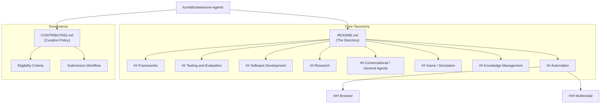
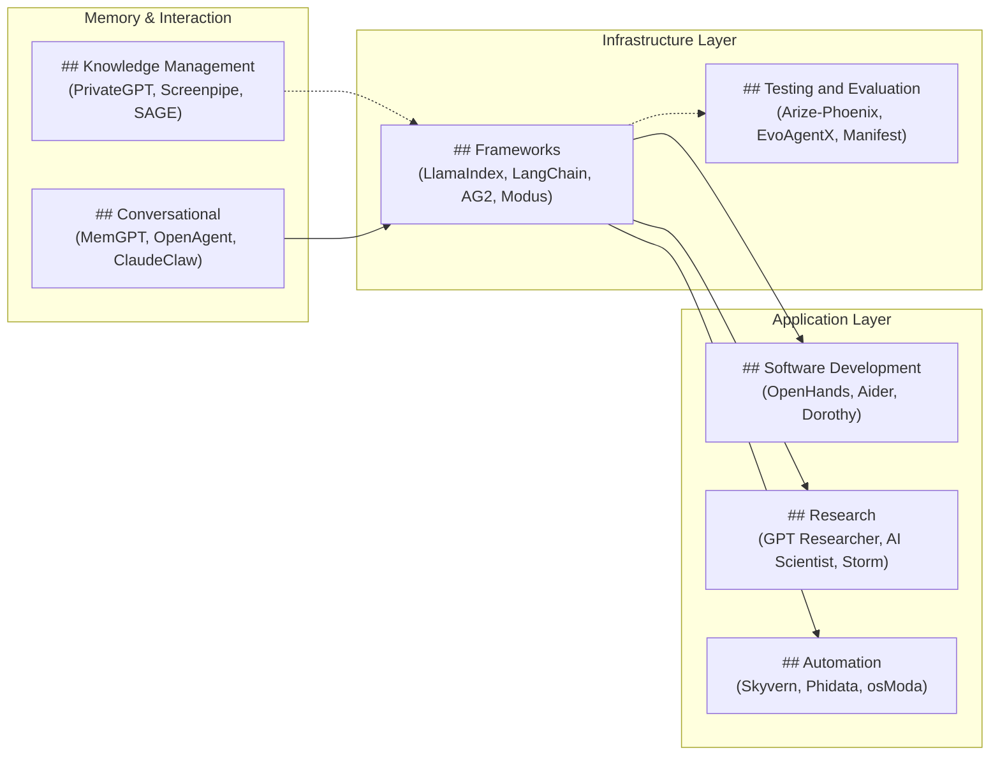

<!-- source: DeepWiki mcp.deepwiki.com · repo kyrolabs/awesome-agents · page 1 Overview · fetched 2026-10-27 -->

# Overview

Relevant source files

The following files were used as context for generating this wiki page:

- [README.md](README.md)

This page describes the purpose, structure, and organization of the [kyrolabs/awesome-agents](https://github.com/kyrolabs/awesome-agents) repository. It serves as a high-level guide to the curated directory of open-source AI agent tools, explaining how the list is categorized and how readers can navigate the ecosystem.

---

## Purpose

`awesome-agents` is a curated list of open-source tools and products to build AI agents [README.md:1-3](). The repository functions as a "clearinghouse" for the rapidly evolving agentic AI landscape, filtering for quality and open-source availability. It features a diverse range of entries, from persistent orchestrators like `ClaudeClaw` [README.md:5-5]() to specialized frameworks and automation utilities.

The repository contains two primary architectural files:

| File | Role |
|---|---|
| `README.md` | The core directory containing the taxonomy of agent tools [README.md:1-21](). |
| `CONTRIBUTING.md` | The governance document defining eligibility criteria and the PR workflow. |

Sources: [README.md:1-5]()

---

## Repository Structure

The following diagram maps the high-level sections of the `README.md` to the conceptual categories of the AI agent stack.

**File Taxonomy and Organization:**

Sources: [README.md:7-21]()

---

## Content Categories

The directory is organized into eight primary categories. Each category represents a specific niche in the agent lifecycle, from foundational orchestration to vertical-specific applications.

| Category | Description | Child Page |
|---|---|---|
| **Frameworks** | Foundational SDKs for multi-agent orchestration, LLM-agnostic logic, and agent networking (e.g., `LangChain`, `CrewAI`, `AG2`, `smolagents`). | [Frameworks](#1.1) |
| **Software Development** | Agents specialized in code generation, autonomous engineering, and DevOps (e.g., `OpenHands`, `Aider`, `Dorothy`). | [Software Development Agents](#1.2) |
| **Research** | Tools for automated literature search, paper generation, and data science (e.g., `GPT Researcher`, `AI Scientist`). | [Research Agents](#1.3) |
| **Testing and Evaluation** | Infrastructure for observability, RAG quality, and guardrail scanning (e.g., `Arize-Phoenix`, `EvoAgentX`). | [Testing and Evaluation](#1.4) |
| **Conversational / General** | Chat-centric agents with long-term memory and multi-channel messaging (e.g., `MemGPT`, `OpenAgent`). | [Conversational and General Agents](#1.5) |
| **Automation** | Workflow builders, RESTful API control, and browser-use agents (e.g., `Phidata`, `Skyvern`, `osModa`). | [Automation, Browser, and Multimodal Agents](#1.6) |
| **Game / Simulation** | Agents for role-playing, human-behavior modeling, and game environments (e.g., `Voyager`, `Enclave`). | [Game, Simulation, and Knowledge Management](#1.7) |
| **Knowledge Management** | Local search, private document Q&A, and institutional memory tools (e.g., `PrivateGPT`, `Screenpipe`). | [Game, Simulation, and Knowledge Management](#1.7) |

Sources: [README.md:22-159]()

---

## Technical Ecosystem Mapping

This diagram bridges the natural language categories in the `README.md` to the functional components of an agentic system, highlighting specific repository entries as examples.

Sources: [README.md:22-159]()

---

## Navigation Guidance

*   **For Developers:** Start with [Frameworks](#1.1) to find base libraries for building agents, such as `OpenClaw` [README.md:24-24]() or `Mastra` [README.md:48-48](), or [Software Development Agents](#1.2) for tools to assist in your coding workflow.
*   **For Researchers:** Visit [Research Agents](#1.3) for automated literature and data science agents like `GPT Researcher` or `data-to-paper`.
*   **For Enterprise/Ops:** See [Testing and Evaluation](#1.4) for observability and [Automation, Browser, and Multimodal Agents](#1.6) for workflow integration and browser-based automation.
*   **For Contributors:** If you wish to add a project, review the eligibility criteria and follow the instructions on the [Contributing to the List](#2) page.

Sources: [README.md:1-21]()

---

