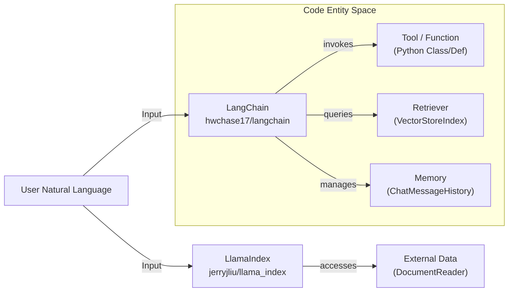
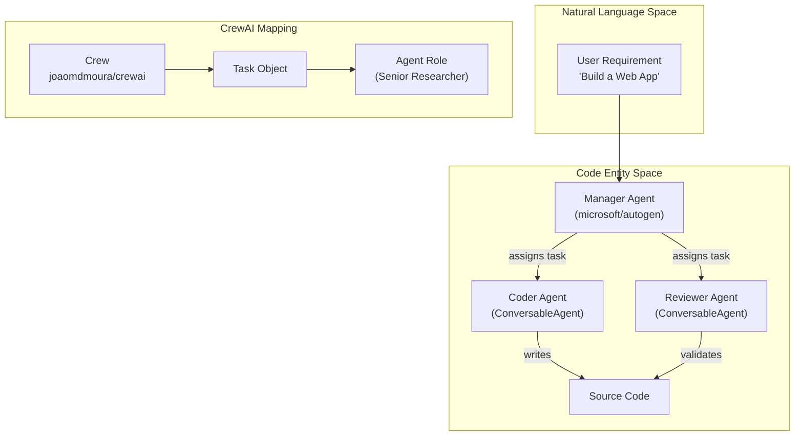

<!-- source: DeepWiki mcp.deepwiki.com · repo kyrolabs/awesome-agents · page 1.1 Frameworks · fetched 2026-10-27 -->

# Frameworks

Relevant source files

The following files were used as context for generating this wiki page:

- [README.md](README.md)

This page documents all entries listed under the **Frameworks** section of the `README.md` in the `kyrolabs/awesome-agents` repository [README.md:22-77](). It covers general-purpose LLM orchestration libraries, multi-agent systems, language-specific SDKs, and specialized infrastructure components that serve as foundational building blocks for AI agents.

---

## What Is an Agent Framework?

In the context of this curated list, an **agent framework** is a library or platform that provides reusable infrastructure for connecting LLMs to tools, memory, and other agents. Frameworks sit between the raw LLM API and the specialized agent application. They handle core logic such as:

- **Tool Invocation**: Routing natural language intent to executable code functions.
- **Reasoning Loops**: Implementing patterns like ReAct, plan-and-execute, or chain-of-thought.
- **Multi-Agent Coordination**: Managing handoffs, role assignment, and inter-agent communication protocols.
- **Memory & Context**: Maintaining long-term and short-term state across interactions.
- **Provider Abstraction**: Allowing developers to switch between LLM providers (OpenAI, Anthropic, Meta, etc.) with minimal code changes.

---

## Framework Taxonomy

The following diagram classifies the frameworks in the repository based on their primary architectural role and implementation language.

**Diagram: Agent Framework Classification by Primary Characteristic**

```mermaid
graph TD
    ROOT["Frameworks\nREADME.md:22-77"]

    ROOT --> GENERAL["General-Purpose\nLLM Orchestration"]
    ROOT --> MULTI["Multi-Agent\nOrchestration"]
    ROOT --> TYPED["Typed-Language\nSDKs"]
    ROOT --> SPECIALIZED["Specialized\nInfrastructure"]
    ROOT --> PROD["Production /\nEnterprise"]

    GENERAL --> G1["LangChain"]
    GENERAL --> G2["LlamaIndex"]
    GENERAL --> G3["Haystack"]
    GENERAL --> G4["Semantic Kernel"]
    GENERAL --> G5["Transformers Agents"]
    GENERAL --> G6["Lagent"]
    GENERAL --> G7["LLM Agents"]
    GENERAL --> G8["Strands Agents SDK"]
    GENERAL --> G9["smolagents"]

    MULTI --> M1["Autogen"]
    MULTI --> M2["AG2"]
    MULTI --> M3["CrewAI"]
    MULTI --> M4["MetaGPT"]
    MULTI --> M5["Swarm"]
    MULTI --> M6["agency-swarm"]
    MULTI --> M7["AgentScope"]
    MULTI --> M8["AgentVerse"]
    MULTI --> M9["Swarms Framework"]
    MULTI --> M10["PraisonAI"]
    MULTI --> M11["Maestro"]
    MULTI --> M12["SwarmClaw"]
    MULTI --> M13["open-multi-agent"]
    MULTI --> M14["Hive"]

    TYPED --> T1["Mastra (TypeScript)"]
    TYPED --> T2["VoltAgent (TypeScript)"]
    TYPED --> T3["AgentDock (TypeScript)"]
    TYPED --> T4["Modus (Go / AssemblyScript)"]
    TYPED --> T5["hcom (multi-runtime)"]
    TYPED --> T6["nanobot (Python/MCP)"]
    TYPED --> T7["ConnectOnion (JS/TS)"]

    SPECIALIZED --> S1["Pipecat (voice / multimodal)"]
    SPECIALIZED --> S2["Cortex Memory (agent memory)"]
    SPECIALIZED --> S3["Agentset (RAG)"]
    SPECIALIZED --> S4["Vectara-agentic (RAG)"]
    SPECIALIZED --> S5["Pilot Protocol (networking)"]
    SPECIALIZED --> S6["Agentic Context Engine (self-improving)"]
    SPECIALIZED --> S7["Ailoy (local AI / WASM)"]

    PROD --> P1["Portia AI"]
    PROD --> P2["AgentField"]
    PROD --> P3["AgentUp"]
    PROD --> P4["Astron"]
    PROD --> P5["llama-agentic-system"]
    PROD --> P6["Upsonic (MCP)"]
    PROD --> P7["e2b"]
    PROD --> P8["Aeon"]
```

Sources: [README.md:22-77]()

---

## Complete Framework Listing

### General-Purpose LLM Orchestration

These frameworks provide the fundamental primitives (chains, tools, and agents) required to build LLM-powered applications.

| Name | Language | Description | Link |
|---|---|---|---|
| **LangChain** | Python | The original framework for LLM chaining and tool integration. | [hwchase17/langchain](https://github.com/hwchase17/langchain) |
| **LlamaIndex** | Python | Central interface to connect LLMs with external data sources. | [jerryjliu/llama_index](https://github.com/jerryjliu/llama_index) |
| **Haystack** | Python | NLP framework using Transformer models and LLMs to interact with data. | [deepset-ai/haystack](https://github.com/deepset-ai/haystack) |
| **Semantic Kernel** | C# / Python | Microsoft SDK for integrating LLM technology into applications. | [microsoft/semantic-kernel](https://github.com/microsoft/semantic-kernel) |
| **Transformers Agents** | Python | Natural language API layered on top of Hugging Face transformers. | [huggingface/transformers](https://huggingface.co/docs/transformers/transformers_agents) |
| **Lagent** | Python | Lightweight framework for building LLM-based agents. | [InternLM/lagent](https://github.com/InternLM/lagent) |
| **LLM Agents** | Python | Minimal library for building agents controlled by LLMs. | [mpaepper/llm_agents](https://github.com/mpaepper/llm_agents) |
| **Strands Agents SDK** | Python | Model-driven approach to building agents in few lines of code. | [strands-agents/sdk-python](https://github.com/strands-agents/sdk-python) |
| **smolagents** | Python | Tiny library for building agents that write and execute code. | [huggingface/smolagents](https://github.com/huggingface/smolagents) |

Sources: [README.md:27-29](), [README.md:31-32](), [README.md:34](), [README.md:38](), [README.md:53](), [README.md:77]()

---

### Multi-Agent Orchestration

These frameworks specialize in the coordination of multiple agents, often utilizing role-playing, task decomposition, or hierarchical management.

| Name | Key Mechanism | Distinguishing Characteristic | Link |
|---|---|---|---|
| **Autogen** | Conversational | Multi-agent conversation loops for complex tasks. | [microsoft/autogen](https://github.com/microsoft/autogen) |
| **AG2** | Cooperation | Framework for multi-agent cooperation (from AutoGen creators). | [ag2ai/ag2](https://github.com/ag2ai/ag2) |
| **CrewAI** | Role-playing | Orchestrates autonomous "crews" of agents with specific roles. | [joaomdmoura/crewai](https://github.com/joaomdmoura/crewai) |
| **MetaGPT** | Meta-programming | Generates PRDs, designs, and code from a single requirement. | [geekan/MetaGPT](https://github.com/geekan/MetaGPT) |
| **Swarm** | Handoffs | Educational, lightweight multi-agent orchestration by OpenAI. | [openai/swarm](https://github.com/openai/swarm) |
| **agency-swarm** | Assistants API | Built on top of the latest OpenAI Assistants API. | [VRSEN/agency-swarm](https://github.com/VRSEN/agency-swarm) |
| **AgentScope** | Application-focused | Simplifies building LLM-empowered multi-agent applications. | [modelscope/agentscope](https://github.com/modelscope/agentscope) |
| **AgentVerse** | Environment | Flexible framework for building custom multi-agent environments. | [openbmb/agentverse](https://github.com/openbmb/agentverse) |
| **Swarms Framework** | Enterprise | Multi-agent orchestration for enterprise-grade applications. | [kyegomez/swarms](https://github.com/kyegomez/swarms) |
| **PraisonAI** | Self-reflection | Supports 100+ LLMs and features 3.77 µs agent instantiation. | [MervinPraison/PraisonAI](https://github.com/MervinPraison/PraisonAI) |
| **Maestro** | Subagent orchestration | Uses Claude Opus to intelligently orchestrate subagents. | [Doriandarko/maestro](https://github.com/Doriandarko/maestro) |
| **SwarmClaw** | Swarm-to-Claw | Multi-agent orchestration for the Claude Code ecosystem. | [sbusso/swarmclaw](https://github.com/sbusso/swarmclaw) |
| **Hive** | Task DAG | Decomposes complex tasks into manageable subtasks via DAGs. | [instill-ai/hive](https://github.com/instill-ai/hive) |
| **open-multi-agent** | Distributed | Open-source platform for distributed multi-agent systems. | [open-multi-agent/open-multi-agent](https://github.com/open-multi-agent/open-multi-agent) |

Sources: [README.md:37](), [README.md:39-46](), [README.md:52](), [README.md:57](), [README.md:65](), [README.md:70-71]()

---

### Typed-Language and Runtime-Specific SDKs

These frameworks target developers working outside the Python ecosystem or requiring specific runtime capabilities like serverless execution and WASM.

| Name | Language / Runtime | Description | Link |
|---|---|---|---|
| **Mastra** | TypeScript | Opinionated framework for building AI applications quickly. | [mastra-ai/mastra](https://github.com/mastra-ai/mastra) |
| **VoltAgent** | TypeScript | Framework with built-in LLM observability. | [VoltAgent/voltagent](https://github.com/VoltAgent/voltagent) |
| **AgentDock** | TypeScript | Foundation to build and deploy production-ready AI agents. | [AgentDock/AgentDock](https://github.com/AgentDock/AgentDock) |
| **Modus** | Go / AssemblyScript | Serverless framework for building intelligent agents and APIs. | [hypermodeinc/modus](https://github.com/hypermodeinc/modus) |
| **hcom** | Shell / Multi-runtime | Protocol for agents to message and spawn each other across terminals. | [sbusso/hcom](https://github.com/sbusso/hcom) |
| **nanobot** | Python | Ultra-lightweight (~4k lines) supporting MCP and 9+ chat channels. | [HKUDS/nanobot](https://github.com/HKUDS/nanobot) |
| **ConnectOnion** | JS / TS | Tool for making agents and services accessible over the Tor network. | [sbusso/connectonion](https://github.com/sbusso/connectonion) |

Sources: [README.md:48](), [README.md:50-51](), [README.md:54](), [README.md:67-68](), [README.md:73]()

---

### Specialized Infrastructure

Frameworks focusing on specific technical layers like memory, networking, RAG, or durable execution.

| Name | Specialization | Description | Link |
|---|---|---|---|
| **Pipecat** | Voice / Multimodal | Framework for voice and multimodal conversational AI pipelines. | [pipecat-ai/pipecat](https://github.com/pipecat-ai/pipecat) |
| **Cortex Memory** | Memory | Extraction, vector search, and automated optimization for agent memory. | [sopaco/cortex-mem](https://github.com/sopaco/cortex-mem) |
| **Agentset** | RAG | Production-ready RAG platform with agentic reasoning and hybrid search. | [agentset-ai/agentset](https://github.com/agentset-ai/agentset) |
| **Vectara-agentic** | RAG | Framework for creating assistants using Vectara. | [vectara/py-vectara-agentic](https://github.com/vectara/py-vectara-agentic) |
| **Pilot Protocol** | Networking | Overlay network stack for agents with virtual addresses and encrypted tunnels. | [TeoSlayer/pilotprotocol](https://github.com/TeoSlayer/pilotprotocol) |
| **Agentic Context Engine** | Self-improvement | Agents that learn from execution feedback and curate context. | [kayba-ai/agentic-context-engine](https://github.com/kayba-ai/agentic-context-engine) |
| **Ailoy** | Local AI / WASM | Runs agents anywhere with full local-AI and WebAssembly support. | [ailoy-ai/ailoy](https://github.com/ailoy-ai/ailoy) |
| **Aeon** | Durable Execution | Heartbeat, schedule, and delegation runtime for agents. | [aeon-ai/aeon](https://github.com/aeon-ai/aeon) |

Sources: [README.md:47](), [README.md:49](), [README.md:55-56](), [README.md:59-63](), [README.md:66](), [README.md:75-76]()

---

## Data Flow and Integration Patterns

The following diagrams illustrate how frameworks bridge the gap between high-level natural language and technical code entities.

**Diagram: Natural Language to Code Entity Mapping (Connectivity Layer)**

This diagram shows how general-purpose frameworks like `LangChain` and `LlamaIndex` map user intents to codebase entities.

Sources: [README.md:28-29]()

**Diagram: Multi-Agent Orchestration Flow (Coordination Layer)**

This diagram maps the conceptual "Manager" and "Worker" roles to the specific implementations found in frameworks like `Autogen` and `CrewAI`.

Sources: [README.md:39](), [README.md:44]()

---

## Distinguishing Characteristics Summary

| Feature | Key Frameworks |
|---|---|
| **Multi-Agent Orchestration** | `Autogen`, `AG2`, `CrewAI`, `MetaGPT`, `Swarms Framework`, `SwarmClaw`, `open-multi-agent` |
| **MCP Integration** | `Upsonic`, `PraisonAI`, `nanobot`, `Cortex Memory`, `OpenClaw` |
| **Durable Execution / Production** | `Portia AI`, `AgentDock`, `AgentField`, `Astron`, `Aeon` |
| **Voice / Multimodal** | `Pipecat` |
| **TypeScript / Go Native** | `Mastra`, `VoltAgent`, `Modus`, `ConnectOnion` |
| **Networking Protocols** | `Pilot Protocol`, `hcom`, `ConnectOnion` |
| **Self-Improving / Feedback** | `Agentic Context Engine`, `LoongFlow` |
| **WASM / Local AI** | `Ailoy` |

Sources: [README.md:22-77]()

---

