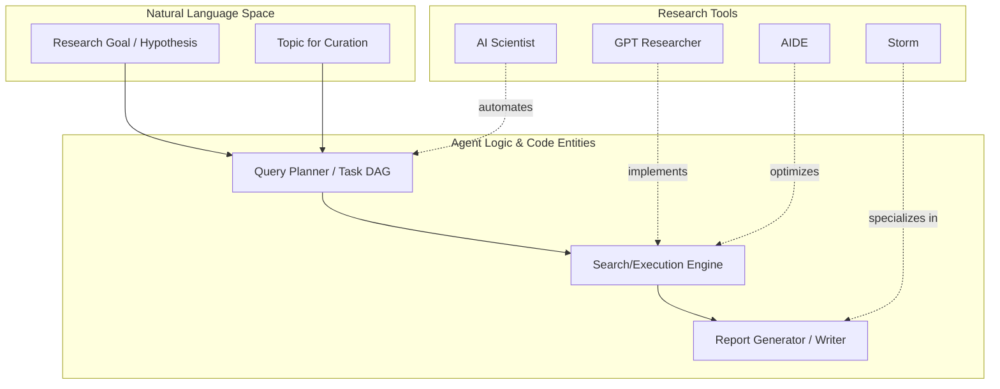
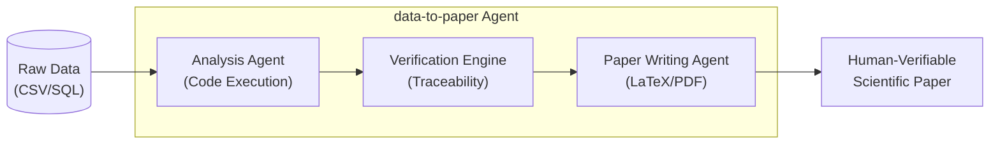

<!-- source: DeepWiki mcp.deepwiki.com · repo kyrolabs/awesome-agents · page 1.3 Research Agents · fetched 2026-10-27 -->

# Research Agents

Relevant source files

The following files were used as context for generating this wiki page:

- [README.md](README.md)

This page documents all entries listed under the **Research** section of the `README.md` in the `kyrolabs/awesome-agents` repository. Research agents are specialized autonomous systems designed for information retrieval, literature synthesis, paper generation, and data-driven scientific experimentation.

## Purpose and Scope

Research agents automate the cognitive heavy lifting of the scientific and analytical process. Unlike general-purpose conversational agents, they are optimized for high-fidelity information gathering and structured output. Their primary functions include:
*   **Automated Literature Search:** Querying web engines and academic databases.
*   **Paper Generation:** Drafting full-length manuscripts with inline citations.
*   **Online Research:** Aggregating disparate web sources into cohesive reports.
*   **Data Science & ML Experimentation:** Running code-driven workflows to analyze datasets and test hypotheses.
*   **Knowledge Curation:** Organizing complex topics into encyclopedic structures.

Sources: [README.md:103-113]()

---

## Technical Workflow of Research Agents

Research agents typically implement a "Plan-Execute-Synthesize" loop. They translate a natural language research goal into a series of search queries or code execution steps, evaluate the results, and iterate until a comprehensive report is generated.

### From Natural Language to Research Execution

The following diagram maps high-level research objectives to the specific technical components and tools mentioned in the repository.

**Research Execution Flow**

Sources: [README.md:105-113]()

---

## Documented Research Tools

The following tools are categorized under the Research section of the repository.

### General & Online Research

| Tool | Description | Key Feature |
| :--- | :--- | :--- |
| **GPT Researcher** | Autonomous agent for comprehensive online research. | Aggregates 20+ sources per report. |
| **BlockAGI** | Conducts iterative, domain-specific research. | Detailed narrative report output. |
| **Storm** | LLM-powered knowledge curation system. | Generates full-length reports with citations. |

*   **GPT Researcher**: Designed to solve the problem of LLM hallucinations and limited context by browsing the web autonomously to aggregate content [README.md:105]().
*   **BlockAGI**: Focuses on iterative loops, refining its search based on previous findings to provide depth in specific domains [README.md:106]().
*   **Storm**: Developed by Stanford OVAL, it researches a topic and organizes it into a structured, cited article [README.md:109]().

### Scientific Discovery & Academic Writing

| Tool | Description | Key Feature |
| :--- | :--- | :--- |
| **data-to-paper** | AI-driven research from data to papers. | Human-verifiable research papers. |
| **AI Scientist** | Fully automated open-ended scientific discovery. | End-to-end: Hypothesis to Review. |
| **GenoMAS** | Multi-agent framework for gene analysis. | Code-driven scientific workflows. |

*   **data-to-paper**: Bridges the gap between raw data analysis and formal academic writing, ensuring that every claim in the paper is traceable back to the data [README.md:107]().
*   **AI Scientist**: A system by Sakana AI that automates the entire research lifecycle, including peer review of its own generated papers [README.md:108]().
*   **GenoMAS**: Uses a multi-agent architecture to automate gene expression analysis, where agents write and execute code to process biological data [README.md:111]().

### Data Science & Specialized Research

| Tool | Description | Key Feature |
| :--- | :--- | :--- |
| **DeepAnalyze** | First agentic LLM for autonomous data science. | Data prep, modeling, and visualization. |
| **AIDE** | Autonomous agent for optimized data science. | Solution search for DS/ML tasks. |
| **OpenLens AI** | Autonomous Research Agent for Health Informatics. | Domain-specific for medical data. |

*   **DeepAnalyze**: Handles the full lifecycle of data-oriented deep research, producing analyst-grade reports [README.md:112]().
*   **AIDE**: Focuses on the "optimization" aspect of research, searching for the best solutions to data science and machine learning problems [README.md:113]().
*   **OpenLens AI**: Tailored specifically for health informatics, navigating specialized medical databases and research constraints [README.md:110]().

---

## Data Flow: From Raw Data to Insight

The technical implementation of these agents often involves bridging structured data environments with natural language reasoning.

**Data-to-Paper Pipeline Architecture**

Sources: [README.md:107-112]()

## Relationship to Other Categories

Research agents frequently utilize components from other sections of the `awesome-agents` list:
*   **Frameworks**: Many research agents are built on `LangChain` [README.md:29]() or `AutoGen` [README.md:39]().
*   **Software Development**: Tools like `GenoMAS` [README.md:111]() use code-generation capabilities similar to software agents to perform data analysis.
*   **Automation**: Research agents often utilize browser automation tools (found in the [Automation, Browser, and Multimodal Agents](#1.6) section) to bypass paywalls or navigate complex web interfaces.

Sources: [README.md:29](), [README.md:39](), [README.md:111]()

---

