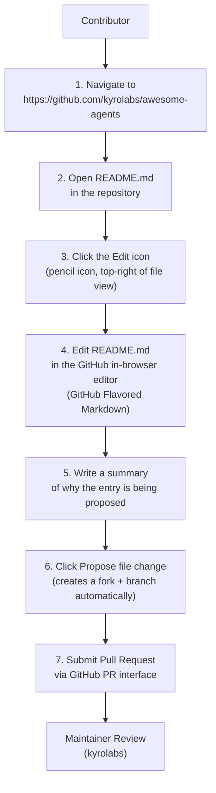
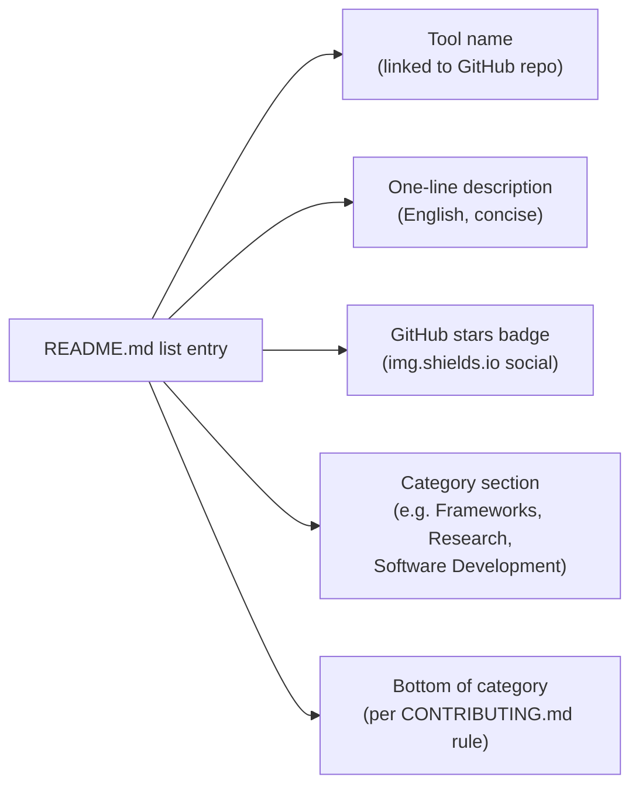
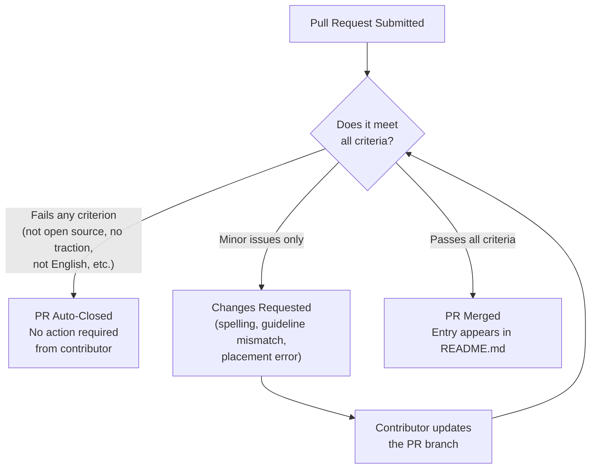
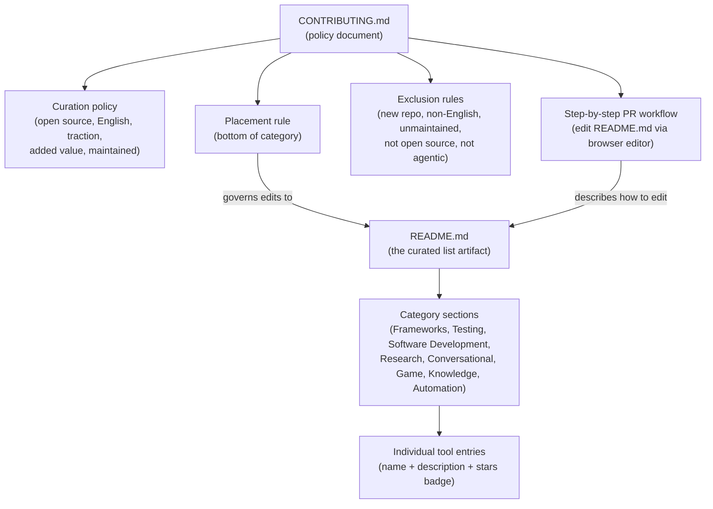

<!-- source: DeepWiki mcp.deepwiki.com · repo kyrolabs/awesome-agents · page 2 Contributing to the List · fetched 2026-10-27 -->

# Contributing to the List

Relevant source files

The following files were used as context for generating this wiki page:

- [CONTRIBUTING.md](CONTRIBUTING.md)

This page documents the rules and mechanics for submitting a new entry to the `awesome-agents` curated list. It covers what projects are eligible, how to open a Pull Request via the GitHub browser editor, and what occurs during maintainer review. For an overview of the list's contents and categories, see [Overview](#1).

---

## Eligibility Criteria

All submissions are governed by `CONTRIBUTING.md` and are curated by the repository maintainers. A project must pass every criterion before it will be merged.

### Required Criteria

| Criterion | Description |
|---|---|
| **Open source** | The project repository must be publicly accessible and use an open-source license. |
| **English** | Documentation and README must be in English. |
| **Agentic relevance** | The project must be related to the AI agent / agentic framework ecosystem. |
| **Maintained** | The project must still be actively maintained. |
| **Online** | The project's links and hosted resources must be live. |
| **Added value** | The project must offer something not already covered by existing list entries. |
| **Demonstrated traction** | New projects with no evident community usage (history) are excluded. |

Sources: [CONTRIBUTING.md:3-13](), [CONTRIBUTING.md:19-19]()

### Placement Rule

New entries must be added at the **bottom of the relevant category section** in `README.md`, not inserted anywhere else in the list.

Sources: [CONTRIBUTING.md:15-15]()

---

## Submission Workflow

The only accepted submission mechanism is a GitHub Pull Request. Issues are not processed for new entries and will not result in additions to the list [CONTRIBUTING.md:17-17]().

**Workflow overview:**

Sources: [CONTRIBUTING.md:27-32]()

### Step-by-Step Details

1. **Navigate** to the repository at `https://github.com/kyrolabs/awesome-agents` [CONTRIBUTING.md:27-27]().
2. **Open `README.md`** — this is the file that constitutes the curated list [CONTRIBUTING.md:28-28]().
3. **Click the edit icon** (pencil) in the top-right corner of the file view [CONTRIBUTING.md:29-29]().
4. **Make your edit** in the in-browser editor using GitHub Flavored Markdown [CONTRIBUTING.md:30-30](). All entries follow a standard format. Place your entry at the **bottom** of the appropriate category section [CONTRIBUTING.md:15-15]().
5. **Scroll to the bottom** of the editor and write a description of your proposed change in the "Propose file change" box [CONTRIBUTING.md:31-31]().
6. **Click "Propose file change"** — GitHub will fork the repository under your account and create a branch with your edit [CONTRIBUTING.md:31-31]().
7. **Submit the Pull Request** on the resulting "Open a pull request" page [CONTRIBUTING.md:32-32]().

Sources: [CONTRIBUTING.md:15-32]()

---

## Entry Format Reference

The following diagram maps the physical structure of a list entry in `README.md` to the components that maintainers check during review.

Sources: [CONTRIBUTING.md:15-15](), [CONTRIBUTING.md:3-13]()

---

## Maintainer Review

Once a Pull Request is submitted, a maintainer from `kyrolabs` evaluates it against the criteria in `CONTRIBUTING.md`. There are three possible outcomes:

Sources: [CONTRIBUTING.md:17-19](), [CONTRIBUTING.md:34-36]()

### Automatic Closure and Revision Requests

Any PR that does not follow the guidelines will be **automatically closed** [CONTRIBUTING.md:17-17](). Non-negotiable criteria that trigger immediate closure include brand new repositories with no history, brand new GitHub users, or incorrect placement in the list [CONTRIBUTING.md:19-19]().

If a maintainer requests changes — typically for spelling errors or guideline mismatches — the contributor must amend the existing PR branch rather than opening a new PR [CONTRIBUTING.md:34-36]().

| Issue | Cause |
|---|---|
| **Wrong placement** | Entry was not added at the bottom of the category [CONTRIBUTING.md:19-19](). |
| **Spelling / formatting** | Markdown formatting incorrect or description contains errors [CONTRIBUTING.md:36-36](). |
| **Guideline mismatch** | Entry violates one of the exclusion rules (e.g., unmaintained repo) [CONTRIBUTING.md:17-17](). |
| **No Traction** | Brand new repo with no history [CONTRIBUTING.md:19-19](). |

Sources: [CONTRIBUTING.md:17-19](), [CONTRIBUTING.md:34-36]()

---

## Relationship Between Governance and Artifacts

The following diagram maps the governance flow between the policy document and the resulting list.

Sources: [CONTRIBUTING.md:1-36]()

---

