# Page: Overview

# Overview

<details>
<summary>Relevant source files</summary>

The following files were used as context for generating this wiki page:

- [README.md](README.md)

</details>


This page describes the purpose, structure, and organization of the [kyrolabs/awesome-agents](https://github.com/kyrolabs/awesome-agents) repository. It serves as a high-level guide to the curated directory of open-source AI agent tools, explaining how the list is categorized and how readers can navigate the ecosystem.

---

## Purpose

`awesome-agents` is a curated list of open-source tools and products to build AI agents [README.md:1-3](). The repository functions as a "clearinghouse" for the rapidly evolving agentic AI landscape, filtering for quality and open-source availability. It features a diverse range of entries, from persistent orchestrators like `ClaudeClaw` [README.md:5-5]() to specialized frameworks and automation utilities.

The repository contains two primary architectural files:

| File | Role |
|---|---|
| `README.md` | The core directory containing the taxonomy of agent tools [README.md:1-21](). |
| `CONTRIBUTING.md` | The governance document defining eligibility criteria and the PR workflow. |

Sources: [README.md:1-5]()

---

## Repository Structure

The following diagram maps the high-level sections of the `README.md` to the conceptual categories of the AI agent stack.

**File Taxonomy and Organization:**

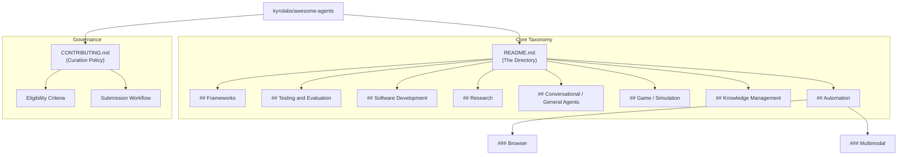

Sources: [README.md:7-21]()

---

## Content Categories

The directory is organized into eight primary categories. Each category represents a specific niche in the agent lifecycle, from foundational orchestration to vertical-specific applications.

| Category | Description | Child Page |
|---|---|---|
| **Frameworks** | Foundational SDKs for multi-agent orchestration, LLM-agnostic logic, and agent networking (e.g., `LangChain`, `CrewAI`, `AG2`, `smolagents`). | [Frameworks](#1.1) |
| **Software Development** | Agents specialized in code generation, autonomous engineering, and DevOps (e.g., `OpenHands`, `Aider`, `Dorothy`). | [Software Development Agents](#1.2) |
| **Research** | Tools for automated literature search, paper generation, and data science (e.g., `GPT Researcher`, `AI Scientist`). | [Research Agents](#1.3) |
| **Testing and Evaluation** | Infrastructure for observability, RAG quality, and guardrail scanning (e.g., `Arize-Phoenix`, `EvoAgentX`). | [Testing and Evaluation](#1.4) |
| **Conversational / General** | Chat-centric agents with long-term memory and multi-channel messaging (e.g., `MemGPT`, `OpenAgent`). | [Conversational and General Agents](#1.5) |
| **Automation** | Workflow builders, RESTful API control, and browser-use agents (e.g., `Phidata`, `Skyvern`, `osModa`). | [Automation, Browser, and Multimodal Agents](#1.6) |
| **Game / Simulation** | Agents for role-playing, human-behavior modeling, and game environments (e.g., `Voyager`, `Enclave`). | [Game, Simulation, and Knowledge Management](#1.7) |
| **Knowledge Management** | Local search, private document Q&A, and institutional memory tools (e.g., `PrivateGPT`, `Screenpipe`). | [Game, Simulation, and Knowledge Management](#1.7) |

Sources: [README.md:22-159]()

---

## Technical Ecosystem Mapping

This diagram bridges the natural language categories in the `README.md` to the functional components of an agentic system, highlighting specific repository entries as examples.

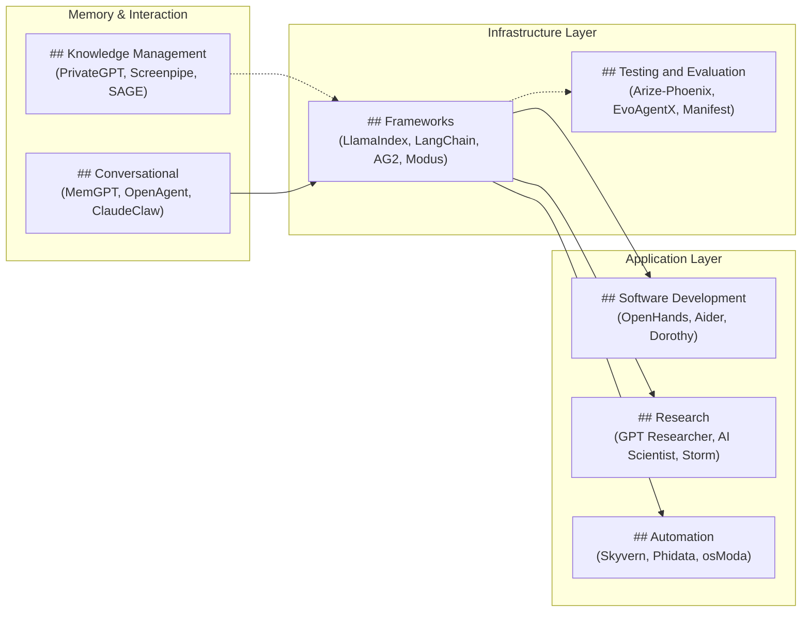

Sources: [README.md:22-159]()

---

## Navigation Guidance

*   **For Developers:** Start with [Frameworks](#1.1) to find base libraries for building agents, such as `OpenClaw` [README.md:24-24]() or `Mastra` [README.md:48-48](), or [Software Development Agents](#1.2) for tools to assist in your coding workflow.
*   **For Researchers:** Visit [Research Agents](#1.3) for automated literature and data science agents like `GPT Researcher` or `data-to-paper`.
*   **For Enterprise/Ops:** See [Testing and Evaluation](#1.4) for observability and [Automation, Browser, and Multimodal Agents](#1.6) for workflow integration and browser-based automation.
*   **For Contributors:** If you wish to add a project, review the eligibility criteria and follow the instructions on the [Contributing to the List](#2) page.

Sources: [README.md:1-21]()

---

# Page: Frameworks

# Frameworks

<details>
<summary>Relevant source files</summary>

The following files were used as context for generating this wiki page:

- [README.md](README.md)

</details>


This page documents all entries listed under the **Frameworks** section of the `README.md` in the `kyrolabs/awesome-agents` repository [README.md:22-77](). It covers general-purpose LLM orchestration libraries, multi-agent systems, language-specific SDKs, and specialized infrastructure components that serve as foundational building blocks for AI agents.

---

## What Is an Agent Framework?

In the context of this curated list, an **agent framework** is a library or platform that provides reusable infrastructure for connecting LLMs to tools, memory, and other agents. Frameworks sit between the raw LLM API and the specialized agent application. They handle core logic such as:

- **Tool Invocation**: Routing natural language intent to executable code functions.
- **Reasoning Loops**: Implementing patterns like ReAct, plan-and-execute, or chain-of-thought.
- **Multi-Agent Coordination**: Managing handoffs, role assignment, and inter-agent communication protocols.
- **Memory & Context**: Maintaining long-term and short-term state across interactions.
- **Provider Abstraction**: Allowing developers to switch between LLM providers (OpenAI, Anthropic, Meta, etc.) with minimal code changes.

---

## Framework Taxonomy

The following diagram classifies the frameworks in the repository based on their primary architectural role and implementation language.

**Diagram: Agent Framework Classification by Primary Characteristic**

```mermaid
graph TD
    ROOT["Frameworks\nREADME.md:22-77"]

    ROOT --> GENERAL["General-Purpose\nLLM Orchestration"]
    ROOT --> MULTI["Multi-Agent\nOrchestration"]
    ROOT --> TYPED["Typed-Language\nSDKs"]
    ROOT --> SPECIALIZED["Specialized\nInfrastructure"]
    ROOT --> PROD["Production /\nEnterprise"]

    GENERAL --> G1["LangChain"]
    GENERAL --> G2["LlamaIndex"]
    GENERAL --> G3["Haystack"]
    GENERAL --> G4["Semantic Kernel"]
    GENERAL --> G5["Transformers Agents"]
    GENERAL --> G6["Lagent"]
    GENERAL --> G7["LLM Agents"]
    GENERAL --> G8["Strands Agents SDK"]
    GENERAL --> G9["smolagents"]

    MULTI --> M1["Autogen"]
    MULTI --> M2["AG2"]
    MULTI --> M3["CrewAI"]
    MULTI --> M4["MetaGPT"]
    MULTI --> M5["Swarm"]
    MULTI --> M6["agency-swarm"]
    MULTI --> M7["AgentScope"]
    MULTI --> M8["AgentVerse"]
    MULTI --> M9["Swarms Framework"]
    MULTI --> M10["PraisonAI"]
    MULTI --> M11["Maestro"]
    MULTI --> M12["SwarmClaw"]
    MULTI --> M13["open-multi-agent"]
    MULTI --> M14["Hive"]

    TYPED --> T1["Mastra (TypeScript)"]
    TYPED --> T2["VoltAgent (TypeScript)"]
    TYPED --> T3["AgentDock (TypeScript)"]
    TYPED --> T4["Modus (Go / AssemblyScript)"]
    TYPED --> T5["hcom (multi-runtime)"]
    TYPED --> T6["nanobot (Python/MCP)"]
    TYPED --> T7["ConnectOnion (JS/TS)"]

    SPECIALIZED --> S1["Pipecat (voice / multimodal)"]
    SPECIALIZED --> S2["Cortex Memory (agent memory)"]
    SPECIALIZED --> S3["Agentset (RAG)"]
    SPECIALIZED --> S4["Vectara-agentic (RAG)"]
    SPECIALIZED --> S5["Pilot Protocol (networking)"]
    SPECIALIZED --> S6["Agentic Context Engine (self-improving)"]
    SPECIALIZED --> S7["Ailoy (local AI / WASM)"]

    PROD --> P1["Portia AI"]
    PROD --> P2["AgentField"]
    PROD --> P3["AgentUp"]
    PROD --> P4["Astron"]
    PROD --> P5["llama-agentic-system"]
    PROD --> P6["Upsonic (MCP)"]
    PROD --> P7["e2b"]
    PROD --> P8["Aeon"]
```

Sources: [README.md:22-77]()

---

## Complete Framework Listing

### General-Purpose LLM Orchestration

These frameworks provide the fundamental primitives (chains, tools, and agents) required to build LLM-powered applications.

| Name | Language | Description | Link |
|---|---|---|---|
| **LangChain** | Python | The original framework for LLM chaining and tool integration. | [hwchase17/langchain](https://github.com/hwchase17/langchain) |
| **LlamaIndex** | Python | Central interface to connect LLMs with external data sources. | [jerryjliu/llama_index](https://github.com/jerryjliu/llama_index) |
| **Haystack** | Python | NLP framework using Transformer models and LLMs to interact with data. | [deepset-ai/haystack](https://github.com/deepset-ai/haystack) |
| **Semantic Kernel** | C# / Python | Microsoft SDK for integrating LLM technology into applications. | [microsoft/semantic-kernel](https://github.com/microsoft/semantic-kernel) |
| **Transformers Agents** | Python | Natural language API layered on top of Hugging Face transformers. | [huggingface/transformers](https://huggingface.co/docs/transformers/transformers_agents) |
| **Lagent** | Python | Lightweight framework for building LLM-based agents. | [InternLM/lagent](https://github.com/InternLM/lagent) |
| **LLM Agents** | Python | Minimal library for building agents controlled by LLMs. | [mpaepper/llm_agents](https://github.com/mpaepper/llm_agents) |
| **Strands Agents SDK** | Python | Model-driven approach to building agents in few lines of code. | [strands-agents/sdk-python](https://github.com/strands-agents/sdk-python) |
| **smolagents** | Python | Tiny library for building agents that write and execute code. | [huggingface/smolagents](https://github.com/huggingface/smolagents) |

Sources: [README.md:27-29](), [README.md:31-32](), [README.md:34](), [README.md:38](), [README.md:53](), [README.md:77]()

---

### Multi-Agent Orchestration

These frameworks specialize in the coordination of multiple agents, often utilizing role-playing, task decomposition, or hierarchical management.

| Name | Key Mechanism | Distinguishing Characteristic | Link |
|---|---|---|---|
| **Autogen** | Conversational | Multi-agent conversation loops for complex tasks. | [microsoft/autogen](https://github.com/microsoft/autogen) |
| **AG2** | Cooperation | Framework for multi-agent cooperation (from AutoGen creators). | [ag2ai/ag2](https://github.com/ag2ai/ag2) |
| **CrewAI** | Role-playing | Orchestrates autonomous "crews" of agents with specific roles. | [joaomdmoura/crewai](https://github.com/joaomdmoura/crewai) |
| **MetaGPT** | Meta-programming | Generates PRDs, designs, and code from a single requirement. | [geekan/MetaGPT](https://github.com/geekan/MetaGPT) |
| **Swarm** | Handoffs | Educational, lightweight multi-agent orchestration by OpenAI. | [openai/swarm](https://github.com/openai/swarm) |
| **agency-swarm** | Assistants API | Built on top of the latest OpenAI Assistants API. | [VRSEN/agency-swarm](https://github.com/VRSEN/agency-swarm) |
| **AgentScope** | Application-focused | Simplifies building LLM-empowered multi-agent applications. | [modelscope/agentscope](https://github.com/modelscope/agentscope) |
| **AgentVerse** | Environment | Flexible framework for building custom multi-agent environments. | [openbmb/agentverse](https://github.com/openbmb/agentverse) |
| **Swarms Framework** | Enterprise | Multi-agent orchestration for enterprise-grade applications. | [kyegomez/swarms](https://github.com/kyegomez/swarms) |
| **PraisonAI** | Self-reflection | Supports 100+ LLMs and features 3.77 µs agent instantiation. | [MervinPraison/PraisonAI](https://github.com/MervinPraison/PraisonAI) |
| **Maestro** | Subagent orchestration | Uses Claude Opus to intelligently orchestrate subagents. | [Doriandarko/maestro](https://github.com/Doriandarko/maestro) |
| **SwarmClaw** | Swarm-to-Claw | Multi-agent orchestration for the Claude Code ecosystem. | [sbusso/swarmclaw](https://github.com/sbusso/swarmclaw) |
| **Hive** | Task DAG | Decomposes complex tasks into manageable subtasks via DAGs. | [instill-ai/hive](https://github.com/instill-ai/hive) |
| **open-multi-agent** | Distributed | Open-source platform for distributed multi-agent systems. | [open-multi-agent/open-multi-agent](https://github.com/open-multi-agent/open-multi-agent) |

Sources: [README.md:37](), [README.md:39-46](), [README.md:52](), [README.md:57](), [README.md:65](), [README.md:70-71]()

---

### Typed-Language and Runtime-Specific SDKs

These frameworks target developers working outside the Python ecosystem or requiring specific runtime capabilities like serverless execution and WASM.

| Name | Language / Runtime | Description | Link |
|---|---|---|---|
| **Mastra** | TypeScript | Opinionated framework for building AI applications quickly. | [mastra-ai/mastra](https://github.com/mastra-ai/mastra) |
| **VoltAgent** | TypeScript | Framework with built-in LLM observability. | [VoltAgent/voltagent](https://github.com/VoltAgent/voltagent) |
| **AgentDock** | TypeScript | Foundation to build and deploy production-ready AI agents. | [AgentDock/AgentDock](https://github.com/AgentDock/AgentDock) |
| **Modus** | Go / AssemblyScript | Serverless framework for building intelligent agents and APIs. | [hypermodeinc/modus](https://github.com/hypermodeinc/modus) |
| **hcom** | Shell / Multi-runtime | Protocol for agents to message and spawn each other across terminals. | [sbusso/hcom](https://github.com/sbusso/hcom) |
| **nanobot** | Python | Ultra-lightweight (~4k lines) supporting MCP and 9+ chat channels. | [HKUDS/nanobot](https://github.com/HKUDS/nanobot) |
| **ConnectOnion** | JS / TS | Tool for making agents and services accessible over the Tor network. | [sbusso/connectonion](https://github.com/sbusso/connectonion) |

Sources: [README.md:48](), [README.md:50-51](), [README.md:54](), [README.md:67-68](), [README.md:73]()

---

### Specialized Infrastructure

Frameworks focusing on specific technical layers like memory, networking, RAG, or durable execution.

| Name | Specialization | Description | Link |
|---|---|---|---|
| **Pipecat** | Voice / Multimodal | Framework for voice and multimodal conversational AI pipelines. | [pipecat-ai/pipecat](https://github.com/pipecat-ai/pipecat) |
| **Cortex Memory** | Memory | Extraction, vector search, and automated optimization for agent memory. | [sopaco/cortex-mem](https://github.com/sopaco/cortex-mem) |
| **Agentset** | RAG | Production-ready RAG platform with agentic reasoning and hybrid search. | [agentset-ai/agentset](https://github.com/agentset-ai/agentset) |
| **Vectara-agentic** | RAG | Framework for creating assistants using Vectara. | [vectara/py-vectara-agentic](https://github.com/vectara/py-vectara-agentic) |
| **Pilot Protocol** | Networking | Overlay network stack for agents with virtual addresses and encrypted tunnels. | [TeoSlayer/pilotprotocol](https://github.com/TeoSlayer/pilotprotocol) |
| **Agentic Context Engine** | Self-improvement | Agents that learn from execution feedback and curate context. | [kayba-ai/agentic-context-engine](https://github.com/kayba-ai/agentic-context-engine) |
| **Ailoy** | Local AI / WASM | Runs agents anywhere with full local-AI and WebAssembly support. | [ailoy-ai/ailoy](https://github.com/ailoy-ai/ailoy) |
| **Aeon** | Durable Execution | Heartbeat, schedule, and delegation runtime for agents. | [aeon-ai/aeon](https://github.com/aeon-ai/aeon) |

Sources: [README.md:47](), [README.md:49](), [README.md:55-56](), [README.md:59-63](), [README.md:66](), [README.md:75-76]()

---

## Data Flow and Integration Patterns

The following diagrams illustrate how frameworks bridge the gap between high-level natural language and technical code entities.

**Diagram: Natural Language to Code Entity Mapping (Connectivity Layer)**

This diagram shows how general-purpose frameworks like `LangChain` and `LlamaIndex` map user intents to codebase entities.

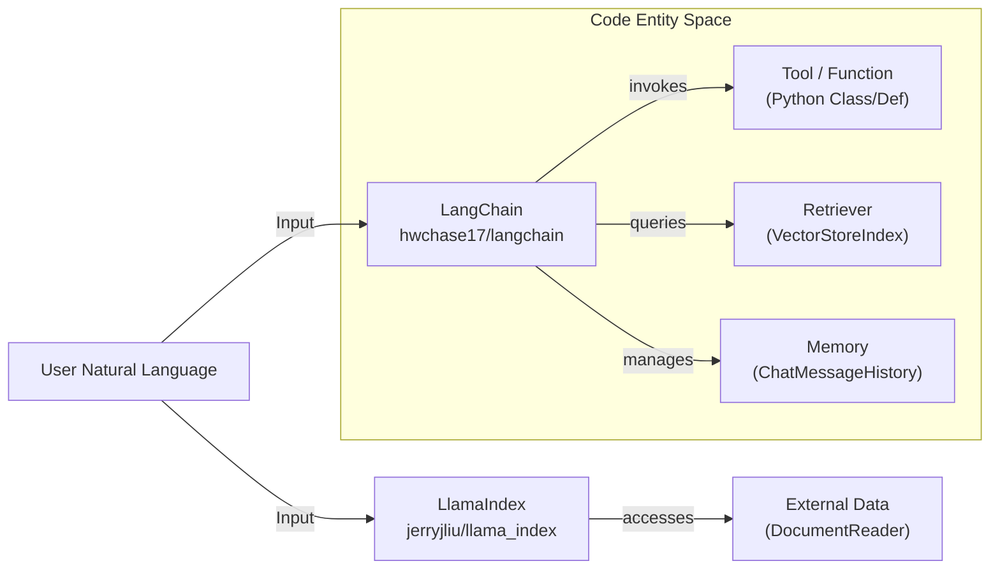

Sources: [README.md:28-29]()

**Diagram: Multi-Agent Orchestration Flow (Coordination Layer)**

This diagram maps the conceptual "Manager" and "Worker" roles to the specific implementations found in frameworks like `Autogen` and `CrewAI`.

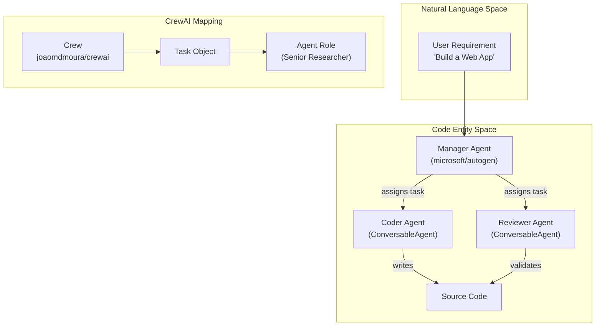

Sources: [README.md:39](), [README.md:44]()

---

## Distinguishing Characteristics Summary

| Feature | Key Frameworks |
|---|---|
| **Multi-Agent Orchestration** | `Autogen`, `AG2`, `CrewAI`, `MetaGPT`, `Swarms Framework`, `SwarmClaw`, `open-multi-agent` |
| **MCP Integration** | `Upsonic`, `PraisonAI`, `nanobot`, `Cortex Memory`, `OpenClaw` |
| **Durable Execution / Production** | `Portia AI`, `AgentDock`, `AgentField`, `Astron`, `Aeon` |
| **Voice / Multimodal** | `Pipecat` |
| **TypeScript / Go Native** | `Mastra`, `VoltAgent`, `Modus`, `ConnectOnion` |
| **Networking Protocols** | `Pilot Protocol`, `hcom`, `ConnectOnion` |
| **Self-Improving / Feedback** | `Agentic Context Engine`, `LoongFlow` |
| **WASM / Local AI** | `Ailoy` |

Sources: [README.md:22-77]()

---

# Page: Software Development Agents

# Software Development Agents

<details>
<summary>Relevant source files</summary>

The following files were used as context for generating this wiki page:

- [README.md](README.md)

</details>


This page documents all entries listed under the **Software Development** section of the `README.md` in the `kyrolabs/awesome-agents` repository. It covers agents and tools whose primary focus is assisting with or autonomously performing software engineering tasks — including code generation, repository comprehension, autonomous bug fixing, pair programming, code review, and DevOps.

---

## What Are Software Development Agents?

Software development agents are AI systems that operate within a software engineering context. They differ from general-purpose frameworks in that they are purpose-built to interact with codebases, development tools (terminals, editors, browsers), version control systems, and issue trackers. Their outputs are typically code changes, documentation, or automated pull requests — not free-form text.

The agents listed here span a wide range of autonomy and scope:

- **Interactive pair programmers** — assist a developer in real time inside a terminal or IDE.
- **Autonomous engineers** — accept a high-level task and independently plan, write, and test code.
- **Repo-understanding tools** — analyze and document existing codebases.
- **Specialized agents** — target a specific sub-task such as code review, DevOps/infrastructure, or visual computing.
- **Sandbox isolation** — provide secure environments for executing agent-generated code.
- **Multi-agent CLI orchestration** — coordinate multiple specialized agents to complete complex engineering workflows.

Sources: [README.md:74-118]()

---

## Entries by Use Case

The following table organizes all Software Development entries from the README by their primary use case, including the latest additions.

| Tool | Primary Use Case | Interface / Environment |
|---|---|---|
| **MetaGPT** | Multi-agent software company simulation | Python API |
| **OpenHands** | Autonomous full-stack software development | Web platform |
| **GPT Pilot** | AI developer companion in VS Code | VS Code extension |
| **Aider** | AI pair programming | Terminal (CLI) |
| **Devika** | Agentic AI software engineer | Web UI |
| **RepoAgent** | Repository documentation generation | CLI / Python API |
| **DSPy** | Programmatic LLM pipeline construction | Python library |
| **ThinkGPT** | LLM augmentation techniques | Python library |
| **PyCodeAGI** | Python app generation from natural language | Python experiment |
| **SuperAGI** | Dev-first autonomous agent framework | Web platform |
| **Plandex** | AI coding engine for complex multi-file tasks | Terminal (CLI) |
| **Codel** | Fully autonomous task execution (terminal + browser + editor) | Web UI |
| **DB GPT** | Local GPT interaction with databases | Python / local deployment |
| **Agency** | Go-idiomatic LLM agent library | Go library |
| **TaskWeaver** | Data analytics agent (code-first planning) | Python API |
| **MicroAgent** | Self-editing prompt and Python code agents | Python |
| **SWE Agent** | Automated GitHub issue resolution | CLI / Python |
| **AgentRun** | Safe execution of AI-generated Python code | Python library |
| **Claude Engineer** | CLI assistant for software development tasks | Terminal (CLI) |
| **Vision Agent** | Vision task code generation | Python library |
| **Nous** | TypeScript AI agent platform (dev + review) | TypeScript |
| **Cline** | Open-source AI coding agent in IDE | IDE extension |
| **OpenCode** | Terminal-based AI coding agent | Terminal (CLI) |
| **Stakpak** | DevOps: infrastructure security and deployment | CLI |
| **ReviewCerberus** | AI code review (security, performance, quality) | CLI / git diff |
| **Hivemoot Colony** | Autonomous agent governance (voting, releasing) | Web dashboard |
| **GoatStack** | Open-source platform for building AI agents | Platform |
| **E2B Sandbox** | Secure cloud sandbox for AI agents | Cloud Infrastructure |
| **ClaudeClaw** | Persistent agent orchestrator (Claude Code plugin) | Plugin / CLI |
| **Dorothy** | AI-driven software engineering automation | Automation Platform |
| **Greywall** | Autonomous software engineering | Engineering Platform |
| **Maestro Orchestrate** | Multi-agent CLI orchestration | Terminal (CLI) |
| **amux** | Multi-agent CLI interface | Terminal (CLI) |
| **AgentsMesh** | Distributed agent networking for development | Network Protocol |
| **KubeStellar Console** | Multi-cluster Kubernetes management agent | DevOps UI |

Sources: [README.md:5-6](), [README.md:74-118]()

---

## Implementation and Data Flow

Software development agents bridge the gap between "Natural Language Space" (user requirements) and "Code Entity Space" (files, functions, and infrastructure).

**Diagram: Data Flow from Natural Language to Code Entities**

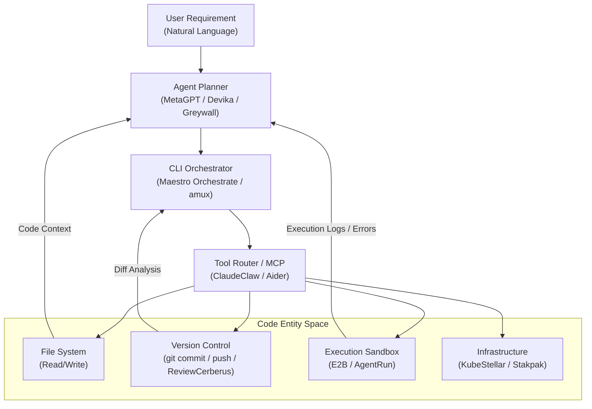

Sources: [README.md:5-6](), [README.md:74-118]()

**Diagram: Sandbox Isolation and Execution Flow**

This diagram illustrates how agents like **AgentRun** and **E2B** provide a secure boundary between generated code and the host system, now incorporating the networking layer of **AgentsMesh**.

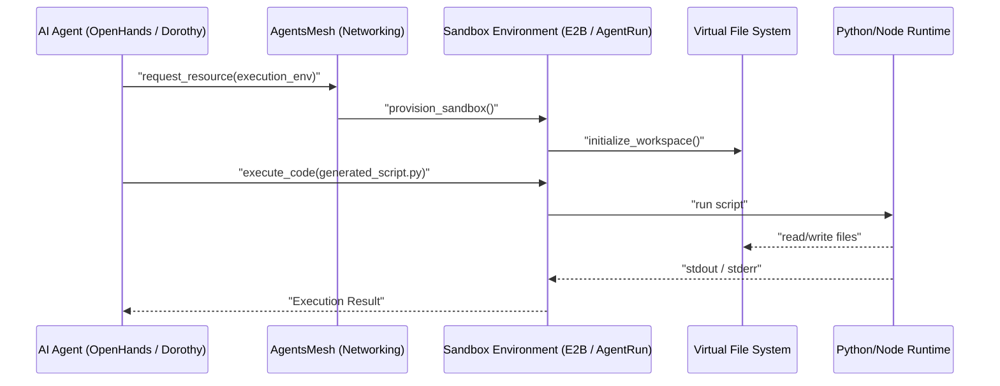

Sources: [README.md:33](), [README.md:93](), [README.md:109](), [README.md:115]()

---

## Detailed Entry Reference

### Autonomous and Orchestrated Agents

These tools manage the full lifecycle of a software task, from planning to deployment.

| Tool | GitHub Repository | Key Characteristic |
|---|---|---|
| **ClaudeClaw** | `sbusso/claudeclaw` | Persistent orchestrator as a Claude Code plugin; features OS-level sandbox isolation and multi-channel routing. |
| **OpenHands** | `All-Hands-AI/OpenHands` | Comprehensive platform for autonomous software development. |
| **Dorothy** | `dev-dorothy/dorothy` | Focuses on software engineering automation through AI-driven task completion. |
| **Greywall** | `greywall-ai/greywall` | An autonomous software engineering platform designed for end-to-end task execution. |
| **SWE Agent** | `princeton-nlp/swe-agent` | Designed to resolve GitHub issues by browsing repositories and applying patches. |
| **MetaGPT** | `geekan/MetaGPT` | Simulates a software company roles (PM, Architect, Engineer) to produce full repositories. |

Sources: [README.md:5-6](), [README.md:76-78](), [README.md:92](), [README.md:111-112]()

### Development Environments and CLI Orchestration

Tools that integrate into the developer's workflow or coordinate multiple agents via terminal interfaces.

| Tool | GitHub Repository | Key Characteristic |
|---|---|---|
| **Aider** | `Aider-AI/aider` | CLI tool for editing code in local git repos via chat. |
| **Maestro Orchestrate** | `Doriandarko/maestro-orchestrate` | A framework for orchestrating multiple sub-agents via CLI. |
| **amux** | `merwane/amux` | A multi-agent CLI interface for managing different agent interactions. |
| **Cline** | `cline/cline` | Open-source AI coding agent running inside the IDE with file system access. |
| **Plandex** | `plandex-ai/plandex` | Terminal-based engine for complex, multi-file coding tasks. |

Sources: [README.md:79-80](), [README.md:86](), [README.md:113-114]()

### Infrastructure, DevOps, and Networking

Specialized tools for the safe execution, deployment, and interconnection of agentic systems.

| Tool | GitHub Repository | Key Characteristic |
|---|---|---|
| **E2B Sandbox** | `e2b-dev/e2b` | Secure cloud sandboxes for AI agents to run code and use tools. |
| **KubeStellar Console** | `kubestellar/console` | Agent-based interface for managing multi-cluster Kubernetes environments. |
| **AgentsMesh** | `agents-mesh/agents-mesh` | A distributed networking protocol for connecting multiple agents across environments. |
| **Stakpak** | `stakpak/agent` | Focuses on DevOps, infrastructure security, and deployment automation. |
| **ReviewCerberus** | `review-cerberus/review-cerberus` | Specialized agent for automated code review focusing on security and quality. |

Sources: [README.md:33](), [README.md:100](), [README.md:115-117]()

---

## Summary: Use Case Coverage

**Diagram: Taxonomy of Software Development Agents**

```mermaid
mindmap
  root(("Software\nDevelopment\nAgents"))
    "Autonomous Engineers"
      "OpenHands"
      "Devika"
      "SWE Agent"
      "Dorothy"
      "Greywall"
    "Pair Programming & CLI"
      "Aider"
      "Cline"
      "Maestro Orchestrate"
      "amux"
    "Multi-Agent & Orchestration"
      "MetaGPT"
      "ClaudeClaw"
      "Nous"
      "AgentsMesh"
    "Sandbox & Infrastructure"
      "E2B Sandbox"
      "AgentRun"
      "KubeStellar Console"
      "Stakpak"
    "Specialized Tasks"
      "RepoAgent (Docs)"
      "ReviewCerberus (Review)"
      "Vision Agent (CV)"
      "DB GPT (SQL)"
    "Libraries & Logic"
      "DSPy"
      "ThinkGPT"
      "TaskWeaver"
```

Sources: [README.md:5-6](), [README.md:74-118]()

---

# Page: Research Agents

# Research Agents

<details>
<summary>Relevant source files</summary>

The following files were used as context for generating this wiki page:

- [README.md](README.md)

</details>


This page documents all entries listed under the **Research** section of the `README.md` in the `kyrolabs/awesome-agents` repository. Research agents are specialized autonomous systems designed for information retrieval, literature synthesis, paper generation, and data-driven scientific experimentation.

## Purpose and Scope

Research agents automate the cognitive heavy lifting of the scientific and analytical process. Unlike general-purpose conversational agents, they are optimized for high-fidelity information gathering and structured output. Their primary functions include:
*   **Automated Literature Search:** Querying web engines and academic databases.
*   **Paper Generation:** Drafting full-length manuscripts with inline citations.
*   **Online Research:** Aggregating disparate web sources into cohesive reports.
*   **Data Science & ML Experimentation:** Running code-driven workflows to analyze datasets and test hypotheses.
*   **Knowledge Curation:** Organizing complex topics into encyclopedic structures.

Sources: [README.md:103-113]()

---

## Technical Workflow of Research Agents

Research agents typically implement a "Plan-Execute-Synthesize" loop. They translate a natural language research goal into a series of search queries or code execution steps, evaluate the results, and iterate until a comprehensive report is generated.

### From Natural Language to Research Execution

The following diagram maps high-level research objectives to the specific technical components and tools mentioned in the repository.

**Research Execution Flow**

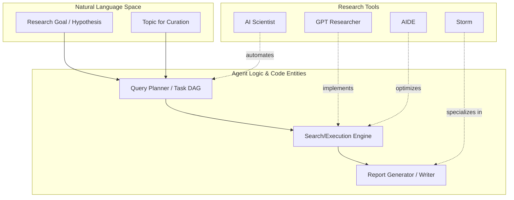

Sources: [README.md:105-113]()

---

## Documented Research Tools

The following tools are categorized under the Research section of the repository.

### General & Online Research

| Tool | Description | Key Feature |
| :--- | :--- | :--- |
| **GPT Researcher** | Autonomous agent for comprehensive online research. | Aggregates 20+ sources per report. |
| **BlockAGI** | Conducts iterative, domain-specific research. | Detailed narrative report output. |
| **Storm** | LLM-powered knowledge curation system. | Generates full-length reports with citations. |

*   **GPT Researcher**: Designed to solve the problem of LLM hallucinations and limited context by browsing the web autonomously to aggregate content [README.md:105]().
*   **BlockAGI**: Focuses on iterative loops, refining its search based on previous findings to provide depth in specific domains [README.md:106]().
*   **Storm**: Developed by Stanford OVAL, it researches a topic and organizes it into a structured, cited article [README.md:109]().

### Scientific Discovery & Academic Writing

| Tool | Description | Key Feature |
| :--- | :--- | :--- |
| **data-to-paper** | AI-driven research from data to papers. | Human-verifiable research papers. |
| **AI Scientist** | Fully automated open-ended scientific discovery. | End-to-end: Hypothesis to Review. |
| **GenoMAS** | Multi-agent framework for gene analysis. | Code-driven scientific workflows. |

*   **data-to-paper**: Bridges the gap between raw data analysis and formal academic writing, ensuring that every claim in the paper is traceable back to the data [README.md:107]().
*   **AI Scientist**: A system by Sakana AI that automates the entire research lifecycle, including peer review of its own generated papers [README.md:108]().
*   **GenoMAS**: Uses a multi-agent architecture to automate gene expression analysis, where agents write and execute code to process biological data [README.md:111]().

### Data Science & Specialized Research

| Tool | Description | Key Feature |
| :--- | :--- | :--- |
| **DeepAnalyze** | First agentic LLM for autonomous data science. | Data prep, modeling, and visualization. |
| **AIDE** | Autonomous agent for optimized data science. | Solution search for DS/ML tasks. |
| **OpenLens AI** | Autonomous Research Agent for Health Informatics. | Domain-specific for medical data. |

*   **DeepAnalyze**: Handles the full lifecycle of data-oriented deep research, producing analyst-grade reports [README.md:112]().
*   **AIDE**: Focuses on the "optimization" aspect of research, searching for the best solutions to data science and machine learning problems [README.md:113]().
*   **OpenLens AI**: Tailored specifically for health informatics, navigating specialized medical databases and research constraints [README.md:110]().

---

## Data Flow: From Raw Data to Insight

The technical implementation of these agents often involves bridging structured data environments with natural language reasoning.

**Data-to-Paper Pipeline Architecture**

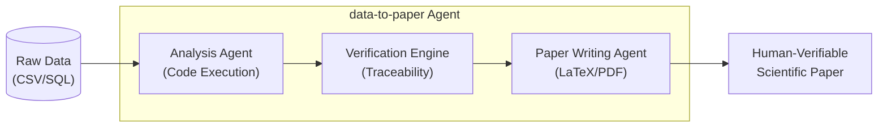

Sources: [README.md:107-112]()

## Relationship to Other Categories

Research agents frequently utilize components from other sections of the `awesome-agents` list:
*   **Frameworks**: Many research agents are built on `LangChain` [README.md:29]() or `AutoGen` [README.md:39]().
*   **Software Development**: Tools like `GenoMAS` [README.md:111]() use code-generation capabilities similar to software agents to perform data analysis.
*   **Automation**: Research agents often utilize browser automation tools (found in the [Automation, Browser, and Multimodal Agents](#1.6) section) to bypass paywalls or navigate complex web interfaces.

Sources: [README.md:29](), [README.md:39](), [README.md:111]()

---

# Page: Testing and Evaluation

# Testing and Evaluation

<details>
<summary>Relevant source files</summary>

The following files were used as context for generating this wiki page:

- [README.md](README.md)

</details>


## Purpose and Scope

This page documents the tools listed under the **Testing and Evaluation** category in [README.md:66-75](). These tools are specifically concerned with measuring, observing, and improving AI agent behavior after the agent has been built — covering runtime observability, benchmark evaluation, voice interface testing, and workflow optimization.

For documentation on the frameworks used to *build* agents, see [Frameworks (1.1)](). For agents that conduct *research tasks*, see [Research Agents (1.3)]().

---

## Why Evaluation Is a Distinct Concern

Evaluation tooling occupies a separate layer from agent frameworks because the failure modes of AI agents differ from those of deterministic software. Agents may produce outputs that are syntactically correct but semantically wrong, costly, or inconsistent across runs. This creates several concerns that ordinary unit testing does not address:

- **Non-determinism**: Agent outputs vary between runs; evaluation must handle probabilistic correctness.
- **Multi-step reasoning**: Errors may compound across tool calls and LLM invocations.
- **Modality diversity**: Voice agents, RAG pipelines, and code-generating agents each require specialized evaluation methods.
- **Cost and resource tracking**: Token usage and API costs must be monitored in production.
- **Iterative improvement**: Evaluation results should feed back into prompt or workflow refinement.
- **Guardrails and Compliance**: Agents require real-time scanning to prevent harmful outputs or policy violations.

The tools in this category each address one or more of these concerns.

---

## Tool Summary

| Tool | Primary Focus | Key Differentiator |
|---|---|---|
| `Arize-Phoenix` | Observability, testing, evaluation | General-purpose; covers tracing, evals, and LLM spans |
| `Open-RAG-Eval` | RAG pipeline quality | Does not require golden/reference answers |
| `Voice Lab` | Voice agent evaluation | Tests across LLM variants, prompt sets, and agent personas |
| `voicetest` | Voice agent testing | Supports Retell, VAPI, Bland, LiveKit; uses LLM judges |
| `EvoAgentX` | Workflow evaluation and evolution | Self-evolving ecosystem; automates eval and workflow optimization |
| `Manifest` | Cost and token observability | Real-time dashboard; OTLP ingestion; 28+ LLM models; self-hosted |
| `traceAI` | Compliance and observability | Focuses on agent compliance, security, and performance tracing |

Sources: [README.md:66-75]()

---

## Tool Categorization

**Diagram: Evaluation Tools by Primary Concern**

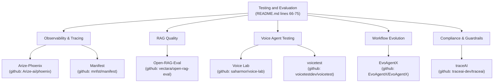

Sources: [README.md:66-75]()

---

## How These Tools Fit Into the Agent Lifecycle

**Diagram: Evaluation Tools Mapped to Agent System Layers**

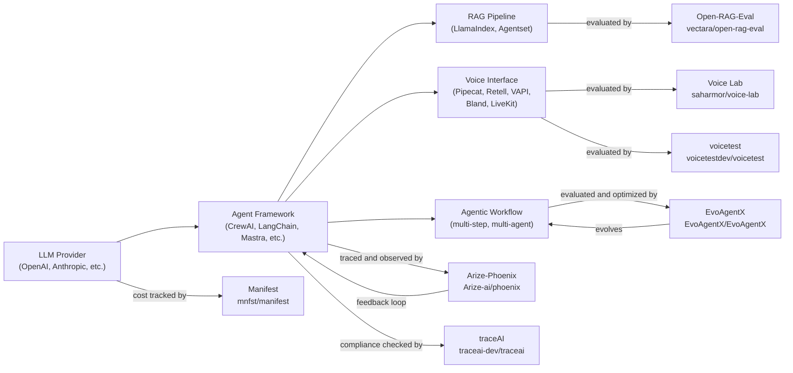

Sources: [README.md:22-75]()

---

## Tool Reference

### Arize-Phoenix

**GitHub:** `Arize-ai/phoenix`

An open-source library covering agent testing, evaluation, and observability. Arize-Phoenix is the most general-purpose tool in this category — it provides LLM tracing (spans and traces), built-in evaluators, and experiment tracking. It is suitable for monitoring production agent runs as well as running offline evaluations.

**Relevant aspects:**
- Captures LLM input/output spans across multi-step agent workflows.
- Supports evaluation of retrieval quality, hallucination, and relevance.
- Integrates with OpenTelemetry-compatible tracing pipelines.

Sources: [README.md:70]()

### Open-RAG-Eval

**GitHub:** `vectara/open-rag-eval`

An open-source RAG evaluation framework targeting the specific challenge of evaluating retrieval-augmented generation systems without needing pre-compiled golden answers. This is significant because constructing reference answer sets is expensive and often not feasible for production pipelines. Open-RAG-Eval is positioned for use with "Agentic RAG" — RAG pipelines embedded inside or orchestrated by AI agents.

**Key characteristic:** Reference-free evaluation; can assess factual grounding, answer coherence, and context relevance without a ground-truth corpus.

Sources: [README.md:68]()

### Voice Lab

**GitHub:** `saharmor/voice-lab`

A testing and evaluation framework specific to voice agents. Voice Lab allows engineers to test voice agent behavior across multiple dimensions simultaneously:
- Different underlying language models.
- Varied prompt configurations.
- Multiple agent personas.

This makes it suitable for systematic comparison experiments before deploying a voice agent to production.

Sources: [README.md:67]()

### voicetest

**GitHub:** `voicetestdev/voicetest`

An open-source test harness for voice agents with explicit support for several major voice agent platforms:

| Supported Platform | Type |
|---|---|
| Retell | Managed voice agent API |
| VAPI | Voice AI platform |
| Bland | Voice automation API |
| LiveKit | Open-source real-time communication |

`voicetest` runs **autonomous simulations** — the agent under test interacts with a simulated caller — and uses an **LLM-as-judge** pattern to score the interaction. This removes the need for human reviewers in the evaluation loop.

Sources: [README.md:71]()

### EvoAgentX

**GitHub:** `EvoAgentX/EvoAgentX`

EvoAgentX combines evaluation with workflow optimization. Rather than only measuring agent performance, it feeds evaluation results back into an automated loop that modifies the agentic workflow to improve scores — a "self-evolving ecosystem" model. This means EvoAgentX acts as both a benchmark runner and an optimizer.

**Distinction from other tools:** Most evaluation tools in this list produce reports or metrics; EvoAgentX acts on those metrics automatically to evolve the workflow.

Sources: [README.md:69]()

### Manifest

**GitHub:** `mnfst/manifest`

A real-time cost observability platform focused on tracking the operational cost and usage of AI agents. Unlike evaluation tools that assess output quality, Manifest focuses on resource consumption: tokens consumed, API costs, message counts, and model usage patterns.

**Notable characteristics:**
- Local-first dashboard (data stays on-premises).
- Supports 28+ LLM models.
- Accepts OTLP (OpenTelemetry Protocol) ingestion, making it compatible with existing observability pipelines.
- Self-hosted deployment.

Sources: [README.md:72]()

### traceAI

**GitHub:** `traceai-dev/traceai`

An open-source platform for agent compliance, observability, and performance tracing. It targets the "Guardrail Scanning" and "Compliance" aspects of agent behavior, ensuring that agent actions and outputs adhere to predefined security and performance standards.

Sources: [README.md:74]()

---

## Evaluation Concerns by Tool Matrix

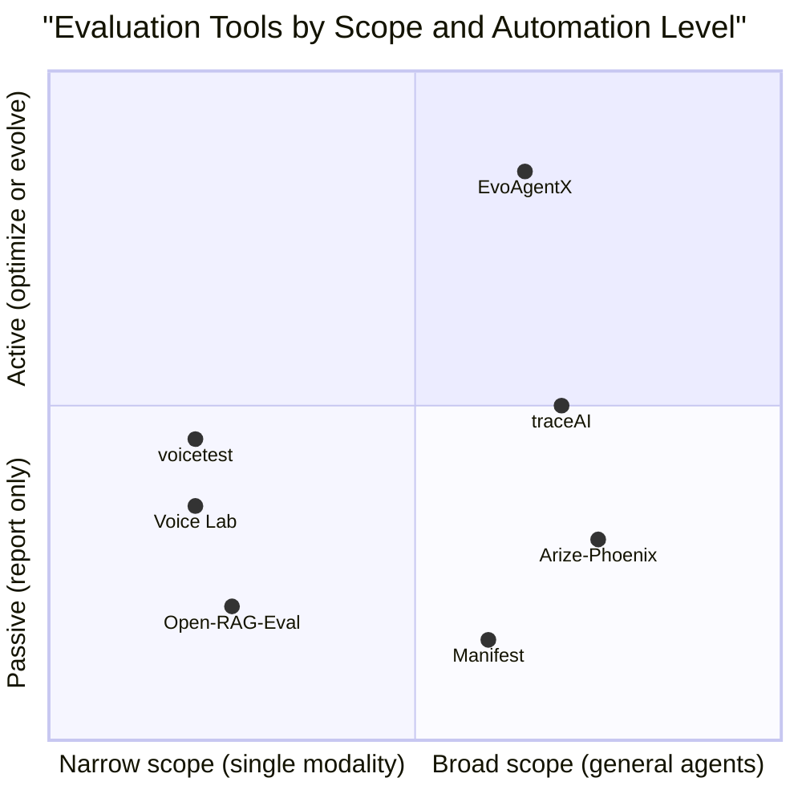

Sources: [README.md:66-75]()

---

## Relationship to Frameworks

Evaluation tools in this category are consumers of agent frameworks, not alternatives to them. As illustrated in the lifecycle diagram, the output of frameworks like `CrewAI` [README.md:44](), `LangChain` [README.md:29](), `Mastra` [README.md:48](), and `Pipecat` [README.md:64]() flows into these evaluation tools. The feedback loop — where evaluation findings improve framework configuration, prompts, or workflows — is the mechanism by which the ecosystem matures iteratively.

`EvoAgentX` [README.md:69]() makes this loop explicit and automated. `Arize-Phoenix` [README.md:70]() and `Manifest` [README.md:72]() support it through persistent traces and metrics. `Voice Lab` [README.md:67](), `voicetest` [README.md:71](), and `Open-RAG-Eval` [README.md:68]() provide the domain-specific signal needed for voice and retrieval-focused agents. `traceAI` [README.md:74]() ensures these framework outputs remain compliant with safety and security policies.

Sources: [README.md:22-75]()

---

# Page: Conversational and General Agents

# Conversational and General Agents

<details>
<summary>Relevant source files</summary>

The following files were used as context for generating this wiki page:

- [README.md](README.md)

</details>


This section documents the **Conversational and General Agents** category within the `awesome-agents` repository. Unlike specialized vertical agents designed for narrow domains like software engineering or medical research, general-purpose agents focus on versatile interaction, long-term state management, and multi-modal communication across various platforms.

## Overview of General-Purpose Agents

General-purpose conversational agents are distinguished by their ability to handle diverse tasks through natural language, often serving as a unified interface for multiple tools. Key architectural patterns in this category include:

*   **Long-term Memory:** Systems that persist user preferences and past interactions across sessions (e.g., `MemGPT`).
*   **Voice-First Interaction:** Low-latency audio processing for real-time verbal communication.
*   **Multi-Channel Deployment:** The ability to route interactions through Slack, WhatsApp, Telegram, or custom web interfaces (e.g., `ClaudeClaw`, `OpenAgent`).
*   **Browser-Use Integration:** Leveraging agents to navigate the web to fulfill general user requests (e.g., `MateClaw`).

### Agent-User Interaction Flow

The following diagram illustrates the typical data flow for a conversational agent, bridging the "Natural Language Space" (User Input) to the "Code Entity Space" (Internal Logic and State).

**Conversational Agent Architecture**

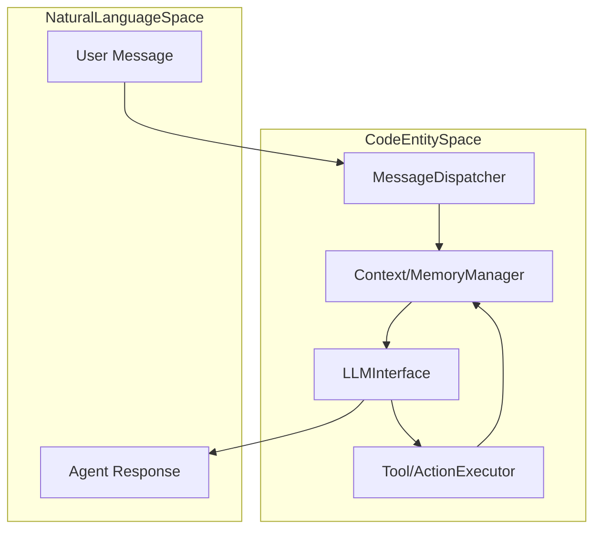

Sources: [README.md:1-21]()

---

## Featured Tool: ClaudeClaw

[ClaudeClaw](https://github.com/sbusso/claudeclaw) is a featured entry that exemplifies the "General Agent" paradigm by acting as a persistent orchestrator implemented as a Claude Code plugin.

*   **Multi-channel routing:** Supports Slack, WhatsApp, and Telegram [README.md:5-5]().
*   **Isolation:** Uses OS-level sandbox isolation for safe execution [README.md:5-5]().
*   **Extensibility:** Features a composable extension system [README.md:5-5]().

Sources: [README.md:5-5]()

---

## Directory of Conversational and General Agents

The following tools are curated in the `README.md` under the Conversational / General Agents section.

| Tool | Description | Key Capability |
| :--- | :--- | :--- |
| [OpenAgent](https://github.com/OpenAgent-dev/OpenAgent) | Open-source agent for multi-channel messaging (Telegram, Slack, Discord) with long-term memory. | Multi-channel Memory |
| [MateClaw](https://github.com/V-I-R-L/MateClaw) | A browser-use deployment of the ClaudeClaw agent. | Browser-based Execution |
| [ClaudeClaw](https://github.com/sbusso/claudeclaw) | Persistent agent orchestrator as a Claude Code plugin. | OS-level Sandboxing |
| [joinly](https://github.com/joinly-ai/joinly) | Multi-channel AI agent platform for WhatsApp, Telegram, and Web. | Messaging Interoperability |
| [Gobii](https://github.com/gobii-ai/gobii) | Your open-source AI sidekick. | General Productivity |
| [MemGPT](https://github.com/cpacker/MemGPT) | Teaching LLMs memory management for unbounded context. | Virtual Context Management |
| [GPT Engineer](https://github.com/AntonOsika/gpt-engineer) | Specify what you want it to build, the AI asks for clarification, and then builds the entire codebase. | General Project Scaffolding |
| [BabyAGI](https://github.com/yoheinakajima/babyagi) | An AI-powered task management system using OpenAI and Pinecone. | Autonomous Task Planning |
| [AutoGPT](https://github.com/Significant-Gravitas/Auto-GPT) | An experimental attempt to make GPT-4 fully autonomous. | General Goal Pursuit |
| [OpenInterpreter](https://github.com/KillianLucas/open-interpreter) | A natural language interface for your computer's code interpreter. | Local OS Interaction |

Sources: [README.md:5-5](), [README.md:120-155]()

---

## Technical Implementation Patterns

### Memory and State Persistence (MemGPT & OpenAgent)

General agents often implement a `LongTermMemory` or `StateStore` to maintain context across disconnected chat sessions. **MemGPT** introduces the concept of "OS-like" memory management, where the LLM manages its own context window through explicit memory-paging functions.

**Memory Paging Logic (MemGPT Pattern)**

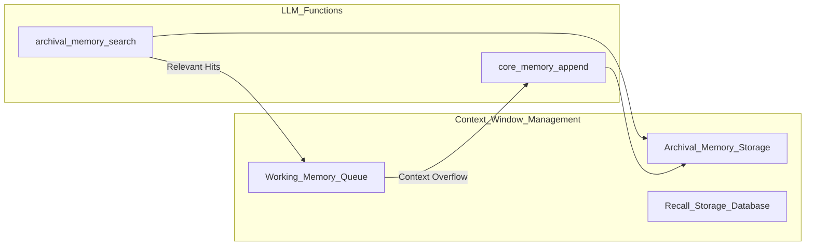

Sources: [README.md:130-131]()

### Multi-Channel Messaging and Routing

Agents like **OpenAgent**, **joinly**, and **ClaudeClaw** utilize a routing layer to abstract communication protocols. This allows a single agent core to interact with users on Signal, WhatsApp, or Slack.

**Multi-Channel Routing Architecture**

| Entity | Role |
| :--- | :--- |
| `MultiChannelRouter` | Maps incoming platform events (e.g., `on_message`) to internal formats. |
| `SandboxIsolation` | Used by `ClaudeClaw` to ensure conversational code execution is safe. |
| `SkillPlugin` | Composable extensions used by `OpenAgent` to add functionality like web search. |

Sources: [README.md:5-5](), [README.md:148-152]()

### Browser-Use and GUI Deployment (MateClaw & Self-operating Computer)

The transition from text-only to "General" capability often involves the agent controlling a browser or GUI. **MateClaw** serves as a specific deployment of the `ClaudeClaw` framework focused on browser-based tasks, while **Self-operating Computer** maps multimodal vision to mouse and keyboard events.

**Vision-to-Action Pipeline**

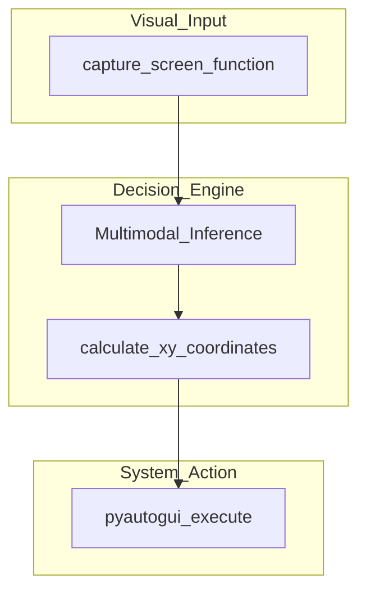

Sources: [README.md:141-142](), [README.md:154-155]()

---

# Page: Automation, Browser, and Multimodal Agents

# Automation, Browser, and Multimodal Agents

<details>
<summary>Relevant source files</summary>

The following files were used as context for generating this wiki page:

- [README.md](README.md)

</details>


This section documents agents and tools designed to bridge the gap between Large Language Models (LLMs) and actionable interfaces. The scope of automation agents in this repository ranges from high-level workflow builders and RESTful API controllers to low-level macOS GUI automation, Telegram bridges, and browser-specific infrastructure [README.md:18-20]().

## Automation Agents and Workflow Builders

Automation agents focus on executing sequences of tasks across different platforms. This includes everything from simple API integrations to complex, long-running workflows that can control operating systems or messaging platforms.

| Tool | Description |
| :--- | :--- |
| [ClaudeClaw](https://github.com/sbusso/claudeclaw) | A featured persistent agent orchestrator acting as a Claude Code plugin. It supports multi-channel routing (Slack, WhatsApp, Telegram) and OS-level sandbox isolation [README.md:5-5](). |
| [osModa](https://github.com/moda-org/osmoda) | Open source macOS automation agent [README.md:143-143](). |
| [AppAgent](https://github.com/mnotgod96/AppAgent) | An LLM-based multimodal agent framework designed to operate smartphone applications [README.md:144-144](). |
| [Self-Operating Computer](https://github.com/OthersideAI/self-operating-computer) | A framework that enables multimodal models to operate a computer by interacting with the GUI [README.md:145-145](). |
| [AutoGPT](https://github.com/Significant-Gravitas/Auto-GPT) | An experimental open-source attempt to make GPT-4 fully autonomous [README.md:146-146](). |
| [BabyAGI](https://github.com/yoheinakajima/babyagi) | A Python script that uses OpenAI and Pinecone APIs to create, prioritize, and execute tasks [README.md:147-147](). |
| [AgentForge](https://github.com/mnotgod96/AgentForge) | A low-code framework for building and deploying AI agents [README.md:148-148](). |
| [SuperAGI](https://github.com/TransformerOptimus/SuperAGI) | A dev-first open-source autonomous AI agent framework [README.md:149-149](). |
| [Skyvern](https://github.com/skyvern-ai/skyvern) | Automates browser-based workflows using LLMs and Computer Vision [README.md:150-150](). |
| [OpenDevin](https://github.com/OpenDevin/OpenDevin) | An autonomous agent that can interact with the world via a web browser and shell [README.md:151-151](). |
| [OpenOperator](https://github.com/OpenOperator/OpenOperator) | An open-source implementation of a browser-based AI operator [README.md:152-152](). |
| [UFO](https://github.com/microsoft/UFO) | A UI-Focused agent for Windows OS interaction [README.md:153-153](). |
| [Griptape](https://github.com/griptape-ai/griptape) | Python framework for building AI agents with memory, tools, and workflows [README.md:154-154](). |
| [Open-Interpreter](https://github.com/KillianLucas/open-interpreter) | A natural language interface for your computer's shell [README.md:155-155](). |
| [Keep](https://github.com/keephq/keep) | An open-source AIOps platform that uses agents for alert management [README.md:156-156](). |
| [Task Weaver](https://github.com/microsoft/TaskWeaver) | A code-first agent framework for seamless planning and execution [README.md:157-157](). |
| [PyGPT](https://github.com/szczyglis-dev/py-gpt) | All-in-one AI desktop assistant for Windows, Linux, and Mac [README.md:158-158](). |
| [Hamilton](https://github.com/dagworks-inc/hamilton) | A micro-framework for defining dataflows [README.md:159-159](). |
| [Activepieces](https://github.com/activepieces/activepieces) | Open-source workflow automation tool with AI capabilities [README.md:160-160](). |
| [n8n](https://github.com/n8n-io/n8n) | Workflow automation tool with native AI nodes [README.md:161-161](). |
| [Bee Agent Framework](https://github.com/i-am-bee/bee-agent-framework) | Open-source framework for building and deploying resilient agents [README.md:162-162](). |
| [Plandex](https://github.com/plandex-ai/plandex) | AI coding agent that plans and executes complex tasks [README.md:163-163](). |
| [Browser-use](https://github.com/browser-use/browser-use) | Make any LLM operate a browser [README.md:164-164](). |
| [Aider](https://github.com/paul-gauthier/aider) | Command-line chat tool that allows you to write code with LLMs [README.md:165-165](). |
| [OpenManus](https://github.com/mannaandbeast/OpenManus) | An open-source alternative to Manus, designed for high-performance agentic tasks [README.md:166-166](). |
| [Hugging Face Agent](https://github.com/huggingface/huggingface-agent) | A simple and efficient agent implementation by Hugging Face [README.md:167-167](). |
| [ZerePy](https://github.com/blorm-network/ZerePy) | A framework to deploy your own agents on X (Twitter) [README.md:168-168](). |
| [Atomic Agents](https://github.com/KennyVaneetvelde/atomic-agents) | A framework for building modular and predictable AI agents [README.md:169-169](). |
| [AI-Data-Scientist](https://github.com/vllm-project/ai-data-scientist) | An AI agent for automated data science and machine learning [README.md:170-170](). |
| [Actionbook](https://github.com/shobrook/actionbook) | The easiest way to build and run AI agents that can take actions [README.md:171-171](). |
| [RestGPT](https://github.com/yuzhen-mao/RestGPT) | An LLM-based agent for controlling RESTful APIs [README.md:172-172](). |

### Automation Data Flow: From Intent to Action

The following diagram illustrates how an automation agent like `ClaudeClaw` or `Open-Interpreter` bridges the "Natural Language Space" (User Intent) to the "Code Entity Space" (System Execution).

**System Architecture: Intent to Execution Bridge**

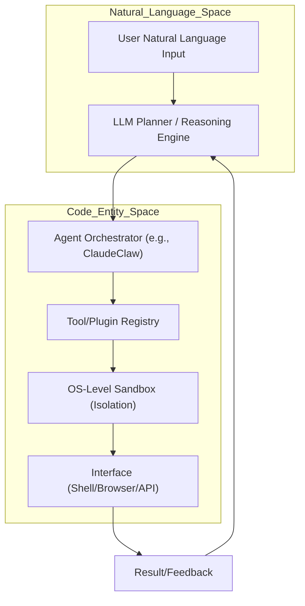

**Sources:** [README.md:5-5](), [README.md:155-155](), [README.md:164-164](), [README.md:172-172]()

## Browser Agents

Browser agents are a specialized sub-category focused on navigating and interacting with the web. They often combine Computer Vision with DOM manipulation to mimic human browsing behavior or provide specialized infrastructure for agentic browsing.

| Tool | Description |
| :--- | :--- |
| [LaVague](https://github.com/lavague-ai/lavague) | Open-source framework to build AI Web Agents [README.md:173-173](). |
| [BrowserGym](https://github.com/ServiceNow/BrowserGym) | A gym environment for evaluating and training browser agents [README.md:174-174](). |
| [Steel Browser](https://github.com/steel-dev/steel-browser) | An open-source browser built for AI agents [README.md:175-175](). |
| [Giselle](https://github.com/Giselle-ai/Giselle) | Low-code agent workflow builder [README.md:176-176](). |
| [ADAS](https://github.com/adas-ai/adas) | Automated Design of Agentic Systems [README.md:177-177](). |

**Sources:** [README.md:150-152](), [README.md:164-164](), [README.md:173-177]()

## Multimodal Agents

Multimodal agents extend the capabilities of standard agents by processing and generating multiple types of data, such as images, video, and audio, in addition to text.

*   **[AppAgent](https://github.com/mnotgod96/AppAgent)**: Uses visual cues to operate smartphone apps, effectively "seeing" the screen [README.md:144-144]().
*   **[Self-Operating Computer](https://github.com/OthersideAI/self-operating-computer)**: Employs multimodal models (like GPT-4V) to view the desktop screen and interact with the mouse and keyboard [README.md:145-145]().
*   **[UFO](https://github.com/microsoft/UFO)**: A UI-focused agent specifically for Windows, leveraging multimodal capabilities to navigate the OS [README.md:153-153]().

### Multimodal Interaction Flow

This diagram maps the interaction between multimodal input processing and the resulting system actions.

**Multimodal Entity Mapping**

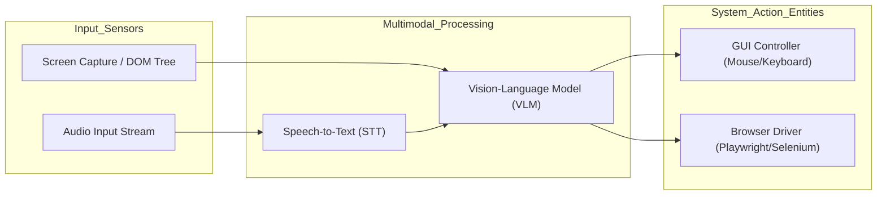

**Sources:** [README.md:144-145](), [README.md:153-153](), [README.md:173-173]()

---

# Page: Game, Simulation, and Knowledge Management

# Game, Simulation, and Knowledge Management

<details>
<summary>Relevant source files</summary>

The following files were used as context for generating this wiki page:

- [README.md](README.md)

</details>


This page documents specialized AI agents designed for virtual environments and information retrieval. These tools bridge the gap between static data and dynamic interaction, covering simulation agents that model human behavior or embody characters in games, and knowledge management agents that provide sophisticated search, institutional memory, and private document Q&A.

## Game and Simulation Agents

Simulation agents focus on role-playing, human-behavior modeling, and embodied interaction within virtual environments. These projects often utilize LLMs to drive social dynamics, NPC (Non-Player Character) logic, and complex multi-agent interactions in sandbox settings. Recent additions like **Enclave** and **MiroShark** expand this category into swarm intelligence and specialized game environments.

### Featured Tools

| Project | Description |
| :--- | :--- |
| [Enclave](https://github.com/enclave-ai/enclave) | A swarm-intelligence social simulation framework for exploring emergent agent behaviors. |
| [MiroShark](https://github.com/MiroShark/MiroShark) | Specialized agents designed for game environments and interactive simulations. |
| [Generative Agents](https://github.com/joonspk-research/generative_agents) | Interactive simulacra of human behavior, creating agents that can plan, socialize, and form memories in a sandbox world. |
| [ChatDev](https://github.com/OpenBMB/ChatDev) | A virtual software company simulation where multiple agents play roles (CEO, CPO, CTO) to develop software. |
| [Voyager](https://github.com/MineDojo/Voyager) | An open-ended embodied agent in Minecraft that learns via lifelong exploration and code generation. |
| [GPTeam](https://github.com/101dotai/gpteam) | An open-source multi-agent simulation that uses GPT-4 to create a collaborative task-solving environment. |
| [Project-S](https://github.com/S-G-P/Project-S) | A simulation framework focused on social intelligence and agent-to-agent interactions. |
| [WarAgent](https://github.com/beiyuanIT/WarAgent) | An AI-driven multi-agent system designed to simulate historical international conflicts and diplomatic decision-making. |

### Implementation Logic: Social Simulation

In simulation frameworks like `Generative Agents`, the core logic revolves around an architecture that maintains a long-term memory stream. This stream allows agents to perceive their environment, reflect on past experiences, and plan future actions. In swarm-based systems like `Enclave`, the focus shifts to emergent behavior from simple local interactions.

**Social Simulation and Swarm Data Flow**

```mermaid
graph TD
    subgraph "Environment_Space"
        "Env_State[Environment State]"
    end

    subgraph "Agent_Entity_Space"
        "Perceive[Perception_Module]"
        "Memory_Stream[MemoryStream_Class]"
        "Reflect[Reflection_Logic]"
        "Plan[Planning_Engine]"
        "Act[Action_Dispatcher]"
    end

    subgraph "Swarm_Logic"
        "Enclave_Swarm[Swarm_Controller]"
        "Local_Interaction[Peer_To_Peer_Logic]"
    end

    "Env_State" --> "Perceive"
    "Perceive" --> "Memory_Stream"
    "Memory_Stream" --> "Reflect"
    "Reflect" --> "Memory_Stream"
    "Memory_Stream" --> "Plan"
    "Plan" --> "Act"
    "Act" --> "Env_State"
    "Enclave_Swarm" --> "Local_Interaction"
    "Local_Interaction" --> "Act"
```

Sources: [README.md:16-17](), [README.md:126-135](), [README.md:131-132]()

---

## Knowledge Management Agents

Knowledge management agents transform static repositories into interactive assets. They handle private document Q&A, local search, and institutional memory. Newer tools such as **Screenpipe** provide 24/7 context by recording screen and audio, while **SAGE** and **Hindsight** focus on advanced indexing and retrieval logic.

### Featured Tools

| Project | Description |
| :--- | :--- |
| [SAGE](https://github.com/SAGE-AI/SAGE) | A smart agent for knowledge extraction and management. |
| [Hindsight](https://github.com/Hindsight-AI/Hindsight) | Advanced knowledge management agent for long-term memory and retrieval. |
| [Screenpipe](https://github.com/mediar-ai/screenpipe) | 24/7 local context capture (screen/audio) to provide agents with a complete history of user activity. |
| [PrivateGPT](https://github.com/imartinez/privateGPT) | Ask questions about your documents using the power of LLMs, 100% privately, no data leaves your execution environment. |
| [LocalGPT](https://github.com/PromtEngineer/localGPT) | Chat with your documents on your local device using GPT models without an internet connection. |
| [Quivr](https://github.com/StanGirard/quivr) | Your "Second Brain" in the cloud, designed to store and retrieve unstructured information using Generative AI. |
| [Verba](https://github.com/weaviate/Verba) | The Golden RAGtriever: A fully customizable personal assistant for querying your own data. |
| [Khoj](https://github.com/khoj-ai/khoj) | An AI personal assistant for your digital brain, providing search and chat across personal notes and documents. |
| [Ragged](https://github.com/profullstack/ragged) | A toolkit for building RAG (Retrieval-Augmented Generation) agents with a focus on developer experience. |
| [Knowledge Graph Builder](https://github.com/rahuldshetty/knowledge-graph-builder) | Automatically creates structured knowledge graphs from unstructured text for agent consumption. |

### Data Flow: Continuous Context and Knowledge Retrieval

Knowledge management agents typically follow a RAG (Retrieval-Augmented Generation) pattern. Tools like `Screenpipe` add a continuous ingestion layer, capturing real-time data that is then processed through standard RAG pipelines. Some institutional memory systems utilize BFT (Byzantine Fault Tolerance) consensus to maintain a consistent state across distributed agent nodes.

**Continuous Context and Knowledge Architecture**

```mermaid
graph LR
    subgraph "Continuous_Capture"
        "Screenpipe_Recorder[Screen_Audio_Capture]"
        "OCR_Engine[OCR_Processor]"
    end

    subgraph "Ingestion_Pipeline"
        "Doc_Loader[DocumentLoader]"
        "Chunker[TextSplitter]"
        "Embedder[EmbeddingModel]"
    end

    subgraph "Storage_Layer"
        "Vector_DB[VectorStore]"
        "BFT_Consensus[Consensus_Protocol]"
    end

    subgraph "Query_Engine"
        "Retriever[VectorIndexRetriever]"
        "LLM_Generator[LLM_Interface]"
    end

    "Screenpipe_Recorder" --> "OCR_Engine"
    "OCR_Engine" --> "Doc_Loader"
    "Doc_Loader" --> "Chunker"
    "Chunker" --> "Embedder"
    "Embedder" --> "Vector_DB"
    "Vector_DB" -.-> "BFT_Consensus"
    "Retriever" -- "Similarity_Search" --> "Vector_DB"
    "Retriever" --> "LLM_Generator"
```

Sources: [README.md:17](), [README.md:137-147](), [README.md:144-146]()

## Summary of Categories

The following table summarizes the key focus areas for the tools listed in these categories:

| Category | Primary Focus | Key Capability |
| :--- | :--- | :--- |
| **Game / Simulation** | Emergent Behavior | Role-playing, social dynamics, swarm intelligence, and autonomous decision-making in sandboxes. |
| **Knowledge Management** | Data Sovereignty & Context | Private RAG, local document indexing, 24/7 screen/audio context, and persistent institutional memory. |

Sources: [README.md:16-17](), [README.md:126-147]()

---

# Page: Contributing to the List

# Contributing to the List

<details>
<summary>Relevant source files</summary>

The following files were used as context for generating this wiki page:

- [CONTRIBUTING.md](CONTRIBUTING.md)

</details>


This page documents the rules and mechanics for submitting a new entry to the `awesome-agents` curated list. It covers what projects are eligible, how to open a Pull Request via the GitHub browser editor, and what occurs during maintainer review. For an overview of the list's contents and categories, see [Overview](#1).

---

## Eligibility Criteria

All submissions are governed by `CONTRIBUTING.md` and are curated by the repository maintainers. A project must pass every criterion before it will be merged.

### Required Criteria

| Criterion | Description |
|---|---|
| **Open source** | The project repository must be publicly accessible and use an open-source license. |
| **English** | Documentation and README must be in English. |
| **Agentic relevance** | The project must be related to the AI agent / agentic framework ecosystem. |
| **Maintained** | The project must still be actively maintained. |
| **Online** | The project's links and hosted resources must be live. |
| **Added value** | The project must offer something not already covered by existing list entries. |
| **Demonstrated traction** | New projects with no evident community usage (history) are excluded. |

Sources: [CONTRIBUTING.md:3-13](), [CONTRIBUTING.md:19-19]()

### Placement Rule

New entries must be added at the **bottom of the relevant category section** in `README.md`, not inserted anywhere else in the list.

Sources: [CONTRIBUTING.md:15-15]()

---

## Submission Workflow

The only accepted submission mechanism is a GitHub Pull Request. Issues are not processed for new entries and will not result in additions to the list [CONTRIBUTING.md:17-17]().

**Workflow overview:**

```mermaid
flowchart TD
    C["Contributor"]
    step1["1. Navigate to\nhttps://github.com/kyrolabs/awesome-agents"]
    step2["2. Open README.md\nin the repository"]
    step3["3. Click the Edit icon\n(pencil icon, top-right of file view)"]
    step4["4. Edit README.md\nin the GitHub in-browser editor\n(GitHub Flavored Markdown)"]
    step5["5. Write a summary\nof why the entry is being proposed"]
    step6["6. Click Propose file change\n(creates a fork + branch automatically)"]
    step7["7. Submit Pull Request\nvia GitHub PR interface"]
    R["Maintainer Review\n(kyrolabs)"]

    C --> step1 --> step2 --> step3 --> step4 --> step5 --> step6 --> step7 --> R
```

Sources: [CONTRIBUTING.md:27-32]()

### Step-by-Step Details

1. **Navigate** to the repository at `https://github.com/kyrolabs/awesome-agents` [CONTRIBUTING.md:27-27]().
2. **Open `README.md`** — this is the file that constitutes the curated list [CONTRIBUTING.md:28-28]().
3. **Click the edit icon** (pencil) in the top-right corner of the file view [CONTRIBUTING.md:29-29]().
4. **Make your edit** in the in-browser editor using GitHub Flavored Markdown [CONTRIBUTING.md:30-30](). All entries follow a standard format. Place your entry at the **bottom** of the appropriate category section [CONTRIBUTING.md:15-15]().
5. **Scroll to the bottom** of the editor and write a description of your proposed change in the "Propose file change" box [CONTRIBUTING.md:31-31]().
6. **Click "Propose file change"** — GitHub will fork the repository under your account and create a branch with your edit [CONTRIBUTING.md:31-31]().
7. **Submit the Pull Request** on the resulting "Open a pull request" page [CONTRIBUTING.md:32-32]().

Sources: [CONTRIBUTING.md:15-32]()

---

## Entry Format Reference

The following diagram maps the physical structure of a list entry in `README.md` to the components that maintainers check during review.

```mermaid
graph LR
    ENTRY["README.md list entry"]
    NAME["Tool name\n(linked to GitHub repo)"]
    DESC["One-line description\n(English, concise)"]
    STARS["GitHub stars badge\n(img.shields.io social)"]
    CATEGORY["Category section\n(e.g. Frameworks, Research,\nSoftware Development)"]
    PLACEMENT["Bottom of category\n(per CONTRIBUTING.md rule)"]

    ENTRY --> NAME
    ENTRY --> DESC
    ENTRY --> STARS
    ENTRY --> CATEGORY
    ENTRY --> PLACEMENT
```

Sources: [CONTRIBUTING.md:15-15](), [CONTRIBUTING.md:3-13]()

---

## Maintainer Review

Once a Pull Request is submitted, a maintainer from `kyrolabs` evaluates it against the criteria in `CONTRIBUTING.md`. There are three possible outcomes:

```mermaid
flowchart TD
    PR["Pull Request Submitted"]
    CHECK{"Does it meet\nall criteria?"}
    CLOSE["PR Auto-Closed\nNo action required\nfrom contributor"]
    REVISE["Changes Requested\n(spelling, guideline mismatch,\nplacement error)"]
    UPDATE["Contributor updates\nthe PR branch"]
    MERGE["PR Merged\nEntry appears in README.md"]

    PR --> CHECK
    CHECK -- "Fails any criterion\n(not open source, no traction,\nnot English, etc.)" --> CLOSE
    CHECK -- "Minor issues only" --> REVISE
    REVISE --> UPDATE --> CHECK
    CHECK -- "Passes all criteria" --> MERGE
```

Sources: [CONTRIBUTING.md:17-19](), [CONTRIBUTING.md:34-36]()

### Automatic Closure and Revision Requests

Any PR that does not follow the guidelines will be **automatically closed** [CONTRIBUTING.md:17-17](). Non-negotiable criteria that trigger immediate closure include brand new repositories with no history, brand new GitHub users, or incorrect placement in the list [CONTRIBUTING.md:19-19]().

If a maintainer requests changes — typically for spelling errors or guideline mismatches — the contributor must amend the existing PR branch rather than opening a new PR [CONTRIBUTING.md:34-36]().

| Issue | Cause |
|---|---|
| **Wrong placement** | Entry was not added at the bottom of the category [CONTRIBUTING.md:19-19](). |
| **Spelling / formatting** | Markdown formatting incorrect or description contains errors [CONTRIBUTING.md:36-36](). |
| **Guideline mismatch** | Entry violates one of the exclusion rules (e.g., unmaintained repo) [CONTRIBUTING.md:17-17](). |
| **No Traction** | Brand new repo with no history [CONTRIBUTING.md:19-19](). |

Sources: [CONTRIBUTING.md:17-19](), [CONTRIBUTING.md:34-36]()

---

## Relationship Between Governance and Artifacts

The following diagram maps the governance flow between the policy document and the resulting list.

```mermaid
graph TD
    CONTRIB_FILE["CONTRIBUTING.md\n(policy document)"]
    README_FILE["README.md\n(the curated list artifact)"]

    CURATION_POLICY["Curation policy\n(open source, English, traction,\nadded value, maintained)"]
    WORKFLOW_STEPS["Step-by-step PR workflow\n(edit README.md via browser editor)"]
    EXCLUSION_LIST["Exclusion rules\n(new repo, non-English, unmaintained,\nnot open source, not agentic)"]
    PLACEMENT_RULE["Placement rule\n(bottom of category)"]

    SECTIONS["Category sections\n(Frameworks, Testing, Software Development,\nResearch, Conversational, Game, Knowledge, Automation)"]
    ENTRIES["Individual tool entries\n(name + description + stars badge)"]

    CONTRIB_FILE --> CURATION_POLICY
    CONTRIB_FILE --> WORKFLOW_STEPS
    CONTRIB_FILE --> EXCLUSION_LIST
    CONTRIB_FILE --> PLACEMENT_RULE

    PLACEMENT_RULE -- "governs edits to" --> README_FILE
    WORKFLOW_STEPS -- "describes how to edit" --> README_FILE

    README_FILE --> SECTIONS
    SECTIONS --> ENTRIES
```

Sources: [CONTRIBUTING.md:1-36]()

---

# Page: Glossary

# Glossary

<details>
<summary>Relevant source files</summary>

The following files were used as context for generating this wiki page:

- [CONTRIBUTING.md](CONTRIBUTING.md)
- [README.md](README.md)

</details>


This glossary defines technical terms, architectural patterns, and curation concepts found within the `awesome-agents` repository. It serves as a reference for engineers and researchers navigating the ecosystem of autonomous agents, multi-agent systems, and the specific contribution requirements of this curated list.

## 1. Agent Architecture & Patterns

These terms describe the structural design and operational logic of the agents listed in the repository.

| Term | Definition | Reference |
|:--- |:--- |:--- |
| **Agentic System** | A system where an LLM is used as a central reasoning engine to drive loops, use tools, and achieve goals. | [README.md:26-26]() |
| **Multi-Agent Orchestration** | The coordination of multiple independent agents to solve complex tasks through cooperation or competition. | [README.md:40-40]() |
| **Role-Playing Agents** | An architecture where agents are assigned specific personas or "roles" (e.g., "Coder", "Reviewer") to improve task performance. | [README.md:44-44]() |
| **Orchestrator** | A high-level agent or controller that manages sub-agents, delegates tasks, and aggregates results. | [README.md:42-42]() |
| **Sandbox Isolation** | The practice of running agent-generated code or actions in a restricted environment (e.g., Docker, PTY) to prevent host system damage. | [README.md:5-5]() |
| **Durable Execution** | Systems that ensure agent state, history, and progress are preserved across restarts or failures. | [README.md:5-5]() |
| **Self-Healing Watchdog** | A monitoring component that detects agent failures or loops and triggers corrective actions. | [README.md:24-24]() |
| **Task DAG** | Directed Acyclic Graph decomposition of complex tasks into manageable, dependent steps. | [README.md:37-37]() |
| **Swarm Intelligence** | Decentralized, self-organized systems where simple agents interact locally to produce complex global behavior. | [README.md:45-45]() |
| **Kanban Orchestration** | A workflow pattern where tasks move through stages (To Do, Doing, Done) managed by an agentic controller. | [README.md:37-37]() |
| **Counterfactual Branching** | A reasoning technique where agents explore multiple "what-if" scenarios in parallel before committing to an action. | [README.md:45-45]() |

### Data Flow: Agentic Reasoning Loop
The following diagram illustrates the standard conceptual flow within an "Agentic System" as defined in the frameworks section.

```mermaid
graph TD
    subgraph "Agent_Logic_Loop"
        "Input_Prompt" --> "LLM_Reasoning_Engine"
        "LLM_Reasoning_Engine" -- "Action_Request" --> "Tool_Executor"
        "Tool_Executor" -- "Observation" --> "Context_Memory"
        "Context_Memory" -- "Updated_State" --> "LLM_Reasoning_Engine"
        "LLM_Reasoning_Engine" -- "Final_Answer" --> "User"
    end

    subgraph "External_Resources"
        "Tool_Executor" <--> "Sandbox_Environment"
        "Context_Memory" <--> "Vector_Database"
    end
```
**Sources:** [README.md:24-24](), [README.md:55-55](), [README.md:33-33]()

---

## 2. Protocols & Infrastructure

Interoperability standards and runtime environments that allow agents to communicate and execute.

| Term | Definition | Reference |
|:--- |:--- |:--- |
| **MCP (Model Context Protocol)** | An open standard that enables LLMs to access data and tools across different platforms seamlessly. | [README.md:24-24]() |
| **A2A (Agent-to-Agent)** | Protocols and communication patterns specifically designed for inter-agent messaging and negotiation. | [README.md:40-40]() |
| **OTLP Ingestion** | Support for OpenTelemetry Line Protocol to export agent traces and metrics to observability platforms. | [README.md:54-54]() |
| **PTY Sandbox** | Use of Pseudo-Terminal interfaces to provide isolated, interactive shell environments for agents. | [README.md:5-5]() |
| **Git Worktree Isolation** | Isolation of agent code-editing tasks by using separate git worktrees to prevent workspace pollution. | [README.md:37-37]() |
| **Deny-by-Default** | A security posture where all agent actions are blocked unless explicitly permitted by a policy. | [README.md:5-5]() |
| **AgentPods** | Containerized units of execution that package an agent with its specific dependencies and environment. | [README.md:50-50]() |
| **BFT Consensus** | Byzantine Fault Tolerance; used in decentralized knowledge management to ensure data integrity. | [README.md:17-17]() |

### System Integration: Protocol Mapping
This diagram maps high-level protocol names to their functional roles in the repository's ecosystem.

```mermaid
graph LR
    subgraph "Data_Access_Layer"
        "LlamaIndex" -- "implements" --> "RAG_Interface"
        "Vectara-agentic" -- "provides" --> "Managed_RAG"
    end

    subgraph "Communication_Layer"
        "Upsonic" -- "supports" --> "MCP_Protocol"
        "OpenClaw" -- "uses" --> "A2A_Messaging"
    end

    subgraph "Execution_Layer"
        "ClaudeClaw" -- "provides" --> "PTY_Sandbox"
        "e2b" -- "provides" --> "Virtual_Developer_Sandbox"
        "Modus" -- "runs" --> "Serverless_WASM"
    end
```
**Sources:** [README.md:24-24](), [README.md:47-47](), [README.md:5-5](), [README.md:51-51]()

---

## 3. Curation & Contribution Terminology

Terms used in the governance and maintenance of the `awesome-agents` list.

| Term | Definition | Reference |
|:--- |:--- |:--- |
| **Curated List** | A manually selected collection of high-quality projects, rather than an exhaustive directory. | [CONTRIBUTING.md:3-3]() |
| **Demonstrated Traction** | Evidence of project health, such as GitHub stars, active issues, or community usage. | [CONTRIBUTING.md:7-7]() |
| **Open Source** | A mandatory requirement for inclusion; the project's source code must be publicly available. | [CONTRIBUTING.md:12-12]() |
| **PR (Pull Request)** | The primary method for suggesting additions to the list. | [CONTRIBUTING.md:17-17]() |
| **Automatic Closure** | Rejection of a PR by automation if it fails to meet criteria (e.g., brand new repo). | [CONTRIBUTING.md:19-19]() |
| **Maintained** | Projects that show recent activity; unmaintained projects are removed. | [CONTRIBUTING.md:10-10]() |

### Contribution Lifecycle
The process for adding a new entry to the `README.md`.

```mermaid
stateDiagram-v2
    [*] --> "Check_Guidelines"
    "Check_Guidelines" --> "Fork_Repository"
    "Fork_Repository" --> "Edit_README.md"
    "Edit_README.md" --> "Submit_PR"
    
    state "Submit_PR" {
        direction LR
        "Validate_Placement" --> "Validate_Quality"
    }
    
    "Submit_PR" --> "Maintainer_Review"
    "Maintainer_Review" --> "Merged": Criteria Met
    "Maintainer_Review" --> "Automatic_Closure": Criteria Failed
    "Maintainer_Review" --> "Revision_Requested": Minor Issues
    "Revision_Requested" --> "Submit_PR"
    "Merged" --> [*]
```
**Sources:** [CONTRIBUTING.md:1-20](), [CONTRIBUTING.md:34-39]()

---

## 4. Domain Concepts

Specialized categories of agents found in the list.

*   **Multimodal Agents:** Agents capable of processing and generating multiple forms of data (text, images, audio). [README.md:20-20]()
*   **Browser Agents:** Agents designed to interact with web browsers and perform DOM manipulation. [README.md:19-19]()
*   **Knowledge Management Agents:** Agents focused on retrieval from private or institutional datasets. [README.md:17-17]()
*   **Observability Tooling:** Tools designed to trace, log, and monitor agent behavior and LLM calls. [README.md:54-54]()

**Sources:**
- [README.md:1-55]()
- [CONTRIBUTING.md:1-39]()