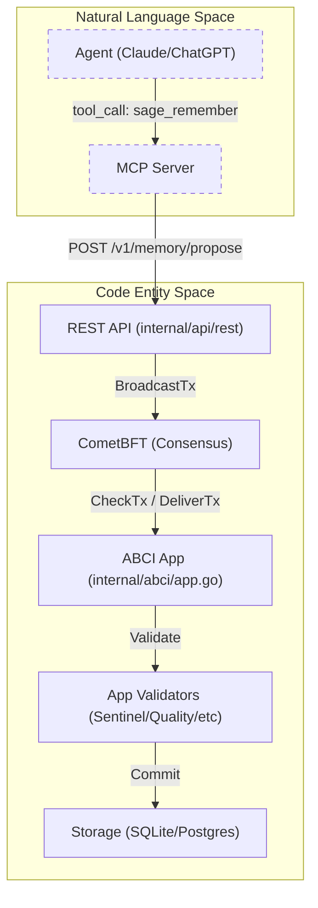
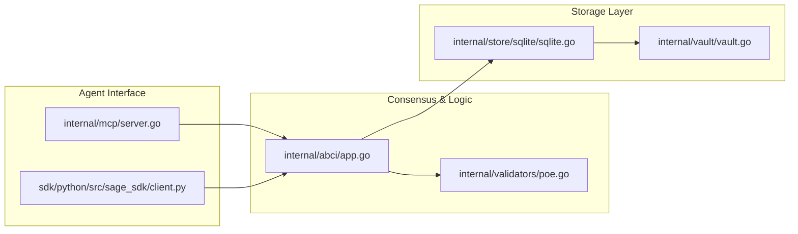

<!-- source: DeepWiki mcp.deepwiki.com · repo l33tdawg/sage · page 1 SAGE Overview · fetched 2026-10-27 -->

# SAGE Overview

Relevant source files

The following files were used as context for generating this wiki page:

- [README.md](README.md)
- [docs/ARCHITECTURE.md](docs/ARCHITECTURE.md)
- [docs/GETTING_STARTED.md](docs/GETTING_STARTED.md)
- [docs/connect.html](docs/connect.html)
- [docs/index.html](docs/index.html)
- [papers/Paper1 - Agent Memory Infrastructure - Byzantine-Resilient Institutional Memory for Multi-Agent Systems.pdf](papers/Paper1 - Agent Memory Infrastructure - Byzantine-Resilient Institutional Memory for Multi-Agent Systems.pdf)
- [papers/Paper2 - Consensus-Validated Memory Improves Agent Performance on Complex Tasks.pdf](papers/Paper2 - Consensus-Validated Memory Improves Agent Performance on Complex Tasks.pdf)
- [papers/Paper3 - Institutional Memory as Organizational Knowledge - AI Agents That Learn Their Jobs from Experience Not Instructions.pdf](papers/Paper3 - Institutional Memory as Organizational Knowledge - AI Agents That Learn Their Jobs from Experience Not Instructions.pdf)
- [papers/README.md](papers/README.md)
- [sdk/python/README.md](sdk/python/README.md)
- [sdk/python/pyproject.toml](sdk/python/pyproject.toml)
- [sdk/python/src/sage_sdk/__init__.py](sdk/python/src/sage_sdk/__init__.py)
- [sdk/python/src/sage_sdk/models.py](sdk/python/src/sage_sdk/models.py)

SAGE (Sovereign Agent Governed Experience) is a Byzantine fault-tolerant institutional memory infrastructure designed for AI agents. Unlike traditional vector databases or flat-file memory "skills," SAGE provides a persistent, consensus-validated knowledge layer that allows agents to learn from experience across conversations and organizational boundaries [README.md:1-7]().

SAGE ensures that AI agents possess a verifiable audit trail of facts, observations, and inferences, preventing the "memory loss" typically associated with stateless LLM context windows [README.md:5-7]().

## Deployment Modes

SAGE supports two primary deployment topologies to accommodate both individual users and large-scale multi-agent organizations:

1.  **Personal Mode (`sage-gui`)**: A single-binary deployment that runs a local CometBFT node with four in-process application validators [README.md:32-34](). It includes a built-in SQLite store, an optional AES-256-GCM encrypted "Synaptic Ledger," and a web-based dashboard [README.md:23-28]().
2.  **Multi-Node Mode (`amid`)**: A distributed network of ABCI application nodes and CometBFT validators, typically deployed via Docker [docs/ARCHITECTURE.md:79-81](). This mode utilizes PostgreSQL with `pgvector` for off-chain storage and scales to support complex RBAC, federation, and high-throughput agent environments [docs/ARCHITECTURE.md:91-100]().

For installation and setup instructions, see **[Getting Started](#1.1)**.

## System Architecture

The SAGE architecture bridges the gap between agent tool calls and a distributed consensus ledger.

### High-Level Data Flow
"Natural Language Space" (Agent) $\rightarrow$ "Code Entity Space" (SAGE)

Sources: [README.md:17-30](), [docs/ARCHITECTURE.md:31-79]()

### Component Interaction
The following diagram illustrates how internal code entities relate to the physical infrastructure.

Sources: [README.md:23-29](), [docs/ARCHITECTURE.md:91-100](), [sdk/python/src/sage_sdk/client.py:1-10]()

## Major Subsystems

*   **CEREBRUM Dashboard**: A Preact-based SPA providing a force-directed neural graph visualization of memories, real-time event monitoring via SSE, and network management tools [README.md:38-44]().
*   **Synaptic Ledger**: A secure storage system using AES-256-GCM encryption and Argon2id key derivation to protect memory content at rest [README.md:27](), [docs/GETTING_STARTED.md:50-60]().
*   **Consensus Engine**: Leverages CometBFT and the ABCI 2.0 protocol to ensure all memory commits reach a 3/4 BFT quorum through four specialized validators: Sentinel, Dedup, Quality, and Consistency [README.md:24-26]().
*   **Agent Identity**: An Ed25519-based PKI system where every agent is uniquely identified by a `RegisteredName` and signs every request to the infrastructure [README.md:69-70](), [sdk/python/src/sage_sdk/auth.py:1-10]().
*   **Inter-Agent Pipeline**: An asynchronous message bus allowing agents to coordinate tasks and share results via `sage_pipe` and `sage_inbox` tools [README.md:99-100]().

For a detailed breakdown of these terms, see **[Key Concepts and Terminology](#1.2)**.

## Research and Performance
SAGE is based on peer-reviewed research demonstrating that consensus-validated memory significantly improves agent performance over time (Spearman rho=0.716) [papers/README.md:22-25](). 

| Metric | Performance |
| :--- | :--- |
| **Throughput** | ~956 req/s memory submissions |
| **Latency** | 21.6ms P95 query latency |
| **Fault Tolerance** | 1/4 nodes can fail without halting |
Sources: [docs/ARCHITECTURE.md:103-108](), [papers/README.md:10-11]()

---

## Child Pages
*   **[Getting Started](#1.1)**: Step-by-step guide for installing `sage-gui` and connecting to Claude/ChatGPT.
*   **[Key Concepts and Terminology](#1.2)**: Deep dive into the domain vocabulary and data structures like `MemoryRecord` and `PoE`.

---

