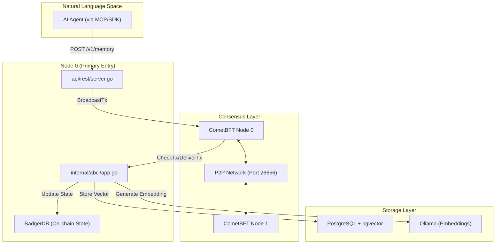
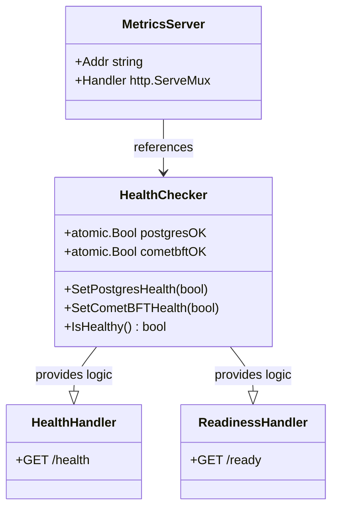

<!-- source: DeepWiki mcp.deepwiki.com · repo l33tdawg/sage · page 10.1 Multi-Node Docker Deployment · fetched 2026-10-27 -->

# Multi-Node Docker Deployment

Relevant source files

The following files were used as context for generating this wiki page:

- [.github/workflows/ci.yml](.github/workflows/ci.yml)
- [.github/workflows/release.yml](.github/workflows/release.yml)
- [api/rest/helpers.go](api/rest/helpers.go)
- [deploy/Dockerfile.abci](deploy/Dockerfile.abci)
- [deploy/docker-compose.yml](deploy/docker-compose.yml)
- [go.mod](go.mod)
- [go.sum](go.sum)
- [internal/metrics/health.go](internal/metrics/health.go)
- [internal/metrics/server.go](internal/metrics/server.go)
- [server.json](server.json)

This page covers the architecture and configuration of the SAGE multi-node deployment stack. Unlike the personal `sage-gui` mode which uses SQLite, the multi-node deployment is designed for institutional environments requiring BFT (Byzantine Fault Tolerant) consensus, high-availability off-chain storage via PostgreSQL, and a distributed monitoring stack.

## Service Topology

The standard SAGE deployment consists of a 4-validator quorum. Each logical "node" in the network is composed of two primary containers: an **ABCI Application** (the Go state machine) and a **CometBFT Node** (the consensus engine). These are supported by shared infrastructure for vector storage and AI embeddings.

### Deployment Component Overview

| Service | Image / Component | Role |
| :--- | :--- | :--- |
| `postgres` | `pgvector/pgvector:pg16` | Off-chain storage for MemoryRecords and KnowledgeTriples [deploy/docker-compose.yml:10-10](). |
| `abci[0-3]` | `deploy/Dockerfile.abci` | The `amid` binary executing the SAGE state machine and REST API [deploy/docker-compose.yml:32-135](). |
| `cometbft[0-3]` | `deploy/Dockerfile.node` | Consensus engine handling P2P networking and block production [deploy/docker-compose.yml:168-236](). |
| `ollama` | `ollama/ollama:0.6.2` | Local embedding provider for `nomic-embed-text` [deploy/docker-compose.yml:140-140](). |
| `ollama-init` | `ollama/ollama:0.6.2` | One-shot container to pull required models into the `ollama_data` volume [deploy/docker-compose.yml:155-161](). |

### Network and Data Flow

The following diagram illustrates the relationship between the Natural Language Space (where agents interact) and the Code Entity Space (where transactions are processed and stored).

**Figure 1: Multi-Node Data Flow Architecture**

Sources: [deploy/docker-compose.yml:32-56](), [deploy/docker-compose.yml:168-185](), [api/rest/server.go:1-50](), [internal/abci/app.go:1-100]()

## Configuration and Environment

The multi-node stack is configured primarily through environment variables passed to the `abci` services.

### Key Environment Variables
Each `abci` container requires the following variables to coordinate with its specific CometBFT peer and the shared database:

*   `POSTGRES_URL`: Connection string for the pgvector instance [deploy/docker-compose.yml:43-43]().
*   `COMET_RPC`: The URL of the local CometBFT node's RPC interface (e.g., `http://cometbft0:26657`) [deploy/docker-compose.yml:49-49]().
*   `ABCI_ADDR`: The address where the ABCI app listens for CometBFT connections [deploy/docker-compose.yml:48-48]().
*   `BADGER_PATH`: Filesystem path for the on-chain key-value store [deploy/docker-compose.yml:47-47]().
*   `VALIDATOR_KEY_FILE`: Path to the `priv_validator_key.json` used for signing application-level votes [deploy/docker-compose.yml:50-50]().

### Security Posture
In the `docker-compose.yml` configuration, the CometBFT RPC port (`26657`) is **not** exposed to the host [deploy/docker-compose.yml:177-177](). This ensures that all transactions must pass through the SAGE REST API's authentication and validation logic before reaching the consensus layer, preventing unauthorized direct transaction submission.

## Initialization and Genesis

The deployment relies on a pre-configured genesis state located in the `deploy/genesis/` directory.

### init-testnet.sh
The `init-testnet.sh` script (referenced in infrastructure documentation) is responsible for:
1.  Generating the 4 validator Ed25519 keypairs.
2.  Creating the `genesis.json` file containing the initial validator set.
3.  Distributing the `priv_validator_key.json` and `node_key.json` files into the respective `node0` through `node3` directories [deploy/docker-compose.yml:54-54]().

### Database Schema
The PostgreSQL instance is initialized using `deploy/init.sql`, which sets up the `pgvector` extension and the necessary tables for `MemoryRecords`, `KnowledgeTriples`, and `Entities` [deploy/docker-compose.yml:19-19]().

## Monitoring Stack

SAGE includes a comprehensive monitoring stack accessible via `docker-compose.monitoring.yml` [deploy/docker-compose.yml:3-3]().

### Metrics Collection
The `amid` binary includes an internal metrics server that exports Prometheus-formatted data.

*   **Endpoint**: `:2112/metrics` [deploy/docker-compose.yml:46-46]().
*   **Implementation**: Utilizes `prometheus/client_golang` [go.mod:14-14]().
*   **Health Checks**: Provides `/health` and `/ready` endpoints to monitor the status of PostgreSQL and CometBFT connections [internal/metrics/health.go:37-74]().

**Figure 2: Monitoring and Health Entity Map**

Sources: [internal/metrics/health.go:9-14](), [internal/metrics/server.go:11-25]()

## Build Pipeline

The multi-node images are built using a multi-stage `Dockerfile.abci` to ensure a minimal runtime footprint.

1.  **Builder Stage**: Uses `golang:1.24-alpine`, downloads dependencies via `go mod download`, and compiles the `amid` binary with `CGO_ENABLED=0` [deploy/Dockerfile.abci:5-17]().
2.  **Final Stage**: Uses `alpine:3.20`, copies the `amid` binary, and exposes ports `8080` (REST), `2112` (Metrics), and `26658` (ABCI) [deploy/Dockerfile.abci:20-27]().

The CI pipeline automates these builds upon every push to the `main` branch, ensuring the `deploy/docker-compose.yml` always points to compatible images [/.github/workflows/ci.yml:54-65]().

Sources:
- [deploy/docker-compose.yml:1-250]()
- [deploy/Dockerfile.abci:1-30]()
- [internal/metrics/health.go:1-75]()
- [internal/metrics/server.go:1-26]()
- [/.github/workflows/ci.yml:54-65]()
- [go.mod:1-20]()

---

