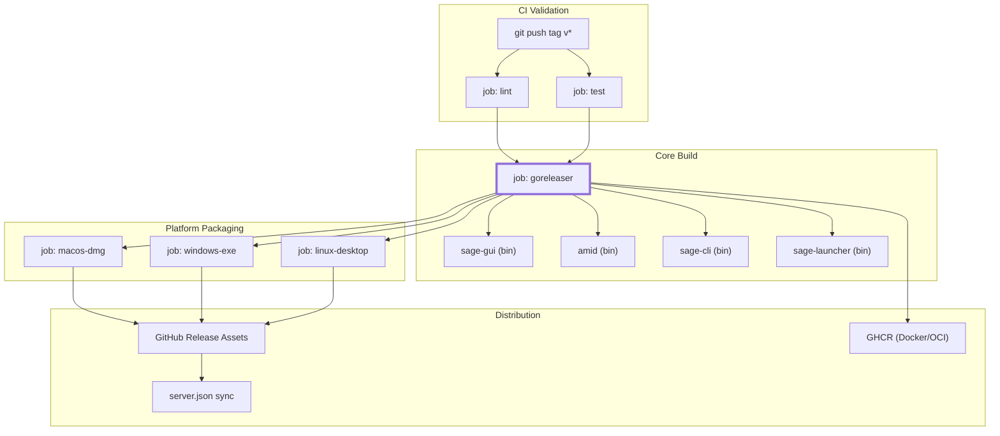
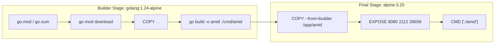

<!-- source: DeepWiki mcp.deepwiki.com · repo l33tdawg/sage · page 10.2 Platform Installers and Release Pipeline · fetched 2026-10-27 -->

# Platform Installers and Release Pipeline

Relevant source files

The following files were used as context for generating this wiki page:

- [.github/workflows/ci.yml](.github/workflows/ci.yml)
- [.github/workflows/release.yml](.github/workflows/release.yml)
- [.goreleaser.yaml](.goreleaser.yaml)
- [cmd/sage-launcher/main.go](cmd/sage-launcher/main.go)
- [cmd/sage-launcher/proc_other.go](cmd/sage-launcher/proc_other.go)
- [cmd/sage-launcher/proc_windows.go](cmd/sage-launcher/proc_windows.go)
- [deploy/Dockerfile.abci](deploy/Dockerfile.abci)
- [go.mod](go.mod)
- [go.sum](go.sum)
- [installer/linux/build-linux.sh](installer/linux/build-linux.sh)
- [installer/linux/install.sh](installer/linux/install.sh)
- [installer/linux/sage.desktop](installer/linux/sage.desktop)
- [installer/macos/build-dmg.sh](installer/macos/build-dmg.sh)
- [installer/windows/build-exe.sh](installer/windows/build-exe.sh)
- [installer/windows/sage-installer.nsi](installer/windows/sage-installer.nsi)
- [server.json](server.json)

The SAGE release pipeline is an automated multi-stage process that transforms the Go source code into production-ready artifacts for macOS, Windows, and Linux. It utilizes `goreleaser` for core binary distribution and platform-specific scripting for native installers (DMG, NSIS, Tarball). The pipeline also handles OCI image publishing and synchronization of the Model Context Protocol (MCP) `server.json` metadata.

## Release Pipeline Architecture

The release process is triggered by Git tags (e.g., `v4.5.7`) and managed via GitHub Actions. It follows a sequential dependency chain where core binaries are built first, followed by platform-specific packaging.

### Pipeline Flow Diagram

"Pipeline Workflow"

Sources: [.github/workflows/release.yml:1-111](), [.goreleaser.yaml:1-80]()

## Core Binaries and GoReleaser

The project uses `.goreleaser.yaml` to define the compilation matrix for four primary commands:
1.  **`sage-gui`**: The main personal node entry point [[.goreleaser.yaml:10-26]]().
2.  **`amid`**: The multi-node consensus engine [[.goreleaser.yaml:28-43]]().
3.  **`sage-cli`**: Command-line interface for remote interaction [[.goreleaser.yaml:45-61]]().
4.  **`sage-launcher`**: A lightweight wrapper used by installers to manage background processes and browser spawning [[.goreleaser.yaml:63-80]]().

The build process enforces `CGO_ENABLED=0` for maximum portability across Linux distributions [[.goreleaser.yaml:14]]().

Sources: [.goreleaser.yaml:1-117](), [.github/workflows/release.yml:47-67]()

## macOS DMG Pipeline

The macOS release produces signed and notarized disk images for both `arm64` (Apple Silicon) and `x86_64` (Intel).

### Implementation Details
*   **App Bundle**: The `build-dmg.sh` script constructs a standard `.app` structure [[installer/macos/build-dmg.sh:51-54]]().
*   **Native Tray**: It attempts to compile `sage-tray` using `swiftc` to provide a native macOS experience [[installer/macos/build-dmg.sh:60-70]]().
*   **Code Signing**: Uses `codesign` with the `--options runtime` flag to enable the Hardened Runtime required for notarization [[installer/macos/build-dmg.sh:117-137]]().
*   **Notarization**: The DMG is submitted to Apple's notary service via `xcrun notarytool`. Upon success, the ticket is "stapled" to the DMG using `xcrun stapler` [[installer/macos/build-dmg.sh:179-191]]().

Sources: [installer/macos/build-dmg.sh:1-198](), [.github/workflows/release.yml:112-177]()

## Windows NSIS Installer

Windows distribution relies on the Nullsoft Scriptable Install System (NSIS) to create a professional setup experience.

### Key Components
*   **GUI Mode**: The `sage-launcher` is compiled with `-H=windowsgui` to prevent a command prompt from appearing when the user launches the application [[installer/windows/build-exe.sh:40-44]]().
*   **Environment Variables**: The installer uses the `EnVar` plugin to append the installation directory to the system `PATH`, allowing `sage-cli` to be used globally [[installer/windows/sage-installer.nsi:84-85]]().
*   **Registry Integration**: Standard Windows uninstall keys are written to `HKLM\Software\Microsoft\Windows\CurrentVersion\Uninstall\SAGE` for Add/Remove Programs support [[installer/windows/sage-installer.nsi:90-98]]().

Sources: [installer/windows/sage-installer.nsi:1-130](), [installer/windows/build-exe.sh:1-60](), [cmd/sage-launcher/main.go:1-26]()

## Linux Desktop Integration

Linux releases are packaged as `.tar.gz` archives containing a `sage-launcher` binary and a `.desktop` entry.

### Desktop Entry Specification
The `build-linux.sh` script bundles an `install.sh` script that places the `sage.desktop` file into `~/.local/share/applications/`. This allows SAGE to appear in system application menus (GNOME, KDE, etc.) [[installer/linux/build-linux.sh:43-48]]().

Sources: [installer/linux/build-linux.sh:1-74]()

## Docker and OCI Distribution

For multi-node deployments and MCP stdio usage, SAGE publishes OCI-compliant images to the GitHub Container Registry (GHCR).

### Docker Image Composition
"Container Build Logic"

Sources: [deploy/Dockerfile.abci:1-30]()

### server.json Synchronization
The `server.json` file acts as the manifest for the Model Context Protocol. It explicitly links the current version to the OCI image identifier [[server.json:9-13]](). During the release process, this version string is updated to match the Git tag, ensuring that MCP clients (like Claude Desktop) pull the correct container version.

Sources: [server.json:1-19]()

## The Sage Launcher

The `sage-launcher` is a critical utility shared across all platform installers. It handles the transition from a "Double-Click" event to a running backend service.

### Functional Logic
1.  **Process Detection**: Checks `http://localhost:8080/health` to see if SAGE is already active [[cmd/sage-launcher/main.go:89-124]]().
2.  **Daemonization**: If not running, it starts `sage-gui serve` as a detached process [[cmd/sage-launcher/main.go:56-67]]().
3.  **PID Management**: Writes the process ID to `~/.sage/sage.pid` for future tracking [[cmd/sage-launcher/main.go:69-73]]().
4.  **Browser Launch**: Polls the health endpoint until ready, then opens the default system browser to the CEREBRUM dashboard [[cmd/sage-launcher/main.go:78-83]]().

Sources: [cmd/sage-launcher/main.go:27-84](), [cmd/sage-launcher/main.go:163-175]()

---

