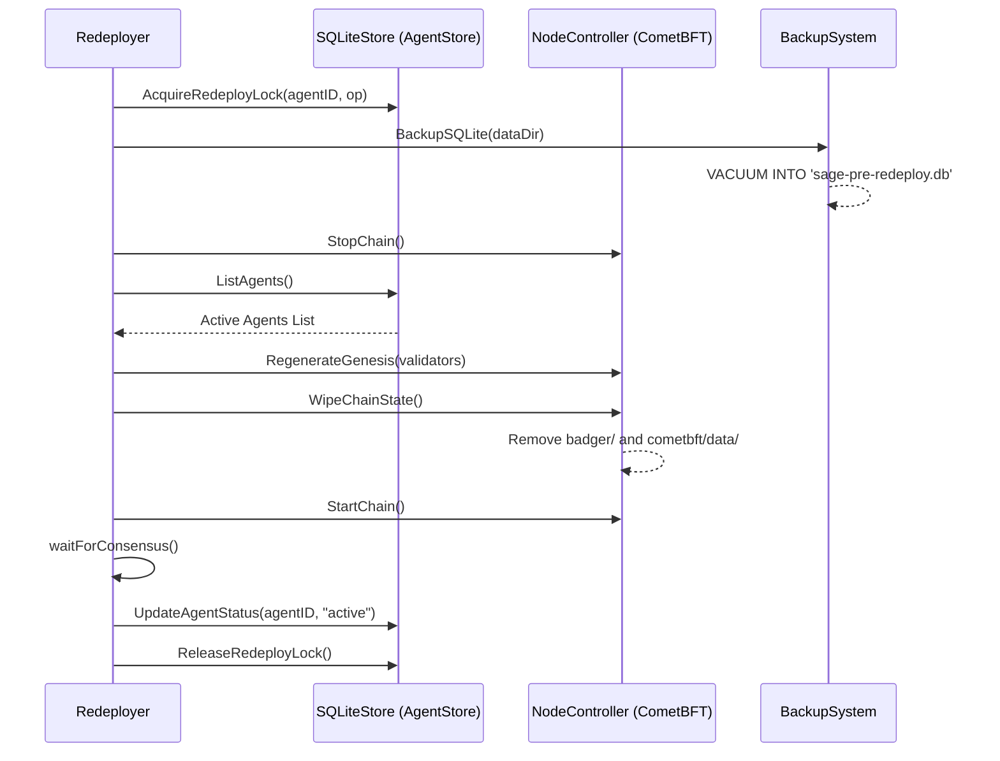
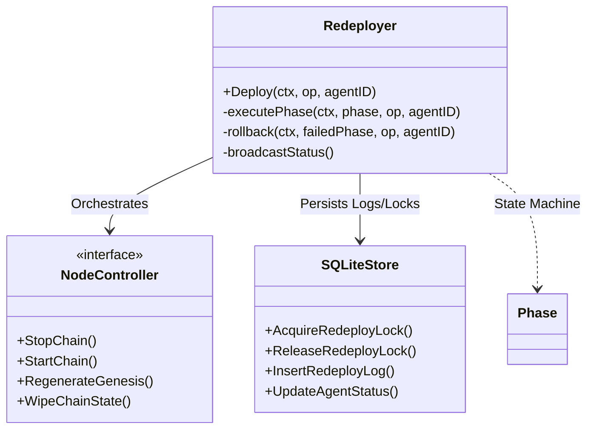

<!-- source: DeepWiki mcp.deepwiki.com · repo l33tdawg/sage · page 10.3 Redeployment Orchestrator · fetched 2026-10-27 -->

# Redeployment Orchestrator

<details>
<summary>Relevant source files</summary>

The following files were used as context for generating this wiki page:

- [.golangci.yml](.golangci.yml)
- [cmd/sage-gui/migrate.go](cmd/sage-gui/migrate.go)
- [internal/orchestrator/backup.go](internal/orchestrator/backup.go)
- [internal/orchestrator/redeployer.go](internal/orchestrator/redeployer.go)
- [internal/orchestrator/redeployer_test.go](internal/orchestrator/redeployer_test.go)
- [internal/store/sqlite_test.go](internal/store/sqlite_test.go)
- [web/pairing.go](web/pairing.go)
- [web/pairing_test.go](web/pairing_test.go)
- [web/redeploy_middleware.go](web/redeploy_middleware.go)

</details>


The **Redeployment Orchestrator** is a critical subsystem responsible for managing the lifecycle of the CometBFT blockchain state during sensitive operations such as adding or removing agents, or rotating agent keys. Because SAGE uses a 4-node consensus model where the validator set is defined in the `genesis.json`, any change to the network composition requires a coordinated "redeployment" to reset the chain state while preserving the underlying memory data in SQLite.

## Overview and Purpose

The orchestrator implements a 9-phase state machine to ensure that transitions are atomic and recoverable. Its primary goal is to maintain data integrity: while the blockchain (CometBFT) and on-chain state (BadgerDB) are wiped and rebuilt, the "precious" data (memories and the Synaptic Ledger vault key) is backed up and protected [cmd/sage-gui/migrate.go:46-60](), [internal/orchestrator/backup.go:14-24]().

### Key Responsibilities
*   **Atomic State Transitions**: Moving the system through a sequence of phases from locking to completion [internal/orchestrator/redeployer.go:17-27]().
*   **Data Protection**: Performing atomic backups of the SQLite database using `VACUUM INTO` before any destructive chain operations [internal/orchestrator/backup.go:34-40]().
*   **Chain Management**: Interfacing with the `NodeController` to stop the CometBFT node, regenerate genesis files with new validator sets, and restart the node [internal/orchestrator/redeployer.go:68-74]().
*   **Rollback**: Reverting to the previous known-good state (including database restoration) if any phase fails [internal/orchestrator/redeployer.go:230-242]().

Sources: [internal/orchestrator/redeployer.go:1-110](), [internal/orchestrator/backup.go:1-52](), [cmd/sage-gui/migrate.go:17-149]()

## The 9-Phase State Machine

The `Redeployer` struct executes the `Deploy` method, which iterates through the following phases defined in `internal/orchestrator/redeployer.go`.

| Phase | Code Identifier | Action |
| :--- | :--- | :--- |
| 1. **Lock Acquired** | `PhaseLockAcquired` | Acquires a global redeployment lock in SQLite to prevent concurrent operations [internal/orchestrator/redeployer.go:175-176](). |
| 2. **Backup Created** | `PhaseBackupCreated` | Creates a timestamped backup of `sage.db` and the current `genesis.json` [internal/orchestrator/redeployer.go:178-179](). |
| 3. **Chain Stopped** | `PhaseChainStopped` | Signals the CometBFT node to shut down gracefully [internal/orchestrator/redeployer.go:181-182](). |
| 4. **Genesis Generated** | `PhaseGenesisGenerated` | Calculates the new validator set based on active agents and generates a new `genesis.json` [internal/orchestrator/redeployer.go:184-203](). |
| 5. **Chain State Wiped** | `PhaseChainStateWiped` | Deletes CometBFT block/state DBs and the BadgerDB on-chain state [internal/orchestrator/redeployer.go:205-206](). |
| 6. **Chain Restarted** | `PhaseChainRestarted` | Launches the CometBFT node with the new genesis file [internal/orchestrator/redeployer.go:208-209](). |
| 7. **Consensus Verified** | `PhaseConsensusVerified` | Polls the node until it successfully produces new blocks [internal/orchestrator/redeployer.go:211-213](). |
| 8. **RBAC Configured** | `PhaseRBACConfigured` | Updates the agent status in the registry (e.g., from `pending` to `active`) [internal/orchestrator/redeployer.go:215-220](). |
| 9. **Completed** | `PhaseCompleted` | Releases the global lock and marks the operation as finished [internal/orchestrator/redeployer.go:222-223](). |

### Data Flow and Orchestration Logic

The following diagram illustrates how the `Redeployer` interacts with the `NodeController` and `AgentStore` to manage the transition.

**Redeployment Sequence Diagram**

Sources: [internal/orchestrator/redeployer.go:111-171](), [internal/orchestrator/redeployer.go:173-228](), [internal/orchestrator/backup.go:14-41]()

## Failure Handling and Rollback

If any phase fails, the `Redeployer` invokes the `rollback` function [internal/orchestrator/redeployer.go:154-157](). The rollback strategy depends on how far the deployment progressed:

1.  **Post-Wipe Failure**: If the chain was already wiped (Phase 5+), the orchestrator attempts to restore the SQLite backup to ensure the local memory state matches the pre-wipe state [internal/orchestrator/backup.go:55-88]().
2.  **Service Restoration**: The orchestrator always attempts to restart the chain (`StartChain`) and release the redeployment lock, even if the deployment failed, to keep the system available for read operations [internal/orchestrator/redeployer.go:233-242]().

### API Protection during Redeployment

To prevent data corruption or inconsistent states, the `redeployGuard` middleware intercepts incoming REST API requests [web/redeploy_middleware.go:17-31]().

*   **Write Methods (POST, PUT, DELETE)**: These are blocked with a `503 Service Unavailable` status and a `Retry-After` header [web/redeploy_middleware.go:39-46]().
*   **Read Methods (GET)**: These are allowed to proceed because the SQLite database remains readable throughout the process [web/redeploy_middleware.go:28-31]().
*   **Exemptions**: Paths like `/v1/dashboard/network/redeploy/status` remain open so the UI can track progress [web/redeploy_middleware.go:62-76]().

Sources: [internal/orchestrator/redeployer.go:230-242](), [web/redeploy_middleware.go:1-77]()

## Implementation Details

### NodeController Interface
The orchestrator does not call OS commands directly. Instead, it uses the `NodeController` interface, allowing for different implementations (e.g., a real node in `sage-gui` or a mock in tests) [internal/orchestrator/redeployer.go:68-74]().

```go
type NodeController interface {
	StopChain() error
	StartChain() error
	RegenerateGenesis(validators []ValidatorInfo) error
	WipeChainState() error
	GetDataDir() string
}
```

### Validator Selection
During `PhaseGenesisGenerated`, the orchestrator filters the agent list. Only agents with roles other than `observer` are included in the `ValidatorInfo` slice, and their voting power is currently hardcoded to `10` to maintain a uniform 4-node quorum requirement [internal/orchestrator/redeployer.go:190-202]().

**Entity Mapping: Orchestrator to Code**

Sources: [internal/orchestrator/redeployer.go:68-103](), [internal/orchestrator/redeployer.go:173-228]()

## Upgrade Migration Logic

While the `Redeployer` handles manual network changes, the `migrateOnUpgrade` function in `cmd/sage-gui/migrate.go` performs a similar automated orchestration when the binary version changes [cmd/sage-gui/migrate.go:17-21]().

1.  **Version Check**: Compares `version.txt` with the current binary version [cmd/sage-gui/migrate.go:28-36]().
2.  **Vault Protection**: Backs up `vault.key` immediately [cmd/sage-gui/migrate.go:46-60]().
3.  **Atomic SQLite Backup**: Uses `vacuumBackup` to create a snapshot [cmd/sage-gui/migrate.go:85-98]().
4.  **State Reset**: Wipes BadgerDB and CometBFT data directories but preserves `priv_validator_state.json` to reset the height to 0 [cmd/sage-gui/migrate.go:101-131]().
5.  **Quality Cleanup**: Invokes `cleanupNoisyMemories` to remove duplicate boot safeguards or low-quality observations accumulated in previous versions [cmd/sage-gui/migrate.go:133-140]().

Sources: [cmd/sage-gui/migrate.go:17-149](), [cmd/sage-gui/migrate.go:154-174]()

---

