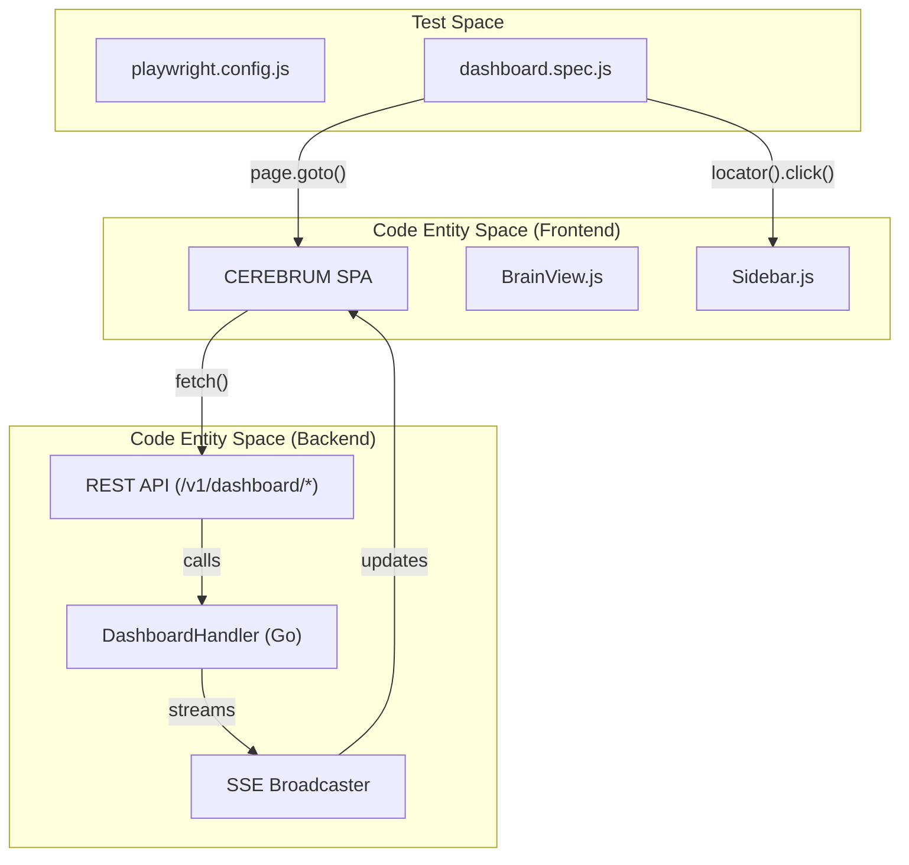
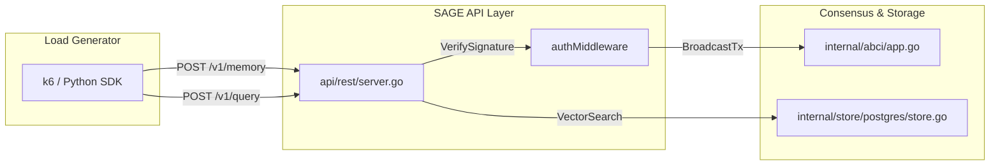

<!-- source: DeepWiki mcp.deepwiki.com · repo l33tdawg/sage · page 12.2 E2E and Load Tests · fetched 2026-10-27 -->

# E2E and Load Tests

Relevant source files

The following files were used as context for generating this wiki page:

- [e2e/agent-identity.spec.js](e2e/agent-identity.spec.js)
- [e2e/bulk-operations.spec.js](e2e/bulk-operations.spec.js)
- [e2e/dashboard.spec.js](e2e/dashboard.spec.js)
- [e2e/network.spec.js](e2e/network.spec.js)
- [package.json](package.json)
- [playwright.config.js](playwright.config.js)

This page documents the end-to-end (E2E) and load testing infrastructure for SAGE. The suite ensures the reliability of the CEREBRUM dashboard, the integrity of the agent identity system, and the performance of the consensus-backed memory store under high-throughput conditions.

## Playwright E2E Suite

The E2E suite uses Playwright to validate the integration between the Preact frontend, the Go dashboard backend, and the underlying CometBFT/ABCI state machine. The tests are located in the `/e2e` directory and are configured via `playwright.config.js`.

### Test Configuration
The configuration specifies a 30-second timeout per test and targets a headless Chromium instance by default [playwright.config.js:3-15](). It assumes the SAGE GUI or `amid` node is reachable at `http://localhost:8080` [playwright.config.js:8-8]().

### Dashboard and Navigation
The `dashboard.spec.js` suite verifies the core UI components and navigation state machine.
*   **Brain View:** Validates that the force-directed graph (BrainView) loads by default [e2e/dashboard.spec.js:6-16]().
*   **Navigation:** Tests the sidebar routing to Search, Import, Network, and Settings pages [e2e/dashboard.spec.js:18-44]().
*   **Real-time Updates:** Confirms that the SSE (Server-Sent Events) connection badge transitions to "Live" or "Connecting" [e2e/dashboard.spec.js:56-61]().
*   **CEREBRUM Guide:** Validates the interactive help overlay and its multi-tab documentation system [e2e/dashboard.spec.js:64-115]().

### Network and Agent Management
The `network.spec.js` suite focuses on the management of agents within the ecosystem.
*   **Agent Listing:** Ensures at least one agent (typically the boot agent) is visible in the UI [e2e/network.spec.js:11-16]().
*   **Agent Details:** Tests the expansion of agent cards and the availability of Overview, Access Control, and Activity tabs [e2e/network.spec.js:30-43]().
*   **RBAC UI:** Validates the role selection cards (Admin, Member, Observer) and the domain access matrix [e2e/network.spec.js:92-117]().

### Bulk Operations and Focus Mode
The `bulk-operations.spec.js` suite tests the high-level dashboard features for managing large volumes of memories.
*   **Focus Mode:** Simulates double-clicking "domain clouds" on the canvas to enter Focus Mode [e2e/bulk-operations.spec.js:10-28]().
*   **Multi-select:** Validates the "Select All" and "Deselect" logic for bulk actions [e2e/bulk-operations.spec.js:140-167]().
*   **Bulk API:** Directly tests the `/v1/dashboard/memory/bulk` endpoint for input validation (e.g., rejecting >500 IDs) and successful tag/domain updates [e2e/bulk-operations.spec.js:32-113]().

### Agent Identity and On-chain Registration
The `agent-identity.spec.js` suite ensures that agent registrations correctly propagate to the Synaptic Ledger.
*   **Redeployment Safety:** Tests include a `beforeEach` hook that polls `/v1/dashboard/network/redeploy/status` to ensure no active redeployment is blocking the API [e2e/agent-identity.spec.js:6-13]().
*   **Registration Wizard:** Walks through the UI "Add Agent" wizard, filling details and selecting roles to verify on-chain commitment [e2e/agent-identity.spec.js:149-181]().
*   **Identity API:** Validates that the `/v1/agents` and `/v1/dashboard/network/agents` endpoints correctly reflect the registered state [e2e/agent-identity.spec.js:19-27]().

**Dashboard E2E Data Flow**
The following diagram illustrates how E2E tests interact with the system layers.

Sources: [e2e/dashboard.spec.js:3-44](), [playwright.config.js:1-15](), [e2e/bulk-operations.spec.js:32-40]()

---

## Load Testing and Benchmarking

Load testing for SAGE focuses on two primary metrics: **Submission Throughput** (writing memories to the consensus engine) and **Query Latency** (vector similarity search performance).

### Memory Submission Benchmarks
Load tests simulate multiple agents concurrently submitting `MemoryRecord` objects.
*   **Implementation:** Typically performed using `k6` or Python-based locust scripts targeting the `/v1/memory` endpoint.
*   **Data Flow:**
    1.  Agent signs request using Ed25519 key.
    2.  REST API validates signature and parses `ParsedTx`.
    3.  `DashboardHandler` broadcasts transaction to CometBFT.
    4.  ABCI application processes transaction through the 4-validator quorum.

### Query Throughput
Benchmarks focus on the efficiency of the `OffchainStore` (SQLite or PostgreSQL+pgvector).
*   **Metrics:** Measures requests per second (RPS) for `sage_recall` operations.
*   **Complexity:** Tests vary the `K` value (number of neighbors) and the dimension of the embeddings (e.g., 768 for Ollama nomic-embed-text).

**Load Test Component Mapping**
This diagram maps the load testing entities to the codebase components responsible for handling high volume.

Sources: [e2e/bulk-operations.spec.js:32-83](), [e2e/agent-identity.spec.js:19-43]()

---

## Summary of Test Suites

| Test File | Target Component | Key Functions Validated |
| :--- | :--- | :--- |
| `dashboard.spec.js` | Dashboard Frontend | Sidebar navigation, SSE connection, Guide UI [e2e/dashboard.spec.js:5-115]() |
| `network.spec.js` | Agent Management | RBAC selection, Agent editing, Activity tracking [e2e/network.spec.js:5-166]() |
| `bulk-operations.spec.js` | Memory Management | Bulk tagging, Domain reassignment, Focus Mode [e2e/bulk-operations.spec.js:32-167]() |
| `agent-identity.spec.js` | Identity/ABCI | On-chain registration, Redeployment locks [e2e/agent-identity.spec.js:19-118]() |

Sources: [e2e/dashboard.spec.js:1-115](), [e2e/network.spec.js:1-166](), [e2e/bulk-operations.spec.js:1-167](), [e2e/agent-identity.spec.js:1-181]()

---

