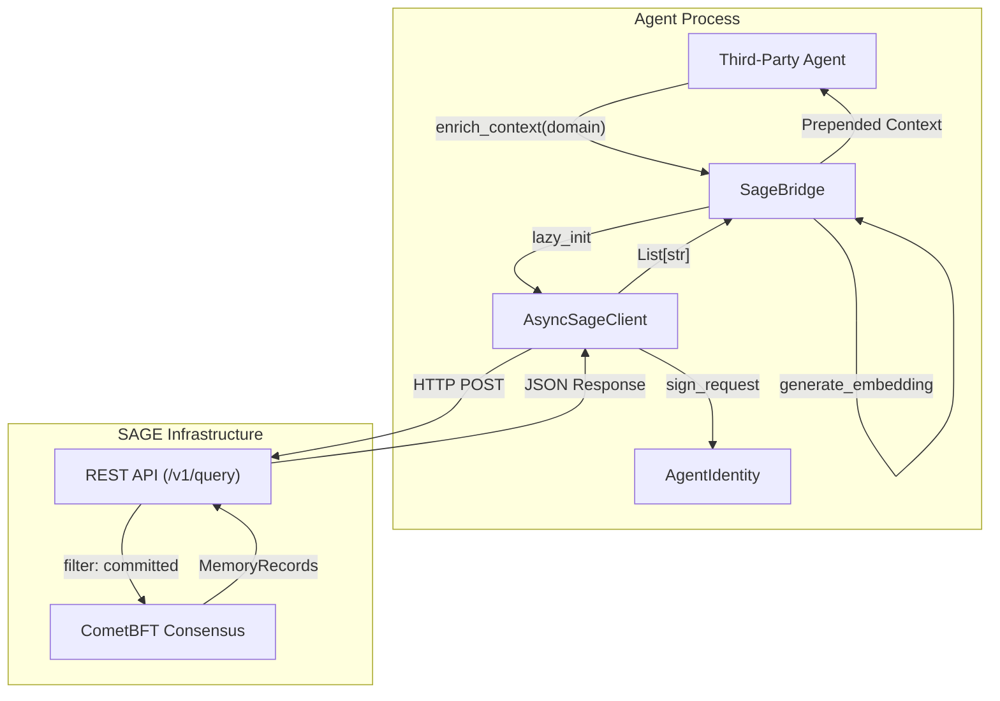
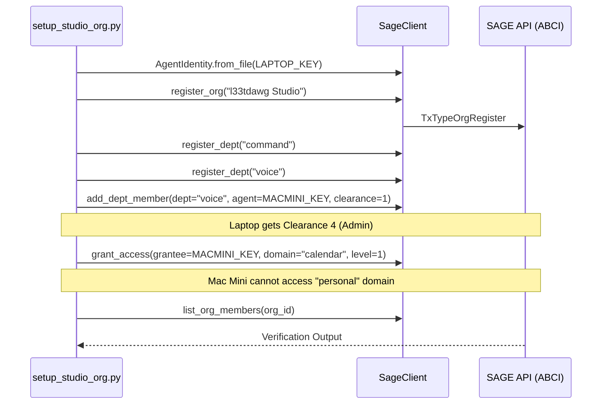

<!-- source: DeepWiki mcp.deepwiki.com · repo l33tdawg/sage · page 13 Integrations and Extensions · fetched 2026-10-27 -->

# Integrations and Extensions

Relevant source files

The following files were used as context for generating this wiki page:

- [.gitignore](.gitignore)
- [Dockerfile](Dockerfile)
- [docs/og-image.png](docs/og-image.png)
- [integrations/levelup/sage_bridge.py](integrations/levelup/sage_bridge.py)
- [sage-memory/SKILL.md](sage-memory/SKILL.md)
- [scripts/setup_studio_org.py](scripts/setup_studio_org.py)
- [sdk/python/examples/sage_bridge_example.py](sdk/python/examples/sage_bridge_example.py)

SAGE is designed to be integrated into diverse agentic workflows, ranging from local development environments to multi-agent capture-the-flag (CTF) simulations. This page details the middleware patterns, skill definitions, and provisioning scripts that facilitate these integrations.

## SageBridge: Python Middleware Pattern

The `SageBridge` is a production-ready integration pattern used to connect multi-agent applications to SAGE with minimal code changes. It provides a thin, asynchronous wrapper around the `sage_sdk.AsyncSageClient` and implements "graceful degradation," allowing the host application to continue functioning even if the SAGE server is unreachable or disabled.

### Implementation and Data Flow

The bridge pattern uses a lazy-initialization strategy and environment-variable-based configuration. It is prominently used in the Level Up CTF integration to provide agents with "institutional knowledge" during security challenges.

| Feature | Description | Source |
|:---|:---|:---|
| **Lazy Init** | `AsyncSageClient` is only instantiated on the first call to `_get_client()`. | [integrations/levelup/sage_bridge.py:56-81]() |
| **Graceful Degradation** | If `SAGE_ENABLED` is `false`, all methods return empty lists or `None` without raising errors. | [sdk/python/examples/sage_bridge_example.py:103-118]() |
| **Context Enrichment** | Prepends SAGE memories to existing agent prompts via `enrich_context`. | [sdk/python/examples/sage_bridge_example.py:194-227]() |
| **Knowledge Triples** | Converts Python dictionaries into `KnowledgeTriple` models for structured memory. | [integrations/levelup/sage_bridge.py:144-155]() |

### SageBridge Component Interaction

This diagram illustrates how `SageBridge` mediates between a Third-Party Agent and the SAGE REST API.

**Sources:** [integrations/levelup/sage_bridge.py:25-50](), [sdk/python/examples/sage_bridge_example.py:120-135]()

## Agent Skills: SKILL.md

For agents supporting the Model Context Protocol (MCP) or specific "skill" definitions (like Claude Code or Cursor), SAGE provides a `SKILL.md` file. This serves as the "brain" definition, instructing the agent on how to interact with the SAGE MCP server.

### Key Instructions for Agents
*   **Boot Sequence**: Agents are instructed to call `sage_inception` or `sage_red_pill` at the start of every session to retrieve operating instructions and safeguards [sage-memory/SKILL.md:49-55]().
*   **Atomic Cycles**: The `sage_turn` tool is defined as the primary per-turn tool, combining memory recall and episodic storage into a single action [sage-memory/SKILL.md:59-66]().
*   **Domain Organic Growth**: Instructions mandate that agents create domains (e.g., `go-debugging`, `user-preferences`) organically rather than using a single flat domain [sage-memory/SKILL.md:67-78]().
*   **Post-Task Reflection**: Agents use `sage_reflect` to store "dos and don'ts" after completing significant tasks, creating a reinforcement learning loop [sage-memory/SKILL.md:104-113]().

**Sources:** [sage-memory/SKILL.md:1-113]()

## Containerized Deployment (Dockerfile)

The SAGE server is available as a containerized image, supporting both standard REST API mode and MCP stdio mode.

### Docker Configuration
*   **Multi-Stage Build**: Uses `golang:1.24-alpine` for building the `sage-gui` binary and `alpine:3.20` for the final runtime image [Dockerfile:4-17]().
*   **Entrypoints**:
    *   **Server Mode**: `docker run -p 8080:8080 ghcr.io/l33tdawg/sage` (runs `sage-gui serve`) [Dockerfile:2-28]().
    *   **MCP Mode**: `docker run -i ghcr.io/l33tdawg/sage mcp` (runs MCP server over stdio) [Dockerfile:3-27]().
*   **Persistence**: Expects a volume mount at `/root/.sage` to persist the SQLite database and agent keys [Dockerfile:2]().

**Sources:** [Dockerfile:1-29]()

## Organization Provisioning (setup_studio_org.py)

The `scripts/setup_studio_org.py` helper demonstrates how to programmatically provision a complex multi-agent hierarchy using the SAGE Python SDK. This script establishes a "Studio" organization with differentiated access for a laptop (admin) and a voice agent (Mac Mini).

### Provisioning Workflow

### Implementation Details
*   **Deterministic ID Generation**: If an organization or department already exists, the script deterministically re-calculates the `org_id` or `dept_id` using SHA-256 hashes of the name and owner public key [scripts/setup_studio_org.py:47-54](), [scripts/setup_studio_org.py:70-74]().
*   **RBAC Enforcement**: The script configures the `ClearanceLevel` (e.g., Level 4 for admin, Level 1 for member) and specific domain grants [scripts/setup_studio_org.py:98-126]().
*   **Domain Isolation**: It registers specific domains like `personal` and `reflection` but intentionally excludes the voice agent from these grants to ensure privacy [scripts/setup_studio_org.py:154-156]().

**Sources:** [scripts/setup_studio_org.py:27-178]()

---

