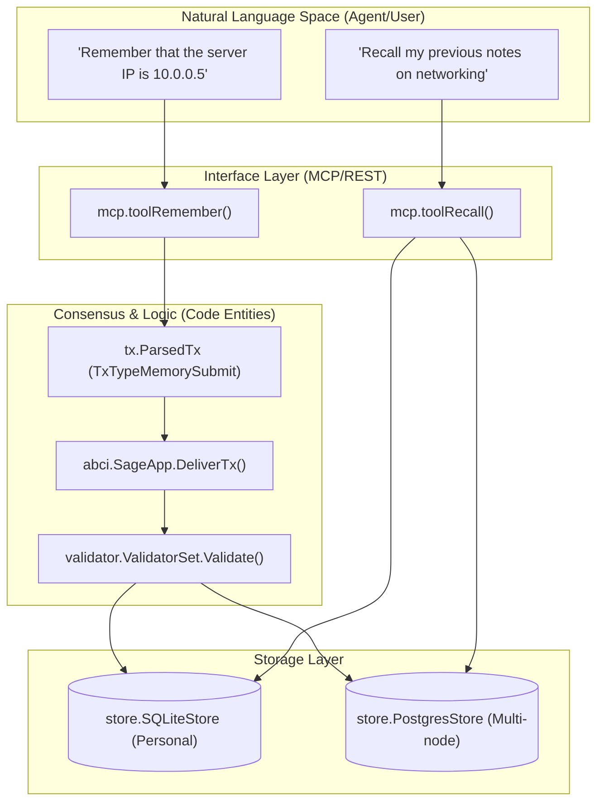
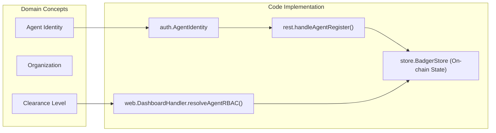

<!-- source: DeepWiki mcp.deepwiki.com · repo l33tdawg/sage · page 14 Glossary · fetched 2026-10-27 -->

# Glossary

Relevant source files

The following files were used as context for generating this wiki page:

- [README.md](README.md)
- [api/rest/agent_handler.go](api/rest/agent_handler.go)
- [internal/abci/app.go](internal/abci/app.go)
- [internal/abci/app_test.go](internal/abci/app_test.go)
- [internal/abci/migrate.go](internal/abci/migrate.go)
- [internal/appvalidator/validator.go](internal/appvalidator/validator.go)
- [internal/mcp/server.go](internal/mcp/server.go)
- [internal/mcp/tools.go](internal/mcp/tools.go)
- [internal/memory/model.go](internal/memory/model.go)
- [internal/store/badger.go](internal/store/badger.go)
- [internal/store/postgres.go](internal/store/postgres.go)
- [internal/store/sqlite.go](internal/store/sqlite.go)
- [internal/store/store.go](internal/store/store.go)
- [sdk/python/pyproject.toml](sdk/python/pyproject.toml)
- [sdk/python/src/sage_sdk/__init__.py](sdk/python/src/sage_sdk/__init__.py)
- [web/handler.go](web/handler.go)
- [web/static/js/app.js](web/static/js/app.js)

This glossary provides comprehensive definitions of the technical terms, architectural components, and domain-specific concepts used throughout the SAGE codebase. It serves as a primary reference for engineers to map high-level system behavior to specific code entities.

---

## Core Domain Concepts

### MemoryRecord
The fundamental unit of data in SAGE. Unlike a simple chat history, a `MemoryRecord` is a structured object containing content, vector embeddings, and metadata used for consensus and decay.
*   **Implementation:** Defined as a struct in `internal/memory/model.go`.
*   **Key Fields:** `MemoryID`, `ContentHash`, `MemoryType`, `ConfidenceScore`, and `Status`.
*   **Data Flow:** Created during `sage_remember` or `sage_turn` calls, validated by the ABCI app, and persisted in the `OffchainStore`.

### Domain
A namespace used to categorize memories. Domains allow agents to filter relevant context and enable the system to calculate **Domain Expertise** for validators.
*   **Behavior:** First-time writes to a new domain trigger auto-registration [web/handler.go:110-112]().
*   **Code Pointer:** Handled in `internal/poe/registry.go` and used as a filter in `QueryOptions` [internal/store/store.go:70]().

### ConfidenceScore
A float64 value (0.0 to 1.0) representing the system's certainty in a memory. 
*   **Initial Value:** Set by the agent (e.g., 0.95 for facts, 0.80 for observations) [internal/mcp/tools.go:31]().
*   **Decay:** Scores decrease over time based on the memory type and age, affecting visibility in `sage_recall`.

### Synaptic Ledger (Vault)
The encryption sub-system providing AES-256-GCM at-rest protection for memory content and embeddings.
*   **Implementation:** `internal/vault/vault.go`.
*   **Mechanism:** Uses Argon2id for key derivation. When "Locked," the `SQLiteStore` returns `[encrypted — vault locked]` instead of plaintext [internal/store/sqlite.go:82]().

---

## Architectural Components

### ABCI Application (`SageApp`)
The bridge between the CometBFT consensus engine and the SAGE business logic. It ensures that every memory operation is deterministic and validated across the network.
*   **Implementation:** `internal/abci/app.go`.
*   **Responsibilities:** Validating transactions (`CheckTx`), executing them in blocks (`DeliverTx`), and managing the state transition of memories from `proposed` to `committed`.

### App Validators
Four internal validation logic gates that must reach a 3/4 quorum before a memory is committed to the ledger.
1.  **Sentinel:** Checks for structural integrity and basic safety.
2.  **Dedup:** Prevents duplicate information from bloating the state.
3.  **Quality:** Evaluates the semantic value of the content.
4.  **Consistency:** Checks for contradictions against existing high-confidence memories.
*   **Source:** `internal/validator/validator.go`.

### Proof of Experience (PoE)
The weighting algorithm used to score validators. Unlike Proof of Stake (PoS), PoE weights a validator's vote based on their historical accuracy, recency of activity, and expertise in the specific **Domain** of the memory being voted on.
*   **Implementation:** `internal/poe/` package.
*   **Data Structure:** `ValidatorScore` [internal/store/store.go:43-52]().

---

## System Mappings

### Natural Language to Code Entity Mapping
The following diagram bridges how agentic requests (Natural Language Space) translate into specific Go functions and storage types (Code Entity Space).

**Diagram: Request Lifecycle Mapping**

**Sources:** [internal/mcp/tools.go:23-38](), [internal/abci/app.go:115-127](), [internal/store/store.go:109-142]()

### Identity and RBAC Mapping
This diagram shows how organizational concepts map to the on-chain registry and security enforcement code.

**Diagram: Identity & Access Mapping**

**Sources:** [api/rest/agent_handler.go:18-116](), [web/handler.go:112-138](), [internal/store/badger.go:1-50]()

---

## Technical Terms Reference

| Term | Definition | Code Pointer |
| :--- | :--- | :--- |
| **ParsedTx** | The internal representation of a SAGE transaction before it is serialized for CometBFT. | [internal/tx/codec.go]() |
| **RegisteredName** | An immutable identifier set at agent registration, used for audit trails even if the display name changes. | [api/rest/agent_handler.go:59]() |
| **OffchainStore** | An interface for high-volume data (embeddings, content) that doesn't fit in the BFT state. | [internal/store/store.go:117]() |
| **BadgerStore** | The Key-Value store used for the BFT "On-chain" state (RBAC, Agent Registry, PoE scores). | [internal/store/badger.go]() |
| **CEREBRUM** | The Preact-based dashboard for visualizing the memory graph and managing the network. | [web/static/js/app.js]() |
| **Inception** | The mandatory boot sequence where an agent initializes its session and retrieves operating instructions. | [internal/mcp/tools.go:105-117]() |
| **MemoryMode** | Configuration determining how often an agent uses tools (`full`, `bookend`, or `on-demand`). | [internal/mcp/server.go:61]() |
| **PhiTracker** | Component that tracks the frequency of memory interactions to calculate recency scores. | [internal/abci/app.go:157]() |

**Sources:** [internal/tx/tx.go](), [internal/mcp/tools.go](), [internal/store/sqlite.go](), [web/handler.go]()