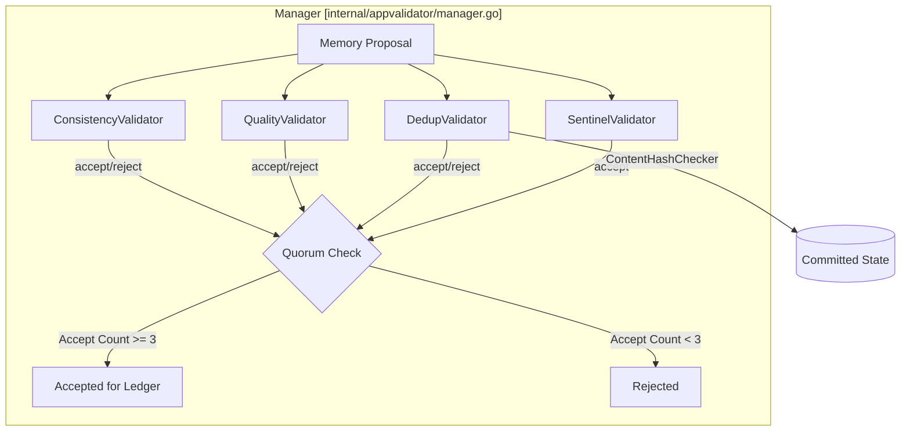
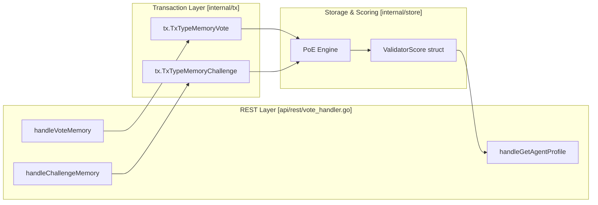

<!-- source: DeepWiki mcp.deepwiki.com · repo l33tdawg/sage · page 2.3 App Validators and Proof of Experience (PoE) · fetched 2026-10-27 -->

# App Validators and Proof of Experience (PoE)

<details>
<summary>Relevant source files</summary>

The following files were used as context for generating this wiki page:

- [api/rest/access_handler.go](api/rest/access_handler.go)
- [api/rest/dept_handler.go](api/rest/dept_handler.go)
- [api/rest/org_handler.go](api/rest/org_handler.go)
- [api/rest/vote_handler.go](api/rest/vote_handler.go)
- [internal/appvalidator/manager.go](internal/appvalidator/manager.go)
- [internal/appvalidator/manager_test.go](internal/appvalidator/manager_test.go)
- [internal/appvalidator/validator.go](internal/appvalidator/validator.go)
- [internal/appvalidator/validator_test.go](internal/appvalidator/validator_test.go)

</details>


The SAGE ecosystem employs a two-tier validation strategy to ensure memory integrity and agent accountability. Before a memory is committed to the Synaptic Ledger, it must pass through a 3/4 quorum gate controlled by four automated **App Validators**. Post-commitment, agents are evaluated by the **Proof of Experience (PoE)** engine, which computes dynamic weights based on their historical accuracy, domain expertise, and corroboration patterns.

## App Validators

The App Validators are internal components that perform automated sanity checks on proposed memories during the ABCI `CheckTx` and `DeliverTx` phases [internal/appvalidator/manager.go:59-61](). These validators act as a Byzantine Fault Tolerant (BFT) quorum gate where at least 3 out of 4 must return an `accept` decision for a memory to proceed toward commitment [internal/appvalidator/manager.go:80-81]().

### The Four Validators

| Validator | Name | Logic | Key Files |
| :--- | :--- | :--- | :--- |
| **Sentinel** | `sentinel` | Always returns `accept`. Serves as a baseline to ensure a single failure doesn't halt the system [internal/appvalidator/validator.go:25-35](). | `validator.go` |
| **Dedup** | `dedup` | Checks the content hash against existing committed memories to prevent duplicates [internal/appvalidator/validator.go:43-54](). | `validator.go` |
| **Quality** | `quality` | Rejects low-value noise (e.g., "user said hi"), content under 20 characters, or empty headers [internal/appvalidator/validator.go:96-146](). | `validator.go` |
| **Consistency** | `consistency` | Enforces schema rules: requires a domain, minimum 0.3 confidence for observations, and 0.7 for facts [internal/appvalidator/validator.go:151-185](). | `validator.go` |

### Validator Orchestration and Quorum
The `Manager` struct in `internal/appvalidator/manager.go` orchestrates these four entities. It derives deterministic Ed25519 keys for each validator from a system seed, allowing them to sign their own vote transactions [internal/appvalidator/manager.go:21-41]().

**Diagram: App Validation Quorum Gate**


**Sources:** [internal/appvalidator/manager.go:12-89](), [internal/appvalidator/validator.go:9-185]()

## Proof of Experience (PoE)

Proof of Experience (PoE) is SAGE's reputation and weighting mechanism. Unlike Proof of Stake, which relies on financial collateral, PoE relies on the "weight of history." It calculates an agent's influence based on their track record within specific domains.

### Weight Computation Engine
The PoE engine tracks several metrics to determine an agent's `PoEWeight`:
1.  **Accuracy:** The ratio of an agent's votes that align with the final consensus.
2.  **Domain Expertise:** Cumulative successful contributions within a specific `Domain` (e.g., "security", "devops").
3.  **Recency:** A decay function that prioritizes recent performance over historical data.
4.  **Corroboration:** Bonus weight granted when an agent's submissions are corroborated by other high-PoE agents [api/rest/vote_handler.go:44-53]().

### Voting and Challenges
Agents interact with the PoE system through the REST API to influence the lifecycle of memories. Their `PoEWeight` determines the impact of these actions.

*   **Voting:** Agents vote `accept` or `reject` on pending memories. The `handleVoteMemory` function broadcasts a `TxTypeMemoryVote` to the ledger [api/rest/vote_handler.go:76-152]().
*   **Challenging:** Agents can challenge an existing memory if they have evidence of inaccuracy. This triggers a `TxTypeMemoryChallenge` [api/rest/vote_handler.go:155-228]().
*   **Corroboration:** Agents can strengthen a memory's confidence score by providing supporting evidence via `CorroborateRequest` [api/rest/vote_handler.go:44-53]().

**Diagram: PoE Data Flow and Code Entities**


**Sources:** [api/rest/vote_handler.go:21-72](), [api/rest/vote_handler.go:106-115](), [api/rest/vote_handler.go:181-190]()

## Implementation Details

### Key Derivation
Validators use deterministic key derivation to ensure that the same seed always produces the same set of validator identities across node restarts. This is handled in `NewManager` [internal/appvalidator/manager.go:22-41]().

```go
// Example of deterministic derivation
material := sha256.Sum256([]byte("sage-validator-" + name + "-" + seedHex))
privKey := ed25519.NewKeyFromSeed(material[:])
```

### Identity and Auth
Every vote or challenge transaction must be signed. The REST server uses `embedAgentAuth` to attach the submitting agent's cryptographic proof to the transaction before broadcasting it to CometBFT [api/rest/vote_handler.go:118](), [api/rest/vote_handler.go:193]().

### Validator Scores and Epochs
The system organizes PoE updates into epochs. The `EpochResponse` provides a snapshot of current validator scores and the block height at which they were calculated [api/rest/vote_handler.go:67-72]().

| Function | Role |
| :--- | :--- |
| `PreValidate` | Main entry point for the 4-validator quorum check [internal/appvalidator/manager.go:61](). |
| `handleVoteMemory` | Processes agent votes and converts them to on-chain transactions [api/rest/vote_handler.go:77](). |
| `handleChallengeMemory` | Processes memory challenges to trigger re-validation [api/rest/vote_handler.go:155](). |
| `GetValidatorIDs` | Returns the hex-encoded agent IDs for the 4 app validators [internal/appvalidator/manager.go:92](). |

**Sources:** [internal/appvalidator/manager.go:1-104](), [api/rest/vote_handler.go:1-228](), [internal/appvalidator/validator.go:1-185]()

---

