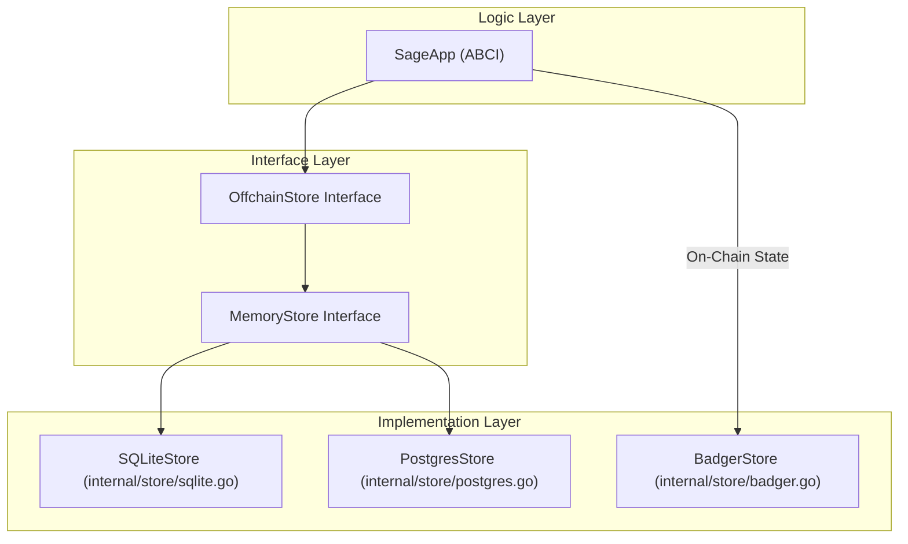
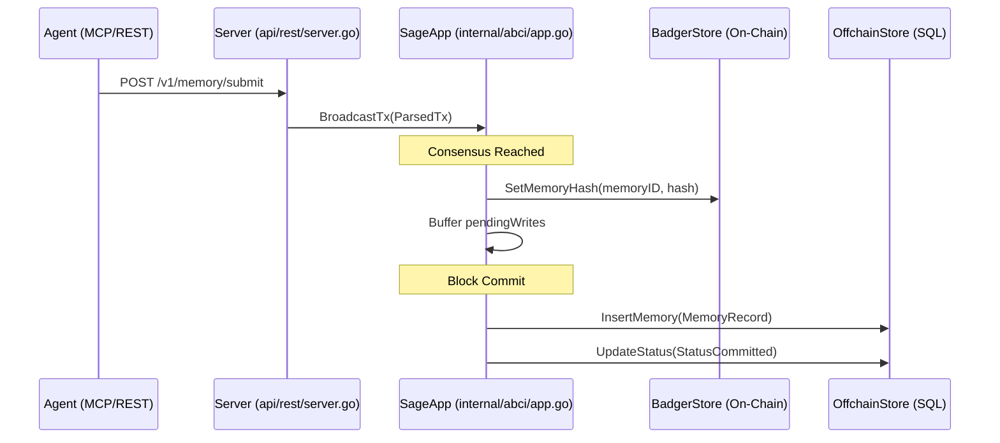

<!-- source: DeepWiki mcp.deepwiki.com · repo l33tdawg/sage · page 3 Storage Layer · fetched 2026-10-27 -->

# Storage Layer

Relevant source files

The following files were used as context for generating this wiki page:

- [api/rest/agent_handler.go](api/rest/agent_handler.go)
- [api/rest/helpers.go](api/rest/helpers.go)
- [deploy/docker-compose.yml](deploy/docker-compose.yml)
- [internal/abci/app.go](internal/abci/app.go)
- [internal/abci/app_test.go](internal/abci/app_test.go)
- [internal/abci/migrate.go](internal/abci/migrate.go)
- [internal/store/badger.go](internal/store/badger.go)
- [internal/store/postgres.go](internal/store/postgres.go)
- [internal/store/sqlite.go](internal/store/sqlite.go)
- [internal/store/store.go](internal/store/store.go)

The SAGE storage layer is a hybrid architecture designed to balance local performance, data sovereignty, and multi-node consistency. It separates "off-chain" data (heavy content, embeddings, and rich metadata) from "on-chain" state (identity, nonces, and consensus-critical hashes).

## Architecture Overview

SAGE utilizes three distinct database engines depending on the deployment mode and the nature of the data being stored:

1.  **SQLite**: The primary off-chain store for **Personal Mode** (`sage-gui`). It provides a zero-config, single-file database that supports full-text search and integrated encryption via the Synaptic Ledger.
2.  **PostgreSQL + pgvector**: The primary off-chain store for **Multi-Node Mode** (`amid`). It enables high-concurrency access and utilizes HNSW indexing for efficient vector similarity searches across large memory sets.
3.  **BadgerDB**: The **On-Chain State Store** used by the ABCI application. It stores the minimal state required for BFT consensus, including agent nonces, registered identities, and cryptographic hashes of committed memories.

### Storage Interface Bridge

The system abstracts these backends through the `OffchainStore` interface, allowing the `SageApp` [internal/abci/app.go:115-127]() to interact with either SQLite or PostgreSQL transparently.

#### Natural Language to Code Entity Map: Storage Backends

**Sources**: [internal/store/store.go:110-142](), [internal/abci/app.go:115-127](), [internal/store/sqlite.go:34-41](), [internal/store/postgres.go:27-30]()

## Hybrid Storage Components

### 1. SQLite Store (Personal Mode)
In personal deployment mode, SAGE uses a pure Go SQLite driver [internal/store/sqlite.go:19]() to manage all memory records, validation votes, and agent metadata locally. It includes a built-in `SetVault` mechanism [internal/store/sqlite.go:48-50]() that integrates with the **Synaptic Ledger** to provide AES-256-GCM encryption at rest for sensitive memory content.

For details, see [SQLite Store (Personal Mode)](#3.1).

### 2. PostgreSQL & pgvector (Multi-Node Mode)
For distributed deployments, SAGE transitions to PostgreSQL. This backend leverages the `pgvector` extension [internal/store/postgres.go:12]() to perform high-performance similarity queries using the `<=>` cosine distance operator [internal/store/postgres.go:147-148](). This is the standard for the `amid` (Agent Managed Infrastructure Daemon) stack.

For details, see [PostgreSQL Store and BadgerDB (Multi-Node Mode)](#3.2).

### 3. BadgerDB (On-Chain State)
BadgerDB acts as the local key-value store for the CometBFT state machine. It is responsible for maintaining the "Source of Truth" that all nodes must agree upon, such as the `ComputeAppHash` [internal/store/badger.go:176-177]() which ensures deterministic state transitions across the validator set.

For details, see [PostgreSQL Store and BadgerDB (Multi-Node Mode)](#3.2).

### 4. Synaptic Ledger (Encryption)
The Synaptic Ledger is the security wrapper around the storage layer. It handles Argon2id key derivation and manages the `vault.key` file. It ensures that both the `content` [internal/store/sqlite.go:61-73]() and `embedding` [internal/store/sqlite.go:102-110]() fields are encrypted before hitting the disk.

For details, see [Synaptic Ledger (Vault Encryption)](#3.3).

## Data Flow: Submission to Persistence

The following diagram illustrates how a memory record moves from a tool call into the respective storage engines.

#### Natural Language to Code Entity Map: Persistence Pipeline

**Sources**: [internal/abci/app.go:125-127](), [api/rest/agent_handler.go:96-101](), [internal/store/badger.go:77-86](), [internal/store/postgres.go:55-79]()

## Core Storage Interfaces

| Interface | Purpose | Primary Implementation |
| :--- | :--- | :--- |
| `MemoryStore` | CRUD for MemoryRecords and KnowledgeTriples | `SQLiteStore`, `PostgresStore` |
| `ValidatorScoreStore` | Persistence for PoE (Proof of Experience) scores | `SQLiteStore`, `PostgresStore` |
| `AccessStore` | RBAC grants and domain permissions | `SQLiteStore`, `PostgresStore` |
| `OffchainStore` | Composite interface for all non-consensus data | `SQLiteStore`, `PostgresStore` |

**Sources**: [internal/store/store.go:110-165]()

---

