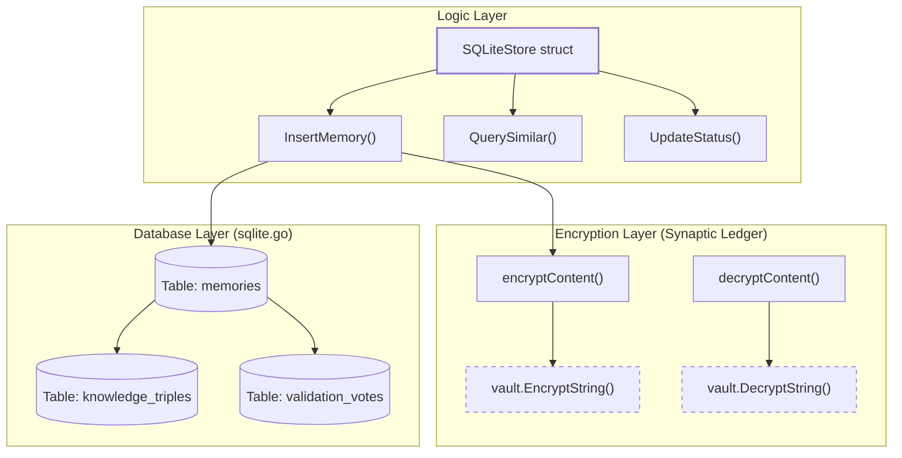
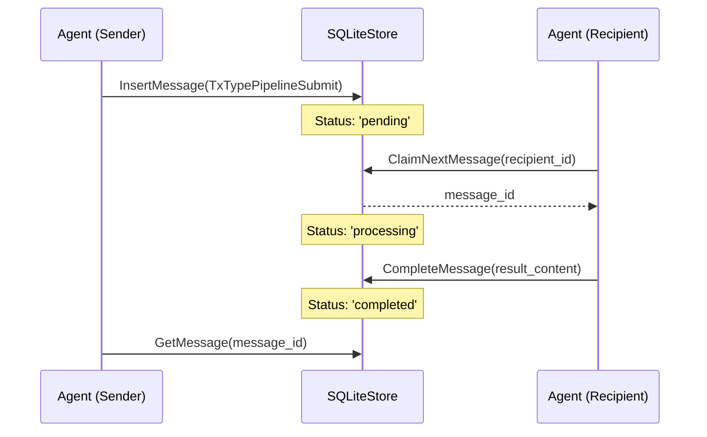

<!-- source: DeepWiki mcp.deepwiki.com · repo l33tdawg/sage · page 3.1 SQLite Store (Personal Mode) · fetched 2026-10-27 -->

# SQLite Store (Personal Mode)

Relevant source files

The following files were used as context for generating this wiki page:

- [internal/store/postgres.go](internal/store/postgres.go)
- [internal/store/sqlite.go](internal/store/sqlite.go)
- [internal/store/store.go](internal/store/store.go)
- [internal/vault/vault.go](internal/vault/vault.go)
- [internal/vault/vault_test.go](internal/vault/vault_test.go)
- [web/handler_ledger.go](web/handler_ledger.go)
- [web/handler_ledger_test.go](web/handler_ledger_test.go)

The `SQLiteStore` is the primary storage implementation for SAGE in personal deployment mode (e.g., `sage-gui`). It provides a lightweight, single-file relational database that handles memory persistence, validation tracking, and integrated encryption via the Synaptic Ledger (Vault).

## Implementation Overview

The `SQLiteStore` struct implements multiple interfaces defined in `internal/store/store.go`, including `MemoryStore`, `ValidatorScoreStore`, `AccessStore`, and `OrgStore` [internal/store/sqlite.go:33-34](). It uses the `modernc.org/sqlite` pure Go driver to ensure cross-platform compatibility without requiring CGO [internal/store/sqlite.go:19]().

### Data Flow: Memory Submission
When a memory is submitted in personal mode, the following flow occurs within the store:
1. **Encryption Check**: If a `Vault` is attached and expected, the content and embeddings are encrypted before hitting the disk [internal/store/sqlite.go:61-73]().
2. **Schema Validation**: The record is inserted into the `memories` table, which enforces constraints on `memory_type`, `confidence_score`, and `status` [internal/store/sqlite.go:149-166]().
3. **Relational Linking**: Associated knowledge triples are stored in the `knowledge_triples` table, linked via `memory_id` [internal/store/sqlite.go:170-176]().

### Code Entity Mapping
The following diagram bridges the high-level storage concepts to specific code entities within the SQLite implementation.

**Diagram: SQLite Store Entity Mapping**

Sources: [internal/store/sqlite.go:34-41](), [internal/store/sqlite.go:61-99](), [internal/store/sqlite.go:149-180]()

## Schema and Migrations

The schema is initialized automatically upon store creation via `initSchema` [internal/store/sqlite.go:148](). It defines the core tables required for the SAGE ecosystem:

| Table | Purpose | Key Columns |
| :--- | :--- | :--- |
| `memories` | Primary storage for agent observations and facts. | `memory_id`, `content`, `embedding`, `status` |
| `knowledge_triples` | Semantic relationships extracted from memories. | `subject`, `predicate`, `object` |
| `validation_votes` | Audit trail of validator decisions (PoE). | `validator_id`, `decision`, `weight_at_vote` |
| `corroborations` | Evidence from other agents supporting a memory. | `agent_id`, `evidence` |
| `pipeline_messages` | Queue for inter-agent communication. | `sender_id`, `recipient_id`, `status` |

Sources: [internal/store/sqlite.go:149-197]()

## Encryption Integration (Synaptic Ledger)

The `SQLiteStore` integrates deeply with the `internal/vault` package to provide at-rest encryption. This is referred to as the "Synaptic Ledger" in the UI.

### Encryption State Machine
The store tracks two fields to manage encryption safety:
- `vault`: A pointer to an unlocked `vault.Vault` instance [internal/store/sqlite.go:38]().
- `vaultExpected`: A boolean flag. If `true` and `vault` is `nil`, the store rejects writes to prevent accidental plaintext leakage [internal/store/sqlite.go:39, 63-65]().

### Content Handling
Encrypted content is stored with a specific prefix `enc::` followed by base64-encoded ciphertext [internal/store/sqlite.go:44, 72](). During retrieval, `decryptContent` checks for this prefix; if the vault is locked, it returns a placeholder string `[encrypted — vault locked]` to the caller [internal/store/sqlite.go:81-83]().

Sources: [internal/store/sqlite.go:44-99](), [internal/vault/vault.go:49-52]()

## In-Memory Vector Search

Unlike the Multi-Node mode which uses `pgvector`, the SQLite store performs cosine similarity search in-memory.

1. **Retrieval**: `QuerySimilar` fetches all memories with non-null embeddings from the database [internal/store/sqlite.go:145-148]().
2. **Decryption**: Each embedding is decrypted using the vault [internal/store/sqlite.go:114-124]().
3. **Scoring**: The system calculates the cosine similarity between the query vector and stored vectors.
4. **Ranking**: Results are sorted by score, filtered by `QueryOptions` (e.g., `MinConfidence`, `DomainTag`), and truncated to `TopK` [internal/store/store.go:69-77]().

Sources: [internal/store/sqlite.go:101-124](), [internal/store/store.go:69-77]()

## Pipeline and Message Management

The SQLite store acts as the broker for the **Inter-Agent Pipeline**. It manages the `pipeline_messages` table, which supports asynchronous tasking and message passing between agents.

**Diagram: Pipeline Message Lifecycle**

Sources: [internal/store/sqlite.go:191-197](), [internal/store/store.go:128-132]()

## RedeploymentLock Mechanism

The `RedeploymentLock` is a specialized table in SQLite used to synchronize critical system operations, such as agent key rotation or node configuration changes. It ensures that only one "orchestrator" process can modify the system state at a time, preventing database corruption during high-stakes transitions.

Key functions include:
- `AcquireRedeploymentLock`: Sets a global lock with a timeout.
- `ReleaseRedeploymentLock`: Clears the lock after a successful or failed operation.

Sources: [internal/store/sqlite.go:200-215]()

---

