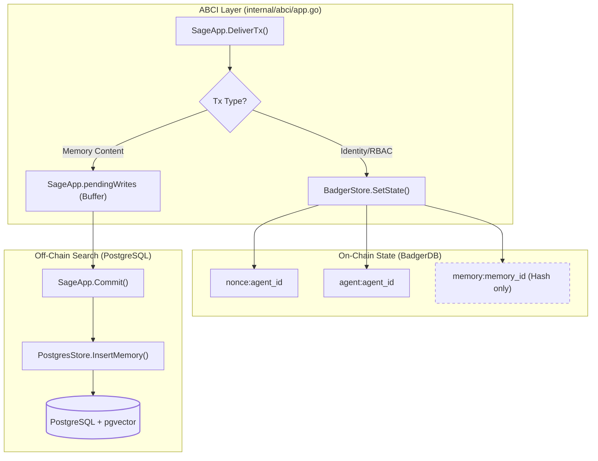
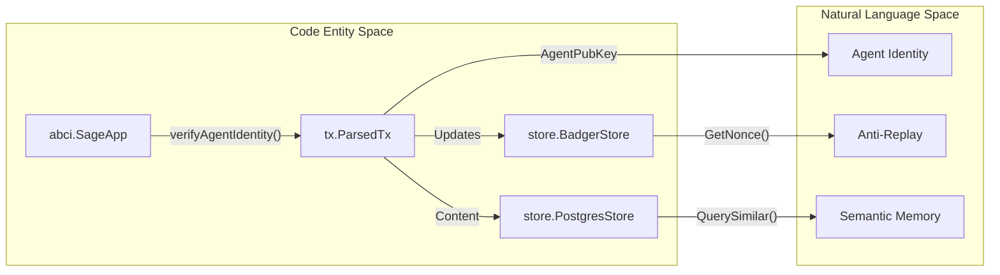

<!-- source: DeepWiki mcp.deepwiki.com · repo l33tdawg/sage · page 3.2 PostgreSQL Store and BadgerDB (Multi-Node Mode) · fetched 2026-10-27 -->

# PostgreSQL Store and BadgerDB (Multi-Node Mode)

Relevant source files

The following files were used as context for generating this wiki page:

- [api/rest/agent_handler.go](api/rest/agent_handler.go)
- [api/rest/helpers.go](api/rest/helpers.go)
- [deploy/docker-compose.yml](deploy/docker-compose.yml)
- [deploy/init.sql](deploy/init.sql)
- [internal/abci/app.go](internal/abci/app.go)
- [internal/abci/app_test.go](internal/abci/app_test.go)
- [internal/abci/migrate.go](internal/abci/migrate.go)
- [internal/store/badger.go](internal/store/badger.go)
- [internal/store/postgres.go](internal/store/postgres.go)
- [internal/store/sqlite.go](internal/store/sqlite.go)
- [internal/store/store.go](internal/store/store.go)

In multi-node deployments (the `amid` binary), SAGE employs a hybrid storage architecture. It splits data between **BadgerDB**, which maintains the "on-chain" consensus state (agent registry, nonces, and memory hashes), and **PostgreSQL**, which serves as the "off-chain" searchable store for high-volume memory content and vector embeddings.

## Hybrid Storage Architecture

The system distinguishes between data that requires strict BFT consensus (on-chain) and data that requires advanced querying and semantic search (off-chain).

| Feature | BadgerDB (On-Chain) | PostgreSQL (Off-Chain) |
|:---|:---|:---|
| **Role** | Truth for consensus & identity | Searchable memory index |
| **Data Types** | Nonces, Hashes, RBAC, Validator Scores | Memory content, Embeddings, Triples |
| **Consistency** | Strong (CometBFT AppHash) | Eventual (Buffered via ABCI Commit) |
| **Implementation** | `BadgerStore` [internal/store/badger.go:16-18]() | `PostgresStore` [internal/store/postgres.go:27-30]() |

### Multi-Node Data Flow

The following diagram illustrates how a transaction flows from the `SageApp` (ABCI) into both storage layers during the consensus lifecycle.

**Consensus to Storage Mapping**

Sources: [internal/abci/app.go:115-127](), [internal/store/badger.go:34-51](), [internal/store/postgres.go:55-79]()

---

## PostgreSQL and pgvector

The `PostgresStore` implements the `OffchainStore` interface. It leverages the `pgvector` extension to perform HNSW (Hierarchical Navigable Small World) indexed vector similarity searches, which is essential for the `sage_recall` tool in multi-node environments.

### Key Implementation Details
- **Vector Search**: Uses the `<=>` operator for cosine distance [internal/store/postgres.go:147-148]().
- **Connection Pooling**: Managed via `pgxpool` with a default maximum of 20 connections [internal/store/postgres.go:39-42]().
- **Batching**: Uses `pgx.Batch` during the ABCI `Commit` phase to ensure high throughput when flushing buffered writes [internal/abci/app.go:126-127]().

### Schema: init.sql
The PostgreSQL schema is initialized via `deploy/init.sql`. It defines the core tables for memories, knowledge triples, and the Proof of Experience (PoE) scoring system.

| Table | Purpose | Key Columns |
|:---|:---|:---|
| `memories` | Main content store | `content`, `embedding vector(768)`, `status` |
| `knowledge_triples` | Graph representation | `subject`, `predicate`, `object` |
| `validation_votes` | PoE audit trail | `validator_id`, `decision`, `weight_at_vote` |
| `validator_scores` | Current PoE weights | `weighted_sum`, `expertise_vec`, `current_weight` |

Sources: [deploy/init.sql:11-106](), [internal/store/postgres.go:33-53]()

---

## BadgerDB: On-Chain State

The `BadgerStore` handles the state that must be identical across all 4 nodes in a SAGE cluster. This state is used to calculate the `AppHash` returned to CometBFT, ensuring the network remains in sync.

### On-Chain Entities
1. **Agent Registry**: Stores `OnChainAgent` structs containing public keys, roles, and clearance levels [internal/store/badger.go:53-68]().
2. **Nonces**: Tracks the current transaction nonce for every agent to prevent replay attacks [internal/store/badger.go:117-123]().
3. **Memory Hashes**: Stores a mapping of `MemoryID` to `ContentHash`. This allows validators to verify that the content in PostgreSQL hasn't been tampered with [internal/store/badger.go:77-86]().

### Deterministic Hashing
To maintain consensus, `BadgerStore.ComputeAppHash()` iterates through all keys in lexicographical order to produce a deterministic SHA-256 hash of the entire database [internal/store/badger.go:176-225]().

**Identity and State Resolution**

Sources: [internal/abci/app.go:143-160](), [internal/store/badger.go:148-152](), [internal/tx/codec.go:1-50]()

---

## Multi-Node Deployment (Docker)

The multi-node mode is typically deployed using the 4-node Docker Compose stack defined in `deploy/docker-compose.yml`.

### Service Topology
- **PostgreSQL**: Shared by all ABCI nodes as the off-chain store [deploy/docker-compose.yml:9-27]().
- **ABCI Nodes (`abci0-3`)**: The Go application logic, each with its own local BadgerDB volume [deploy/docker-compose.yml:32-134]().
- **CometBFT Nodes (`cometbft0-3`)**: The consensus engine nodes that communicate via P2P [deploy/docker-compose.yml:168-236]().
- **Ollama**: Provides embedding generation services to the ABCI nodes [deploy/docker-compose.yml:139-164]().

### Startup Migrations
Upon startup, the system runs `MigrateAgentsOnChain`. This function ensures that agents existing in the PostgreSQL/Offchain store are properly registered in the BadgerDB on-chain state [internal/abci/migrate.go:12-15](). If an agent is found in PostgreSQL but missing from BadgerDB, it is backfilled to height 1 to enable immediate consensus participation [internal/abci/migrate.go:74-80]().

Sources: [deploy/docker-compose.yml:1-250](), [internal/abci/migrate.go:12-92]()

---

