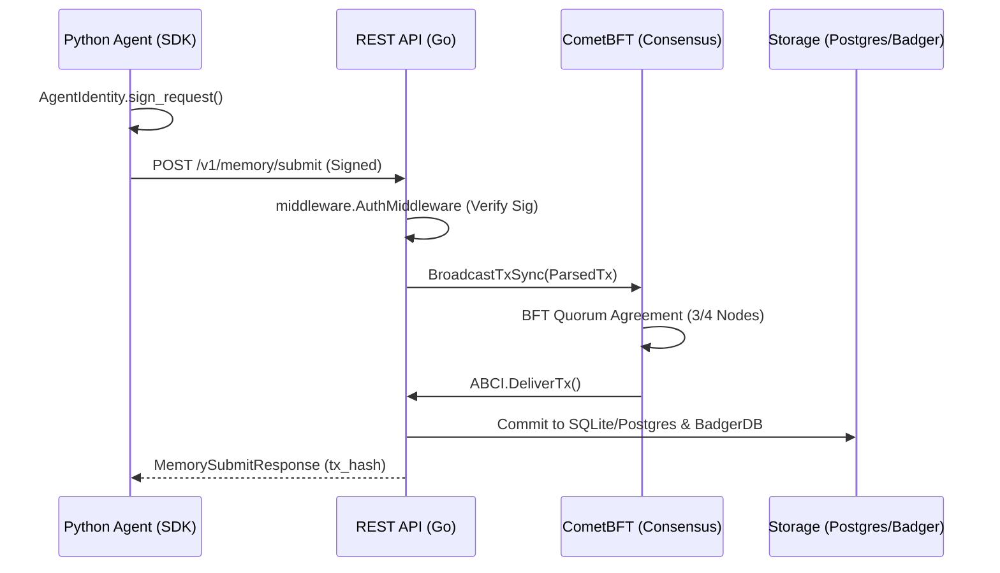
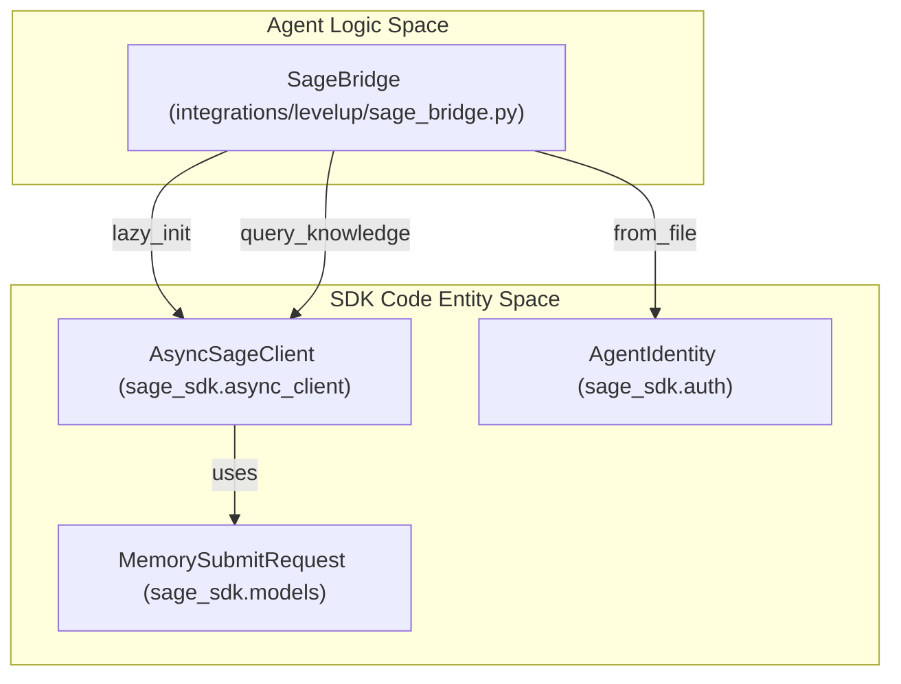

<!-- source: DeepWiki mcp.deepwiki.com · repo l33tdawg/sage · page 4.3 Python SDK · fetched 2026-10-27 -->

# Python SDK

<details>
<summary>Relevant source files</summary>

The following files were used as context for generating this wiki page:

- [.gitignore](.gitignore)
- [CONTRIBUTING.md](CONTRIBUTING.md)
- [api/openapi.yaml](api/openapi.yaml)
- [api/rest/pipe_handler.go](api/rest/pipe_handler.go)
- [docs/og-image.png](docs/og-image.png)
- [extension/build.sh](extension/build.sh)
- [integrations/levelup/sage_bridge.py](integrations/levelup/sage_bridge.py)
- [internal/store/pipeline_test.go](internal/store/pipeline_test.go)
- [papers/Paper4 - Longitudinal Learning in Governed Multi-Agent Systems - How Institutional Memory Improves Agent Performance Over Time.pdf](papers/Paper4 - Longitudinal Learning in Governed Multi-Agent Systems - How Institutional Memory Improves Agent Performance Over Time.pdf)
- [sdk/python/examples/async_example.py](sdk/python/examples/async_example.py)
- [sdk/python/examples/complete_walkthrough.py](sdk/python/examples/complete_walkthrough.py)
- [sdk/python/examples/federation.py](sdk/python/examples/federation.py)
- [sdk/python/examples/full_lifecycle.py](sdk/python/examples/full_lifecycle.py)
- [sdk/python/examples/multi_agent.py](sdk/python/examples/multi_agent.py)
- [sdk/python/examples/org_setup.py](sdk/python/examples/org_setup.py)
- [sdk/python/examples/quickstart.py](sdk/python/examples/quickstart.py)
- [sdk/python/examples/rbac_clearance.py](sdk/python/examples/rbac_clearance.py)
- [sdk/python/src/sage_sdk/async_client.py](sdk/python/src/sage_sdk/async_client.py)
- [sdk/python/src/sage_sdk/auth.py](sdk/python/src/sage_sdk/auth.py)
- [sdk/python/src/sage_sdk/client.py](sdk/python/src/sage_sdk/client.py)

</details>


The `sage-agent-sdk` is the official Python library for interacting with the SAGE network. It provides high-level abstractions for agent identity management, Ed25519 request signing, and a comprehensive client for both synchronous and asynchronous operations. The SDK abstracts the underlying blockchain complexity, allowing developers to focus on memory operations and organizational governance.

## Core Components

### Agent Identity (`AgentIdentity`)
Every agent in the SAGE ecosystem must have a unique identity based on an Ed25519 keypair. The public key serves as the `agent_id`, while the private key is used to sign every HTTP request sent to the SAGE REST API. This ensures non-repudiation and prevents request tampering.

*   **Key Management**: Identities can be generated randomly, loaded from a 32-byte seed file, or derived from environment variables `[sdk/python/src/sage_sdk/auth.py:15-64]()`.
*   **Request Signing**: The SDK implements a canonical signing format: `SHA256(method + " " + path + "\n" + body) || big-endian int64 timestamp` `[sdk/python/src/sage_sdk/auth.py:75-96]()`. This binds signatures to specific endpoints and timestamps to prevent replay attacks.

### SageClient and AsyncSageClient
The SDK provides two primary client classes: `SageClient` (blocking) and `AsyncSageClient` (non-blocking using `httpx`).

*   **Initialization**: Both clients require a `base_url` and an `AgentIdentity` `[sdk/python/src/sage_sdk/client.py:41-49]()` `[sdk/python/src/sage_sdk/async_client.py:41-49]()`.
*   **Automatic Signing**: All requests made through these clients are automatically signed using the provided identity via the internal `_request` method `[sdk/python/src/sage_sdk/client.py:51-80]()`.

### Pydantic Models
The SDK uses Pydantic for strict data validation and serialization of SAGE entities.
*   **MemoryRecord**: Represents a piece of knowledge including its content, `MemoryType` (Fact, Observation, Inference, Task), and `ConfidenceScore` `[sdk/python/src/sage_sdk/models.py]()`.
*   **KnowledgeTriple**: Encapsulates semantic relationships (Subject-Predicate-Object) within a memory `[sdk/python/src/sage_sdk/models.py:18]()`.

## Data Flow: SDK to Consensus
The following diagram illustrates how a Python SDK call is transformed into a consensus-validated state change.

**SDK Transaction Flow**

Sources: `[sdk/python/src/sage_sdk/auth.py:75-96]()`, `[sdk/python/src/sage_sdk/client.py:100-121]()`, `[api/rest/middleware/auth.go]()`

## SDK Methods

### Memory Operations
| Method | Description | Source |
| :--- | :--- | :--- |
| `propose` | Submits a new memory for validation. | `[sdk/python/src/sage_sdk/client.py:100]()` |
| `query` | Performs semantic search using vector embeddings. | `[sdk/python/src/sage_sdk/client.py:123]()` |
| `get_memory` | Retrieves a specific memory by its ID. | `[sdk/python/src/sage_sdk/client.py:146]()` |
| `vote` | Casts a validator vote on a proposed memory. | `[sdk/python/src/sage_sdk/client.py:224]()` |
| `challenge` | Submits a challenge against an existing memory. | `[sdk/python/src/sage_sdk/client.py:240]()` |

### Pipeline Operations
The Pipeline allows agents to send asynchronous tasks to other agents or providers (e.g., `claude-code`, `perplexity`).

*   **`pipeline`**: Creates a message for another agent `[sdk/python/src/sage_sdk/client.py:260]()`.
*   **`pipeline_inbox`**: Retrieves pending tasks for the current agent `[sdk/python/src/sage_sdk/client.py:284]()`.
*   **`pipeline_result`**: Submits the result of a task, which triggers an "auto-journal" memory entry `[sdk/python/src/sage_sdk/client.py:302]()`.

## Integration Patterns

### SageBridge Integration
The `SageBridge` pattern is used to integrate SAGE into existing agentic workflows (like CTF solvers or research agents). It provides a "fail-soft" mechanism where SAGE features are disabled if the network is unreachable or the environment is not configured.

**Code Entity Mapping: SageBridge to SDK**

Sources: `[integrations/levelup/sage_bridge.py:25-80]()`, `[sdk/python/src/sage_sdk/async_client.py:38]()`

### Usage Example: Full Lifecycle
This example demonstrates the standard flow: creating an identity, proposing a memory, and querying it.

```python
from sage_sdk import AgentIdentity, SageClient

# 1. Setup Identity
identity = AgentIdentity.default() # Loads from SAGE_IDENTITY_PATH

with SageClient(base_url="http://localhost:8080", identity=identity) as client:
    # 2. Propose Memory
    result = client.propose(
        content="The consensus quorum in SAGE is 3 out of 4 nodes.",
        memory_type="fact",
        domain_tag="architecture",
        confidence=1.0
    )
    
    # 3. Query (Semantic Search)
    # Note: client.embed() generates vectors via the SAGE embedding provider
    vector = client.embed("How does SAGE reach consensus?")
    matches = client.query(embedding=vector, top_k=1)
    print(f"Found: {matches.results[0].content}")
```
Sources: `[sdk/python/examples/complete_walkthrough.py:64-166]()`, `[sdk/python/src/sage_sdk/auth.py:45-64]()`

## Error Handling
The SDK defines specific exception classes for different failure modes:
*   **`SageAPIError`**: Returned when the REST API returns a non-2xx status code. Includes `detail` and `status_code` `[sdk/python/src/sage_sdk/exceptions.py]()`.
*   **`SageAuthError`**: Specifically for Ed25519 signature verification failures or unauthorized access.

Sources:
- `sdk/python/src/sage_sdk/auth.py`
- `sdk/python/src/sage_sdk/client.py`
- `sdk/python/src/sage_sdk/async_client.py`
- `sdk/python/src/sage_sdk/models.py`
- `integrations/levelup/sage_bridge.py`
- `sdk/python/examples/complete_walkthrough.py`
- `api/rest/pipe_handler.go`

---

