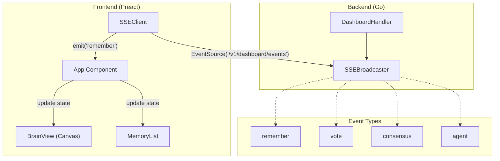
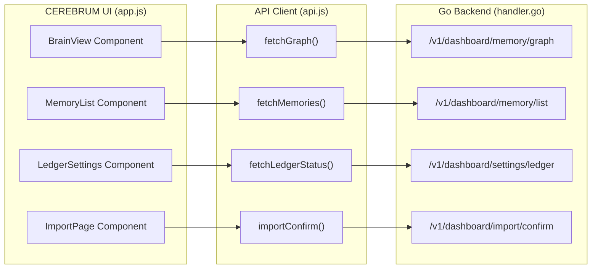

<!-- source: DeepWiki mcp.deepwiki.com · repo l33tdawg/sage · page 5.2 Dashboard Frontend (CEREBRUM SPA) · fetched 2026-10-27 -->

# Dashboard Frontend (CEREBRUM SPA)

Relevant source files

The following files were used as context for generating this wiki page:

- [web/handler.go](web/handler.go)
- [web/static/css/sage.css](web/static/css/sage.css)
- [web/static/js/api.js](web/static/js/api.js)
- [web/static/js/app.js](web/static/js/app.js)
- [web/static/js/components/confidence-badge.js](web/static/js/components/confidence-badge.js)
- [web/static/js/components/domain-filter.js](web/static/js/components/domain-filter.js)
- [web/static/js/components/memory-card.js](web/static/js/components/memory-card.js)
- [web/static/js/pages/brain.js](web/static/js/pages/brain.js)
- [web/static/js/pages/memory-detail.js](web/static/js/pages/memory-detail.js)
- [web/static/js/sse.js](web/static/js/sse.js)

The CEREBRUM SPA is a high-performance web interface built with **Preact** that serves as the primary management console for the SAGE system. It provides real-time visualization of the memory graph, tools for importing external conversation histories, and administrative interfaces for managing agent identities and the Synaptic Ledger.

## Core Technologies and Architecture

The frontend is designed as a lightweight Single Page Application (SPA) that communicates with the `DashboardHandler` [web/handler.go:49-91]() via a REST API and Server-Sent Events (SSE).

| Component | Technology | Role |
| :--- | :--- | :--- |
| **View Layer** | Preact + Hooks | Component-based UI rendering with minimal footprint. |
| **State Management** | Preact Hooks (`useState`, `useEffect`) | Local and global state (e.g., `TooltipsContext`). |
| **Graph Engine** | HTML5 Canvas + d3-force | Force-directed N-body simulation for `BrainView`. |
| **Real-time Sync** | EventSource (SSE) | Unidirectional live updates for memories and consensus. |
| **Styling** | CSS Custom Properties | Dynamic theme system with domain-specific coloring. |

### Data Flow: Real-time Updates
The SPA maintains a persistent connection to the backend via the `SSEClient` [web/static/js/sse.js:3-10](). When agents submit memories or validators vote, the backend broadcasts events that are immediately reflected in the UI without page refreshes.

**Sources:** [web/static/js/sse.js:1-64](), [web/static/js/app.js:1-33](), [web/handler.go:53-53]()

---

## BrainView: Force-Directed Visualization

The `BrainView` component visualizes the "Natural Language Space" as a graph of nodes (Memories) and edges (Relationships/Knowledge Triples). It utilizes a d3-force simulation to position nodes based on their associations.

### Implementation Details
- **N-Body Simulation**: Nodes exert many-body forces to prevent overlap while links pull related memories together [web/static/js/app.js:250-256]().
- **Domain Coloring**: Every domain is assigned a stable hue using a hash-based generator `getDomainColor` [web/static/js/app.js:67-87]().
- **Focus Mode**: When a node is selected, the graph enters a "Focus Mode" transition, highlighting immediate neighbors and dimming the rest of the network.

### Navigation and Interaction
The interface includes a "Navigation Pad" (compass-style D-pad) for panning and zooming the canvas [web/static/css/sage.css:259-273]().

**Sources:** [web/static/js/app.js:35-87](), [web/static/css/sage.css:245-256]()

---

## Synaptic Ledger UI

The Synaptic Ledger interface manages the AES-256-GCM encryption of the underlying memory store. It reflects the state of the `Vault` (Locked vs. Unlocked).

### State Machine Integration
The frontend tracks the `VaultLocked` [web/handler.go:57-57]() state from the backend.
1. **Locked State**: Displays a full-screen overlay requiring the Argon2id-derived passphrase.
2. **Unlocked State**: Grants access to `MemoryRecord` content and embeddings.
3. **Recovery**: Provides a dedicated UI for the `recoverVault` [web/static/js/api.js:28-35]() function using the 32-character recovery key.

**Sources:** [web/static/js/api.js:5-35](), [web/handler.go:56-61]()

---

## Import Pipeline (ChatGPT/Claude/Gemini)

The `ImportPage` facilitates the ingestion of external LLM histories into SAGE. It uses a two-phase commit pattern to ensure data quality.

### Data Flow
1. **Format Detection**: User uploads a JSON/Markdown export.
2. **Preview**: `importPreview(file)` [web/static/js/api.js:112-120]() sends the file to the backend, which returns a summary of detected conversations and proposed `MemoryRecord` objects.
3. **Confirmation**: User reviews the preview and triggers `importConfirm(importId)` [web/static/js/api.js:122-129](). The backend then processes the `pendingImports` [web/handler.go:85-86]() map, generating embeddings and committing records to the store.

**Sources:** [web/static/js/api.js:102-129](), [web/handler.go:85-86]()

---

## Task Board (Kanban)

The SPA includes a Kanban-style task board for managing `MemoryTypeTask` records.

- **Status Columns**: Tasks are organized into columns based on their `MemoryStatus` (Proposed, Validated, Committed).
- **Transitions**: Drag-and-drop actions (or button clicks) trigger `updateTaskStatus` [web/static/js/api.js:215-220](), which updates the status on-chain via CometBFT if in multi-node mode.

**Sources:** [web/static/js/api.js:215-225](), [web/static/js/app.js:113-113]()

---

## CSS Design System

The visual identity is defined in `sage.css` using a comprehensive set of CSS Custom Properties (Variables) to ensure consistency across components.

### Core Variables
| Variable | Value | Usage |
| :--- | :--- | :--- |
| `--bg-deep` | `#0a0e17` | Main application background. |
| `--primary` | `#06b6d4` | Primary actions and brand highlights. |
| `--accent` | `#10b981` | Success states and active connection indicators. |
| `--danger` | `#ef4444` | Errors and disconnected status. |

### Layout Components
- **Sidebar**: Fixed 64px width container for primary navigation icons [web/static/css/sage.css:42-53]().
- **Health Bar**: Bottom-aligned status strip showing CometBFT sync status and memory counts [web/static/css/sage.css:219-244]().
- **Zoom Levels**: The UI supports three global zoom scales (`zoom-small`, `zoom-medium`, `zoom-large`) applied to the `.main-content` container [web/static/css/sage.css:185-188]().

**Sources:** [web/static/css/sage.css:2-23](), [web/static/css/sage.css:42-108]()

---

## System Integration Map

The following diagram bridges the high-level UI components to their corresponding backend handlers and API endpoints.

**Sources:** [web/static/js/app.js:3-3](), [web/static/js/api.js:37-129](), [web/handler.go:49-91]()

---

