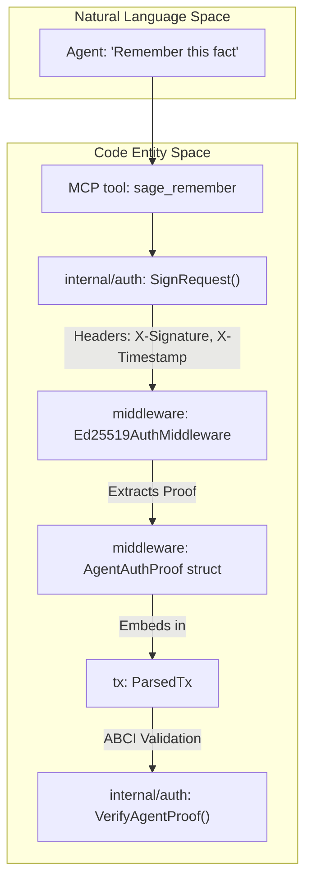
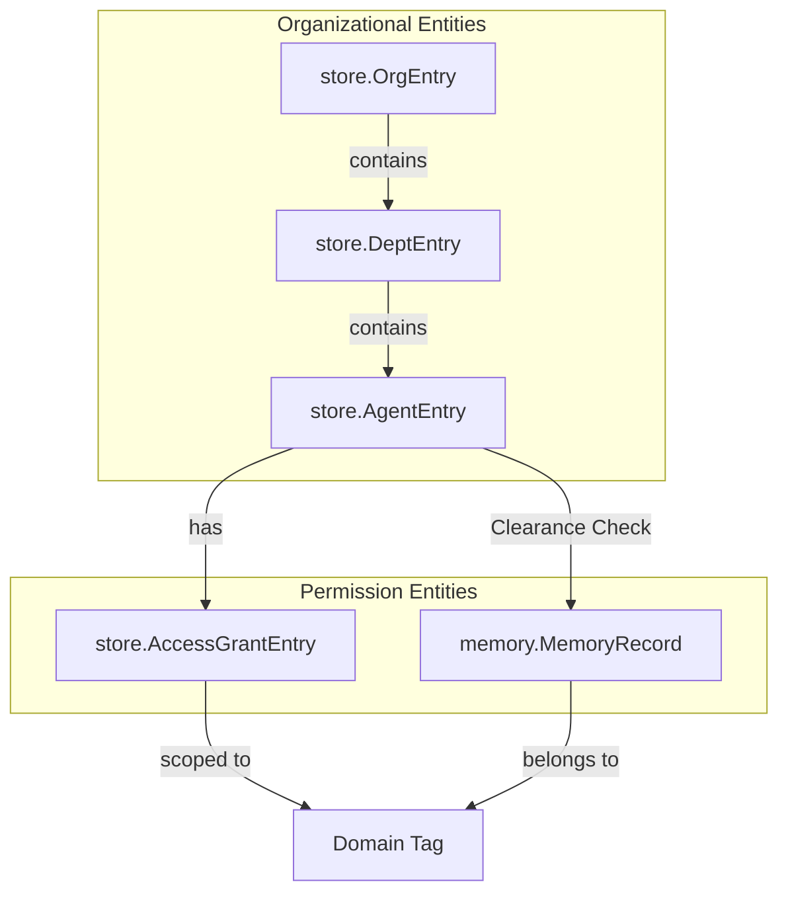

<!-- source: DeepWiki mcp.deepwiki.com · repo l33tdawg/sage · page 6 Agent Identity and Access Control · fetched 2026-10-27 -->

# Agent Identity and Access Control

Relevant source files

The following files were used as context for generating this wiki page:

- [api/rest/middleware/auth.go](api/rest/middleware/auth.go)
- [api/rest/middleware/middleware_test.go](api/rest/middleware/middleware_test.go)
- [internal/auth/ed25519.go](internal/auth/ed25519.go)
- [internal/auth/ed25519_test.go](internal/auth/ed25519_test.go)
- [internal/store/postgres.go](internal/store/postgres.go)
- [internal/store/sqlite.go](internal/store/sqlite.go)
- [internal/store/store.go](internal/store/store.go)
- [test/integration/helpers_test.go](test/integration/helpers_test.go)
- [web/handler_test.go](web/handler_test.go)
- [web/import.go](web/import.go)
- [web/network_handler.go](web/network_handler.go)

This page provides a high-level overview of the identity and permission systems in SAGE. The system is built on a foundation of **Ed25519 cryptography**, ensuring that every action taken by an agent—from submitting a memory to voting on a consensus block—is cryptographically signed and verifiable on-chain.

## Identity Foundation: Ed25519 Keypairs

Every agent in the SAGE network is identified by a unique **Agent ID**, which is the hex-encoded representation of an Ed25519 public key [internal/auth/ed25519.go:31-34](). These keys serve as the root of trust for:
1.  **Request Authentication**: Signing REST API requests via `X-Agent-ID`, `X-Signature`, and `X-Timestamp` headers [api/rest/middleware/auth.go:80-86]().
2.  **On-Chain Transactions**: Embedding cryptographic proofs in transactions so the ABCI application can verify identity independently of the API layer [internal/auth/ed25519.go:79-85]().
3.  **Consensus Participation**: In multi-node mode, an agent's public key is used as their CometBFT validator identity [web/network_handler.go:145-146]().

For details on key generation, rotation, and the resolution logic for finding local keys, see **[Agent Identity Management](#6.1)**.

### Identity Verification Flow
The following diagram illustrates how a "Natural Language" agent action (like "Remembering") is transformed into a cryptographically secured "Code Entity" (a `ParsedTx` with an `AgentAuthProof`).

**Agent Request to On-Chain Proof**

Sources: [internal/auth/ed25519.go:52-55](), [api/rest/middleware/auth.go:64-69](), [api/rest/middleware/auth.go:182-187](), [internal/auth/ed25519.go:85-121]()

---

## Registration and On-Chain Presence

Agents are not recognized by the network until they are registered. Registration involves creating an `AgentEntry` in the local store and broadcasting a `TxTypeAgentRegister` transaction to the blockchain [web/network_handler.go:148-166](), [web/network_handler.go:171-184]().

| Field | Description | Code Reference |
| :--- | :--- | :--- |
| **AgentID** | Hex-encoded Ed25519 Public Key | [internal/store/store.go:181]() |
| **Role** | System role (e.g., `admin`, `member`, `observer`) | [web/network_handler.go:33-39]() |
| **Clearance** | Numeric tier (0-4) for RBAC | [web/network_handler.go:156]() |
| **Status** | Lifecycle state (`pending`, `active`, `removed`) | [web/network_handler.go:155]() |

---

## Access Control and Hierarchy

SAGE employs a multi-layered Access Control system that combines Role-Based Access Control (RBAC) with organizational hierarchies and explicit domain grants.

### Clearance Levels and RBAC
Access to memories is governed by `ClearanceLevel` tiers. An agent can only query or view memories with a classification equal to or lower than their assigned clearance [web/network_handler.go:132-134]().

### Organizational Hierarchy
The system supports `Org` (Organization) and `Dept` (Department) structures. This allows for:
*   **Departmental Isolation**: Restricting memory access to specific sub-units within an organization.
*   **Administrative Scoping**: Admins can manage agents within their specific `OrgID` or `DeptID` [web/network_handler.go:115-116]().

### Domain Access Grants
Beyond hierarchy, the system uses `AccessGrantEntry` to provide fine-grained access to specific `domain_tag` namespaces [internal/store/store.go:158-165](). This allows an agent from one department to be granted temporary or permanent access to a specific domain in another.

**Hierarchy and Grant Model**

Sources: [internal/store/store.go:158-165](), [web/network_handler.go:148-161](), [internal/store/sqlite.go:150-166]()

---

## Federation

Federation allows independent SAGE organizations to share memory spaces securely.
*   **Federation Agreements**: Mutual or one-way agreements between `Org` entities to synchronize specific domains.
*   **Cross-Org Memory Sharing**: Validated memories from a federated partner are treated as external observations, subject to local confidence decay and verification rules.

For a deep dive into the implementation of clearance levels, the organizational data model, and federation protocols, see **[RBAC, Organizations, and Federation](#6.2)**.

---

## Summary of Identity Components

| Component | Responsibility | Primary Files |
| :--- | :--- | :--- |
| **Auth Middleware** | Validates Ed25519 signatures on incoming REST requests. | [api/rest/middleware/auth.go]() |
| **Agent Store** | Manages the local registry of known agents and their roles. | [internal/store/store.go](), [internal/store/sqlite.go]() |
| **Identity Resolution** | Logic for loading agent keys from environment or disk. | [internal/auth/ed25519.go]() |
| **ABCI Validator** | Re-verifies agent signatures on-chain during block processing. | [internal/auth/ed25519.go]() |

Sources: [api/rest/middleware/auth.go:87-192](), [internal/store/store.go:179-204](), [internal/auth/ed25519.go:79-121]()

---

