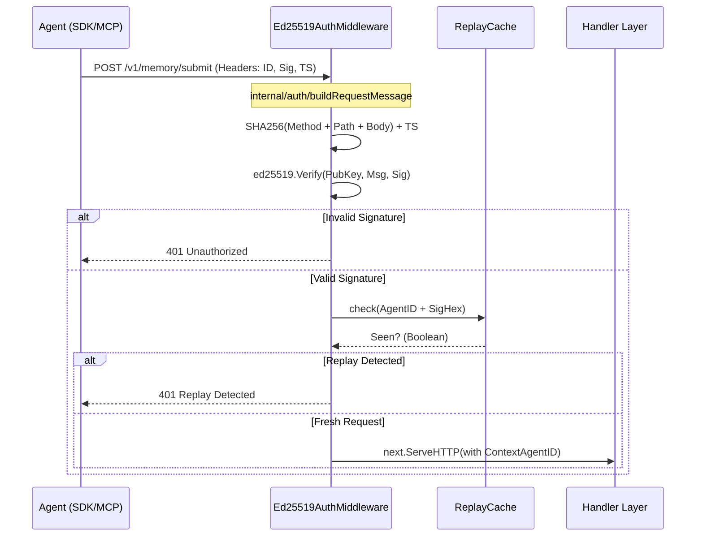

<!-- source: DeepWiki mcp.deepwiki.com · repo l33tdawg/sage · page 6.1 Agent Identity Management · fetched 2026-10-27 -->

# Agent Identity Management

<details>
<summary>Relevant source files</summary>

The following files were used as context for generating this wiki page:

- [api/rest/middleware/auth.go](api/rest/middleware/auth.go)
- [api/rest/middleware/middleware_test.go](api/rest/middleware/middleware_test.go)
- [cmd/sage-gui/config.go](cmd/sage-gui/config.go)
- [cmd/sage-gui/mcp.go](cmd/sage-gui/mcp.go)
- [internal/auth/ed25519.go](internal/auth/ed25519.go)
- [internal/auth/ed25519_test.go](internal/auth/ed25519_test.go)
- [internal/orchestrator/redeployer.go](internal/orchestrator/redeployer.go)
- [internal/store/sqlite_test.go](internal/store/sqlite_test.go)
- [test/integration/helpers_test.go](test/integration/helpers_test.go)
- [web/handler_test.go](web/handler_test.go)
- [web/import.go](web/import.go)
- [web/network_handler.go](web/network_handler.go)
- [web/pairing.go](web/pairing.go)
- [web/pairing_test.go](web/pairing_test.go)

</details>


In SAGE, agent identity is rooted in **Ed25519** cryptography. Every agent is defined by a unique public/private keypair, where the hex-encoded public key serves as the immutable `AgentID`. This identity is used to sign API requests, participate in consensus, and attribute memory ownership across the synaptic ledger.

## Ed25519 Key Generation and Storage

SAGE uses the Ed25519 signature scheme for its high performance and security properties [internal/auth/ed25519.go:4-10](). Keys are typically generated in one of three ways:
1.  **Local CLI**: The `sage-gui` tool generates a default key at `~/.sage/agent.key` during initial setup [cmd/sage-gui/config.go:64-65]().
2.  **Dashboard**: The CEREBRUM dashboard can generate keys for new agents, providing them as a "bundle" for the agent to download [web/network_handler.go:136-144]().
3.  **SDK**: The Python SDK can generate transient or persistent keys for autonomous agents.

### Key Storage Formats
*   **Raw Seed**: The 32-byte private key seed is often stored as a raw binary file (e.g., `agent.key`) [cmd/sage-gui/mcp.go:124]().
*   **Agent Bundle**: A JSON or ZIP package containing the `agent_id` (public key), the `agent_key` (base64 seed), and metadata like `name`, `role`, and `clearance` [web/pairing.go:229-240]().

## Identity Resolution Priority Chain

When an agent (or the MCP server) starts, it must resolve which identity to use. SAGE follows a strict priority chain to allow for global defaults while supporting project-specific identities.

| Priority | Source | Description |
| :--- | :--- | :--- |
| 1 (Highest) | `SAGE_IDENTITY_PATH` | Environment variable pointing to a specific `.key` file. |
| 2 | `SAGE_AGENT_KEY` | Legacy environment variable for backward compatibility. |
| 3 | **Per-Project Key** | Located at `~/.sage/agents/<name>-<hash>/agent.key`. |
| 4 (Lowest) | **Global Key** | The default fallback at `~/.sage/agent.key`. |

Sources: [cmd/sage-gui/mcp.go:84-114]()

### Per-Project Isolation
To prevent memory leakage between unrelated workstreams (e.g., `~/work/project-a` vs `~/personal/project-b`), `sage-gui` generates a unique hash based on the absolute path of the current working directory [cmd/sage-gui/mcp.go:146-155](). This allows a single AI (like Claude) to have distinct "personas" and memory access rights depending on the folder it is operating in.

## Request Signing and Verification

Every REST API request must be signed to prevent impersonation. The signature covers the HTTP method, the path (including query parameters), the request body, and a timestamp to prevent replay attacks [internal/auth/ed25519.go:48-55]().

### Authentication Data Flow
The `Ed25519AuthMiddleware` intercepts requests and performs the following validation:

1.  **Header Extraction**: Retrieves `X-Agent-ID`, `X-Signature`, and `X-Timestamp` [api/rest/middleware/auth.go:95-97]().
2.  **Clock Skew Check**: Ensures the timestamp is within 5 minutes of the server time [api/rest/middleware/auth.go:113-122]().
3.  **Replay Protection**: Checks the `sigCache` to ensure this specific signature hasn't been used before [api/rest/middleware/auth.go:167-173]().
4.  **Cryptographic Verification**: Reconstructs the canonical message and verifies the Ed25519 signature [api/rest/middleware/auth.go:155-165]().

### Request Signature Diagram
The following diagram illustrates how a request is transformed from a network call into a verified identity context.

**Diagram: API Request Authentication Flow**

Sources: [api/rest/middleware/auth.go:87-192](), [internal/auth/ed25519.go:63-77]()

## Key Rotation and Redeployment

In multi-node deployments, changing an agent's key (especially if they are a validator) requires a coordinated "Redeployment" to update the on-chain genesis state.

### RotateAgentKey Process
When `handleRotateAgentKey` is triggered via the dashboard [web/network_handler.go:63](), the system initiates a state machine managed by the `Redeployer` [internal/orchestrator/redeployer.go:84-92]().

1.  **Locking**: `AcquireRedeployLock` prevents concurrent configuration changes [internal/orchestrator/redeployer.go:175-176]().
2.  **Chain Halt**: The CometBFT node is stopped across the quorum [internal/orchestrator/redeployer.go:181-182]().
3.  **Genesis Regeneration**: A new `genesis.json` is created using the updated `ValidatorPubkey` for the rotated agent [internal/orchestrator/redeployer.go:184-203]().
4.  **State Wipe & Restart**: On-chain state is wiped, and the chain is restarted from height 0 with the new keys [internal/orchestrator/redeployer.go:205-209]().

Sources: [internal/orchestrator/redeployer.go:111-171](), [web/network_handler.go:63-67]()

## Claim Tokens and Pairing

To simplify the handover of identities from the CEREBRUM dashboard to a remote agent (e.g., an agent running on a different machine), SAGE uses **Pairing Codes**.

### Pairing Lifecycle
1.  **Generate**: An admin generates a code (e.g., `SAG-X7KP4M2N`) for a specific `AgentID` [web/pairing.go:47-57]().
2.  **TTL**: Codes are ephemeral, typically expiring in 15 minutes [web/pairing.go:19-20]().
3.  **Redeem**: The remote agent calls `GET /v1/dashboard/network/pair/{code}`. This endpoint is unauthenticated because the code itself serves as the proof of intent [web/pairing.go:188-190]().
4.  **Handover**: The server returns the full agent bundle, including the private key seed [web/pairing.go:229-240]().

**Diagram: Agent Identity Handover (Pairing)**
```mermaid
graph TD
    subgraph "CEREBRUM Dashboard"
        Admin["Admin User"]
        PS["PairingStore (web/pairing.go)"]
        AS["AgentStore (SQLite/Postgres)"]
    end

    subgraph "Remote Agent Node"
        GUI["sage-gui mcp install --token"]
    end

    Admin -->|POST /network/agents/{id}/pair| PS
    PS -->|Generate Code| Code["SAG-XXXXXX"]
    Code -.->|Out-of-band Transfer| GUI
    GUI -->|GET /network/pair/{code}| PS
    PS -->|Consume & Validate| AS
    AS -->|Retrieve Bundle + Seed| PS
    PS -->|JSON Bundle| GUI
    GUI -->|Save to| KeyFile["~/.sage/agent.key"]
```
Sources: [web/pairing.go:159-242](), [cmd/sage-gui/mcp.go:175-185]()

## Name Distinctions

SAGE distinguishes between two types of names for an agent:

1.  **RegisteredName**: The name assigned during on-chain registration (e.g., via `TxTypeAgentRegister`). This is used for attribution in the Synaptic Ledger and cannot be changed without a new transaction [web/network_handler.go:176-183]().
2.  **Mutable Name**: A display name used in the CEREBRUM UI for administrative organization, stored in the local `AgentStore` [web/network_handler.go:148-151]().

The `AgentID` (Public Key) remains the only globally unique and immutable identifier across all layers of the system [internal/auth/ed25519.go:31-34]().

Sources: [web/network_handler.go:142-161](), [internal/auth/ed25519.go:31-34]()

---

