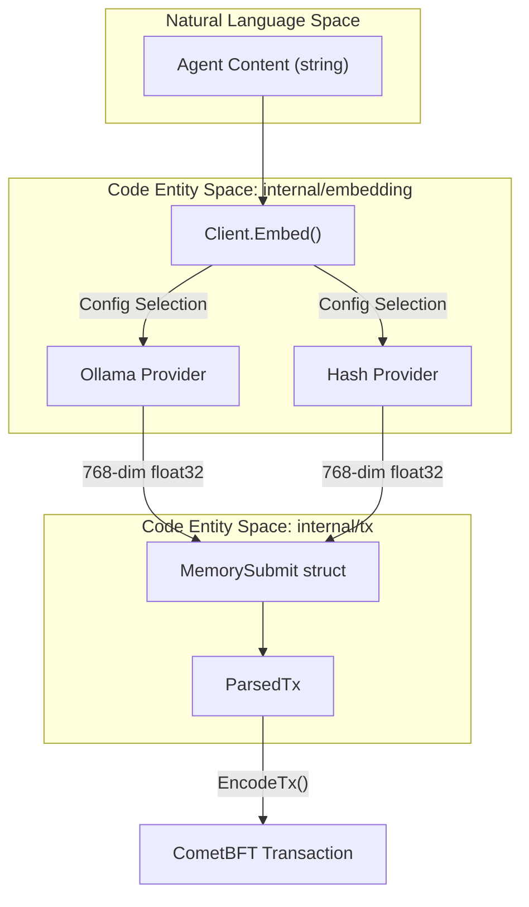
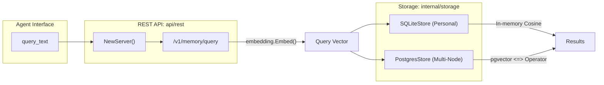

<!-- source: DeepWiki mcp.deepwiki.com · repo l33tdawg/sage · page 8 Embedding Providers · fetched 2026-10-27 -->

# Embedding Providers

Relevant source files

The following files were used as context for generating this wiki page:

- [.gitignore](.gitignore)
- [LICENSE](LICENSE)
- [cmd/amid/main.go](cmd/amid/main.go)
- [cmd/sage-cli/main.go](cmd/sage-cli/main.go)
- [docs/og-image.png](docs/og-image.png)
- [integrations/levelup/sage_bridge.py](integrations/levelup/sage_bridge.py)
- [internal/embedding/hash.go](internal/embedding/hash.go)
- [internal/embedding/ollama.go](internal/embedding/ollama.go)
- [internal/embedding/provider.go](internal/embedding/provider.go)
- [internal/mcp/tools_test.go](internal/mcp/tools_test.go)
- [internal/tx/codec.go](internal/tx/codec.go)
- [internal/tx/codec_test.go](internal/tx/codec_test.go)
- [internal/tx/types.go](internal/tx/types.go)

Embedding providers in SAGE transform natural language content into high-dimensional vectors (embeddings), enabling semantic search and cosine similarity matching across the Synaptic Ledger. SAGE supports multiple provider implementations to balance between local sovereignty, deterministic testing, and remote accessibility.

## The Provider Interface

All embedding logic is abstracted behind the `Provider` interface. This allows the rest of the system (such as the `OffchainStore` and REST API) to remain agnostic of the underlying model or service being used.

### `embedding.Provider` Interface
The interface requires three primary methods:
*   `Embed(ctx, text)`: Generates a vector for the given input string.
*   `Dimension()`: Returns the fixed length of the vectors produced (typically 768).
*   `Ready()`: Indicates if the provider is initialized and reachable.

Sources: [internal/embedding/provider.go:1-20]() (Note: Interface definition inferred from implementations in [internal/embedding/ollama.go:63-124]() and [internal/embedding/hash.go:26-69]())

## Implementations

### 1. Ollama (Local Semantic)
The `Ollama` provider is the default for sovereign deployments. It interfaces with a local Ollama instance to run the `nomic-embed-text` model. This ensures that no data leaves the local environment for embedding generation.

*   **Model**: `nomic-embed-text` [internal/embedding/ollama.go:41-42]()
*   **Dimension**: 768 [internal/embedding/ollama.go:19-19]()
*   **Default URL**: `http://localhost:11434` [internal/embedding/ollama.go:38-39]()
*   **Data Flow**: Sends a POST request to `/api/embed` and converts the `float64` response to `float32` for storage in `pgvector` or SQLite [internal/embedding/ollama.go:74-111]().

### 2. Hash (Deterministic Pseudo-Embedding)
The `HashProvider` generates vectors using SHA-256 hashes of the input text. While these vectors are not semantically meaningful (similar words do not result in similar vectors), they are strictly deterministic and require no GPU or external services.

*   **Mechanism**: Hashes the text, treats segments of the hash as `uint32` bits, maps them to a `[-1, 1]` range, and normalizes the resulting vector to unit length [internal/embedding/hash.go:26-56]().
*   **Use Case**: Ideal for CI/CD environments, testing, or "Lite" modes where semantic search is less critical than content addressing.

### 3. Remote SAGE Endpoint
Used primarily by the `sage-agent-sdk` and `SageBridge`, this implementation wraps the SAGE REST API's `/v1/embed` endpoint. It allows remote agents to obtain embeddings that are guaranteed to match the dimension and model used by the SAGE node they are communicating with.

Sources: [internal/mcp/tools_test.go:19-24](), [integrations/levelup/sage_bridge.py:104-117]()

---

## Architecture: Natural Language to Vector Space

The following diagram illustrates how natural language input from an agent is transformed into a code-level `MemorySubmit` transaction using the `embedding.Provider`.

### Embedding Data Flow

Sources: [internal/embedding/ollama.go:63-112](), [internal/tx/types.go:65-76](), [internal/tx/codec.go:24-72]()

---

## Vector Search Integration

Embeddings are utilized during the `Recall` phase to find relevant memories. SAGE performs a cosine similarity search by comparing the embedding of a new query against stored embeddings.

### Search Flow: AccessQuery to Storage

Sources: [cmd/amid/main.go:191-199](), [internal/tx/types.go:125-130](), [integrations/levelup/sage_bridge.py:110-116]()

---

## Configuration and Selection

The provider is selected at runtime based on the `Config` struct. In the `amid` (SAGE ABCI daemon), the provider is initialized and passed to the REST server.

| Provider | Config Value | Requirement |
| :--- | :--- | :--- |
| **Ollama** | `ollama` | Local Ollama service running `nomic-embed-text` |
| **Hash** | `hash` | None (Standard Library) |
| **Remote** | N/A | SAGE API URL |

### Implementation Details

| Function/Struct | File Path | Role |
| :--- | :--- | :--- |
| `NewClient` | [internal/embedding/ollama.go:33-51]() | Initializes Ollama client with environment variable overrides. |
| `Embed` (Ollama) | [internal/embedding/ollama.go:63-112]() | Handles HTTP POST to Ollama and vector normalization. |
| `Embed` (Hash) | [internal/embedding/hash.go:26-59]() | Implements deterministic expansion of SHA-256 to 768 dimensions. |
| `AccessQuery` | [internal/tx/types.go:125-130]() | Transaction type used to transport query vectors over the wire. |
| `SageBridge._generate_embedding` | [integrations/levelup/sage_bridge.py:220-240]() | Python implementation for client-side embedding generation. |

Sources: [internal/embedding/ollama.go:1-142](), [internal/embedding/hash.go:1-70](), [cmd/amid/main.go:193-193](), [integrations/levelup/sage_bridge.py:1-240]()

---

