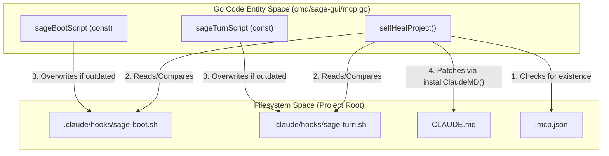
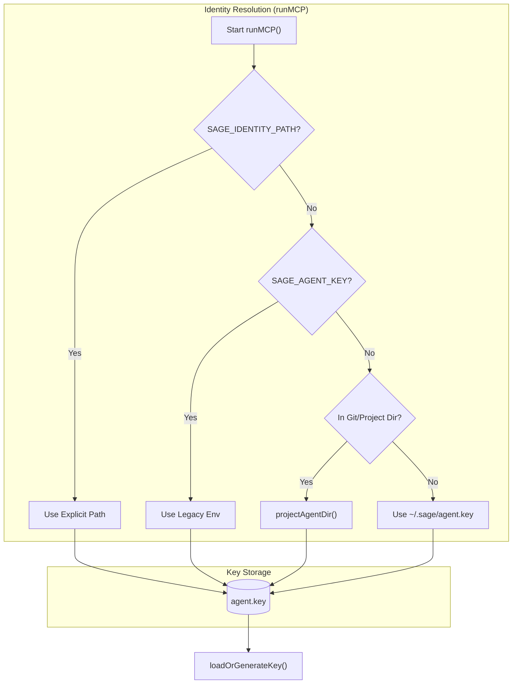

<!-- source: DeepWiki mcp.deepwiki.com · repo l33tdawg/sage · page 9.2 Claude Code Integration and Hooks · fetched 2026-10-27 -->

# Claude Code Integration and Hooks

Relevant source files

The following files were used as context for generating this wiki page:

- [.claude/hooks/sage-boot-check.sh](.claude/hooks/sage-boot-check.sh)
- [.claude/settings.json](.claude/settings.json)
- [cmd/sage-gui/config.go](cmd/sage-gui/config.go)
- [cmd/sage-gui/mcp.go](cmd/sage-gui/mcp.go)
- [cmd/sage-gui/mcp_test.go](cmd/sage-gui/mcp_test.go)
- [extension/chrome/manifest.json](extension/chrome/manifest.json)
- [extension/manifest.firefox.json](extension/manifest.firefox.json)
- [extension/store-listing.md](extension/store-listing.md)
- [web/handler_memorymode_test.go](web/handler_memorymode_test.go)

SAGE provides a deep integration with **Claude Code** (Anthropic's CLI agent) to ensure persistent memory is treated as a core system component rather than an optional tool. This integration is managed through the `sage-gui mcp` command suite and includes automated hook scripts, configuration merging, and a "self-healing" mechanism that maintains the integration integrity every time the MCP server starts.

## Hook Scripts: `sage-boot.sh` and `sage-turn.sh`

SAGE deploys two primary shell scripts to the project's `.claude/hooks/` directory. These scripts are triggered by Claude Code's lifecycle events to enforce "brain booting" and turn-based experience recording.

### 1. `sage-boot.sh`
This script fires on `SessionStart` events (startup, resume, and context compaction) [cmd/sage-gui/mcp.go:25-40](). Its purpose is to mandate the execution of `sage_inception` before the agent performs any other task. This ensures the agent's working memory is populated with relevant historical context from the SAGE store [cmd/sage-gui/mcp.go:35-36]().

### 2. `sage-turn.sh`
This script fires on `PreCompact`, `Stop`, `SubagentStop`, and `PostToolUse` [cmd/sage-gui/mcp.go:42-58](). It reminds the agent to call `sage_turn` to save the current topic and observations.

### Memory Mode Adaptation
Both scripts dynamically adapt their output based on the contents of `~/.sage/memory_mode` [cmd/sage-gui/mcp.go:29-30](), [cmd/sage-gui/mcp.go:47-48]().

| Mode | `sage-boot.sh` Behavior | `sage-turn.sh` Behavior |
| :--- | :--- | :--- |
| **Full** | Mandatory `sage_inception` warning | Mandatory `sage_turn` reminder |
| **Bookend** | Warns NOT to call `sage_turn` every turn; only `sage_reflect` at end | Only reminds on significant events (Stop/Compact) |
| **On-Demand** | Informs user SAGE is manual only | Exits silently (`exit 0`) |

**Sources:** [cmd/sage-gui/mcp.go:25-58](), [cmd/sage-gui/mcp_test.go:109-126]()

---

## Installation and Configuration Merging

The `sage-gui mcp install` command automates the setup of a project for Claude Code.

### `.claude/settings.json` Deep Merge
SAGE performs a deep-merge into the `.claude/settings.json` file to register hooks without overwriting existing user configurations [.claude/settings.json:1-36](). It maps the shell scripts to specific Claude lifecycle matchers:
- **startup/resume/compact**: Executes `sage-boot.sh` [.claude/settings.json:3-33]().
- **PostToolUse/Stop**: Executes `sage-turn.sh`.

### `sagePermissionsConfig` Tool Allowlist
To provide a seamless experience, SAGE configures the `sagePermissionsConfig` (within the `.mcp.json` or global Claude config) to allowlist SAGE tools. This prevents Claude from asking for permission on every memory retrieval or turn update.

### `CLAUDE.md` Patching
SAGE maintains a dedicated section in the project's `CLAUDE.md` file to provide persistent instructions to the agent [cmd/sage-gui/mcp_test.go:13-26](). 
- **Idempotency**: The `installClaudeMD` function uses a marker (`sageClaudeMDMarker`) to identify existing SAGE sections [cmd/sage-gui/mcp_test.go:71-84]().
- **Patching**: If an old version of the SAGE instructions exists, it is replaced with the latest version while preserving the rest of the file [cmd/sage-gui/mcp_test.go:49-69]().

**Sources:** [cmd/sage-gui/mcp.go:175-202](), [cmd/sage-gui/mcp_test.go:13-84](), [.claude/settings.json:1-36]()

---

## Self-Heal Mechanism

The `selfHealProject` function is a critical reliability feature that runs automatically every time `sage-gui mcp` (the MCP server) starts [cmd/sage-gui/mcp.go:76-82]().

### Logic Flow
The self-heal logic ensures that users who upgrade their `sage-gui` binary receive updated hook scripts and instructions without having to re-run the install command.

1. **Detect Project**: It identifies the current working directory [cmd/sage-gui/mcp.go:80]().
2. **Verify Installation**: It checks for the existence of `.mcp.json`. If missing, it assumes the project is not a SAGE project and skips patching [cmd/sage-gui/mcp_test.go:190-200]().
3. **Patch Hooks**: It compares existing `.claude/hooks/sage-*.sh` files against the embedded constants `sageBootScript` and `sageTurnScript`. If they differ (e.g., an old version without `memory_mode` support), it overwrites them [cmd/sage-gui/mcp_test.go:137-154]().
4. **Update Instructions**: It re-runs the `CLAUDE.md` patching logic to ensure the agent's system prompts are up to date [cmd/sage-gui/mcp_test.go:175-188]().

### Hook Update Data Flow
The following diagram illustrates how the `selfHealProject` bridges the Go binary's embedded assets to the local filesystem.

**Self-Healing Data Flow**

**Sources:** [cmd/sage-gui/mcp.go:23-58](), [cmd/sage-gui/mcp.go:76-82](), [cmd/sage-gui/mcp_test.go:135-210]()

---

## Identity Resolution in MCP Mode

When running as an MCP server, `sage-gui` resolves the agent's identity using a specific priority chain to support both global and project-specific agents [cmd/sage-gui/mcp.go:84-114]().

| Priority | Source | Description |
| :--- | :--- | :--- |
| 1 | `SAGE_IDENTITY_PATH` | Explicit path to an `agent.key` [cmd/sage-gui/mcp.go:89](). |
| 2 | `SAGE_AGENT_KEY` | Legacy environment variable support [cmd/sage-gui/mcp.go:91](). |
| 3 | `projectAgentDir()` | Per-project key: `~/.sage/agents/<name>-<hash>/agent.key` [cmd/sage-gui/mcp.go:107-112](). |
| 4 | Default Path | Fallback to `~/.sage/agent.key` [cmd/sage-gui/mcp.go:103](). |

### Project-Specific Key Generation
The `projectAgentDir` function generates a unique hash based on the absolute path of the project [cmd/sage-gui/mcp.go:146-155](). This allows the agent to have different "identities" (and thus different memory access levels) for different codebases, even if the directory names are identical (e.g., two different projects both named `backend`).

**Identity Resolution Diagram**

**Sources:** [cmd/sage-gui/mcp.go:84-114](), [cmd/sage-gui/mcp.go:146-155](), [cmd/sage-gui/mcp.go:124]()

---

