# Page: SAGE Overview

# SAGE Overview

<details>
<summary>Relevant source files</summary>

The following files were used as context for generating this wiki page:

- [README.md](README.md)
- [docs/ARCHITECTURE.md](docs/ARCHITECTURE.md)
- [docs/GETTING_STARTED.md](docs/GETTING_STARTED.md)
- [docs/connect.html](docs/connect.html)
- [docs/index.html](docs/index.html)
- [papers/Paper1 - Agent Memory Infrastructure - Byzantine-Resilient Institutional Memory for Multi-Agent Systems.pdf](papers/Paper1 - Agent Memory Infrastructure - Byzantine-Resilient Institutional Memory for Multi-Agent Systems.pdf)
- [papers/Paper2 - Consensus-Validated Memory Improves Agent Performance on Complex Tasks.pdf](papers/Paper2 - Consensus-Validated Memory Improves Agent Performance on Complex Tasks.pdf)
- [papers/Paper3 - Institutional Memory as Organizational Knowledge - AI Agents That Learn Their Jobs from Experience Not Instructions.pdf](papers/Paper3 - Institutional Memory as Organizational Knowledge - AI Agents That Learn Their Jobs from Experience Not Instructions.pdf)
- [papers/README.md](papers/README.md)
- [sdk/python/README.md](sdk/python/README.md)
- [sdk/python/pyproject.toml](sdk/python/pyproject.toml)
- [sdk/python/src/sage_sdk/__init__.py](sdk/python/src/sage_sdk/__init__.py)
- [sdk/python/src/sage_sdk/models.py](sdk/python/src/sage_sdk/models.py)

</details>


SAGE (Sovereign Agent Governed Experience) is a Byzantine fault-tolerant institutional memory infrastructure designed for AI agents. Unlike traditional vector databases or flat-file memory "skills," SAGE provides a persistent, consensus-validated knowledge layer that allows agents to learn from experience across conversations and organizational boundaries [README.md:1-7]().

SAGE ensures that AI agents possess a verifiable audit trail of facts, observations, and inferences, preventing the "memory loss" typically associated with stateless LLM context windows [README.md:5-7]().

## Deployment Modes

SAGE supports two primary deployment topologies to accommodate both individual users and large-scale multi-agent organizations:

1.  **Personal Mode (`sage-gui`)**: A single-binary deployment that runs a local CometBFT node with four in-process application validators [README.md:32-34](). It includes a built-in SQLite store, an optional AES-256-GCM encrypted "Synaptic Ledger," and a web-based dashboard [README.md:23-28]().
2.  **Multi-Node Mode (`amid`)**: A distributed network of ABCI application nodes and CometBFT validators, typically deployed via Docker [docs/ARCHITECTURE.md:79-81](). This mode utilizes PostgreSQL with `pgvector` for off-chain storage and scales to support complex RBAC, federation, and high-throughput agent environments [docs/ARCHITECTURE.md:91-100]().

For installation and setup instructions, see **[Getting Started](#1.1)**.

## System Architecture

The SAGE architecture bridges the gap between agent tool calls and a distributed consensus ledger.

### High-Level Data Flow
"Natural Language Space" (Agent) $\rightarrow$ "Code Entity Space" (SAGE)

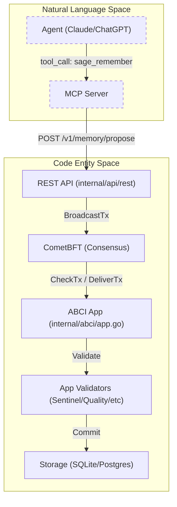
Sources: [README.md:17-30](), [docs/ARCHITECTURE.md:31-79]()

### Component Interaction
The following diagram illustrates how internal code entities relate to the physical infrastructure.

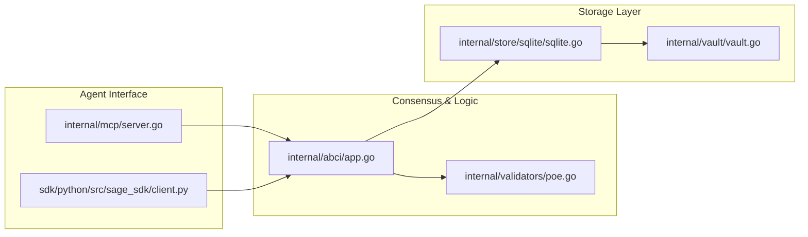
Sources: [README.md:23-29](), [docs/ARCHITECTURE.md:91-100](), [sdk/python/src/sage_sdk/client.py:1-10]()

## Major Subsystems

*   **CEREBRUM Dashboard**: A Preact-based SPA providing a force-directed neural graph visualization of memories, real-time event monitoring via SSE, and network management tools [README.md:38-44]().
*   **Synaptic Ledger**: A secure storage system using AES-256-GCM encryption and Argon2id key derivation to protect memory content at rest [README.md:27](), [docs/GETTING_STARTED.md:50-60]().
*   **Consensus Engine**: Leverages CometBFT and the ABCI 2.0 protocol to ensure all memory commits reach a 3/4 BFT quorum through four specialized validators: Sentinel, Dedup, Quality, and Consistency [README.md:24-26]().
*   **Agent Identity**: An Ed25519-based PKI system where every agent is uniquely identified by a `RegisteredName` and signs every request to the infrastructure [README.md:69-70](), [sdk/python/src/sage_sdk/auth.py:1-10]().
*   **Inter-Agent Pipeline**: An asynchronous message bus allowing agents to coordinate tasks and share results via `sage_pipe` and `sage_inbox` tools [README.md:99-100]().

For a detailed breakdown of these terms, see **[Key Concepts and Terminology](#1.2)**.

## Research and Performance
SAGE is based on peer-reviewed research demonstrating that consensus-validated memory significantly improves agent performance over time (Spearman rho=0.716) [papers/README.md:22-25](). 

| Metric | Performance |
| :--- | :--- |
| **Throughput** | ~956 req/s memory submissions |
| **Latency** | 21.6ms P95 query latency |
| **Fault Tolerance** | 1/4 nodes can fail without halting |
Sources: [docs/ARCHITECTURE.md:103-108](), [papers/README.md:10-11]()

---

## Child Pages
*   **[Getting Started](#1.1)**: Step-by-step guide for installing `sage-gui` and connecting to Claude/ChatGPT.
*   **[Key Concepts and Terminology](#1.2)**: Deep dive into the domain vocabulary and data structures like `MemoryRecord` and `PoE`.

---

# Page: Getting Started

# Getting Started

<details>
<summary>Relevant source files</summary>

The following files were used as context for generating this wiki page:

- [cmd/sage-gui/config.go](cmd/sage-gui/config.go)
- [cmd/sage-gui/main.go](cmd/sage-gui/main.go)
- [cmd/sage-gui/mcp.go](cmd/sage-gui/mcp.go)
- [cmd/sage-gui/vault.go](cmd/sage-gui/vault.go)
- [cmd/sage-gui/wizard.go](cmd/sage-gui/wizard.go)
- [docs/ARCHITECTURE.md](docs/ARCHITECTURE.md)
- [docs/GETTING_STARTED.md](docs/GETTING_STARTED.md)
- [docs/connect.html](docs/connect.html)
- [docs/index.html](docs/index.html)
- [sdk/python/README.md](sdk/python/README.md)
- [sdk/python/src/sage_sdk/models.py](sdk/python/src/sage_sdk/models.py)

</details>


This guide provides a step-by-step walkthrough for setting up SAGE Personal, configuring your AI's memory provider, and connecting to assistants like Claude or ChatGPT via the Model Context Protocol (MCP).

SAGE operates as a single binary (`sage-gui`) that manages a local BFT (Byzantine Fault Tolerant) consensus node, a REST API, and an MCP server [docs/GETTING_STARTED.md:3-11]().

---

## 1. Installation

SAGE is distributed as a Go binary. You can build it from source or use the platform-specific installers.

### Build from Source
Ensure you have Go 1.24+ installed [docs/GETTING_STARTED.md:17-18]().

```bash
git clone https://github.com/l33tdawg/sage.git
cd sage
go build -o sage-gui ./cmd/sage-gui/
sudo mv sage-gui /usr/local/bin/
```
Sources: [docs/GETTING_STARTED.md:19-24](), [cmd/sage-gui/main.go:15-57]()

---

## 2. Initial Setup Wizard

The `setup` command launches a local web server that guides you through the configuration of your embedding provider and encryption settings [cmd/sage-gui/wizard.go:22-67]().

### Running the Wizard
```bash
sage-gui setup
```

The wizard performs the following actions:
1.  **Identity Generation**: Creates an Ed25519 agent key at `~/.sage/agent.key` if one does not exist [cmd/sage-gui/wizard.go:40-43]().
2.  **Embedding Configuration**: Tests connectivity to providers like **Ollama** or initializes a **Hash** provider for zero-dependency keyword matching [cmd/sage-gui/wizard.go:102-135]().
3.  **Vault Initialization**: If encryption is enabled, it initializes an AES-256-GCM vault at `~/.sage/vault.key` using a passphrase [cmd/sage-gui/wizard.go:160-169]().
4.  **Config Persistence**: Saves the final `Config` struct to `~/.sage/config.yaml` [cmd/sage-gui/wizard.go:171-174]().

### Setup Data Flow
The diagram below illustrates how the `runSetup` function coordinates with the `wizard.go` handlers to generate the system configuration.

**Wizard Configuration Flow**
```mermaid
graph TD
    subgraph "CLI Space"
        "runSetup()"["cmd/sage-gui/wizard.go:runSetup"]
    end

    subgraph "Web UI (Browser)"
        "wizardHTML"["cmd/sage-gui/wizard.go:wizardHTML"]
        "handleTestProvider"["cmd/sage-gui/wizard.go:handleTestProvider"]
        "handleSaveConfig"["cmd/sage-gui/wizard.go:handleSaveConfig"]
    end

    subgraph "Logic & Storage"
        "loadOrGenerateKey"["cmd/sage-gui/mcp.go:loadOrGenerateKey"]
        "vault.Init"["internal/vault/vault.go:Init"]
        "SaveConfig"["cmd/sage-gui/config.go:SaveConfig"]
        "config_yaml"["~/.sage/config.yaml"]
    end

    "runSetup()" --> "loadOrGenerateKey"
    "runSetup()" --> "wizardHTML"
    "wizardHTML" -- "Test Provider" --> "handleTestProvider"
    "wizardHTML" -- "Submit Config" --> "handleSaveConfig"
    "handleSaveConfig" --> "vault.Init"
    "handleSaveConfig" --> "SaveConfig"
    "SaveConfig" --> "config_yaml"
```
Sources: [cmd/sage-gui/wizard.go:22-181](), [cmd/sage-gui/config.go:135-147](), [cmd/sage-gui/mcp.go:124-127]()

---

## 3. Connecting AI via MCP

SAGE uses the Model Context Protocol (MCP) to bridge AI assistants to the memory layer.

### Automatic Installation (Claude Code)
For users of `claude-code`, SAGE provides an automated installer that patches local project settings.

```bash
cd /path/to/your/project
sage-gui mcp install
```

This command:
*   Creates a `.mcp.json` file in the current directory [cmd/sage-gui/mcp.go:202-210]().
*   Deploys `sage-boot.sh` and `sage-turn.sh` hook scripts to enforce memory discipline [cmd/sage-gui/mcp.go:23-58]().
*   Configures `sagePermissionsConfig` to auto-allow SAGE tools [cmd/sage-gui/mcp.go:227-233]().

### Manual Configuration (Claude Desktop)
Add the following to your Claude Desktop configuration file (e.g., `~/Library/Application Support/Claude/claude_desktop_config.json` on macOS):

```json
{
  "mcpServers": {
    "sage": {
      "command": "/usr/local/bin/sage-gui",
      "args": ["mcp"],
      "env": {
        "SAGE_HOME": "~/.sage"
      }
    }
  }
}
```
Sources: [cmd/sage-gui/wizard.go:190-200](), [docs/GETTING_STARTED.md:103-115]()

---

## 4. Starting the Node

Once configured, start the SAGE node to enable the REST API and the CEREBRUM Dashboard.

```bash
sage-gui serve
```

This command initializes the `ABCI` application and starts the `CometBFT` consensus engine [cmd/sage-gui/main.go:23-24](). The system will be available at:
*   **Dashboard**: `http://localhost:8080/ui/`
*   **REST API**: `http://localhost:8080/v1/`
Sources: [docs/GETTING_STARTED.md:76-86]()

---

## 5. Verifying the System

To ensure the connection is working, interact with your AI and verify the identity resolution.

### Identity Resolution Logic
When the MCP server starts, it resolves the agent's identity using a priority chain [cmd/sage-gui/mcp.go:84-114]().

**Agent Identity Resolution Diagram**
```mermaid
graph TD
    "Start MCP"["cmd/sage-gui/mcp.go:runMCP"] --> "Check SAGE_IDENTITY_PATH"
    "Check SAGE_IDENTITY_PATH" -- "Exists" --> "Use Explicit Path"
    "Check SAGE_IDENTITY_PATH" -- "Empty" --> "Check SAGE_AGENT_KEY"
    "Check SAGE_AGENT_KEY" -- "Exists" --> "Use Legacy Key"
    "Check SAGE_AGENT_KEY" -- "Empty" --> "projectAgentDir()"
    "projectAgentDir()" --> "Generate Hash from PWD"
    "Generate Hash from PWD" --> "Use ~/.sage/agents/NAME-HASH/agent.key"
    
    subgraph "Identity Entities"
        "AgentIdentity"["sdk/python/src/sage_sdk/models.py:AgentRegistration"]
        "loadOrGenerateKey"["cmd/sage-gui/mcp.go:loadOrGenerateKey"]
    end
```
Sources: [cmd/sage-gui/mcp.go:84-155](), [sdk/python/src/sage_sdk/models.py:178-186]()

### First Tool Call: Inception
Ask your AI to initialize:
> "Call sage_inception to initialize your memory."

The AI will call `sage_inception` (defined in the MCP server), which seeds the conversation with memory usage guidelines [docs/GETTING_STARTED.md:144-154](). You can then verify the memory appears in the CEREBRUM dashboard.

Sources: [docs/GETTING_STARTED.md:128-142](), [cmd/sage-gui/mcp.go:134-139]()

---

# Page: Key Concepts and Terminology

# Key Concepts and Terminology

<details>
<summary>Relevant source files</summary>

The following files were used as context for generating this wiki page:

- [README.md](README.md)
- [internal/mcp/server.go](internal/mcp/server.go)
- [internal/mcp/tools.go](internal/mcp/tools.go)
- [internal/memory/model.go](internal/memory/model.go)
- [internal/store/postgres.go](internal/store/postgres.go)
- [internal/store/sqlite.go](internal/store/sqlite.go)
- [internal/store/store.go](internal/store/store.go)
- [sdk/python/pyproject.toml](sdk/python/pyproject.toml)
- [sdk/python/src/sage_sdk/__init__.py](sdk/python/src/sage_sdk/__init__.py)

</details>


This page defines the core domain vocabulary and technical concepts required to understand the SAGE (Sovereign Agent Governed Experience) infrastructure. It serves as a bridge between high-level agentic memory concepts and their specific implementations in the Go and Python codebases.

## Core Data Entities

The primary unit of data in SAGE is the **MemoryRecord**. Unlike a simple vector embedding, a `MemoryRecord` contains rich metadata, cryptographic proofs, and lifecycle state.

### MemoryRecord
The fundamental data structure representing a piece of knowledge. It is defined in `internal/memory/model.go` [internal/memory/model.go:39-56]().
*   **MemoryID**: A unique identifier for the record.
*   **Content**: The actual text or data stored.
*   **ConfidenceScore**: A float (0.0 to 1.0) representing the system's certainty in the memory [internal/memory/model.go:49-49]().
*   **MemoryType**: Categorizes the memory to determine its decay and visibility rules.

| Type | Description | Default Confidence |
| :--- | :--- | :--- |
| `fact` | Durable knowledge (infrastructure, IPs, architecture) that resists decay. | 0.95+ |
| `observation` | Episodic, session-level context about what happened. | 0.80 |
| `inference` | Hypotheses or conclusions derived by the agent. | 0.60 |
| `task` | Actionable items with a lifecycle (`planned`, `in_progress`, `done`). | 1.0 |

**Sources:** [internal/memory/model.go:18-36](), [internal/mcp/tools.go:25-31]()

### Domain
A logical namespace used to partition memories. Domains are dynamic and created organically by agents (e.g., `security`, `go-debugging`, `quantum-physics`) [internal/mcp/tools.go:134-135](). Access control and recall filtering are often scoped by Domain.

### KnowledgeTriple
An optional structured representation of a memory using Subject-Predicate-Object format (e.g., "SAGE" -> "uses" -> "CometBFT") [internal/memory/model.go:67-71](). These are stored in the `knowledge_triples` table [internal/store/sqlite.go:170-176]().

---

## The Consensus & Validation Layer

SAGE treats memory commitment as a distributed systems problem, utilizing Byzantine Fault Tolerant (BFT) primitives.

### CometBFT & ABCI
*   **CometBFT**: The consensus engine that ensures all nodes in a SAGE network agree on the order and content of memory transactions [README.md:26-26]().
*   **ABCI (Application BlockChain Interface)**: The protocol that connects CometBFT to the SAGE application logic. The SAGE ABCI app handles validation, confidence scoring, and state transitions.

### Proof of Experience (PoE)
The weighting mechanism for validators. Instead of Proof of Stake, SAGE uses **PoE**, where a validator's voting power is determined by its historical accuracy, domain expertise, and corroboration by other agents [internal/store/store.go:54-66]().

### Synaptic Ledger (Vault)
The encryption layer that protects memory at rest. It uses **AES-256-GCM** and derives keys via **Argon2id** [internal/store/sqlite.go:22-22](). When the "Vault" is locked, memory content and embeddings remain encrypted and inaccessible to the agent [internal/store/sqlite.go:81-83]().

---

## System Architecture Diagrams

### From Natural Language to Code Entities
This diagram shows how an agent's intent (Natural Language Space) is transformed into specific code structures (Code Entity Space).

**Intent to Entity Mapping**
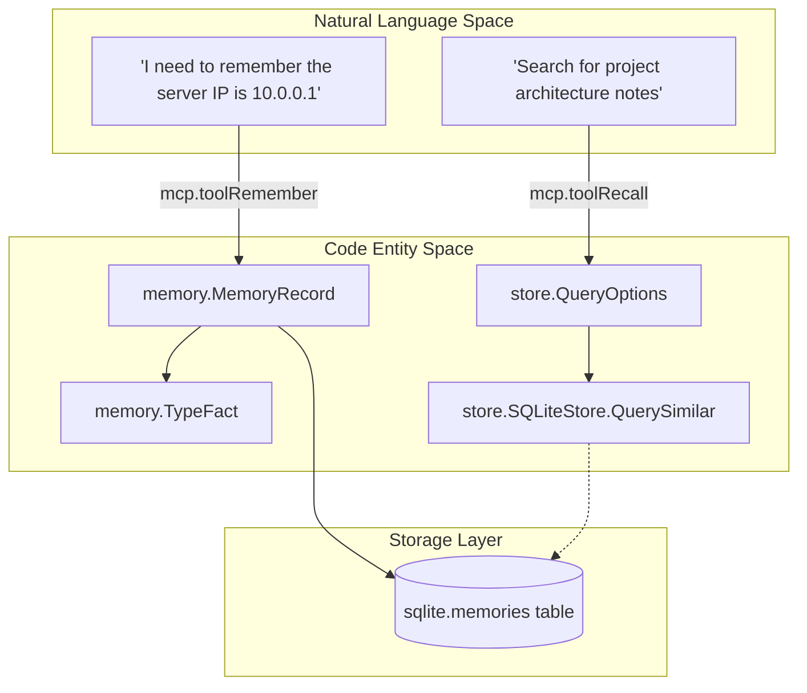
**Sources:** [internal/mcp/tools.go:23-53](), [internal/memory/model.go:39-56](), [internal/store/sqlite.go:150-166]()

### Memory Lifecycle and Validation Flow
This diagram maps the conceptual "validation" of a memory to the actual functions and state changes in the codebase.

**Validation State Machine**
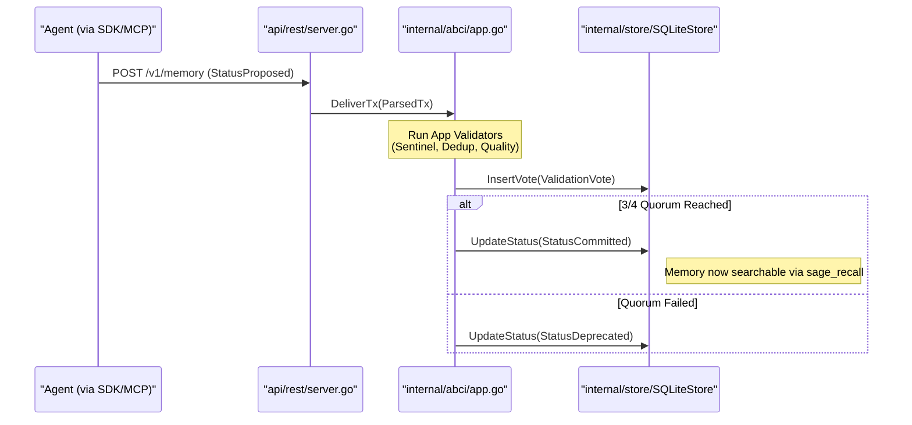
**Sources:** [internal/memory/model.go:10-16](), [internal/store/store.go:11-20](), [internal/store/sqlite.go:113-113](), [internal/mcp/server.go:151-152]()

---

## Glossary of Key Components

| Term | Definition | Code Pointer |
| :--- | :--- | :--- |
| **CEREBRUM** | The web dashboard for visualizing the neural graph and managing the network. | `internal/api/dashboard` |
| **MCP** | Model Context Protocol; the stdio/JSON-RPC interface used by Claude and ChatGPT. | [internal/mcp/server.go:42-42]() |
| **Sentinel** | An app validator that checks for malformed data or unauthorized agents. | `internal/abci/validators` |
| **Confidence Decay** | The automatic reduction of `ConfidenceScore` over time for `observation` types. | `internal/abci/engine` |
| **AgentIdentity** | The Ed25519 keypair and metadata identifying a unique agent. | [sdk/python/src/sage_sdk/auth.py]() |
| **Synaptic Ledger** | The logical term for the encrypted, consensus-validated memory store. | [README.md:27-27]() |
| **sage_inception** | The mandatory "boot" tool that initializes an agent's session context. | [internal/mcp/tools.go:105-117]() |
| **sage_turn** | The atomic "recall + store" tool used every conversation turn. | [internal/mcp/tools.go:128-135]() |

**Sources:** [README.md:19-30](), [internal/mcp/server.go:1-17](), [internal/store/sqlite.go:1-23]()

---

# Page: Core Architecture

# Core Architecture

<details>
<summary>Relevant source files</summary>

The following files were used as context for generating this wiki page:

- [.github/workflows/ci.yml](.github/workflows/ci.yml)
- [.github/workflows/release.yml](.github/workflows/release.yml)
- [api/rest/agent_handler.go](api/rest/agent_handler.go)
- [cmd/sage-gui/node.go](cmd/sage-gui/node.go)
- [deploy/Dockerfile.abci](deploy/Dockerfile.abci)
- [docs/ARCHITECTURE.md](docs/ARCHITECTURE.md)
- [docs/GETTING_STARTED.md](docs/GETTING_STARTED.md)
- [go.mod](go.mod)
- [go.sum](go.sum)
- [internal/abci/app.go](internal/abci/app.go)
- [internal/abci/app_test.go](internal/abci/app_test.go)
- [internal/abci/migrate.go](internal/abci/migrate.go)
- [internal/store/badger.go](internal/store/badger.go)
- [sdk/python/README.md](sdk/python/README.md)
- [sdk/python/src/sage_sdk/models.py](sdk/python/src/sage_sdk/models.py)
- [server.json](server.json)

</details>


SAGE (Sovereign Agent Governed Experience) is a distributed, consensus-validated memory system for AI agents. It operates as a two-tier architecture that bridges the gap between high-frequency agent interactions and cryptographically secure, long-term storage.

The system is designed to run in two primary modes:
1.  **Personal Mode**: A single-binary deployment (`sage-gui`) using SQLite and an in-process CometBFT node for local agent memory [cmd/sage-gui/node.go:187-190]().
2.  **Multi-Node Mode**: A Byzantine Fault Tolerant (BFT) cluster (`amid`) using PostgreSQL and a 4-validator quorum to provide institutional-grade memory [docs/ARCHITECTURE.md:41-57]().

## End-to-End Data Flow

The following diagram traces a memory submission from an AI agent's tool call through the various architectural layers to final commitment.

### Memory Submission Pipeline
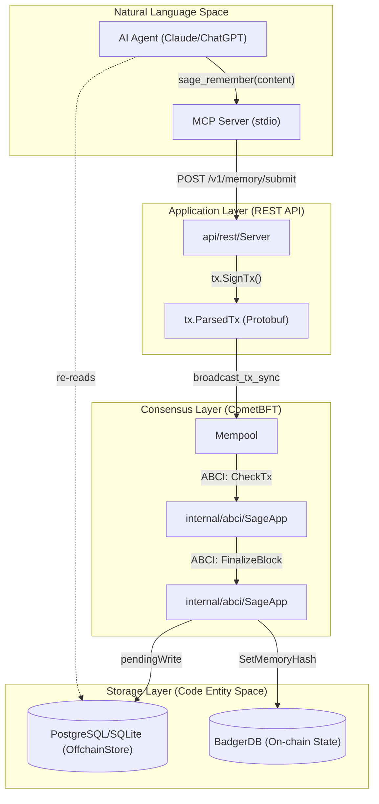
**Sources:** [docs/ARCHITECTURE.md:31-79](), [internal/abci/app.go:115-127](), [api/rest/server.go:15-40]()

## Major System Layers

### 1. The Interface Layer (MCP & REST)
Agents interact with SAGE primarily through the **Model Context Protocol (MCP)** or the **Python SDK**. The MCP server translates agent tool calls into signed REST API requests [docs/GETTING_STARTED.md:128-143](). Every submission is wrapped in a `ParsedTx` struct, which includes an Ed25519 signature from the agent to ensure non-repudiation [internal/tx/codec.go:15-30]().

For details, see [Agent Interfaces](#4).

### 2. The Consensus Engine (CometBFT & ABCI)
SAGE uses **CometBFT** to ensure that all nodes in a cluster agree on the order and validity of memories. The `internal/abci/SageApp` implements the ABCI 2.0 interface to handle block proposals and state transitions [internal/abci/app.go:115-127](). 
*   **CheckTx**: Validates signatures and nonces before a transaction enters the mempool [internal/abci/app.go:218-240]().
*   **FinalizeBlock**: Executes the transactions, updating the local state [internal/abci/app.go:260-285]().

For details, see [Consensus Engine (CometBFT & ABCI)](#2.2).

### 3. Validation & Proof of Experience (PoE)
Before a memory is committed, it must pass through a 3/4 quorum of application-level validators: **Sentinel** (safety), **Dedup** (redundancy), **Quality** (utility), and **Consistency** (logic) [internal/validator/validator.go:10-45](). The system uses **Proof of Experience (PoE)** to weight validator influence based on their historical accuracy and domain expertise [internal/poe/poe.go:20-55]().

For details, see [App Validators and Proof of Experience (PoE)](#2.3).

### 4. The Storage Tier
SAGE employs a hybrid storage strategy:
*   **On-chain State (BadgerDB)**: Stores cryptographic hashes of memories, agent nonces, and the global Synaptic Ledger state [internal/store/badger.go:15-18](). This ensures the integrity of the record.
*   **Off-chain Store (PostgreSQL/SQLite)**: Stores the full text, metadata, and vector embeddings [internal/store/postgres.go:20-40](). It supports semantic search via `pgvector` or in-memory cosine similarity [internal/store/sqlite.go:50-75]().

For details, see [Storage Layer](#3).

## Internal Package Structure

The codebase is organized into functional packages that isolate the blockchain logic from the storage and API concerns.

| Package | Responsibility | Key Entities |
|:---|:---|:---|
| `internal/abci` | CometBFT Application Logic | `SageApp`, `AppState` |
| `internal/tx` | Transaction Processing & Codec | `ParsedTx`, `TxType` |
| `internal/store` | Persistence (SQL & Key-Value) | `SQLiteStore`, `PostgresStore`, `BadgerStore` |
| `internal/memory` | Memory Data Model | `MemoryRecord`, `MemoryStatus` |
| `internal/vault` | Encryption at Rest | `Vault`, `AES-256-GCM` |
| `api/rest` | HTTP Interface & Dashboard | `Server`, `DashboardHandler` |

### System Package Interactions
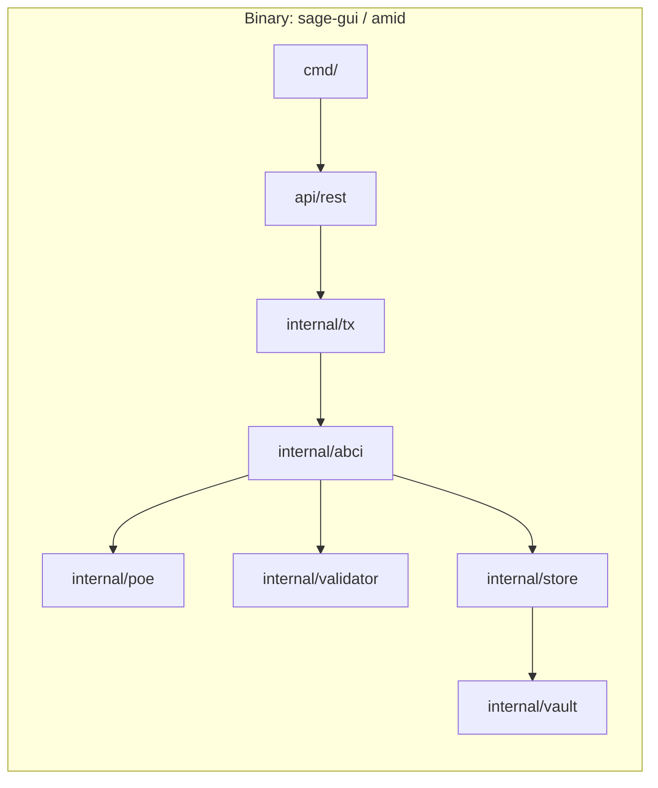
**Sources:** [cmd/sage-gui/node.go:32-41](), [internal/abci/app.go:15-21]()

## Deployment Topologies

### Personal Deployment (`sage-gui`)
Designed for individual developers. It bundles CometBFT, SQLite, and the MCP server into a single process.
*   **Consensus**: Single-validator (self-signing).
*   **Storage**: `sage.db` (SQLite).
*   **Security**: Synaptic Ledger (Vault) encryption enabled by default [cmd/sage-gui/node.go:106-137]().

### Multi-Node Cluster (`amid`)
Designed for organizations. It runs as a distributed network of 4+ nodes.
*   **Consensus**: 3/4 Quorum BFT [docs/ARCHITECTURE.md:103-108]().
*   **Storage**: PostgreSQL with `pgvector` for high-performance semantic retrieval [docs/ARCHITECTURE.md:160-165]().
*   **Identity**: Agents register on-chain and are governed by Role-Based Access Control (RBAC) [internal/abci/app.go:26-30]().

For details on the deployment process, see [Deployment and Infrastructure](#10).

---
**Sources:**
*   End-to-End Flow: [docs/ARCHITECTURE.md:31-79](), [internal/abci/app.go:115-127](), [api/rest/server.go:15-40]()
*   Deployment Modes: [cmd/sage-gui/node.go:187-190](), [docs/ARCHITECTURE.md:103-108]()
*   Package Structure: [cmd/sage-gui/node.go:32-41](), [internal/abci/app.go:15-21]()

---

# Page: Memory Lifecycle and Data Model

# Memory Lifecycle and Data Model

<details>
<summary>Relevant source files</summary>

The following files were used as context for generating this wiki page:

- [internal/mcp/server.go](internal/mcp/server.go)
- [internal/mcp/tools.go](internal/mcp/tools.go)
- [internal/memory/confidence.go](internal/memory/confidence.go)
- [internal/memory/model.go](internal/memory/model.go)
- [internal/store/postgres.go](internal/store/postgres.go)
- [internal/store/sqlite.go](internal/store/sqlite.go)
- [internal/store/store.go](internal/store/store.go)

</details>


The SAGE system treats memory not as a static text file, but as a dynamic, governed, and decaying knowledge graph. Every piece of information submitted by an agent is encapsulated in a `MemoryRecord`, which undergoes a rigorous state machine transition from a mere proposal to a consensus-validated commitment.

## The MemoryRecord Data Model

The `MemoryRecord` is the fundamental unit of storage in SAGE. It contains the raw content, its vector embedding for semantic search, and metadata required for governance and confidence tracking.

| Field | Type | Description |
| :--- | :--- | :--- |
| `MemoryID` | `string` | Unique identifier (often a UUID or hash). |
| `SubmittingAgent` | `string` | The Ed25519 public key of the agent that created the memory. |
| `Content` | `string` | The natural language content (encrypted at rest in the Vault). |
| `MemoryType` | `enum` | Categorization (Fact, Observation, Inference, Task). |
| `Status` | `enum` | Current position in the validation state machine. |
| `ConfidenceScore` | `float64` | Initial confidence (0.0 to 1.0) assigned at creation. |
| `DomainTag` | `string` | Namespace for the memory (e.g., `security`, `code-review`). |
| `CreatedAt` | `time.Time` | Timestamp of initial submission. |

**Sources:** [internal/memory/model.go:39-56](), [internal/store/sqlite.go:150-166]()

### Memory Types
The `MemoryType` determines how the system handles the record's longevity and visibility.

*   **`fact`**: Durable, verified knowledge (e.g., server IPs, architecture decisions). These typically have high initial confidence (0.95+) and are prioritized in recall across different providers.
*   **`observation`**: Ephemeral session-level context. Used by `sage_turn` to track what happened in the current conversation.
*   **`inference`**: Hypotheses or conclusions drawn by an agent that require further validation.
*   **`task`**: Actionable items. These have an associated `TaskStatus` (`planned`, `in_progress`, `done`, `dropped`).

**Sources:** [internal/memory/model.go:18-26](), [internal/mcp/tools.go:25-31]()

---

## Memory Status State Machine

Memories transition through statuses as they move from an agent's tool call to the global Synaptic Ledger. In multi-node deployments, this lifecycle is governed by the ABCI application and CometBFT consensus.

### State Transition Diagram
"Code Entity Space" mapping: The `MemoryStatus` type in `internal/memory/model.go` defines these states, while `internal/store/store.go` provides the `UpdateStatus` interface used by the consensus engine.

```mermaid
stateDiagram-v2
    [*] --> "proposed" : "sage_remember" / "TxTypeMemorySubmit"
    "proposed" --> "validated" : "3/4 App Validators Approve"
    "validated" --> "committed" : "CometBFT Block Finalization"
    "committed" --> "challenged" : "TxTypeMemoryChallenge"
    "committed" --> "deprecated" : "sage_forget" / "Confidence < Threshold"
    "challenged" --> "committed" : "Challenge Rejected"
    "challenged" --> "deprecated" : "Challenge Upheld"
    "deprecated" --> [*]
```
**Sources:** [internal/memory/model.go:7-16](), [internal/store/store.go:113-113](), [internal/mcp/tools.go:54-66]()

---

## Knowledge Representation: Triples and Links

Beyond flat text, SAGE supports structured knowledge through `KnowledgeTriple` and `MemoryLink`.

### Knowledge Triples
Agents can extract structured facts from content using the Subject-Predicate-Object model. These are stored in the `knowledge_triples` table and linked to a specific `memory_id`.
*   **Example**: `[Subject: "Server-A"] [Predicate: "has_ip"] [Object: "10.0.0.5"]`

**Sources:** [internal/memory/model.go:67-71](), [internal/store/sqlite.go:170-176]()

### Memory Links
`MemoryLink` defines directed relationships between two `MemoryRecord` entities, allowing for the construction of a knowledge graph.
*   **LinkTypes**: `supports`, `contradicts`, `supersedes`, `relates_to`.

**Sources:** [internal/memory/model.go:58-64](), [internal/store/store.go:129-130]()

---

## Confidence Decay and Corroboration

SAGE implements a temporal decay model to ensure that stale information eventually loses relevance unless corroborated by other agents.

### The Formula
The current confidence $C(t)$ of a memory is calculated as:
$$C(t) = C_0 \cdot e^{-\lambda \Delta t} \cdot (1 + 0.1 \cdot \ln(1 + N_{corr}))$$

Where:
*   $C_0$: Initial `ConfidenceScore`.
*   $\lambda$: Decay rate (domain-specific).
*   $\Delta t$: Time elapsed since creation (in days).
*   $N_{corr}$: Number of `Corroboration` entries from other agents.

### Implementation Details
*   **Domain-Specific Rates**: The `crypto` domain decays slowly ($\lambda=0.001$), while `vuln_intel` decays rapidly ($\lambda=0.01$).
*   **Task Immunity**: Open tasks (`planned` or `in_progress`) do not decay; they maintain their initial confidence until completed or dropped.
*   **Clamping**: The result is always clamped between `0.0` and `1.0`.

**Sources:** [internal/memory/confidence.go:8-60]()

---

## Data Flow: Natural Language to Storage

The following diagram bridges the gap between the agent's natural language intent and the underlying code structures and database schemas.

### Natural Language to Code Entity Space
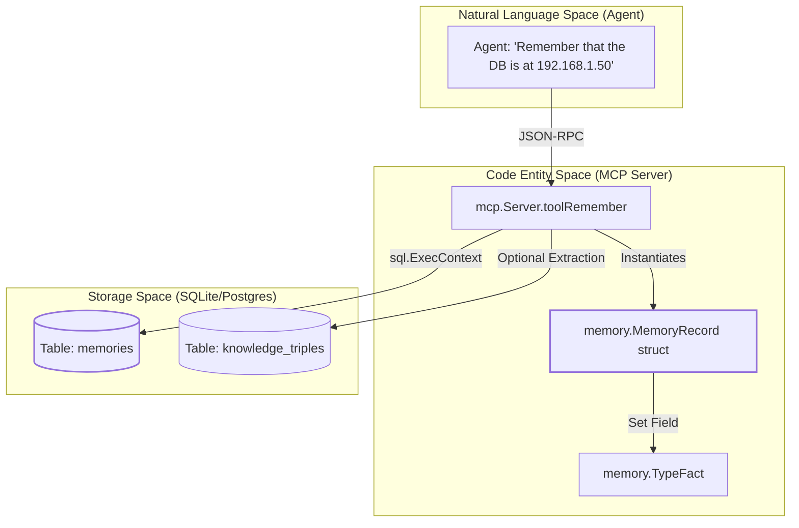
**Sources:** [internal/mcp/tools.go:23-38](), [internal/mcp/server.go:189-210](), [internal/store/sqlite.go:148-166](), [internal/store/postgres.go:55-79]()

### Storage Implementation Summary
SAGE supports two primary backends via the `MemoryStore` interface:
1.  **`SQLiteStore`**: Used in personal `sage-gui` mode. Includes a `vault` field for AES-256-GCM encryption of the `content` and `embedding` fields.
2.  **`PostgresStore`**: Used in multi-node `amid` deployments. Utilizes `pgvector` for high-performance HNSW indexing of memory embeddings.

**Sources:** [internal/store/store.go:109-142](), [internal/store/sqlite.go:34-41](), [internal/store/postgres.go:26-30]()

---

# Page: Consensus Engine (CometBFT & ABCI)

# Consensus Engine (CometBFT & ABCI)

<details>
<summary>Relevant source files</summary>

The following files were used as context for generating this wiki page:

- [.github/workflows/ci.yml](.github/workflows/ci.yml)
- [.github/workflows/release.yml](.github/workflows/release.yml)
- [LICENSE](LICENSE)
- [api/rest/agent_handler.go](api/rest/agent_handler.go)
- [cmd/amid/main.go](cmd/amid/main.go)
- [cmd/sage-cli/main.go](cmd/sage-cli/main.go)
- [cmd/sage-gui/node.go](cmd/sage-gui/node.go)
- [deploy/Dockerfile.abci](deploy/Dockerfile.abci)
- [go.mod](go.mod)
- [go.sum](go.sum)
- [internal/abci/app.go](internal/abci/app.go)
- [internal/abci/app_test.go](internal/abci/app_test.go)
- [internal/abci/migrate.go](internal/abci/migrate.go)
- [internal/embedding/ollama.go](internal/embedding/ollama.go)
- [internal/mcp/tools_test.go](internal/mcp/tools_test.go)
- [internal/store/badger.go](internal/store/badger.go)
- [internal/tx/codec.go](internal/tx/codec.go)
- [internal/tx/codec_test.go](internal/tx/codec_test.go)
- [internal/tx/types.go](internal/tx/types.go)
- [server.json](server.json)

</details>


SAGE utilizes a Byzantine Fault Tolerant (BFT) consensus engine to ensure that institutional memory remains consistent, immutable, and verifiable across multiple nodes. This is achieved by integrating a custom Application BlockChain Interface (ABCI) application with **CometBFT**.

## Overview

The consensus layer acts as the "ground truth" for the SAGE network. While individual nodes may have local copies of data, the state of the **Synaptic Ledger** (including agent identities, memory hashes, and access control lists) is governed by the consensus process [internal/abci/app.go:114-127]().

### Deployment Modes
1.  **Personal Mode (`sage-gui`)**: Runs a single-validator CometBFT instance in-process. It uses a 1-second commit timeout for high responsiveness [cmd/sage-gui/node.go:187-190]().
2.  **Multi-Node Mode (`amid`)**: Deploys a full 4-validator quorum. This mode is designed for institutional use where high availability and Byzantine fault tolerance are required [cmd/amid/main.go:1-50]().

---

## The ABCI Application (`SageApp`)

The `SageApp` struct implements the CometBFT ABCI 2.0 interface. It manages two distinct storage backends to balance consensus speed with query flexibility:

| Component | Entity | Role |
| :--- | :--- | :--- |
| **On-Chain State** | `BadgerStore` | Stores nonces, memory hashes, agent registrations, and validator power. This state is used to calculate the deterministic `AppHash` [internal/store/badger.go:15-18](). |
| **Off-Chain Store** | `OffchainStore` | A `PostgresStore` (multi-node) or `SQLiteStore` (personal) used for rich indexing, vector embeddings, and complex queries [internal/abci/app.go:115-120](). |

### Block Execution Flow

The `SageApp` processes transactions through a multi-stage lifecycle:

1.  **CheckTx**: Validates transaction syntax, signatures, and nonces before allowing them into the mempool [internal/abci/app.go:217-250]().
2.  **FinalizeBlock**: Executes a batch of transactions. State changes are applied to `BadgerStore` immediately, while writes to the `OffchainStore` are buffered in `pendingWrites` [internal/abci/app.go:252-300]().
3.  **Commit**: Flushes the `pendingWrites` to the persistent database and returns a deterministic SHA-256 `AppHash` of the BadgerDB state to CometBFT [internal/abci/app.go:302-340]().

**Sources:** [internal/abci/app.go:115-214](), [internal/store/badger.go:15-31](), [cmd/sage-gui/node.go:146-153]()

---

## Transaction Structure (`ParsedTx`)

All actions in SAGE (submitting memories, registering agents, granting access) are encapsulated in a `ParsedTx`. This structure is the primary unit of data for the consensus engine.

### Data Flow: Natural Language to On-Chain Code
The following diagram illustrates how a high-level agent action is transformed into a consensus-validated transaction.

**Transaction Encoding and Validation Flow**
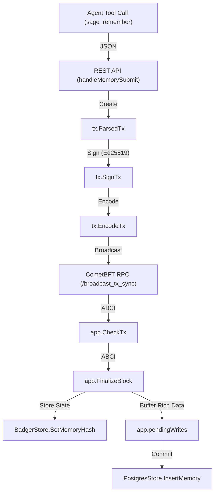
**Sources:** [api/rest/agent_handler.go:69-96](), [internal/tx/types.go:1-50](), [internal/abci/app.go:252-302]()

### Transaction Types
SAGE supports 23 transaction types defined in the `tx` package. Key types include:
*   `TxTypeMemorySubmit`: Proposes a new memory record [internal/tx/types.go:15-20]().
*   `TxTypeAgentRegister`: Links an Ed25519 public key to an agent identity [internal/tx/types.go:25-30]().
*   `TxTypeAccessGrant`: Defines RBAC permissions for a domain [internal/tx/types.go:35-40]().

---

## 4-Validator Quorum Model

In multi-node deployments, SAGE defaults to a 4-validator configuration. This setup provides resilience against a single node failure (3/4 quorum required for consensus).

### Quorum Configuration
The `QuorumConfig` in `config.yaml` manages the P2P networking layer:
*   **P2PAddr**: The address where the node listens for peer connections [cmd/sage-gui/node.go:173-177]().
*   **PersistentPeers**: A list of `ID@IP:Port` strings for the other 3 nodes in the quorum [cmd/sage-gui/node.go:178]().

### Validator State Management
The `SageApp` tracks validator performance and voting power on-chain.
*   **Validator Power**: Stored in BadgerDB and reloaded on startup [internal/abci/app.go:162-174]().
*   **Height Regression Protection**: The node logic includes a safeguard to detect if the validator signing state (`priv_validator_state.json`) is ahead of the local block store, auto-resetting to prevent consensus deadlocks [cmd/sage-gui/node.go:197-210]().

**Sources:** [cmd/sage-gui/node.go:170-190](), [internal/abci/app.go:162-175]()

---

## Deployment with `amid`

The `amid` (Agent Memory Institutional Daemon) binary is the specialized version of SAGE for multi-node, server-side deployments. Unlike `sage-gui`, which focuses on a single-user experience, `amid` is optimized for:

1.  **PostgreSQL Backend**: Uses `PostgresStore` for high-concurrency memory indexing and pgvector search [internal/abci/app.go:137-141]().
2.  **Docker Orchestration**: Typically deployed via Docker Compose with dedicated containers for CometBFT and the ABCI app [deploy/Dockerfile.abci:1-20]().
3.  **Headless Operation**: Managed entirely via environment variables and the REST API.

### Integration Diagram: `amid` Component Architecture
This diagram maps the `amid` binary components to their respective code entities.

**`amid` Internal Component Mapping**
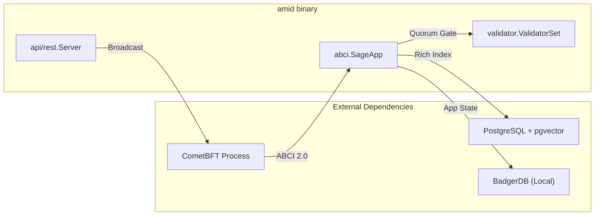
**Sources:** [cmd/amid/main.go:1-100](), [internal/abci/app.go:129-177](), [api/rest/server.go:1-50]()

---

## Key Functions

### `ComputeAppHash()`
This is the most critical function for BFT consensus. It iterates through the `BadgerStore` in deterministic, sorted key order and computes a SHA-256 hash of all on-chain state. If nodes return different hashes for the same block, the chain halts [internal/store/badger.go:176-225]().

### `CheckTx()`
Performs stateless and stateful validation:
*   Verifies the Ed25519 signature of the `ParsedTx` [internal/abci/app.go:217-230]().
*   Checks the `Nonce` against the stored value in BadgerDB to prevent replay attacks [internal/abci/app.go:235-240]().

### `FinalizeBlock()`
The primary execution engine. It iterates through the block's transactions and routes them to specific processors (e.g., `processMemorySubmit`, `processAgentRegister`) based on the `TxType` [internal/abci/app.go:252-280]().

**Sources:** [internal/store/badger.go:176-225](), [internal/abci/app.go:217-300]()

---

# Page: App Validators and Proof of Experience (PoE)

# App Validators and Proof of Experience (PoE)

<details>
<summary>Relevant source files</summary>

The following files were used as context for generating this wiki page:

- [api/rest/access_handler.go](api/rest/access_handler.go)
- [api/rest/dept_handler.go](api/rest/dept_handler.go)
- [api/rest/org_handler.go](api/rest/org_handler.go)
- [api/rest/vote_handler.go](api/rest/vote_handler.go)
- [internal/appvalidator/manager.go](internal/appvalidator/manager.go)
- [internal/appvalidator/manager_test.go](internal/appvalidator/manager_test.go)
- [internal/appvalidator/validator.go](internal/appvalidator/validator.go)
- [internal/appvalidator/validator_test.go](internal/appvalidator/validator_test.go)

</details>


The SAGE ecosystem employs a two-tier validation strategy to ensure memory integrity and agent accountability. Before a memory is committed to the Synaptic Ledger, it must pass through a 3/4 quorum gate controlled by four automated **App Validators**. Post-commitment, agents are evaluated by the **Proof of Experience (PoE)** engine, which computes dynamic weights based on their historical accuracy, domain expertise, and corroboration patterns.

## App Validators

The App Validators are internal components that perform automated sanity checks on proposed memories during the ABCI `CheckTx` and `DeliverTx` phases [internal/appvalidator/manager.go:59-61](). These validators act as a Byzantine Fault Tolerant (BFT) quorum gate where at least 3 out of 4 must return an `accept` decision for a memory to proceed toward commitment [internal/appvalidator/manager.go:80-81]().

### The Four Validators

| Validator | Name | Logic | Key Files |
| :--- | :--- | :--- | :--- |
| **Sentinel** | `sentinel` | Always returns `accept`. Serves as a baseline to ensure a single failure doesn't halt the system [internal/appvalidator/validator.go:25-35](). | `validator.go` |
| **Dedup** | `dedup` | Checks the content hash against existing committed memories to prevent duplicates [internal/appvalidator/validator.go:43-54](). | `validator.go` |
| **Quality** | `quality` | Rejects low-value noise (e.g., "user said hi"), content under 20 characters, or empty headers [internal/appvalidator/validator.go:96-146](). | `validator.go` |
| **Consistency** | `consistency` | Enforces schema rules: requires a domain, minimum 0.3 confidence for observations, and 0.7 for facts [internal/appvalidator/validator.go:151-185](). | `validator.go` |

### Validator Orchestration and Quorum
The `Manager` struct in `internal/appvalidator/manager.go` orchestrates these four entities. It derives deterministic Ed25519 keys for each validator from a system seed, allowing them to sign their own vote transactions [internal/appvalidator/manager.go:21-41]().

**Diagram: App Validation Quorum Gate**

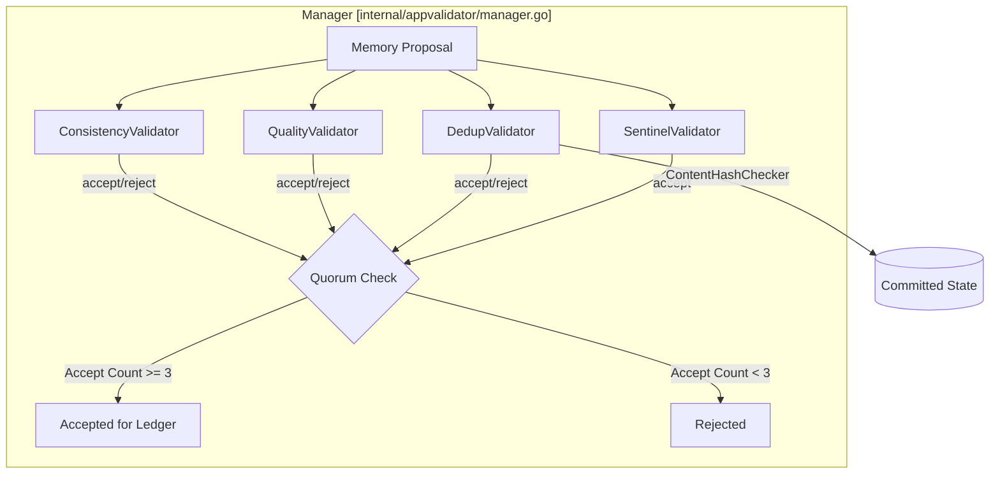
**Sources:** [internal/appvalidator/manager.go:12-89](), [internal/appvalidator/validator.go:9-185]()

## Proof of Experience (PoE)

Proof of Experience (PoE) is SAGE's reputation and weighting mechanism. Unlike Proof of Stake, which relies on financial collateral, PoE relies on the "weight of history." It calculates an agent's influence based on their track record within specific domains.

### Weight Computation Engine
The PoE engine tracks several metrics to determine an agent's `PoEWeight`:
1.  **Accuracy:** The ratio of an agent's votes that align with the final consensus.
2.  **Domain Expertise:** Cumulative successful contributions within a specific `Domain` (e.g., "security", "devops").
3.  **Recency:** A decay function that prioritizes recent performance over historical data.
4.  **Corroboration:** Bonus weight granted when an agent's submissions are corroborated by other high-PoE agents [api/rest/vote_handler.go:44-53]().

### Voting and Challenges
Agents interact with the PoE system through the REST API to influence the lifecycle of memories. Their `PoEWeight` determines the impact of these actions.

*   **Voting:** Agents vote `accept` or `reject` on pending memories. The `handleVoteMemory` function broadcasts a `TxTypeMemoryVote` to the ledger [api/rest/vote_handler.go:76-152]().
*   **Challenging:** Agents can challenge an existing memory if they have evidence of inaccuracy. This triggers a `TxTypeMemoryChallenge` [api/rest/vote_handler.go:155-228]().
*   **Corroboration:** Agents can strengthen a memory's confidence score by providing supporting evidence via `CorroborateRequest` [api/rest/vote_handler.go:44-53]().

**Diagram: PoE Data Flow and Code Entities**

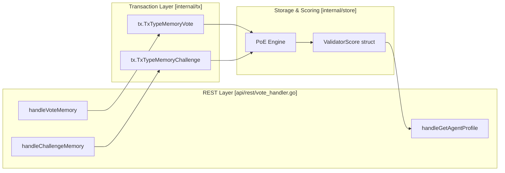
**Sources:** [api/rest/vote_handler.go:21-72](), [api/rest/vote_handler.go:106-115](), [api/rest/vote_handler.go:181-190]()

## Implementation Details

### Key Derivation
Validators use deterministic key derivation to ensure that the same seed always produces the same set of validator identities across node restarts. This is handled in `NewManager` [internal/appvalidator/manager.go:22-41]().

```go
// Example of deterministic derivation
material := sha256.Sum256([]byte("sage-validator-" + name + "-" + seedHex))
privKey := ed25519.NewKeyFromSeed(material[:])
```

### Identity and Auth
Every vote or challenge transaction must be signed. The REST server uses `embedAgentAuth` to attach the submitting agent's cryptographic proof to the transaction before broadcasting it to CometBFT [api/rest/vote_handler.go:118](), [api/rest/vote_handler.go:193]().

### Validator Scores and Epochs
The system organizes PoE updates into epochs. The `EpochResponse` provides a snapshot of current validator scores and the block height at which they were calculated [api/rest/vote_handler.go:67-72]().

| Function | Role |
| :--- | :--- |
| `PreValidate` | Main entry point for the 4-validator quorum check [internal/appvalidator/manager.go:61](). |
| `handleVoteMemory` | Processes agent votes and converts them to on-chain transactions [api/rest/vote_handler.go:77](). |
| `handleChallengeMemory` | Processes memory challenges to trigger re-validation [api/rest/vote_handler.go:155](). |
| `GetValidatorIDs` | Returns the hex-encoded agent IDs for the 4 app validators [internal/appvalidator/manager.go:92](). |

**Sources:** [internal/appvalidator/manager.go:1-104](), [api/rest/vote_handler.go:1-228](), [internal/appvalidator/validator.go:1-185]()

---

# Page: Transaction Types and Codec

# Transaction Types and Codec

<details>
<summary>Relevant source files</summary>

The following files were used as context for generating this wiki page:

- [LICENSE](LICENSE)
- [api/rest/agent_handler.go](api/rest/agent_handler.go)
- [cmd/amid/main.go](cmd/amid/main.go)
- [cmd/sage-cli/main.go](cmd/sage-cli/main.go)
- [internal/abci/app.go](internal/abci/app.go)
- [internal/abci/app_test.go](internal/abci/app_test.go)
- [internal/abci/migrate.go](internal/abci/migrate.go)
- [internal/embedding/ollama.go](internal/embedding/ollama.go)
- [internal/mcp/tools_test.go](internal/mcp/tools_test.go)
- [internal/store/badger.go](internal/store/badger.go)
- [internal/tx/codec.go](internal/tx/codec.go)
- [internal/tx/codec_test.go](internal/tx/codec_test.go)
- [internal/tx/types.go](internal/tx/types.go)
- [web/handler_test.go](web/handler_test.go)
- [web/import.go](web/import.go)
- [web/network_handler.go](web/network_handler.go)

</details>


The SAGE network utilizes a custom binary wire format for all on-chain operations. This page documents the 23 transaction types, the `ParsedTx` structure, and the deterministic encoding/decoding logic used to synchronize state across the Synaptic Ledger.

## Transaction Types (TxType)

SAGE defines a comprehensive set of transaction types covering memory lifecycles, agent identity, and organizational governance. These are defined as a byte-based enum in the `tx` package.

| Value | Type Name | Description |
|:---|:---|:---|
| `0x01` | `TxTypeMemorySubmit` | Proposes a new `MemoryRecord` to the network. |
| `0x02` | `TxTypeMemoryVote` | Validator vote (Accept/Reject) on a proposed memory. |
| `0x03` | `TxTypeMemoryChallenge` | Challenges the validity of an existing committed memory. |
| `0x04` | `TxTypeMemoryCorroborate` | Provides supporting evidence for a memory to increase confidence. |
| `0x05` | `TxTypeAccessRequest` | Agent request for access to a specific domain or clearance level. |
| `0x06` | `TxTypeAccessGrant` | Administrator approval of an access request. |
| `0x07` | `TxTypeAccessRevoke` | Removal of an agent's access rights. |
| `0x08` | `TxTypeDomainRegister` | Registration of a new knowledge domain (e.g., `security`, `finance`). |
| `0x09` | `TxTypeAgentRegister` | On-boarding a new agent identity with Ed25519 public key. |
| `0x0a` | `TxTypeAgentUpdate` | Updates to agent metadata (Name, Bio). |
| `0x0b` | `TxTypeAgentSetPermission` | Admin-level update of agent RBAC and clearance. |
| `0x0c` | `TxTypeOrgRegister` | Creation of a new Organization entity. |
| `0x0d` | `TxTypeOrgMemberAdd` | Adding an agent to an organization. |
| `0x0e` | `TxTypeOrgMemberRemove` | Removing an agent from an organization. |
| `0x0f` | `TxTypeOrgMemberClearance` | Updating a member's clearance within an organization. |
| `0x10` | `TxTypeFederationRequest` | Requesting a federation agreement between two organizations. |
| `0x11` | `TxTypeFederationApprove` | Approval of a cross-org federation. |
| `0x12` | `TxTypeFederationRevoke` | Termination of a federation agreement. |
| `0x13` | `TxTypeMemoryClassify` | Updating the classification level of a specific memory. |
| `0x14` | `TxTypeDeptRegister` | Registration of a Department within an Organization. |
| `0x15` | `TxTypeDeptMemberAdd` | Assigning an agent to a specific department. |
| `0x16` | `TxTypeDeptMemberRemove` | Removing an agent from a department. |
| `0x17` | `TxTypeMemoryReassign` | Transferring ownership of memories between agents. |

Sources: `[internal/tx/types.go:5-32]()`, `[internal/abci/app.go:26-26]()`

## The ParsedTx Structure

The `ParsedTx` struct is the primary data container for transactions. It includes the routing type, the specific payload for that type, and two layers of cryptographic proof: the Node Signature (for consensus) and the Agent Identity Proof (for provenance).

### Code Entity Space: ParsedTx
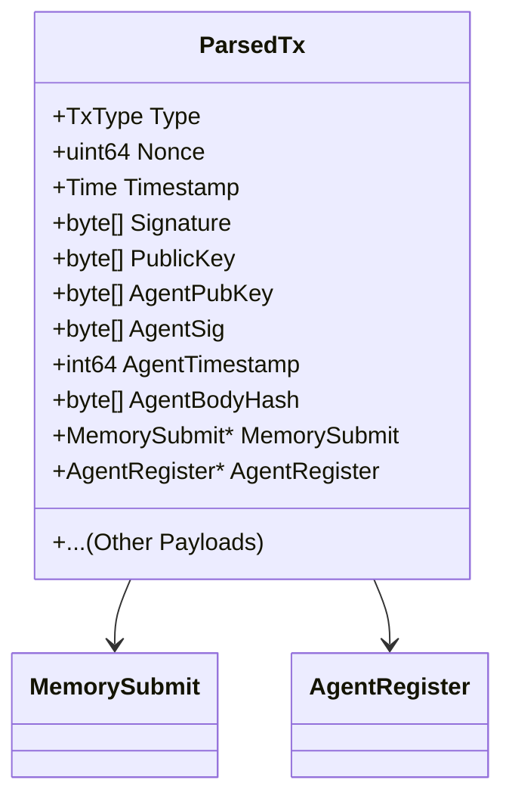
Sources: `[internal/tx/types.go:37-77]()`

## Wire Format and Codec

SAGE uses a custom length-prefixed binary format designed for determinism and efficiency. Unlike JSON, this format ensures that the same transaction data always produces the same byte array, which is critical for BFT consensus.

### Binary Layout
The `EncodeTx` function produces a byte slice with the following layout:

1.  **Type (1 byte):** The `TxType` enum value.
2.  **Payload Length (4 bytes):** Big-endian `uint32` indicating the size of the type-specific data.
3.  **Payload (Variable):** The actual transaction data (e.g., memory content, agent ID).
4.  **Node Signature (64 bytes):** Ed25519 signature from the submitting validator node.
5.  **Node Public Key (32 bytes):** Ed25519 public key of the node.
6.  **Nonce (8 bytes):** Big-endian `uint64` to prevent replay attacks.
7.  **Timestamp (8 bytes):** Unix-nano timestamp.
8.  **Agent Identity Proof (112 bytes):**
    *   Agent Public Key (32 bytes)
    *   Agent Signature (64 bytes)
    *   Agent Timestamp (8 bytes)
    *   Agent Body Hash (8 bytes)

Sources: `[internal/tx/codec.go:13-14]()`, `[internal/tx/codec.go:53-72]()`

### Encoding Logic
The `EncodeTx` function handles the serialization of the `ParsedTx` into the wire format. It first calls `encodePayload` to handle the type-specific data before appending the standard headers and signatures.

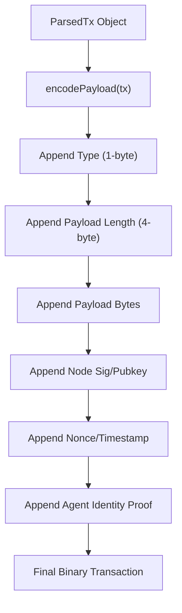
Sources: `[internal/tx/codec.go:24-72]()`

## Agent Identity Proofs

Every transaction includes an embedded proof that the originating agent authorized the action. This is distinct from the CometBFT node signature.

### Proof Generation
When an agent submits a request via the REST API or MCP, the `embedAgentAuth` or `embedDashboardAgentProof` functions are used to populate the `AgentPubKey`, `AgentSig`, `AgentBodyHash`, and `AgentTimestamp` fields.

1.  **Body Hash:** A SHA-256 hash of the transaction's core content (e.g., for `AgentRegister`, this is `name + role + bio`).
2.  **Signing Message:** The concatenation of the `BodyHash` and the `AgentTimestamp`.
3.  **Signature:** An Ed25519 signature over the signing message using the Agent's private key.

### Proof Verification
The ABCI application verifies these proofs in `verifyAgentIdentity` before processing any state change. It ensures that:
1.  The `AgentPubKey` matches the `AgentID` in the transaction.
2.  The signature is valid for the provided `AgentBodyHash` and `AgentTimestamp`.
3.  The `AgentBodyHash` matches a fresh hash of the received transaction payload.

Sources: `[web/network_handler.go:185-185]()`, `[api/rest/agent_handler.go:83-83]()`, `[internal/abci/app_test.go:69-78]()`

## Implementation Details

### Key Functions
*   `EncodeTx(tx *ParsedTx) ([]byte, error)`: Serializes a transaction. `[internal/tx/codec.go:24-72]()`
*   `DecodeTx(data []byte) (*ParsedTx, error)`: Deserializes a transaction, supporting both legacy and full formats. `[internal/tx/codec.go:75-142]()`
*   `SignTx(tx *ParsedTx, privateKey ed25519.PrivateKey)`: Computes the Node Signature. `[internal/tx/codec.go:146-155]()`
*   `VerifyTx(tx *ParsedTx)`: Validates the Node Signature. `[internal/tx/codec.go:158-170]()`

### Error Handling
The codec defines specific errors for validation failures:
*   `ErrInvalidTxData`: Data is too short or malformed.
*   `ErrUnknownTxType`: The type byte does not match a known `TxType`.
*   `ErrSignatureLength`: The Ed25519 signature is not 64 bytes.
*   `ErrPublicKeyLength`: The Ed25519 public key is not 32 bytes.

Sources: `[internal/tx/codec.go:16-21]()`

### Data Flow: Transaction Broadcasting
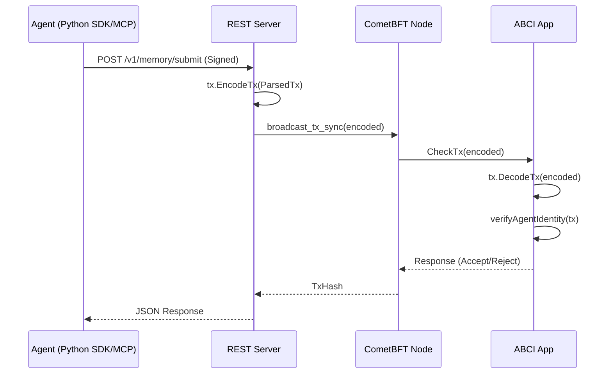
Sources: `[api/rest/agent_handler.go:69-116]()`, `[internal/abci/app.go:240-270]()`

---

# Page: Storage Layer

# Storage Layer

<details>
<summary>Relevant source files</summary>

The following files were used as context for generating this wiki page:

- [api/rest/agent_handler.go](api/rest/agent_handler.go)
- [api/rest/helpers.go](api/rest/helpers.go)
- [deploy/docker-compose.yml](deploy/docker-compose.yml)
- [internal/abci/app.go](internal/abci/app.go)
- [internal/abci/app_test.go](internal/abci/app_test.go)
- [internal/abci/migrate.go](internal/abci/migrate.go)
- [internal/store/badger.go](internal/store/badger.go)
- [internal/store/postgres.go](internal/store/postgres.go)
- [internal/store/sqlite.go](internal/store/sqlite.go)
- [internal/store/store.go](internal/store/store.go)

</details>


The SAGE storage layer is a hybrid architecture designed to balance local performance, data sovereignty, and multi-node consistency. It separates "off-chain" data (heavy content, embeddings, and rich metadata) from "on-chain" state (identity, nonces, and consensus-critical hashes).

## Architecture Overview

SAGE utilizes three distinct database engines depending on the deployment mode and the nature of the data being stored:

1.  **SQLite**: The primary off-chain store for **Personal Mode** (`sage-gui`). It provides a zero-config, single-file database that supports full-text search and integrated encryption via the Synaptic Ledger.
2.  **PostgreSQL + pgvector**: The primary off-chain store for **Multi-Node Mode** (`amid`). It enables high-concurrency access and utilizes HNSW indexing for efficient vector similarity searches across large memory sets.
3.  **BadgerDB**: The **On-Chain State Store** used by the ABCI application. It stores the minimal state required for BFT consensus, including agent nonces, registered identities, and cryptographic hashes of committed memories.

### Storage Interface Bridge

The system abstracts these backends through the `OffchainStore` interface, allowing the `SageApp` [internal/abci/app.go:115-127]() to interact with either SQLite or PostgreSQL transparently.

#### Natural Language to Code Entity Map: Storage Backends

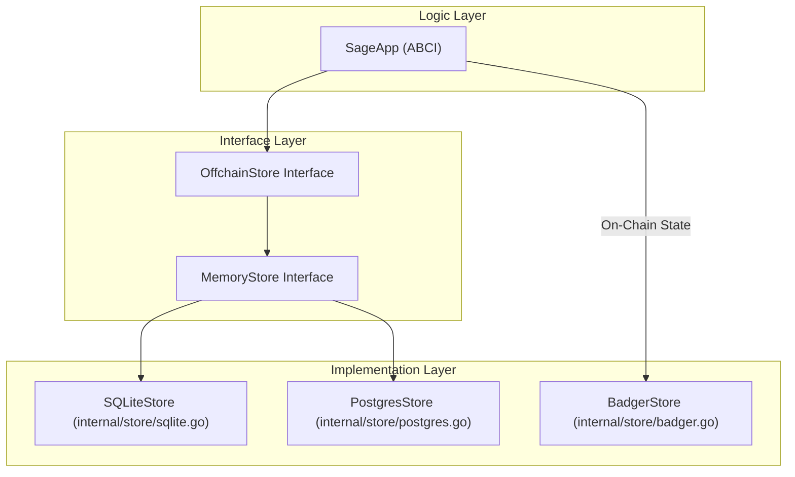
**Sources**: [internal/store/store.go:110-142](), [internal/abci/app.go:115-127](), [internal/store/sqlite.go:34-41](), [internal/store/postgres.go:27-30]()

## Hybrid Storage Components

### 1. SQLite Store (Personal Mode)
In personal deployment mode, SAGE uses a pure Go SQLite driver [internal/store/sqlite.go:19]() to manage all memory records, validation votes, and agent metadata locally. It includes a built-in `SetVault` mechanism [internal/store/sqlite.go:48-50]() that integrates with the **Synaptic Ledger** to provide AES-256-GCM encryption at rest for sensitive memory content.

For details, see [SQLite Store (Personal Mode)](#3.1).

### 2. PostgreSQL & pgvector (Multi-Node Mode)
For distributed deployments, SAGE transitions to PostgreSQL. This backend leverages the `pgvector` extension [internal/store/postgres.go:12]() to perform high-performance similarity queries using the `<=>` cosine distance operator [internal/store/postgres.go:147-148](). This is the standard for the `amid` (Agent Managed Infrastructure Daemon) stack.

For details, see [PostgreSQL Store and BadgerDB (Multi-Node Mode)](#3.2).

### 3. BadgerDB (On-Chain State)
BadgerDB acts as the local key-value store for the CometBFT state machine. It is responsible for maintaining the "Source of Truth" that all nodes must agree upon, such as the `ComputeAppHash` [internal/store/badger.go:176-177]() which ensures deterministic state transitions across the validator set.

For details, see [PostgreSQL Store and BadgerDB (Multi-Node Mode)](#3.2).

### 4. Synaptic Ledger (Encryption)
The Synaptic Ledger is the security wrapper around the storage layer. It handles Argon2id key derivation and manages the `vault.key` file. It ensures that both the `content` [internal/store/sqlite.go:61-73]() and `embedding` [internal/store/sqlite.go:102-110]() fields are encrypted before hitting the disk.

For details, see [Synaptic Ledger (Vault Encryption)](#3.3).

## Data Flow: Submission to Persistence

The following diagram illustrates how a memory record moves from a tool call into the respective storage engines.

#### Natural Language to Code Entity Map: Persistence Pipeline

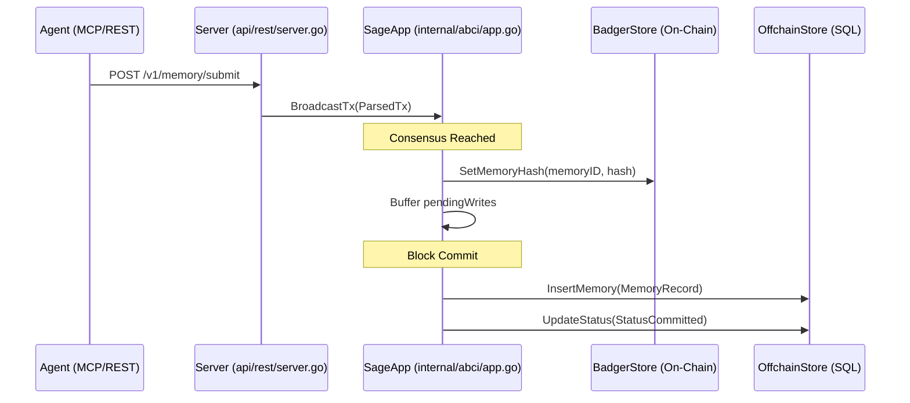
**Sources**: [internal/abci/app.go:125-127](), [api/rest/agent_handler.go:96-101](), [internal/store/badger.go:77-86](), [internal/store/postgres.go:55-79]()

## Core Storage Interfaces

| Interface | Purpose | Primary Implementation |
| :--- | :--- | :--- |
| `MemoryStore` | CRUD for MemoryRecords and KnowledgeTriples | `SQLiteStore`, `PostgresStore` |
| `ValidatorScoreStore` | Persistence for PoE (Proof of Experience) scores | `SQLiteStore`, `PostgresStore` |
| `AccessStore` | RBAC grants and domain permissions | `SQLiteStore`, `PostgresStore` |
| `OffchainStore` | Composite interface for all non-consensus data | `SQLiteStore`, `PostgresStore` |

**Sources**: [internal/store/store.go:110-165]()

---

# Page: SQLite Store (Personal Mode)

# SQLite Store (Personal Mode)

<details>
<summary>Relevant source files</summary>

The following files were used as context for generating this wiki page:

- [internal/store/postgres.go](internal/store/postgres.go)
- [internal/store/sqlite.go](internal/store/sqlite.go)
- [internal/store/store.go](internal/store/store.go)
- [internal/vault/vault.go](internal/vault/vault.go)
- [internal/vault/vault_test.go](internal/vault/vault_test.go)
- [web/handler_ledger.go](web/handler_ledger.go)
- [web/handler_ledger_test.go](web/handler_ledger_test.go)

</details>


The `SQLiteStore` is the primary storage implementation for SAGE in personal deployment mode (e.g., `sage-gui`). It provides a lightweight, single-file relational database that handles memory persistence, validation tracking, and integrated encryption via the Synaptic Ledger (Vault).

## Implementation Overview

The `SQLiteStore` struct implements multiple interfaces defined in `internal/store/store.go`, including `MemoryStore`, `ValidatorScoreStore`, `AccessStore`, and `OrgStore` [internal/store/sqlite.go:33-34](). It uses the `modernc.org/sqlite` pure Go driver to ensure cross-platform compatibility without requiring CGO [internal/store/sqlite.go:19]().

### Data Flow: Memory Submission
When a memory is submitted in personal mode, the following flow occurs within the store:
1. **Encryption Check**: If a `Vault` is attached and expected, the content and embeddings are encrypted before hitting the disk [internal/store/sqlite.go:61-73]().
2. **Schema Validation**: The record is inserted into the `memories` table, which enforces constraints on `memory_type`, `confidence_score`, and `status` [internal/store/sqlite.go:149-166]().
3. **Relational Linking**: Associated knowledge triples are stored in the `knowledge_triples` table, linked via `memory_id` [internal/store/sqlite.go:170-176]().

### Code Entity Mapping
The following diagram bridges the high-level storage concepts to specific code entities within the SQLite implementation.

**Diagram: SQLite Store Entity Mapping**
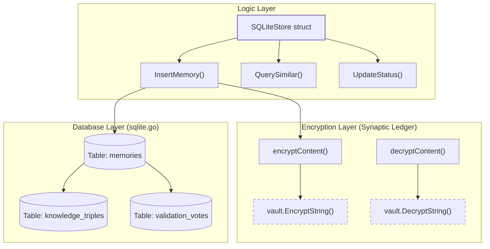
Sources: [internal/store/sqlite.go:34-41](), [internal/store/sqlite.go:61-99](), [internal/store/sqlite.go:149-180]()

## Schema and Migrations

The schema is initialized automatically upon store creation via `initSchema` [internal/store/sqlite.go:148](). It defines the core tables required for the SAGE ecosystem:

| Table | Purpose | Key Columns |
| :--- | :--- | :--- |
| `memories` | Primary storage for agent observations and facts. | `memory_id`, `content`, `embedding`, `status` |
| `knowledge_triples` | Semantic relationships extracted from memories. | `subject`, `predicate`, `object` |
| `validation_votes` | Audit trail of validator decisions (PoE). | `validator_id`, `decision`, `weight_at_vote` |
| `corroborations` | Evidence from other agents supporting a memory. | `agent_id`, `evidence` |
| `pipeline_messages` | Queue for inter-agent communication. | `sender_id`, `recipient_id`, `status` |

Sources: [internal/store/sqlite.go:149-197]()

## Encryption Integration (Synaptic Ledger)

The `SQLiteStore` integrates deeply with the `internal/vault` package to provide at-rest encryption. This is referred to as the "Synaptic Ledger" in the UI.

### Encryption State Machine
The store tracks two fields to manage encryption safety:
- `vault`: A pointer to an unlocked `vault.Vault` instance [internal/store/sqlite.go:38]().
- `vaultExpected`: A boolean flag. If `true` and `vault` is `nil`, the store rejects writes to prevent accidental plaintext leakage [internal/store/sqlite.go:39, 63-65]().

### Content Handling
Encrypted content is stored with a specific prefix `enc::` followed by base64-encoded ciphertext [internal/store/sqlite.go:44, 72](). During retrieval, `decryptContent` checks for this prefix; if the vault is locked, it returns a placeholder string `[encrypted — vault locked]` to the caller [internal/store/sqlite.go:81-83]().

Sources: [internal/store/sqlite.go:44-99](), [internal/vault/vault.go:49-52]()

## In-Memory Vector Search

Unlike the Multi-Node mode which uses `pgvector`, the SQLite store performs cosine similarity search in-memory.

1. **Retrieval**: `QuerySimilar` fetches all memories with non-null embeddings from the database [internal/store/sqlite.go:145-148]().
2. **Decryption**: Each embedding is decrypted using the vault [internal/store/sqlite.go:114-124]().
3. **Scoring**: The system calculates the cosine similarity between the query vector and stored vectors.
4. **Ranking**: Results are sorted by score, filtered by `QueryOptions` (e.g., `MinConfidence`, `DomainTag`), and truncated to `TopK` [internal/store/store.go:69-77]().

Sources: [internal/store/sqlite.go:101-124](), [internal/store/store.go:69-77]()

## Pipeline and Message Management

The SQLite store acts as the broker for the **Inter-Agent Pipeline**. It manages the `pipeline_messages` table, which supports asynchronous tasking and message passing between agents.

**Diagram: Pipeline Message Lifecycle**
```mermaid
sequenceDiagram
    participant A as Agent (Sender)
    participant S as SQLiteStore
    participant B as Agent (Recipient)

    A->>S: InsertMessage(TxTypePipelineSubmit)
    Note over S: Status: 'pending'
    B->>S: ClaimNextMessage(recipient_id)
    S-->>B: message_id
    Note over S: Status: 'processing'
    B->>S: CompleteMessage(result_content)
    Note over S: Status: 'completed'
    A->>S: GetMessage(message_id)
```
Sources: [internal/store/sqlite.go:191-197](), [internal/store/store.go:128-132]()

## RedeploymentLock Mechanism

The `RedeploymentLock` is a specialized table in SQLite used to synchronize critical system operations, such as agent key rotation or node configuration changes. It ensures that only one "orchestrator" process can modify the system state at a time, preventing database corruption during high-stakes transitions.

Key functions include:
- `AcquireRedeploymentLock`: Sets a global lock with a timeout.
- `ReleaseRedeploymentLock`: Clears the lock after a successful or failed operation.

Sources: [internal/store/sqlite.go:200-215]()

---

# Page: PostgreSQL Store and BadgerDB (Multi-Node Mode)

# PostgreSQL Store and BadgerDB (Multi-Node Mode)

<details>
<summary>Relevant source files</summary>

The following files were used as context for generating this wiki page:

- [api/rest/agent_handler.go](api/rest/agent_handler.go)
- [api/rest/helpers.go](api/rest/helpers.go)
- [deploy/docker-compose.yml](deploy/docker-compose.yml)
- [deploy/init.sql](deploy/init.sql)
- [internal/abci/app.go](internal/abci/app.go)
- [internal/abci/app_test.go](internal/abci/app_test.go)
- [internal/abci/migrate.go](internal/abci/migrate.go)
- [internal/store/badger.go](internal/store/badger.go)
- [internal/store/postgres.go](internal/store/postgres.go)
- [internal/store/sqlite.go](internal/store/sqlite.go)
- [internal/store/store.go](internal/store/store.go)

</details>


In multi-node deployments (the `amid` binary), SAGE employs a hybrid storage architecture. It splits data between **BadgerDB**, which maintains the "on-chain" consensus state (agent registry, nonces, and memory hashes), and **PostgreSQL**, which serves as the "off-chain" searchable store for high-volume memory content and vector embeddings.

## Hybrid Storage Architecture

The system distinguishes between data that requires strict BFT consensus (on-chain) and data that requires advanced querying and semantic search (off-chain).

| Feature | BadgerDB (On-Chain) | PostgreSQL (Off-Chain) |
|:---|:---|:---|
| **Role** | Truth for consensus & identity | Searchable memory index |
| **Data Types** | Nonces, Hashes, RBAC, Validator Scores | Memory content, Embeddings, Triples |
| **Consistency** | Strong (CometBFT AppHash) | Eventual (Buffered via ABCI Commit) |
| **Implementation** | `BadgerStore` [internal/store/badger.go:16-18]() | `PostgresStore` [internal/store/postgres.go:27-30]() |

### Multi-Node Data Flow

The following diagram illustrates how a transaction flows from the `SageApp` (ABCI) into both storage layers during the consensus lifecycle.

**Consensus to Storage Mapping**
```mermaid
graph TD
    subgraph "ABCI Layer (internal/abci/app.go)"
        A["SageApp.DeliverTx()"] --> B{"Tx Type?"}
        B -- "Identity/RBAC" --> C["BadgerStore.SetState()"]
        B -- "Memory Content" --> D["SageApp.pendingWrites (Buffer)"]
    end

    subgraph "On-Chain State (BadgerDB)"
        C --> E["nonce:agent_id"]
        C --> F["agent:agent_id"]
        C --> G["memory:memory_id (Hash only)"]
    end

    subgraph "Off-Chain Search (PostgreSQL)"
        H["SageApp.Commit()"] --> I["PostgresStore.InsertMemory()"]
        D --> H
        I --> J[("PostgreSQL + pgvector")]
    end

    style G stroke-dasharray: 5 5
    style J stroke-width:2px
```
Sources: [internal/abci/app.go:115-127](), [internal/store/badger.go:34-51](), [internal/store/postgres.go:55-79]()

---

## PostgreSQL and pgvector

The `PostgresStore` implements the `OffchainStore` interface. It leverages the `pgvector` extension to perform HNSW (Hierarchical Navigable Small World) indexed vector similarity searches, which is essential for the `sage_recall` tool in multi-node environments.

### Key Implementation Details
- **Vector Search**: Uses the `<=>` operator for cosine distance [internal/store/postgres.go:147-148]().
- **Connection Pooling**: Managed via `pgxpool` with a default maximum of 20 connections [internal/store/postgres.go:39-42]().
- **Batching**: Uses `pgx.Batch` during the ABCI `Commit` phase to ensure high throughput when flushing buffered writes [internal/abci/app.go:126-127]().

### Schema: init.sql
The PostgreSQL schema is initialized via `deploy/init.sql`. It defines the core tables for memories, knowledge triples, and the Proof of Experience (PoE) scoring system.

| Table | Purpose | Key Columns |
|:---|:---|:---|
| `memories` | Main content store | `content`, `embedding vector(768)`, `status` |
| `knowledge_triples` | Graph representation | `subject`, `predicate`, `object` |
| `validation_votes` | PoE audit trail | `validator_id`, `decision`, `weight_at_vote` |
| `validator_scores` | Current PoE weights | `weighted_sum`, `expertise_vec`, `current_weight` |

Sources: [deploy/init.sql:11-106](), [internal/store/postgres.go:33-53]()

---

## BadgerDB: On-Chain State

The `BadgerStore` handles the state that must be identical across all 4 nodes in a SAGE cluster. This state is used to calculate the `AppHash` returned to CometBFT, ensuring the network remains in sync.

### On-Chain Entities
1. **Agent Registry**: Stores `OnChainAgent` structs containing public keys, roles, and clearance levels [internal/store/badger.go:53-68]().
2. **Nonces**: Tracks the current transaction nonce for every agent to prevent replay attacks [internal/store/badger.go:117-123]().
3. **Memory Hashes**: Stores a mapping of `MemoryID` to `ContentHash`. This allows validators to verify that the content in PostgreSQL hasn't been tampered with [internal/store/badger.go:77-86]().

### Deterministic Hashing
To maintain consensus, `BadgerStore.ComputeAppHash()` iterates through all keys in lexicographical order to produce a deterministic SHA-256 hash of the entire database [internal/store/badger.go:176-225]().

**Identity and State Resolution**
```mermaid
graph LR
    subgraph "Code Entity Space"
        PTX["tx.ParsedTx"]
        AS["abci.SageApp"]
        BS["store.BadgerStore"]
        PS["store.PostgresStore"]
    end

    subgraph "Natural Language Space"
        Identity["Agent Identity"]
        Sequence["Anti-Replay"]
        Semantic["Semantic Memory"]
    end

    PTX -- "AgentPubKey" --> Identity
    AS -- "verifyAgentIdentity()" --> PTX
    BS -- "GetNonce()" --> Sequence
    PS -- "QuerySimilar()" --> Semantic
    
    PTX -- "Updates" --> BS
    PTX -- "Content" --> PS
```
Sources: [internal/abci/app.go:143-160](), [internal/store/badger.go:148-152](), [internal/tx/codec.go:1-50]()

---

## Multi-Node Deployment (Docker)

The multi-node mode is typically deployed using the 4-node Docker Compose stack defined in `deploy/docker-compose.yml`.

### Service Topology
- **PostgreSQL**: Shared by all ABCI nodes as the off-chain store [deploy/docker-compose.yml:9-27]().
- **ABCI Nodes (`abci0-3`)**: The Go application logic, each with its own local BadgerDB volume [deploy/docker-compose.yml:32-134]().
- **CometBFT Nodes (`cometbft0-3`)**: The consensus engine nodes that communicate via P2P [deploy/docker-compose.yml:168-236]().
- **Ollama**: Provides embedding generation services to the ABCI nodes [deploy/docker-compose.yml:139-164]().

### Startup Migrations
Upon startup, the system runs `MigrateAgentsOnChain`. This function ensures that agents existing in the PostgreSQL/Offchain store are properly registered in the BadgerDB on-chain state [internal/abci/migrate.go:12-15](). If an agent is found in PostgreSQL but missing from BadgerDB, it is backfilled to height 1 to enable immediate consensus participation [internal/abci/migrate.go:74-80]().

Sources: [deploy/docker-compose.yml:1-250](), [internal/abci/migrate.go:12-92]()

---

# Page: Synaptic Ledger (Vault Encryption)

# Synaptic Ledger (Vault Encryption)

<details>
<summary>Relevant source files</summary>

The following files were used as context for generating this wiki page:

- [internal/store/postgres.go](internal/store/postgres.go)
- [internal/store/sqlite.go](internal/store/sqlite.go)
- [internal/store/store.go](internal/store/store.go)
- [internal/vault/vault.go](internal/vault/vault.go)
- [internal/vault/vault_test.go](internal/vault/vault_test.go)
- [web/handler_ledger.go](web/handler_ledger.go)
- [web/handler_ledger_test.go](web/handler_ledger_test.go)

</details>


The Synaptic Ledger provides at-rest encryption for SAGE memories using the **AES-256-GCM** algorithm. It ensures that sensitive memory content and vector embeddings are unreadable if the underlying storage (SQLite or PostgreSQL) is compromised or uploaded to cloud providers. The system uses a **Vault** architecture where a randomly generated data key is protected by a user-defined passphrase via the **Argon2id** key derivation function.

## Vault Architecture and Key Derivation

The encryption system is decoupled: the passphrase does not encrypt the memories directly. Instead, it encrypts a `dataKey`. This design allows users to change their passphrase or recover access via a recovery key without re-encrypting the entire database.

### Key Derivation Flow (Argon2id)

When a vault is initialized, SAGE derives a "wrapping key" from the user's passphrase. This wrapping key is used to encrypt the master `dataKey`, which is then stored in the `vault.key` file.

**Argon2id Parameters:**
*   **Time:** 3 iterations [internal/vault/vault.go:25]()
*   **Memory:** 64 MB [internal/vault/vault.go:26]()
*   **Threads:** 4 [internal/vault/vault.go:27]()
*   **Key Length:** 32 bytes (AES-256) [internal/vault/vault.go:28]()

### The `vault.key` Format

The `vault.key` file is a JSON-encoded structure stored with `0600` (owner-only) permissions [internal/vault/vault.go:115]().

| Field | Description |
| :--- | :--- |
| `salt` | 16-byte random salt for Argon2id [internal/vault/vault.go:41]() |
| `encrypted_key` | The master `dataKey` encrypted with the wrapping key [internal/vault/vault.go:42]() |
| `nonce` | 12-byte GCM nonce used for the `encrypted_key` [internal/vault/vault.go:43]() |
| `verify_hash` | SHA-256 hash of the decrypted `dataKey` for fast passphrase validation [internal/vault/vault.go:44]() |

**Sources:** [internal/vault/vault.go:24-52](), [internal/vault/vault.go:103-116]()

---

## Data Flow: Code to Entity Mapping

The following diagram maps the logical encryption operations to the specific Go functions and structures that implement them.

### Encryption Implementation Mapping
```mermaid
graph TD
    subgraph "Natural Language Space"
        Passphrase["User Passphrase"]
        MemContent["Memory Content"]
        Embedding["Vector Embedding"]
    end

    subgraph "Code Entity Space (internal/vault)"
        VaultStruct["type Vault struct"]
        InitFunc["func Init()"]
        OpenFunc["func Open()"]
        EncryptFunc["func (v *Vault) Encrypt()"]
        DecryptFunc["func (v *Vault) Decrypt()"]
    end

    subgraph "Code Entity Space (internal/store)"
        SQLiteStore["type SQLiteStore struct"]
        EncContent["func encryptContent()"]
        DecContent["func decryptContent()"]
    end

    Passphrase --> InitFunc
    InitFunc --> VaultStruct
    OpenFunc --> VaultStruct
    
    MemContent --> EncContent
    EncContent --> EncryptFunc
    
    Embedding --> SQLiteStore
    SQLiteStore -- "encryptEmbedding()" --> EncryptFunc
    
    EncryptFunc --> VaultStruct
    DecryptFunc --> VaultStruct
```
**Sources:** [internal/vault/vault.go:49-52](), [internal/vault/vault.go:63-116](), [internal/store/sqlite.go:34-41](), [internal/store/sqlite.go:61-73]()

---

## Content and Embedding Encryption

SAGE encrypts two primary data types: the `content` string (the actual text of the memory) and the `embedding` (the high-dimensional vector).

### Content Encryption
Encrypted content is stored in the database as a string with a specific prefix: `enc::<base64_ciphertext>`. 
*   **Encryption:** The `SQLiteStore.encryptContent` function checks if a vault is attached. If so, it calls `vault.EncryptString` and prepends the prefix [internal/store/sqlite.go:61-73]().
*   **Decryption:** The `SQLiteStore.decryptContent` function looks for the `enc::` prefix. If the vault is locked, it returns a placeholder `[encrypted — vault locked]` [internal/store/sqlite.go:77-83]().

### Embedding Encryption
Embeddings are stored as raw binary blobs (`BLOB`).
*   **Encryption:** `encryptEmbedding` converts the float vector to bytes and encrypts it using the vault [internal/store/sqlite.go:102-110]().
*   **Decryption:** `decryptEmbedding` attempts decryption. If it fails (e.g., legacy unencrypted data), it returns the data as-is for backward compatibility [internal/store/sqlite.go:114-124]().

**Sources:** [internal/store/sqlite.go:44-124]()

---

## State Machine: Locked vs. Unlocked

The system operates in a state machine managed by the `DashboardHandler` and the `Vault` struct.

### Vault State Transitions
```mermaid
stateDiagram-v2
    [*] --> NoVault: vault.key missing
    NoVault --> Locked: vault.Init(passphrase)
    
    [*] --> Locked: vault.key exists
    Locked --> Unlocked: vault.Open(passphrase)
    
    Unlocked --> Locked: Restart / Timeout
    
    Unlocked --> Unlocked: vault.ChangePassphrase()
    Locked --> Unlocked: vault.InitFromRecoveryKey()
```

### State Behavior
1.  **Locked:** The `Vault` pointer in `SQLiteStore` is `nil`. If `vaultExpected` is true, all writes to the memory store will fail with an error to prevent accidental plaintext leaks [internal/store/sqlite.go:62-65]().
2.  **Unlocked:** The `Vault` holds the `dataKey` in memory [internal/vault/vault.go:51](). `SQLiteStore` uses this key to transparently encrypt/decrypt during CRUD operations.

**Sources:** [internal/store/sqlite.go:48-67](), [web/handler_ledger.go:17-36](), [internal/vault/vault.go:47-52]()

---

## Passphrase Management and Recovery

### Passphrase Change
Because SAGE uses a wrapped-key architecture, the user can change their passphrase without re-encrypting all memories. The `vault.ChangePassphrase` function:
1.  Opens the vault with the old passphrase to retrieve the `dataKey`.
2.  Generates a new `salt` and `nonce`.
3.  Re-wraps the existing `dataKey` with a new wrapping key derived from the new passphrase [internal/vault/vault.go:218-240]().

### Recovery Key Mechanism
During initialization or passphrase change, the system provides a **Recovery Key**. This is the raw `dataKey` encoded in Base64 [web/handler_ledger.go:101-104]().
*   If the passphrase is lost, `vault.InitFromRecoveryKey` can be used to create a new `vault.key` file using the recovery key and a new passphrase [internal/vault/vault.go:244-275]().
*   The `DashboardHandler` creates a `.bak` of the existing key file before performing a recovery for safety [web/handler_ledger.go:195-200]().

**Sources:** [internal/vault/vault.go:218-275](), [web/handler_ledger.go:117-161](), [web/handler_ledger.go:165-204]()

---

# Page: Agent Interfaces

# Agent Interfaces

<details>
<summary>Relevant source files</summary>

The following files were used as context for generating this wiki page:

- [README.md](README.md)
- [api/rest/memory_handler.go](api/rest/memory_handler.go)
- [api/rest/pipe_handler.go](api/rest/pipe_handler.go)
- [api/rest/server.go](api/rest/server.go)
- [internal/mcp/server.go](internal/mcp/server.go)
- [internal/mcp/server_test.go](internal/mcp/server_test.go)
- [internal/mcp/tools.go](internal/mcp/tools.go)
- [internal/store/pipeline_test.go](internal/store/pipeline_test.go)
- [sdk/python/pyproject.toml](sdk/python/pyproject.toml)
- [sdk/python/src/sage_sdk/__init__.py](sdk/python/src/sage_sdk/__init__.py)
- [sdk/python/src/sage_sdk/async_client.py](sdk/python/src/sage_sdk/async_client.py)
- [sdk/python/src/sage_sdk/client.py](sdk/python/src/sage_sdk/client.py)

</details>


SAGE provides three primary interfaces for AI agents to interact with its persistent memory infrastructure. These interfaces allow agents to propose, query, and manage memories, as well as coordinate with other agents via an asynchronous pipeline. All interfaces eventually converge on the same BFT consensus-validated storage layer [README.md:19-32]().

### Interface Overview

| Interface | Primary Use Case | Transport | Protocol / Format |
| :--- | :--- | :--- | :--- |
| **MCP Server** | Direct LLM tool-calling (Claude, ChatGPT) | `stdio` | JSON-RPC 2.0 |
| **REST API** | Custom agent integrations and backend services | `HTTP/S` | JSON / Ed25519 Signatures |
| **Python SDK** | Rapid development of SAGE-enabled Python agents | `HTTPS` | Python Classes / Pydantic |

---

### 1. MCP Server and Tools

The Model Context Protocol (MCP) server is the most common entry point for LLMs. It runs as a `stdio` process, typically managed by a host like Claude Desktop or ChatGPT [internal/mcp/server.go:40-42](). It exposes a suite of tools that allow the agent to treat SAGE as an extension of its own cognitive process.

*   **Turn Discipline**: The server tracks "turns" and encourages agents to call `sage_turn` every cycle to maintain episodic memory [internal/mcp/server.go:51-53]().
*   **Auto-Inception**: On the first tool call, the server can automatically trigger `sage_inception` to provide the agent with its operating instructions and context [internal/mcp/server.go:64-65]().
*   **Memory Modes**: Supports `full`, `bookend`, and `on-demand` modes to balance context window usage against memory persistence [README.md:102]().

For details, see [MCP Server and Tools](#4.1).

**Sources:** [internal/mcp/server.go:40-65](), [internal/mcp/tools.go:21-135]().

---

### 2. REST API

The REST API is the backbone of the SAGE network. It provides a standardized set of endpoints for all memory operations, identity management, and inter-agent communication [api/rest/server.go:175-195]().

*   **Authentication**: Every request must be signed using an Ed25519 keypair, verified by the `Ed25519AuthMiddleware` [api/rest/server.go:176]().
*   **Access Control**: The API enforces Domain-Based Access Control (DBAC), checking agent permissions against both on-chain state (BadgerDB) and local registries (SQLite/Postgres) [api/rest/memory_handler.go:117-160]().
*   **Pipeline**: Enables asynchronous messaging between agents via the `/v1/pipeline` endpoints [api/rest/pipe_handler.go:19-202]().

For details, see [REST API](#4.2).

**Sources:** [api/rest/server.go:25-50](), [api/rest/memory_handler.go:23-80](), [api/rest/pipe_handler.go:19-202]().

---

### 3. Python SDK

The `sage-agent-sdk` is a high-level Python wrapper for the REST API. It simplifies the process of building SAGE-aware agents by handling request signing, JSON serialization, and providing asynchronous support via `httpx` [sdk/python/src/sage_sdk/async_client.py:38-49]().

*   **SageClient & AsyncSageClient**: Synchronous and asynchronous clients for interacting with SAGE nodes [sdk/python/src/sage_sdk/client.py:38-49]().
*   **Identity Management**: The `AgentIdentity` class handles Ed25519 key loading and request signing [sdk/python/src/sage_sdk/auth.py]().
*   **Pydantic Models**: All API responses are validated into strictly typed Python objects [sdk/python/src/sage_sdk/models.py]().

For details, see [Python SDK](#4.3).

**Sources:** [sdk/python/pyproject.toml:5-29](), [sdk/python/src/sage_sdk/async_client.py:100-217]().

---

### Data Flow: Natural Language to Code Entity

The following diagrams illustrate how an agent's natural language intent is translated into SAGE code entities across the different interfaces.

#### Diagram: Memory Submission Flow
"Store this architectural decision about the API."

```mermaid
graph LR
    subgraph "Natural Language Space"
        A["Agent Intent: 'Remember this fact'"]
    end

    subgraph "Agent Interface Space"
        B["MCP Tool: sage_remember"]
        C["SDK Method: propose()"]
        D["REST POST: /v1/memory/submit"]
    end

    subgraph "Code Entity Space"
        E["SubmitMemoryRequest struct"]
        F["MemoryRecord struct"]
        G["TxTypeMemorySubmit"]
    end

    A --> B
    A --> C
    B --> D
    C --> D
    D --> E
    E --> F
    F --> G
```
**Sources:** [internal/mcp/tools.go:23-38](), [api/rest/memory_handler.go:26-38](), [sdk/python/src/sage_sdk/client.py:100-121]().

#### Diagram: Inter-Agent Communication Flow
"Ask the Research Agent to find BFT papers."

```mermaid
graph TD
    subgraph "Natural Language Space"
        NL["'Send work to Research Agent'"]
    end

    subgraph "Interface Logic"
        MCP["sage_pipe tool"]
        SDK["client.pipe_send()"]
    end

    subgraph "System Entities (api/rest/pipe_handler.go)"
        PIPE["handlePipeSend()"]
        STORE["PipelineStore.InsertPipeline()"]
        MSG["PipelineMessage struct"]
    end

    subgraph "Recipient Agent"
        INBOX["handlePipeInbox()"]
        CLAIM["handlePipeClaim()"]
    end

    NL --> MCP
    NL --> SDK
    MCP --> PIPE
    SDK --> PIPE
    PIPE --> STORE
    STORE --> MSG
    MSG --> INBOX
    INBOX --> CLAIM
```
**Sources:** [api/rest/pipe_handler.go:19-134](), [internal/store/pipeline_test.go:20-31]().

---

# Page: MCP Server and Tools

# MCP Server and Tools

<details>
<summary>Relevant source files</summary>

The following files were used as context for generating this wiki page:

- [LICENSE](LICENSE)
- [cmd/amid/main.go](cmd/amid/main.go)
- [cmd/sage-cli/main.go](cmd/sage-cli/main.go)
- [cmd/sage-gui/config.go](cmd/sage-gui/config.go)
- [cmd/sage-gui/mcp.go](cmd/sage-gui/mcp.go)
- [cmd/sage-gui/mcp_test.go](cmd/sage-gui/mcp_test.go)
- [extension/chrome/manifest.json](extension/chrome/manifest.json)
- [extension/manifest.firefox.json](extension/manifest.firefox.json)
- [extension/store-listing.md](extension/store-listing.md)
- [internal/embedding/ollama.go](internal/embedding/ollama.go)
- [internal/mcp/server.go](internal/mcp/server.go)
- [internal/mcp/tools.go](internal/mcp/tools.go)
- [internal/mcp/tools_test.go](internal/mcp/tools_test.go)
- [internal/tx/codec.go](internal/tx/codec.go)
- [internal/tx/codec_test.go](internal/tx/codec_test.go)
- [internal/tx/types.go](internal/tx/types.go)
- [web/handler_memorymode_test.go](web/handler_memorymode_test.go)

</details>


The SAGE MCP (Model Context Protocol) server is the primary interface through which Large Language Models (LLMs) interact with the SAGE memory layer. It implements a **stdio-based JSON-RPC 2.0** server that exposes a suite of specialized tools for memory persistence, retrieval, and session management.

## JSON-RPC 2.0 Implementation

The server operates over standard input/output (stdio), allowing it to be easily integrated as an MCP server in clients like Claude Desktop or ChatGPT. It handles standard MCP lifecycle methods including `initialize`, `tools/list`, and `tools/call` [internal/mcp/server.go:120-135]().

### Core Request/Response Loop
The server utilizes a `bufio.Scanner` with a 1MB buffer to process incoming JSON-RPC requests [internal/mcp/server.go:96-117](). Each request is unmarshaled into a `jsonRPCRequest` struct [internal/mcp/server.go:20-25]() and dispatched to the appropriate handler.

### Data Flow: Tool Call to REST API
When an agent calls a SAGE tool, the MCP server acts as a proxy, signing the request with the agent's Ed25519 key and forwarding it to the SAGE REST API.

| Step | Component | Action |
| :--- | :--- | :--- |
| 1 | LLM | Issues `tools/call` via stdio |
| 2 | `mcp.Server` | Validates parameters and checks "Turn Discipline" [internal/mcp/server.go:189-210]() |
| 3 | `mcp.Server` | Signs request using `agentKey` (Ed25519) [internal/mcp/server.go:134]() |
| 4 | REST API | Receives signed request, validates identity, and processes memory [api/rest/server.go:193]() |
| 5 | `mcp.Server` | Returns JSON-RPC result to LLM [internal/mcp/server.go:113]() |

**Sources:** [internal/mcp/server.go:20-117](), [internal/mcp/server.go:189-210]()

---

## SAGE Tools Reference

The server registers a comprehensive set of tools defined in `internal/mcp/tools.go`.

### 1. Consciousness & Session Tools
*   **`sage_inception` (Alias: `sage_red_pill`)**: Initializes the agent's persistent consciousness. It seeds foundational memories and returns operating instructions [internal/mcp/tools.go:105-127]().
*   **`sage_turn`**: The atomic "heartbeat" of SAGE. It should be called every turn to recall relevant memories and store an observation of the current turn [internal/mcp/tools.go:128-135]().
*   **`sage_reflect`**: Used after significant tasks to store "dos and don'ts" (learnings) to improve future performance [internal/mcp/tools.go:25]().

### 2. Memory Management Tools
*   **`sage_remember`**: Stores facts (durable, confidence 0.95+) or observations (ephemeral context). Facts survive confidence decay [internal/mcp/tools.go:23-38]().
*   **`sage_recall`**: Semantic search across memories using natural language queries [internal/mcp/tools.go:39-53]().
*   **`sage_forget`**: Deprecates a memory by ID when it is no longer accurate [internal/mcp/tools.go:54-66]().
*   **`sage_list`**: Browse memories with filters for domain, tag, or status [internal/mcp/tools.go:67-82]().

### 3. Pipeline & Task Tools
*   **`sage_task`**: Lists pending tasks and actionable items [internal/mcp/tools_test.go:98-113]().
*   **`sage_pipe` / `sage_inbox` / `sage_pipe_result`**: Facilitates inter-agent communication and asynchronous message passing.

**Sources:** [internal/mcp/tools.go:22-135](), [internal/mcp/tools_test.go:98-113]()

---

## Turn Discipline and Auto-Inception

The MCP server enforces specific agent behaviors to ensure memory integrity and consistency.

### Turn Discipline Enforcement
The server tracks the number of tool calls made since the last `sage_turn`. If an agent makes multiple calls without updating its episodic memory via `sage_turn`, the server can issue nudges [internal/mcp/server.go:51-53]().

### Auto-Inception
To ensure a seamless onboarding experience, the server features **Auto-Inception**. On the very first tool call of a session, the server checks if the agent's brain is empty. If so, it automatically triggers the inception sequence before processing the requested tool [internal/mcp/server.go:211-215]().

### Memory Mode Configuration
The server behavior adapts based on the `memory_mode` file located in `SAGE_HOME` [cmd/sage-gui/mcp.go:29]().
*   **`full`**: Standard behavior; `sage_turn` is expected every turn.
*   **`bookend`**: Agents are instructed to only call `sage_reflect` at the end of a conversation [cmd/sage-gui/mcp.go:36-38]().
*   **`on-demand`**: No automatic reminders; the user triggers SAGE manually [cmd/sage-gui/mcp.go:31-33]().

**Sources:** [internal/mcp/server.go:51-65](), [cmd/sage-gui/mcp.go:25-58](), [web/handler_memorymode_test.go:128-152]()

---

## Technical Architecture Diagrams

### Diagram 1: MCP Tool Dispatch Logic
This diagram bridges the natural language request from the LLM to the Go function handlers.

```mermaid
graph TD
    subgraph "Natural Language Space (LLM)"
        A["LLM Tool Call: 'sage_remember'"]
    end

    subgraph "Code Entity Space (internal/mcp)"
        B["Run() Loop"]
        C["handleToolsCall()"]
        D["s.tools['sage_remember']"]
        E["toolRemember()"]
    end

    subgraph "REST API Space"
        F["/v1/memory/submit"]
    end

    A -->|JSON-RPC| B
    B --> C
    C --> D
    D -->|Handler| E
    E -->|HTTP POST| F
```
**Sources:** [internal/mcp/server.go:95-117](), [internal/mcp/server.go:189-209](), [internal/mcp/tools.go:37]()

### Diagram 2: Identity Resolution and Server Initialization
How the MCP server resolves its cryptographic identity before starting the JSON-RPC loop.

```mermaid
graph TD
    subgraph "Environment / Filesystem"
        ENV1["SAGE_IDENTITY_PATH"]
        ENV2["SAGE_AGENT_KEY"]
        DIR["~/.sage/agents/&lt;hash&gt;/agent.key"]
    end

    subgraph "Code Entity Space (cmd/sage-gui)"
        M["runMCP()"]
        L["loadOrGenerateKey()"]
        S["NewServer()"]
    end

    ENV1 --> M
    ENV2 --> M
    DIR --> M
    M --> L
    L -->|ed25519.PrivateKey| S
    S -->|Start Stdio| Loop["server.Run()"]
```
**Sources:** [cmd/sage-gui/mcp.go:60-140](), [internal/mcp/server.go:71-86]()

---

## Configuration and Deployment

The MCP server is typically launched via the `sage-gui mcp` command.

### Identity Resolution Priority
The server resolves the agent's Ed25519 identity in the following order:
1.  `SAGE_IDENTITY_PATH` environment variable.
2.  `SAGE_AGENT_KEY` environment variable.
3.  Per-project key in `~/.sage/agents/<project-name>-<hash>/agent.key`.
4.  Default global key in `~/.sage/agent.key`.

[cmd/sage-gui/mcp.go:84-114]()

### Self-Healing Integration
On every startup, the MCP server performs a "self-heal" of the local project directory. This includes:
*   Patching `CLAUDE.md` with the latest SAGE instructions [cmd/sage-gui/mcp_test.go:13-26]().
*   Updating hook scripts in `.claude/hooks/` to ensure they support the current `memory_mode` [cmd/sage-gui/mcp_test.go:137-154]().

**Sources:** [cmd/sage-gui/mcp.go:84-114](), [cmd/sage-gui/mcp_test.go:137-154](), [cmd/sage-gui/config.go:83-120]()

---

# Page: REST API

# REST API

<details>
<summary>Relevant source files</summary>

The following files were used as context for generating this wiki page:

- [CONTRIBUTING.md](CONTRIBUTING.md)
- [api/openapi.yaml](api/openapi.yaml)
- [api/rest/access_handler.go](api/rest/access_handler.go)
- [api/rest/dept_handler.go](api/rest/dept_handler.go)
- [api/rest/memory_handler.go](api/rest/memory_handler.go)
- [api/rest/middleware/auth.go](api/rest/middleware/auth.go)
- [api/rest/middleware/middleware_test.go](api/rest/middleware/middleware_test.go)
- [api/rest/middleware/ratelimit.go](api/rest/middleware/ratelimit.go)
- [api/rest/org_handler.go](api/rest/org_handler.go)
- [api/rest/server.go](api/rest/server.go)
- [api/rest/vote_handler.go](api/rest/vote_handler.go)
- [cmd/sage-gui/node_controller.go](cmd/sage-gui/node_controller.go)
- [cmd/sage-gui/quorum.go](cmd/sage-gui/quorum.go)
- [cmd/sage-gui/seed.go](cmd/sage-gui/seed.go)
- [internal/auth/ed25519.go](internal/auth/ed25519.go)
- [internal/auth/ed25519_test.go](internal/auth/ed25519_test.go)
- [internal/mcp/server_test.go](internal/mcp/server_test.go)
- [sdk/python/examples/async_example.py](sdk/python/examples/async_example.py)
- [sdk/python/examples/full_lifecycle.py](sdk/python/examples/full_lifecycle.py)
- [sdk/python/examples/multi_agent.py](sdk/python/examples/multi_agent.py)
- [sdk/python/examples/quickstart.py](sdk/python/examples/quickstart.py)
- [test/integration/helpers_test.go](test/integration/helpers_test.go)

</details>


The SAGE REST API server, implemented in `api/rest/server.go`, serves as the primary interface for agents, the CEREBRUM dashboard, and external tools to interact with the SAGE ecosystem [api/rest/server.go:25-50](). It handles memory submission, querying, agent registration, and governance actions (voting/challenging) by translating HTTP requests into signed CometBFT transactions or local database queries [api/rest/memory_handler.go:178-200]().

## Server Architecture

The `Server` struct encapsulates the dependencies required for the API's operation, including storage backends, the embedding provider, and the CometBFT RPC client [api/rest/server.go:31-50]().

### Key Components
*   **Router**: Built using `go-chi`, managing middleware and endpoint routing [api/rest/server.go:148-170]().
*   **Storage Interfaces**: The server uses `MemoryStore`, `AgentStore`, `OrgStore`, and `AccessStore` to interact with both the off-chain SQLite/PostgreSQL data and the on-chain BadgerDB state [api/rest/server.go:34-39]().
*   **Validator Signing Key**: The server loads the CometBFT validator private key from the `VALIDATOR_KEY_FILE` path. This allows the API to sign vote transactions using the node's official validator identity, ensuring they are recognized by the consensus quorum [api/rest/server.go:104-145]().
*   **Embedding Provider**: Used to generate vectors for incoming memory content during submission or to process text-to-vector conversions for queries [api/rest/server.go:44]().

### Data Flow: REST to Consensus
The following diagram illustrates how a memory submission flows from a REST client through the API server into the consensus layer.

**Memory Submission Flow**
```mermaid
graph TD
    subgraph "Client Space"
        A["Agent/Client"] -- "POST /v1/memory/submit" --> B["REST API Server"]
    end

    subgraph "api/rest/server.go"
        B --> C["Ed25519AuthMiddleware"]
        C --> D["RateLimitMiddleware"]
        D --> E["handleSubmitMemory"]
    end

    subgraph "internal/tx"
        E --> F["tx.ParsedTx (TxTypeMemorySubmit)"]
        F --> G["tx.SignTx (Node Key)"]
    end

    subgraph "Consensus Space"
        G -- "broadcastTx" --> H["CometBFT RPC"]
        H -- "DeliverTx" --> I["internal/abci/app.go"]
    end

    Sources["Sources: [api/rest/server.go:175-180](), [api/rest/memory_handler.go:202-230](), [api/rest/middleware/auth.go:87-100]()"]
```

## Authentication and Security

All non-public endpoints are protected by `Ed25519AuthMiddleware` [api/rest/middleware/auth.go:87](). SAGE uses a header-based signature scheme rather than bearer tokens.

### Ed25519 Signature Scheme
Clients must provide three headers [api/rest/middleware/auth.go:80-86]():
1.  `X-Agent-ID`: The hex-encoded Ed25519 public key of the agent.
2.  `X-Signature`: A hex-encoded signature of the request.
3.  `X-Timestamp`: Unix epoch seconds (must be within a 5-minute window to prevent long-term replays) [api/rest/middleware/auth.go:78]().

The signature is calculated over a canonical message: `SHA-256(method + " " + path + "\n" + body) + timestamp` [internal/auth/ed25519.go:63-77](). This format binds the signature to a specific endpoint and body, preventing cross-endpoint replay attacks [internal/auth/ed25519.go:49-51]().

### Replay Protection
The `replayCache` tracks `(agentID + signature)` pairs within the timestamp validity window to prevent immediate request duplication [api/rest/middleware/auth.go:19-30]().

### Rate Limiting
The `RateLimitMiddleware` enforces a limit of 10,000 requests per minute per `X-Agent-ID` [api/rest/middleware/ratelimit.go:10-20](). If no ID is present (for public endpoints), it falls back to the client's remote IP address [api/rest/middleware/ratelimit.go:21-23]().

## Endpoint Categories

### Memory Management
*   `POST /v1/memory/submit`: Proposes a new memory. The server creates a `TxTypeMemorySubmit` transaction and broadcasts it to the network [api/rest/memory_handler.go:202-215]().
*   `POST /v1/memory/query`: Performs semantic search using the provided embedding and filters by `domain_tag` or `min_confidence` [api/rest/memory_handler.go:47-56]().
*   `GET /v1/memory/{memory_id}`: Retrieves full details of a memory, including its current status, votes, and corroborations [api/rest/memory_handler.go:82-100]().

### Governance and Validation
*   `POST /v1/memory/{memory_id}/vote`: Casts an `accept`, `reject`, or `abstain` vote. The server signs this with the node's validator key to ensure it counts toward the 3/4 quorum [api/rest/vote_handler.go:76-152]().
*   `POST /v1/memory/{memory_id}/challenge`: Submits a challenge against a memory with a reason and evidence [api/rest/vote_handler.go:154-228]().
*   `POST /v1/memory/{memory_id}/corroborate`: Submits supporting evidence for an existing memory [api/rest/vote_handler.go:230-250]().

### Agent and Organization
*   `GET /v1/agents`: Lists all registered agents from the on-chain registry [api/rest/server.go:172]().
*   `POST /v1/org/create`: (Authenticated) Registers a new organization on-chain [api/rest/org_handler.go]().
*   `POST /v1/access/grant`: Grants an agent specific read/write permissions for a domain [api/rest/access_handler.go]().

## Domain Access Control

The API enforces Role-Based Access Control (RBAC) through `checkDomainAccess` [api/rest/memory_handler.go:121]().

1.  **On-Chain Check**: If `BadgerStore` is available, the server checks the agent's registered role and `DomainAccess` JSON string stored on-chain [api/rest/memory_handler.go:127-140]().
2.  **Role Privileges**:
    *   **Admins**: Bypass all domain checks [api/rest/memory_handler.go:131-133]().
    *   **Observers**: Can read but are blocked from `write` actions (submitting memories) [api/rest/memory_handler.go:134-136]().
3.  **Fallback**: If the agent is not found in the on-chain registry, the system falls back to the local SQLite agent store for backwards compatibility [api/rest/memory_handler.go:163-172]().

**Identity and Access Code Map**
```mermaid
classDiagram
    class Server {
        +AgentStore agentStore
        +BadgerStore badgerStore
        +signingKey ed25519.PrivateKey
    }
    class Ed25519AuthMiddleware {
        +VerifyRequest()
        +ContextAgentID()
    }
    class MemoryHandler {
        +handleSubmitMemory()
        +checkDomainAccess()
    }
    class VoteHandler {
        +handleVoteMemory()
        +embedAgentAuth()
    }

    Server --> Ed25519AuthMiddleware : uses
    Ed25519AuthMiddleware ..> MemoryHandler : injects agent_id
    MemoryHandler --> Server : queries stores
    VoteHandler --> Server : uses signingKey

    Sources["Sources: [api/rest/server.go:31-50](), [api/rest/middleware/auth.go:87-100](), [api/rest/memory_handler.go:121-160]()"]
```

## Request and Response Types

The API uses standard JSON for request bodies and follows RFC 7807 (Problem Details for HTTP APIs) for error responses via the `writeProblem` helper [api/rest/middleware/auth.go:100-103]().

| Type | Struct Name | Description |
| :--- | :--- | :--- |
| Request | `SubmitMemoryRequest` | Content, type, domain, and optional triples/embeddings [api/rest/memory_handler.go:26-38](). |
| Request | `QueryMemoryRequest` | Vector and filters for semantic search [api/rest/memory_handler.go:48-56](). |
| Response | `SubmitMemoryResponse` | Returns `memory_id` and the CometBFT `tx_hash` [api/rest/memory_handler.go:41-45](). |
| Response | `MemoryResult` | Summary of a memory including computed confidence and status [api/rest/memory_handler.go:66-80](). |

Sources:
- `api/rest/server.go`
- `api/rest/memory_handler.go`
- `api/rest/vote_handler.go`
- `api/rest/middleware/auth.go`
- `api/rest/middleware/ratelimit.go`
- `internal/auth/ed25519.go`
- `internal/tx/codec.go`

---

# Page: Python SDK

# Python SDK

<details>
<summary>Relevant source files</summary>

The following files were used as context for generating this wiki page:

- [.gitignore](.gitignore)
- [CONTRIBUTING.md](CONTRIBUTING.md)
- [api/openapi.yaml](api/openapi.yaml)
- [api/rest/pipe_handler.go](api/rest/pipe_handler.go)
- [docs/og-image.png](docs/og-image.png)
- [extension/build.sh](extension/build.sh)
- [integrations/levelup/sage_bridge.py](integrations/levelup/sage_bridge.py)
- [internal/store/pipeline_test.go](internal/store/pipeline_test.go)
- [papers/Paper4 - Longitudinal Learning in Governed Multi-Agent Systems - How Institutional Memory Improves Agent Performance Over Time.pdf](papers/Paper4 - Longitudinal Learning in Governed Multi-Agent Systems - How Institutional Memory Improves Agent Performance Over Time.pdf)
- [sdk/python/examples/async_example.py](sdk/python/examples/async_example.py)
- [sdk/python/examples/complete_walkthrough.py](sdk/python/examples/complete_walkthrough.py)
- [sdk/python/examples/federation.py](sdk/python/examples/federation.py)
- [sdk/python/examples/full_lifecycle.py](sdk/python/examples/full_lifecycle.py)
- [sdk/python/examples/multi_agent.py](sdk/python/examples/multi_agent.py)
- [sdk/python/examples/org_setup.py](sdk/python/examples/org_setup.py)
- [sdk/python/examples/quickstart.py](sdk/python/examples/quickstart.py)
- [sdk/python/examples/rbac_clearance.py](sdk/python/examples/rbac_clearance.py)
- [sdk/python/src/sage_sdk/async_client.py](sdk/python/src/sage_sdk/async_client.py)
- [sdk/python/src/sage_sdk/auth.py](sdk/python/src/sage_sdk/auth.py)
- [sdk/python/src/sage_sdk/client.py](sdk/python/src/sage_sdk/client.py)

</details>


The `sage-agent-sdk` is the official Python library for interacting with the SAGE network. It provides high-level abstractions for agent identity management, Ed25519 request signing, and a comprehensive client for both synchronous and asynchronous operations. The SDK abstracts the underlying blockchain complexity, allowing developers to focus on memory operations and organizational governance.

## Core Components

### Agent Identity (`AgentIdentity`)
Every agent in the SAGE ecosystem must have a unique identity based on an Ed25519 keypair. The public key serves as the `agent_id`, while the private key is used to sign every HTTP request sent to the SAGE REST API. This ensures non-repudiation and prevents request tampering.

*   **Key Management**: Identities can be generated randomly, loaded from a 32-byte seed file, or derived from environment variables `[sdk/python/src/sage_sdk/auth.py:15-64]()`.
*   **Request Signing**: The SDK implements a canonical signing format: `SHA256(method + " " + path + "\n" + body) || big-endian int64 timestamp` `[sdk/python/src/sage_sdk/auth.py:75-96]()`. This binds signatures to specific endpoints and timestamps to prevent replay attacks.

### SageClient and AsyncSageClient
The SDK provides two primary client classes: `SageClient` (blocking) and `AsyncSageClient` (non-blocking using `httpx`).

*   **Initialization**: Both clients require a `base_url` and an `AgentIdentity` `[sdk/python/src/sage_sdk/client.py:41-49]()` `[sdk/python/src/sage_sdk/async_client.py:41-49]()`.
*   **Automatic Signing**: All requests made through these clients are automatically signed using the provided identity via the internal `_request` method `[sdk/python/src/sage_sdk/client.py:51-80]()`.

### Pydantic Models
The SDK uses Pydantic for strict data validation and serialization of SAGE entities.
*   **MemoryRecord**: Represents a piece of knowledge including its content, `MemoryType` (Fact, Observation, Inference, Task), and `ConfidenceScore` `[sdk/python/src/sage_sdk/models.py]()`.
*   **KnowledgeTriple**: Encapsulates semantic relationships (Subject-Predicate-Object) within a memory `[sdk/python/src/sage_sdk/models.py:18]()`.

## Data Flow: SDK to Consensus
The following diagram illustrates how a Python SDK call is transformed into a consensus-validated state change.

**SDK Transaction Flow**
```mermaid
sequenceDiagram
    participant A as Python Agent (SDK)
    participant R as REST API (Go)
    participant C as CometBFT (Consensus)
    participant S as Storage (Postgres/Badger)

    A->>A: AgentIdentity.sign_request()
    A->>R: POST /v1/memory/submit (Signed)
    R->>R: middleware.AuthMiddleware (Verify Sig)
    R->>C: BroadcastTxSync(ParsedTx)
    C->>C: BFT Quorum Agreement (3/4 Nodes)
    C->>R: ABCI.DeliverTx()
    R->>S: Commit to SQLite/Postgres & BadgerDB
    R-->>A: MemorySubmitResponse (tx_hash)
```
Sources: `[sdk/python/src/sage_sdk/auth.py:75-96]()`, `[sdk/python/src/sage_sdk/client.py:100-121]()`, `[api/rest/middleware/auth.go]()`

## SDK Methods

### Memory Operations
| Method | Description | Source |
| :--- | :--- | :--- |
| `propose` | Submits a new memory for validation. | `[sdk/python/src/sage_sdk/client.py:100]()` |
| `query` | Performs semantic search using vector embeddings. | `[sdk/python/src/sage_sdk/client.py:123]()` |
| `get_memory` | Retrieves a specific memory by its ID. | `[sdk/python/src/sage_sdk/client.py:146]()` |
| `vote` | Casts a validator vote on a proposed memory. | `[sdk/python/src/sage_sdk/client.py:224]()` |
| `challenge` | Submits a challenge against an existing memory. | `[sdk/python/src/sage_sdk/client.py:240]()` |

### Pipeline Operations
The Pipeline allows agents to send asynchronous tasks to other agents or providers (e.g., `claude-code`, `perplexity`).

*   **`pipeline`**: Creates a message for another agent `[sdk/python/src/sage_sdk/client.py:260]()`.
*   **`pipeline_inbox`**: Retrieves pending tasks for the current agent `[sdk/python/src/sage_sdk/client.py:284]()`.
*   **`pipeline_result`**: Submits the result of a task, which triggers an "auto-journal" memory entry `[sdk/python/src/sage_sdk/client.py:302]()`.

## Integration Patterns

### SageBridge Integration
The `SageBridge` pattern is used to integrate SAGE into existing agentic workflows (like CTF solvers or research agents). It provides a "fail-soft" mechanism where SAGE features are disabled if the network is unreachable or the environment is not configured.

**Code Entity Mapping: SageBridge to SDK**
```mermaid
graph TD
    subgraph "Agent Logic Space"
        B["SageBridge (integrations/levelup/sage_bridge.py)"]
    end

    subgraph "SDK Code Entity Space"
        AC["AsyncSageClient (sage_sdk.async_client)"]
        AI["AgentIdentity (sage_sdk.auth)"]
        M["MemorySubmitRequest (sage_sdk.models)"]
    end

    B -- "lazy_init" --> AC
    B -- "from_file" --> AI
    B -- "query_knowledge" --> AC
    AC -- "uses" --> M
```
Sources: `[integrations/levelup/sage_bridge.py:25-80]()`, `[sdk/python/src/sage_sdk/async_client.py:38]()`

### Usage Example: Full Lifecycle
This example demonstrates the standard flow: creating an identity, proposing a memory, and querying it.

```python
from sage_sdk import AgentIdentity, SageClient

# 1. Setup Identity
identity = AgentIdentity.default() # Loads from SAGE_IDENTITY_PATH

with SageClient(base_url="http://localhost:8080", identity=identity) as client:
    # 2. Propose Memory
    result = client.propose(
        content="The consensus quorum in SAGE is 3 out of 4 nodes.",
        memory_type="fact",
        domain_tag="architecture",
        confidence=1.0
    )
    
    # 3. Query (Semantic Search)
    # Note: client.embed() generates vectors via the SAGE embedding provider
    vector = client.embed("How does SAGE reach consensus?")
    matches = client.query(embedding=vector, top_k=1)
    print(f"Found: {matches.results[0].content}")
```
Sources: `[sdk/python/examples/complete_walkthrough.py:64-166]()`, `[sdk/python/src/sage_sdk/auth.py:45-64]()`

## Error Handling
The SDK defines specific exception classes for different failure modes:
*   **`SageAPIError`**: Returned when the REST API returns a non-2xx status code. Includes `detail` and `status_code` `[sdk/python/src/sage_sdk/exceptions.py]()`.
*   **`SageAuthError`**: Specifically for Ed25519 signature verification failures or unauthorized access.

Sources:
- `sdk/python/src/sage_sdk/auth.py`
- `sdk/python/src/sage_sdk/client.py`
- `sdk/python/src/sage_sdk/async_client.py`
- `sdk/python/src/sage_sdk/models.py`
- `integrations/levelup/sage_bridge.py`
- `sdk/python/examples/complete_walkthrough.py`
- `api/rest/pipe_handler.go`

---

# Page: CEREBRUM Dashboard

# CEREBRUM Dashboard

<details>
<summary>Relevant source files</summary>

The following files were used as context for generating this wiki page:

- [web/handler.go](web/handler.go)
- [web/handler_test.go](web/handler_test.go)
- [web/import.go](web/import.go)
- [web/network_handler.go](web/network_handler.go)
- [web/static/css/sage.css](web/static/css/sage.css)
- [web/static/js/api.js](web/static/js/api.js)
- [web/static/js/app.js](web/static/js/app.js)

</details>


The **CEREBRUM Dashboard** is the primary management interface for the SAGE ecosystem. It provides a web-based UI for visualizing the memory graph, managing autonomous agents, monitoring the Synaptic Ledger, and orchestrating system-wide tasks. It serves as the bridge between the underlying cryptographic state (CometBFT/ABCI) and the human operator.

The dashboard is served by the `DashboardHandler` [web/handler.go:49-91](), which integrates the local memory store, the preference store, and the real-time Server-Sent Events (SSE) broadcaster.

### System Overview

The dashboard architecture consists of a Go-based backend handler and a Preact-based Single Page Application (SPA).

| Component | Role | Primary Files |
| :--- | :--- | :--- |
| **Backend Handler** | REST API, SSE broadcasting, RBAC enforcement, and transaction signing. | `web/handler.go`, `web/network_handler.go` |
| **Frontend SPA** | Force-directed graph visualization, agent management, and import wizard. | `web/static/js/app.js`, `web/static/js/api.js` |
| **Import Engine** | Multi-format parser for ChatGPT, Claude, and Markdown history. | `web/import.go` |

### Code-to-System Mapping

The following diagram illustrates how high-level dashboard features map to specific backend structures and frontend components.

**Dashboard Architecture Mapping**
```mermaid
graph TD
    subgraph "Natural Language Space (UI Concepts)"
        "BrainView"["Brain Visualization"]
        "AgentMgr"["Agent Management"]
        "LedgerUI"["Security/Vault UI"]
        "Importer"["Memory Import"]
    end

    subgraph "Code Entity Space (Implementation)"
        "DashboardHandler"["DashboardHandler (Go)"]
        "SSEBroadcaster"["SSEBroadcaster (Real-time)"]
        "JS_App"["app.js (Preact SPA)"]
        "JS_API"["api.js (Fetch Client)"]
        "MemStore"["MemoryStore (SQLite/Postgres)"]
        "Vault"["Vault (Encryption)"]
    end

    "BrainView" -.-> "JS_App"
    "JS_App" -- "fetchGraph()" --> "JS_API"
    "JS_API" -- "GET /v1/dashboard/memory/graph" --> "DashboardHandler"
    "DashboardHandler" --> "MemStore"

    "AgentMgr" -.-> "JS_App"
    "JS_App" -- "fetchAgents()" --> "JS_API"
    "JS_API" -- "GET /v1/dashboard/network/agents" --> "DashboardHandler"
    "DashboardHandler" -- "Broadcast Tx" --> "CometBFT"

    "Importer" -.-> "JS_App"
    "JS_App" -- "importPreview()" --> "JS_API"
    "JS_API" -- "POST /v1/dashboard/import/preview" --> "DashboardHandler"
    "DashboardHandler" --> "pendingImports"
end
```
Sources: [web/handler.go:49-91](), [web/static/js/app.js:1-114](), [web/static/js/api.js:1-68](), [web/import.go:96-145]()

---

### Core Functionality

#### 1. Memory Management & Visualization
The dashboard provides a force-directed graph (BrainView) that visualizes memories as nodes and their semantic or domain-based relationships as edges [web/static/js/app.js:246-256](). Users can filter memories by domain, status (proposed, validated, committed), or submitting agent [web/static/js/api.js:37-48]().

#### 2. Agent & Network Orchestration
Through the `network_handler.go`, the dashboard manages the lifecycle of agents, including:
*   **Registration:** Creating new Ed25519 keypairs and broadcasting `TxTypeAgentRegister` transactions [web/network_handler.go:107-195]().
*   **Bundling:** Generating deployment bundles for agents to use in their local environments [web/network_handler.go:197-200]().
*   **RBAC:** Defining clearance levels (0-4) and domain access for each agent [web/network_handler.go:110-118]().

#### 3. Security & The Synaptic Ledger
The dashboard manages the `Vault` state. If encryption is enabled, the handler enforces an `authMiddleware` that requires a session cookie [web/handler.go:59-63](). Users can lock/unlock the ledger, rotate keys, and recover the vault using a recovery key [web/static/js/api.js:154-187]().

#### 4. Memory Import Pipeline
The import engine allows users to ingest large volumes of historical data from other AI platforms. It supports a two-phase "Preview then Confirm" flow to ensure data quality before commitment [web/import.go:96-173]().

---

### Data Flow: Dashboard to Consensus

When an administrative action is taken in the UI (like creating an agent), the request traverses the backend handler and is committed to the blockchain via CometBFT.

**Transaction Broadcast Flow**
```mermaid
sequenceDiagram
    participant UI as CEREBRUM SPA (app.js)
    participant API as DashboardHandler (Go)
    participant TX as internal/tx (Codec)
    participant CBFT as CometBFT RPC

    UI->>API: POST /v1/dashboard/network/agents
    Note over API: Generate Ed25519 Keypair
    API->>TX: Create ParsedTx (TxTypeAgentRegister)
    TX->>TX: SignTx(SigningKey)
    TX->>TX: EncodeTx()
    API->>CBFT: broadcastTxSync(encoded)
    API-->>UI: 200 OK (AgentID, Bundle)
```
Sources: [web/network_handler.go:107-195](), [web/handler.go:76-80]()

---

### Sub-Pages

For detailed technical specifications of each subsystem, refer to the following child pages:

*   **[Dashboard Backend (Handler Layer)](#5.1)**
    Details on the `DashboardHandler`, session management, RBAC resolution via `BadgerStore`, and the SSE event broadcaster.
*   **[Dashboard Frontend (CEREBRUM SPA)](#5.2)**
    Deep dive into the Preact architecture, the `BrainView` canvas renderer, and the real-time state synchronization logic.
*   **[Memory Import Pipeline](#5.3)**
    Technical details on format detection, the conversation tree-walking logic for ChatGPT/Claude exports, and embedding generation during import.

Sources: [web/handler.go:1-153](), [web/network_handler.go:1-79](), [web/import.go:1-173](), [web/static/js/app.js:1-114]()

---

# Page: Dashboard Backend (Handler Layer)

# Dashboard Backend (Handler Layer)

<details>
<summary>Relevant source files</summary>

The following files were used as context for generating this wiki page:

- [internal/vault/vault.go](internal/vault/vault.go)
- [internal/vault/vault_test.go](internal/vault/vault_test.go)
- [web/handler.go](web/handler.go)
- [web/handler_ledger.go](web/handler_ledger.go)
- [web/handler_ledger_test.go](web/handler_ledger_test.go)
- [web/handler_pipeline.go](web/handler_pipeline.go)
- [web/handler_test.go](web/handler_test.go)
- [web/import.go](web/import.go)
- [web/network_handler.go](web/network_handler.go)
- [web/sse.go](web/sse.go)
- [web/sse_test.go](web/sse_test.go)
- [web/static/js/app.js](web/static/js/app.js)
- [web/update_handler.go](web/update_handler.go)
- [web/update_handler_test.go](web/update_handler_test.go)

</details>


The `DashboardHandler` serves as the primary backend for the CEREBRUM web interface. It provides a comprehensive REST API for memory management, agent orchestration, security configuration (Synaptic Ledger), and real-time system monitoring via Server-Sent Events (SSE).

## Core Architecture and Data Flow

The `DashboardHandler` acts as a bridge between the frontend SPA and the internal SAGE subsystems (Storage, Vault, and CometBFT). It implements a multi-layered security model, supporting both standard session-based authentication for human users and Ed25519-signed request bypass for automated agents.

### Entity Mapping: Natural Language to Code Space

The following diagram maps high-level dashboard features to their corresponding Go entities and data structures.

**CEREBRUM Backend Entity Map**
```mermaid
graph TD
    subgraph "Frontend Interface"
        UI["CEREBRUM SPA (Preact)"]
    end

    subgraph "DashboardHandler (web/handler.go)"
        DH["DashboardHandler Struct"]
        RT["chi.Router (Routes)"]
        SSE["SSEBroadcaster"]
        SESS["sync.Map (Sessions)"]
    end

    subgraph "Internal Subsystems"
        MS["MemoryStore (internal/store)"]
        VS["Vault (internal/vault)"]
        CBFT["CometBFT RPC"]
        BS["BadgerStore (RBAC)"]
    end

    UI -- "REST Requests" --> RT
    RT -- "Auth/RBAC" --> DH
    DH -- "Persistence" --> MS
    DH -- "Encryption" --> VS
    DH -- "Consensus" --> CBFT
    DH -- "Real-time Events" --> SSE
    SSE -- "EventStream" --> UI
    DH -- "Agent RBAC" --> BS

    style DH stroke-width:2px
    style MS stroke-dasharray: 5 5
```
**Sources:** [web/handler.go:49-91](), [web/handler.go:141-153](), [web/sse.go:38-41]()

## Authentication and RBAC

The handler implements a dual-mode authentication strategy. For human users, it uses a secure session cookie (`sage_session`) with a 24-hour TTL [web/handler.go:202-203](). For agents, it supports a bypass mechanism where requests are validated against the `BadgerStore` [web/handler.go:112-138]().

### RBAC Resolution
When a request includes an `X-Agent-ID` header, the handler performs on-chain RBAC resolution via `resolveAgentRBAC`:
1. **Admin/Wildcard:** If the agent has an `admin` role or `VisibleAgents` set to `*`, no filtering is applied [web/handler.go:120-125]().
2. **Restricted:** Otherwise, the handler retrieves a whitelist of allowed agent IDs from the agent's on-chain registration [web/handler.go:126-133]().
3. **Isolated:** Unregistered agents are restricted to viewing only their own memories [web/handler.go:137]().

**Sources:** [web/handler.go:112-138](), [web/handler.go:202-203]()

## Real-time Events (SSE)

The `SSEBroadcaster` manages a pool of up to 50 concurrent client connections [web/sse.go:15](). It streams system events to the dashboard to ensure the UI reflects the current state of the ledger without polling.

| Event Type | Trigger | Data Payload |
| :--- | :--- | :--- |
| `EventRemember` | New memory committed | MemoryID, Domain, Content |
| `EventVote` | Validator casts a vote | Validator ID, Decision, Reason |
| `EventConsensus` | Quorum reached | MemoryID, Status |
| `EventImport` | Background import progress | Phase, Total, Imported, Skipped |
| `EventUpdate` | Binary update status | Step, Status, Message |

The broadcaster includes a 10-second heartbeat mechanism to prevent idle connection termination by intermediate proxies or the HTTP server's `WriteTimeout` [web/sse.go:116-127]().

**Sources:** [web/sse.go:17-26](), [web/sse.go:72-88](), [web/sse.go:116-135]()

## Memory and Agent Management

### On-Chain Broadcasting
When agents are created or updated via the dashboard, the handler doesn't just update the local store; it also broadcasts a `TxTypeAgentRegister` transaction to the CometBFT network if `CometBFTRPC` is configured [web/network_handler.go:170-195](). This ensures that agent metadata is synchronized across all nodes in a multi-node deployment.

### Pre-Validation Quorum
Before submitting memories, the dashboard can invoke `handlePreValidate`. This runs the four internal app validators (Sentinel, Dedup, Quality, Consistency) against proposed content [web/handler.go:163-200](). It returns the individual votes and a boolean `accepted` status based on a 3/4 BFT quorum requirement [web/handler.go:196-199]().

**Sources:** [web/network_handler.go:170-195](), [web/handler.go:163-200]()

## Synaptic Ledger (Vault) Integration

The dashboard manages the `Synaptic Ledger` (Vault) state machine. It handles the initialization, unlocking, and recovery of the AES-256-GCM encryption system.

**Vault Lifecycle Flow**
```mermaid
stateDiagram-v2
    [*] --> Disabled: No vault.key
    Disabled --> Enabled_Locked: handleEnableLedger (Init)
    Enabled_Locked --> Enabled_Unlocked: handleLogin (Vault.Open)
    Enabled_Unlocked --> Enabled_Locked: handleLogout
    Enabled_Locked --> Enabled_Unlocked: handleRecoverLedger (Recovery Key)
    Enabled_Unlocked --> Disabled: handleDisableLedger (Delete Key)
```

### Key Functions:
- **`handleEnableLedger`**: Generates a random 32-byte data key and wraps it with an Argon2id-derived key from the user's passphrase [web/handler_ledger.go:38-114]().
- **`handleChangePassphrase`**: Re-wraps the existing data key with a new passphrase, avoiding the need to re-encrypt stored memories [web/handler_ledger.go:117-161]().
- **`handleRecoverLedger`**: Provides an escape hatch using a base64-encoded recovery key to reset the passphrase if lost [web/handler_ledger.go:165-206]().

**Sources:** [web/handler_ledger.go:38-114](), [web/handler_ledger.go:117-161](), [web/handler_ledger.go:165-206](), [internal/vault/vault.go:63-116]()

## Update Orchestration

The `DashboardHandler` includes a self-update mechanism that interacts with the GitHub Releases API.

1. **Check**: `handleCheckUpdate` compares the current `h.Version` against the latest tag on GitHub using semver logic [web/update_handler.go:43-124]().
2. **Apply**: `handleApplyUpdate` initiates an asynchronous process [web/update_handler.go:128-171]().
3. **Perform**: `performUpdate` downloads the platform-specific binary, verifies its SHA-256 checksum, extracts the archive, and replaces the running executable using `syscall.Exec` or binary replacement [web/update_handler.go:188-230]().
4. **Progress**: Throughout the process, status updates are streamed via `EventUpdate` SSE events [web/update_handler.go:174-186]().

**Sources:** [web/update_handler.go:43-124](), [web/update_handler.go:128-171](), [web/update_handler.go:188-230]()

---

# Page: Dashboard Frontend (CEREBRUM SPA)

# Dashboard Frontend (CEREBRUM SPA)

<details>
<summary>Relevant source files</summary>

The following files were used as context for generating this wiki page:

- [web/handler.go](web/handler.go)
- [web/static/css/sage.css](web/static/css/sage.css)
- [web/static/js/api.js](web/static/js/api.js)
- [web/static/js/app.js](web/static/js/app.js)
- [web/static/js/components/confidence-badge.js](web/static/js/components/confidence-badge.js)
- [web/static/js/components/domain-filter.js](web/static/js/components/domain-filter.js)
- [web/static/js/components/memory-card.js](web/static/js/components/memory-card.js)
- [web/static/js/pages/brain.js](web/static/js/pages/brain.js)
- [web/static/js/pages/memory-detail.js](web/static/js/pages/memory-detail.js)
- [web/static/js/sse.js](web/static/js/sse.js)

</details>


The CEREBRUM SPA is a high-performance web interface built with **Preact** that serves as the primary management console for the SAGE system. It provides real-time visualization of the memory graph, tools for importing external conversation histories, and administrative interfaces for managing agent identities and the Synaptic Ledger.

## Core Technologies and Architecture

The frontend is designed as a lightweight Single Page Application (SPA) that communicates with the `DashboardHandler` [web/handler.go:49-91]() via a REST API and Server-Sent Events (SSE).

| Component | Technology | Role |
| :--- | :--- | :--- |
| **View Layer** | Preact + Hooks | Component-based UI rendering with minimal footprint. |
| **State Management** | Preact Hooks (`useState`, `useEffect`) | Local and global state (e.g., `TooltipsContext`). |
| **Graph Engine** | HTML5 Canvas + d3-force | Force-directed N-body simulation for `BrainView`. |
| **Real-time Sync** | EventSource (SSE) | Unidirectional live updates for memories and consensus. |
| **Styling** | CSS Custom Properties | Dynamic theme system with domain-specific coloring. |

### Data Flow: Real-time Updates
The SPA maintains a persistent connection to the backend via the `SSEClient` [web/static/js/sse.js:3-10](). When agents submit memories or validators vote, the backend broadcasts events that are immediately reflected in the UI without page refreshes.

```mermaid
graph TD
    subgraph "Backend (Go)"
        H["DashboardHandler"] --> SSEB["SSEBroadcaster"]
    end

    subgraph "Frontend (Preact)"
        SSEC["SSEClient"] -- "EventSource('/v1/dashboard/events')" --> SSEB
        SSEC -- "emit('remember')" --> App["App Component"]
        App -- "update state" --> BV["BrainView (Canvas)"]
        App -- "update state" --> ML["MemoryList"]
    end

    subgraph "Event Types"
        direction LR
        E1["remember"]
        E2["vote"]
        E3["consensus"]
        E4["agent"]
    end
    SSEB -.-> E1 & E2 & E3 & E4
```
**Sources:** [web/static/js/sse.js:1-64](), [web/static/js/app.js:1-33](), [web/handler.go:53-53]()

---

## BrainView: Force-Directed Visualization

The `BrainView` component visualizes the "Natural Language Space" as a graph of nodes (Memories) and edges (Relationships/Knowledge Triples). It utilizes a d3-force simulation to position nodes based on their associations.

### Implementation Details
- **N-Body Simulation**: Nodes exert many-body forces to prevent overlap while links pull related memories together [web/static/js/app.js:250-256]().
- **Domain Coloring**: Every domain is assigned a stable hue using a hash-based generator `getDomainColor` [web/static/js/app.js:67-87]().
- **Focus Mode**: When a node is selected, the graph enters a "Focus Mode" transition, highlighting immediate neighbors and dimming the rest of the network.

### Navigation and Interaction
The interface includes a "Navigation Pad" (compass-style D-pad) for panning and zooming the canvas [web/static/css/sage.css:259-273]().

**Sources:** [web/static/js/app.js:35-87](), [web/static/css/sage.css:245-256]()

---

## Synaptic Ledger UI

The Synaptic Ledger interface manages the AES-256-GCM encryption of the underlying memory store. It reflects the state of the `Vault` (Locked vs. Unlocked).

### State Machine Integration
The frontend tracks the `VaultLocked` [web/handler.go:57-57]() state from the backend.
1. **Locked State**: Displays a full-screen overlay requiring the Argon2id-derived passphrase.
2. **Unlocked State**: Grants access to `MemoryRecord` content and embeddings.
3. **Recovery**: Provides a dedicated UI for the `recoverVault` [web/static/js/api.js:28-35]() function using the 32-character recovery key.

**Sources:** [web/static/js/api.js:5-35](), [web/handler.go:56-61]()

---

## Import Pipeline (ChatGPT/Claude/Gemini)

The `ImportPage` facilitates the ingestion of external LLM histories into SAGE. It uses a two-phase commit pattern to ensure data quality.

### Data Flow
1. **Format Detection**: User uploads a JSON/Markdown export.
2. **Preview**: `importPreview(file)` [web/static/js/api.js:112-120]() sends the file to the backend, which returns a summary of detected conversations and proposed `MemoryRecord` objects.
3. **Confirmation**: User reviews the preview and triggers `importConfirm(importId)` [web/static/js/api.js:122-129](). The backend then processes the `pendingImports` [web/handler.go:85-86]() map, generating embeddings and committing records to the store.

**Sources:** [web/static/js/api.js:102-129](), [web/handler.go:85-86]()

---

## Task Board (Kanban)

The SPA includes a Kanban-style task board for managing `MemoryTypeTask` records.

- **Status Columns**: Tasks are organized into columns based on their `MemoryStatus` (Proposed, Validated, Committed).
- **Transitions**: Drag-and-drop actions (or button clicks) trigger `updateTaskStatus` [web/static/js/api.js:215-220](), which updates the status on-chain via CometBFT if in multi-node mode.

**Sources:** [web/static/js/api.js:215-225](), [web/static/js/app.js:113-113]()

---

## CSS Design System

The visual identity is defined in `sage.css` using a comprehensive set of CSS Custom Properties (Variables) to ensure consistency across components.

### Core Variables
| Variable | Value | Usage |
| :--- | :--- | :--- |
| `--bg-deep` | `#0a0e17` | Main application background. |
| `--primary` | `#06b6d4` | Primary actions and brand highlights. |
| `--accent` | `#10b981` | Success states and active connection indicators. |
| `--danger` | `#ef4444` | Errors and disconnected status. |

### Layout Components
- **Sidebar**: Fixed 64px width container for primary navigation icons [web/static/css/sage.css:42-53]().
- **Health Bar**: Bottom-aligned status strip showing CometBFT sync status and memory counts [web/static/css/sage.css:219-244]().
- **Zoom Levels**: The UI supports three global zoom scales (`zoom-small`, `zoom-medium`, `zoom-large`) applied to the `.main-content` container [web/static/css/sage.css:185-188]().

**Sources:** [web/static/css/sage.css:2-23](), [web/static/css/sage.css:42-108]()

---

## System Integration Map

The following diagram bridges the high-level UI components to their corresponding backend handlers and API endpoints.

```mermaid
graph LR
    subgraph "CEREBRUM UI (app.js)"
        UI_BV["BrainView Component"]
        UI_ML["MemoryList Component"]
        UI_SL["LedgerSettings Component"]
        UI_IP["ImportPage Component"]
    end

    subgraph "API Client (api.js)"
        API_FG["fetchGraph()"]
        API_FM["fetchMemories()"]
        API_LS["fetchLedgerStatus()"]
        API_IC["importConfirm()"]
    end

    subgraph "Go Backend (handler.go)"
        H_GR["/v1/dashboard/memory/graph"]
        H_ML["/v1/dashboard/memory/list"]
        H_LS["/v1/dashboard/settings/ledger"]
        H_IC["/v1/dashboard/import/confirm"]
    end

    UI_BV --> API_FG --> H_GR
    UI_ML --> API_FM --> H_ML
    UI_SL --> API_LS --> H_LS
    UI_IP --> API_IC --> H_IC
```
**Sources:** [web/static/js/app.js:3-3](), [web/static/js/api.js:37-129](), [web/handler.go:49-91]()

---

# Page: Memory Import Pipeline

# Memory Import Pipeline

<details>
<summary>Relevant source files</summary>

The following files were used as context for generating this wiki page:

- [web/autostart.go](web/autostart.go)
- [web/handler_test.go](web/handler_test.go)
- [web/import.go](web/import.go)
- [web/import_realdata_test.go](web/import_realdata_test.go)
- [web/import_test.go](web/import_test.go)
- [web/network_handler.go](web/network_handler.go)

</details>


The Memory Import Pipeline is a multi-format ingestion engine responsible for converting external data sources—such as LLM conversation histories (ChatGPT, Claude, Gemini, Grok), structured JSONL files, and Markdown documents—into validated SAGE `MemoryRecord` objects. It employs a two-phase "Preview and Confirm" flow to ensure data quality before commitment to the Synaptic Ledger.

## Import Workflow Overview

The pipeline operates through a series of stages: format detection, tree-walking (for hierarchical conversations), content chunking, and finally, parallelized embedding generation and on-chain broadcasting.

### Two-Phase Import Flow
To prevent bulk ingestion of irrelevant data, the pipeline uses a stateful preview mechanism [web/import.go:43-48]().

1.  **Preview Phase**: The user uploads a file. The system parses it into memory, generates a unique `import_id`, and stores the `pendingImport` struct in a TTL-limited cache [web/import.go:114-120](). A subset of records is returned to the UI for inspection [web/import.go:123-136]().
2.  **Confirmation Phase**: Upon user approval, the `import_id` is used to retrieve the cached records. The system then performs the heavy lifting: embedding generation and transaction broadcasting [web/import.go:172-173]().

### Data Flow Diagram: Import to Ledger
This diagram illustrates the transition from external "Natural Language Space" (raw files) into "Code Entity Space" (MemoryRecords and Transactions).

"Memory Import Data Flow"
```mermaid
graph TD
    subgraph "Natural Language Space"
        A["Raw Upload (Multipart)"] --> B["parseImportFile"]
    end

    subgraph "Format Detectors (web/import.go)"
        B --> C{"Format Detection"}
        C -->|".zip"| D["parseChatGPTZip"]
        C -->|".jsonl"| E["parseJSONL"]
        C -->|".md / .txt"| F["parseMarkdownImport"]
        C -->|".json"| G["detectAndParseJSON"]
    end

    subgraph "Code Entity Space"
        D & E & F & G --> H["[]memory.MemoryRecord"]
        H --> I["handleImportPreview"]
        I -->|"/v1/dashboard/import/preview"| J["pendingImports (SyncMap)"]
        
        K["handleImportConfirm"] -->|"/v1/dashboard/import/confirm"| J
        J --> L["processImportRecords"]
        
        L --> M["Embedding Provider"]
        L --> N["tx.ParsedTx (TxTypeMemorySubmit)"]
        N --> O["CometBFT broadcastTxSync"]
        O --> P["SQLiteStore.InsertMemory"]
    end
```
Sources: [web/import.go:51-92](), [web/import.go:96-145](), [web/import.go:148-173](), [web/import.go:198-223]()

## Format Detection and Parsing

The engine identifies formats based on file extensions and internal JSON structure. Each provider has a specialized parser to handle its unique schema.

### Supported Formats
| Format | Detector | Logic |
| :--- | :--- | :--- |
| **ChatGPT** | `parseChatGPTJSON` | Walks a mapping of nodes (parent/child) to reconstruct linear conversation threads [web/import_test.go:19-69](). |
| **Claude** | `parseClaudeJSON` | Extracts messages from the `chat_messages` array, filtering out "thinking" blocks [web/import_realdata_test.go:60-78](). |
| **Grok** | `parseGrokJSON` | Maps Grok's internal conversation structure to standard SAGE turns [web/import_realdata_test.go:80-95](). |
| **JSONL** | `parseJSONL` | Processes line-delimited JSON, supporting both SAGE exports and standard fine-tuning formats [web/import.go:78-79](). |
| **Markdown** | `parseMarkdownImport` | Splits documents by headers or significant whitespace into discrete chunks [web/import.go:80-86](). |

### Conversation Tree Walking
For ChatGPT exports, the pipeline must resolve a complex tree structure where nodes represent individual messages. The `parseChatGPTJSON` function performs a recursive walk to linearize these nodes into a single cohesive string for the `MemoryRecord.Content` field [web/import_test.go:71-122]().

**Key Constraints:**
- **System Messages**: Filtered out to focus on actual interaction [web/import_test.go:124-155]().
- **Content Truncation**: Individual memories are capped at `maxMemoryContent` (2000 characters) to ensure high-density retrieval [web/import.go:25]().

Sources: [web/import.go:23-27](), [web/import.go:73-89](), [web/import_test.go:19-69](), [web/import_realdata_test.go:15-110]()

## Implementation Details

### Processing and Enrichment
Once records are confirmed, `processImportRecords` orchestrates the final ingestion.

1.  **Identity Resolution**: Memories are attributed to the first available `admin` agent. If none exists, they are assigned to a generic `import-agent` [web/import.go:199-210]().
2.  **Parallel Embedding**: The system iterates through records, calling the configured `embedding.Provider` to generate vectors [web/import.go:245-255]().
3.  **On-Chain Integrity**: Each memory is wrapped in a `tx.TxTypeMemorySubmit` transaction and broadcast to the consensus layer via `broadcastTxSync` [web/import.go:275-298]().
4.  **Local Persistence**: Finally, the record is saved to the local `store.SQLiteStore` [web/import.go:303-305]().

### Component Interaction Diagram
This diagram shows how the `DashboardHandler` coordinates between the storage layer and the consensus engine during an import.

"Import Logic Orchestration"
```mermaid
sequenceDiagram
    participant U as User (Frontend)
    participant H as DashboardHandler (web/import.go)
    participant E as Embedding Provider
    participant C as CometBFT (ABCI)
    participant S as SQLiteStore (internal/store)

    U->>H: POST /v1/dashboard/import/upload
    H->>H: parseImportFile()
    H->>H: detectAndParseJSON()
    H-->>U: 200 OK (Preview Data + import_id)
    
    U->>H: POST /v1/dashboard/import/confirm
    H->>H: processImportRecords()
    loop For each Record
        H->>E: GenerateEmbedding(content)
        E-->>H: Vector
        H->>C: broadcastTxSync(TxTypeMemorySubmit)
        H->>S: InsertMemory(MemoryRecord)
    end
    H-->>U: 200 OK (Import Stats)
```
Sources: [web/import.go:177-194](), [web/import.go:198-310]()

## Validation and Error Handling

The pipeline includes safeguards against "unstructured" data. If a Markdown or Plaintext file is detected as a raw document rather than a set of discrete memories, the `isUnstructuredDocument` check triggers a `422 Unprocessable Entity` response [web/import.go:104-111](). This encourages users to have an agent process the document via `sage_reflect` instead of polluting the ledger with raw text chunks [web/import.go:108-109]().

**Limits:**
- **Max Upload Size**: 100 MB [web/import.go:24]().
- **Preview Cache TTL**: 10 minutes [web/import.go:166]().

Sources: [web/import.go:24-26](), [web/import.go:104-111](), [web/import.go:165-169]()

---

# Page: Agent Identity and Access Control

# Agent Identity and Access Control

<details>
<summary>Relevant source files</summary>

The following files were used as context for generating this wiki page:

- [api/rest/middleware/auth.go](api/rest/middleware/auth.go)
- [api/rest/middleware/middleware_test.go](api/rest/middleware/middleware_test.go)
- [internal/auth/ed25519.go](internal/auth/ed25519.go)
- [internal/auth/ed25519_test.go](internal/auth/ed25519_test.go)
- [internal/store/postgres.go](internal/store/postgres.go)
- [internal/store/sqlite.go](internal/store/sqlite.go)
- [internal/store/store.go](internal/store/store.go)
- [test/integration/helpers_test.go](test/integration/helpers_test.go)
- [web/handler_test.go](web/handler_test.go)
- [web/import.go](web/import.go)
- [web/network_handler.go](web/network_handler.go)

</details>


This page provides a high-level overview of the identity and permission systems in SAGE. The system is built on a foundation of **Ed25519 cryptography**, ensuring that every action taken by an agent—from submitting a memory to voting on a consensus block—is cryptographically signed and verifiable on-chain.

## Identity Foundation: Ed25519 Keypairs

Every agent in the SAGE network is identified by a unique **Agent ID**, which is the hex-encoded representation of an Ed25519 public key [internal/auth/ed25519.go:31-34](). These keys serve as the root of trust for:
1.  **Request Authentication**: Signing REST API requests via `X-Agent-ID`, `X-Signature`, and `X-Timestamp` headers [api/rest/middleware/auth.go:80-86]().
2.  **On-Chain Transactions**: Embedding cryptographic proofs in transactions so the ABCI application can verify identity independently of the API layer [internal/auth/ed25519.go:79-85]().
3.  **Consensus Participation**: In multi-node mode, an agent's public key is used as their CometBFT validator identity [web/network_handler.go:145-146]().

For details on key generation, rotation, and the resolution logic for finding local keys, see **[Agent Identity Management](#6.1)**.

### Identity Verification Flow
The following diagram illustrates how a "Natural Language" agent action (like "Remembering") is transformed into a cryptographically secured "Code Entity" (a `ParsedTx` with an `AgentAuthProof`).

**Agent Request to On-Chain Proof**
```mermaid
graph TD
    subgraph "Natural Language Space"
        A["Agent: 'Remember this fact'"]
    end

    subgraph "Code Entity Space"
        B["MCP tool: sage_remember"]
        C["internal/auth: SignRequest()"]
        D["middleware: Ed25519AuthMiddleware"]
        E["middleware: AgentAuthProof struct"]
        F["tx: ParsedTx"]
        G["internal/auth: VerifyAgentProof()"]
    end

    A --> B
    B --> C
    C -- "Headers: X-Signature, X-Timestamp" --> D
    D -- "Extracts Proof" --> E
    E -- "Embeds in" --> F
    F -- "ABCI Validation" --> G
```
Sources: [internal/auth/ed25519.go:52-55](), [api/rest/middleware/auth.go:64-69](), [api/rest/middleware/auth.go:182-187](), [internal/auth/ed25519.go:85-121]()

---

## Registration and On-Chain Presence

Agents are not recognized by the network until they are registered. Registration involves creating an `AgentEntry` in the local store and broadcasting a `TxTypeAgentRegister` transaction to the blockchain [web/network_handler.go:148-166](), [web/network_handler.go:171-184]().

| Field | Description | Code Reference |
| :--- | :--- | :--- |
| **AgentID** | Hex-encoded Ed25519 Public Key | [internal/store/store.go:181]() |
| **Role** | System role (e.g., `admin`, `member`, `observer`) | [web/network_handler.go:33-39]() |
| **Clearance** | Numeric tier (0-4) for RBAC | [web/network_handler.go:156]() |
| **Status** | Lifecycle state (`pending`, `active`, `removed`) | [web/network_handler.go:155]() |

---

## Access Control and Hierarchy

SAGE employs a multi-layered Access Control system that combines Role-Based Access Control (RBAC) with organizational hierarchies and explicit domain grants.

### Clearance Levels and RBAC
Access to memories is governed by `ClearanceLevel` tiers. An agent can only query or view memories with a classification equal to or lower than their assigned clearance [web/network_handler.go:132-134]().

### Organizational Hierarchy
The system supports `Org` (Organization) and `Dept` (Department) structures. This allows for:
*   **Departmental Isolation**: Restricting memory access to specific sub-units within an organization.
*   **Administrative Scoping**: Admins can manage agents within their specific `OrgID` or `DeptID` [web/network_handler.go:115-116]().

### Domain Access Grants
Beyond hierarchy, the system uses `AccessGrantEntry` to provide fine-grained access to specific `domain_tag` namespaces [internal/store/store.go:158-165](). This allows an agent from one department to be granted temporary or permanent access to a specific domain in another.

**Hierarchy and Grant Model**
```mermaid
graph TD
    subgraph "Organizational Entities"
        ORG["store.OrgEntry"]
        DEPT["store.DeptEntry"]
        AGENT["store.AgentEntry"]
    end

    subgraph "Permission Entities"
        GRANT["store.AccessGrantEntry"]
        MEM["memory.MemoryRecord"]
    end

    ORG -- "contains" --> DEPT
    DEPT -- "contains" --> AGENT
    AGENT -- "has" --> GRANT
    GRANT -- "scoped to" --> DOMAIN["Domain Tag"]
    MEM -- "belongs to" --> DOMAIN
    AGENT -- "Clearance Check" --> MEM
```
Sources: [internal/store/store.go:158-165](), [web/network_handler.go:148-161](), [internal/store/sqlite.go:150-166]()

---

## Federation

Federation allows independent SAGE organizations to share memory spaces securely.
*   **Federation Agreements**: Mutual or one-way agreements between `Org` entities to synchronize specific domains.
*   **Cross-Org Memory Sharing**: Validated memories from a federated partner are treated as external observations, subject to local confidence decay and verification rules.

For a deep dive into the implementation of clearance levels, the organizational data model, and federation protocols, see **[RBAC, Organizations, and Federation](#6.2)**.

---

## Summary of Identity Components

| Component | Responsibility | Primary Files |
| :--- | :--- | :--- |
| **Auth Middleware** | Validates Ed25519 signatures on incoming REST requests. | [api/rest/middleware/auth.go]() |
| **Agent Store** | Manages the local registry of known agents and their roles. | [internal/store/store.go](), [internal/store/sqlite.go]() |
| **Identity Resolution** | Logic for loading agent keys from environment or disk. | [internal/auth/ed25519.go]() |
| **ABCI Validator** | Re-verifies agent signatures on-chain during block processing. | [internal/auth/ed25519.go]() |

Sources: [api/rest/middleware/auth.go:87-192](), [internal/store/store.go:179-204](), [internal/auth/ed25519.go:79-121]()

---

# Page: Agent Identity Management

# Agent Identity Management

<details>
<summary>Relevant source files</summary>

The following files were used as context for generating this wiki page:

- [api/rest/middleware/auth.go](api/rest/middleware/auth.go)
- [api/rest/middleware/middleware_test.go](api/rest/middleware/middleware_test.go)
- [cmd/sage-gui/config.go](cmd/sage-gui/config.go)
- [cmd/sage-gui/mcp.go](cmd/sage-gui/mcp.go)
- [internal/auth/ed25519.go](internal/auth/ed25519.go)
- [internal/auth/ed25519_test.go](internal/auth/ed25519_test.go)
- [internal/orchestrator/redeployer.go](internal/orchestrator/redeployer.go)
- [internal/store/sqlite_test.go](internal/store/sqlite_test.go)
- [test/integration/helpers_test.go](test/integration/helpers_test.go)
- [web/handler_test.go](web/handler_test.go)
- [web/import.go](web/import.go)
- [web/network_handler.go](web/network_handler.go)
- [web/pairing.go](web/pairing.go)
- [web/pairing_test.go](web/pairing_test.go)

</details>


In SAGE, agent identity is rooted in **Ed25519** cryptography. Every agent is defined by a unique public/private keypair, where the hex-encoded public key serves as the immutable `AgentID`. This identity is used to sign API requests, participate in consensus, and attribute memory ownership across the synaptic ledger.

## Ed25519 Key Generation and Storage

SAGE uses the Ed25519 signature scheme for its high performance and security properties [internal/auth/ed25519.go:4-10](). Keys are typically generated in one of three ways:
1.  **Local CLI**: The `sage-gui` tool generates a default key at `~/.sage/agent.key` during initial setup [cmd/sage-gui/config.go:64-65]().
2.  **Dashboard**: The CEREBRUM dashboard can generate keys for new agents, providing them as a "bundle" for the agent to download [web/network_handler.go:136-144]().
3.  **SDK**: The Python SDK can generate transient or persistent keys for autonomous agents.

### Key Storage Formats
*   **Raw Seed**: The 32-byte private key seed is often stored as a raw binary file (e.g., `agent.key`) [cmd/sage-gui/mcp.go:124]().
*   **Agent Bundle**: A JSON or ZIP package containing the `agent_id` (public key), the `agent_key` (base64 seed), and metadata like `name`, `role`, and `clearance` [web/pairing.go:229-240]().

## Identity Resolution Priority Chain

When an agent (or the MCP server) starts, it must resolve which identity to use. SAGE follows a strict priority chain to allow for global defaults while supporting project-specific identities.

| Priority | Source | Description |
| :--- | :--- | :--- |
| 1 (Highest) | `SAGE_IDENTITY_PATH` | Environment variable pointing to a specific `.key` file. |
| 2 | `SAGE_AGENT_KEY` | Legacy environment variable for backward compatibility. |
| 3 | **Per-Project Key** | Located at `~/.sage/agents/<name>-<hash>/agent.key`. |
| 4 (Lowest) | **Global Key** | The default fallback at `~/.sage/agent.key`. |

Sources: [cmd/sage-gui/mcp.go:84-114]()

### Per-Project Isolation
To prevent memory leakage between unrelated workstreams (e.g., `~/work/project-a` vs `~/personal/project-b`), `sage-gui` generates a unique hash based on the absolute path of the current working directory [cmd/sage-gui/mcp.go:146-155](). This allows a single AI (like Claude) to have distinct "personas" and memory access rights depending on the folder it is operating in.

## Request Signing and Verification

Every REST API request must be signed to prevent impersonation. The signature covers the HTTP method, the path (including query parameters), the request body, and a timestamp to prevent replay attacks [internal/auth/ed25519.go:48-55]().

### Authentication Data Flow
The `Ed25519AuthMiddleware` intercepts requests and performs the following validation:

1.  **Header Extraction**: Retrieves `X-Agent-ID`, `X-Signature`, and `X-Timestamp` [api/rest/middleware/auth.go:95-97]().
2.  **Clock Skew Check**: Ensures the timestamp is within 5 minutes of the server time [api/rest/middleware/auth.go:113-122]().
3.  **Replay Protection**: Checks the `sigCache` to ensure this specific signature hasn't been used before [api/rest/middleware/auth.go:167-173]().
4.  **Cryptographic Verification**: Reconstructs the canonical message and verifies the Ed25519 signature [api/rest/middleware/auth.go:155-165]().

### Request Signature Diagram
The following diagram illustrates how a request is transformed from a network call into a verified identity context.

**Diagram: API Request Authentication Flow**
```mermaid
sequenceDiagram
    participant A as Agent (SDK/MCP)
    participant M as Ed25519AuthMiddleware
    participant C as ReplayCache
    participant H as Handler Layer

    A->>M: POST /v1/memory/submit (Headers: ID, Sig, TS)
    Note over M: internal/auth/buildRequestMessage
    M->>M: SHA256(Method + Path + Body) + TS
    M->>M: ed25519.Verify(PubKey, Msg, Sig)
    alt Invalid Signature
        M-->>A: 401 Unauthorized
    else Valid Signature
        M->>C: check(AgentID + SigHex)
        C-->>M: Seen? (Boolean)
        alt Replay Detected
            M-->>A: 401 Replay Detected
        else Fresh Request
            M->>H: next.ServeHTTP(with ContextAgentID)
        end
    end
```
Sources: [api/rest/middleware/auth.go:87-192](), [internal/auth/ed25519.go:63-77]()

## Key Rotation and Redeployment

In multi-node deployments, changing an agent's key (especially if they are a validator) requires a coordinated "Redeployment" to update the on-chain genesis state.

### RotateAgentKey Process
When `handleRotateAgentKey` is triggered via the dashboard [web/network_handler.go:63](), the system initiates a state machine managed by the `Redeployer` [internal/orchestrator/redeployer.go:84-92]().

1.  **Locking**: `AcquireRedeployLock` prevents concurrent configuration changes [internal/orchestrator/redeployer.go:175-176]().
2.  **Chain Halt**: The CometBFT node is stopped across the quorum [internal/orchestrator/redeployer.go:181-182]().
3.  **Genesis Regeneration**: A new `genesis.json` is created using the updated `ValidatorPubkey` for the rotated agent [internal/orchestrator/redeployer.go:184-203]().
4.  **State Wipe & Restart**: On-chain state is wiped, and the chain is restarted from height 0 with the new keys [internal/orchestrator/redeployer.go:205-209]().

Sources: [internal/orchestrator/redeployer.go:111-171](), [web/network_handler.go:63-67]()

## Claim Tokens and Pairing

To simplify the handover of identities from the CEREBRUM dashboard to a remote agent (e.g., an agent running on a different machine), SAGE uses **Pairing Codes**.

### Pairing Lifecycle
1.  **Generate**: An admin generates a code (e.g., `SAG-X7KP4M2N`) for a specific `AgentID` [web/pairing.go:47-57]().
2.  **TTL**: Codes are ephemeral, typically expiring in 15 minutes [web/pairing.go:19-20]().
3.  **Redeem**: The remote agent calls `GET /v1/dashboard/network/pair/{code}`. This endpoint is unauthenticated because the code itself serves as the proof of intent [web/pairing.go:188-190]().
4.  **Handover**: The server returns the full agent bundle, including the private key seed [web/pairing.go:229-240]().

**Diagram: Agent Identity Handover (Pairing)**
```mermaid
graph TD
    subgraph "CEREBRUM Dashboard"
        Admin["Admin User"]
        PS["PairingStore (web/pairing.go)"]
        AS["AgentStore (SQLite/Postgres)"]
    end

    subgraph "Remote Agent Node"
        GUI["sage-gui mcp install --token"]
    end

    Admin -->|POST /network/agents/{id}/pair| PS
    PS -->|Generate Code| Code["SAG-XXXXXX"]
    Code -.->|Out-of-band Transfer| GUI
    GUI -->|GET /network/pair/{code}| PS
    PS -->|Consume & Validate| AS
    AS -->|Retrieve Bundle + Seed| PS
    PS -->|JSON Bundle| GUI
    GUI -->|Save to| KeyFile["~/.sage/agent.key"]
```
Sources: [web/pairing.go:159-242](), [cmd/sage-gui/mcp.go:175-185]()

## Name Distinctions

SAGE distinguishes between two types of names for an agent:

1.  **RegisteredName**: The name assigned during on-chain registration (e.g., via `TxTypeAgentRegister`). This is used for attribution in the Synaptic Ledger and cannot be changed without a new transaction [web/network_handler.go:176-183]().
2.  **Mutable Name**: A display name used in the CEREBRUM UI for administrative organization, stored in the local `AgentStore` [web/network_handler.go:148-151]().

The `AgentID` (Public Key) remains the only globally unique and immutable identifier across all layers of the system [internal/auth/ed25519.go:31-34]().

Sources: [web/network_handler.go:142-161](), [internal/auth/ed25519.go:31-34]()

---

# Page: RBAC, Organizations, and Federation

# RBAC, Organizations, and Federation

<details>
<summary>Relevant source files</summary>

The following files were used as context for generating this wiki page:

- [api/rest/access_handler.go](api/rest/access_handler.go)
- [api/rest/agent_handler.go](api/rest/agent_handler.go)
- [api/rest/dept_handler.go](api/rest/dept_handler.go)
- [api/rest/org_handler.go](api/rest/org_handler.go)
- [api/rest/vote_handler.go](api/rest/vote_handler.go)
- [internal/abci/app.go](internal/abci/app.go)
- [internal/abci/app_test.go](internal/abci/app_test.go)
- [internal/abci/migrate.go](internal/abci/migrate.go)
- [internal/store/badger.go](internal/store/badger.go)
- [internal/store/postgres.go](internal/store/postgres.go)
- [internal/store/sqlite.go](internal/store/sqlite.go)
- [internal/store/store.go](internal/store/store.go)
- [papers/Paper4 - Longitudinal Learning in Governed Multi-Agent Systems - How Institutional Memory Improves Agent Performance Over Time.pdf](papers/Paper4 - Longitudinal Learning in Governed Multi-Agent Systems - How Institutional Memory Improves Agent Performance Over Time.pdf)
- [sdk/python/examples/complete_walkthrough.py](sdk/python/examples/complete_walkthrough.py)
- [sdk/python/examples/federation.py](sdk/python/examples/federation.py)
- [sdk/python/examples/org_setup.py](sdk/python/examples/org_setup.py)
- [sdk/python/examples/rbac_clearance.py](sdk/python/examples/rbac_clearance.py)

</details>


SAGE implements a multi-tier identity and access control system that governs how agents interact with the Synaptic Ledger. Unlike traditional centralized systems, SAGE's Role-Based Access Control (RBAC), organizational hierarchies, and federation agreements are committed to the blockchain via the **ABCI application layer**, ensuring that permissions are replicated, auditable, and enforceable across all nodes in a multi-node deployment.

### 1. Clearance Levels (RBAC Tiers)

Access to memories and system operations is governed by five distinct `ClearanceLevel` tiers. These levels are defined as an enumeration in the storage layer and enforced during transaction processing.

| Level | Name | Numeric Value | Capabilities |
| :--- | :--- | :--- | :--- |
| **Public** | `Public` | 0 | Observer only; can query public memories but cannot submit. |
| **Internal** | `Internal` | 1 | Standard read access; default for new agents. |
| **Trusted** | `Trusted` | 2 | Read + Write; can submit new memories and corroborate others. |
| **Privileged** | `Privileged` | 3 | Read + Write + Validate; can participate in the PoE voting quorum. |
| **TopSecret** | `TopSecret` | 4 | Administrative; full control over org/dept settings and RBAC. |

**Sources:** [internal/store/store.go:163-170](), [sdk/python/examples/org_setup.py:83-89]()

### 2. Organizational Hierarchy

SAGE models access through a structured hierarchy of Organizations and Departments. This state is managed on-chain in `BadgerDB` for consensus and mirrored in the `OffchainStore` (Postgres/SQLite) for efficient querying.

*   **Organizations (Org):** The top-level entity representing a sovereign group (e.g., "Security Lab").
*   **Departments (Dept):** Sub-units within an organization (e.g., "Cryptography Team").
*   **Membership:** Agents are added to Orgs or Depts with specific roles and clearance levels.

#### Data Flow: Org Registration
When an agent registers an organization, the request flows through the REST API, is signed, and broadcast as a `TxTypeOrgRegister` transaction.

Title: Organization Registration Flow
```mermaid
sequenceDiagram
    participant A as Agent (Python SDK)
    participant R as REST API (api/rest/org_handler.go)
    participant C as CometBFT (Consensus)
    participant ABCI as SageApp (internal/abci/app.go)
    participant B as BadgerDB (On-chain State)
    participant P as Postgres/SQLite (Offchain)

    A->>R: POST /v1/org/register {name, desc}
    R->>R: Sign ParsedTx (TxTypeOrgRegister)
    R->>C: BroadcastTxSync(encoded)
    C->>ABCI: DeliverTx(TxTypeOrgRegister)
    ABCI->>ABCI: processOrgRegister()
    ABCI->>B: Store Org Metadata
    ABCI->>P: Buffer pendingWrite{"org_register"}
    C->>ABCI: Commit()
    ABCI->>P: Flush buffered writes to OffchainStore
```
**Sources:** [api/rest/org_handler.go:15-50](), [internal/abci/app.go:25-28](), [internal/abci/app.go:125-127]()

### 3. Domain-Scoped Access Grants

Knowledge in SAGE is partitioned into **Domains** (e.g., `vuln_intel`, `crypto`). Access to these domains is not global; it must be explicitly granted via an `AccessGrant`.

*   **Domain Registration:** Domains must be registered on-chain before they can be used as `domain_tag` in memories.
*   **Grants:** A `TxTypeAccessGrant` associates an `AgentID` with a `Domain` and an `AccessLevel`.
*   **Enforcement:** The `OffchainStore` uses these grants to filter results during `QuerySimilar` and `ListMemories` calls.

**Key Implementation:**
In `internal/store/postgres.go`, the `QuerySimilar` function enforces RBAC by checking the `submitting_agent` against allowed agents if `QueryOptions.SubmittingAgents` is populated by the API layer based on active grants.

**Sources:** [internal/store/store.go:158-166](), [internal/store/postgres.go:172-180](), [sdk/python/examples/org_setup.py:137-152]()

### 4. Federation Agreements

Federation allows two independent organizations to share knowledge without merging their identities. This is achieved through a two-phase handshake:

1.  **Propose:** Org A submits a `TxTypeFederationPropose`, specifying the target Org B and the `allowed_domains`.
2.  **Approve:** Org B submits a `TxTypeFederationApprove`.

Once "Active", agents in Org A can query memories in Org B's shared domains, subject to a `max_clearance` cap defined in the agreement.

Title: Federation Handshake State Machine
```mermaid
stateDiagram-v2
    [*] --> PROPOSED: TxTypeFederationPropose
    PROPOSED --> ACTIVE: TxTypeFederationApprove
    PROPOSED --> REJECTED: TxTypeFederationRevoke
    ACTIVE --> REVOKED: TxTypeFederationRevoke
    ACTIVE --> ACTIVE: TxTypeFederationUpdate
    REVOKED --> [*]
```
**Sources:** [sdk/python/examples/federation.py:138-159](), [internal/abci/app.go:65-75]()

### 5. On-Chain Enforcement (ABCI)

The `SageApp` (ABCI Application) is the final arbiter of RBAC. It processes transactions in `DeliverTx` and ensures only authorized agents can modify the hierarchy.

#### Agent Identity Verification
Every transaction must contain a cryptographic proof of the agent's identity. The `SageApp` verifies this by checking the `AgentPubKey` and `AgentSig` against the `AgentBodyHash` and `AgentTimestamp`.

**Key Function:** `verifyAgentIdentity` (called within `DeliverTx`)
The system checks:
1.  Is the agent registered in `BadgerDB`? [internal/store/badger.go:167-172]()
2.  Is the signature valid for the provided public key? [internal/abci/app_test.go:69-78]()
3.  Is the nonce incrementing correctly to prevent replay attacks? [internal/store/badger.go:126-145]()

#### Buffering and Persistence
To maintain consistency between the BFT chain (`BadgerDB`) and the searchable memory store (`Postgres/SQLite`), the ABCI app uses a `pendingWrites` buffer.

*   **BadgerDB:** Updated immediately during `DeliverTx` to provide the state for the next transaction in the same block. [internal/store/badger.go:77-86]()
*   **OffchainStore:** Writes are buffered in `pendingWrite` structs and only flushed during the `Commit` phase after consensus is reached. [internal/abci/app.go:25-29]()

**Sources:** [internal/abci/app.go:114-127](), [api/rest/agent_handler.go:69-81](), [internal/store/badger.go:53-68]()

---

# Page: Inter-Agent Pipeline

# Inter-Agent Pipeline

<details>
<summary>Relevant source files</summary>

The following files were used as context for generating this wiki page:

- [api/rest/pipe_handler.go](api/rest/pipe_handler.go)
- [internal/mcp/server.go](internal/mcp/server.go)
- [internal/mcp/tools.go](internal/mcp/tools.go)
- [internal/store/pipeline_test.go](internal/store/pipeline_test.go)
- [internal/store/postgres.go](internal/store/postgres.go)
- [internal/store/sqlite.go](internal/store/sqlite.go)
- [internal/store/store.go](internal/store/store.go)
- [sdk/python/src/sage_sdk/async_client.py](sdk/python/src/sage_sdk/async_client.py)
- [sdk/python/src/sage_sdk/client.py](sdk/python/src/sage_sdk/client.py)
- [web/handler_pipeline.go](web/handler_pipeline.go)

</details>


The Inter-Agent Pipeline is an asynchronous messaging system that allows SAGE-enabled agents to delegate tasks, share research intents, and hand over work across different providers (e.g., Claude to ChatGPT) or specific agent identities. It moves beyond simple memory sharing by providing a structured, stateful coordination layer with claim/complete semantics and automatic journaling of results.

## System Overview

The pipeline operates as a "mailbox" system where messages are addressed either to a specific `agent_id` or a broader `provider` category [api/rest/pipe_handler.go:19-39](). It is built into the core storage layer and exposed via MCP tools, allowing agents to "pipe" work to others without requiring both agents to be active in the same context window simultaneously.

### Pipeline Architecture and Data Flow

The following diagram illustrates the flow from a sender agent initiating a task to a receiver agent completing it and the system auto-journaling the result.

**Diagram: Pipeline Message Lifecycle**

```mermaid
sequenceDiagram
    participant A as Sender Agent (Claude)
    participant S as SAGE REST API (pipe_handler.go)
    participant DB as PipelineStore (SQLite/Postgres)
    participant B as Receiver Agent (ChatGPT)

    A->>S: sage_pipe(to_provider="chatgpt", intent="research", payload="...")
    S->>DB: InsertPipeline(msg, status="pending") [internal/store/sqlite.go]
    Note over B: (Passive Discovery)
    B->>S: sage_turn (Auto-checks Inbox) [internal/mcp/tools.go]
    S->>DB: GetInbox(agent_id, provider)
    DB-->>S: Pending Messages
    S->>DB: ClaimPipeline(pipe_id, agent_id) [api/rest/pipe_handler.go:167-171]
    S-->>B: "You have a pending task: ..."
    Note over B: Processing Task...
    B->>S: sage_pipe_result(pipe_id, result="...")
    S->>DB: CompletePipeline(pipe_id, result, journal_id)
    S->>DB: InsertMemory(type="observation", content="Auto-Journal: Task Completed") [api/rest/pipe_handler.go:230-260]
    S-->>B: Success
```
Sources: [api/rest/pipe_handler.go:19-260](), [internal/mcp/tools.go:128-135](), [internal/store/sqlite.go:148-170]()

---

## Core Components

### 1. PipelineStore Interface
The `PipelineStore` defines the contract for managing asynchronous messages. It is implemented by both `SQLiteStore` [internal/store/sqlite.go:34-41]() and `PostgresStore` [internal/store/postgres.go:27-30]().

Key methods include:
- `InsertPipeline`: Persists a new message with a generated `PipeID` [api/rest/pipe_handler.go:102-118]().
- `ClaimPipeline`: Atomically transitions a message from `pending` to `claimed` by a specific `agent_id` to prevent double-processing [api/rest/pipe_handler.go:179-199]().
- `CompletePipeline`: Marks the task as `completed`, stores the result, and links a `JournalID` [internal/store/pipeline_test.go:66-67]().
- `GetInbox`: Retrieves pending messages filtered by the caller's `agent_id` or `provider` [api/rest/pipe_handler.go:137-177]().

### 2. Message Schema
Messages are represented by the `PipelineMessage` struct, which tracks the intent, payload, and lifecycle status.

| Field | Type | Description |
| :--- | :--- | :--- |
| `PipeID` | `string` | Unique identifier (SHA-256 hash) [api/rest/pipe_handler.go:103](). |
| `FromAgent` | `string` | The Ed25519 ID of the sender [api/rest/pipe_handler.go:104](). |
| `ToProvider` | `string` | Target provider (e.g., "claude-code", "chatgpt") [api/rest/pipe_handler.go:107](). |
| `Status` | `string` | `pending`, `claimed`, `completed`, `expired` [internal/store/pipeline_test.go:132](). |
| `ExpiresAt` | `time.Time` | TTL enforcement (default 60 mins, max 1440) [api/rest/pipe_handler.go:77-83](). |

Sources: [api/rest/pipe_handler.go:19-113](), [internal/store/sqlite.go:150-166]()

---

## Agent Interaction (MCP Tools)

Agents interact with the pipeline using three primary tools defined in the MCP server [internal/mcp/tools.go:21-200]().

### `sage_pipe` (Send)
Used to dispatch a task. The agent specifies a target (agent or provider) and an intent.
- **Implementation**: Calls `POST /v1/pipe/send` [api/rest/pipe_handler.go:20]().
- **Logic**: Validates the target exists in the `AgentStore` before insertion [api/rest/pipe_handler.go:42-75]().

### `sage_inbox` (Receive)
Used to check for work.
- **Implementation**: Calls `GET /v1/pipe/inbox` [api/rest/pipe_handler.go:137]().
- **Atomic Claim**: The REST handler automatically claims any returned messages to ensure the agent "owns" the task during its context window [api/rest/pipe_handler.go:167-171]().

### `sage_pipe_result` (Complete)
Used to submit the output of a task.
- **Auto-Journaling**: When a result is submitted, SAGE automatically creates a new `observation` memory (Auto-Journal) containing a summary of the task and its outcome [api/rest/pipe_handler.go:230-260](). This ensures the sender can discover the result via `sage_recall` even if they are not actively polling.

Sources: [internal/mcp/tools.go:21-200](), [api/rest/pipe_handler.go:137-260]()

---

## Passive Discovery via `sage_turn`

To prevent agents from having to poll the inbox manually, SAGE implements **Passive Discovery**. The `sage_turn` tool—which agents are instructed to call every conversation turn [internal/mcp/server.go:158-160]()—internally checks the pipeline inbox. If pending messages are found, they are appended to the `sage_turn` response, effectively "nudging" the agent to address the incoming work.

**Diagram: Code Entity Mapping (Pipeline Operations)**

```mermaid
graph LR
    subgraph "Natural Language Space"
        NL_SEND["'Hey Claude, ask ChatGPT to research BFT'"]
        NL_RECV["'Do I have any new tasks?'"]
    end

    subgraph "Code Entity Space (REST/Internal)"
        direction TB
        M_SEND["sage_pipe (MCP Tool)"]
        M_RECV["sage_turn (MCP Tool)"]
        H_SEND["handlePipeSend (REST Handler)"]
        H_INBOX["handlePipeInbox (REST Handler)"]
        S_STORE["PipelineStore (Interface)"]
        SQL_S["SQLiteStore.InsertPipeline"]
    end

    NL_SEND --> M_SEND
    M_SEND --> H_SEND
    H_SEND --> SQL_S
    
    NL_RECV --> M_RECV
    M_RECV --> H_INBOX
    H_INBOX --> S_STORE
    S_STORE --> SQL_S
```
Sources: [internal/mcp/tools.go:128-135](), [api/rest/pipe_handler.go:19-137](), [internal/store/sqlite.go:34-41]()

---

## Maintenance and Cleanup

### Expiry and Purging
Pipeline messages are not permanent. They are subject to a Time-To-Live (TTL) to prevent the store from filling with abandoned tasks.
- **Expiry**: The `ExpirePipelines` function transitions messages from `pending` to `expired` once `time.Now() > ExpiresAt` [internal/store/pipeline_test.go:125-132]().
- **Purging**: The `PurgePipelines` function permanently deletes messages that have been in a terminal state (`completed`, `expired`) for a configurable duration [internal/store/pipeline_test.go:135-137]().

### Dashboard Visibility
The CEREBRUM dashboard provides a management interface for the pipeline via the `DashboardHandler` [web/handler_pipeline.go:20]().
- **Enrichment**: The handler resolves raw `agent_id` strings to human-readable names using the `AgentStore` before sending them to the UI [web/handler_pipeline.go:49-60]().
- **Stats**: Status counts (pending vs. completed) are aggregated for the dashboard's system health view [web/handler_pipeline.go:97-124]().

Sources: [internal/store/pipeline_test.go:103-138](), [web/handler_pipeline.go:1-132]()

---

# Page: Embedding Providers

# Embedding Providers

<details>
<summary>Relevant source files</summary>

The following files were used as context for generating this wiki page:

- [.gitignore](.gitignore)
- [LICENSE](LICENSE)
- [cmd/amid/main.go](cmd/amid/main.go)
- [cmd/sage-cli/main.go](cmd/sage-cli/main.go)
- [docs/og-image.png](docs/og-image.png)
- [integrations/levelup/sage_bridge.py](integrations/levelup/sage_bridge.py)
- [internal/embedding/hash.go](internal/embedding/hash.go)
- [internal/embedding/ollama.go](internal/embedding/ollama.go)
- [internal/embedding/provider.go](internal/embedding/provider.go)
- [internal/mcp/tools_test.go](internal/mcp/tools_test.go)
- [internal/tx/codec.go](internal/tx/codec.go)
- [internal/tx/codec_test.go](internal/tx/codec_test.go)
- [internal/tx/types.go](internal/tx/types.go)

</details>


Embedding providers in SAGE transform natural language content into high-dimensional vectors (embeddings), enabling semantic search and cosine similarity matching across the Synaptic Ledger. SAGE supports multiple provider implementations to balance between local sovereignty, deterministic testing, and remote accessibility.

## The Provider Interface

All embedding logic is abstracted behind the `Provider` interface. This allows the rest of the system (such as the `OffchainStore` and REST API) to remain agnostic of the underlying model or service being used.

### `embedding.Provider` Interface
The interface requires three primary methods:
*   `Embed(ctx, text)`: Generates a vector for the given input string.
*   `Dimension()`: Returns the fixed length of the vectors produced (typically 768).
*   `Ready()`: Indicates if the provider is initialized and reachable.

Sources: [internal/embedding/provider.go:1-20]() (Note: Interface definition inferred from implementations in [internal/embedding/ollama.go:63-124]() and [internal/embedding/hash.go:26-69]())

## Implementations

### 1. Ollama (Local Semantic)
The `Ollama` provider is the default for sovereign deployments. It interfaces with a local Ollama instance to run the `nomic-embed-text` model. This ensures that no data leaves the local environment for embedding generation.

*   **Model**: `nomic-embed-text` [internal/embedding/ollama.go:41-42]()
*   **Dimension**: 768 [internal/embedding/ollama.go:19-19]()
*   **Default URL**: `http://localhost:11434` [internal/embedding/ollama.go:38-39]()
*   **Data Flow**: Sends a POST request to `/api/embed` and converts the `float64` response to `float32` for storage in `pgvector` or SQLite [internal/embedding/ollama.go:74-111]().

### 2. Hash (Deterministic Pseudo-Embedding)
The `HashProvider` generates vectors using SHA-256 hashes of the input text. While these vectors are not semantically meaningful (similar words do not result in similar vectors), they are strictly deterministic and require no GPU or external services.

*   **Mechanism**: Hashes the text, treats segments of the hash as `uint32` bits, maps them to a `[-1, 1]` range, and normalizes the resulting vector to unit length [internal/embedding/hash.go:26-56]().
*   **Use Case**: Ideal for CI/CD environments, testing, or "Lite" modes where semantic search is less critical than content addressing.

### 3. Remote SAGE Endpoint
Used primarily by the `sage-agent-sdk` and `SageBridge`, this implementation wraps the SAGE REST API's `/v1/embed` endpoint. It allows remote agents to obtain embeddings that are guaranteed to match the dimension and model used by the SAGE node they are communicating with.

Sources: [internal/mcp/tools_test.go:19-24](), [integrations/levelup/sage_bridge.py:104-117]()

---

## Architecture: Natural Language to Vector Space

The following diagram illustrates how natural language input from an agent is transformed into a code-level `MemorySubmit` transaction using the `embedding.Provider`.

### Embedding Data Flow
```mermaid
graph TD
    subgraph "Natural Language Space"
        A["Agent Content (string)"]
    end

    subgraph "Code Entity Space: internal/embedding"
        B["Client.Embed()"]
        C["Ollama Provider"]
        D["Hash Provider"]
    end

    subgraph "Code Entity Space: internal/tx"
        E["MemorySubmit struct"]
        F["ParsedTx"]
    end

    A --> B
    B -- "Config Selection" --> C
    B -- "Config Selection" --> D
    C -- "768-dim float32" --> E
    D -- "768-dim float32" --> E
    E --> F
    F -- "EncodeTx()" --> G["CometBFT Transaction"]
```
Sources: [internal/embedding/ollama.go:63-112](), [internal/tx/types.go:65-76](), [internal/tx/codec.go:24-72]()

---

## Vector Search Integration

Embeddings are utilized during the `Recall` phase to find relevant memories. SAGE performs a cosine similarity search by comparing the embedding of a new query against stored embeddings.

### Search Flow: AccessQuery to Storage
```mermaid
graph LR
    subgraph "Agent Interface"
        Q["query_text"]
    end

    subgraph "REST API: api/rest"
        H["NewServer()"]
        EP["/v1/memory/query"]
    end

    subgraph "Storage: internal/storage"
        S1["SQLiteStore (Personal)"]
        S2["PostgresStore (Multi-Node)"]
    end

    Q --> H
    H --> EP
    EP -- "embedding.Embed()" --> V["Query Vector"]
    V --> S1
    V --> S2
    S1 -- "In-memory Cosine" --> R["Results"]
    S2 -- "pgvector <=> Operator" --> R
```
Sources: [cmd/amid/main.go:191-199](), [internal/tx/types.go:125-130](), [integrations/levelup/sage_bridge.py:110-116]()

---

## Configuration and Selection

The provider is selected at runtime based on the `Config` struct. In the `amid` (SAGE ABCI daemon), the provider is initialized and passed to the REST server.

| Provider | Config Value | Requirement |
| :--- | :--- | :--- |
| **Ollama** | `ollama` | Local Ollama service running `nomic-embed-text` |
| **Hash** | `hash` | None (Standard Library) |
| **Remote** | N/A | SAGE API URL |

### Implementation Details

| Function/Struct | File Path | Role |
| :--- | :--- | :--- |
| `NewClient` | [internal/embedding/ollama.go:33-51]() | Initializes Ollama client with environment variable overrides. |
| `Embed` (Ollama) | [internal/embedding/ollama.go:63-112]() | Handles HTTP POST to Ollama and vector normalization. |
| `Embed` (Hash) | [internal/embedding/hash.go:26-59]() | Implements deterministic expansion of SHA-256 to 768 dimensions. |
| `AccessQuery` | [internal/tx/types.go:125-130]() | Transaction type used to transport query vectors over the wire. |
| `SageBridge._generate_embedding` | [integrations/levelup/sage_bridge.py:220-240]() | Python implementation for client-side embedding generation. |

Sources: [internal/embedding/ollama.go:1-142](), [internal/embedding/hash.go:1-70](), [cmd/amid/main.go:193-193](), [integrations/levelup/sage_bridge.py:1-240]()

---

# Page: CLI Reference (sage-gui)

# CLI Reference (sage-gui)

<details>
<summary>Relevant source files</summary>

The following files were used as context for generating this wiki page:

- [.golangci.yml](.golangci.yml)
- [api/rest/middleware/ratelimit.go](api/rest/middleware/ratelimit.go)
- [cmd/sage-gui/config.go](cmd/sage-gui/config.go)
- [cmd/sage-gui/main.go](cmd/sage-gui/main.go)
- [cmd/sage-gui/mcp.go](cmd/sage-gui/mcp.go)
- [cmd/sage-gui/migrate.go](cmd/sage-gui/migrate.go)
- [cmd/sage-gui/node.go](cmd/sage-gui/node.go)
- [cmd/sage-gui/node_controller.go](cmd/sage-gui/node_controller.go)
- [cmd/sage-gui/quorum.go](cmd/sage-gui/quorum.go)
- [cmd/sage-gui/seed.go](cmd/sage-gui/seed.go)
- [cmd/sage-gui/vault.go](cmd/sage-gui/vault.go)
- [cmd/sage-gui/wizard.go](cmd/sage-gui/wizard.go)
- [internal/orchestrator/backup.go](internal/orchestrator/backup.go)

</details>


The `sage-gui` binary is the primary interface for managing a SAGE Personal node. It serves as an all-in-one tool encompassing the consensus engine (CometBFT), the REST API, the CEREBRUM dashboard, and the MCP server for agent integration.

## Command Overview

The CLI follows a standard subcommand pattern: `sage-gui <command> [options]`.

| Command | Purpose |
|:---|:---|
| `serve` | Starts the full SAGE stack (Consensus, API, Dashboard). |
| `setup` | Launches the web-based first-time configuration wizard. |
| `mcp` | Runs the Model Context Protocol (MCP) stdio server. |
| `mcp install` | Configures a local project directory for Claude Code/MCP. |
| `seed` | Batch-imports memories from external files (.txt, .json, .md). |
| `export` | Saves memories to a `.vault` file (supports AES-256 encryption). |
| `import` | Restores memories from a `.vault` file into the active node. |
| `status` | Displays health metrics and node synchronization state. |
| `backup` | Triggers an atomic SQLite `VACUUM INTO` backup. |
| `recover` | Facilitates vault passphrase recovery via the recovery key. |
| `quorum-init` | Generates a manifest to start a multi-node network. |
| `quorum-join` | Joins an existing quorum using a peer manifest. |

Sources: [cmd/sage-gui/main.go:65-92]()

## Core Subcommands

### serve
The `serve` command initializes the `SageApp` [cmd/sage-gui/node.go:147-150](), opens the Synaptic Ledger (Vault), and starts the in-process CometBFT node. It manages the transition between **Personal Mode** (single-validator, 1s blocks) and **Quorum Mode** (multi-validator, P2P enabled) based on the `config.yaml` [cmd/sage-gui/node.go:170-190]().

### setup
The `setup` command starts a temporary local web server (typically on a random available port) to guide the user through provider selection (Ollama/Hash) and encryption setup [cmd/sage-gui/wizard.go:58-67](). It generates the initial `agent.key` and `config.yaml` [cmd/sage-gui/wizard.go:39-43]().

### mcp and mcp install
`mcp` runs the stdio server used by Claude Desktop or ChatGPT to access SAGE tools. `mcp install` automates the creation of `.mcp.json` and patches project-specific `CLAUDE.md` files to ensure agents are aware of their memory capabilities [cmd/sage-gui/mcp.go:175-202]().

For details on hook scripts and deep-merge logic, see [Claude Code Integration and Hooks](#9.2).

## Environment Variables

The CLI and MCP server respect several environment variables to override default behaviors or provide secrets without interactive prompts.

| Variable | Description | Default |
|:---|:---|:---|
| `SAGE_HOME` | Root directory for config, keys, and databases. | `~/.sage` |
| `SAGE_API_URL` | Base URL for MCP/CLI to reach the SAGE REST API. | `http://localhost:8080` |
| `SAGE_IDENTITY_PATH` | Path to the Ed25519 `agent.key` for request signing. | (Derived) |
| `SAGE_PASSPHRASE` | Passphrase to unlock the Synaptic Ledger vault. | (Interactive) |
| `REST_ADDR` | Bind address for the REST API (useful for Docker). | `127.0.0.1:8080` |

Sources: [cmd/sage-gui/config.go:69-79](), [cmd/sage-gui/mcp.go:84-114](), [cmd/sage-gui/node.go:114-126]()

## Identity and Key Resolution

`sage-gui` uses a hierarchical resolution strategy to determine which `agent.key` to use for signing transactions and MCP tool calls.

Title: Agent Identity Resolution Flow
```mermaid
graph TD
    subgraph "Identity Logic [cmd/sage-gui/mcp.go]"
        A["Start MCP/CLI"] --> B{"SAGE_IDENTITY_PATH set?"}
        B -- "Yes" --> C["Use Explicit Path"]
        B -- "No" --> D{"SAGE_AGENT_KEY set?"}
        D -- "Yes" --> E["Use Legacy Env Path"]
        D -- "No" --> F["Check Current Directory"]
        F --> G["Hash Project Path [projectAgentDir]"]
        G --> H["~/.sage/agents/<name>-<hash>/agent.key"]
    end
```
Sources: [cmd/sage-gui/mcp.go:84-114](), [cmd/sage-gui/mcp.go:146-155]()

## Configuration Structure

The `config.yaml` file defines the operational parameters of the node. It is managed via the `Config` struct.

Title: Config Entity Mapping
```mermaid
classDiagram
    class Config {
        +EmbeddingConfig Embedding
        +EncryptionConfig Encryption
        +QuorumConfig Quorum
        +string DataDir
        +string RESTAddr
        +string AgentKey
    }
    class EmbeddingConfig {
        +string Provider
        +string Model
        +int Dimension
        +string BaseURL
    }
    class EncryptionConfig {
        +bool Enabled
    }
    class QuorumConfig {
        +bool Enabled
        +string[] Peers
        +string P2PAddr
    }
    Config *-- EmbeddingConfig
    Config *-- EncryptionConfig
    Config *-- QuorumConfig
```
Sources: [cmd/sage-gui/config.go:24-53]()

For a detailed field-by-field breakdown, see [Configuration Reference](#9.1).

## Maintenance and Migration

The CLI includes built-in logic to handle version upgrades and data integrity:
*   **Auto-Migration:** On binary version changes, `sage-gui` performs a `VACUUM INTO` backup of SQLite, resets the CometBFT chain state (BadgerDB), and rebuilds the chain from the preserved SQLite memories [cmd/sage-gui/migrate.go:17-41]().
*   **Self-Healing:** Every time `mcp` starts, it verifies and repairs project-level hook scripts and `CLAUDE.md` instructions to ensure they match the current binary version [cmd/sage-gui/mcp.go:76-82]().

Sources: [cmd/sage-gui/migrate.go:21-36](), [cmd/sage-gui/mcp.go:76-82]()

---

# Page: Configuration Reference

# Configuration Reference

<details>
<summary>Relevant source files</summary>

The following files were used as context for generating this wiki page:

- [cmd/sage-gui/config.go](cmd/sage-gui/config.go)
- [cmd/sage-gui/config_test.go](cmd/sage-gui/config_test.go)
- [cmd/sage-gui/mcp.go](cmd/sage-gui/mcp.go)
- [docs/ARCHITECTURE.md](docs/ARCHITECTURE.md)
- [docs/GETTING_STARTED.md](docs/GETTING_STARTED.md)
- [sdk/python/README.md](sdk/python/README.md)
- [sdk/python/src/sage_sdk/models.py](sdk/python/src/sage_sdk/models.py)

</details>


This page provides a technical reference for the SAGE configuration system. SAGE uses a YAML-based configuration file (`config.yaml`) supplemented by environment variables to manage its embedding providers, consensus parameters, and local storage settings.

## Configuration Overview

The primary configuration is managed via the `Config` struct in the `sage-gui` binary. This struct governs how the local node behaves, including how it connects to other peers in a quorum and how it processes vector embeddings.

### Data Flow: Configuration Loading
The system follows a specific priority chain when resolving configuration:
1.  **Environment Variables**: High-priority overrides (e.g., `SAGE_HOME`, `REST_ADDR`).
2.  **YAML File**: Settings defined in `~/.sage/config.yaml`.
3.  **Defaults**: Hardcoded fallbacks if no file or environment variables are present.

Title: Configuration Resolution Logic
```mermaid
graph TD
    A["Start sage-gui"] --> B["Check SAGE_HOME Env Var"]
    B -- "Set" --> C["Use SAGE_HOME path"]
    B -- "Not Set" --> D["Default to ~/.sage"]
    C --> E["Call LoadConfig()"]
    D --> E
    E --> F{"config.yaml exists?"}
    F -- "Yes" --> G["Unmarshal YAML into Config struct"]
    F -- "No" --> H["Apply DefaultConfig()"]
    G --> I["Check REST_ADDR Env Var Override"]
    H --> I
    I --> J["Expand Tildes (~) in Paths"]
    J --> K["Final Config Object"]
```
Sources: [cmd/sage-gui/config.go:69-79](), [cmd/sage-gui/config.go:83-120]()

---

## The `Config` Struct

The `Config` struct is the central data structure for system parameters.

| Field | Type | Description |
| :--- | :--- | :--- |
| `Embedding` | `EmbeddingConfig` | Settings for vector generation (Ollama, Hash, etc.) |
| `Encryption` | `EncryptionConfig` | Toggle for AES-256-GCM at-rest encryption |
| `Quorum` | `QuorumConfig` | P2P and consensus settings for multi-node mode |
| `DataDir` | `string` | Path to the SQLite/BadgerDB data files |
| `RESTAddr` | `string` | Listen address for the API (default `127.0.0.1:8080`) |
| `AgentKey` | `string` | Path to the Ed25519 private key file |

Sources: [cmd/sage-gui/config.go:24-32]()

### Embedding Configuration (`EmbeddingConfig`)
Defines how SAGE transforms natural language into vector space for semantic search.

*   **`provider`**: Supported values are `ollama` (semantic search) or `hash` (deterministic keyword-like matching) [cmd/sage-gui/config.go:48]().
*   **`base_url`**: The endpoint for the provider (e.g., `http://localhost:11434` for Ollama) [cmd/sage-gui/config.go:52]().
*   **`model`**: The specific model name, typically `nomic-embed-text` [cmd/sage-gui/config.go:50]().
*   **`dimension`**: Vector size, default is `768` [cmd/sage-gui/config.go:51]().

### Quorum Configuration (`QuorumConfig`)
Used when `sage-gui` is running in multi-validator mode rather than standalone personal mode.

*   **`enabled`**: Boolean to activate CometBFT consensus [cmd/sage-gui/config.go:36]().
*   **`peers`**: A list of persistent P2P peers in the format `nodeID@host:port` [cmd/sage-gui/config.go:37]().
*   **`p2p_addr`**: The local address to listen for P2P connections [cmd/sage-gui/config.go:38]().

### Encryption Configuration (`EncryptionConfig`)
Controls the "Synaptic Ledger" vault.
*   **`enabled`**: If true, memory content and embeddings are encrypted using AES-256-GCM before being written to the `OffchainStore` [cmd/sage-gui/config.go:43]().

---

## Environment Variable Overrides

Certain parameters are frequently overridden in containerized or development environments.

| Variable | Target Field | Purpose |
| :--- | :--- | :--- |
| `SAGE_HOME` | N/A | Changes the root directory for config and data (default `~/.sage`) [cmd/sage-gui/config.go:70-73]() |
| `REST_ADDR` | `RESTAddr` | Overrides the API listen address [cmd/sage-gui/config.go:92-95]() |
| `SAGE_API_URL` | N/A | Used by the MCP server to find the SAGE REST API [cmd/sage-gui/mcp.go:129-132]() |
| `SAGE_IDENTITY_PATH`| `AgentKey` | Direct path to the agent's Ed25519 private key [cmd/sage-gui/mcp.go:89-91]() |

---

## Path Handling and Tilde Expansion

SAGE performs automatic tilde (`~`) expansion for all path-related configuration fields. This is implemented in `expandTilde` and `expandHome` to ensure compatibility between shell-provided paths and Go's filesystem operations.

1.  **`expandTilde(path)`**: Replaces `~` or `~/` with the value of `os.UserHomeDir()` [cmd/sage-gui/config.go:14-21]().
2.  **`LoadConfig` Integration**: After unmarshaling the YAML, the system explicitly calls `expandHome` on `DataDir` and `AgentKey`, then converts them to absolute paths relative to `SAGE_HOME` if they are not already absolute [cmd/sage-gui/config.go:109-117]().

---

## Implementation Details

### Key Functions

*   **`DefaultConfig(home)`**: Returns a configuration object initialized with the `hash` provider and standard local paths [cmd/sage-gui/config.go:56-66]().
*   **`LoadConfig()`**: Orchestrates the loading sequence. It reads `config.yaml`, unmarshals the YAML, and applies environment overrides [cmd/sage-gui/config.go:83-120]().
*   **`SaveConfig(cfg)`**: Serializes the current `Config` struct back to YAML and writes it to disk with restricted permissions (`0600`) [cmd/sage-gui/config.go:135-147]().

### Configuration to Code Entity Mapping

Title: Configuration Field to System Entity Mapping
```mermaid
graph LR
    subgraph Config_YAML["config.yaml"]
        C1["embedding.provider"]
        C2["rest_addr"]
        C3["quorum.enabled"]
        C4["data_dir"]
    end

    subgraph Code_Entities["Code Entities"]
        E1["internal/embedding/Provider"]
        E2["api/rest/Server"]
        E3["internal/abci/App"]
        E4["internal/store/SQLiteStore"]
    end

    C1 -.-> E1
    C2 -.-> E2
    C3 -.-> E3
    C4 -.-> E4
```
Sources: [cmd/sage-gui/config.go:24-32](), [docs/ARCHITECTURE.md:91-102]()

### Identity Resolution Logic

The `sage-gui mcp` command uses a specific priority logic to resolve which `AgentKey` to use for signing requests.

Title: Identity Resolution (mcp.go)
```mermaid
graph TD
    Start["Identity Resolution"] --> V1{"SAGE_IDENTITY_PATH set?"}
    V1 -- "Yes" --> UseV1["Use path from Env Var"]
    V1 -- "No" --> V2{"SAGE_AGENT_KEY set?"}
    V2 -- "Yes" --> UseV2["Use path from Env Var"]
    V2 -- "No" --> Project{"Inside Project Dir?"}
    Project -- "Yes" --> PerProject["~/.sage/agents/&lt;name&gt;-&lt;hash&gt;/agent.key"]
    Project -- "No" --> Global["~/.sage/agent.key"]
```
Sources: [cmd/sage-gui/mcp.go:84-114](), [cmd/sage-gui/mcp.go:146-155]()

Sources: [cmd/sage-gui/config.go:1-148](), [cmd/sage-gui/mcp.go:60-140](), [docs/GETTING_STARTED.md:48-70]()

---

# Page: Claude Code Integration and Hooks

# Claude Code Integration and Hooks

<details>
<summary>Relevant source files</summary>

The following files were used as context for generating this wiki page:

- [.claude/hooks/sage-boot-check.sh](.claude/hooks/sage-boot-check.sh)
- [.claude/settings.json](.claude/settings.json)
- [cmd/sage-gui/config.go](cmd/sage-gui/config.go)
- [cmd/sage-gui/mcp.go](cmd/sage-gui/mcp.go)
- [cmd/sage-gui/mcp_test.go](cmd/sage-gui/mcp_test.go)
- [extension/chrome/manifest.json](extension/chrome/manifest.json)
- [extension/manifest.firefox.json](extension/manifest.firefox.json)
- [extension/store-listing.md](extension/store-listing.md)
- [web/handler_memorymode_test.go](web/handler_memorymode_test.go)

</details>


SAGE provides a deep integration with **Claude Code** (Anthropic's CLI agent) to ensure persistent memory is treated as a core system component rather than an optional tool. This integration is managed through the `sage-gui mcp` command suite and includes automated hook scripts, configuration merging, and a "self-healing" mechanism that maintains the integration integrity every time the MCP server starts.

## Hook Scripts: `sage-boot.sh` and `sage-turn.sh`

SAGE deploys two primary shell scripts to the project's `.claude/hooks/` directory. These scripts are triggered by Claude Code's lifecycle events to enforce "brain booting" and turn-based experience recording.

### 1. `sage-boot.sh`
This script fires on `SessionStart` events (startup, resume, and context compaction) [cmd/sage-gui/mcp.go:25-40](). Its purpose is to mandate the execution of `sage_inception` before the agent performs any other task. This ensures the agent's working memory is populated with relevant historical context from the SAGE store [cmd/sage-gui/mcp.go:35-36]().

### 2. `sage-turn.sh`
This script fires on `PreCompact`, `Stop`, `SubagentStop`, and `PostToolUse` [cmd/sage-gui/mcp.go:42-58](). It reminds the agent to call `sage_turn` to save the current topic and observations.

### Memory Mode Adaptation
Both scripts dynamically adapt their output based on the contents of `~/.sage/memory_mode` [cmd/sage-gui/mcp.go:29-30](), [cmd/sage-gui/mcp.go:47-48]().

| Mode | `sage-boot.sh` Behavior | `sage-turn.sh` Behavior |
| :--- | :--- | :--- |
| **Full** | Mandatory `sage_inception` warning | Mandatory `sage_turn` reminder |
| **Bookend** | Warns NOT to call `sage_turn` every turn; only `sage_reflect` at end | Only reminds on significant events (Stop/Compact) |
| **On-Demand** | Informs user SAGE is manual only | Exits silently (`exit 0`) |

**Sources:** [cmd/sage-gui/mcp.go:25-58](), [cmd/sage-gui/mcp_test.go:109-126]()

---

## Installation and Configuration Merging

The `sage-gui mcp install` command automates the setup of a project for Claude Code.

### `.claude/settings.json` Deep Merge
SAGE performs a deep-merge into the `.claude/settings.json` file to register hooks without overwriting existing user configurations [.claude/settings.json:1-36](). It maps the shell scripts to specific Claude lifecycle matchers:
- **startup/resume/compact**: Executes `sage-boot.sh` [.claude/settings.json:3-33]().
- **PostToolUse/Stop**: Executes `sage-turn.sh`.

### `sagePermissionsConfig` Tool Allowlist
To provide a seamless experience, SAGE configures the `sagePermissionsConfig` (within the `.mcp.json` or global Claude config) to allowlist SAGE tools. This prevents Claude from asking for permission on every memory retrieval or turn update.

### `CLAUDE.md` Patching
SAGE maintains a dedicated section in the project's `CLAUDE.md` file to provide persistent instructions to the agent [cmd/sage-gui/mcp_test.go:13-26](). 
- **Idempotency**: The `installClaudeMD` function uses a marker (`sageClaudeMDMarker`) to identify existing SAGE sections [cmd/sage-gui/mcp_test.go:71-84]().
- **Patching**: If an old version of the SAGE instructions exists, it is replaced with the latest version while preserving the rest of the file [cmd/sage-gui/mcp_test.go:49-69]().

**Sources:** [cmd/sage-gui/mcp.go:175-202](), [cmd/sage-gui/mcp_test.go:13-84](), [.claude/settings.json:1-36]()

---

## Self-Heal Mechanism

The `selfHealProject` function is a critical reliability feature that runs automatically every time `sage-gui mcp` (the MCP server) starts [cmd/sage-gui/mcp.go:76-82]().

### Logic Flow
The self-heal logic ensures that users who upgrade their `sage-gui` binary receive updated hook scripts and instructions without having to re-run the install command.

1. **Detect Project**: It identifies the current working directory [cmd/sage-gui/mcp.go:80]().
2. **Verify Installation**: It checks for the existence of `.mcp.json`. If missing, it assumes the project is not a SAGE project and skips patching [cmd/sage-gui/mcp_test.go:190-200]().
3. **Patch Hooks**: It compares existing `.claude/hooks/sage-*.sh` files against the embedded constants `sageBootScript` and `sageTurnScript`. If they differ (e.g., an old version without `memory_mode` support), it overwrites them [cmd/sage-gui/mcp_test.go:137-154]().
4. **Update Instructions**: It re-runs the `CLAUDE.md` patching logic to ensure the agent's system prompts are up to date [cmd/sage-gui/mcp_test.go:175-188]().

### Hook Update Data Flow
The following diagram illustrates how the `selfHealProject` bridges the Go binary's embedded assets to the local filesystem.

**Self-Healing Data Flow**
```mermaid
graph TD
    subgraph "Go Code Entity Space (cmd/sage-gui/mcp.go)"
        A["sageBootScript (const)"]
        B["sageTurnScript (const)"]
        C["selfHealProject()"]
    end

    subgraph "Filesystem Space (Project Root)"
        D[".claude/hooks/sage-boot.sh"]
        E[".claude/hooks/sage-turn.sh"]
        F["CLAUDE.md"]
        G[".mcp.json"]
    end

    C -- "1. Checks for existence" --> G
    C -- "2. Reads/Compares" --> D
    C -- "2. Reads/Compares" --> E
    A -- "3. Overwrites if outdated" --> D
    B -- "3. Overwrites if outdated" --> E
    C -- "4. Patches via installClaudeMD()" --> F
```

**Sources:** [cmd/sage-gui/mcp.go:23-58](), [cmd/sage-gui/mcp.go:76-82](), [cmd/sage-gui/mcp_test.go:135-210]()

---

## Identity Resolution in MCP Mode

When running as an MCP server, `sage-gui` resolves the agent's identity using a specific priority chain to support both global and project-specific agents [cmd/sage-gui/mcp.go:84-114]().

| Priority | Source | Description |
| :--- | :--- | :--- |
| 1 | `SAGE_IDENTITY_PATH` | Explicit path to an `agent.key` [cmd/sage-gui/mcp.go:89](). |
| 2 | `SAGE_AGENT_KEY` | Legacy environment variable support [cmd/sage-gui/mcp.go:91](). |
| 3 | `projectAgentDir()` | Per-project key: `~/.sage/agents/<name>-<hash>/agent.key` [cmd/sage-gui/mcp.go:107-112](). |
| 4 | Default Path | Fallback to `~/.sage/agent.key` [cmd/sage-gui/mcp.go:103](). |

### Project-Specific Key Generation
The `projectAgentDir` function generates a unique hash based on the absolute path of the project [cmd/sage-gui/mcp.go:146-155](). This allows the agent to have different "identities" (and thus different memory access levels) for different codebases, even if the directory names are identical (e.g., two different projects both named `backend`).

**Identity Resolution Diagram**
```mermaid
graph TD
    subgraph "Identity Resolution (runMCP)"
        START["Start runMCP()"]
        ENV1{"SAGE_IDENTITY_PATH?"}
        ENV2{"SAGE_AGENT_KEY?"}
        PROJ{"In Git/Project Dir?"}
        
        KEY1["Use Explicit Path"]
        KEY2["Use Legacy Env"]
        KEY3["projectAgentDir()"]
        KEY4["Use ~/.sage/agent.key"]
    end

    subgraph "Key Storage"
        FILE1[("agent.key")]
    end

    START --> ENV1
    ENV1 -- "Yes" --> KEY1
    ENV1 -- "No" --> ENV2
    ENV2 -- "Yes" --> KEY2
    ENV2 -- "No" --> PROJ
    PROJ -- "Yes" --> KEY3
    PROJ -- "No" --> KEY4

    KEY1 & KEY2 & KEY3 & KEY4 --> FILE1
    FILE1 --> LOAD["loadOrGenerateKey()"]
```

**Sources:** [cmd/sage-gui/mcp.go:84-114](), [cmd/sage-gui/mcp.go:146-155](), [cmd/sage-gui/mcp.go:124]()

---

# Page: Deployment and Infrastructure

# Deployment and Infrastructure

<details>
<summary>Relevant source files</summary>

The following files were used as context for generating this wiki page:

- [.github/workflows/ci.yml](.github/workflows/ci.yml)
- [.github/workflows/release.yml](.github/workflows/release.yml)
- [.goreleaser.yaml](.goreleaser.yaml)
- [api/rest/helpers.go](api/rest/helpers.go)
- [deploy/Dockerfile.abci](deploy/Dockerfile.abci)
- [deploy/docker-compose.yml](deploy/docker-compose.yml)
- [go.mod](go.mod)
- [go.sum](go.sum)
- [installer/macos/build-dmg.sh](installer/macos/build-dmg.sh)
- [installer/windows/build-exe.sh](installer/windows/build-exe.sh)
- [installer/windows/sage-installer.nsi](installer/windows/sage-installer.nsi)
- [server.json](server.json)

</details>


SAGE is designed with a flexible infrastructure model that scales from a single-user local binary to a multi-node, consensus-governed institutional cluster. This page provides a high-level overview of the deployment topologies, the automated CI/CD pipeline, and the platform-specific installers that package the SAGE ecosystem.

## Deployment Topologies

SAGE supports two primary deployment modes, targeting different levels of trust and resource requirements. Both modes leverage the same underlying ABCI application logic but vary in their consensus and storage backends.

### 1. Personal Mode (Single-Binary)
In Personal Mode, the `sage-gui` binary acts as an all-in-one sovereign node. It utilizes an embedded SQLite database for off-chain storage and a local-only consensus mechanism. This mode is optimized for individual developers and privacy-conscious users who want a persistent memory for their AI agents (like Claude or ChatGPT) without external infrastructure.

### 2. Multi-Node Mode (Docker Cluster)
Multi-Node Mode is the "Synaptic Ledger" in its full form. It deploys a 4-node [CometBFT](https://github.com/cometbft/cometbft) network where each node runs a SAGE ABCI application instance (`amid`). This topology provides Byzantine Fault Tolerance (BFT) and requires a 3/4 quorum for memory commitment.

For details on the cluster architecture, see [Multi-Node Docker Deployment](#10.1).

#### Topology Comparison

| Feature | Personal Mode (`sage-gui`) | Multi-Node Mode (`amid`) |
| :--- | :--- | :--- |
| **Consensus** | Single-node (Instant) | 4-node CometBFT (BFT) |
| **Storage** | SQLite + BadgerDB | PostgreSQL + pgvector + BadgerDB |
| **Packaging** | Native OS Installer (DMG/EXE) | Docker Compose |
| **Scaling** | Vertical (Local machine) | Horizontal (Distributed cluster) |

**Sources:** [.goreleaser.yaml:10-44](), [deploy/docker-compose.yml:5-56]()

## Infrastructure Stack (Multi-Node)

The multi-node infrastructure is orchestrated via Docker Compose and consists of three functional layers:

### Data and Embedding Layer
*   **PostgreSQL + pgvector**: Stores off-chain memory records and provides vector similarity search capabilities [deploy/docker-compose.yml:9-27]().
*   **Ollama**: A local inference engine that provides the `nomic-embed-text` model for generating sovereign embeddings [deploy/docker-compose.yml:139-163]().

### Consensus and State Layer
*   **CometBFT**: Handles the P2P networking and Tendermint consensus algorithm [deploy/docker-compose.yml:168-236]().
*   **ABCI Application (`amid`)**: The Go-based state machine that enforces Proof of Experience (PoE) and RBAC rules [deploy/docker-compose.yml:32-134]().

### Deployment Orchestration to Code Mapping
The following diagram bridges the high-level service names in the `docker-compose.yml` to the specific code entities they execute.

**Service to Code Entity Mapping**
```mermaid
graph TD
    subgraph "Docker Compose Stack"
        D_PG["postgres (image: pgvector/pgvector:pg16)"]
        D_ABCI["abci0...3 (Dockerfile.abci)"]
        D_COMET["cometbft0...3 (Dockerfile.node)"]
        D_OLLAMA["ollama (image: ollama/ollama)"]
    end

    subgraph "Code Entities"
        C_AMID["cmd/amid/main.go"]
        C_REST["api/rest/server.go"]
        C_ABCI_APP["internal/abci/app.go"]
    end

    D_ABCI -- "Executes" --> C_AMID
    C_AMID -- "Mounts" --> C_ABCI_APP
    C_AMID -- "Serves" --> C_REST
    D_ABCI -- "Writes to" --> D_PG
    D_COMET -- "Drives" --> D_ABCI_APP
```
**Sources:** [deploy/docker-compose.yml:32-50](), [deploy/Dockerfile.abci:17-29](), [api/rest/helpers.go:1-48]()

## CI/CD and Release Pipeline

SAGE utilizes GitHub Actions and `goreleaser` to automate the testing, building, and distribution of binaries and installers.

### CI Workflow
The `ci.yml` workflow triggers on every push to `main`. It performs:
1.  **Linting**: Uses `golangci-lint` to ensure code quality [.github/workflows/ci.yml:14-27]().
2.  **Unit/Race Testing**: Executes `go test ./... -race` [.github/workflows/ci.yml:29-39]().
3.  **Integration Testing**: Verifies the Python SDK against the core logic [.github/workflows/ci.yml:66-79]().
4.  **Docker Validation**: Builds the `deploy/docker-compose.yml` stack to ensure no regression in container definitions [.github/workflows/ci.yml:54-65]().

### Release Workflow
The `release.yml` workflow triggers on version tags (e.g., `v4.5.7`). It automates the generation of:
*   **macOS DMG**: Includes code signing and notarization for `arm64` and `x86_64` [.github/workflows/release.yml:112-177]().
*   **Windows EXE**: Uses NSIS to create an installer that configures the system `PATH` and desktop shortcuts [.github/workflows/release.yml:178-208]().
*   **OCI Images**: Publishes the `sage` image to the GitHub Container Registry (GHCR) as defined in `server.json` [server.json:10-18]().

For a deep dive into the build scripts and signing requirements, see [Platform Installers and Release Pipeline](#10.2).

**Sources:** [.github/workflows/ci.yml:1-79](), [.github/workflows/release.yml:1-110](), [.goreleaser.yaml:1-150]()

## Infrastructure Management

Maintaining a SAGE deployment involves managing state transitions and node lifecycle.

### Redeployment Orchestrator
The system includes a specialized orchestrator for handling "hot" updates to the infrastructure. This state machine manages the transition from an old chain state to a new one, ensuring that backups are created and RBAC configurations are migrated before the consensus engine is restarted.

For details on the 9-phase redeployment process, see [Redeployment Orchestrator](#10.3).

### Infrastructure Component Interaction
This diagram illustrates how the various infrastructure components interact during a standard transaction flow.

**Transaction Flow Architecture**
```mermaid
sequenceDiagram
    participant A as Agent (MCP/SDK)
    participant R as REST API (api/rest)
    participant S as State Machine (internal/abci)
    participant C as CometBFT (P2P)
    participant DB as PostgreSQL (pgvector)

    A->>R: POST /v1/memory (ParsedTx)
    R->>C: BroadcastTxSync
    C->>C: P2P Gossip & Consensus
    C->>S: ABCI: DeliverTx
    S->>S: Validate PoE & RBAC
    S->>DB: Store MemoryRecord & Vector
    S-->>C: Response (Code 0)
    C-->>R: TxResult
    R-->>A: HTTP 201 Created
```
**Sources:** [deploy/docker-compose.yml:43-50](), [api/rest/helpers.go:12-28](), [server.json:3-4]()

## See Also

*   [Multi-Node Docker Deployment](#10.1) — Detailed guide to the CometBFT cluster.
*   [Platform Installers and Release Pipeline](#10.2) — Technical details of the GoReleaser and NSIS workflows.
*   [Redeployment Orchestrator](#10.3) — The state machine for node and key lifecycle management.

---

# Page: Multi-Node Docker Deployment

# Multi-Node Docker Deployment

<details>
<summary>Relevant source files</summary>

The following files were used as context for generating this wiki page:

- [.github/workflows/ci.yml](.github/workflows/ci.yml)
- [.github/workflows/release.yml](.github/workflows/release.yml)
- [api/rest/helpers.go](api/rest/helpers.go)
- [deploy/Dockerfile.abci](deploy/Dockerfile.abci)
- [deploy/docker-compose.yml](deploy/docker-compose.yml)
- [go.mod](go.mod)
- [go.sum](go.sum)
- [internal/metrics/health.go](internal/metrics/health.go)
- [internal/metrics/server.go](internal/metrics/server.go)
- [server.json](server.json)

</details>


This page covers the architecture and configuration of the SAGE multi-node deployment stack. Unlike the personal `sage-gui` mode which uses SQLite, the multi-node deployment is designed for institutional environments requiring BFT (Byzantine Fault Tolerant) consensus, high-availability off-chain storage via PostgreSQL, and a distributed monitoring stack.

## Service Topology

The standard SAGE deployment consists of a 4-validator quorum. Each logical "node" in the network is composed of two primary containers: an **ABCI Application** (the Go state machine) and a **CometBFT Node** (the consensus engine). These are supported by shared infrastructure for vector storage and AI embeddings.

### Deployment Component Overview

| Service | Image / Component | Role |
| :--- | :--- | :--- |
| `postgres` | `pgvector/pgvector:pg16` | Off-chain storage for MemoryRecords and KnowledgeTriples [deploy/docker-compose.yml:10-10](). |
| `abci[0-3]` | `deploy/Dockerfile.abci` | The `amid` binary executing the SAGE state machine and REST API [deploy/docker-compose.yml:32-135](). |
| `cometbft[0-3]` | `deploy/Dockerfile.node` | Consensus engine handling P2P networking and block production [deploy/docker-compose.yml:168-236](). |
| `ollama` | `ollama/ollama:0.6.2` | Local embedding provider for `nomic-embed-text` [deploy/docker-compose.yml:140-140](). |
| `ollama-init` | `ollama/ollama:0.6.2` | One-shot container to pull required models into the `ollama_data` volume [deploy/docker-compose.yml:155-161](). |

### Network and Data Flow

The following diagram illustrates the relationship between the Natural Language Space (where agents interact) and the Code Entity Space (where transactions are processed and stored).

**Figure 1: Multi-Node Data Flow Architecture**
```mermaid
graph TD
    subgraph "Natural Language Space"
        Agent["AI Agent (via MCP/SDK)"]
    end

    subgraph "Node 0 (Primary Entry)"
        REST["api/rest/server.go"]
        ABCI["internal/abci/app.go"]
        Badger["BadgerDB (On-chain State)"]
    end

    subgraph "Consensus Layer"
        CBFT0["CometBFT Node 0"]
        CBFT1["CometBFT Node 1"]
        CBFT_P2P["P2P Network (Port 26656)"]
    end

    subgraph "Storage Layer"
        PG["PostgreSQL + pgvector"]
        Ollama["Ollama (Embeddings)"]
    end

    Agent -- "POST /v1/memory" --> REST
    REST -- "BroadcastTx" --> CBFT0
    CBFT0 -- "CheckTx/DeliverTx" --> ABCI
    ABCI -- "Update State" --> Badger
    ABCI -- "Store Vector" --> PG
    ABCI -- "Generate Embedding" --> Ollama
    CBFT0 <--> CBFT_P2P <--> CBFT1
```
Sources: [deploy/docker-compose.yml:32-56](), [deploy/docker-compose.yml:168-185](), [api/rest/server.go:1-50](), [internal/abci/app.go:1-100]()

## Configuration and Environment

The multi-node stack is configured primarily through environment variables passed to the `abci` services.

### Key Environment Variables
Each `abci` container requires the following variables to coordinate with its specific CometBFT peer and the shared database:

*   `POSTGRES_URL`: Connection string for the pgvector instance [deploy/docker-compose.yml:43-43]().
*   `COMET_RPC`: The URL of the local CometBFT node's RPC interface (e.g., `http://cometbft0:26657`) [deploy/docker-compose.yml:49-49]().
*   `ABCI_ADDR`: The address where the ABCI app listens for CometBFT connections [deploy/docker-compose.yml:48-48]().
*   `BADGER_PATH`: Filesystem path for the on-chain key-value store [deploy/docker-compose.yml:47-47]().
*   `VALIDATOR_KEY_FILE`: Path to the `priv_validator_key.json` used for signing application-level votes [deploy/docker-compose.yml:50-50]().

### Security Posture
In the `docker-compose.yml` configuration, the CometBFT RPC port (`26657`) is **not** exposed to the host [deploy/docker-compose.yml:177-177](). This ensures that all transactions must pass through the SAGE REST API's authentication and validation logic before reaching the consensus layer, preventing unauthorized direct transaction submission.

## Initialization and Genesis

The deployment relies on a pre-configured genesis state located in the `deploy/genesis/` directory.

### init-testnet.sh
The `init-testnet.sh` script (referenced in infrastructure documentation) is responsible for:
1.  Generating the 4 validator Ed25519 keypairs.
2.  Creating the `genesis.json` file containing the initial validator set.
3.  Distributing the `priv_validator_key.json` and `node_key.json` files into the respective `node0` through `node3` directories [deploy/docker-compose.yml:54-54]().

### Database Schema
The PostgreSQL instance is initialized using `deploy/init.sql`, which sets up the `pgvector` extension and the necessary tables for `MemoryRecords`, `KnowledgeTriples`, and `Entities` [deploy/docker-compose.yml:19-19]().

## Monitoring Stack

SAGE includes a comprehensive monitoring stack accessible via `docker-compose.monitoring.yml` [deploy/docker-compose.yml:3-3]().

### Metrics Collection
The `amid` binary includes an internal metrics server that exports Prometheus-formatted data.

*   **Endpoint**: `:2112/metrics` [deploy/docker-compose.yml:46-46]().
*   **Implementation**: Utilizes `prometheus/client_golang` [go.mod:14-14]().
*   **Health Checks**: Provides `/health` and `/ready` endpoints to monitor the status of PostgreSQL and CometBFT connections [internal/metrics/health.go:37-74]().

**Figure 2: Monitoring and Health Entity Map**
```mermaid
classDiagram
    class HealthChecker {
        +atomic.Bool postgresOK
        +atomic.Bool cometbftOK
        +SetPostgresHealth(bool)
        +SetCometBFTHealth(bool)
        +IsHealthy() bool
    }
    class MetricsServer {
        +Addr string
        +Handler http.ServeMux
    }
    class HealthHandler {
        +GET /health
    }
    class ReadinessHandler {
        +GET /ready
    }

    MetricsServer --> HealthChecker : references
    HealthChecker --|> HealthHandler : provides logic
    HealthChecker --|> ReadinessHandler : provides logic
```
Sources: [internal/metrics/health.go:9-14](), [internal/metrics/server.go:11-25]()

## Build Pipeline

The multi-node images are built using a multi-stage `Dockerfile.abci` to ensure a minimal runtime footprint.

1.  **Builder Stage**: Uses `golang:1.24-alpine`, downloads dependencies via `go mod download`, and compiles the `amid` binary with `CGO_ENABLED=0` [deploy/Dockerfile.abci:5-17]().
2.  **Final Stage**: Uses `alpine:3.20`, copies the `amid` binary, and exposes ports `8080` (REST), `2112` (Metrics), and `26658` (ABCI) [deploy/Dockerfile.abci:20-27]().

The CI pipeline automates these builds upon every push to the `main` branch, ensuring the `deploy/docker-compose.yml` always points to compatible images [/.github/workflows/ci.yml:54-65]().

Sources:
- [deploy/docker-compose.yml:1-250]()
- [deploy/Dockerfile.abci:1-30]()
- [internal/metrics/health.go:1-75]()
- [internal/metrics/server.go:1-26]()
- [/.github/workflows/ci.yml:54-65]()
- [go.mod:1-20]()

---

# Page: Platform Installers and Release Pipeline

# Platform Installers and Release Pipeline

<details>
<summary>Relevant source files</summary>

The following files were used as context for generating this wiki page:

- [.github/workflows/ci.yml](.github/workflows/ci.yml)
- [.github/workflows/release.yml](.github/workflows/release.yml)
- [.goreleaser.yaml](.goreleaser.yaml)
- [cmd/sage-launcher/main.go](cmd/sage-launcher/main.go)
- [cmd/sage-launcher/proc_other.go](cmd/sage-launcher/proc_other.go)
- [cmd/sage-launcher/proc_windows.go](cmd/sage-launcher/proc_windows.go)
- [deploy/Dockerfile.abci](deploy/Dockerfile.abci)
- [go.mod](go.mod)
- [go.sum](go.sum)
- [installer/linux/build-linux.sh](installer/linux/build-linux.sh)
- [installer/linux/install.sh](installer/linux/install.sh)
- [installer/linux/sage.desktop](installer/linux/sage.desktop)
- [installer/macos/build-dmg.sh](installer/macos/build-dmg.sh)
- [installer/windows/build-exe.sh](installer/windows/build-exe.sh)
- [installer/windows/sage-installer.nsi](installer/windows/sage-installer.nsi)
- [server.json](server.json)

</details>


The SAGE release pipeline is an automated multi-stage process that transforms the Go source code into production-ready artifacts for macOS, Windows, and Linux. It utilizes `goreleaser` for core binary distribution and platform-specific scripting for native installers (DMG, NSIS, Tarball). The pipeline also handles OCI image publishing and synchronization of the Model Context Protocol (MCP) `server.json` metadata.

## Release Pipeline Architecture

The release process is triggered by Git tags (e.g., `v4.5.7`) and managed via GitHub Actions. It follows a sequential dependency chain where core binaries are built first, followed by platform-specific packaging.

### Pipeline Flow Diagram

"Pipeline Workflow"
```mermaid
graph TD
    subgraph "CI_Validation" [CI Validation]
        A["git push tag v*"] --> B["job: lint"]
        A --> C["job: test"]
    end

    subgraph "Core_Build" [Core Build]
        B & C --> D["job: goreleaser"]
        D --> D1["sage-gui (bin)"]
        D --> D2["amid (bin)"]
        D --> D3["sage-cli (bin)"]
        D --> D4["sage-launcher (bin)"]
    end

    subgraph "Platform_Packaging" [Platform Packaging]
        D --> E["job: macos-dmg"]
        D --> F["job: windows-exe"]
        D --> G["job: linux-desktop"]
    end

    subgraph "Distribution" [Distribution]
        E --> H["GitHub Release Assets"]
        F --> H
        G --> H
        D --> I["GHCR (Docker/OCI)"]
        H --> J["server.json sync"]
    end

    style D stroke-width:4px
```
Sources: [.github/workflows/release.yml:1-111](), [.goreleaser.yaml:1-80]()

## Core Binaries and GoReleaser

The project uses `.goreleaser.yaml` to define the compilation matrix for four primary commands:
1.  **`sage-gui`**: The main personal node entry point [[.goreleaser.yaml:10-26]]().
2.  **`amid`**: The multi-node consensus engine [[.goreleaser.yaml:28-43]]().
3.  **`sage-cli`**: Command-line interface for remote interaction [[.goreleaser.yaml:45-61]]().
4.  **`sage-launcher`**: A lightweight wrapper used by installers to manage background processes and browser spawning [[.goreleaser.yaml:63-80]]().

The build process enforces `CGO_ENABLED=0` for maximum portability across Linux distributions [[.goreleaser.yaml:14]]().

Sources: [.goreleaser.yaml:1-117](), [.github/workflows/release.yml:47-67]()

## macOS DMG Pipeline

The macOS release produces signed and notarized disk images for both `arm64` (Apple Silicon) and `x86_64` (Intel).

### Implementation Details
*   **App Bundle**: The `build-dmg.sh` script constructs a standard `.app` structure [[installer/macos/build-dmg.sh:51-54]]().
*   **Native Tray**: It attempts to compile `sage-tray` using `swiftc` to provide a native macOS experience [[installer/macos/build-dmg.sh:60-70]]().
*   **Code Signing**: Uses `codesign` with the `--options runtime` flag to enable the Hardened Runtime required for notarization [[installer/macos/build-dmg.sh:117-137]]().
*   **Notarization**: The DMG is submitted to Apple's notary service via `xcrun notarytool`. Upon success, the ticket is "stapled" to the DMG using `xcrun stapler` [[installer/macos/build-dmg.sh:179-191]]().

Sources: [installer/macos/build-dmg.sh:1-198](), [.github/workflows/release.yml:112-177]()

## Windows NSIS Installer

Windows distribution relies on the Nullsoft Scriptable Install System (NSIS) to create a professional setup experience.

### Key Components
*   **GUI Mode**: The `sage-launcher` is compiled with `-H=windowsgui` to prevent a command prompt from appearing when the user launches the application [[installer/windows/build-exe.sh:40-44]]().
*   **Environment Variables**: The installer uses the `EnVar` plugin to append the installation directory to the system `PATH`, allowing `sage-cli` to be used globally [[installer/windows/sage-installer.nsi:84-85]]().
*   **Registry Integration**: Standard Windows uninstall keys are written to `HKLM\Software\Microsoft\Windows\CurrentVersion\Uninstall\SAGE` for Add/Remove Programs support [[installer/windows/sage-installer.nsi:90-98]]().

Sources: [installer/windows/sage-installer.nsi:1-130](), [installer/windows/build-exe.sh:1-60](), [cmd/sage-launcher/main.go:1-26]()

## Linux Desktop Integration

Linux releases are packaged as `.tar.gz` archives containing a `sage-launcher` binary and a `.desktop` entry.

### Desktop Entry Specification
The `build-linux.sh` script bundles an `install.sh` script that places the `sage.desktop` file into `~/.local/share/applications/`. This allows SAGE to appear in system application menus (GNOME, KDE, etc.) [[installer/linux/build-linux.sh:43-48]]().

Sources: [installer/linux/build-linux.sh:1-74]()

## Docker and OCI Distribution

For multi-node deployments and MCP stdio usage, SAGE publishes OCI-compliant images to the GitHub Container Registry (GHCR).

### Docker Image Composition
"Container Build Logic"
```mermaid
graph LR
    subgraph "Builder_Stage" [Builder Stage: golang:1.24-alpine]
        B1["go.mod / go.sum"] --> B2["go mod download"]
        B2 --> B3["COPY . ."]
        B3 --> B4["go build -o amid ./cmd/amid"]
    end

    subgraph "Final_Stage" [Final Stage: alpine:3.20]
        B4 --> F1["COPY --from=builder /app/amid"]
        F1 --> F2["EXPOSE 8080 2112 26658"]
        F2 --> F3["CMD ['./amid']"]
    end
```
Sources: [deploy/Dockerfile.abci:1-30]()

### server.json Synchronization
The `server.json` file acts as the manifest for the Model Context Protocol. It explicitly links the current version to the OCI image identifier [[server.json:9-13]](). During the release process, this version string is updated to match the Git tag, ensuring that MCP clients (like Claude Desktop) pull the correct container version.

Sources: [server.json:1-19]()

## The Sage Launcher

The `sage-launcher` is a critical utility shared across all platform installers. It handles the transition from a "Double-Click" event to a running backend service.

### Functional Logic
1.  **Process Detection**: Checks `http://localhost:8080/health` to see if SAGE is already active [[cmd/sage-launcher/main.go:89-124]]().
2.  **Daemonization**: If not running, it starts `sage-gui serve` as a detached process [[cmd/sage-launcher/main.go:56-67]]().
3.  **PID Management**: Writes the process ID to `~/.sage/sage.pid` for future tracking [[cmd/sage-launcher/main.go:69-73]]().
4.  **Browser Launch**: Polls the health endpoint until ready, then opens the default system browser to the CEREBRUM dashboard [[cmd/sage-launcher/main.go:78-83]]().

Sources: [cmd/sage-launcher/main.go:27-84](), [cmd/sage-launcher/main.go:163-175]()

---

# Page: Redeployment Orchestrator

# Redeployment Orchestrator

<details>
<summary>Relevant source files</summary>

The following files were used as context for generating this wiki page:

- [.golangci.yml](.golangci.yml)
- [cmd/sage-gui/migrate.go](cmd/sage-gui/migrate.go)
- [internal/orchestrator/backup.go](internal/orchestrator/backup.go)
- [internal/orchestrator/redeployer.go](internal/orchestrator/redeployer.go)
- [internal/orchestrator/redeployer_test.go](internal/orchestrator/redeployer_test.go)
- [internal/store/sqlite_test.go](internal/store/sqlite_test.go)
- [web/pairing.go](web/pairing.go)
- [web/pairing_test.go](web/pairing_test.go)
- [web/redeploy_middleware.go](web/redeploy_middleware.go)

</details>


The **Redeployment Orchestrator** is a critical subsystem responsible for managing the lifecycle of the CometBFT blockchain state during sensitive operations such as adding or removing agents, or rotating agent keys. Because SAGE uses a 4-node consensus model where the validator set is defined in the `genesis.json`, any change to the network composition requires a coordinated "redeployment" to reset the chain state while preserving the underlying memory data in SQLite.

## Overview and Purpose

The orchestrator implements a 9-phase state machine to ensure that transitions are atomic and recoverable. Its primary goal is to maintain data integrity: while the blockchain (CometBFT) and on-chain state (BadgerDB) are wiped and rebuilt, the "precious" data (memories and the Synaptic Ledger vault key) is backed up and protected [cmd/sage-gui/migrate.go:46-60](), [internal/orchestrator/backup.go:14-24]().

### Key Responsibilities
*   **Atomic State Transitions**: Moving the system through a sequence of phases from locking to completion [internal/orchestrator/redeployer.go:17-27]().
*   **Data Protection**: Performing atomic backups of the SQLite database using `VACUUM INTO` before any destructive chain operations [internal/orchestrator/backup.go:34-40]().
*   **Chain Management**: Interfacing with the `NodeController` to stop the CometBFT node, regenerate genesis files with new validator sets, and restart the node [internal/orchestrator/redeployer.go:68-74]().
*   **Rollback**: Reverting to the previous known-good state (including database restoration) if any phase fails [internal/orchestrator/redeployer.go:230-242]().

Sources: [internal/orchestrator/redeployer.go:1-110](), [internal/orchestrator/backup.go:1-52](), [cmd/sage-gui/migrate.go:17-149]()

## The 9-Phase State Machine

The `Redeployer` struct executes the `Deploy` method, which iterates through the following phases defined in `internal/orchestrator/redeployer.go`.

| Phase | Code Identifier | Action |
| :--- | :--- | :--- |
| 1. **Lock Acquired** | `PhaseLockAcquired` | Acquires a global redeployment lock in SQLite to prevent concurrent operations [internal/orchestrator/redeployer.go:175-176](). |
| 2. **Backup Created** | `PhaseBackupCreated` | Creates a timestamped backup of `sage.db` and the current `genesis.json` [internal/orchestrator/redeployer.go:178-179](). |
| 3. **Chain Stopped** | `PhaseChainStopped` | Signals the CometBFT node to shut down gracefully [internal/orchestrator/redeployer.go:181-182](). |
| 4. **Genesis Generated** | `PhaseGenesisGenerated` | Calculates the new validator set based on active agents and generates a new `genesis.json` [internal/orchestrator/redeployer.go:184-203](). |
| 5. **Chain State Wiped** | `PhaseChainStateWiped` | Deletes CometBFT block/state DBs and the BadgerDB on-chain state [internal/orchestrator/redeployer.go:205-206](). |
| 6. **Chain Restarted** | `PhaseChainRestarted` | Launches the CometBFT node with the new genesis file [internal/orchestrator/redeployer.go:208-209](). |
| 7. **Consensus Verified** | `PhaseConsensusVerified` | Polls the node until it successfully produces new blocks [internal/orchestrator/redeployer.go:211-213](). |
| 8. **RBAC Configured** | `PhaseRBACConfigured` | Updates the agent status in the registry (e.g., from `pending` to `active`) [internal/orchestrator/redeployer.go:215-220](). |
| 9. **Completed** | `PhaseCompleted` | Releases the global lock and marks the operation as finished [internal/orchestrator/redeployer.go:222-223](). |

### Data Flow and Orchestration Logic

The following diagram illustrates how the `Redeployer` interacts with the `NodeController` and `AgentStore` to manage the transition.

**Redeployment Sequence Diagram**
```mermaid
sequenceDiagram
    participant R as Redeployer
    participant S as SQLiteStore (AgentStore)
    participant N as NodeController (CometBFT)
    participant B as BackupSystem

    R->>S: AcquireRedeployLock(agentID, op)
    R->>B: BackupSQLite(dataDir)
    B-->>B: VACUUM INTO 'sage-pre-redeploy.db'
    R->>N: StopChain()
    R->>S: ListAgents()
    S-->>R: Active Agents List
    R->>N: RegenerateGenesis(validators)
    R->>N: WipeChainState()
    N-->>N: Remove badger/ and cometbft/data/
    R->>N: StartChain()
    R->>R: waitForConsensus()
    R->>S: UpdateAgentStatus(agentID, "active")
    R->>S: ReleaseRedeployLock()
```
Sources: [internal/orchestrator/redeployer.go:111-171](), [internal/orchestrator/redeployer.go:173-228](), [internal/orchestrator/backup.go:14-41]()

## Failure Handling and Rollback

If any phase fails, the `Redeployer` invokes the `rollback` function [internal/orchestrator/redeployer.go:154-157](). The rollback strategy depends on how far the deployment progressed:

1.  **Post-Wipe Failure**: If the chain was already wiped (Phase 5+), the orchestrator attempts to restore the SQLite backup to ensure the local memory state matches the pre-wipe state [internal/orchestrator/backup.go:55-88]().
2.  **Service Restoration**: The orchestrator always attempts to restart the chain (`StartChain`) and release the redeployment lock, even if the deployment failed, to keep the system available for read operations [internal/orchestrator/redeployer.go:233-242]().

### API Protection during Redeployment

To prevent data corruption or inconsistent states, the `redeployGuard` middleware intercepts incoming REST API requests [web/redeploy_middleware.go:17-31]().

*   **Write Methods (POST, PUT, DELETE)**: These are blocked with a `503 Service Unavailable` status and a `Retry-After` header [web/redeploy_middleware.go:39-46]().
*   **Read Methods (GET)**: These are allowed to proceed because the SQLite database remains readable throughout the process [web/redeploy_middleware.go:28-31]().
*   **Exemptions**: Paths like `/v1/dashboard/network/redeploy/status` remain open so the UI can track progress [web/redeploy_middleware.go:62-76]().

Sources: [internal/orchestrator/redeployer.go:230-242](), [web/redeploy_middleware.go:1-77]()

## Implementation Details

### NodeController Interface
The orchestrator does not call OS commands directly. Instead, it uses the `NodeController` interface, allowing for different implementations (e.g., a real node in `sage-gui` or a mock in tests) [internal/orchestrator/redeployer.go:68-74]().

```go
type NodeController interface {
	StopChain() error
	StartChain() error
	RegenerateGenesis(validators []ValidatorInfo) error
	WipeChainState() error
	GetDataDir() string
}
```

### Validator Selection
During `PhaseGenesisGenerated`, the orchestrator filters the agent list. Only agents with roles other than `observer` are included in the `ValidatorInfo` slice, and their voting power is currently hardcoded to `10` to maintain a uniform 4-node quorum requirement [internal/orchestrator/redeployer.go:190-202]().

**Entity Mapping: Orchestrator to Code**
```mermaid
classDiagram
    class Redeployer {
        +Deploy(ctx, op, agentID)
        -executePhase(ctx, phase, op, agentID)
        -rollback(ctx, failedPhase, op, agentID)
        -broadcastStatus()
    }
    class NodeController {
        <<interface>>
        +StopChain()
        +StartChain()
        +RegenerateGenesis()
        +WipeChainState()
    }
    class SQLiteStore {
        +AcquireRedeployLock()
        +ReleaseRedeployLock()
        +InsertRedeployLog()
        +UpdateAgentStatus()
    }
    Redeployer --> NodeController : Orchestrates
    Redeployer --> SQLiteStore : Persists Logs/Locks
    Redeployer ..> Phase : State Machine
```
Sources: [internal/orchestrator/redeployer.go:68-103](), [internal/orchestrator/redeployer.go:173-228]()

## Upgrade Migration Logic

While the `Redeployer` handles manual network changes, the `migrateOnUpgrade` function in `cmd/sage-gui/migrate.go` performs a similar automated orchestration when the binary version changes [cmd/sage-gui/migrate.go:17-21]().

1.  **Version Check**: Compares `version.txt` with the current binary version [cmd/sage-gui/migrate.go:28-36]().
2.  **Vault Protection**: Backs up `vault.key` immediately [cmd/sage-gui/migrate.go:46-60]().
3.  **Atomic SQLite Backup**: Uses `vacuumBackup` to create a snapshot [cmd/sage-gui/migrate.go:85-98]().
4.  **State Reset**: Wipes BadgerDB and CometBFT data directories but preserves `priv_validator_state.json` to reset the height to 0 [cmd/sage-gui/migrate.go:101-131]().
5.  **Quality Cleanup**: Invokes `cleanupNoisyMemories` to remove duplicate boot safeguards or low-quality observations accumulated in previous versions [cmd/sage-gui/migrate.go:133-140]().

Sources: [cmd/sage-gui/migrate.go:17-149](), [cmd/sage-gui/migrate.go:154-174]()

---

# Page: Browser Extension

# Browser Extension

<details>
<summary>Relevant source files</summary>

The following files were used as context for generating this wiki page:

- [cmd/sage-gui/mcp_test.go](cmd/sage-gui/mcp_test.go)
- [extension/build.sh](extension/build.sh)
- [extension/chrome/README.md](extension/chrome/README.md)
- [extension/chrome/background.js](extension/chrome/background.js)
- [extension/chrome/content.css](extension/chrome/content.css)
- [extension/chrome/icons/generate-icons.html](extension/chrome/icons/generate-icons.html)
- [extension/chrome/icons/generate-icons.js](extension/chrome/icons/generate-icons.js)
- [extension/chrome/icons/icon128.png](extension/chrome/icons/icon128.png)
- [extension/chrome/icons/icon16.png](extension/chrome/icons/icon16.png)
- [extension/chrome/icons/icon48.png](extension/chrome/icons/icon48.png)
- [extension/chrome/manifest.json](extension/chrome/manifest.json)
- [extension/chrome/popup.css](extension/chrome/popup.css)
- [extension/chrome/popup.html](extension/chrome/popup.html)
- [extension/chrome/popup.js](extension/chrome/popup.js)
- [extension/chrome/sage-tools.js](extension/chrome/sage-tools.js)
- [extension/manifest.firefox.json](extension/manifest.firefox.json)
- [extension/store-listing.md](extension/store-listing.md)
- [sdk/python/src/sage_sdk/auth.py](sdk/python/src/sage_sdk/auth.py)
- [web/handler_memorymode_test.go](web/handler_memorymode_test.go)

</details>


The SAGE Browser Extension (SuperAssistant) bridges the gap between web-based AI interfaces (like ChatGPT) and the local SAGE memory node. It enables persistent memory for AI agents even on free plans by injecting a monitoring layer that intercepts specific command patterns and executes them against the local SAGE REST API.

### Architecture Overview

The extension follows a standard Manifest V3 architecture, utilizing a content script for DOM manipulation and a background service worker for secure communication and cryptographic signing.

#### Data Flow: Natural Language to Code Entity

The following diagram illustrates how a user's natural language interaction in ChatGPT is transformed into a structured SAGE tool call and eventually a signed cryptographic request.

**User Interaction to SAGE Request Flow**
```mermaid
graph TD
    subgraph "Browser (ChatGPT Tab)"
        A["User/AI Message"] -- "Contains [SAGE_CALL: ...]" --> B["content.js (MutationObserver)"]
        B -- "Parsed JSON Call" --> C["sage-tools.js (Parser)"]
    end

    subgraph "Extension Background"
        C -- "chrome.runtime.sendMessage" --> D["background.js (Service Worker)"]
        D -- "Sign Request" --> E["Ed25519 (WebCrypto)"]
        E -- "Signed Headers" --> F["fetch() to localhost:8080"]
    end

    subgraph "SAGE Node (Go)"
        F --> G["api/rest/server.go (REST API)"]
        G --> H["internal/mcp/tools.go (Tool Logic)"]
    end
```
Sources: [extension/chrome/README.md:52-63](), [extension/chrome/manifest.json:12-26]()

---

### Core Components

#### 1. Content Script Injection
The extension targets `chatgpt.com` and `chat.openai.com` [extension/chrome/manifest.json:18-21](). It injects `content.js`, `sage-tools.js`, and `content.css` at `document_idle` [extension/chrome/manifest.json:22-25]().

*   **MutationObserver**: `content.js` monitors the ChatGPT chat log for the `[SAGE_CALL: ...]` pattern [extension/chrome/README.md:38-43]().
*   **Sidebar UI**: A floating action button (brain icon) triggers a sidebar that displays connection status, memory statistics, and quick-action buttons [extension/chrome/README.md:9-10]().

#### 2. Pattern Monitoring: `[SAGE_CALL:]`
Since web interfaces do not provide native tool-calling APIs to extensions, SAGE uses a text-interception pattern.
*   **Mechanism**: The extension injects a system prompt that instructs the AI to use the format `[SAGE_CALL: tool_name({params})]` [extension/chrome/README.md:32-33]().
*   **Execution**: Once detected, the content script extracts the tool name and JSON arguments, sending them to the background worker for execution [extension/chrome/README.md:58-60]().

#### 3. Background Service Worker (`background.js`)
The service worker acts as the secure gateway to the local SAGE node.
*   **Request Signing**: It implements Ed25519 signing using the Web Crypto API, mirroring the logic found in the Python SDK [sdk/python/src/sage_sdk/auth.py:75-96](). Every request includes `X-Agent-ID`, `X-Signature`, and `X-Timestamp` headers [extension/chrome/README.md:12-12]().
*   **API Proxy**: It performs the `fetch` calls to `http://localhost:8080` (or the user-configured URL) to bypass CORS restrictions and manage authentication [extension/chrome/manifest.json:8-11]().

Sources: [extension/chrome/README.md:65-75](), [extension/chrome/manifest.json:12-15]()

---

### Quick-Action Tools

The extension provides a set of pre-defined tools that can be triggered manually via the sidebar or automatically by the AI agent.

| Tool | Implementation | Description |
| :--- | :--- | :--- |
| `sage_inception` | `sage-tools.js` | Initializes the memory session and loads relevant context. |
| `sage_turn` | `sage-tools.js` | Per-turn synchronization: performs recall and stores observations. |
| `sage_remember` | `sage-tools.js` | Explicitly commits a fact or observation to the Synaptic Ledger. |
| `sage_recall` | `sage-tools.js` | Performs a semantic vector search for relevant past memories. |
| `sage_status` | `sage-tools.js` | Retrieves node health and memory counts for the UI. |

Sources: [extension/chrome/README.md:77-90](), [cmd/sage-gui/mcp_test.go:24-25]()

---

### UI and Connection Management

#### Floating Action Button & Sidebar
The sidebar provides real-time feedback on the agent's memory state.
*   **Connection Status**: Displays a status dot (Green/Red) based on the heartbeat to the local SAGE node [extension/chrome/popup.html:16-19]().
*   **Memory Stats**: Displays the total count of memories and domains indexed in the local SQLite store [extension/chrome/popup.html:21-30]().

#### Configuration Popup
The `popup.html` allows users to configure the connection to their SAGE instance.
*   **Server URL**: Default is `http://localhost:8080` [extension/chrome/popup.html:34-35]().
*   **Test Connection**: A manual trigger to verify the REST API is reachable and the Ed25519 keys are correctly initialized [extension/chrome/popup.html:37-37]().

**Extension UI Structure**
```mermaid
graph LR
    subgraph "Popup (popup.html)"
        P1["Server URL Input"]
        P2["Test Connection Button"]
        P3["Status Dot"]
    end

    subgraph "Sidebar (content.js)"
        S1["Inject Prompt Button"]
        S2["Quick Actions (Wake/Turn)"]
        S3["Tool Call Log"]
    end

    P1 -- "chrome.storage" --> S1
    S2 -- "Internal Message" --> P3
```
Sources: [extension/chrome/popup.html:1-47](), [extension/chrome/manifest.json:27-35]()

---

### Build and Publish Pipeline

The extension supports both Chrome and Firefox through a unified build script that manages manifest variations.

#### Pipeline Stages
1.  **Icon Generation**: `generate-icons.js` uses a canvas-less approach to generate 16x16, 48x48, and 128x128 PNGs from raw RGBA data [extension/chrome/icons/generate-icons.js:1-8]().
2.  **Manifest Selection**:
    *   **Chrome**: Uses `extension/chrome/manifest.json` (Manifest V3) [extension/chrome/manifest.json:1-41]().
    *   **Firefox**: Uses `extension/manifest.firefox.json` which includes `browser_specific_settings` for Gecko [extension/manifest.firefox.json:1-14]().
3.  **Packaging**: `build.sh` zips the assets into `dist/sage-chrome-extension.zip` and `dist/sage-firefox-extension.zip` [extension/build.sh:18-42]().

#### Key Files
*   `extension/build.sh`: Orchestrates the build process [extension/build.sh:1-61]().
*   `extension/chrome/icons/generate-icons.js`: Generates the "neural theme" icons [extension/chrome/icons/generate-icons.js:142-214]().

Sources: [extension/build.sh:1-62](), [extension/manifest.firefox.json:1-50](), [extension/chrome/manifest.json:1-41]()

---

# Page: Testing

# Testing

<details>
<summary>Relevant source files</summary>

The following files were used as context for generating this wiki page:

- [.github/workflows/ci.yml](.github/workflows/ci.yml)
- [.github/workflows/release.yml](.github/workflows/release.yml)
- [LICENSE](LICENSE)
- [api/rest/handlers_test.go](api/rest/handlers_test.go)
- [cmd/amid/main.go](cmd/amid/main.go)
- [cmd/sage-cli/main.go](cmd/sage-cli/main.go)
- [deploy/Dockerfile.abci](deploy/Dockerfile.abci)
- [e2e/dashboard.spec.js](e2e/dashboard.spec.js)
- [e2e/network.spec.js](e2e/network.spec.js)
- [go.mod](go.mod)
- [go.sum](go.sum)
- [internal/embedding/ollama.go](internal/embedding/ollama.go)
- [internal/mcp/tools_test.go](internal/mcp/tools_test.go)
- [internal/tx/codec.go](internal/tx/codec.go)
- [internal/tx/codec_test.go](internal/tx/codec_test.go)
- [internal/tx/types.go](internal/tx/types.go)
- [server.json](server.json)

</details>


The SAGE codebase employs a multi-layered testing strategy to ensure the integrity of the Synaptic Ledger, the accuracy of the Proof of Experience (PoE) consensus, and the reliability of the agent-facing interfaces. Testing spans from low-level Go unit tests to end-to-end browser automation and Byzantine fault simulation.

### Testing Overview

The testing architecture is divided into three primary tiers:
1.  **Core Logic (Go):** Unit and integration tests for the ABCI application, state stores, and transaction codecs.
2.  **Agent Interfaces (Python/JS):** SDK validation and MCP tool integration tests.
3.  **System E2E (Playwright/k6):** Browser-based dashboard testing and performance benchmarking.

The CI/CD pipeline, defined in `.github/workflows/ci.yml`, automates these tests on every push to the `main` branch, including linting, Go race detection, and Python SDK verification [/.github/workflows/ci.yml:13-79]().

### Natural Language to Code Mapping: Testing Entities

The following diagram maps high-level testing concepts to the specific code entities and suites that implement them.

**Testing Strategy Mapping**
```mermaid
graph TD
    subgraph "Natural Language Space"
        A["Unit Testing"]
        B["Integration Testing"]
        C["E2E Testing"]
        D["Byzantine Fault Testing"]
    end

    subgraph "Code Entity Space"
        A --> A1["go test ./..."]
        A --> A2["pytest (Python SDK)"]
        
        B --> B1["internal/abci/app_test.go"]
        B --> B2["api/rest/handlers_test.go"]
        
        C --> C1["e2e/dashboard.spec.js"]
        C --> C2["playwright.config.js"]
        
        D --> D1["internal/abci/byzantine_test.go"]
    end

    style A1 stroke-dasharray: 5 5
    style B1 stroke-dasharray: 5 5
```
Sources: [/.github/workflows/ci.yml:29-79](), [/api/rest/handlers_test.go:26-191](), [/e2e/dashboard.spec.js:1-62]()

---

### Test Categories

#### Unit and Integration Tests
Go unit tests focus on isolated component logic, such as the `tx.EncodeTx` and `tx.DecodeTx` functions for transaction serialization [internal/tx/codec.go:24-142](). Integration tests verify the interaction between the REST API and the underlying storage layers using mocks like `mockMemoryStore` and `mockScoreStore` [api/rest/handlers_test.go:28-222]().

For details, see [Unit and Integration Tests](#12.1).

#### E2E and Load Tests
End-to-end tests utilize Playwright to simulate user interactions with the CEREBRUM dashboard, verifying navigation, health bar statistics, and SSE connection status [e2e/dashboard.spec.js:5-62](). Load tests (implemented via k6 or Python scripts) benchmark the system's ability to handle high-frequency memory submissions and complex vector queries.

For details, see [E2E and Load Tests](#12.2).

---

### Component Testing Architecture

The diagram below illustrates how test mocks isolate components during the testing process, specifically within the REST API and MCP layers.

**Mock Isolation Architecture**
```mermaid
graph LR
    subgraph "Test Suite"
        T["TestSageRemember"]
    end

    subgraph "API Layer"
        H["rest.NewServer"]
        M["mcp.NewServer"]
    end

    subgraph "Mocks"
        MS["mockMemoryStore"]
        SS["mockScoreStore"]
        MA["mockSageAPI"]
    end

    T --> M
    M -- "HTTP" --> MA
    T --> H
    H --> MS
    H --> SS
```
Sources: [/api/rest/handlers_test.go:28-222](), [/internal/mcp/tools_test.go:15-152]()

### Summary Table: Test Coverage

| Category | Target | Key Files | Tools |
| :--- | :--- | :--- | :--- |
| **Unit** | Codecs, Logic | `internal/tx/codec_test.go` | `go test` |
| **API Integration** | REST Endpoints | `api/rest/handlers_test.go` | `testify/assert` |
| **MCP Integration** | Agent Tools | `internal/mcp/tools_test.go` | `httptest` |
| **E2E** | Dashboard UI | `e2e/dashboard.spec.js` | Playwright |
| **SDK** | Python Client | `sdk/python/tests/` | `pytest` |
| **Consensus** | ABCI / PoE | `internal/abci/app_test.go` | CometBFT TMLogger |

Sources: [/.github/workflows/ci.yml:1-79](), [/api/rest/handlers_test.go:1-25](), [/e2e/dashboard.spec.js:1-4]()

---

# Page: Unit and Integration Tests

# Unit and Integration Tests

<details>
<summary>Relevant source files</summary>

The following files were used as context for generating this wiki page:

- [LICENSE](LICENSE)
- [api/rest/handlers_test.go](api/rest/handlers_test.go)
- [cmd/amid/main.go](cmd/amid/main.go)
- [cmd/sage-cli/main.go](cmd/sage-cli/main.go)
- [internal/appvalidator/manager_test.go](internal/appvalidator/manager_test.go)
- [internal/appvalidator/validator_test.go](internal/appvalidator/validator_test.go)
- [internal/embedding/ollama.go](internal/embedding/ollama.go)
- [internal/mcp/tools_test.go](internal/mcp/tools_test.go)
- [internal/orchestrator/redeployer_test.go](internal/orchestrator/redeployer_test.go)
- [internal/tx/codec.go](internal/tx/codec.go)
- [internal/tx/codec_test.go](internal/tx/codec_test.go)
- [internal/tx/types.go](internal/tx/types.go)
- [internal/vault/vault.go](internal/vault/vault.go)
- [internal/vault/vault_test.go](internal/vault/vault_test.go)
- [web/handler_ledger.go](web/handler_ledger.go)
- [web/handler_ledger_test.go](web/handler_ledger_test.go)

</details>


SAGE employs a multi-layered testing strategy to ensure the integrity of its distributed memory ledger, the correctness of its consensus logic, and the security of its cryptographic vault. The test suite spans Go unit tests for core logic, REST API handler tests using mock stores, and complex integration tests that simulate multi-node Byzantine environments.

## Go Unit Testing

Unit tests in SAGE focus on isolated component logic, particularly the transaction codec, the Synaptic Ledger (Vault), and the MCP tool implementations.

### Synaptic Ledger (Vault) Tests
The `internal/vault` package tests verify the AES-256-GCM encryption lifecycle. Key test cases include:
*   **Key Derivation**: Verifying that `Argon2id` correctly derives wrapping keys from passphrases [internal/vault/vault.go:81-81]().
*   **Encryption Integrity**: Ensuring that encrypting the same plaintext twice produces different ciphertexts due to unique nonces [internal/vault/vault_test.go:71-84]().
*   **Passphrase Rotation**: Testing `ChangePassphrase`, which re-encrypts the data key without requiring a full database re-encryption [internal/vault/vault_test.go:92-117]().
*   **Recovery**: Validating that `InitFromRecoveryKey` can restore access to encrypted memories using the raw 32-byte data key [internal/vault/vault_test.go:137-165]().

### Transaction Codec Tests
The `internal/tx` package ensures deterministic serialization of the 23 transaction types.
*   **Round-trip Validation**: Tests in `codec_test.go` verify that `EncodeTx` and `DecodeTx` preserve all fields for `MemorySubmit`, `MemoryVote`, and `MemoryChallenge` [internal/tx/codec_test.go:76-138]().
*   **Signature Verification**: `TestSignVerifyTx` confirms that `SignTx` produces valid Ed25519 signatures and that `VerifyTx` correctly identifies tampered payloads [internal/tx/codec_test.go:140-167]().

### MCP Tool Tests
The MCP server is tested by mocking the SAGE REST API. The `mockSageAPI` function creates a local `httptest.Server` that simulates various endpoints like `/v1/memory/submit` and `/v1/memory/query` [internal/mcp/tools_test.go:15-130](). This allows testing of:
*   **sage_remember**: Verifying that agent tool calls correctly translate to `MemorySubmit` transactions [internal/mcp/tools_test.go:132-152]().
*   **sage_recall**: Testing semantic search result parsing [internal/mcp/tools_test.go:163-181]().

**Sources:** [internal/vault/vault.go](), [internal/vault/vault_test.go](), [internal/tx/codec.go](), [internal/tx/codec_test.go](), [internal/mcp/tools_test.go]()

## REST API and Handler Testing

SAGE uses a `mockMemoryStore` and `mockScoreStore` to test REST handlers without requiring a live database or CometBFT node.

### Mocking Strategy
The `mockMemoryStore` implements the `OffchainStore` interface, using Go maps to track `MemoryRecord` objects and `ValidationVote` entries [api/rest/handlers_test.go:28-41]().

### Code Entity Mapping: REST Testing
The following diagram bridges the HTTP interface to the internal mock entities used during testing.

"REST Handler Testing Architecture"
```mermaid
graph TD
    subgraph "HTTP Space"
        URL_SUBMIT["POST /v1/memory/submit"]
        URL_QUERY["GET /v1/memory/query"]
    end

    subgraph "Code Entity Space"
        SRV["rest.Server"]
        HND["SubmitMemoryHandler"]
        MOCK["mockMemoryStore"]
        REC["memory.MemoryRecord"]
    end

    URL_SUBMIT --> SRV
    SRV --> HND
    HND -- "InsertMemory()" --> MOCK
    MOCK -- "stores" --> REC
```
**Sources:** [api/rest/handlers_test.go:28-106](), [api/rest/server.go]()

## Integration Testing Suite

Integration tests verify the interaction between the Go backend, the CometBFT consensus engine, and the storage layer.

### Dashboard and Ledger Integration
The `web` package includes integration tests for the CEREBRUM dashboard handlers. `TestHandleEnableLedger` verifies the end-to-end flow of enabling encryption, which involves:
1.  Initializing the vault file on disk [web/handler_ledger.go:69-73]().
2.  Attaching the `Vault` instance to the underlying store [web/handler_ledger.go:87-89]().
3.  Updating the global `Encrypted` atomic state [web/handler_ledger.go:91-91]().

### Authentication Integration
Tests like `loginAfterEnable` simulate the session lifecycle, ensuring that once the Synaptic Ledger is enabled, subsequent requests carry the correct session cookies and can access encrypted data [web/handler_ledger_test.go:15-27]().

| Test Function | Target Component | Verification Logic |
| :--- | :--- | :--- |
| `TestHandleEnableLedger` | `DashboardHandler` | Verifies vault initialization and recovery key generation [web/handler_ledger_test.go:44-62]() |
| `TestHandleChangePassphrase` | `vault.Vault` | Ensures data remains decryptable after KDF salt/passphrase update [web/handler_ledger_test.go:136-165]() |
| `TestHandleRecoverLedger` | `vault.Vault` | Tests the "escape hatch" using the raw data key [web/handler_ledger_test.go:166-203]() |

**Sources:** [web/handler_ledger.go](), [web/handler_ledger_test.go](), [internal/vault/vault.go]()

## Byzantine Fault and Quorum Tests

SAGE is designed to operate in multi-node environments (the `amid` daemon). Testing covers scenarios where nodes fail or act maliciously.

### Consensus and Validator Quorum
The system utilizes a 4-node model requiring a 3/4 quorum for memory commitment. Integration tests verify:
*   **3/4 Node Failure**: Ensuring the system remains operational if one node fails.
*   **2/4 Node Failure**: Verifying that consensus halts if two nodes fail, preventing split-brain scenarios.
*   **Proof of Experience (PoE)**: Testing the `ValidatorScore` updates in the `mockScoreStore` after successful consensus rounds [api/rest/handlers_test.go:193-222]().

### Multi-Node Deployment Testing
The `amid` binary supports two modes:
1.  **In-Process**: CometBFT is embedded in the Go binary [cmd/amid/main.go:121-177]().
2.  **Standalone ABCI**: The app runs as a socket server for an external CometBFT process [cmd/amid/main.go:92-118]().

Testing both modes ensures that the `SageApp` correctly implements the ABCI interface regardless of the networking topology.

"Consensus Flow and ABCI Integration"
```mermaid
graph LR
    subgraph "CometBFT Node"
        CONSENSUS["Consensus Engine"]
        MEMPOOL["Mempool"]
    end

    subgraph "SAGE ABCI App (amid)"
        APP["sageabci.SageApp"]
        VAL["appvalidator.Manager"]
        STORE["BadgerStore (On-chain)"]
    end

    CONSENSUS -- "DeliverTx" --> APP
    APP -- "Validate()" --> VAL
    VAL -- "Commit" --> STORE
```
**Sources:** [cmd/amid/main.go](), [internal/abci/app.go](), [api/rest/handlers_test.go]()

## Python SDK Testing

The `sage-agent-sdk` is tested to ensure compatibility with the Go REST API. Tests cover:
*   **Identity Management**: Generating Ed25519 keys and signing request headers.
*   **Asynchronous Operations**: Using `AsyncSageClient` to submit memories and poll for status.
*   **Model Validation**: Ensuring Pydantic models correctly enforce the `MemoryRecord` schema.

**Sources:** [api/rest/handlers_test.go](), [internal/tx/types.go]()

---

# Page: E2E and Load Tests

# E2E and Load Tests

<details>
<summary>Relevant source files</summary>

The following files were used as context for generating this wiki page:

- [e2e/agent-identity.spec.js](e2e/agent-identity.spec.js)
- [e2e/bulk-operations.spec.js](e2e/bulk-operations.spec.js)
- [e2e/dashboard.spec.js](e2e/dashboard.spec.js)
- [e2e/network.spec.js](e2e/network.spec.js)
- [package.json](package.json)
- [playwright.config.js](playwright.config.js)

</details>


This page documents the end-to-end (E2E) and load testing infrastructure for SAGE. The suite ensures the reliability of the CEREBRUM dashboard, the integrity of the agent identity system, and the performance of the consensus-backed memory store under high-throughput conditions.

## Playwright E2E Suite

The E2E suite uses Playwright to validate the integration between the Preact frontend, the Go dashboard backend, and the underlying CometBFT/ABCI state machine. The tests are located in the `/e2e` directory and are configured via `playwright.config.js`.

### Test Configuration
The configuration specifies a 30-second timeout per test and targets a headless Chromium instance by default [playwright.config.js:3-15](). It assumes the SAGE GUI or `amid` node is reachable at `http://localhost:8080` [playwright.config.js:8-8]().

### Dashboard and Navigation
The `dashboard.spec.js` suite verifies the core UI components and navigation state machine.
*   **Brain View:** Validates that the force-directed graph (BrainView) loads by default [e2e/dashboard.spec.js:6-16]().
*   **Navigation:** Tests the sidebar routing to Search, Import, Network, and Settings pages [e2e/dashboard.spec.js:18-44]().
*   **Real-time Updates:** Confirms that the SSE (Server-Sent Events) connection badge transitions to "Live" or "Connecting" [e2e/dashboard.spec.js:56-61]().
*   **CEREBRUM Guide:** Validates the interactive help overlay and its multi-tab documentation system [e2e/dashboard.spec.js:64-115]().

### Network and Agent Management
The `network.spec.js` suite focuses on the management of agents within the ecosystem.
*   **Agent Listing:** Ensures at least one agent (typically the boot agent) is visible in the UI [e2e/network.spec.js:11-16]().
*   **Agent Details:** Tests the expansion of agent cards and the availability of Overview, Access Control, and Activity tabs [e2e/network.spec.js:30-43]().
*   **RBAC UI:** Validates the role selection cards (Admin, Member, Observer) and the domain access matrix [e2e/network.spec.js:92-117]().

### Bulk Operations and Focus Mode
The `bulk-operations.spec.js` suite tests the high-level dashboard features for managing large volumes of memories.
*   **Focus Mode:** Simulates double-clicking "domain clouds" on the canvas to enter Focus Mode [e2e/bulk-operations.spec.js:10-28]().
*   **Multi-select:** Validates the "Select All" and "Deselect" logic for bulk actions [e2e/bulk-operations.spec.js:140-167]().
*   **Bulk API:** Directly tests the `/v1/dashboard/memory/bulk` endpoint for input validation (e.g., rejecting >500 IDs) and successful tag/domain updates [e2e/bulk-operations.spec.js:32-113]().

### Agent Identity and On-chain Registration
The `agent-identity.spec.js` suite ensures that agent registrations correctly propagate to the Synaptic Ledger.
*   **Redeployment Safety:** Tests include a `beforeEach` hook that polls `/v1/dashboard/network/redeploy/status` to ensure no active redeployment is blocking the API [e2e/agent-identity.spec.js:6-13]().
*   **Registration Wizard:** Walks through the UI "Add Agent" wizard, filling details and selecting roles to verify on-chain commitment [e2e/agent-identity.spec.js:149-181]().
*   **Identity API:** Validates that the `/v1/agents` and `/v1/dashboard/network/agents` endpoints correctly reflect the registered state [e2e/agent-identity.spec.js:19-27]().

**Dashboard E2E Data Flow**
The following diagram illustrates how E2E tests interact with the system layers.

```mermaid
graph TD
    subgraph "Test Space"
        TS["playwright.config.js"]
        SPEC["dashboard.spec.js"]
    end

    subgraph "Code Entity Space (Frontend)"
        UI["CEREBRUM SPA"]
        BV["BrainView.js"]
        SS["Sidebar.js"]
    end

    subgraph "Code Entity Space (Backend)"
        DH["DashboardHandler (Go)"]
        SSE["SSE Broadcaster"]
        REST["REST API (/v1/dashboard/*)"]
    end

    SPEC -- "page.goto()" --> UI
    SPEC -- "locator().click()" --> SS
    UI -- "fetch()" --> REST
    REST -- "calls" --> DH
    DH -- "streams" --> SSE
    SSE -- "updates" --> UI
```
Sources: [e2e/dashboard.spec.js:3-44](), [playwright.config.js:1-15](), [e2e/bulk-operations.spec.js:32-40]()

---

## Load Testing and Benchmarking

Load testing for SAGE focuses on two primary metrics: **Submission Throughput** (writing memories to the consensus engine) and **Query Latency** (vector similarity search performance).

### Memory Submission Benchmarks
Load tests simulate multiple agents concurrently submitting `MemoryRecord` objects.
*   **Implementation:** Typically performed using `k6` or Python-based locust scripts targeting the `/v1/memory` endpoint.
*   **Data Flow:**
    1.  Agent signs request using Ed25519 key.
    2.  REST API validates signature and parses `ParsedTx`.
    3.  `DashboardHandler` broadcasts transaction to CometBFT.
    4.  ABCI application processes transaction through the 4-validator quorum.

### Query Throughput
Benchmarks focus on the efficiency of the `OffchainStore` (SQLite or PostgreSQL+pgvector).
*   **Metrics:** Measures requests per second (RPS) for `sage_recall` operations.
*   **Complexity:** Tests vary the `K` value (number of neighbors) and the dimension of the embeddings (e.g., 768 for Ollama nomic-embed-text).

**Load Test Component Mapping**
This diagram maps the load testing entities to the codebase components responsible for handling high volume.

```mermaid
graph LR
    subgraph "Load Generator"
        K6["k6 / Python SDK"]
    end

    subgraph "SAGE API Layer"
        SRV["api/rest/server.go"]
        MW["authMiddleware"]
    end

    subgraph "Consensus & Storage"
        ABCI["internal/abci/app.go"]
        STORE["internal/store/postgres/store.go"]
    end

    K6 -- "POST /v1/memory" --> SRV
    SRV -- "VerifySignature" --> MW
    MW -- "BroadcastTx" --> ABCI
    K6 -- "POST /v1/query" --> SRV
    SRV -- "VectorSearch" --> STORE
```
Sources: [e2e/bulk-operations.spec.js:32-83](), [e2e/agent-identity.spec.js:19-43]()

---

## Summary of Test Suites

| Test File | Target Component | Key Functions Validated |
| :--- | :--- | :--- |
| `dashboard.spec.js` | Dashboard Frontend | Sidebar navigation, SSE connection, Guide UI [e2e/dashboard.spec.js:5-115]() |
| `network.spec.js` | Agent Management | RBAC selection, Agent editing, Activity tracking [e2e/network.spec.js:5-166]() |
| `bulk-operations.spec.js` | Memory Management | Bulk tagging, Domain reassignment, Focus Mode [e2e/bulk-operations.spec.js:32-167]() |
| `agent-identity.spec.js` | Identity/ABCI | On-chain registration, Redeployment locks [e2e/agent-identity.spec.js:19-118]() |

Sources: [e2e/dashboard.spec.js:1-115](), [e2e/network.spec.js:1-166](), [e2e/bulk-operations.spec.js:1-167](), [e2e/agent-identity.spec.js:1-181]()

---

# Page: Integrations and Extensions

# Integrations and Extensions

<details>
<summary>Relevant source files</summary>

The following files were used as context for generating this wiki page:

- [.gitignore](.gitignore)
- [Dockerfile](Dockerfile)
- [docs/og-image.png](docs/og-image.png)
- [integrations/levelup/sage_bridge.py](integrations/levelup/sage_bridge.py)
- [sage-memory/SKILL.md](sage-memory/SKILL.md)
- [scripts/setup_studio_org.py](scripts/setup_studio_org.py)
- [sdk/python/examples/sage_bridge_example.py](sdk/python/examples/sage_bridge_example.py)

</details>


SAGE is designed to be integrated into diverse agentic workflows, ranging from local development environments to multi-agent capture-the-flag (CTF) simulations. This page details the middleware patterns, skill definitions, and provisioning scripts that facilitate these integrations.

## SageBridge: Python Middleware Pattern

The `SageBridge` is a production-ready integration pattern used to connect multi-agent applications to SAGE with minimal code changes. It provides a thin, asynchronous wrapper around the `sage_sdk.AsyncSageClient` and implements "graceful degradation," allowing the host application to continue functioning even if the SAGE server is unreachable or disabled.

### Implementation and Data Flow

The bridge pattern uses a lazy-initialization strategy and environment-variable-based configuration. It is prominently used in the Level Up CTF integration to provide agents with "institutional knowledge" during security challenges.

| Feature | Description | Source |
|:---|:---|:---|
| **Lazy Init** | `AsyncSageClient` is only instantiated on the first call to `_get_client()`. | [integrations/levelup/sage_bridge.py:56-81]() |
| **Graceful Degradation** | If `SAGE_ENABLED` is `false`, all methods return empty lists or `None` without raising errors. | [sdk/python/examples/sage_bridge_example.py:103-118]() |
| **Context Enrichment** | Prepends SAGE memories to existing agent prompts via `enrich_context`. | [sdk/python/examples/sage_bridge_example.py:194-227]() |
| **Knowledge Triples** | Converts Python dictionaries into `KnowledgeTriple` models for structured memory. | [integrations/levelup/sage_bridge.py:144-155]() |

### SageBridge Component Interaction

This diagram illustrates how `SageBridge` mediates between a Third-Party Agent and the SAGE REST API.

```mermaid
graph TD
    subgraph "Agent Process"
        A["Third-Party Agent"] -- "enrich_context(domain)" --> B["SageBridge"]
        B -- "lazy_init" --> C["AsyncSageClient"]
        C -- "sign_request" --> D["AgentIdentity"]
    end

    subgraph "SAGE Infrastructure"
        E["REST API (/v1/query)"]
        F["CometBFT Consensus"]
    end

    B -- "generate_embedding" --> B
    C -- "HTTP POST" --> E
    E -- "filter: committed" --> F
    F -- "MemoryRecords" --> E
    E -- "JSON Response" --> C
    C -- "List[str]" --> B
    B -- "Prepended Context" --> A
```
**Sources:** [integrations/levelup/sage_bridge.py:25-50](), [sdk/python/examples/sage_bridge_example.py:120-135]()

## Agent Skills: SKILL.md

For agents supporting the Model Context Protocol (MCP) or specific "skill" definitions (like Claude Code or Cursor), SAGE provides a `SKILL.md` file. This serves as the "brain" definition, instructing the agent on how to interact with the SAGE MCP server.

### Key Instructions for Agents
*   **Boot Sequence**: Agents are instructed to call `sage_inception` or `sage_red_pill` at the start of every session to retrieve operating instructions and safeguards [sage-memory/SKILL.md:49-55]().
*   **Atomic Cycles**: The `sage_turn` tool is defined as the primary per-turn tool, combining memory recall and episodic storage into a single action [sage-memory/SKILL.md:59-66]().
*   **Domain Organic Growth**: Instructions mandate that agents create domains (e.g., `go-debugging`, `user-preferences`) organically rather than using a single flat domain [sage-memory/SKILL.md:67-78]().
*   **Post-Task Reflection**: Agents use `sage_reflect` to store "dos and don'ts" after completing significant tasks, creating a reinforcement learning loop [sage-memory/SKILL.md:104-113]().

**Sources:** [sage-memory/SKILL.md:1-113]()

## Containerized Deployment (Dockerfile)

The SAGE server is available as a containerized image, supporting both standard REST API mode and MCP stdio mode.

### Docker Configuration
*   **Multi-Stage Build**: Uses `golang:1.24-alpine` for building the `sage-gui` binary and `alpine:3.20` for the final runtime image [Dockerfile:4-17]().
*   **Entrypoints**:
    *   **Server Mode**: `docker run -p 8080:8080 ghcr.io/l33tdawg/sage` (runs `sage-gui serve`) [Dockerfile:2-28]().
    *   **MCP Mode**: `docker run -i ghcr.io/l33tdawg/sage mcp` (runs MCP server over stdio) [Dockerfile:3-27]().
*   **Persistence**: Expects a volume mount at `/root/.sage` to persist the SQLite database and agent keys [Dockerfile:2]().

**Sources:** [Dockerfile:1-29]()

## Organization Provisioning (setup_studio_org.py)

The `scripts/setup_studio_org.py` helper demonstrates how to programmatically provision a complex multi-agent hierarchy using the SAGE Python SDK. This script establishes a "Studio" organization with differentiated access for a laptop (admin) and a voice agent (Mac Mini).

### Provisioning Workflow

```mermaid
sequenceDiagram
    participant S as setup_studio_org.py
    participant C as SageClient
    participant A as SAGE API (ABCI)

    S->>C: AgentIdentity.from_file(LAPTOP_KEY)
    S->>C: register_org("l33tdawg Studio")
    C->>A: TxTypeOrgRegister
    S->>C: register_dept("command")
    S->>C: register_dept("voice")
    S->>C: add_dept_member(dept="voice", agent=MACMINI_KEY, clearance=1)
    Note over S,A: Laptop gets Clearance 4 (Admin)
    S->>C: grant_access(grantee=MACMINI_KEY, domain="calendar", level=1)
    Note over S,A: Mac Mini cannot access "personal" domain
    S->>C: list_org_members(org_id)
    A-->>S: Verification Output
```

### Implementation Details
*   **Deterministic ID Generation**: If an organization or department already exists, the script deterministically re-calculates the `org_id` or `dept_id` using SHA-256 hashes of the name and owner public key [scripts/setup_studio_org.py:47-54](), [scripts/setup_studio_org.py:70-74]().
*   **RBAC Enforcement**: The script configures the `ClearanceLevel` (e.g., Level 4 for admin, Level 1 for member) and specific domain grants [scripts/setup_studio_org.py:98-126]().
*   **Domain Isolation**: It registers specific domains like `personal` and `reflection` but intentionally excludes the voice agent from these grants to ensure privacy [scripts/setup_studio_org.py:154-156]().

**Sources:** [scripts/setup_studio_org.py:27-178]()

---

# Page: Glossary

# Glossary

<details>
<summary>Relevant source files</summary>

The following files were used as context for generating this wiki page:

- [README.md](README.md)
- [api/rest/agent_handler.go](api/rest/agent_handler.go)
- [internal/abci/app.go](internal/abci/app.go)
- [internal/abci/app_test.go](internal/abci/app_test.go)
- [internal/abci/migrate.go](internal/abci/migrate.go)
- [internal/appvalidator/validator.go](internal/appvalidator/validator.go)
- [internal/mcp/server.go](internal/mcp/server.go)
- [internal/mcp/tools.go](internal/mcp/tools.go)
- [internal/memory/model.go](internal/memory/model.go)
- [internal/store/badger.go](internal/store/badger.go)
- [internal/store/postgres.go](internal/store/postgres.go)
- [internal/store/sqlite.go](internal/store/sqlite.go)
- [internal/store/store.go](internal/store/store.go)
- [sdk/python/pyproject.toml](sdk/python/pyproject.toml)
- [sdk/python/src/sage_sdk/__init__.py](sdk/python/src/sage_sdk/__init__.py)
- [web/handler.go](web/handler.go)
- [web/static/js/app.js](web/static/js/app.js)

</details>


This glossary provides comprehensive definitions of the technical terms, architectural components, and domain-specific concepts used throughout the SAGE codebase. It serves as a primary reference for engineers to map high-level system behavior to specific code entities.

---

## Core Domain Concepts

### MemoryRecord
The fundamental unit of data in SAGE. Unlike a simple chat history, a `MemoryRecord` is a structured object containing content, vector embeddings, and metadata used for consensus and decay.
*   **Implementation:** Defined as a struct in `internal/memory/model.go`.
*   **Key Fields:** `MemoryID`, `ContentHash`, `MemoryType`, `ConfidenceScore`, and `Status`.
*   **Data Flow:** Created during `sage_remember` or `sage_turn` calls, validated by the ABCI app, and persisted in the `OffchainStore`.

### Domain
A namespace used to categorize memories. Domains allow agents to filter relevant context and enable the system to calculate **Domain Expertise** for validators.
*   **Behavior:** First-time writes to a new domain trigger auto-registration [web/handler.go:110-112]().
*   **Code Pointer:** Handled in `internal/poe/registry.go` and used as a filter in `QueryOptions` [internal/store/store.go:70]().

### ConfidenceScore
A float64 value (0.0 to 1.0) representing the system's certainty in a memory. 
*   **Initial Value:** Set by the agent (e.g., 0.95 for facts, 0.80 for observations) [internal/mcp/tools.go:31]().
*   **Decay:** Scores decrease over time based on the memory type and age, affecting visibility in `sage_recall`.

### Synaptic Ledger (Vault)
The encryption sub-system providing AES-256-GCM at-rest protection for memory content and embeddings.
*   **Implementation:** `internal/vault/vault.go`.
*   **Mechanism:** Uses Argon2id for key derivation. When "Locked," the `SQLiteStore` returns `[encrypted — vault locked]` instead of plaintext [internal/store/sqlite.go:82]().

---

## Architectural Components

### ABCI Application (`SageApp`)
The bridge between the CometBFT consensus engine and the SAGE business logic. It ensures that every memory operation is deterministic and validated across the network.
*   **Implementation:** `internal/abci/app.go`.
*   **Responsibilities:** Validating transactions (`CheckTx`), executing them in blocks (`DeliverTx`), and managing the state transition of memories from `proposed` to `committed`.

### App Validators
Four internal validation logic gates that must reach a 3/4 quorum before a memory is committed to the ledger.
1.  **Sentinel:** Checks for structural integrity and basic safety.
2.  **Dedup:** Prevents duplicate information from bloating the state.
3.  **Quality:** Evaluates the semantic value of the content.
4.  **Consistency:** Checks for contradictions against existing high-confidence memories.
*   **Source:** `internal/validator/validator.go`.

### Proof of Experience (PoE)
The weighting algorithm used to score validators. Unlike Proof of Stake (PoS), PoE weights a validator's vote based on their historical accuracy, recency of activity, and expertise in the specific **Domain** of the memory being voted on.
*   **Implementation:** `internal/poe/` package.
*   **Data Structure:** `ValidatorScore` [internal/store/store.go:43-52]().

---

## System Mappings

### Natural Language to Code Entity Mapping
The following diagram bridges how agentic requests (Natural Language Space) translate into specific Go functions and storage types (Code Entity Space).

**Diagram: Request Lifecycle Mapping**
```mermaid
graph TD
    subgraph "Natural Language Space (Agent/User)"
        A["'Remember that the server IP is 10.0.0.5'"]
        B["'Recall my previous notes on networking'"]
    end

    subgraph "Interface Layer (MCP/REST)"
        C["mcp.toolRemember()"]
        D["mcp.toolRecall()"]
    end

    subgraph "Consensus & Logic (Code Entities)"
        E["tx.ParsedTx (TxTypeMemorySubmit)"]
        F["abci.SageApp.DeliverTx()"]
        G["validator.ValidatorSet.Validate()"]
    end

    subgraph "Storage Layer"
        H[("store.SQLiteStore (Personal)")]
        I[("store.PostgresStore (Multi-node)")]
    end

    A --> C
    B --> D
    C --> E
    E --> F
    F --> G
    G --> H
    G --> I
    D --> H
    D --> I
```
**Sources:** [internal/mcp/tools.go:23-38](), [internal/abci/app.go:115-127](), [internal/store/store.go:109-142]()

### Identity and RBAC Mapping
This diagram shows how organizational concepts map to the on-chain registry and security enforcement code.

**Diagram: Identity & Access Mapping**
```mermaid
graph LR
    subgraph "Domain Concepts"
        Agent["Agent Identity"]
        Org["Organization"]
        Clearance["Clearance Level"]
    end

    subgraph "Code Implementation"
        Identity["auth.AgentIdentity"]
        Reg["rest.handleAgentRegister()"]
        Badger["store.BadgerStore (On-chain State)"]
        RBAC["web.DashboardHandler.resolveAgentRBAC()"]
    end

    Agent --> Identity
    Identity --> Reg
    Reg --> Badger
    Clearance --> RBAC
    RBAC --> Badger
```
**Sources:** [api/rest/agent_handler.go:18-116](), [web/handler.go:112-138](), [internal/store/badger.go:1-50]()

---

## Technical Terms Reference

| Term | Definition | Code Pointer |
| :--- | :--- | :--- |
| **ParsedTx** | The internal representation of a SAGE transaction before it is serialized for CometBFT. | [internal/tx/codec.go]() |
| **RegisteredName** | An immutable identifier set at agent registration, used for audit trails even if the display name changes. | [api/rest/agent_handler.go:59]() |
| **OffchainStore** | An interface for high-volume data (embeddings, content) that doesn't fit in the BFT state. | [internal/store/store.go:117]() |
| **BadgerStore** | The Key-Value store used for the BFT "On-chain" state (RBAC, Agent Registry, PoE scores). | [internal/store/badger.go]() |
| **CEREBRUM** | The Preact-based dashboard for visualizing the memory graph and managing the network. | [web/static/js/app.js]() |
| **Inception** | The mandatory boot sequence where an agent initializes its session and retrieves operating instructions. | [internal/mcp/tools.go:105-117]() |
| **MemoryMode** | Configuration determining how often an agent uses tools (`full`, `bookend`, or `on-demand`). | [internal/mcp/server.go:61]() |
| **PhiTracker** | Component that tracks the frequency of memory interactions to calculate recency scores. | [internal/abci/app.go:157]() |

**Sources:** [internal/tx/tx.go](), [internal/mcp/tools.go](), [internal/store/sqlite.go](), [web/handler.go]()