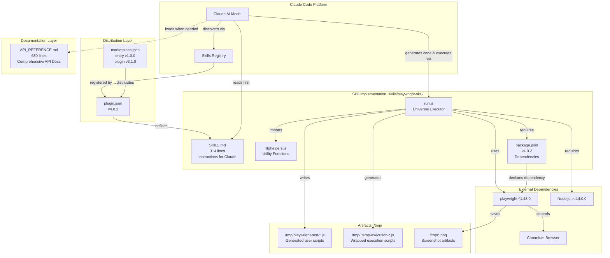
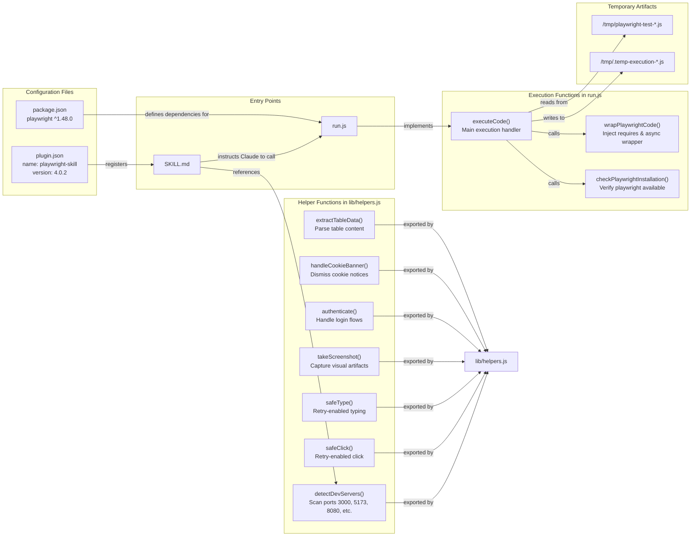
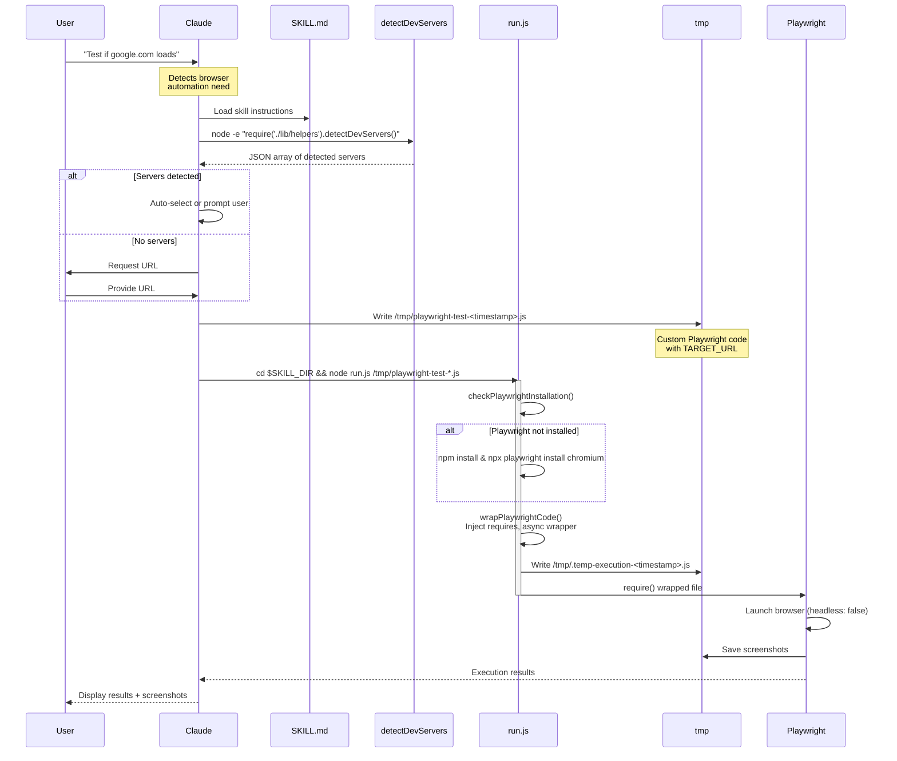

<!-- source: DeepWiki mcp.deepwiki.com · repo lackeyjb/playwright-skill · page 1 Overview · fetched 2026-10-27 -->

# Overview

<details>
<summary>Relevant source files</summary>

The following files were used as context for generating this wiki page:

- [.claude-plugin/marketplace.json](.claude-plugin/marketplace.json)
- [.claude-plugin/plugin.json](.claude-plugin/plugin.json)
- [README.md](README.md)

</details>


This document introduces the `playwright-skill` repository, explaining its purpose as a Claude Code Skill for browser automation, its key features, and high-level architecture. For installation instructions, see [Installation](#2.1). For detailed architecture, see [Architecture](#4).

## Purpose and Scope

The `playwright-skill` is a [Claude Code Skill](https://www.anthropic.com/news/skills) that enables Claude to autonomously write and execute Playwright browser automation code. Unlike traditional tools that require explicit commands or use pre-built templates, this skill operates on a **model-invoked pattern** where Claude detects browser automation needs and generates custom code for each specific task.

The skill is distributed as a [Claude Code Plugin](https://docs.claude.com/en/docs/claude-code/plugins) with a nested structure, supporting both plugin installation and standalone skill installation.

Sources: [README.md:1-7](), [.claude-plugin/plugin.json:1-21]()

## What is playwright-skill

`playwright-skill` is a general-purpose browser automation capability that integrates with Claude Code. It consists of:

- **Skill instructions** (`SKILL.md`) that Claude reads to understand how to perform browser automation
- **Universal executor** (`run.js`) that handles code execution with proper module resolution
- **Helper library** (`lib/helpers.js`) providing reusable utility functions
- **Progressive documentation** with concise instructions (314 lines) and comprehensive API reference (630 lines, loaded on demand)
- **Plugin metadata** for distribution via Claude Code's marketplace system

The skill enables Claude to perform any browser automation task by generating custom Playwright code, not by using pre-defined templates. This includes page testing, form interactions, visual testing, responsive design validation, authentication flows, and more.

Sources: [README.md:1-17](), [.claude-plugin/plugin.json:2-4]()

## Key Features

| Feature | Description | Implementation |
|---------|-------------|----------------|
| **Model-Invoked** | Claude autonomously decides when to use the skill without explicit user commands | Registered as `claude-skill` type in plugin metadata [.claude-plugin/plugin.json:11-12]() |
| **Custom Code Generation** | Claude writes task-specific Playwright code, not template-based scripts | Instructions in `SKILL.md` guide code generation patterns |
| **Visible Browser by Default** | Browser opens visibly with `headless: false` for real-time observation | Default configuration in `SKILL.md` workflow |
| **Zero Module Resolution Errors** | Universal executor ensures proper module access regardless of installation location | `run.js` handles dynamic path resolution with `$SKILL_DIR` |
| **Dev Server Auto-Detection** | Automatically scans common ports (3000, 5173, 8080, etc.) to detect local servers | `lib/helpers.js` `detectDevServers()` function |
| **Clean Artifact Management** | All generated scripts and screenshots saved to `/tmp`, not repository | Explicit `/tmp` path usage in execution workflow |
| **Progressive Disclosure** | Concise `SKILL.md` (314 lines) with full `API_REFERENCE.md` (630 lines) loaded only when needed | Two-tier documentation strategy |
| **Safe Cleanup** | Smart temporary file management without race conditions | Temp files persisted during execution, cleaned on next run |

Sources: [README.md:9-16](), [.claude-plugin/plugin.json:10-20]()

## System Architecture

### High-Level Component Diagram



**Figure 1: System Architecture and Component Relationships**

This diagram shows how components interact from distribution through execution. The skill is discovered via Claude's Skills Registry, which reads metadata from `plugin.json`. When invoked, Claude loads `SKILL.md` first (314 lines), only loading `API_REFERENCE.md` (630 lines) for complex scenarios. Code execution flows through `run.js`, which handles module resolution and dependency management. All artifacts are isolated in `/tmp/` to keep projects clean.

Sources: [.claude-plugin/plugin.json:1-21](), [README.md:166-184](), [.claude-plugin/marketplace.json:1-38]()

### Code Entity Mapping



**Figure 2: Code Entity Relationships**

This diagram maps natural language concepts to actual code entities. The `run.js` file implements three primary functions: `executeCode()` for orchestration, `wrapPlaywrightCode()` for code transformation, and `checkPlaywrightInstallation()` for dependency verification. The `lib/helpers.js` exports seven utility functions that `SKILL.md` references for common patterns. Temporary files follow naming conventions: user scripts are `playwright-test-*.js` while wrapped execution files are `.temp-execution-*.js`.

Sources: [README.md:176-179](), [skills/playwright-skill/ directory structure]()

## Distribution Model

The `playwright-skill` uses a dual-distribution strategy:

### Nested Structure

```
playwright-skill/              # Repository root (Plugin format)
├── .claude-plugin/           # Plugin metadata
│   ├── plugin.json          # Plugin definition (v4.0.2)
│   └── marketplace.json     # Marketplace listing (v1.0.0 entry, v3.1.0 plugin)
└── skills/
    └── playwright-skill/     # Actual skill implementation
        ├── SKILL.md
        ├── run.js
        ├── package.json     # Skill dependencies (v4.0.2)
        └── lib/
            └── helpers.js
```

This structure enables:

1. **Plugin Installation**: Full nested structure preserved at `~/.claude/plugins/marketplaces/playwright-skill/skills/playwright-skill/`
2. **Standalone Installation**: Inner `skills/playwright-skill/` folder extracted to `~/.claude/skills/playwright-skill`

The nested structure separates plugin-level concerns (metadata, marketplace) from skill-level concerns (functionality). For standalone use, only the inner folder is needed. See [Distribution Model](#3.2) for details.

Sources: [README.md:22-34](), [README.md:166-184]()

### Version Numbers

| Manifest | Version | Purpose |
|----------|---------|---------|
| `plugin.json` | 4.0.2 | Plugin release version |
| `marketplace.json` (entry) | 1.0.0 | Marketplace entry metadata |
| `marketplace.json` (plugin) | 3.1.0 | Listed plugin version |
| `package.json` | 4.0.2 | npm package version |

The skill uses semantic versioning across multiple manifests. The plugin and package versions (4.0.2) represent the actual release, while marketplace versions track listing evolution. See [Metadata and Versioning](#9.5) for details.

Sources: [.claude-plugin/plugin.json:3](), [.claude-plugin/marketplace.json:9,16](), [README.md:166-184]()

## How It Works



**Figure 3: Execution Flow**

The execution flow shows the model-invoked pattern in action. Claude autonomously detects the need for browser automation, loads `SKILL.md`, runs `detectDevServers()` to find local servers, generates custom Playwright code (not templates), writes it to `/tmp` for clean artifact management, and executes via `run.js`. The universal executor handles installation checks, code wrapping, and module resolution. Browsers launch visibly by default for observability.

Sources: [README.md:150-156](), [SKILL.md workflow section]()

## Installation Context

The skill must be installed to one of three locations for Claude to discover it:

| Installation Type | Path | Use Case | Resolution |
|-------------------|------|----------|------------|
| Plugin | `~/.claude/plugins/marketplaces/playwright-skill/skills/playwright-skill/` | Centralized, auto-updating | Full nested structure |
| Global | `~/.claude/skills/playwright-skill/` | Available to all projects | Extracted inner folder |
| Project-Specific | `<project>/.claude/skills/playwright-skill/` | Single project only | Extracted inner folder |

All commands in `SKILL.md` use `cd $SKILL_DIR &&` prefix to ensure proper module resolution regardless of installation location. The `$SKILL_DIR` variable is dynamically resolved by Claude based on where the skill is installed. See [Path Resolution and $SKILL_DIR](#4.6) for details.

Sources: [README.md:38-96](), [README.md:22-34]()

## Key Design Principles

The architecture embodies several design principles:

1. **Autonomous Operation**: Claude decides when to invoke the skill based on user intent, not explicit commands. The `model-invoked` keyword in metadata enables this. See [Model-Invoked Pattern](#3.1).

2. **Progressive Disclosure**: `SKILL.md` (314 lines) provides concise instructions for immediate use. `API_REFERENCE.md` (630 lines) loads only when needed for complex scenarios. See [Progressive Disclosure Documentation](#3.4).

3. **Clean Artifacts**: All generated scripts and screenshots save to `/tmp/`, never to the repository. This prevents cluttering projects with test debris. See [Artifact Management](#4.5).

4. **Zero Configuration**: Dev server auto-detection via `detectDevServers()` eliminates hardcoded URLs. Default settings (`headless: false`, `slowMo: 100ms`) prioritize visibility over speed. See [Dev Server Detection](#3.3).

5. **Universal Execution**: `run.js` handles module resolution, code wrapping, and dependency installation regardless of installation method. See [run.js: The Universal Executor](#4.2).

Sources: [README.md:9-16](), [.claude-plugin/plugin.json:10-20](), [README.md:150-165]()

## Dependencies

| Dependency | Version | Purpose | Installation |
|------------|---------|---------|--------------|
| Node.js | >=14.0.0 | Runtime environment | System prerequisite |
| Playwright | ^1.48.0 | Browser automation library | `npm run setup` |
| Chromium | Latest | Default browser engine | `npm run setup` (via `npx playwright install chromium`) |

The skill declares Playwright as a dependency in `package.json` at [package.json dependency declaration](). The setup script (`npm run setup`) installs both Playwright and Chromium to ensure immediate functionality.

Sources: [README.md:190-194](), [package.json dependencies]()

## Next Steps

- **Install the skill**: See [Installation](#2.1) for detailed instructions
- **Run your first automation**: See [Quick Start](#2.2) for a walkthrough
- **Understand core concepts**: See [Core Concepts](#3) for architectural patterns
- **Write automation scripts**: See [Usage Guide](#5) for practical examples
- **Reference API documentation**: See [API Reference](#6) for comprehensive Playwright documentation

Sources: [README.md:1-232]()

---

