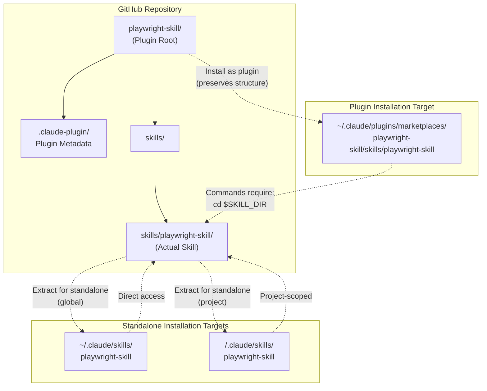
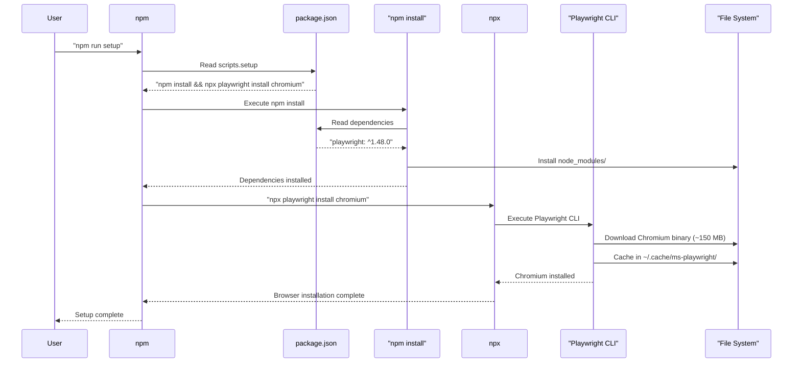
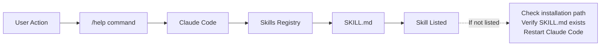
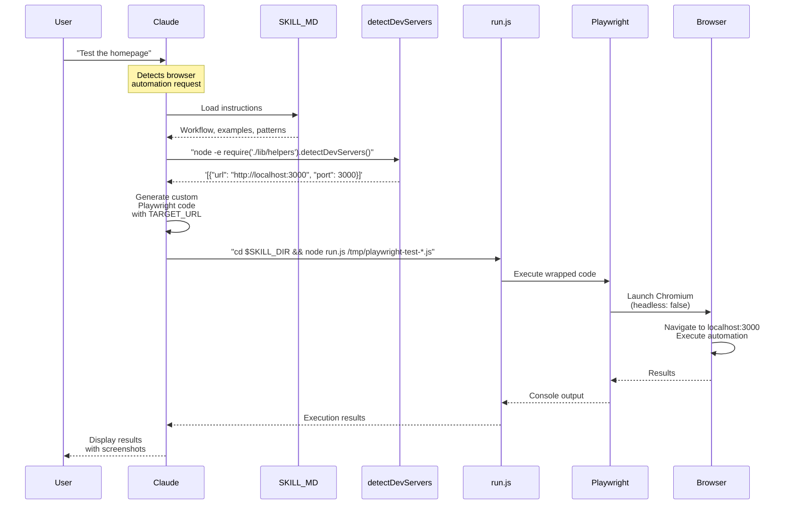
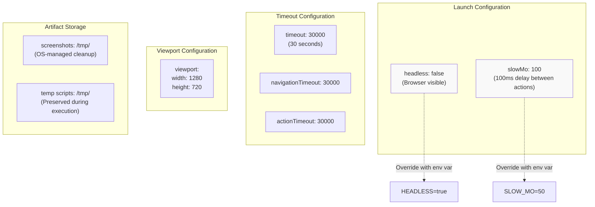

<!-- source: DeepWiki mcp.deepwiki.com · repo lackeyjb/playwright-skill · page 2 Getting Started · fetched 2026-10-27 -->

# Getting Started

<details>
<summary>Relevant source files</summary>

The following files were used as context for generating this wiki page:

- [README.md](README.md)
- [skills/playwright-skill/package.json](skills/playwright-skill/package.json)

</details>


This document guides you through the initial setup and first use of the playwright-skill. It covers prerequisites, installation overview, post-installation configuration, verification, and your first automation task. For detailed installation instructions, see [Installation](#2.1). For a complete first automation walkthrough, see [Quick Start](#2.2). For advanced configuration options, see [Configuration and Setup](#2.3).

## Prerequisites

Before installing playwright-skill, ensure your environment meets the following requirements:

| Requirement | Version | Purpose |
|------------|---------|---------|
| Node.js | >= 14.0.0 | Runtime environment for executing JavaScript |
| npm | Bundled with Node.js | Package manager for dependency installation |
| Claude Code | Latest | Host platform for skills and plugins |
| Disk Space | ~500 MB | Playwright library and Chromium browser |

**Sources:** [skills/playwright-skill/package.json:22-24](), [README.md:190-194]()

## Installation Overview

The playwright-skill can be installed through three distinct methods, each suited for different use cases. The repository structure uses the Claude Code Plugin format with a nested directory layout that requires understanding before installation.

### Repository Structure



**Sources:** [README.md:22-34](), [README.md:166-184]()

### Installation Methods Comparison

| Method | Path | Scope | Updates | Use Case |
|--------|------|-------|---------|----------|
| **Plugin Installation** | `~/.claude/plugins/marketplaces/playwright-skill/skills/playwright-skill` | Global | Automatic via marketplace | Team environments, managed deployments |
| **Global Standalone** | `~/.claude/skills/playwright-skill` | Global | Manual git pull | Individual developers, all projects |
| **Project Standalone** | `<project>/.claude/skills/playwright-skill` | Project-specific | Manual git pull | Single project, isolated dependencies |

The key architectural distinction: plugin installation preserves the nested `skills/playwright-skill/` structure within the marketplace directory, while standalone installation requires extracting only the inner `skills/playwright-skill/` folder to avoid double-nesting.

**Sources:** [README.md:37-110]()

### Installation Command Reference

The following table maps installation methods to their command sequences:

| Method | Initial Commands | Setup Location |
|--------|-----------------|----------------|
| **Plugin** | `/plugin marketplace add lackeyjb/playwright-skill`<br/>`/plugin install playwright-skill@playwright-skill` | `~/.claude/plugins/marketplaces/playwright-skill/skills/playwright-skill` |
| **Global Clone** | `git clone https://github.com/lackeyjb/playwright-skill.git /tmp/playwright-skill-temp`<br/>`cp -r /tmp/playwright-skill-temp/skills/playwright-skill ~/.claude/skills/` | `~/.claude/skills/playwright-skill` |
| **Project Clone** | `git clone https://github.com/lackeyjb/playwright-skill.git /tmp/playwright-skill-temp`<br/>`cp -r /tmp/playwright-skill-temp/skills/playwright-skill .claude/skills/` | `.claude/skills/playwright-skill` |
| **Release Download** | Download from GitHub Releases<br/>Extract `skills/playwright-skill/` folder | User's chosen location |

All methods require running `npm run setup` after extraction. See [Installation](#2.1) for complete instructions.

**Sources:** [README.md:37-110]()

## Post-Installation Setup

After placing the skill files in the appropriate directory, execute the setup script to install dependencies and browser binaries.

### Setup Script Execution Flow



**Sources:** [skills/playwright-skill/package.json:7-9](), [skills/playwright-skill/package.json:19-20]()

### What the Setup Script Does

The `npm run setup` command defined in [skills/playwright-skill/package.json:8]() performs two critical operations:

1. **Dependency Installation** (`npm install`):
   - Installs `playwright` package version `^1.48.0` from [skills/playwright-skill/package.json:20]()
   - Creates `node_modules/` directory in the skill folder
   - Generates `package-lock.json` for reproducible builds

2. **Browser Installation** (`npx playwright install chromium`):
   - Downloads Chromium browser binary (~150 MB)
   - Stores browser in `~/.cache/ms-playwright/`
   - Configures browser for headless and headed execution

### Running Setup

Navigate to the installed skill directory and execute setup:

```bash
# For plugin installation
cd ~/.claude/plugins/marketplaces/playwright-skill/skills/playwright-skill
npm run setup

# For global standalone installation
cd ~/.claude/skills/playwright-skill
npm run setup

# For project-specific installation
cd .claude/skills/playwright-skill
npm run setup
```

The setup process typically completes in 1-2 minutes depending on network speed.

**Sources:** [README.md:49-50](), [README.md:71-72](), [README.md:88-89](), [README.md:106-109]()

### Optional: Install All Browsers

By default, only Chromium is installed. To install Firefox and WebKit for cross-browser testing:

```bash
npm run install-all-browsers
```

This executes `npx playwright install chromium firefox webkit` from [skills/playwright-skill/package.json:9]() and downloads approximately 500 MB of browser binaries.

**Sources:** [skills/playwright-skill/package.json:9](), [README.md:207-208]()

## Verification

After installation and setup, verify the skill is properly registered and accessible to Claude.

### Verification Process



### Verification Steps

1. **Check Skill Registration**:
   ```
   /help
   ```
   This displays all registered skills. Look for `playwright-skill` in the output.

2. **Test Basic Invocation**:
   Ask Claude: `"Test if google.com loads"`
   
   Claude should autonomously:
   - Detect the browser automation request
   - Load instructions from `SKILL.md`
   - Generate Playwright code
   - Execute via `run.js`
   - Return results with console output

3. **Verify File Structure**:
   Ensure the following files exist in the skill directory:
   - `SKILL.md` - Instructions for Claude (314 lines)
   - `run.js` - Universal executor
   - `package.json` - Dependency manifest
   - `lib/helpers.js` - Utility functions
   - `node_modules/` - Installed dependencies (after setup)

**Sources:** [README.md:113-116](), [README.md:166-184]()

### Troubleshooting Installation

| Issue | Cause | Solution |
|-------|-------|----------|
| Skill not listed in `/help` | Incorrect installation path | Verify skill is directly in `.claude/skills/` not nested further |
| Module not found errors | `npm run setup` not executed | Run `npm run setup` in skill directory |
| Browser launch failure | Chromium not installed | Run `npx playwright install chromium` in skill directory |
| Permission denied | File permissions | Check directory and file ownership, use `chmod` if needed |

**Sources:** [README.md:197-209]()

## First Use

Once verified, the skill operates through Claude's model-invoked pattern. You describe what you want to automate, and Claude autonomously generates and executes the appropriate Playwright code.

### Model-Invoked Execution Flow



**Sources:** [README.md:117-157]()

### Example First Automation

Ask Claude any of the following natural language requests:

**Basic Page Testing**:
- `"Test if the homepage loads"`
- `"Check if google.com is accessible"`
- `"Verify the contact page renders"`

**Interaction Testing**:
- `"Click the login button and check what happens"`
- `"Fill out the contact form with test data"`
- `"Navigate through the main menu"`

**Visual Testing**:
- `"Take a screenshot of the dashboard"`
- `"Capture the mobile view of the homepage"`

Claude will:
1. Detect the automation need from your request
2. Load `SKILL.md` instructions (314 lines of concise guidance)
3. Check for local development servers via `lib/helpers.js::detectDevServers()`
4. Generate custom Playwright code (not template-based)
5. Write the code to `/tmp/playwright-test-<timestamp>.js`
6. Execute via `run.js` with proper module resolution
7. Launch a visible browser window (headless: false by default)
8. Run the automation with 100ms slow motion for visibility
9. Return console output and screenshots from `/tmp/`

**Sources:** [README.md:122-157]()

### Understanding the Workflow

The skill uses a specific workflow that Claude follows automatically:

1. **Server Detection**: Scans common ports (3000, 5173, 8080, 4200, 5000, etc.) for running development servers
2. **URL Parameterization**: Generates code with `TARGET_URL` variable instead of hardcoded URLs
3. **Script Generation**: Writes custom automation code to `/tmp/` directory
4. **Execution**: Runs via `cd $SKILL_DIR && node run.js /tmp/script.js` for proper module resolution
5. **Artifact Management**: Saves screenshots and output to `/tmp/` for OS-managed cleanup

For a complete walkthrough of this workflow, see [Quick Start](#2.2).

**Sources:** [README.md:150-157]()

## Default Configuration

The skill operates with sensible defaults optimized for development and debugging:



| Configuration | Default Value | Override Method | Purpose |
|---------------|--------------|-----------------|---------|
| `headless` | `false` | `HEADLESS=true` env var | Browser visibility for debugging |
| `slowMo` | `100` (ms) | `SLOW_MO=<value>` env var | Delay between actions for observation |
| `timeout` | `30000` (ms) | Inline script configuration | Maximum wait time for operations |
| `viewport` | `1280x720` | Inline script configuration | Default browser window size |
| `screenshots` | `/tmp/` | N/A | Screenshot storage location |

These defaults prioritize **visibility and debuggability** over execution speed. For headless CI/CD execution, see [CI/CD Integration](#7.4).

**Sources:** [README.md:159-164]()

## Next Steps

After completing installation and verification:

- **For detailed installation instructions**: See [Installation](#2.1)
- **For your first automation walkthrough**: See [Quick Start](#2.2)
- **For setup script details and configuration**: See [Configuration and Setup](#2.3)
- **For understanding the model-invoked pattern**: See [Model-Invoked Pattern](#3.1)
- **For development server detection details**: See [Dev Server Detection](#3.3)
- **For writing custom automation scripts**: See [Writing Automation Scripts](#5.1)
- **For helper function usage**: See [Helper Functions API](#6.2)
- **For advanced configuration**: See [Configuration Options](#9.1)

The skill is now ready for use. Simply describe your automation needs to Claude in natural language, and the skill will handle code generation, execution, and artifact management automatically.

**Sources:** [README.md:1-232]()

---

