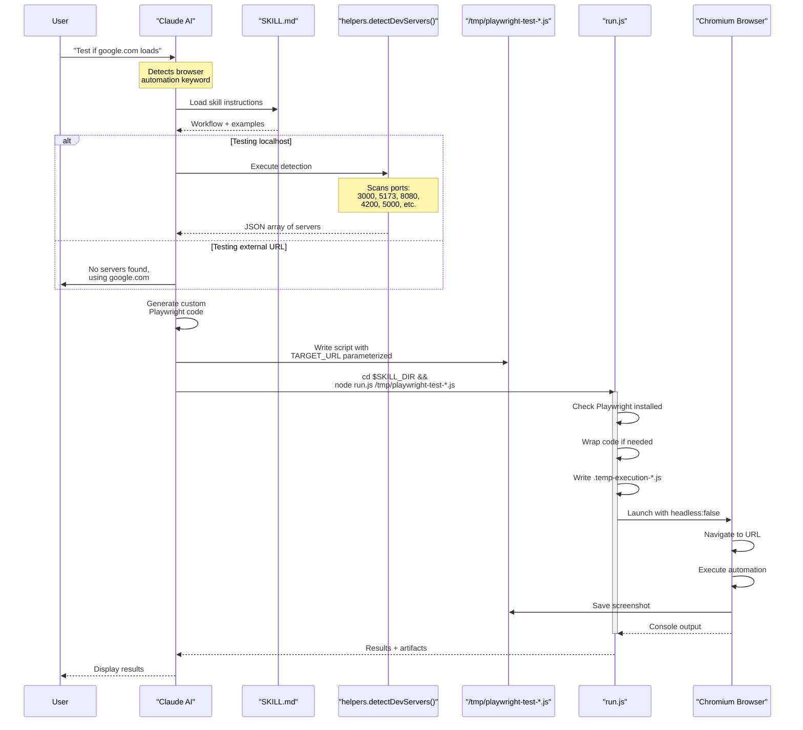
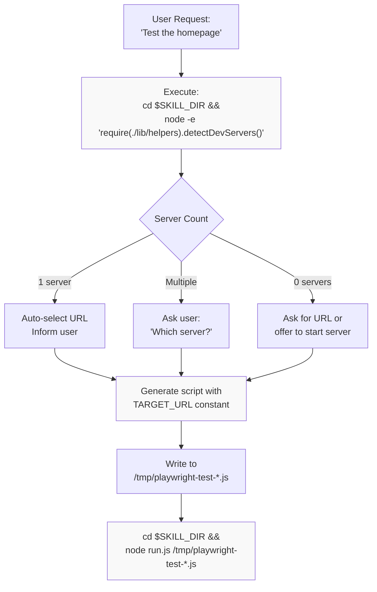
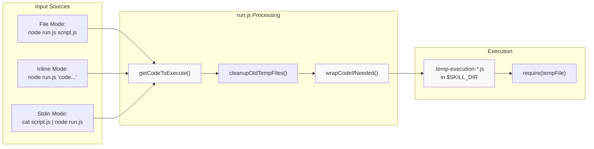
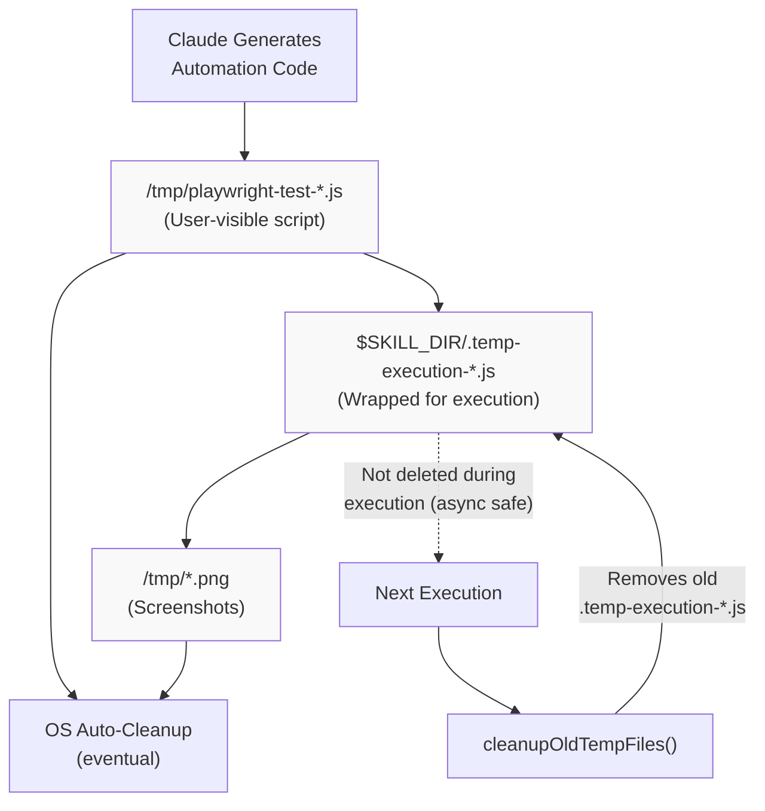

<!-- source: DeepWiki mcp.deepwiki.com · repo lackeyjb/playwright-skill · page 2.2 Quick Start · fetched 2026-10-27 -->

# Quick Start

<details>
<summary>Relevant source files</summary>

The following files were used as context for generating this wiki page:

- [README.md](README.md)
- [skills/playwright-skill/SKILL.md](skills/playwright-skill/SKILL.md)
- [skills/playwright-skill/run.js](skills/playwright-skill/run.js)

</details>


This guide walks you through your first browser automation with the playwright-skill. By the end, you'll understand how Claude autonomously detects automation needs, generates Playwright code, and executes it with visible results.

**Scope**: This page covers the first-time experience after installation. For installation instructions, see [Installation](#2.1). For detailed configuration options, see [Configuration and Setup](#2.3).

## Prerequisites

Before starting, ensure you have completed:
1. Installation of playwright-skill (via plugin system, global, or project-specific - see [Installation](#2.1))
2. Run `npm run setup` from the skill directory to install Playwright and Chromium

To verify the skill is loaded, run `/help` in Claude Code and confirm `playwright-skill` appears in the list.

**Sources**: [README.md:113-116](), [skills/playwright-skill/SKILL.md:46-53]()

## Your First Automation

Simply ask Claude to test or automate a browser task. Claude autonomously detects that browser automation is needed and invokes the skill without any explicit commands from you.

### Example Request

```
"Test if google.com loads"
```

### What Happens Behind the Scenes



**Sources**: [skills/playwright-skill/SKILL.md:21-45](), [skills/playwright-skill/run.js:52-81](), [skills/playwright-skill/run.js:162-201]()

### Generated Script Example

Claude writes a script to `/tmp/playwright-test-*.js` that looks like this:

```javascript
const { chromium } = require('playwright');

// Parameterized URL
const TARGET_URL = 'https://google.com';

(async () => {
  const browser = await chromium.launch({ headless: false });
  const page = await browser.newPage();

  await page.goto(TARGET_URL);
  console.log('Page loaded:', await page.title());

  await page.screenshot({ path: '/tmp/screenshot.png', fullPage: true });
  console.log('📸 Screenshot saved to /tmp/screenshot.png');

  await browser.close();
})();
```

This code is then executed via: `cd $SKILL_DIR && node run.js /tmp/playwright-test-*.js`

**Sources**: [skills/playwright-skill/SKILL.md:65-84](), [skills/playwright-skill/SKILL.md:369-380]()

## Understanding the Critical Workflow

The playwright-skill follows a specific execution pattern that Claude implements automatically. Understanding this workflow helps you know what to expect.

### Workflow Components

| Step | Component | Code Entity | Purpose |
|------|-----------|-------------|---------|
| 1 | Dev Server Detection | `helpers.detectDevServers()` | Auto-detect localhost servers to avoid hardcoded URLs |
| 2 | Script Generation | Claude AI | Generate custom Playwright code for specific task |
| 3 | Write to /tmp | `/tmp/playwright-test-*.js` | Keep projects clean, avoid repository clutter |
| 4 | Execute via run.js | `run.js` main function | Ensure proper module resolution from skill directory |
| 5 | Browser Launch | `chromium.launch({ headless: false })` | Visible browser with slow motion for observability |
| 6 | Save Artifacts | `/tmp/*.png` | Screenshots saved to temp directory |

**Sources**: [skills/playwright-skill/SKILL.md:21-30](), [skills/playwright-skill/run.js:162-201]()

### Dev Server Detection Flow

When testing localhost applications, Claude ALWAYS runs dev server detection first:



**Sources**: [skills/playwright-skill/SKILL.md:21-29](), [skills/playwright-skill/SKILL.md:57-61]()

### Module Resolution via run.js

The `run.js` executor handles three execution modes and ensures proper module resolution:



The executor (`run.js`) performs these operations:
- **Line 18**: `process.chdir(__dirname)` - Changes to skill directory for module resolution
- **Line 52-81**: `getCodeToExecute()` - Reads code from file, inline, or stdin
- **Line 86-104**: `cleanupOldTempFiles()` - Removes previous `.temp-execution-*.js` files
- **Line 109-157**: `wrapCodeIfNeeded()` - Injects `require('playwright')` and async IIFE wrapper
- **Line 181**: Creates timestamped temp file in skill directory
- **Line 189**: `require(tempFile)` - Executes with proper module resolution

**Sources**: [skills/playwright-skill/run.js:1-209](), [skills/playwright-skill/SKILL.md:86-90]()

## Example: Testing a Local Development Server

This example demonstrates the complete workflow when testing a localhost application.

### User Request

```
"Test the homepage and take screenshots"
```

### Execution Steps

**Step 1: Dev Server Detection**

Claude executes:
```bash
cd $SKILL_DIR && node -e "require('./lib/helpers').detectDevServers().then(servers => console.log(JSON.stringify(servers)))"
```

Output:
```json
[
  {
    "port": 3001,
    "url": "http://localhost:3001",
    "responding": true
  }
]
```

**Step 2: URL Selection**

Claude automatically selects the single detected server and informs you:
```
"I found your dev server running on http://localhost:3001"
```

**Step 3: Script Generation**

Claude writes to `/tmp/playwright-test-homepage.js`:

```javascript
const { chromium } = require('playwright');

// Auto-detected URL
const TARGET_URL = 'http://localhost:3001';

(async () => {
  const browser = await chromium.launch({ 
    headless: false, 
    slowMo: 100 
  });
  const page = await browser.newPage();

  console.log('Testing homepage...');
  
  await page.goto(TARGET_URL);
  console.log('Page loaded:', await page.title());

  // Desktop screenshot
  await page.setViewportSize({ width: 1920, height: 1080 });
  await page.screenshot({ 
    path: '/tmp/desktop-homepage.png', 
    fullPage: true 
  });
  console.log('📸 Desktop screenshot saved');

  // Mobile screenshot
  await page.setViewportSize({ width: 375, height: 667 });
  await page.screenshot({ 
    path: '/tmp/mobile-homepage.png', 
    fullPage: true 
  });
  console.log('📸 Mobile screenshot saved');

  await browser.close();
  console.log('✅ Test complete');
})();
```

**Step 4: Execution**

Claude runs:
```bash
cd $SKILL_DIR && node run.js /tmp/playwright-test-homepage.js
```

Console output:
```
🎭 Playwright Skill - Universal Executor

📄 Executing file: /tmp/playwright-test-homepage.js
🚀 Starting automation...

Testing homepage...
Page loaded: My Application
📸 Desktop screenshot saved
📸 Mobile screenshot saved
✅ Test complete
```

**Step 5: Results**

You'll see:
- A Chromium browser window opens (visible)
- Automation executes in slow motion (100ms between actions)
- Screenshots saved to `/tmp/desktop-homepage.png` and `/tmp/mobile-homepage.png`
- Console output showing progress

**Sources**: [skills/playwright-skill/SKILL.md:94-118](), [skills/playwright-skill/SKILL.md:369-397]()

## Common First-Time Scenarios

### Scenario 1: No Dev Server Running

```
User: "Test my app"
Claude: "I didn't detect any running dev servers. Please provide the URL or start your dev server."
```

Claude will ask for the URL if `detectDevServers()` returns an empty array.

### Scenario 2: Multiple Dev Servers

```
User: "Test the login page"
Claude: "I found 2 dev servers. Which one should I test?
- http://localhost:3000
- http://localhost:3001"

User: "Use 3001"
```

Claude prompts for selection when multiple servers are detected.

### Scenario 3: Testing External URL

```
User: "Test if example.com loads"
```

Claude skips dev server detection and directly uses the provided URL in the `TARGET_URL` constant.

**Sources**: [skills/playwright-skill/SKILL.md:382-397]()

## Observing the Execution

The default configuration prioritizes visibility and observability:

| Setting | Default Value | Purpose |
|---------|---------------|---------|
| `headless` | `false` | Browser window visible |
| `slowMo` | `100` | 100ms delay between actions |
| `timeout` | `30000` | 30 second timeout for operations |
| `viewport` | `1280x720` | Standard desktop viewport |

You'll see the browser window open and automation execute step-by-step. This makes debugging easy during development.

To run in headless mode, explicitly request it:
```
"Test the page in headless mode"
```

**Sources**: [skills/playwright-skill/SKILL.md:33](), [skills/playwright-skill/SKILL.md:344-346](), [README.md:159-165]()

## Artifacts and Cleanup

All generated files are ephemeral and stored in `/tmp`:



**Why this matters:**
- User scripts in `/tmp/playwright-test-*.js` are preserved for inspection
- Execution wrappers in `.temp-execution-*.js` are cleaned up on next run
- Your project directory stays clean - no test files clutter
- OS eventually cleans `/tmp` directory automatically

**Sources**: [skills/playwright-skill/run.js:86-104](), [skills/playwright-skill/SKILL.md:31](), [skills/playwright-skill/SKILL.md:402-404]()

## What Happens Next

After your first automation succeeds:

1. **Try More Complex Tasks**: See [Common Automation Patterns](#5.2) for examples
2. **Understand the Architecture**: See [run.js: The Universal Executor](#4.2) for deep dive
3. **Use Helper Functions**: See [Helper Functions Library](#4.3) for utilities
4. **Load API Reference**: Claude automatically loads [API_REFERENCE.md](#6.1) for complex scenarios

The skill uses **progressive disclosure** - Claude starts with the concise `SKILL.md` (314 lines) and only loads the comprehensive `API_REFERENCE.md` (630 lines) when you need advanced features.

**Sources**: [skills/playwright-skill/SKILL.md:326-337](), [README.md:188]()

## Troubleshooting Your First Run

### Error: "Playwright not found"

```bash
cd $SKILL_DIR && npm run setup
```

The `run.js` executor auto-installs Playwright if missing, but manual setup is more reliable.

**Code**: [skills/playwright-skill/run.js:23-46]()

### Error: "Module not found"

This indicates the script wasn't executed through `run.js`. Claude should always use:
```bash
cd $SKILL_DIR && node run.js /tmp/playwright-test-*.js
```

The `cd $SKILL_DIR` prefix is critical for module resolution.

**Code**: [skills/playwright-skill/run.js:18]()

### Browser Doesn't Open

Verify the script uses `headless: false`:
```javascript
const browser = await chromium.launch({ headless: false });
```

If running in an environment without display (SSH, Docker), you'll need to explicitly request headless mode or set up X11 forwarding.

**Sources**: [skills/playwright-skill/SKILL.md:353-363](), [README.md:199-209]()

### Element Not Found

Playwright may be executing too fast. Add explicit waits:
```javascript
await page.waitForSelector('.element', { timeout: 10000 });
```

Or increase `slowMo` for better visibility:
```javascript
const browser = await chromium.launch({ 
  headless: false, 
  slowMo: 200  // Slower than default 100ms
});
```

**Sources**: [skills/playwright-skill/SKILL.md:364-366]()

## Summary

You've now completed your first automation with playwright-skill. Key takeaways:

- **Model-Invoked Pattern**: Claude decides when to use the skill - no slash commands needed
- **Auto-Detection**: Dev servers are automatically discovered via `helpers.detectDevServers()`
- **Clean Artifacts**: Scripts written to `/tmp`, never to project directory
- **Visible Execution**: Browser opens with `headless: false` by default for observability
- **Universal Executor**: `run.js` ensures proper module resolution from skill directory
- **Parameterized URLs**: `TARGET_URL` constant makes scripts reusable

For more advanced usage, continue to [Configuration and Setup](#2.3) or explore [Common Automation Patterns](#5.2).

**Sources**: [README.md:117-157](), [skills/playwright-skill/SKILL.md:1-407]()

---

