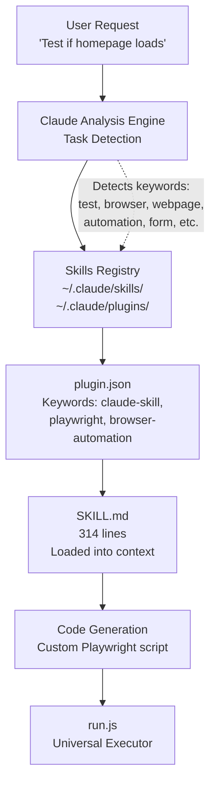
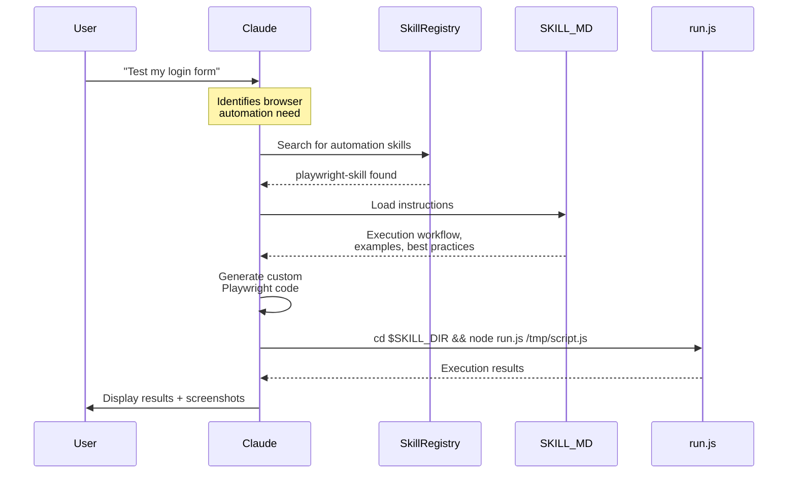
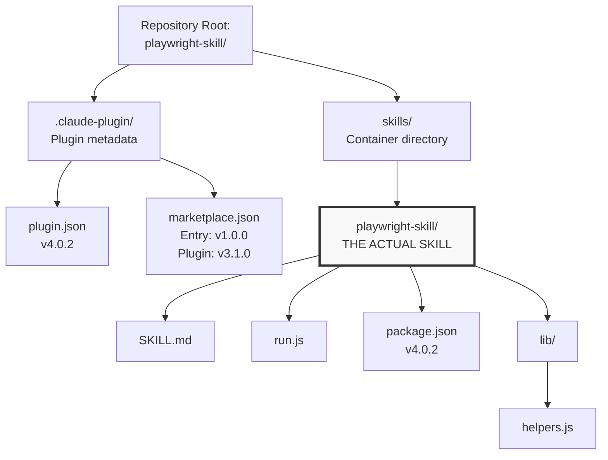
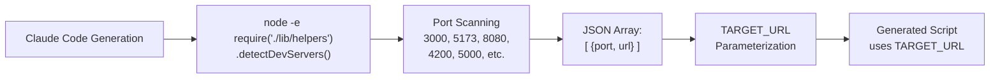
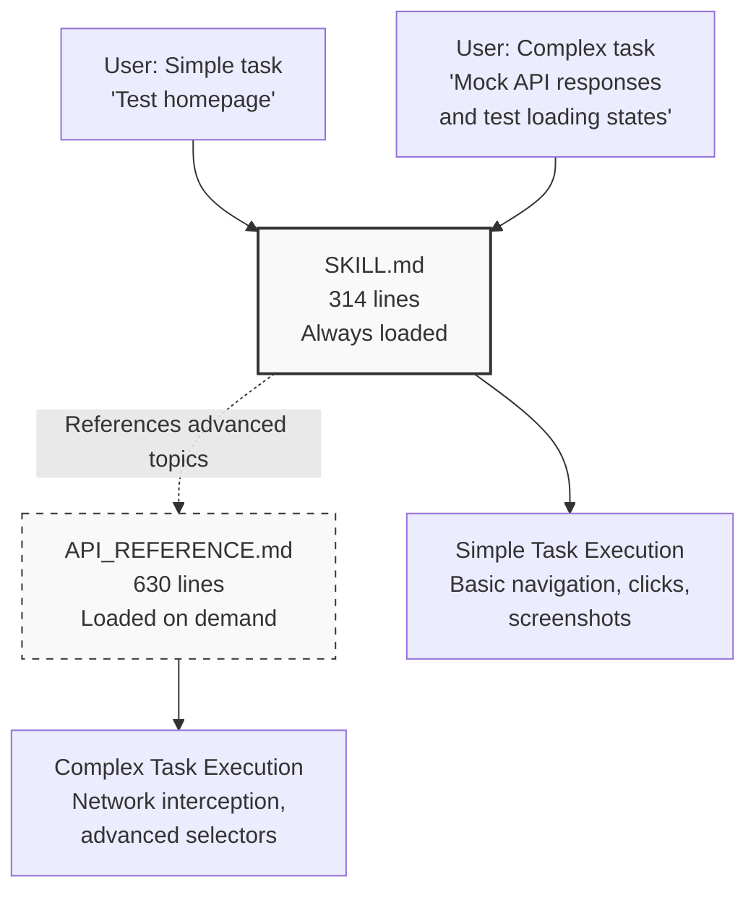
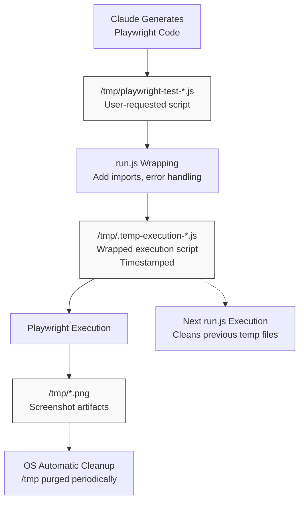
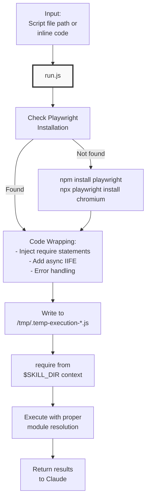

<!-- source: DeepWiki mcp.deepwiki.com · repo lackeyjb/playwright-skill · page 3 Core Concepts · fetched 2026-10-27 -->

# Core Concepts

<details>
<summary>Relevant source files</summary>

The following files were used as context for generating this wiki page:

- [.claude-plugin/plugin.json](.claude-plugin/plugin.json)
- [README.md](README.md)

</details>


## Purpose and Scope

This document explains the fundamental architectural patterns and design principles that enable `playwright-skill` to function as a model-invoked browser automation capability within Claude Code. These concepts underpin all functionality described in subsequent sections.

For installation procedures, see [Installation](#2.1). For detailed architecture and implementation, see [Architecture](#4). For practical usage patterns, see [Usage Guide](#5).

---

## Model-Invoked Execution Pattern

The `playwright-skill` uses a **model-invoked** pattern where Claude autonomously detects browser automation needs and invokes the skill without explicit user commands. Users never type slash commands or manually trigger the skill.

### Skill Discovery and Invocation



**Sources:** [.claude-plugin/plugin.json:1-21](), [README.md:212-214]()

### Task Detection Keywords

Claude identifies browser automation needs based on task language patterns. The skill is registered with keywords that trigger discovery:

| Keyword Category | Examples | File Reference |
|-----------------|----------|----------------|
| Skill Type | `claude-skill`, `model-invoked` | [.claude-plugin/plugin.json:11-12,19]() |
| Technology | `playwright`, `browser-automation` | [.claude-plugin/plugin.json:13-14]() |
| Use Cases | `testing`, `e2e`, `web-testing`, `automation` | [.claude-plugin/plugin.json:15-18]() |

When Claude detects phrases like "test the homepage", "check if form works", "automate login", or "take screenshots", it searches the skills registry for matches and loads the skill instructions.

**Sources:** [.claude-plugin/plugin.json:10-20](), [README.md:7-8]()

### Autonomous Operation



**Key characteristics:**

- **No explicit invocation**: Users describe tasks naturally; Claude decides when to use the skill
- **Context-aware loading**: Instructions loaded only when needed
- **Custom code generation**: Claude writes specific code for each task, not template-based
- **Transparent execution**: Users see results without knowing internal skill mechanics

**Sources:** [README.md:1-8](), [README.md:210-214]()

---

## Distribution Architecture

The repository implements a dual-distribution strategy to support both centralized plugin management and manual skill installation.

### Nested Directory Structure



The repository has two distinct layers:

1. **Plugin wrapper** (`.claude-plugin/` directory): Contains metadata for plugin distribution
2. **Skill implementation** (`skills/playwright-skill/` directory): Contains actual executable code

**Sources:** [README.md:23-31](), [README.md:166-184]()

### Installation Paths and $SKILL_DIR Resolution

Different installation methods result in different file paths, requiring dynamic `$SKILL_DIR` resolution:

| Installation Method | Skill Path | `$SKILL_DIR` Value |
|---------------------|------------|-------------------|
| Plugin Installation | `~/.claude/plugins/marketplaces/playwright-skill/skills/playwright-skill` | Nested plugin path |
| Global Manual | `~/.claude/skills/playwright-skill` | Direct skills path |
| Project-Specific | `<project>/.claude/skills/playwright-skill` | Project-relative path |

All execution commands must be prefixed with `cd $SKILL_DIR &&` to ensure proper module resolution regardless of installation method.

**Sources:** [README.md:38-51](), [README.md:61-93]()

### Extraction Requirement for Standalone Installation

When installing as a standalone skill (not via plugin system), the inner `skills/playwright-skill/` directory must be extracted:

```bash
# INCORRECT - retains nested structure
cp -r playwright-skill ~/.claude/skills/

# Result: ~/.claude/skills/playwright-skill/skills/playwright-skill ❌

# CORRECT - extract inner folder
cp -r playwright-skill/skills/playwright-skill ~/.claude/skills/

# Result: ~/.claude/skills/playwright-skill ✓
```

The plugin format requires the `skills/` container for organizing multiple skills within a plugin. Claude's skill discovery expects skills directly under `.claude/skills/`, not nested within additional directories.

**Sources:** [README.md:22-34](), [README.md:95-96]()

---

## Auto-Detection and Parameterization

### Dev Server Detection Mechanism

The `detectDevServers()` function in `lib/helpers.js` scans common development server ports to prevent hardcoded URLs in automation scripts:



**Common ports scanned:**

| Port | Framework/Tool | Typical Use |
|------|---------------|-------------|
| 3000 | React (Create React App), Express | Default React dev server |
| 5173 | Vite | Modern build tool default |
| 8080 | Vue CLI, Webpack Dev Server | Common dev server port |
| 4200 | Angular CLI | Angular development |
| 5000 | Flask, Next.js (alternative) | Python/Node servers |

**Sources:** [README.md:150-156]()

### URL Parameterization Pattern

Instead of hardcoding URLs in scripts, the skill uses environment variable parameterization:

```javascript
// ❌ BAD - Hardcoded URL
await page.goto('http://localhost:3000');

// ✓ GOOD - Parameterized URL
const targetUrl = process.env.TARGET_URL || 'http://localhost:3000';
await page.goto(targetUrl);
```

This allows the same script to target different environments (development, staging, production) without modification.

**Sources:** High-level diagrams (Diagram 3, Diagram 5)

---

## Progressive Disclosure Documentation

The skill implements a two-tier documentation strategy to minimize token usage while providing comprehensive reference material when needed.

### Documentation Hierarchy



### SKILL.md: Concise Instructions

Located at `skills/playwright-skill/SKILL.md`, this 314-line file contains:

- Execution workflow (detect servers → write to `/tmp` → execute via `run.js`)
- Core automation patterns (navigation, interaction, assertions)
- Helper function examples
- Best practices for visible browser execution

Claude loads this file for every browser automation task.

**Sources:** [README.md:14](), [README.md:175]()

### API_REFERENCE.md: Comprehensive Documentation

Located at `API_REFERENCE.md` (repository root), this 630-line file provides exhaustive documentation:

- Complete Playwright API reference
- Advanced selector strategies
- Network interception patterns
- Authentication workflows
- Visual regression testing
- Mobile device emulation

Claude loads this file only when tasks require advanced functionality not covered in `SKILL.md`.

**Sources:** [README.md:180](), [README.md:188]()

### Progressive Loading Strategy

| Task Complexity | Documentation Loaded | Token Usage | Examples |
|----------------|---------------------|-------------|----------|
| Simple | `SKILL.md` only | ~314 lines | Page testing, screenshots, basic forms |
| Moderate | `SKILL.md` + selective `API_REFERENCE.md` sections | ~400-500 lines | Authentication, responsive testing |
| Complex | `SKILL.md` + full `API_REFERENCE.md` | ~944 lines | Network mocking, visual regression, performance |

This strategy minimizes context window usage while ensuring comprehensive capabilities.

**Sources:** [README.md:188-189]()

---

## Clean Artifact Management

All generated scripts and execution artifacts are written to `/tmp`, keeping project directories clean.

### Artifact Lifecycle



### Why /tmp?

1. **Project cleanliness**: No test debris, build artifacts, or generated code in source control
2. **Automatic cleanup**: Operating system periodically purges `/tmp` directory
3. **Safe async operations**: Temp files remain available during execution, cleaned on next run
4. **Visibility**: Developers can inspect generated scripts in known location

**Configuration:**

```javascript
// Screenshots default to /tmp
await page.screenshot({ 
  path: `/tmp/screenshot-${Date.now()}.png` 
});
```

**Sources:** [README.md:164](), High-level diagrams (Diagram 5)

### Cleanup Strategy

The `run.js` executor implements safe cleanup:

1. **During execution**: Temp files NOT deleted (prevents race conditions with async operations)
2. **On next run**: Previous execution's temp files cleaned up
3. **Long-term**: OS handles `/tmp` purging based on system policies

This prevents premature deletion while ensuring eventual cleanup.

**Sources:** High-level diagrams (Diagram 5)

---

## Universal Executor Pattern

The `run.js` file serves as a universal executor that ensures proper module resolution regardless of installation method or execution context.

### Executor Responsibilities



### Module Resolution

All commands must be executed with the skill directory as the working directory:

```bash
# Required prefix for all executions
cd $SKILL_DIR && node run.js /tmp/script.js
```

This ensures:
- `require('playwright')` resolves to skill's `node_modules/`
- `require('./lib/helpers')` resolves to skill's `lib/` directory
- All dependencies are found regardless of user's current directory

**Sources:** [README.md:150-156](), [README.md:202]()

### Execution Modes

| Mode | Invocation | Use Case |
|------|-----------|----------|
| File | `node run.js /path/to/script.js` | Standard execution from file path |
| Inline | `node run.js 'await page.goto(...)'` | Direct code execution |
| Stdin | `cat script.js \| node run.js` | Piped input |

All modes support the same code wrapping and module resolution logic.

**Sources:** High-level diagrams (Diagram 6)

### Code Wrapping

The executor automatically wraps user code with necessary infrastructure:

```javascript
// User writes:
await page.goto('http://localhost:3000');
await page.screenshot({ path: '/tmp/test.png' });

// run.js wraps with:
const { chromium } = require('playwright');
(async () => {
  const browser = await chromium.launch({ headless: false, slowMo: 100 });
  const context = await browser.newContext();
  const page = await context.newPage();
  
  try {
    // User code here
    await page.goto('http://localhost:3000');
    await page.screenshot({ path: '/tmp/test.png' });
  } catch (error) {
    console.error('Error:', error);
  } finally {
    await browser.close();
  }
})();
```

This eliminates boilerplate and ensures consistent error handling.

**Sources:** High-level diagrams (Diagram 3)

---

## Default Configuration

The skill prioritizes visibility and debuggability over speed:

| Setting | Default Value | Rationale |
|---------|--------------|-----------|
| `headless` | `false` | Users should see automation in real-time |
| `slowMo` | `100ms` | Slows actions for visibility |
| `timeout` | `30000ms` (30s) | Reasonable wait for page loads |
| `viewport` | `1280x720` | Standard desktop resolution |

Configuration can be overridden via:
1. Environment variables (`HEADLESS=true`, `SLOW_MO=50`)
2. Inline script configuration (`{ headless: true }`)
3. Per-script launch options

**Sources:** [README.md:159-164]()

---

## Summary

The core concepts that enable `playwright-skill` functionality:

1. **Model-Invoked Pattern**: Claude autonomously detects and invokes the skill
2. **Dual Distribution**: Supports both plugin and standalone installation with nested structure
3. **Auto-Detection**: Scans dev servers to parameterize URLs dynamically
4. **Progressive Disclosure**: Minimal documentation loaded by default, comprehensive reference available
5. **Clean Artifacts**: All generated code written to `/tmp` for automatic cleanup
6. **Universal Executor**: `run.js` ensures module resolution across all installation methods
7. **Visible Defaults**: Browser launches visibly with slow motion for observability

These patterns work together to create an autonomous, clean, and debuggable browser automation system.

**Sources:** [README.md:1-232](), [.claude-plugin/plugin.json:1-21]()

---

