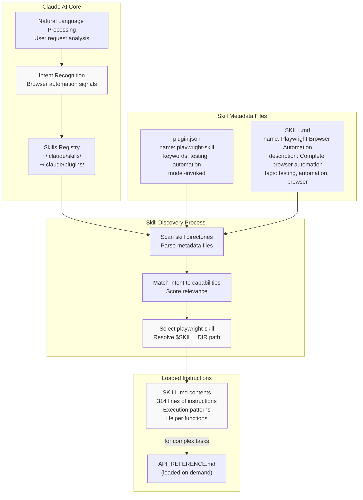
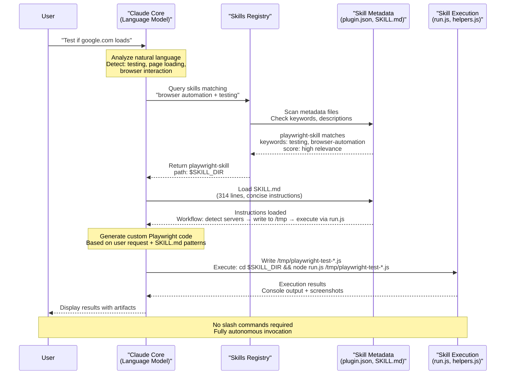
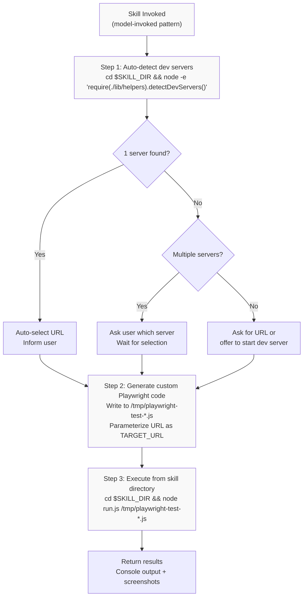
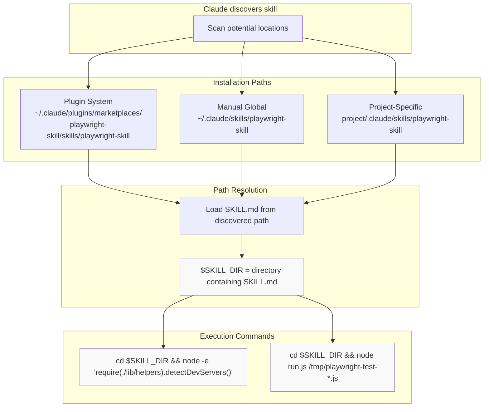

<!-- source: DeepWiki mcp.deepwiki.com · repo lackeyjb/playwright-skill · page 3.1 Model-Invoked Pattern · fetched 2026-10-27 -->

# Model-Invoked Pattern

<details>
<summary>Relevant source files</summary>

The following files were used as context for generating this wiki page:

- [.claude-plugin/plugin.json](.claude-plugin/plugin.json)
- [README.md](README.md)
- [skills/playwright-skill/SKILL.md](skills/playwright-skill/SKILL.md)

</details>


This document explains the model-invoked pattern used by playwright-skill, where Claude autonomously detects browser automation needs and invokes the skill without explicit user commands. This pattern contrasts with traditional command-based approaches (e.g., slash commands) and enables seamless, conversational automation workflows.

For information about the documentation that guides Claude's behavior after invocation, see [Progressive Disclosure Documentation](#3.4). For details on how the skill is distributed and registered, see [Distribution Model](#3.2).

---

## Overview

The model-invoked pattern is a core architectural decision in playwright-skill. Rather than requiring users to explicitly invoke the skill with commands like `/playwright` or `/automate`, Claude's language model analyzes user requests and autonomously determines when browser automation is needed. This creates a natural, conversational interface where users describe their goals and Claude handles the technical execution.

The pattern operates through three phases:
1. **Task Detection**: Claude identifies browser automation intent from natural language
2. **Skill Discovery**: Claude locates and loads the skill from the registry
3. **Autonomous Execution**: Claude generates and executes custom Playwright code

**Sources**: [README.md:1-232](), [.claude-plugin/plugin.json:1-22]()

---

## Task Detection and Skill Discovery

### How Claude Identifies Automation Needs

Claude analyzes user requests for indicators of browser automation requirements. The language model looks for patterns such as:

| Trigger Category | Example Phrases | Detection Signals |
|------------------|-----------------|-------------------|
| Testing Intent | "test the homepage", "check if form works" | Test-related verbs, page references |
| Interaction Goals | "click through navigation", "fill out form" | Action verbs, UI element mentions |
| Validation Requests | "verify all images load", "check for broken links" | Verification language, quality checks |
| Visual Testing | "take screenshots", "test responsive design" | Visual/display terminology |
| Workflow Automation | "test login flow", "automate signup process" | Multi-step process descriptions |

The skill's metadata in [.claude-plugin/plugin.json:10-19]() includes keywords that guide Claude's detection:

```json
"keywords": [
  "claude-skill",
  "claude-code",
  "playwright",
  "browser-automation",
  "testing",
  "e2e",
  "web-testing",
  "automation",
  "model-invoked"
]
```

The description field [.claude-plugin/plugin.json:4]() explicitly states the skill's purpose, helping Claude match user intent to capability.

**Sources**: [.claude-plugin/plugin.json:1-22](), [README.md:210-214]()

### Skill Registry Integration



**Skill Discovery Process:**

1. **Registry Scan**: Claude scans installation paths:
   - Plugin system: `~/.claude/plugins/marketplaces/playwright-skill/skills/playwright-skill`
   - Manual global: `~/.claude/skills/playwright-skill`
   - Project-specific: `<project>/.claude/skills/playwright-skill`

2. **Metadata Parsing**: Claude reads [.claude-plugin/plugin.json:1-22]() and [skills/playwright-skill/SKILL.md:1-7]() frontmatter

3. **Relevance Matching**: Keywords and description are matched against user intent

4. **Path Resolution**: The `$SKILL_DIR` variable is resolved to the actual installation location [skills/playwright-skill/SKILL.md:9-15]()

5. **Instruction Loading**: [skills/playwright-skill/SKILL.md]() (314 lines) is loaded into context

**Sources**: [.claude-plugin/plugin.json:1-22](), [skills/playwright-skill/SKILL.md:1-16](), [README.md:20-34]()

---

## Invocation Trigger Flow

### Complete Execution Sequence



**Key Phases**:

1. **Natural Language Analysis**: Claude's core model processes the user's request
2. **Intent Recognition**: Browser automation signals detected
3. **Registry Query**: Skills matching the intent are retrieved
4. **Metadata Evaluation**: [.claude-plugin/plugin.json]() and [skills/playwright-skill/SKILL.md:1-7]() are scored for relevance
5. **Path Resolution**: The actual installation directory is determined
6. **Instruction Loading**: [skills/playwright-skill/SKILL.md:9-407]() is loaded into context
7. **Code Generation**: Claude writes custom Playwright code based on loaded instructions
8. **Execution**: The generated code is executed via [skills/playwright-skill/run.js]()

**Sources**: [skills/playwright-skill/SKILL.md:9-44](), [README.md:7-8](), [README.md:150-156]()

---

## Skill Registration and Metadata

### Plugin Metadata Structure

The skill's registration with Claude's system is defined through metadata files:

**Plugin-Level Metadata** [.claude-plugin/plugin.json:1-22]():
```json
{
  "name": "playwright-skill",
  "version": "4.0.2",
  "description": "Claude Code Skill for general-purpose browser automation with Playwright. Auto-detects dev servers, writes clean test scripts to /tmp, and autonomously handles any browser automation task.",
  "keywords": [
    "claude-skill",
    "claude-code",
    "playwright",
    "browser-automation",
    "testing",
    "e2e",
    "web-testing",
    "automation",
    "model-invoked"
  ]
}
```

**Skill-Level Metadata** [skills/playwright-skill/SKILL.md:1-7]():
```yaml
---
name: Playwright Browser Automation
description: Complete browser automation with Playwright. Auto-detects dev servers, writes clean test scripts to /tmp. Test pages, fill forms, take screenshots, check responsive design, validate UX, test login flows, check links, automate any browser task. Use when user wants to test websites, automate browser interactions, validate web functionality, or perform any browser-based testing.
version: 4.0.0
author: Claude Assistant
tags: [testing, automation, browser, e2e, playwright, web-testing]
---
```

The `model-invoked` keyword [.claude-plugin/plugin.json:19]() explicitly marks this as an autonomously-invoked skill, not a command-based tool.

**Sources**: [.claude-plugin/plugin.json:1-22](), [skills/playwright-skill/SKILL.md:1-7]()

### Critical Workflow Instructions

Once invoked, Claude follows a critical workflow defined in [skills/playwright-skill/SKILL.md:21-45]():



This workflow ensures consistent, reliable execution regardless of the user's specific request. The instructions in [skills/playwright-skill/SKILL.md:21-31]() are explicit:

> **CRITICAL WORKFLOW - Follow these steps in order:**
> 
> 1. **Auto-detect dev servers** - For localhost testing, ALWAYS run server detection FIRST
> 2. **Write scripts to /tmp** - NEVER write test files to skill directory
> 3. **Use visible browser by default** - Always use `headless: false` unless user specifically requests headless mode
> 4. **Parameterize URLs** - Always make URLs configurable via environment variable or constant at top of script

**Sources**: [skills/playwright-skill/SKILL.md:21-45](), [skills/playwright-skill/SKILL.md:57-90]()

---

## Model-Invoked vs Command-Based Patterns

### Pattern Comparison

| Aspect | Model-Invoked (playwright-skill) | Command-Based (Traditional) |
|--------|----------------------------------|----------------------------|
| **Invocation** | Autonomous, based on intent detection | Explicit user command (e.g., `/playwright test`) |
| **User Experience** | Natural language: "test the homepage" | Structured syntax: `/playwright test --url=...` |
| **Discovery** | Claude scans registry, matches keywords | User must know command exists |
| **Flexibility** | Adapts to varied phrasing and context | Fixed command structure |
| **Learning Curve** | Zero - conversational interface | Requires command memorization |
| **Metadata Importance** | Critical - drives discovery | Optional - just documentation |
| **Context Awareness** | Understands project context | Relies on explicit parameters |

**Sources**: [README.md:210-214](), [.claude-plugin/plugin.json:19]()

### Example Interaction Patterns

**Model-Invoked Pattern** (playwright-skill):

```
User: "Test if the marketing page looks good"

Claude: [Internal] Detects intent: testing, visual validation, page quality
        [Internal] Queries registry for browser automation skills
        [Internal] Loads playwright-skill, resolves $SKILL_DIR
        [Internal] Reads SKILL.md instructions
        
        I'll test the marketing page across multiple viewports.
        Let me first detect running servers...
        
        [Executes: cd $SKILL_DIR && node -e "require('./lib/helpers').detectDevServers()..."]
        
        Found your dev server on http://localhost:3001
        
        [Generates custom test script in /tmp/playwright-test-marketing.js]
        [Executes: cd $SKILL_DIR && node run.js /tmp/playwright-test-marketing.js]
        
        [Displays results with screenshots]
```

**Command-Based Pattern** (hypothetical):

```
User: /playwright test --url=http://localhost:3001 --viewport=desktop,mobile --screenshot

Claude: [Executes predefined test template with parameters]
        [Returns results]
```

The model-invoked pattern enables context-aware, flexible automation without requiring users to learn command syntax. Claude generates custom code for each request rather than filling templates.

**Sources**: [skills/playwright-skill/SKILL.md:369-397](), [README.md:119-148]()

---

## Path Resolution in Model-Invoked Context

### Dynamic $SKILL_DIR Resolution

Because the skill is model-invoked and can be installed in multiple locations, Claude must dynamically resolve the `$SKILL_DIR` variable at runtime. The instructions in [skills/playwright-skill/SKILL.md:9-15]() specify:

> **IMPORTANT - Path Resolution:**
> This skill can be installed in different locations (plugin system, manual installation, global, or project-specific). Before executing any commands, determine the skill directory based on where you loaded this SKILL.md file, and use that path in all commands below.

**Installation Contexts**:



All commands in [skills/playwright-skill/SKILL.md]() are prefixed with `cd $SKILL_DIR &&` to ensure proper module resolution regardless of installation location. This is critical because:

1. The skill requires `require('./lib/helpers')` [skills/playwright-skill/SKILL.md:25]()
2. `run.js` must be executed from the skill directory for proper `require()` resolution
3. Dependencies in `package.json` are installed relative to the skill directory

**Sources**: [skills/playwright-skill/SKILL.md:9-15](), [skills/playwright-skill/SKILL.md:24-26](), [skills/playwright-skill/SKILL.md:49-51]()

---

## Progressive Disclosure in Model-Invoked Pattern

The model-invoked pattern leverages progressive disclosure to minimize context loading:

| Document | Size | When Loaded | Purpose |
|----------|------|-------------|---------|
| `SKILL.md` | 314 lines | Always (on invocation) | Core instructions, common patterns, critical workflow |
| `API_REFERENCE.md` | 630 lines | On demand (complex tasks) | Comprehensive Playwright API, advanced patterns |

Claude loads [skills/playwright-skill/SKILL.md:1-407]() immediately upon skill invocation, but only loads [API_REFERENCE.md]() when the user's request requires advanced features like network interception, visual regression testing, or mobile emulation.

The instructions in [skills/playwright-skill/SKILL.md:326-337]() reference the API documentation:

> ## Advanced Usage
> 
> For comprehensive Playwright API documentation, see [API_REFERENCE.md](API_REFERENCE.md):
> 
> - Selectors & Locators best practices
> - Network interception & API mocking
> - Authentication & session management
> - Visual regression testing
> - Mobile device emulation
> - Performance testing
> - Debugging techniques
> - CI/CD integration

This progressive approach keeps the initial context small while making comprehensive documentation available when needed.

**Sources**: [skills/playwright-skill/SKILL.md:326-337](), [README.md:14](), [README.md:188]()

---

## Summary

The model-invoked pattern is the foundational design principle of playwright-skill:

1. **Autonomous Detection**: Claude identifies browser automation needs from natural language without explicit commands
2. **Registry-Based Discovery**: Skills are discovered through metadata scanning and relevance matching
3. **Context-Aware Execution**: Claude generates custom code based on loaded instructions and user context
4. **Dynamic Path Resolution**: The skill adapts to different installation locations through `$SKILL_DIR` resolution
5. **Progressive Disclosure**: Core instructions loaded immediately, comprehensive API documentation loaded on demand

This pattern creates a seamless, conversational interface for browser automation where users describe their goals and Claude handles the technical execution autonomously.

**Sources**: [.claude-plugin/plugin.json:1-22](), [skills/playwright-skill/SKILL.md:1-407](), [README.md:1-232]()

---

