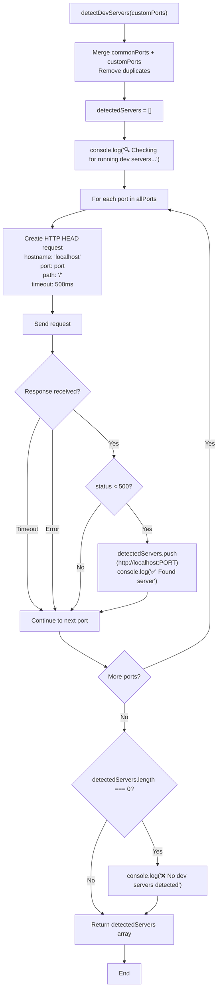
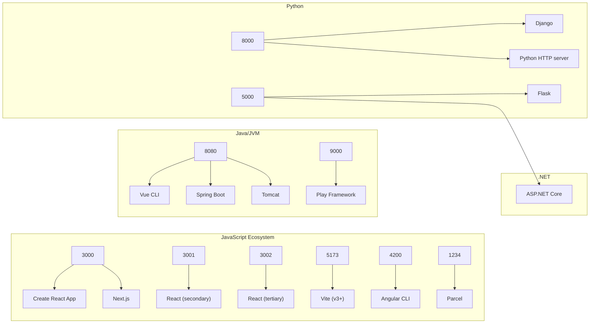
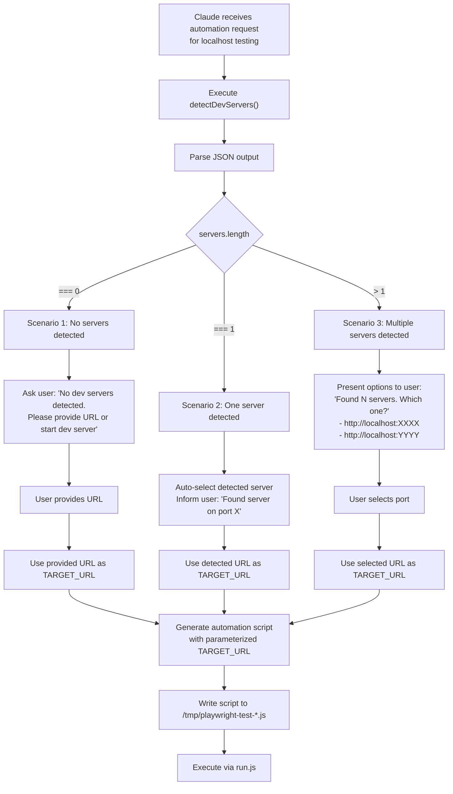
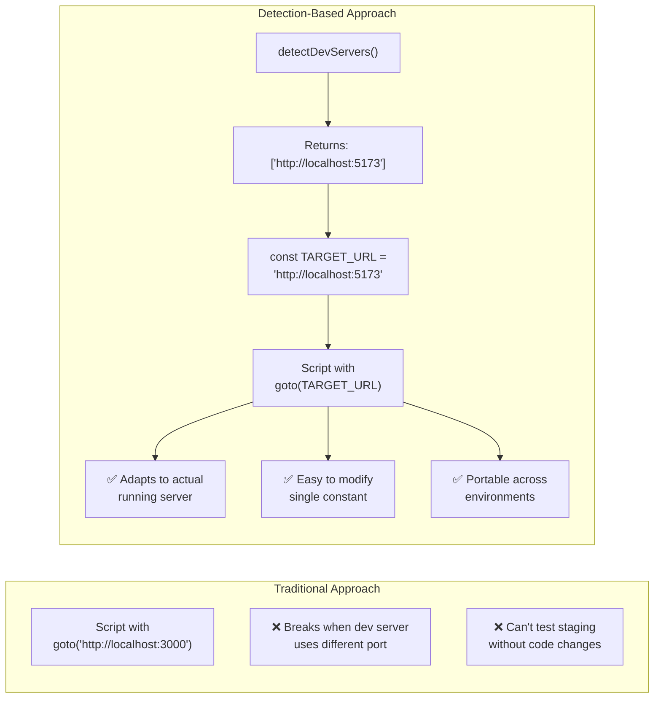
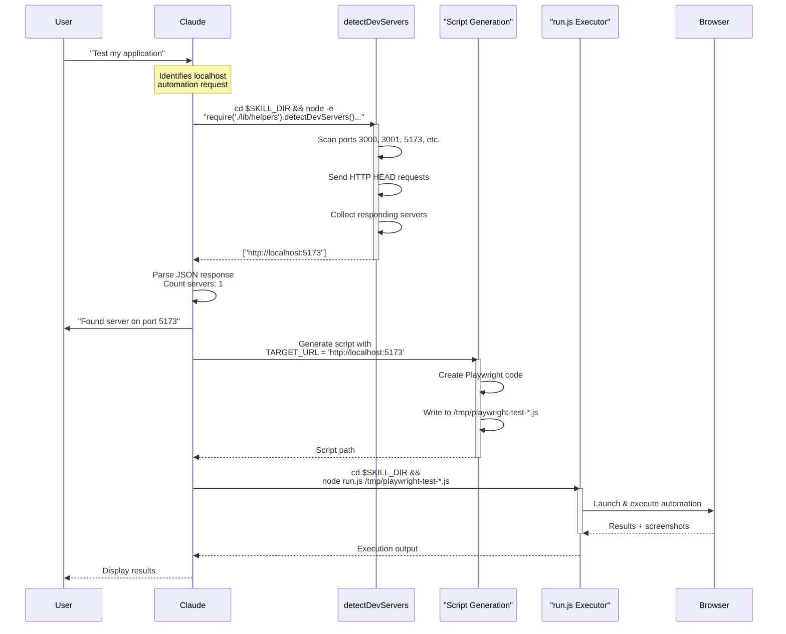

<!-- source: DeepWiki mcp.deepwiki.com · repo lackeyjb/playwright-skill · page 3.3 Dev Server Detection · fetched 2026-10-27 -->

# Dev Server Detection

<details>
<summary>Relevant source files</summary>

The following files were used as context for generating this wiki page:

- [README.md](README.md)
- [skills/playwright-skill/SKILL.md](skills/playwright-skill/SKILL.md)
- [skills/playwright-skill/lib/helpers.js](skills/playwright-skill/lib/helpers.js)

</details>


## Purpose and Scope

This document explains the auto-detection mechanism for local development servers in playwright-skill. It covers how the `detectDevServers` function works, which ports are scanned, the URL parameterization strategy, and why this prevents hardcoded URLs in automation scripts. For information about how detected servers are used in automation patterns, see [Common Automation Patterns](#5.2). For the overall workflow integration, see [Model-Invoked Pattern](#3.1).

---

## Overview

The dev server detection mechanism automatically identifies running development servers on localhost before generating automation scripts. This prevents hardcoded URLs in test code and ensures scripts target the correct environment. The detection runs as the first step in every localhost-based automation workflow, scanning common development server ports using HTTP HEAD requests.

The system returns a JSON array of detected server URLs that Claude uses to:
- Auto-select the target when exactly one server is found
- Prompt the user to choose when multiple servers are detected
- Request a URL from the user when no servers are found

This approach ensures automation scripts are portable and adaptable to different development environments.

Sources: [skills/playwright-skill/SKILL.md:21-29](), [skills/playwright-skill/lib/helpers.js:331-381]()

---

## The detectDevServers Function

### Function Signature and Location

The `detectDevServers` function is implemented in [skills/playwright-skill/lib/helpers.js:335-381]() and exported as part of the helpers module.

```javascript
async function detectDevServers(customPorts = [])
```

**Parameters:**
- `customPorts` (Array<number>): Optional additional ports to check beyond the common defaults

**Returns:**
- `Promise<Array<string>>`: Array of detected server URLs in format `http://localhost:PORT`

### Detection Algorithm

The function uses Node.js's built-in `http` module to send HEAD requests to each port:

1. Merges common ports with any custom ports (removing duplicates)
2. Iterates through all ports sequentially
3. Sends HTTP HEAD request to `http://localhost:PORT/` with 500ms timeout
4. Considers a server "detected" if response status code is less than 500
5. Logs each detection with console output
6. Returns array of all detected server URLs

**Detection Flow Diagram**



Sources: [skills/playwright-skill/lib/helpers.js:335-381]()

### HTTP Request Configuration

The HEAD request is configured with specific parameters to ensure fast, non-intrusive detection:

| Parameter | Value | Purpose |
|-----------|-------|---------|
| `method` | `'HEAD'` | Minimal overhead, no response body |
| `hostname` | `'localhost'` | Only check local development servers |
| `path` | `'/'` | Root path to verify server is responding |
| `timeout` | `500ms` | Fast timeout to avoid blocking on unresponsive ports |

**Status Code Interpretation:**

- **< 500**: Server is running and responding (even 404 indicates a working server)
- **≥ 500**: Server error, not considered "detected"
- **No response/timeout**: Port not in use or firewalled

Sources: [skills/playwright-skill/lib/helpers.js:348-369]()

---

## Common Ports Scanned

### Default Port List

The function scans 10 common development server ports by default, defined in [skills/playwright-skill/lib/helpers.js:339]():

```javascript
const commonPorts = [3000, 3001, 3002, 5173, 8080, 8000, 4200, 5000, 9000, 1234];
```

### Port-to-Framework Mapping

| Port | Common Framework/Tool | Notes |
|------|----------------------|-------|
| 3000 | Create React App, Next.js | Most common React development port |
| 3001 | Secondary React/Node instance | Often used when 3000 is occupied |
| 3002 | Tertiary instance | Third alternative port |
| 5173 | Vite | Default Vite dev server port (v3+) |
| 8080 | Vue CLI, Spring Boot, Tomcat | Common Java/Vue development port |
| 8000 | Django, Python HTTP server | Python web framework default |
| 4200 | Angular CLI | Default Angular development port |
| 5000 | Flask, ASP.NET Core | Python Flask and .NET default |
| 9000 | Play Framework | Scala/Java Play framework |
| 1234 | Parcel | Parcel bundler default |

**Port-Framework Association Diagram**



Sources: [skills/playwright-skill/lib/helpers.js:339](), [README.md:10-16](), [skills/playwright-skill/SKILL.md:23-29]()

### Custom Port Support

Additional ports can be passed via the `customPorts` parameter:

```javascript
const servers = await detectDevServers([7000, 7001]);
// Will check: 3000, 3001, 3002, 5173, 8080, 8000, 4200, 5000, 9000, 1234, 7000, 7001
```

The function uses `Set` to eliminate duplicates when merging port lists [skills/playwright-skill/lib/helpers.js:340]().

Sources: [skills/playwright-skill/lib/helpers.js:340]()

---

## Integration with Claude Workflow

### Command Execution Pattern

Claude executes the detection function using Node.js inline evaluation from the skill directory:

```bash
cd $SKILL_DIR && node -e "require('./lib/helpers').detectDevServers().then(servers => console.log(JSON.stringify(servers)))"
```

This command pattern:
- Changes to the skill directory for proper module resolution
- Requires the helpers module inline
- Calls `detectDevServers()` and awaits the promise
- Outputs results as JSON for programmatic parsing

Sources: [skills/playwright-skill/SKILL.md:24-26](), [skills/playwright-skill/SKILL.md:60]()

### Response Handling Logic

The workflow defines three scenarios based on detection results:

**Claude's Decision Tree**



Sources: [skills/playwright-skill/SKILL.md:27-29](), [skills/playwright-skill/SKILL.md:369-397]()

### Example Interaction Flows

**Flow 1: Single Server Auto-Selection**

```
User: "Test if the homepage loads"

Claude: I'll test the homepage. Let me detect running servers...
[Executes: detectDevServers()]
[Output: ["http://localhost:3001"]]

I found your dev server running on http://localhost:3001

[Generates script with TARGET_URL = 'http://localhost:3001']
[Writes to /tmp/playwright-test-homepage.js]
[Executes: cd $SKILL_DIR && node run.js /tmp/playwright-test-homepage.js]
```

**Flow 2: Multiple Servers - User Selection**

```
User: "Check if login works"

Claude: I'll test the login flow. First, let me check for running servers...
[Executes: detectDevServers()]
[Output: ["http://localhost:3000", "http://localhost:3001"]]

I found 2 dev servers. Which one should I test?
- http://localhost:3000
- http://localhost:3001

User: "Use 3001"

[Generates script with TARGET_URL = 'http://localhost:3001']
```

Sources: [skills/playwright-skill/SKILL.md:369-397]()

---

## URL Parameterization Strategy

### The TARGET_URL Pattern

Once a server is detected or specified, Claude generates automation scripts with the URL as a configurable constant at the top of the file:

```javascript
// /tmp/playwright-test-example.js
const { chromium } = require('playwright');

// Parameterized URL (detected or user-provided)
const TARGET_URL = 'http://localhost:3001';

(async () => {
  const browser = await chromium.launch({ headless: false });
  const page = await browser.newPage();
  
  await page.goto(TARGET_URL);
  // ... rest of automation
})();
```

This pattern appears consistently throughout the example scripts in [skills/playwright-skill/SKILL.md:64-275]().

Sources: [skills/playwright-skill/SKILL.md:69-70](), [skills/playwright-skill/SKILL.md:100](), [skills/playwright-skill/SKILL.md:126]()

### Benefits of URL Parameterization

**Why This Prevents Hardcoded URLs**

| Problem with Hardcoded URLs | Solution via Detection + Parameterization |
|------------------------------|-------------------------------------------|
| Scripts break when port changes | URL is detected at runtime, always current |
| Can't share scripts across environments | TARGET_URL is reconfigured per execution |
| Must manually edit scripts to test different instances | Detection automatically finds what's running |
| Easy to accidentally test wrong environment | User explicitly selects from detected options |
| Scripts become environment-specific | Scripts remain portable and reusable |

**Parameterization in Practice**



Sources: [skills/playwright-skill/SKILL.md:34](), [skills/playwright-skill/SKILL.md:340]()

### Path Concatenation Pattern

The `TARGET_URL` constant enables clean path concatenation for testing multiple pages:

```javascript
const TARGET_URL = 'http://localhost:3001';

await page.goto(`${TARGET_URL}/login`);
await page.goto(`${TARGET_URL}/dashboard`);
await page.goto(`${TARGET_URL}/settings`);
```

This pattern is demonstrated in the login flow example [skills/playwright-skill/SKILL.md:132]() and form submission example [skills/playwright-skill/SKILL.md:158]().

Sources: [skills/playwright-skill/SKILL.md:132](), [skills/playwright-skill/SKILL.md:158]()

---

## Detection as Critical First Step

### Workflow Order Enforcement

The SKILL.md file explicitly defines detection as the **first step** in the critical workflow [skills/playwright-skill/SKILL.md:21-22]():

```
**CRITICAL WORKFLOW - Follow these steps in order:**

1. **Auto-detect dev servers** - For localhost testing, ALWAYS run server detection FIRST
```

This ordering is reinforced throughout the documentation:
- Listed as step 1 in the execution pattern [skills/playwright-skill/SKILL.md:57]()
- Required before writing scripts [skills/playwright-skill/SKILL.md:31]()
- Emphasized in tips section [skills/playwright-skill/SKILL.md:341]()

**Workflow Sequence Diagram**



Sources: [skills/playwright-skill/SKILL.md:21-29](), [skills/playwright-skill/SKILL.md:57-90]()

---

## Error Handling and Edge Cases

### Timeout and Error Handling

The detection function handles various error scenarios gracefully:

**Error Handling Strategy**

| Error Type | Handling | Behavior |
|------------|----------|----------|
| Connection timeout (> 500ms) | `req.on('timeout')` listener | Destroys request, resolves promise, continues to next port |
| Connection refused | `req.on('error')` listener | Resolves promise silently, continues to next port |
| HTTP error (status ≥ 500) | Status code check | Does not add to `detectedServers`, continues |
| Exception during request | try-catch block | Catches silently, continues to next port |

All error paths lead to continuing the port scan rather than failing the entire detection process [skills/playwright-skill/lib/helpers.js:362-373]().

Sources: [skills/playwright-skill/lib/helpers.js:362-373]()

### No Servers Detected

When `detectedServers.length === 0`, the function:
1. Logs: `❌ No dev servers detected` [skills/playwright-skill/lib/helpers.js:376-378]()
2. Returns empty array `[]`
3. Claude then prompts user for URL or offers to help start a dev server [skills/playwright-skill/SKILL.md:29]()

Sources: [skills/playwright-skill/lib/helpers.js:376-378](), [skills/playwright-skill/SKILL.md:29]()

### Port Already Bound

If a port is bound but not responding to HTTP requests (e.g., non-HTTP service), the detection will timeout and skip that port. This prevents false positives from services like:
- Database servers (PostgreSQL on 5432)
- Redis (6379)
- Other non-HTTP services

Sources: [skills/playwright-skill/lib/helpers.js:348-369]()

---

## Module Export and Usage

### Export Pattern

The `detectDevServers` function is exported as part of the helpers module object [skills/playwright-skill/lib/helpers.js:383-398]():

```javascript
module.exports = {
  launchBrowser,
  createPage,
  waitForPageReady,
  safeClick,
  safeType,
  extractTexts,
  takeScreenshot,
  authenticate,
  scrollPage,
  extractTableData,
  handleCookieBanner,
  retryWithBackoff,
  createContext,
  detectDevServers  // Exported here
};
```

### Usage Examples from SKILL.md

**Command-line usage:**
```bash
cd $SKILL_DIR && node -e "require('./lib/helpers').detectDevServers().then(servers => console.log(JSON.stringify(servers)))"
```

**In automation scripts:**
```javascript
const helpers = require('./lib/helpers');

const servers = await helpers.detectDevServers();
console.log('Found servers:', servers);
```

**With custom ports:**
```javascript
const servers = await helpers.detectDevServers([7000, 7001, 8888]);
```

Sources: [skills/playwright-skill/SKILL.md:24-26](), [skills/playwright-skill/SKILL.md:304-306](), [skills/playwright-skill/lib/helpers.js:383-398]()

---

## Summary

The dev server detection mechanism is a critical component of playwright-skill's architecture that:

1. **Eliminates hardcoded URLs** by detecting what's actually running at execution time
2. **Scans 10 common ports** covering major JavaScript, Python, Java, and .NET frameworks
3. **Uses HTTP HEAD requests** with 500ms timeouts for fast, non-intrusive detection
4. **Integrates with Claude's workflow** as the mandatory first step for localhost automation
5. **Enables URL parameterization** through the `TARGET_URL` constant pattern
6. **Handles multiple servers** by prompting user selection when ambiguous
7. **Fails gracefully** with clear messaging and fallback to manual URL input

This design ensures automation scripts are portable, adaptable, and free from environment-specific hardcoded values.

Sources: [skills/playwright-skill/lib/helpers.js:331-381](), [skills/playwright-skill/SKILL.md:21-34](), [README.md:10-16]()

---

